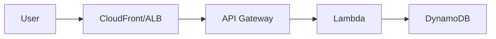
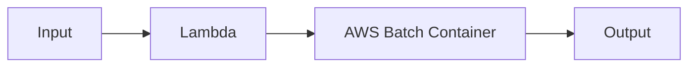

# VAMS Documentation Development Workflow & Rules

This document provides comprehensive guidelines for creating, updating, and maintaining VAMS documentation. Follow these rules to ensure consistency, accuracy, and quality across all documentation pages.

> **Steering Document Sync (bidirectional):** This document mirrors the Claude Code steering in `documentation/CLAUDE.md` (and cross-cutting rules in the root `CLAUDE.md`). Whenever you change a rule, pattern, or convention here, make the equivalent change in `documentation/CLAUDE.md` in the same change — and whenever those `CLAUDE.md` files change, reflect it back here. Keep the two sets of documents saying the same thing.

> **Add-on steering:** an add-on's own steering lives in `.kiro/steering/ADDON_*.md` (`inclusion: fileMatch`), which loads when you edit that add-on's files; this document covers core and the lanes an add-on plugs into.

## 🏗️ **Architecture Overview**

### **Documentation Framework**

| Component             | Technology                                 | Purpose                              |
| --------------------- | ------------------------------------------ | ------------------------------------ |
| Static site generator | Docusaurus 3.x (React-based SSG)           | Markdown to static HTML              |
| Language              | TypeScript                                 | Config files and custom components   |
| Markdown format       | CommonMark (`.md`) with `format: 'detect'` | Standard Markdown (not MDX) for docs |
| Diagrams              | @docusaurus/theme-mermaid                  | Mermaid diagrams in code blocks      |
| Theme                 | GitHub Docs inspired                       | Custom CSS in `src/css/custom.css`   |
| Deployment            | GitLab Pages + GitHub Pages                | CI/CD automated deployment           |

### **File Structure Standards**

```
documentation/
├── CLAUDE.md                        # Documentation steering document
├── VAMS_API.yaml                    # OpenAPI specification for all endpoints
├── diagrams/                        # Architecture diagrams (exported PNGs and JPEGs; draw.io sources in source/drawio/, see Rule 10; main architecture diagram source in source/designinspector/; JPEG diagrams' PowerPoint deck in source/powerpoint/)
├── permissionsTemplates/            # Permission constraint JSON templates
└── docusaurus-site/
    ├── docusaurus.config.ts         # Docusaurus configuration
    ├── sidebars.ts                  # Sidebar navigation structure
    ├── package.json                 # npm dependencies
    ├── src/
    │   └── css/
    │       └── custom.css           # Custom theme CSS
    ├── static/
    │   └── img/                     # Static images referenced in docs
    └── docs/                        # Source Markdown and MDX pages, each listed in sidebars.ts
        ├── index.mdx                # Landing page
        ├── overview/                # Solution overview, benefits, use cases, features, costs
        ├── concepts/                # Core concepts: databases, assets, files, pipelines, metadata, permissions
        ├── architecture/            # Architecture overview, details, AWS resources, security, networking, data model
        ├── deployment/              # Prerequisites, deploy, config reference, external S3, update, uninstall
        ├── user-guide/              # Getting started, web UI, upload tutorial, asset mgmt, search, metadata, permissions
        ├── cli/                     # CLI getting started, installation, command reference, automation
        ├── pipelines/               # Pipeline overview, one page per built-in pipeline family, custom pipeline guide, v2.5-to-v2.6 migration guide
        ├── developer/               # Dev setup, backend, frontend, CDK, viewer plugins, audit logging, fork extension points, add-ons overview
        │   └── <addon>/             # One folder per add-on with several pages (overview, enablement, user guide, resources, uninstall, CLI), in the sidebar's Add-ons category
        ├── api/                     # API overview, auth, assets, files, metadata, search, pipelines, workflows, tags
        ├── troubleshooting/         # Common issues, known limitations, FAQ
        └── additional/              # Quotas, partner integrations, viewer plugins ref, notices, revisions
```

### **Navigation Structure (sidebars.ts)**

The sidebar uses a hierarchical tree with collapsible categories:

```
Home (index.mdx)
├── Overview
├── Core Concepts
├── Architecture
├── Deployment
├── User Guide
├── Developer Guide
│   ├── Setup, Agentic Development, Backend, Frontend, CDK, OpenSearch, Viewer Plugins, Audit Logging, Security, Permissions, Extending VAMS in a Fork, Workflow Execution Data Model
│   ├── Data Syncing
│   ├── Addons
│   ├── Pipelines
│   ├── CLI Reference (with Command Details and Troubleshooting subcategories)
│   ├── API Reference
│   ├── Utilities
│   ├── External Tool Integrations
│   └── Troubleshooting
└── Additional
```

---

## 📋 **Development Workflow Checklist**

### **Phase 1: Pre-Implementation**

-   [ ] **Identify scope**: Determine which documentation pages need creating or updating
-   [ ] **Cross-reference source code**: Check relevant source files for accuracy (see Key Files table below)
-   [ ] **Check existing content**: Avoid duplicating content already on another page
-   [ ] **Plan sidebar placement**: Determine where new pages belong in `sidebars.ts`
-   [ ] **Gather screenshots/diagrams**: Prepare any visual assets needed

### **Phase 2: Implementation**

#### **Step 1: Write or Update Content**

-   [ ] **Follow writing style**: AWS documentation standards (see Writing Style Rules)
-   [ ] **Use Docusaurus admonitions**: `:::note`, `:::tip`, `:::warning`, `:::danger`, `:::info`
-   [ ] **Include code blocks**: With language tags (`bash`, `python`, `typescript`, `json`)
-   [ ] **Add cross-references**: Use relative links `[Page Title](../section/page.md)`
-   [ ] **Escape curly braces**: Use `\{variable\}` outside code blocks
-   [ ] **Add frontmatter**: Include `title`, `sidebar_label`, `description` where needed

#### **Step 2: Update Navigation**

-   [ ] **Update sidebars.ts**: Add new pages to the correct category
-   [ ] **Verify page ordering**: Ensure logical flow within sections
-   [ ] **Check parent categories**: Ensure collapsible categories are correct

#### **Step 3: Add Visual Assets**

-   [ ] **Add images to static/img/**: Use descriptive file names
-   [ ] **Reference images correctly**: Use `/img/filename.png` paths
-   [ ] **Add diagrams**: Use Mermaid code blocks for flow/architecture diagrams
-   [ ] **Add architecture diagrams**: A draw.io source, three identical PNG exports and an embed in the section the diagram illustrates (see Rule 10)

### **Phase 3: Quality Assurance**

#### **Step 4: Build and Verify**

-   [ ] **Run local build**: `cd documentation/docusaurus-site && npm run build`
-   [ ] **Check for broken links**: Build output reports broken references
-   [ ] **Preview locally**: `npm run start` and verify rendering
-   [ ] **Verify admonitions**: Ensure `:::` syntax renders correctly
-   [ ] **Check code blocks**: Verify syntax highlighting and accuracy

#### **Step 5: Cross-Reference Accuracy**

-   [ ] **Verify against source code**: Configuration options match `config.ts`
-   [ ] **Verify API endpoints**: Match `backend/backend/common/apiRoutes.py` (`ALL_API_ROUTES`), then the registrations, which are every `attachFunctionToApi(` call under `infra/lib/` and the two direct `registry.register(` calls in `rest-api-gateway-construct.ts`, and `VAMS_API.yaml`. A fixed list of stacks misses routes: new endpoints go in `apiBuilder2`, the search stack and add-on stacks such as the Physna one register their own, and an add-on's routes are registered only when the add-on is enabled and are documented in `api/addon.md`. `infra/test/api/apiRouteBackendCdkParity.test.ts` checks the registrations against `apiRoutes.py`
-   [ ] **Verify CLI commands**: Match `tools/VamsCLI/vamscli/commands/`
-   [ ] **Verify feature flags**: Match `infra/common/vamsAppFeatures.ts` (core) and `infra/common/addonAppFeatures.ts` (add-on)
-   [ ] **No hardcoded versions**: Reference source of truth files instead

---

## 🚨 **Mandatory Rules**

### **Rule 1: Use Docusaurus Admonition Syntax**

Always use Docusaurus-style admonitions. NEVER use MkDocs syntax.

```markdown
<!-- CORRECT -- Docusaurus syntax -->

:::note
General information here.
:::

:::warning[Important Configuration]
Be careful when changing this setting.
:::

:::tip
This can improve performance.
:::

:::danger
This will delete all data permanently.
:::

<!-- INCORRECT -- MkDocs syntax (will NOT render) -->

!!! note
General information here.

!!! warning "Important"
Be careful.
```

### **Rule 2: Escape Curly Braces Outside Code Blocks**

MDX interprets curly braces as JSX expressions. Outside code blocks, always escape them.

```markdown
<!-- CORRECT -->

Set the value to `\{variableName\}` in the config file.

The format is `prefix-\{region\}-\{account\}`.

<!-- INCORRECT -- will cause MDX parse error -->

Set the value to {variableName} in the config file.
```

Inside code blocks (``` fenced blocks), curly braces do NOT need escaping.

### **Rule 3: Always Update sidebars.ts When Adding New Pages**

Every new documentation page MUST be added to `documentation/docusaurus-site/sidebars.ts`. A page not in the sidebar is effectively invisible.

```typescript
// In sidebars.ts -- add to the correct category
{
    type: "category",
    label: "Pipelines",
    items: [
        "pipelines/overview",
        "pipelines/new-pipeline-page",  // <-- Add new page here
        // ... existing items
    ],
},
```

### **Rule 4: Do Not Duplicate Content -- Link to Authoritative Page**

Each concept should have ONE authoritative page. Other pages should link to it rather than restating the information.

```markdown
<!-- CORRECT -- link to the authoritative page -->

For details on configuring permissions, see [Permissions Model](../concepts/permissions-model.md).

<!-- INCORRECT -- duplicating content from another page -->

## Permissions

The VAMS permission system uses two tiers: API-level and Object-level...
(paragraphs of content already on permissions-model.md)
```

### **Rule 5: Do Not Hardcode Version Numbers**

Never hardcode VAMS version numbers, Python versions, or CDK versions in documentation. Reference the source of truth.

```markdown
<!-- CORRECT -->

The current VAMS version is defined in `infra/config/config.ts`.
VAMS backend Lambdas use Python 3.12 (defined in `LAMBDA_PYTHON_RUNTIME`).

<!-- INCORRECT -->

VAMS requires Python 3.12.
```

### **Rule 6: Follow AWS Documentation Writing Standards**

1. **Tone**: Professional, formal, solution-focused
2. **AWS service names**: Always fully qualified ("Amazon DynamoDB" not "DynamoDB", "Amazon S3" not "S3")
3. **Paragraphs**: 2-4 sentences, concise
4. **Headings**: `##` for main sections, `###` for subsections
5. **Code blocks**: Always include language tags
6. **Tables**: Use for comparisons, feature lists, field references
7. **Never reference other AWS solutions** by name
8. **Match the surrounding page's level of detail and form**: When adding to an existing page, mirror its density and structure. If the section uses descriptive prose, describe how the behavior works rather than introducing "requirement"/"must" line-item checklists. Reserve upgrade/migration framing for the pages whose subject is a change, listed in rule 9; do not narrate "upgrades" on conceptual or architecture pages.
9. **Use present-tense framing — describe current behavior, not history**: Document what VAMS does **now**. Do not reference past behavior, version-relative changes, or how something used to work. Avoid phrasings such as "previously", "earlier releases", "no longer", "now defaults to", "used to", "as of version X", "prior to vX", "matches the historical layout", "changed from … to …", or "this used to". State the current behavior directly and, where relevant, the action the reader should take. The exceptions are the pages whose **subject is a change** — an upgrade path, a migration, or a version history — where naming versions and describing prior behavior is required rather than merely tolerated, because a reader cannot act on a migration without knowing which side of it they are on. The pages of that kind today: `deployment/update-the-solution.md` (the migration guide), `additional/revisions.md` (the document revision history), and `pipelines/migrating-pipelines-v25-to-v26.md` (the custom-pipeline porting guide). A new page of the same kind — any upgrade, migration, or version-history guide — is covered by that reasoning and belongs on the list; add it when you create it. The test is whether the page's purpose is to get the reader **across** a version boundary; a page that merely mentions a recent feature is not such a page. Everywhere else (overview, concepts, architecture, configuration reference, deployment, user guide, CLI, pipelines, API, developer, troubleshooting) must read as if the current behavior had always been the behavior.

    ```text
    # WRONG (architecture/config/reference page) — references the past
    The VPC is no longer auto-enabled. availabilityZoneCount now defaults to 2 (previously 3).

    # CORRECT — states current behavior and the action to take
    A VPC is required for these features; set app.useGlobalVpc.enabled to true. availabilityZoneCount
    defaults to 2 and must be 2 or 3.

    # ALLOWED only on a page whose subject is the change itself (see the list above)
    availabilityZoneCount now defaults to 2 (earlier releases built 3 AZs); on upgrade the unused
    third AZ subnet is removed.
    ```

    Beware two false positives when sweeping for these phrasings. **Runtime state is not history:** "files that no longer exist locally", "a previously issued presigned URL", and "a previously archived file" describe a state the system moves through, not a release change — leave them. **A version number may not be VAMS's:** "the Cosmos-Predict 2.5 models are self-contained" names a third-party model family, so a mechanical replace on a version string corrupts it. Triage by hand; this sweep cannot be scripted safely.

### **Rule 7: Include Language Tags in All Code Blocks**

Every code block must have a language specifier for proper syntax highlighting.

````markdown
<!-- CORRECT -->

```bash
cd infra && npx cdk deploy --all
```

```python
def lambda_handler(event, context):
    return {"statusCode": 200}
```

```json
{
    "enabled": true
}
```

<!-- INCORRECT -- no language tag -->

```
cd infra && npx cdk deploy --all
```
````

### **Rule 8: Use Mermaid for Diagrams Where Possible**

Prefer Mermaid code blocks for architectural and flow diagrams (maintainable in source control):

````markdown

````

Use static images from `static/img/` only for complex diagrams that Mermaid cannot express. Draw an architecture diagram that uses AWS service icons in draw.io, following Rule 10.

### **Rule 9: Use Relative Links for Cross-References**

Always use relative Markdown file paths for links between documentation pages.

```markdown
<!-- CORRECT -->

[Configuration Reference](../deployment/configuration-reference.md)
[Permissions Model](../concepts/permissions-model.md)

<!-- INCORRECT -- absolute URL -->

[Configuration Reference](https://docs.example.com/deployment/configuration-reference)

<!-- INCORRECT -- no file extension -->

[Configuration Reference](../deployment/configuration-reference)
```

### **Rule 10: Reference Images from /img/ Path**

Images in `static/img/` are served at `/img/` in the built site.

```markdown
<!-- CORRECT -->


<!-- INCORRECT -- wrong path -->


```

Architecture diagrams drawn in draw.io follow one convention, keyed by a file name such as `pipeline_usecase_isaacLab` or `addon_<addon>_<view>`:

-   **Source**: `documentation/diagrams/source/drawio/<key>.drawio`, saved as uncompressed XML (the file contains `<mxGraphModel>`), drawn with the AWS 2026 icons (`mxgraph.aws4` shapes), with numbered badges on the flow and a description panel that explains each number, as in `pipeline_usecase_isaacLab.drawio`.
-   **Export**: one PNG with identical bytes in `documentation/diagrams/<key>.png`, `documentation/docusaurus-site/static/img/<key>.png` (served as `/img/<key>.png`) and `documentation/docusaurus-site/docs/assets/images/diagrams/<key>.png`. Re-export and copy all three when the source changes.
-   **Embed**: `` inside the section the diagram illustrates, ahead of that section's subsections and of any Mermaid block in it: directly under the heading, or after the text that introduces the section.
-   **Overview**: an all-up overview diagram of a feature, such as `addon_<addon>_overview`, instead follows the main VAMS architecture diagram (`Commercial-GovCloud-VAMS_Architecture`): large icons and labelled flows, without numbered badges or a description panel. It is embedded where the feature is introduced, and the feature's detail diagrams stay in the sections they illustrate. A variant for black backgrounds, keyed `<key>_dark`, has the same cells and labels on a black canvas with light text and lines, follows the same source and export convention, and is not embedded.
-   **Ownership and labels**: a diagram of a feature or add-on keeps only what every VAMS deployment already has inside `AWS VAMS (Existing)`, draws what the feature adds outside that box, and gives an external system it integrates its own labelled box; an addition to an existing resource, such as new routes or a new bucket prefix, is an edge label rather than a new node inside `AWS VAMS (Existing)`. Icon labels are the service's full name, with its AWS or Amazon prefix, and a short functional name, without handler, resource or configuration names, as in `Commercial-GovCloud-VAMS_Architecture` and `pipeline_usecase_isaacLab`.

```markdown
## Architecture


```

### **Rule 11: Do Not Use HTML Directly in Markdown**

Use standard Markdown or Docusaurus components instead of raw HTML.

```markdown
<!-- CORRECT -->

**Bold text** and _italic text_

| Column 1 | Column 2 |
| -------- | -------- |
| Data     | Data     |

<!-- INCORRECT -->

<b>Bold text</b> and <i>italic text</i>

<table><tr><td>Data</td></tr></table>
```

### **Rule 12: Update Steering Files When Documentation Standards Change**

When documentation standards, patterns, or structure change, update all affected locations:

1. `documentation/CLAUDE.md` -- documentation steering document
2. `.kiro/steering/DOCUMENTATION_WORKFLOW.md` -- this file
3. The documentation-related Claude Code skills `.claude/commands/update-docs.md` and `.claude/commands/verify-docs.md`, which restate the writing style and source-to-doc mappings (see root `CLAUDE.md` Rule 12)
4. An add-on's `.kiro/steering/ADDON_*.md` file and its own `CLAUDE.md` files, when the change touches that add-on's pages

---

### **Rule 13: A Pipeline With Selectable Models or Stages Carries an Options Page, Kept Current**

Where a pipeline offers a choice -- which model generates, which stages run, which combinations produce
colour -- the reference page mapping those choices is a maintained artefact, not a one-off write-up. It
carries the stage map, every option each stage takes, the combinations that interact, the licence of each
component, and what has actually been measured.

`documentation/docusaurus-site/docs/pipelines/image-to-3d-options.md` is the worked example. Update it in
the same change as:

-   a new or removed model, or a change to what a model produces
-   a new template tag, a changed default, or a changed enum
-   a new stage, or a change to the stage ORDER (the order is load-bearing in that pipeline)
-   a new dependency carrying its own licence, especially a use-limited one
-   a recorded benchmark round, and any selection guidance drawn from it

A stale matrix is worse than none, because it is read as the list of what is possible. Mirrors the Rule 11
row in the root `CLAUDE.md`.

## 📋 **When to Update Documentation**

| Change Type                                      | Documentation to Update                                                                                                                                                                                                                                                                                                                                                                                                                                                                                                                                                                                                                                                                                                                                                                                                                                                                                                                                                                                                                                                                                                                                                                                                                                                                                                                                                                                                                                                                                                                                                                                                                                                                                                                                                                                                                                                                                                                                         |
| ------------------------------------------------ | --------------------------------------------------------------------------------------------------------------------------------------------------------------------------------------------------------------------------------------------------------------------------------------------------------------------------------------------------------------------------------------------------------------------------------------------------------------------------------------------------------------------------------------------------------------------------------------------------------------------------------------------------------------------------------------------------------------------------------------------------------------------------------------------------------------------------------------------------------------------------------------------------------------------------------------------------------------------------------------------------------------------------------------------------------------------------------------------------------------------------------------------------------------------------------------------------------------------------------------------------------------------------------------------------------------------------------------------------------------------------------------------------------------------------------------------------------------------------------------------------------------------------------------------------------------------------------------------------------------------------------------------------------------------------------------------------------------------------------------------------------------------------------------------------------------------------------------------------------------------------------------------------------------------------------------------------------------- |
| New or changed API endpoint (incl. path renames) | **Both** the OpenAPI spec `VAMS_API.yaml` **and** the matching Docusaurus reference page under `api/` (e.g. `api/auth.md` for `/auth/*`) -- these are two separate sources of truth and both must be kept in sync. Also `cli/command-reference.md` if the CLI changed.                                                                                                                                                                                                                                                                                                                                                                                                                                                                                                                                                                                                                                                                                                                                                                                                                                                                                                                                                                                                                                                                                                                                                                                                                                                                                                                                                                                                                                                                                                                                                                                                                                                                                          |
| New config option                                | `deployment/configuration-reference.md` + the **ConfigBuilder** component (`src/components/ConfigBuilder/`, embedded in `deployment/config-builder.mdx`) -- then run `infra/test/config/configBuilderSync.test.ts`                                                                                                                                                                                                                                                                                                                                                                                                                                                                                                                                                                                                                                                                                                                                                                                                                                                                                                                                                                                                                                                                                                                                                                                                                                                                                                                                                                                                                                                                                                                                                                                                                                                                                                                                              |
| New/changed pipeline                             | `pipelines/` new page + `pipelines/overview.md` table + `sidebars.ts`; `overview/features.md` table **and its spelled-out built-in-pipeline count** (bump _N_ in "VAMS includes _N_ built-in processing pipelines…" to match the row count); and, when the pipeline adds/changes a third-party model, base image, or licensed dependency, the license entries in **both** `additional/notices.md` (per-pipeline license paragraph + closing attribution list) and the repo-root `NOTICE.md` (per-pipeline dependency table + attribution note). Record the exact license and any required attribution string.                                                                                                                                                                                                                                                                                                                                                                                                                                                                                                                                                                                                                                                                                                                                                                                                                                                                                                                                                                                                                                                                                                                                                                                                                                                                                                                                                   |
| New viewer plugin                                | `developer/viewer-plugins.md`, `additional/viewer-plugins.md`, `overview/features.md`                                                                                                                                                                                                                                                                                                                                                                                                                                                                                                                                                                                                                                                                                                                                                                                                                                                                                                                                                                                                                                                                                                                                                                                                                                                                                                                                                                                                                                                                                                                                                                                                                                                                                                                                                                                                                                                                           |
| New DynamoDB table                               | `architecture/aws-resources.md`, `architecture/data-model.md`                                                                                                                                                                                                                                                                                                                                                                                                                                                                                                                                                                                                                                                                                                                                                                                                                                                                                                                                                                                                                                                                                                                                                                                                                                                                                                                                                                                                                                                                                                                                                                                                                                                                                                                                                                                                                                                                                                   |
| Permission model change                          | `concepts/permissions-model.md`, `user-guide/permissions.md`                                                                                                                                                                                                                                                                                                                                                                                                                                                                                                                                                                                                                                                                                                                                                                                                                                                                                                                                                                                                                                                                                                                                                                                                                                                                                                                                                                                                                                                                                                                                                                                                                                                                                                                                                                                                                                                                                                    |
| New or reclassified add-on                       | `developer/addons-overview.md` (definition and add-on table), the add-on's own page in the sidebar's Add-ons category (a `developer/<addon>/` folder when it has several: overview, enablement, user guide, resources, uninstall, and CLI commands and troubleshooting when it ships CLI commands), `deployment/configuration-reference.md` (`app.addons`) and the ConfigBuilder add-on module. Everything else about the add-on, including its web interface, how it works, resources, data model, network, security, costs, limits, teardown, troubleshooting, permission templates, feature flags and CLI, is documented only on its own pages: core user guides describe no add-on page and link once, without naming an add-on, to `developer/addons-overview.md`. Core pages carry the add-on only in registries and rule-mandated entries: the `addons-overview.md` row, the enumerations that list every add-on (`overview/features.md`, `overview/solution-overview.md`, `overview/benefits.md`, `index.mdx`, a short `additional/partner-integrations.md` entry), the `cli/command-reference.md` group row, `sidebars.ts`, `api/addon.md` and `VAMS_API.yaml` (both, per the API rule above), `deployment/configuration-reference.md`, `additional/notices.md` and the repo-root `NOTICE.md` for the third-party software it integrates, installs or builds into images, and `additional/revisions.md` with `CHANGELOG.md`. `architecture/aws-resources.md` ("Add-on Resources") and `deployment/uninstall.md` ("Pre-uninstall: add-ons") point to its resources and uninstall pages. Its draw.io diagrams follow the diagram convention (Rule 10). An add-on's docs guard tests live under `infra/test/addon/<addon>/docs/`, beside its `placement.ts` descriptor (the identifiers that mark its internals and the core pages and sections allowed to name them), which `infra/test/docs/coreDocsAddonPlacement.test.ts` applies to every core page. |
| New/changed core, add-on or custom lane file     | `developer/customizing-vams.md` (lane table in "How the Extension Points Work")                                                                                                                                                                                                                                                                                                                                                                                                                                                                                                                                                                                                                                                                                                                                                                                                                                                                                                                                                                                                                                                                                                                                                                                                                                                                                                                                                                                                                                                                                                                                                                                                                                                                                                                                                                                                                                                                                 |
| New CLI command                                  | `cli/commands/<group>.md` (the command-group page), `cli/troubleshooting/<group>.md` (if error scenarios changed), `cli/command-reference.md` (if a new group), `cli/automation.md` (if new patterns), and `sidebars.ts` (if a new page). The `cli/` section is the single source of truth — the legacy `tools/VamsCLI/docs/` is deprecated.                                                                                                                                                                                                                                                                                                                                                                                                                                                                                                                                                                                                                                                                                                                                                                                                                                                                                                                                                                                                                                                                                                                                                                                                                                                                                                                                                                                                                                                                                                                                                                                                                    |
| UI navigation change                             | `user-guide/web-interface.md`, `user-guide/getting-started.mdx`                                                                                                                                                                                                                                                                                                                                                                                                                                                                                                                                                                                                                                                                                                                                                                                                                                                                                                                                                                                                                                                                                                                                                                                                                                                                                                                                                                                                                                                                                                                                                                                                                                                                                                                                                                                                                                                                                                 |
| Breaking change                                  | `additional/revisions.md`, `deployment/update-the-solution.md`                                                                                                                                                                                                                                                                                                                                                                                                                                                                                                                                                                                                                                                                                                                                                                                                                                                                                                                                                                                                                                                                                                                                                                                                                                                                                                                                                                                                                                                                                                                                                                                                                                                                                                                                                                                                                                                                                                  |
| New feature                                      | `overview/features.md`, relevant user guide page                                                                                                                                                                                                                                                                                                                                                                                                                                                                                                                                                                                                                                                                                                                                                                                                                                                                                                                                                                                                                                                                                                                                                                                                                                                                                                                                                                                                                                                                                                                                                                                                                                                                                                                                                                                                                                                                                                                |
| New sidebar page                                 | `sidebars.ts` -- add the page to the appropriate category                                                                                                                                                                                                                                                                                                                                                                                                                                                                                                                                                                                                                                                                                                                                                                                                                                                                                                                                                                                                                                                                                                                                                                                                                                                                                                                                                                                                                                                                                                                                                                                                                                                                                                                                                                                                                                                                                                       |

> **API changes live in two places.** The VAMS API is documented in **two** independent
> sources that must always be updated together: (1) `documentation/VAMS_API.yaml` (the OpenAPI
> specification -- paths + component schemas), and (2) the human-readable Docusaurus reference
> page `documentation/docusaurus-site/docs/api/<domain>.md` (e.g. `api/auth.md`, `api/assets.md`).
> When you add, remove, rename, or change the request/response shape of an endpoint, update
> **both**. Updating only the YAML (or only the Markdown) leaves the documentation inconsistent.

---

## 🔍 **Key Files to Cross-Reference**

When writing or verifying documentation, cross-reference these source files to ensure accuracy:

| Documentation Topic                                       | Source Files                                                                                                                                                                                                                                                                                                                                                                                                                                                                                                                                                                                                                                                                                |
| --------------------------------------------------------- | ------------------------------------------------------------------------------------------------------------------------------------------------------------------------------------------------------------------------------------------------------------------------------------------------------------------------------------------------------------------------------------------------------------------------------------------------------------------------------------------------------------------------------------------------------------------------------------------------------------------------------------------------------------------------------------------- |
| Config options                                            | `infra/config/config.ts` (ConfigPublic interface)                                                                                                                                                                                                                                                                                                                                                                                                                                                                                                                                                                                                                                           |
| ConfigBuilder component (`src/components/ConfigBuilder/`) | `infra/config/config.ts` (`ConfigPublic` + `getConfig()`), `infra/config/config.template.{commercial,govcloud,eusovereign}.json` — `infra/test/config/configBuilderSync.test.ts` guards `schema.ts` and `defaults.ts` only; `validation.ts` and `derived.ts` are kept in sync by review. An add-on's config block lives in its module under `infra/config/addon/` (joined through `addonConfig.ts`), and its fields, rules, presets, VPC-requiring features and normalizations in `ConfigBuilder/addon/<addon>.ts` (joined through `ConfigBuilder/addon/index.ts`, whose `applyAddonDerived()` `applyDerived()` runs); the add-on's own steering names any normalization its module mirrors |
| API endpoints                                             | `backend/backend/common/apiRoutes.py` (`ALL_API_ROUTES`, which splices in `common/addonApiRoutes.py` and the fork-owned `custom/customApiRoutes.py`) and `VAMS_API.yaml`, then every `attachFunctionToApi(` call under `infra/lib/` (add-on routes are feature-gated and documented in `api/addon.md`) and the two `registry.register(` calls in `rest-api-gateway-construct.ts`; `infra/test/api/apiRouteBackendCdkParity.test.ts` checks them                                                                                                                                                                                                                                             |
| DynamoDB tables                                           | `infra/lib/nestedStacks/storage/storageBuilder-nestedStack.ts`                                                                                                                                                                                                                                                                                                                                                                                                                                                                                                                                                                                                                              |
| Feature flags                                             | `infra/common/vamsAppFeatures.ts` (core) and `infra/common/addonAppFeatures.ts` (add-on)                                                                                                                                                                                                                                                                                                                                                                                                                                                                                                                                                                                                    |
| Backend handlers                                          | `backend/backend/handlers/`                                                                                                                                                                                                                                                                                                                                                                                                                                                                                                                                                                                                                                                                 |
| Pydantic models                                           | `backend/backend/models/`                                                                                                                                                                                                                                                                                                                                                                                                                                                                                                                                                                                                                                                                   |
| CLI commands                                              | `tools/VamsCLI/vamscli/commands/`                                                                                                                                                                                                                                                                                                                                                                                                                                                                                                                                                                                                                                                           |
| Viewer plugins                                            | `web/src/visualizerPlugin/config/viewerConfig.json` (core) and `addonViewerConfig.json` (add-on viewers)                                                                                                                                                                                                                                                                                                                                                                                                                                                                                                                                                                                    |
| Lambda builders                                           | `infra/lib/lambdaBuilder/`                                                                                                                                                                                                                                                                                                                                                                                                                                                                                                                                                                                                                                                                  |
| Pipeline configs                                          | `infra/lib/nestedStacks/pipelines/`                                                                                                                                                                                                                                                                                                                                                                                                                                                                                                                                                                                                                                                         |
| Frontend routes                                           | `web/src/routes.tsx`                                                                                                                                                                                                                                                                                                                                                                                                                                                                                                                                                                                                                                                                        |
| Synonyms                                                  | `web/src/synonyms.tsx`                                                                                                                                                                                                                                                                                                                                                                                                                                                                                                                                                                                                                                                                      |
| Permission templates                                      | `documentation/permissionsTemplates/`                                                                                                                                                                                                                                                                                                                                                                                                                                                                                                                                                                                                                                                       |

---

## 📐 **Gold Standard Reference Files**

| Purpose                 | File                                         |
| ----------------------- | -------------------------------------------- |
| Docusaurus config       | `docusaurus-site/docusaurus.config.ts`       |
| Sidebar structure       | `docusaurus-site/sidebars.ts`                |
| Well-structured concept | `docs/concepts/permissions-model.md`         |
| Config reference format | `docs/deployment/configuration-reference.md` |
| Pipeline documentation  | `docs/pipelines/overview.md`                 |
| API reference format    | `docs/api/assets.md`                         |
| User guide format       | `docs/user-guide/getting-started.mdx`        |
| Developer setup         | `docs/developer/setup.md`                    |
| OpenAPI spec            | `VAMS_API.yaml`                              |

---

## 📝 **Writing Templates**

### **New Documentation Page Template**

````markdown
---
title: Page Title
sidebar_label: Short Label
description: Brief description for SEO and link previews.
---

# Page Title

Brief introduction paragraph (2-3 sentences) explaining what this page covers and who it is for.

## Prerequisites

:::note
List any prerequisites or prior knowledge needed.
:::

## Section Heading

Content paragraphs here. Keep to 2-4 sentences per paragraph.

### Subsection

More detailed content.

```bash
# Example command
command --flag value
```

## Configuration

| Option                | Default | Description         |
| --------------------- | ------- | ------------------- |
| `app.feature.enabled` | `false` | Enables the feature |

## Related Pages

-   [Related Page 1](../section/page1.md)
-   [Related Page 2](../section/page2.md)
````

### **New Pipeline Documentation Template**

````markdown
---
title: Pipeline Name Pipeline
sidebar_label: Pipeline Name
description: Description of what this pipeline does.
---

# Pipeline Name Pipeline

Brief overview of the pipeline purpose and capabilities.

## Overview

What the pipeline does, what inputs it takes, what outputs it produces.

## Architecture


````

## Configuration

Enable this pipeline in `infra/config/config.json`:

```json
{
    "app": {
        "pipelines": {
            "pipelineName": {
                "enabled": true
            }
        }
    }
}
```

| Option                 | Default | Description                 |
| ---------------------- | ------- | --------------------------- |
| `enabled`              | `false` | Enable the pipeline         |
| `autoRegisterWithVAMS` | `true`  | Auto-register on deployment |

## Input Requirements

Describe input file types, formats, and constraints.

## Output

Describe what the pipeline produces.

## Troubleshooting

Common issues and solutions.

````

### **New API Reference Page Template**

```markdown
---
title: Resource Name API
sidebar_label: Resource Name
description: API reference for Resource Name operations.
---

# Resource Name API

## List Resources

````

GET /database/{databaseId}/resources

````

### Parameters

| Parameter | Type | Required | Description |
| --------- | ---- | -------- | ----------- |
| `databaseId` | path | Yes | Database identifier |

### Response

```json
{
    "Items": [],
    "nextToken": "..."
}
````

## Get Resource

```
GET /database/{databaseId}/resources/{resourceId}
```

### Parameters

| Parameter    | Type | Required | Description         |
| ------------ | ---- | -------- | ------------------- |
| `databaseId` | path | Yes      | Database identifier |
| `resourceId` | path | Yes      | Resource identifier |

````

---

## 🚀 **Build Commands**

```bash
# Install dependencies
cd documentation/docusaurus-site
npm install

# Local preview with live reload
npm run start
# Opens http://localhost:3000

# Build static site (also validates links)
npm run build
# Output in documentation/docusaurus-site/build/

# Serve built site locally
npm run serve
````

### **CI/CD Deployment**

Documentation is deployed automatically via CI/CD when changes are pushed to `main` or `release/*` branches:

-   **GitLab**: `.gitlab-ci.yml` -- builds with `node:22-slim`, outputs to `public/` for GitLab Pages
-   **GitHub**: `.github/workflows/docs.yml` -- builds with `actions/setup-node@v4`, then publishes to the `gh-pages` branch with `peaceiris/actions-gh-pages` pinned to a commit SHA (v4.1.0), with `keep_files: true`, under `contents: write`. `main` publishes at the branch root; each `release/*` branch publishes to its own subdirectory named from the branch (`release/2.5.0` becomes `release-2.5.0`), which the "Determine deploy path" step passes as `destination_dir`

Both pipelines only trigger when files under `documentation/docusaurus-site/` change.

---

## 🔍 **Quality Review Checklist**

### **Content Accuracy**

-   [ ] All configuration options match `infra/config/config.ts`
-   [ ] All API endpoints match `VAMS_API.yaml` and route definitions
-   [ ] All CLI commands match current `tools/VamsCLI/vamscli/commands/`
-   [ ] Feature flags match `infra/common/vamsAppFeatures.ts`
-   [ ] No hardcoded version numbers
-   [ ] AWS service names fully qualified

### **Formatting Compliance**

-   [ ] Docusaurus admonition syntax used (not MkDocs)
-   [ ] Curly braces escaped outside code blocks
-   [ ] All code blocks have language tags
-   [ ] Images reference `/img/` path
-   [ ] Cross-references use relative Markdown links
-   [ ] No raw HTML in Markdown
-   [ ] Tables properly formatted

### **Navigation**

-   [ ] New pages added to `sidebars.ts`
-   [ ] Pages appear in correct category
-   [ ] Logical ordering within sections
-   [ ] No orphaned pages (pages not in sidebar)

### **Build Verification**

-   [ ] `npm run build` succeeds without errors
-   [ ] No broken link warnings
-   [ ] Admonitions render correctly
-   [ ] Code blocks have proper syntax highlighting
-   [ ] Mermaid diagrams render

---

## 🚫 **Anti-Patterns Summary**

1. **Using MkDocs admonition syntax** (`!!! note`) -- use Docusaurus (`:::note`)
2. **Unescaped curly braces** outside code blocks -- causes MDX parse errors
3. **Missing sidebar entries** -- new pages are invisible without `sidebars.ts` update
4. **Duplicating content** across pages -- link to the authoritative page instead
5. **Hardcoding version numbers** -- reference source of truth files
6. **Missing language tags** on code blocks -- always specify the language
7. **Using raw HTML** in Markdown -- use Markdown or Docusaurus components
8. **Referencing other AWS solutions** by name -- VAMS documentation is standalone
9. **Using absolute URLs** for cross-references -- use relative Markdown paths
10. **Leaving placeholder pages** -- every sidebar entry must have real content
11. **Forgetting to update `sidebars.ts`** when adding new pages
12. **Using barrel imports** in any custom React components in documentation
