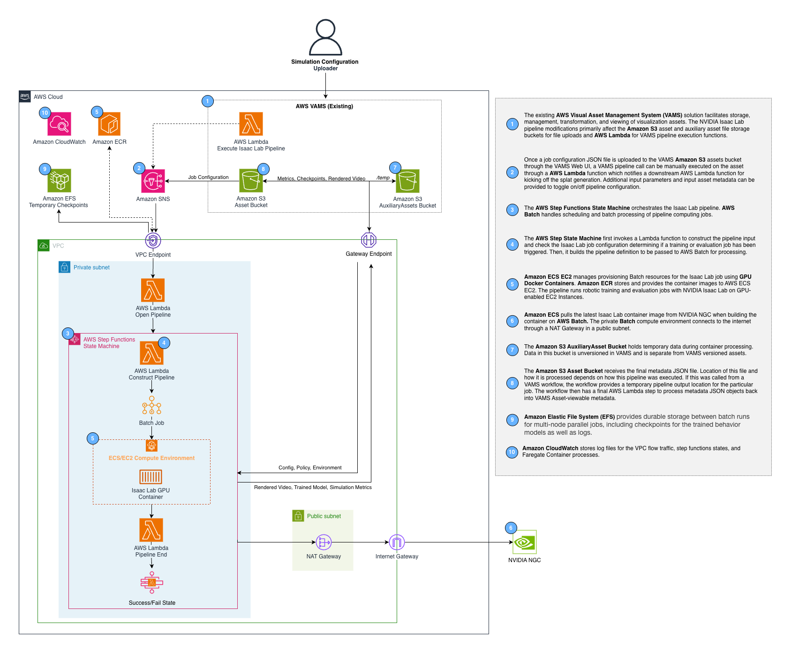

# NVIDIA Isaac Lab Simulation Pipeline

GPU-accelerated reinforcement learning training and evaluation for robotic assets using NVIDIA IsaacLab on AWS Batch.

## Overview

This pipeline enables VAMS users to:

-   **Train** RL policies for robots using GPU-accelerated simulation
-   **Evaluate** trained policies and generate video recordings

It leverages AWS Batch for scalable GPU compute with automatic checkpoint management and S3 integration.

## Architecture



### Architecture Flow

1. **AWS VAMS (Existing)** - The existing AWS Visual Asset Management System (VAMS) solution facilitates storage, management, transformation, and viewing of visualization assets. The NVIDIA Isaac Lab pipeline modifications primarily affect the Amazon S3 asset and auxiliary asset file storage buckets for file uploads and AWS Lambda for VAMS pipeline execution functions.

2. **Job Configuration Upload** - Once a job configuration JSON file is uploaded to the VAMS Amazon S3 assets bucket through the VAMS Web UI, a VAMS pipeline call can be manually executed on the asset through a AWS Lambda function which notifies a downstream AWS Lambda function for kicking off the pipeline. Additional input parameters and input asset metadata can be provided to toggle on/off pipeline configuration.

3. **AWS Step Functions State Machine** - The AWS Step Functions State Machine orchestrates the Isaac Lab pipeline. AWS Batch handles scheduling and batch processing of pipeline computing jobs.

4. **Pipeline Construction** - The AWS Step State Machine first invokes a Lambda function to construct the pipeline input and check the Isaac Lab job configuration determining if a training or evaluation job has been triggered. Then, it builds the pipeline definition to be passed to AWS Batch for processing.

5. **Batch Compute Environment** - Amazon ECS EC2 manages provisioning Batch resources for the Isaac Lab job using GPU Docker Containers. Amazon ECR stores and provides the container images to AWS ECS EC2. The pipeline runs robotic training and evaluation jobs with NVIDIA Isaac Lab on GPU-enabled EC2 instances.

6. **Container Image Pull** - Amazon ECS pulls the latest Isaac Lab container image from NVIDIA NGC when building the container on AWS Batch. The private Batch compute environment connects to the internet through a NAT Gateway in a public subnet.

7. **Auxiliary Asset Bucket** - The Amazon S3 AuxiliaryAsset Bucket holds temporary data during container processing. Data in this bucket is unversioned in VAMS and is separate from VAMS versioned assets.

8. **Asset Bucket Output** - The Amazon S3 Asset Bucket receives the final metadata JSON file. Location of this file and how it is processed depends on how this pipeline was executed. If this was called from a VAMS workflow, the workflow provides a temporary pipeline output location for the particular job. The workflow then has a final AWS Lambda step to process metadata JSON objects back into VAMS Asset-viewable metadata.

9. **Elastic File System** - Amazon Elastic File System (EFS) provides durable storage between batch runs, including checkpoints for the trained behavior models as well as logs.

10. **CloudWatch Logging** - Amazon CloudWatch stores log files for the VPC flow traffic, step functions states, and Fargate Container processes.

## Prerequisites

-   VAMS deployed with VPC enabled (`useGlobalVpc.enabled: true`)
-   AWS account with GPU instance quota (g5 or g6e instances)
-   Docker installed locally (for container development)

---

## Job Configuration Files

Isaac Lab jobs are configured using JSON files that specify the training or evaluation parameters. These config files are uploaded to VAMS as assets and used to trigger pipeline executions.

### Training Config (`*-training-config.json`)

Training configs are used to train new RL policies from scratch.

#### Schema

```json
{
  "name": "string",           // Job display name
  "description": "string",    // Job description
  "trainingConfig": {
    "mode": "train",          // Must be "train" for training jobs
    "task": "string",         // Isaac Lab task name (e.g., "Isaac-Ant-Direct")
    "numEnvs": number,        // Number of parallel environments (typically 1024-8192)
    "maxIterations": number,  // Training iterations (policy updates)
    "rlLibrary": "string",    // RL library: "rsl_rl", "rl_games", or "skrl"
    "physics": "string",      // Optional: "newton_mjwarp" (default) or "isaacsim_physx"
    "customEnvironmentPath": "string", // Optional: relative path to custom env package
    "stageAssetPaths": ["string"]      // Optional: asset files/folders downloaded before the run
  }
}
```

#### Example: Cartpole Training

Simple balancing task - good for testing the pipeline:

```json
{
    "name": "Cartpole Training Job",
    "description": "Train a PPO policy for the Isaac-Cartpole-Direct environment",
    "trainingConfig": {
        "mode": "train",
        "task": "Isaac-Cartpole-Direct",
        "numEnvs": 4096,
        "maxIterations": 500,
        "rlLibrary": "rsl_rl"
    }
}
```

#### Example: Ant Locomotion Training

Quadruped locomotion - more complex task:

```json
{
    "name": "Ant Training Job",
    "description": "Train a PPO policy for the Isaac-Ant-Direct environment",
    "trainingConfig": {
        "mode": "train",
        "task": "Isaac-Ant-Direct",
        "numEnvs": 4096,
        "maxIterations": 1000,
        "rlLibrary": "rsl_rl"
    }
}
```

#### Training Parameters Guide

These are the parameters of the JSON config file supplied with the asset. `task`, `numEnvs`,
`maxIterations`, `rlLibrary` and `seed` are also fields on the execute form, supplied by the
`isaaclab-training-cartpole` template's `TASK`, `NUM_ENVS`, `MAX_ITERATIONS`, `RL_LIBRARY` and `SEED`
tags. Wherever both name the same parameter the form's value wins. The numeric and choice fields always
carry a value, so they always decide; `SEED` is the one that can be left blank, which falls through to
the config file.

| Parameter                        | Type   | Required | Description                                                                                                                                                                                                                                                                                                                                                                        |
| -------------------------------- | ------ | -------- | ---------------------------------------------------------------------------------------------------------------------------------------------------------------------------------------------------------------------------------------------------------------------------------------------------------------------------------------------------------------------------------- |
| `name`                           | string | Yes      | Display name for the job shown in VAMS UI and logs                                                                                                                                                                                                                                                                                                                                 |
| `description`                    | string | Yes      | Human-readable description of the training job purpose                                                                                                                                                                                                                                                                                                                             |
| `trainingConfig.mode`            | string | Yes      | Must be `"train"` for training jobs                                                                                                                                                                                                                                                                                                                                                |
| `trainingConfig.task`            | string | Yes      | Isaac Lab task/environment name (e.g., `"Isaac-Ant-Direct"`, `"Isaac-Cartpole-Direct"`). Isaac Lab 3.0 ids carry no `-v0` suffix; a few saved 2.x ids are mapped, see the [CLI reference](ISAACLAB_CLI_REFERENCE.md#task-ids)                                                                                                                                                      |
| `trainingConfig.numEnvs`         | number | Yes      | Number of parallel simulation environments. Higher values = faster training but more GPU memory. Recommended: 1024-8192                                                                                                                                                                                                                                                            |
| `trainingConfig.maxIterations`   | number | Yes      | Number of policy update iterations. More iterations = longer training, potentially better policy. Recommended: 500-5000 depending on task complexity                                                                                                                                                                                                                               |
| `trainingConfig.rlLibrary`       | string | Yes      | Reinforcement learning library to use. Options: `"rsl_rl"` (recommended for locomotion), `"rl_games"`, `"skrl"`. Any other value fails the execution, naming the value and the supported set, before a GPU node is provisioned — it is not substituted                                                                                                                             |
| `trainingConfig.physics`         | string | No       | Physics engine for the run: `"newton_mjwarp"` (Newton, the default) or `"isaacsim_physx"` (PhysX on Isaac Sim, what earlier VAMS releases used). Absent or blank means Newton; any other value fails the execution before a GPU node is provisioned. Results differ between engines. Not every task offers both: see the [CLI reference](ISAACLAB_CLI_REFERENCE.md#physics-engine) |
| `trainingConfig.stageAssetPaths` | list   | No       | Files and folders of the executing asset that the container downloads into `/tmp/assets` (`VAMS_ASSET_FILES_DIR`) before the run, keeping their asset-relative paths; also accepted in evaluation configs. Limits and validation: the pipeline documentation page                                                                                                                  |

---

### Evaluation Config (`*-evaluation-config.json`)

Evaluation configs are used to evaluate trained policies and generate video recordings.

#### Schema

```json
{
  "name": "string",           // Job display name
  "description": "string",    // Job description
  "trainingConfig": {
    "mode": "evaluate",       // Must be "evaluate" for evaluation jobs
    "task": "string",         // Isaac Lab task name (must match training task)
    "checkpointPath": "string", // Relative path to checkpoint (e.g., "checkpoints/model_300.pt")
    "numEnvs": number,        // Number of parallel environments (1-16 recommended for video)
    "numEpisodes": number,    // Number of episodes to run
    "stepsPerEpisode": number,// Steps per episode (task-dependent)
    "rlLibrary": "string"     // RL library (must match training)
  }
}
```

#### Checkpoint Discovery

The pipeline supports three methods to specify the checkpoint file (in priority order):

1. **`checkpointPath`** (recommended): Relative path within the asset directory

    ```json
    "checkpointPath": "checkpoints/model_300.pt"
    ```

2. **`policyS3Uri`**: Full S3 URI to the checkpoint, which must name the executing asset's own bucket

    ```json
    "policyS3Uri": "s3://asset-bucket/asset-123/checkpoints/model_300.pt"
    ```

3. **Auto-discovery** (legacy): Place a `.pt` or `.pth` file in the asset. The newest run folder holding a checkpoint named the way the chosen `rlLibrary` names its own (`model_*.pt`, `*.pth`, `agent_*.pt`/`best_agent.pt`) wins, and within it the highest epoch, iteration or timestep

#### Example: Cartpole Evaluation with checkpointPath

```json
{
    "name": "Cartpole Evaluation Job",
    "description": "Evaluate a trained PPO policy for the Isaac-Cartpole-Direct environment",
    "trainingConfig": {
        "mode": "evaluate",
        "task": "Isaac-Cartpole-Direct",
        "checkpointPath": "checkpoints/model_499.pt",
        "numEnvs": 4,
        "numEpisodes": 10,
        "stepsPerEpisode": 500,
        "rlLibrary": "rsl_rl"
    }
}
```

#### Example: Ant Evaluation

```json
{
    "name": "Ant Evaluation Job",
    "description": "Evaluate a trained PPO policy for the Isaac-Ant-Direct environment. Videos are automatically generated and uploaded.",
    "trainingConfig": {
        "mode": "evaluate",
        "task": "Isaac-Ant-Direct",
        "checkpointPath": "checkpoints/model_1000.pt",
        "numEnvs": 4,
        "numEpisodes": 5,
        "stepsPerEpisode": 900,
        "rlLibrary": "rsl_rl"
    }
}
```

#### Example: Cartpole Evaluation (legacy auto-discovery)

This example uses auto-discovery - place a `.pt` file in the same directory as the config:

```json
{
    "name": "Cartpole Evaluation Job",
    "description": "Evaluate a trained PPO policy for the Isaac-Cartpole-Direct environment. Videos are automatically generated and uploaded.",
    "trainingConfig": {
        "mode": "evaluate",
        "task": "Isaac-Cartpole-Direct",
        "numEnvs": 4,
        "numEpisodes": 10,
        "stepsPerEpisode": 500,
        "rlLibrary": "rsl_rl"
    }
}
```

#### Evaluation Parameters Guide

These are the parameters of the JSON config file supplied with the asset. `task`, `checkpointPath`,
`numEnvs`, `numEpisodes`, `stepsPerEpisode`, `recordVideo` and `rlLibrary` are also fields on the
execute form, supplied by the `isaaclab-evaluation-cartpole` template's `TASK`, `CHECKPOINT_PATH`,
`NUM_ENVS`, `NUM_EPISODES`, `STEPS_PER_EPISODE`, `RECORD_VIDEO` and `RL_LIBRARY` tags. Wherever both
name the same parameter the form's value wins. The numeric, boolean and choice fields always carry a
value, so they always decide; `CHECKPOINT_PATH` is the one that can be left blank, which falls through
to the config file and then to auto-discovery.

| Parameter                        | Type   | Required    | Description                                                                                                                                                                                                                                                                                         |
| -------------------------------- | ------ | ----------- | --------------------------------------------------------------------------------------------------------------------------------------------------------------------------------------------------------------------------------------------------------------------------------------------------- |
| `name`                           | string | Yes         | Display name for the job shown in VAMS UI and logs                                                                                                                                                                                                                                                  |
| `description`                    | string | Yes         | Human-readable description of the evaluation job purpose                                                                                                                                                                                                                                            |
| `trainingConfig.mode`            | string | Yes         | Must be `"evaluate"` for evaluation jobs                                                                                                                                                                                                                                                            |
| `trainingConfig.task`            | string | Yes         | Isaac Lab task/environment name. Must match the task used during training                                                                                                                                                                                                                           |
| `trainingConfig.checkpointPath`  | string | Recommended | Relative path to the trained model checkpoint within the asset (e.g., `"checkpoints/model_499.pt"`)                                                                                                                                                                                                 |
| `trainingConfig.policyS3Uri`     | string | Optional    | Full S3 URI to a checkpoint inside the executing asset's own bucket                                                                                                                                                                                                                                 |
| `trainingConfig.numEnvs`         | number | Yes         | Number of parallel environments. **Keep low (1-16) for video recording to avoid out-of-memory errors**                                                                                                                                                                                              |
| `trainingConfig.numEpisodes`     | number | Yes         | Number of evaluation episodes to run. Each episode generates video frames                                                                                                                                                                                                                           |
| `trainingConfig.stepsPerEpisode` | number | Yes         | Simulation steps per episode. Task-dependent: Cartpole ~500, Ant ~900, Humanoid ~1000                                                                                                                                                                                                               |
| `trainingConfig.rlLibrary`       | string | Yes         | RL library used during training. Must match the training configuration. Options: `"rsl_rl"`, `"rl_games"`, `"skrl"`; any other value fails the execution rather than being substituted                                                                                                              |
| `trainingConfig.physics`         | string | No          | Physics engine for the evaluation: `"newton_mjwarp"` (default) or `"isaacsim_physx"`. Use the engine that trained the policy; a checkpoint from before the upgrade was trained on `isaacsim_physx`. A different engine is a transfer test and is noted in the run log and in `evaluate-config.json` |

#### Steps Per Episode by Task

| Task                  | Typical Steps/Episode | Notes           |
| --------------------- | --------------------- | --------------- |
| Isaac-Cartpole-Direct | 500                   | Short episodes  |
| Isaac-Ant-Direct      | 900                   | Medium episodes |
| Isaac-Humanoid-Direct | 1000                  | Longer episodes |

#### Video Recording

-   Videos are **automatically generated** during evaluation
-   Video length = `numEpisodes × stepsPerEpisode` frames
-   Videos are uploaded to S3 alongside evaluation results
-   **Important**: Keep `numEnvs` low (1-16) to avoid out-of-memory errors during video recording

---

## Usage Workflow

### 1. Training a New Policy

1. Create a training config JSON file
2. Upload the config file to VAMS as an asset
3. Run the `isaaclab-training` pipeline on the config asset
4. Wait for training to complete (check job status in VAMS)
5. Download the trained policy (`.pt` file) from the output asset

### 2. Evaluating a Trained Policy

1. Create an evaluation config JSON file with `checkpointPath` pointing to the trained model
2. Upload the config file to VAMS as an asset (e.g., in an `evaluation/` subdirectory)
3. Run the `isaaclab-evaluation` pipeline on the config asset
4. View the generated evaluation video in the output asset

### Checkpoint Discovery

The pipeline supports three methods to locate the checkpoint file:

| Method         | Config Field     | Example                         | Use Case                                                      |
| -------------- | ---------------- | ------------------------------- | ------------------------------------------------------------- |
| Relative path  | `checkpointPath` | `"checkpoints/model_300.pt"`    | **Recommended** - reference checkpoints within the same asset |
| Full S3 URI    | `policyS3Uri`    | `"s3://bucket/path/model.pt"`   | Absolute path inside the same asset's bucket                  |
| Auto-discovery | (none)           | Place `.pt`/`.pth` in the asset | Legacy - backward compatibility                               |

**Asset Directory Structure Example:**

```
my-training-asset/
├── training/
│   └── cartpole-training-config.json
├── evaluation/
│   └── cartpole-evaluation-config.json  ← references checkpoints/model_499.pt
└── checkpoints/
    ├── model_0.pt
    ├── model_100.pt
    └── model_499.pt
```

---

## Output Files

Pipeline outputs are organized under the job UUID for easy identification when running multiple jobs on the same asset.

### Training Output Structure

```
{asset}/
└── {job-uuid}/
    ├── checkpoints/
    │   ├── model_100.pt          # rsl_rl: model_<iteration>.pt
    │   ├── model_200.pt
    │   ├── <name>.pth            # rl_games: last_<name>_ep_<epoch>_rew__<reward>_.pth
    │   └── agent_<n>.pt          # skrl: agent_<timestep>.pt and best_agent.pt
    ├── metrics.csv           # Training metrics from TensorBoard
    ├── train-config.json     # Copy of input configuration
    └── *.txt                 # Log files
```

### Evaluation Output Structure

```
{asset}/
└── {job-uuid}/
    ├── videos/
    │   └── *.mp4             # Recorded evaluation videos
    ├── metrics.csv           # Evaluation metrics
    ├── evaluate-config.json  # Copy of input configuration
    └── *.txt                 # Log files
```

The `{job-uuid}` prefix matches the workflow execution ID, making it easy to identify outputs from different pipeline runs.

---

## Infrastructure Configuration

### config.json Settings

Add the IsaacLab training pipeline configuration to `infra/config/config.json`:

```json
{
    "app": {
        "useGlobalVpc": {
            "enabled": true,
            "useForAllLambdas": false,
            "addVpcEndpoints": true
        },
        "pipelines": {
            "useIsaacLabTraining": {
                "enabled": true,
                "acceptNvidiaEula": true,
                "autoRegisterWithVAMS": true,
                "keepWarmInstance": false,
                "instanceTypes": ["g6.4xlarge", "g6e.2xlarge", "g5.4xlarge"]
            }
        }
    }
}
```

| Setting                | Description                                                                                           |
| ---------------------- | ----------------------------------------------------------------------------------------------------- |
| `enabled`              | Enable/disable the pipeline                                                                           |
| `acceptNvidiaEula`     | Accept NVIDIA Software License Agreement (required)                                                   |
| `autoRegisterWithVAMS` | Auto-register pipelines with VAMS on deployment                                                       |
| `keepWarmInstance`     | Keep 1 GPU instance warm to avoid cold starts                                                         |
| `instanceTypes`        | GPU instance types the compute environment may use (default: 11 single-GPU G5, G6, GR6 and G6E types) |

### Optimizing Container Pull Times

The Isaac Lab container image is ~10GB. The first AWS Batch job may take 5-10 minutes to pull the image. For faster subsequent job startup:

1. **Keep warm instances**: Set `keepWarmInstance: true` to keep instances running
2. **Pre-bake AMI**: Create a custom AMI with the container image pre-cached
3. **Larger EBS volumes**: The pipeline uses 100GB EBS volumes with Docker layer caching

Note: ECR pull-through cache is **not supported** for NVIDIA NGC (nvcr.io).

---

## Supported Tasks

| Task                         | Description              | Complexity | Training Time (1 GPU) |
| ---------------------------- | ------------------------ | ---------- | --------------------- |
| Isaac-Cartpole-Direct        | Cartpole balancing       | Low        | 2-5 min               |
| Isaac-Ant-Direct             | Quadruped locomotion     | Medium     | 15-30 min             |
| Isaac-Humanoid-Direct        | Humanoid locomotion      | High       | 1-2 hrs               |
| Isaac-Velocity-Flat-AnymalD  | Anymal quadruped (flat)  | Medium     | 10-15 min             |
| Isaac-Velocity-Rough-AnymalD | Anymal quadruped (rough) | High       | 1-2 hrs               |

## Instance Types

One job asks for 8 vCPUs, 32,768 MiB and 1 GPU, and every type in `instanceTypes` must be able to run it: one NVIDIA GPU with RT cores and 16 GB or more of video memory, at least 8 vCPUs, and more registered memory than 32,768 MiB. `g5.2xlarge` and `g6.2xlarge` (32 GiB installed) and multi-GPU sizes are rejected when the configuration loads. See the [Isaac Lab pipeline documentation](../../../documentation/docusaurus-site/docs/pipelines/nvidia-isaac-lab.md#instance-types) for the default list.

| Instance    | GPUs    | VRAM | Use Case                           |
| ----------- | ------- | ---- | ---------------------------------- |
| g6.4xlarge  | 1x L4   | 24GB | Development, evaluation            |
| g5.4xlarge  | 1x A10G | 24GB | Single-node training               |
| g6e.2xlarge | 1x L40S | 48GB | Large-scale training               |
| g6e.8xlarge | 1x L40S | 48GB | Large-scale training, more CPU/RAM |

---

## Troubleshooting

### Out of Memory (OOM) during Evaluation

**Symptom**: Job fails with "OutOfMemoryError: Container killed due to memory usage"

**Solution**: Reduce `numEnvs` in evaluation config to 1-16. Video recording requires significant memory.

### Container fails to start

-   Verify NVIDIA drivers are available on Batch compute instances
-   Check CloudWatch logs: `/aws/batch/job`

### Training job times out

-   A training run is limited to 8 hours, including the wait for a GPU instance and the image pull; an evaluation to 4 hours, of which playback itself is limited to at most 110 minutes
-   Consider using more GPUs or reducing `maxIterations`

---

## Directory Structure

```
isaacLabTraining/
├── README.md                    # This file (quick reference)
├── USER_GUIDE.md               # Detailed user guide
├── ISAACLAB_CLI_REFERENCE.md   # Isaac Lab CLI reference
├── container/                   # Docker container
│   ├── Dockerfile
│   ├── __main__.py             # Main entry point
│   ├── entrypoint.sh
│   └── utils/
│       ├── aws/s3.py           # S3 utilities
│       ├── aws/staging.py      # Asset files staged before the run (stageAssetPaths)
│       └── training/config.py  # Config parsing
└── lambda/                      # AWS Lambda functions
    ├── openPipeline.py         # Parse config, prepare job
    ├── executeBatchJob.py      # Submit Batch job
    ├── closePipeline.py        # Handle completion
    ├── handleError.py          # Handle failures
    └── vamsExecuteIsaacLabPipeline.py  # VAMS entry point
```

## References

-   [User Guide](./USER_GUIDE.md)
-   [Isaac Lab Documentation](https://isaac-sim.github.io/IsaacLab/)
-   [Isaac Lab Docker Guide](https://isaac-sim.github.io/IsaacLab/main/source/deployment/docker.html)
