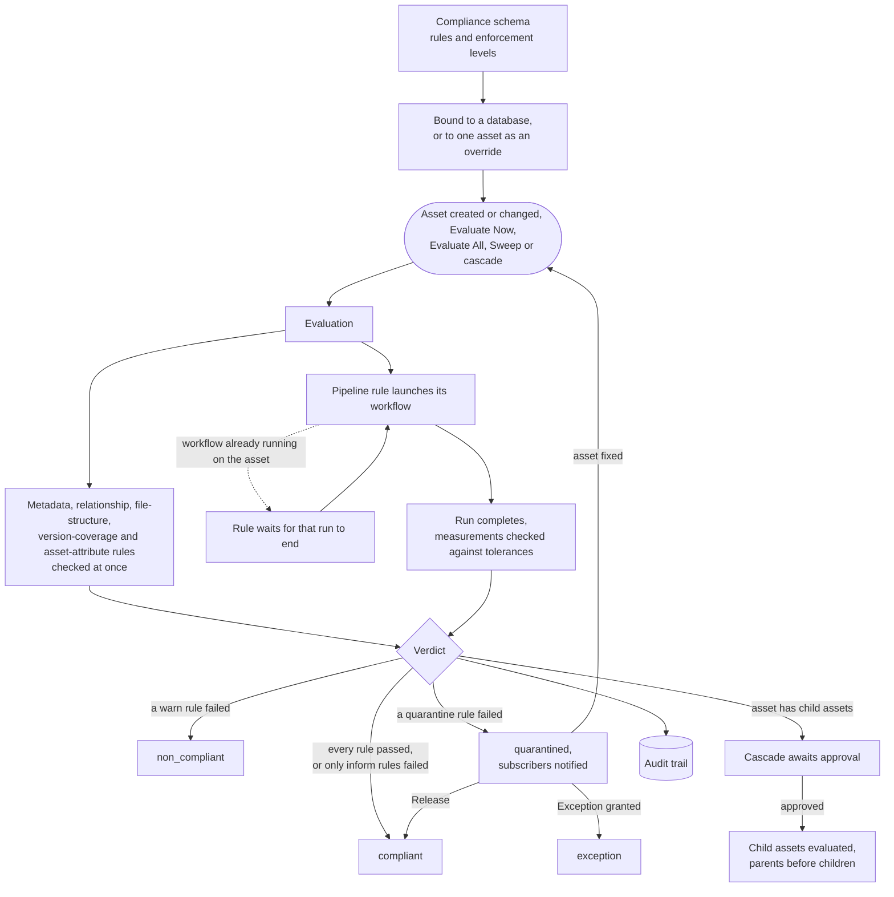

# Compliance

Compliance (also known as federated model management) lets you write down the rules your assets must meet, checks every asset against those rules whenever it changes, and keeps a record of each verdict and of every decision made about it. An asset that breaks a strict rule can be held back in quarantine until it is fixed or someone with the authority to do so releases it.

This page first explains what compliance is for and how its parts fit together, then gives the shortest path to a first verdict and the behaviors worth knowing before you rely on it. The sections from [Configuration](#configuration) onward are the reference. For the web interface walkthrough, see [Compliance (User Guide)](../user-guide/compliance.md).

## Overview

### What compliance is for

Teams that manage engineering, survey or 3D content usually have standards that every deliverable must meet: required metadata, an expected file layout, a successful automated check, a link to the assembly it belongs to. Compliance turns those standards into rules that VAMS checks for you, so that:

-   **You know, for each asset, whether it meets the rules that apply to it.** Every asset bound to a set of rules carries a compliance state (`compliant`, `non_compliant`, `quarantined` and others), shown on the asset, in a per-database overview and through the CLI and API.
-   **Content that fails a strict rule does not leave unnoticed.** A failure at the `quarantine` level puts the asset in quarantine, lists it on the Quarantine page and notifies the asset's subscribers. A deployment can also refuse downloads of quarantined assets (`app.compliance.quarantineBlocksDownload`).
-   **An auditor can see who decided what, and when.** Every evaluation, release, exception, binding change and cascade decision is written to a compliance audit trail with the actor, the time and, where the asset's state changed, its previous and new state.

### Who uses it

| Role                                 | Typical work                                                                                                              | Permission template                                 |
| ------------------------------------ | ------------------------------------------------------------------------------------------------------------------------- | --------------------------------------------------- |
| Central compliance team              | Writes the `GLOBAL` rule sets every database may use, and reads compliance across all databases                           | `compliance-global-admin.json`                      |
| Database or compliance administrator | Writes the database's own rule sets, binds rule sets to the database or to single assets, evaluates assets                | `compliance-admin.json`, or `database-admin.json`   |
| Reviewer for a database              | Decides what happens to a quarantined asset (release or exception) and approves or rejects re-evaluation of linked assets | `compliance-admin.json`, or `database-admin.json`   |
| Auditor or viewer                    | Reads states, evaluation history, the quarantine list and the audit trail without changing anything                       | `compliance-readonly.json`, or `database-user.json` |

The built-in `admin` role can do all of these. See [Authorization model](#authorization-model) for what each template grants.

### A worked example

Suppose every CAD model in the `cad-models` database must carry a part number and pass a mesh check before it is released, and the team would also like to see which models are tagged `released`. One compliance schema expresses that with three rules:

```json
{
    "schemaFormat": "vams-rules-v1",
    "rules": {
        "part-number-recorded": {
            "ruleType": "metadata",
            "enforcement": "quarantine",
            "metadataSchemaRef": { "schemaName": "defaultAsset" },
            "checks": [
                {
                    "name": "part-number",
                    "validateRequired": true,
                    "validateTypes": true,
                    "additionalRequiredFields": ["part_number"]
                }
            ]
        },
        "mesh-converts": {
            "ruleType": "pipeline",
            "enforcement": "quarantine",
            "pipelineRef": {
                "databaseId": "GLOBAL",
                "workflowId": "conversion-3d-basic",
                "pipelineDatabaseId": "GLOBAL",
                "pipelineId": "conversion-3d-basic",
                "templateId": "convert-to-glb"
            },
            "inputFiles": { "mode": "matching", "filter": ["*.stl", "*.obj"] },
            "checks": [
                {
                    "name": "conversion-succeeds",
                    "outputField": "execution_success",
                    "tolerance": { "operator": "eq", "value": 1 }
                }
            ]
        },
        "released-tag": {
            "ruleType": "assetAttributes",
            "enforcement": "inform",
            "checks": [{ "name": "released", "field": "tags", "requiredTags": ["released"] }]
        }
    }
}
```

1. The database already holds the asset `bracket`, with one file, `bracket.stl`, and no `part_number` metadata. A compliance administrator registers the schema and binds it to `cad-models`, with automatic evaluation on. Every asset of the database is now governed by the schema, and the binding queues an evaluation of each one.
2. The evaluation of `bracket` checks the metadata rule at once, and it fails. The mesh check runs the built-in 3D conversion workflow on `bracket.stl`, and the asset reads `pending_evaluation` until that run ends. When it ends, the verdict is `quarantined`, because a `quarantine`-level rule failed: the asset appears on the Quarantine page and its subscribers are notified.
3. The engineer adds the `part_number` metadata. That change evaluates the asset again. The conversion runs again, and when it succeeds both strict rules have passed and the asset becomes `compliant`. The GLB file the conversion writes back into the asset is never taken as an input of the rule.
4. The asset carries no `released` tag. That rule is at the `inform` level, so its failure is recorded on the evaluation and the state stays `compliant`.
5. An auditor opens the Audit Log, filters on the asset and sees an entry for each evaluation (`compliance_check`) with its verdict, the state before and after, and who or what started it.

If the asset had to stay available despite the missing part number, a reviewer could instead have granted an exception, with a recorded reason.

## How it works

### The parts

| Part                  | What it is                                                                                                                                                                                                                                                                                                                                                                                                                                                                                                                                                                                                                                                                                                                                                                 |
| --------------------- | -------------------------------------------------------------------------------------------------------------------------------------------------------------------------------------------------------------------------------------------------------------------------------------------------------------------------------------------------------------------------------------------------------------------------------------------------------------------------------------------------------------------------------------------------------------------------------------------------------------------------------------------------------------------------------------------------------------------------------------------------------------------------- |
| **Compliance schema** | A named, versioned set of rules. It is available to every database (`GLOBAL`) or to one database. Each save writes a new version. See [Compliance schemas](#compliance-schemas).                                                                                                                                                                                                                                                                                                                                                                                                                                                                                                                                                                                           |
| **Rule**              | One requirement, of one of six types: `metadata` (the asset's, its files' or its links' metadata has the required fields, for example a `part_number`), `relationship` (the asset has the required links, for example at least one parent assembly), `pipeline` (a workflow run on the asset reports measurements within tolerance, for example the model converts to GLB within ten minutes), `fileStructure` (required or forbidden file paths and file counts, for example a `models/` folder and no `.tmp` files), `versionCoverage` (every current file is recorded in an asset version) and `assetAttributes` (the asset name, description or tags, for example a naming convention or a `released` tag). See [The vams-rules-v1 format](#the-vams-rules-v1-format). |
| **Enforcement level** | What a failed rule does: `quarantine` quarantines the asset, `warn` marks it `non_compliant`, and `inform` only records the failure.                                                                                                                                                                                                                                                                                                                                                                                                                                                                                                                                                                                                                                       |
| **Binding**           | Which schema governs which assets. A database binding governs every asset of the database; an asset override replaces it for one asset. A database binding also says whether assets are evaluated automatically when they change (`complianceAutoEval`, on by default). See [Schema binding](#schema-binding).                                                                                                                                                                                                                                                                                                                                                                                                                                                             |
| **Evaluation**        | One check of one asset against its schema, producing a verdict. It starts automatically when the asset is created or changed, or on request: **Evaluate Now** for one asset, **Evaluate All** for a database, **Sweep** for every asset bound to a schema, or a cascade. See [Evaluation](#evaluation).                                                                                                                                                                                                                                                                                                                                                                                                                                                                    |
| **Compliance state**  | The asset's standing after its last verdict: `unknown`, `pending_evaluation`, `compliant`, `non_compliant`, `quarantined` or `exception`. See [Compliance states](#compliance-states).                                                                                                                                                                                                                                                                                                                                                                                                                                                                                                                                                                                     |
| **Quarantine**        | The state of an asset that failed a `quarantine`-level rule. It is listed on the Quarantine page, its subscribers are notified and, if the deployment says so, its downloads are refused. See [Quarantine](#quarantine).                                                                                                                                                                                                                                                                                                                                                                                                                                                                                                                                                   |
| **Release**           | A reviewer's decision to return a quarantined asset to `compliant` without recording an exception; the next failing evaluation quarantines it again.                                                                                                                                                                                                                                                                                                                                                                                                                                                                                                                                                                                                                       |
| **Exception**         | A reviewer's recorded decision, with a reason, that a quarantined asset stays available despite the failure. It holds for the schema version it was granted against. See [Exceptions](#exceptions).                                                                                                                                                                                                                                                                                                                                                                                                                                                                                                                                                                        |
| **Cascade**           | Re-evaluation of the assets that depend on an evaluated asset (its `parentChild` descendants), parents before children. A cascade opened after an evaluation waits for a reviewer's approval. See [Cascades](#cascades).                                                                                                                                                                                                                                                                                                                                                                                                                                                                                                                                                   |
| **Audit trail**       | The record of every compliance action, queried per asset or across the deployment. See [Audit trail](#audit-trail).                                                                                                                                                                                                                                                                                                                                                                                                                                                                                                                                                                                                                                                        |
| **Permissions**       | Four compliance object types (`complianceSchema`, `complianceBinding`, `complianceEvaluation`, `complianceCascade`) in the standard two-tier model, and three templates for compliance roles. See [Authorization model](#authorization-model).                                                                                                                                                                                                                                                                                                                                                                                                                                                                                                                             |

### The lifecycle

The diagram follows one asset from a bound schema to a recorded verdict.



A rule whose tooling fails before it can decide (a workflow that cannot start, a metadata schema that does not exist) records an `error` result instead of a pass or fail. It takes no part in the verdict, so it never quarantines an asset; see [Tooling failures](#tooling-failures).

## First steps

The shortest route from a new deployment to a first verdict uses the default schema that a deployment seeds while `app.compliance.autoLoadDefaultSchema` is on (the default). That schema, `default-compliance-schema`, is `GLOBAL` and holds one `warn`-level rule that checks an asset's metadata against the `GLOBAL` `defaultAsset` metadata schema. As seeded, `defaultAsset` declares one optional field, `Location`, of a type the rule does not type-check, so every asset passes it: the first verdict is `compliant` until you make fields of `defaultAsset` required or bind a schema of your own. The built-in `admin` role, or a role from one of the [permission templates](#authorization-model) with administrator rights for the database, can do every step.

| Step                         | Web interface                                                                                                                                                                    | CLI                                                                                                                                             | API                                      |
| ---------------------------- | -------------------------------------------------------------------------------------------------------------------------------------------------------------------------------- | ----------------------------------------------------------------------------------------------------------------------------------------------- | ---------------------------------------- |
| 1. Find a schema             | **Admin - Compliance > Compliance Schemas** lists `default-compliance-schema`                                                                                                    | `vamscli compliance schema list`                                                                                                                | `GET /compliance/schemas`                |
| 2. Write your own (optional) | **Create Schema**, then **Start from template** for a working example to adjust                                                                                                  | `vamscli compliance schema create -n <name> --schema-file <file>`                                                                               | `POST /compliance/schemas`               |
| 3. Bind it to a database     | **Databases**, the database's **Compliance** link, then select the schema in **Bound schema**, choose **Bind** and confirm with **Bind schema**                                  | `vamscli compliance bind -n <schemaName> -d <databaseId>`                                                                                       | `PUT /compliance/bind/{databaseId}`      |
| 4. Evaluate                  | Nothing to do with automatic evaluation on: the binding queues an evaluation of every asset. Otherwise **Evaluate All Assets** on the overview, or **Evaluate Now** on one asset | `vamscli compliance sweep -d <databaseId>` or `vamscli compliance evaluate -d <databaseId> -a <assetId>`                                        | `POST /compliance/evaluate/{databaseId}` |
| 5. Read the result           | The database's compliance overview (counts per state and a table of assets), and the asset's **Compliance** tab with its evaluation history                                      | `vamscli compliance state -d <databaseId>` (add `-a <assetId>` for one asset) and `vamscli compliance evaluations -d <databaseId> -a <assetId>` | `GET /compliance/state/{databaseId}`     |

From there, the [user guide](../user-guide/compliance.md) covers the Quarantine, Cascade Approvals and Audit Log pages, the [CLI reference](../cli/commands/compliance.md) every `vamscli compliance` command, and the [Compliance API](../api/compliance.md) every endpoint.

## Behaviors to know about

-   **A tooling failure does not count against an asset.** When a rule cannot run (its workflow cannot start, its input selection does not resolve, its metadata schema is missing), it records an `error` result and its enforcement does not apply. The verdict comes from the other rules; when every rule errored, the asset keeps its state and shows an **Evaluation error** indicator. See [Tooling failures](#tooling-failures).
-   **A pipeline rule can wait, and nothing re-checks it on a timer.** If the rule's workflow restricts concurrency and is already running on the asset, the rule waits for that run to end and the asset stays `pending_evaluation` (a quarantined asset stays `quarantined`). The wait limit is checked only when that workflow ends a run or the asset is evaluated again, so a run that never reports its end leaves the rule waiting until **Evaluate Now**, a sweep, a change to the asset or another run of the workflow. See [Rules that wait for a running execution](#rules-that-wait-for-a-running-execution).
-   **A database binding change is applied in the background.** Binding, changing or removing a database's schema saves the binding at once and then updates every asset record over seconds to minutes, depending on the database's size; the database's compliance page shows **Applying the binding** with its progress. Until every record carries the binding, another binding change of that database and **Evaluate All** are refused with "still being applied; try again when it finishes". With automatic evaluation on, the evaluations are queued after that, a share at a time (**Queueing evaluations**), and hold nothing. A change only reads **Stopped** when it really stopped (its last step failed on every delivery, or could not be queued), never because it waits its turn on a busy queue; repeating the same change resumes it. See [Applying a database binding](#applying-a-database-binding).
-   **A binding change does not lift a quarantine.** Binding another schema, removing the binding, or setting or clearing an asset override keeps a quarantined asset quarantined (and download-blocked, where downloads are blocked) until an evaluation under the binding now in force decides it, or someone releases it. See [Schema binding](#schema-binding).
-   **A re-evaluation does not lift a quarantine while its pipeline rules run.** When a quarantined asset is evaluated again (an edit, **Evaluate Now**, **Evaluate All**, a sweep or a cascade) and the schema has a pipeline rule, the asset stays `quarantined`, and download-blocked where downloads are blocked, while that rule runs or waits, which can take a day or more for a waiting rule. Its record is marked awaiting re-evaluation, and the verdict decides it when the run ends. Other assets read `pending_evaluation` meanwhile. See [Quarantine](#quarantine).
-   **Subscribers hear of a quarantine once.** The asset's subscribers are notified when it enters quarantine. Edits and re-evaluations that keep it quarantined, even with other failing rules, send no further message; the Audit Log has each evaluation and its reason. After a release or an exception, the next quarantine notifies again. See [Quarantine](#quarantine).
-   **Only assets with a compliance record are tracked.** An asset gets a record when a schema binding reaches it, or when it is evaluated on demand against a named schema. The overview counts and lists only those assets, and removing a database binding deletes the records of the assets that inherited it, except a quarantined asset's.
-   **Evaluation after an upload waits about a minute.** An upload is evaluated once, about 60 seconds after it completes, so that an upload sent as several requests is evaluated over all its files. See [Evaluation](#evaluation).
-   **A version-coverage rule fails after every upload** until an asset version records the new files. Use `warn` for it unless that is the intended workflow. See [Version-coverage rules](#version-coverage-rules).
-   **A missing parent schema is ignored, with a warning when you save.** A schema whose `extends` names a schema that does not exist is saved, and evaluates with its own rules only. The save answers a warning saying the parent was not found as a `vams-rules-v1` schema you may read. See [Schema inheritance](#schema-inheritance).
-   **Deleting a database moves its compliance history.** The records, evaluations, cascades, database-scoped schemas and audit entries move under `<databaseId>#deleted`, so a database created later with the same id starts with none. See [Deleted databases](#deleted-databases).
-   **Archived assets are left out.** An archived asset is not evaluated and is left out of the database overview and the quarantine list; its record returns when it is unarchived. See [Archived assets](#archived-assets).
-   **Compliance data follows asset access.** A user whose permissions restrict assets sees an asset's compliance state, history, quarantine and audit entries only if they may open the asset itself. See [Who sees an asset's compliance data](#who-sees-an-assets-compliance-data).
-   **Saving a pipeline rule needs the right to run its workflow.** The save is refused (`403`) unless the user may run that workflow. The current Compliance Admin and Compliance Global Admin templates include those rights; a role built from an earlier copy of either needs a few constraints added, as described in [Adding the pipeline-rule run rights to an existing role](../user-guide/compliance.md#adding-the-pipeline-rule-run-rights-to-an-existing-role). See [Authorization model](#authorization-model).
-   **A release or exception made while an evaluation runs stands.** An evaluation that began before an asset was released, or given an exception, does not undo that decision when it ends: its verdict is recorded on the evaluation (`notApplied`, shown as **Not applied** in the asset's history) and in the audit trail, the asset keeps the state the decision left, and no release entry or quarantine notification is written for it. The next evaluation (an edit, **Evaluate Now**, a sweep) decides the asset normally. See [Quarantine](#quarantine).

## Configuration

Compliance is part of every VAMS deployment: five Amazon DynamoDB tables, nine AWS Lambda functions and the `/compliance/*` API routes are always created, and the compliance pages of the web interface appear to a user whose role grants them like every other page. Two configuration settings tune it:

```json
{
    "app": {
        "compliance": {
            "autoLoadDefaultSchema": true,
            "quarantineBlocksDownload": false
        }
    }
}
```

| Setting                                   | Default | Effect                                                                                                                                                                                                                                                                                                                                                                                                                                             |
| ----------------------------------------- | ------- | -------------------------------------------------------------------------------------------------------------------------------------------------------------------------------------------------------------------------------------------------------------------------------------------------------------------------------------------------------------------------------------------------------------------------------------------------- |
| `app.compliance.autoLoadDefaultSchema`    | `true`  | Seeds the `GLOBAL` schema `default-compliance-schema` at deployment: one `warn`-level metadata rule that validates a bound asset against the `GLOBAL` `defaultAsset` metadata schema. The schema is written once; setting `false` on an existing deployment stops the seeding but leaves an already-written schema in place.                                                                                                                       |
| `app.compliance.quarantineBlocksDownload` | `false` | When `true`, the asset download, stream, export (presigned file URLs), auxiliary-preview stream and Download as Zip (create and download URL) endpoints refuse a quarantined asset with `400` and the message "Asset is quarantined and cannot be downloaded", and log each refusal once at INFO with the database, asset and route (not as an error). When `false`, quarantine is visible in the interface and the API but does not block access. |

See the [Configuration Reference](../deployment/configuration-reference.md) for the settings and [Compliance (User Guide)](../user-guide/compliance.md) for the interface walkthrough.

## Compliance schemas

A compliance schema is a named, versioned set of rules. Every registration or update writes the next version of the schema and evaluation always reads the highest version, so the version history is retained. A schema is scoped to a database or to `GLOBAL`; a database-scoped schema can only be bound within its own database, while a `GLOBAL` schema can be bound anywhere.

Schema names are unique across all databases: `GLOBAL` and every database share one name space, so a name another scope uses cannot be reused for a new schema (registering it again writes the next version of that schema, which needs the right to change it in its scope). The routes that name a schema answer `Not Authorized` for a schema in a scope the caller may not read, and `Schema not found` for a name no scope uses (checked as a `GLOBAL` schema), so a caller learns only of schemas it may read. Give each schema a name that is unique for the deployment, for example prefixed with its database ID.

A schema whose `isSystem` flag is set is a system schema. Only the system user can register one, write a new version of it, or delete it. The default schema seeded at deployment is a system schema, so no user can edit or delete it through the web interface, the CLI or the API, including after `app.compliance.autoLoadDefaultSchema` is turned off. To keep it, do nothing; to remove it, see [The default schema on fresh and existing deployments](../deployment/configuration-reference.md#the-default-schema-on-fresh-and-existing-deployments).

### Schema format

A schema body is a `vams-rules-v1` document: named rules of six types, each with an enforcement level. Registration and update accept only a valid `vams-rules-v1` document — an object with `schemaFormat` set to `vams-rules-v1` and at least one rule under `rules`. Any other body (a plain JSON Schema, a template file's envelope, an object without rules) is rejected with `400` and the message `schemaBody must be a vams-rules-v1 document`; the specific validation failure is written to the handler's log rather than returned.

Every schema record the listing and the single-schema read return carries a top-level `schemaFormat`, derived from its body: `vams-rules-v1`, or `legacy` for a row whose body is not a `vams-rules-v1` document. A legacy schema cannot be bound (the bind request is refused with `400` and `Schema body must be a vams-rules-v1 document`), updated or evaluated; it is listed — marked **Legacy** on the Compliance Schemas page and printed as `Format: legacy` by the CLI — only so that it can be found and deleted.

### Schema templates

Four ready-to-register schemas ship in `documentation/complianceSchemaTemplates/`. Each file wraps a `vams-rules-v1` body in an envelope (`metadata`, `schemaName`, `description`, `schemaBody`); register the `schemaBody` under the `schemaName` — the envelope itself is not a schema body and is rejected as one.

| Template                     | Rules                                                                                                                                                                                                                                                                                                                                                                                                                                                                                                                                                                                                                                                                                                                                                                                                                                                                                                                                               |
| ---------------------------- | --------------------------------------------------------------------------------------------------------------------------------------------------------------------------------------------------------------------------------------------------------------------------------------------------------------------------------------------------------------------------------------------------------------------------------------------------------------------------------------------------------------------------------------------------------------------------------------------------------------------------------------------------------------------------------------------------------------------------------------------------------------------------------------------------------------------------------------------------------------------------------------------------------------------------------------------------- |
| `3d-model-quality`           | A `warn` metadata rule against the `GLOBAL` `defaultAsset` metadata schema (required fields, declared types, plus `polygon_count`, `coordinate_system` and `units`), a `warn` file-structure rule requiring a source model file and forbidding `.tmp`, `.bak`, `.DS_Store` and `Thumbs.db` files, and a `quarantine` pipeline rule that converts the model through the built-in 3D conversion workflow: `pipelineRef` `{"databaseId": "GLOBAL", "workflowId": "conversion-3d-basic", "pipelineDatabaseId": "GLOBAL", "pipelineId": "conversion-3d-basic", "templateId": "convert-to-glb"}`, `inputFiles` `{"mode": "matching", "filter": ["*.stl", "*.obj", "*.ply", "*.gltf", "*.xyz"]}`, with checks on `execution_success` and `processing_duration_seconds`. The filter names source formats only and excludes `*.glb`: the pipeline writes a `.glb` back into the asset, and a filter that admitted it would select the pipeline's own output. |
| `data-classification`        | A `quarantine` metadata rule requiring `classification`, `handling_instructions` and `data_steward`, and an `inform` metadata rule recording `dissemination_controls` and `originating_agency`.                                                                                                                                                                                                                                                                                                                                                                                                                                                                                                                                                                                                                                                                                                                                                     |
| `engineering-asset-standard` | A `warn` metadata rule requiring `owner`, `classification` and `retention_days`, an `inform` metadata rule recording `department` and `review_date`, a `warn` relationship rule requiring at least one `parentChild` parent, an `inform` links-scope metadata rule requiring every parent-assembly link to record a `Translation` against the `GLOBAL` `defaultAssetLinks` metadata schema, and an `inform` asset-attribute rule checking the asset name against a naming convention.                                                                                                                                                                                                                                                                                                                                                                                                                                                               |
| `retention-policy`           | A `warn` metadata rule requiring `retention_days`, `disposal_method` and `data_owner`, an `inform` metadata rule recording `last_access_review` and `next_review_date`, and a `warn` version-coverage rule requiring every current file except preview images to be recorded in an asset version.                                                                                                                                                                                                                                                                                                                                                                                                                                                                                                                                                                                                                                                   |

The pipeline template's `filter` names the source formats the conversion workflow accepts, and the workflow takes exactly one input file, so a model asset that holds exactly one such file converts; an asset holding several records the rule as an `error` result — a [tooling failure](#tooling-failures) that applies no enforcement — until the selection is narrowed (a tighter `filter`, or `explicit` keys).

### The vams-rules-v1 format

A `vams-rules-v1` body is a set of named rules. Each rule has a `ruleType`, an `enforcement` level and at least one check:

```json
{
    "schemaFormat": "vams-rules-v1",
    "extends": "parent-schema-name",
    "rules": {
        "rule-name": {
            "ruleType": "pipeline | metadata | relationship | fileStructure | versionCoverage | assetAttributes",
            "enforcement": "quarantine | warn | inform",
            "checks": []
        }
    }
}
```

| Rule type         | Purpose                                                                                                                                                                                                                                      | Evaluation                                       |
| ----------------- | -------------------------------------------------------------------------------------------------------------------------------------------------------------------------------------------------------------------------------------------- | ------------------------------------------------ |
| `metadata`        | Validate metadata against a VAMS metadata schema — required fields present, values of the declared type, and any `additionalRequiredFields` — for the asset, each of its files or each of its links — see [Metadata rules](#metadata-rules). | Within the evaluation request                    |
| `relationship`    | Validate that the asset carries the required asset links — `direction` (`parents`, `children`, `related`), `relationshipType` (`parentChild`, `related`) and a `minCount` or `maxCount`.                                                     | Within the evaluation request                    |
| `pipeline`        | Run a VAMS workflow and compare the measurements one of its pipelines reports against tolerances.                                                                                                                                            | Asynchronous, completed by the workflow callback |
| `fileStructure`   | Require or forbid file paths and bound the number of the asset's current files — see [File-structure rules](#file-structure-rules).                                                                                                          | Within the evaluation request                    |
| `versionCoverage` | Require every current file to be recorded in an asset version — see [Version-coverage rules](#version-coverage-rules).                                                                                                                       | Within the evaluation request                    |
| `assetAttributes` | Check the asset's name, description or tags — see [Asset-attribute rules](#asset-attribute-rules).                                                                                                                                           | Within the evaluation request                    |

:::info[Relationship type values]
`relationshipType` takes the value stored on the asset link: `parentChild` or `related`.
:::

| Enforcement  | Effect of a failed rule on the verdict                                    |
| ------------ | ------------------------------------------------------------------------- |
| `quarantine` | The asset is `quarantined`                                                |
| `warn`       | The asset is `non_compliant` unless a `quarantine`-level rule also failed |
| `inform`     | The failure is recorded in the rule results; the asset stays `compliant`  |

#### Path and attribute patterns

`fileStructure`, `versionCoverage` and `assetAttributes` rules, and the `includePaths` / `excludePaths` of a file-scope metadata rule, take Python regular expressions. A pattern is searched (`re.search`) in the value rather than matched against all of it, so `^` and `$` anchor it; a file path is matched without its leading `/`, so `^models/` means a top-level `models` folder and `\.glb$` a GLB file anywhere. Every pattern is checked when the schema is registered or updated: it must compile, may not repeat a group that itself repeats or alternates (`(a+)+`) or use a backreference, and must stay within a backtracking budget computed for the longest value it is searched in — 1024 characters for a path pattern (the Amazon S3 object key limit), 256 for a name or description pattern — in which a pattern that does not begin with `^` also counts the start positions the search tries, as one more quantifier. A path pattern therefore admits at most two unbounded quantifiers (`.*`, `+`, `{n,}`) when it begins with `^` and one when it does not; a name or description pattern admits three and two. Optional and bounded repeats (`?`, `{m,n}`) count toward the same budget. A pattern that fails is rejected with `400` and a message naming the field, never the pattern. Should a stored pattern fail to compile at evaluation time, the rule records an `error` result with the message `Invalid pattern in rule`.

| Bound                                                                                                                       | Limit                     |
| --------------------------------------------------------------------------------------------------------------------------- | ------------------------- |
| Checks per `metadata`, `fileStructure`, `versionCoverage` or `assetAttributes` rule                                         | 25                        |
| Patterns per `requiredPaths`, `forbiddenPaths` or `excludePaths` list, or a metadata rule's `includePaths` / `excludePaths` | 25, 1-512 characters each |
| Links a `links`-scope metadata rule evaluates                                                                               | 500                       |
| `matches` / `notMatches`                                                                                                    | 1-512 characters          |
| Tags per `requiredTags` or `forbiddenTags` list                                                                             | 50, 1-256 characters each |

#### Metadata rules

A metadata rule validates metadata against a VAMS metadata schema. Without `databaseId` the metadata schema is looked up in the database of the asset being evaluated, then in `GLOBAL`, so one compliance schema bound to several databases uses each database's own metadata schema of that name where it has one. `databaseId` pins the lookup to that database (then `GLOBAL`) and is limited to the compliance schema's scope: a GLOBAL compliance schema may name only `GLOBAL`, a database-scoped one `GLOBAL` or its own database. The same limit applies to a pipeline rule's `pipelineRef.databaseId` and `pipelineRef.pipelineDatabaseId`; another database is refused with `400`. Its `scope` selects which metadata, and the schema named by `metadataSchemaRef` must be of the entity type that scope reads:

| `scope`           | Validates                                         | Metadata schema entity type | Filters                             |
| ----------------- | ------------------------------------------------- | --------------------------- | ----------------------------------- |
| `asset` (default) | The asset's own metadata                          | `assetMetadata`             | —                                   |
| `files`           | The metadata of each current, non-archived file   | `fileMetadata`              | `includePaths`, `excludePaths`      |
| `fileAttributes`  | The attributes of each current, non-archived file | `fileAttribute`             | `includePaths`, `excludePaths`      |
| `links`           | The metadata of each asset link of the asset      | `assetLinkMetadata`         | `linkDirection`, `relationshipType` |

Each check runs against the metadata of every unit in scope — the asset, each file, or each link — and the rule passes when every unit passes every check. A scope with no unit in it (no file left after the filters, no link of the direction and type) passes. A rule without `scope` is an `asset` rule.

```json
{
    "ruleType": "metadata",
    "enforcement": "quarantine",
    "metadataSchemaRef": { "schemaName": "defaultAsset" },
    "checks": [
        {
            "name": "baseline",
            "validateRequired": true,
            "validateTypes": true,
            "additionalRequiredFields": ["owner"]
        }
    ]
}
```

```json
{
    "ruleType": "metadata",
    "enforcement": "warn",
    "scope": "files",
    "metadataSchemaRef": { "schemaName": "modelFileMetadata" },
    "includePaths": ["\\.(glb|stl)$"],
    "excludePaths": ["\\.previewFile\\."],
    "checks": [{ "name": "file-fields", "validateRequired": true, "validateTypes": true }]
}
```

```json
{
    "ruleType": "metadata",
    "enforcement": "inform",
    "scope": "fileAttributes",
    "metadataSchemaRef": { "schemaName": "defaultAssetFile3dModel" },
    "checks": [{ "name": "polygon-count", "additionalRequiredFields": ["Polygon_Count"] }]
}
```

```json
{
    "ruleType": "metadata",
    "enforcement": "warn",
    "scope": "links",
    "linkDirection": "parents",
    "relationshipType": "parentChild",
    "metadataSchemaRef": { "schemaName": "defaultAssetLinks" },
    "checks": [{ "name": "placement-recorded", "additionalRequiredFields": ["Translation"] }]
}
```

The schema is looked up by name among the metadata schemas of the scope's entity type, in the rule's `databaseId` and then in `GLOBAL`, so two schemas that share a name but differ in entity type never stand in for each other. The schema is read whether or not it is enabled: a metadata schema's enabled setting decides whether it validates metadata writes, not whether compliance rules can use it. A schema that is not found, one whose entity type does not match the scope, or one whose field list cannot be read records the rule as an `error` result — a [tooling failure](#tooling-failures), never a pass.

A file scope evaluates the asset's current files from its Amazon S3 listing, not its metadata rows: a file that carries no metadata is evaluated with none and fails `validateRequired` when the schema requires a field, and archived files, folder markers and the rows of a file no longer current are not evaluated. Files are selected in this order:

1. the schema's `fileKeyTypeRestriction`: a file whose extension is not listed is out of scope; no restriction, or one listing `.all`, admits every file. A file without an extension, such as `README` or `LICENSE`, is out of scope of a restricted schema, the way the metadata editor validates such a file only against schemas with no file type restriction;
2. `includePaths`: when any is given, a file is in scope only if one pattern matches its path;
3. `excludePaths`: a file whose path matches any pattern is out of scope.

Path patterns follow the [path pattern](#path-and-attribute-patterns) rules (searched in the path without its leading `/`). Preview images (`.previewFile.` files) are current files of the asset; leave them out with `excludePaths` (`\.previewFile\.`) unless the schema's file type restriction already does. File attributes are stored as strings only, so `validateTypes` passes on every `fileAttributes` value.

The `links` scope reads the asset's link rows: `linkDirection` `parents` takes the links to this asset, `children` the links from it, and `related` or no direction both; `relationshipType` takes `parentChild` or `related`, and no type takes either. A link without metadata is evaluated with none. The rule evaluates at most 500 links; an asset with more links in the rule's scope records the rule as an `error` result instead of evaluating part of them.

`includePaths` and `excludePaths` are accepted only with `files` and `fileAttributes`, and `linkDirection` and `relationshipType` only with `links`; a schema that sets one on another scope is rejected at registration. The rule result's `measured` carries `scope`, `evaluatedCount`, `failingCount` and the first ten `failing` units — `{path, message}` for a file, `{assetLinkId, message}` for a link — plus the `metadataKeys` the asset carries on the `asset` scope; its message names up to ten failing units and counts the rest (`2 of 5 files fail: /a.glb: …`). Neither carries a pattern. `expected` carries `schemaRef` and `scope`.

A write of asset metadata, file metadata, file attributes or asset-link metadata, and the creation or deletion of an asset link, re-evaluates the asset — see [Evaluation](#evaluation).

#### File-structure rules

A file-structure rule checks the asset's current, non-archived files — one listing of the asset's S3 prefix per evaluation, folder markers and archived files left out:

```json
{
    "ruleType": "fileStructure",
    "enforcement": "warn",
    "checks": [
        {
            "name": "deliverable-layout",
            "requiredPaths": ["^models/", "\\.glb$"],
            "forbiddenPaths": ["\\.tmp$", "(^|/)\\.DS_Store$"],
            "minFiles": 1,
            "maxFiles": 500
        }
    ]
}
```

| Field            | Passes when                                                                                  |
| ---------------- | -------------------------------------------------------------------------------------------- |
| `requiredPaths`  | Every pattern matches at least one file; the message names the patterns no file matches      |
| `forbiddenPaths` | No file matches any pattern; the message names up to ten offending files and counts the rest |
| `minFiles`       | The asset has at least this many files                                                       |
| `maxFiles`       | The asset has at most this many files (at least `minFiles` when both are given)              |

A check needs at least one of the four. The rule result's `measured` carries `fileCount`, `unmatchedRequired` and the first ten `forbiddenMatches`. When the asset's files cannot be listed (no resolvable bucket, a denied listing), the rule records an `error` result.

#### Version-coverage rules

A version-coverage rule checks that every current, non-archived file — except those an `excludePaths` pattern matches — has its current S3 version recorded in some asset version, that is, that the asset's current file set can be reproduced from its versions:

```json
{
    "ruleType": "versionCoverage",
    "enforcement": "warn",
    "checks": [{ "name": "current-files-versioned", "excludePaths": ["\\.previewFile\\."] }]
}
```

The rule compares each current file's S3 version id against the file records of all of the asset's versions. A file in a bucket without versioning has no version id; it is reported as not covered, with a message of its own. The rule result's `measured` carries `fileCount`, `uncoveredCount` and the first ten `uncovered` paths.

:::warning[A version-coverage rule fails after every upload]
An upload writes new S3 versions that no asset version records yet, so the rule fails from every upload until an asset version is created. Creating an asset version records the asset's latest change as `assetVersion` and re-evaluates the asset, which clears the failure. Reverting to an earlier version re-evaluates the asset the same way. Files added after the target version stay current; any of them that no asset version records stays uncovered until a new version includes it, while one a later version already records stays covered. At `quarantine` level with `app.compliance.quarantineBlocksDownload` on, a freshly uploaded asset is therefore download-blocked until it is versioned. Use `warn` for this rule unless that is the intended workflow.
:::

#### Asset-attribute rules

An asset-attribute rule checks fields of the asset record:

```json
{
    "ruleType": "assetAttributes",
    "enforcement": "inform",
    "checks": [
        { "name": "name-convention", "field": "assetName", "matches": "^[A-Z][A-Za-z0-9-]*$" },
        { "name": "no-placeholder", "field": "description", "notMatches": "(?i)^(tbd|todo)$" },
        {
            "name": "released",
            "field": "tags",
            "requiredTags": ["released"],
            "forbiddenTags": ["draft"],
            "minTags": 1
        }
    ]
}
```

| `field`       | Criteria                                                                                                                            |
| ------------- | ----------------------------------------------------------------------------------------------------------------------------------- |
| `assetName`   | Exactly one of `matches` (the name must match; an empty name fails) or `notMatches` (the name must not match; an empty name passes) |
| `description` | As for `assetName`                                                                                                                  |
| `tags`        | At least one of `requiredTags` (every tag present), `forbiddenTags` (none present) or `minTags`; tags compare by exact value        |

The rule result's `measured` carries the values the checks read — `assetName` and `description` cut to 256 characters, the `tags` list — and never a pattern; its `expected` names each check's field and condition.

An edit to the asset's name, description or tags records `assetEdit` as the asset's latest change and re-evaluates the asset (with `complianceAutoEval` on), so the rule follows the edit; an edit that leaves all three as they were records nothing and starts no evaluation.

#### Schema inheritance

A schema names a parent in `extends` and inherits every rule of the parent. A rule of the same name in the child replaces the parent's definition; rules defined only in the parent apply unchanged. Inheritance resolves through up to ten levels of parents. When the schema is saved, the parent is looked up as the evaluation looks it up, and the save answers an `extendsSchemaNotFound` warning when the parent is missing, is not `vams-rules-v1`, or is a schema the saving user may not read; the three cases get the same message, so the warning does not tell anyone whether a schema they may not read exists. The save succeeds either way, and only the immediate parent is checked. The parent is read again when the schema is evaluated: a parent that does not exist, or is not a `vams-rules-v1` document, ends the chain there without an error, and the evaluation uses the rules defined below it (logged by the compliance service, not recorded on the evaluation). A chain deeper than ten levels ends the same way.

#### Pipeline rules

A pipeline rule names a workflow, the pipeline within that workflow whose output the checks read, and which of the asset's files the execution receives:

```json
{
    "ruleType": "pipeline",
    "enforcement": "quarantine",
    "pipelineRef": {
        "databaseId": "GLOBAL",
        "workflowId": "coord-validate-workflow",
        "pipelineDatabaseId": "GLOBAL",
        "pipelineId": "coord-validate",
        "templateId": "coord-validate-osgb36"
    },
    "inputFiles": { "mode": "matching", "filter": ["*.las", "*.laz"] },
    "inputParameters": { "expected_crs": "EPSG:27700" },
    "checks": [
        {
            "name": "residual_check",
            "outputField": "residual_error_mm",
            "tolerance": { "operator": "lte", "value": 1.0 }
        }
    ]
}
```

| Field                            | Description                                                                                                                                                                                                                                                                                               |
| -------------------------------- | --------------------------------------------------------------------------------------------------------------------------------------------------------------------------------------------------------------------------------------------------------------------------------------------------------- |
| `pipelineRef.databaseId`         | Database of the workflow (`GLOBAL` accepted)                                                                                                                                                                                                                                                              |
| `pipelineRef.workflowId`         | The workflow to execute                                                                                                                                                                                                                                                                                   |
| `pipelineRef.pipelineDatabaseId` | Database of the pipeline (`GLOBAL` accepted)                                                                                                                                                                                                                                                              |
| `pipelineRef.pipelineId`         | The pipeline within the workflow that receives the rule's template and `inputParameters`; the execution request keys the template and tag values by this id. The checks read the workflow's `compliance-output.json`, whichever step wrote it (see [Pipeline output contract](#pipeline-output-contract)) |
| `pipelineRef.templateId`         | Optional. The pipeline template to run; when omitted the pipeline's default template is used                                                                                                                                                                                                              |
| `inputFiles`                     | Optional. Which of the asset's files the execution receives — see [Input files](#input-files); defaults to `{"mode": "matching"}`                                                                                                                                                                         |
| `inputParameters`                | Optional. Values handed to the pipeline as its template tag values                                                                                                                                                                                                                                        |
| `checks[].outputField`           | Key of the `measurements` object in the pipeline's output file, or one of the two derived measurements                                                                                                                                                                                                    |
| `checks[].tolerance`             | The comparison — see [Tolerance operators](#tolerance-operators)                                                                                                                                                                                                                                          |

The evaluation launches one workflow execution per pipeline rule through the standard execute-workflow request: the selected files are the inputs, `pipelineExecutionParameters` carries the template and tag values under the `pipelineId`, and the trigger type is `manual`. The execution runs as the system user and is listed with the workflow's other executions. The evaluation records the `executionId` of each execution and stays `pending_pipeline` (asset state `pending_evaluation`) until every execution has completed. A rule whose workflow or pipeline does not exist, whose input selection cannot be satisfied, or whose execution cannot be launched (its workflow is archived or disabled, for example), records an `error` result at once — a [tooling failure](#tooling-failures), not a verdict. Each execution is launched with the evaluation's id as its `executionGroupId`, so the executions of one evaluation form one group and their audit entries and completion events name the evaluation.

#### Rules that wait for a running execution

A workflow can restrict its own concurrency (`concurrencyRestriction` `perAsset`, `perInputFile` or `perInputFileVersion`): while one execution of it holds an asset, a file or a file version, another launch over the same one is refused. A pipeline rule whose launch is refused that way is not an error. It waits: the evaluation stays `pending_pipeline`, the asset stays `pending_evaluation` (or `quarantined`, see [Quarantine](#quarantine)), and the rule's entry in the evaluation's `pipelineExecutions` reads `waiting`. When an execution of that workflow over the asset ends, whatever its outcome, the [completion callback](#workflow-completion) launches the waiting rule, and the rule's own run decides its result as for any other pipeline rule. The holding execution can be any run of the workflow on the asset:

-   a user's run, or a trigger's;
-   the run of the asset's earlier evaluation, when the asset is edited, evaluated again (Evaluate Now, a sweep, a cascade) or uploaded to while that run is going. The newer evaluation waits and measures the asset as it is now; the earlier run's result is recorded on its own evaluation only, because the newer one owns the asset's state;
-   the run of another pipeline rule of the same schema that names the same workflow. The rules run one after another, and the verdict comes from all of them. The schema editor and the API warn about such rules when the schema is saved (see [Registering a schema](../user-guide/compliance.md#registering-a-schema)).

A waiting rule is launched at most once, however the completion events are delivered. When the lock is taken again before the waiting rule's launch (another run started first), the rule keeps waiting for that run. Only the newest evaluation of an asset launches its waiting rules: an evaluation that a newer one has replaced closes its waiting rule with `Not started: a newer evaluation of the asset began while the rule waited for its workflow`, so pressing Evaluate Now several times during one run ends with one more run, for the last evaluation. The replaced evaluation is closed on its own row with no verdict: its `status` and `verdict` read `error`, `closedReason` is `superseded` and `errorMessage` is `Not completed: a newer evaluation of the asset started`, and the asset's history shows it as **Not completed** with that reason, never as a verdict it did not reach.

Nothing waits forever. A rule waits at most as long as a lock of its workflow can last (the sum of its pipelines' timeouts, at least one day, plus 30 minutes) plus one hour. Past that, the rule records an `error` result `Waited too long for a running execution of the workflow` (a [tooling failure](#tooling-failures)), the evaluation finalizes from its other rules, and an `evaluation_error` audit entry names the rule and that reason. The bound is checked whenever an execution of the workflow ends, on any asset, and whenever the asset is evaluated again. No schedule checks it. So if the run holding the lock ends without reporting its end (an execution stranded before its records were written) and the workflow does not run again, the waiting rule stays waiting past its limit, and the asset reads `pending_evaluation` (or stays `quarantined`), never compliant. **Evaluate Now**, a sweep, a change to the asset or any later run of that workflow ends the wait.

A rule result or a waiting entry never names the execution it waits for: that run may be another user's, which the reader may not open.

#### Input files

A workflow declares how many input files it takes (`inputFileArity`: one, several or none), whether it accepts the whole asset, and which file names it accepts (`inputFileFilters`); each of its pipelines can narrow those through its own configuration and the chosen template. `inputFiles` selects the asset files the rule hands to that contract, in one of three modes:

| Mode         | Selection                                                                                                                                                                                                                     | Fields                                                     |
| ------------ | ----------------------------------------------------------------------------------------------------------------------------------------------------------------------------------------------------------------------------- | ---------------------------------------------------------- |
| `matching`   | The default. The asset's current files are listed, the workflow's input-file filters are applied, then each pipeline's effective filters, then the rule's own `filter` globs as an allow list; the matches are sorted by key. | `filter` — optional glob list (up to 32, 1-256 characters) |
| `wholeAsset` | The asset root (`/`) is sent. Accepted only when the workflow permits whole-asset selection.                                                                                                                                  | —                                                          |
| `explicit`   | The listed asset-relative keys are sent. Every key must exist among the asset's files.                                                                                                                                        | `keys` — required (1-64 keys, each starting with `/`)      |

The workflow's arity is honoured after the selection is made: a single-input workflow needs the selection to resolve to exactly one file, a multi-input workflow receives every match and needs at least one, and a workflow that takes no input files receives none. In `matching` mode a file that a workflow execution wrote into the asset (object metadata `vams-changesource` of `workflowExecution`) is never a candidate: such a file is a pipeline's output, not a source, so a rule's own output cannot be selected as its input on the next evaluation. `explicit` keys are sent as given. A selection that cannot be satisfied — a whole-asset selection the workflow refuses, a `matching` or `explicit` selection that does not resolve to the number of files the workflow takes, or an `explicit` key the asset does not have — is recorded as that rule's result with `passed: false`, `status: "error"` and a message that names the condition but no file names or filters; it is a [tooling failure](#tooling-failures) and applies no enforcement. `filter` is accepted only with `matching`, and `keys` only — and always — with `explicit`; a schema violating either is rejected at registration.

:::tip[Matching one file of many]
The built-in conversion workflows take exactly one input file. When an asset holds several files the workflow accepts, narrow the rule's `filter` (for example `["*.stl"]`) or name the file with `explicit` keys so the selection resolves to one.
:::

#### Tooling failures

A rule result carries a `status`: `evaluated` for a rule that produced a pass or fail, `error` for a rule whose tooling failed before it could — an input selection that was not accepted by the workflow, that did not match exactly one file, or that named a file the asset does not have, or a workflow execution that could not be launched (a launch the workflow's concurrency restriction holds back is not one: the rule [waits](#rules-that-wait-for-a-running-execution)), or a rule that waited longer than its bound; for a metadata rule, a schema not found under the entity type its scope reads, a schema whose fields cannot be read, or more than 500 links in a `links` scope; asset data the rule needs that cannot be read (the asset's files, versions, metadata or links); and a stored pattern that does not compile. An `error` result is not a verdict. Its `passed` is `false` and its message names the condition, but the rule's enforcement does not apply: a `quarantine`-level rule that errored neither quarantines the asset nor opens a cascade, so a mistake in a schema's input selection cannot quarantine every asset it is bound to.

The evaluation's outcome follows from the rules that were evaluated. When some rules errored, the verdict is determined from the remaining rules and the evaluation is `completed` with `hasRuleErrors: true` and the errored rule names in `errorRules`; its violations list the failed rules only. When every rule errored, or no rule remains, the evaluation itself is an `error` with no verdict and the asset's compliance state is left unchanged. Either way the asset's compliance record is updated with `lastEvaluationId`, `lastEvaluatedAt` and `lastEvaluationStatus` (`completed`, `pending_pipeline` or `error`), and an `evaluation_error` audit entry naming the errored rules (`ruleNames`) is written. An evaluation whose schema cannot be loaded, or whose body is not a `vams-rules-v1` document, is recorded the same way: an `error` evaluation, `lastEvaluationStatus: error`, the state unchanged, and an `evaluation_error` entry.

The compliance engine holds this mapping behind one constant, `TOOLING_FAILURES_APPLY_ENFORCEMENT` (default `false`). An operator who wants a tooling failure treated as a failed rule — enforcement applied, the asset quarantined at `quarantine` level — sets it to `true` in the engine module and redeploys; every other behaviour described on this page is unchanged by the switch.

#### Pipeline output contract

A pipeline that backs a compliance rule reports its measurements by writing one file, `compliance-output.json`, under the execution's standard results output prefix — the `outputs.results` location of the workflow manifest, alongside the `files`, `previews` and `metadata` prefixes. The workflow end-state records every file under that prefix as an output result of the execution, and the compliance callback reads the document from there. The pipeline needs no evaluation identifier, asset reference or compliance table access. A pipeline written in Python uses the `write_compliance_output` helper of `backendPipelines/common/compliance_output.py`, copied into the pipeline's own `lambda/` or `container/` directory beside its vendored `manifestHelper.py`, since a deployed pipeline contains only its own directory. [Building a pipeline for compliance checks](../user-guide/compliance.md#building-a-pipeline-for-compliance-checks) walks through a pipeline and its rule from start to finish.

All the steps of a workflow share one results location (the output folder named by the workflow's first step; see [Job names](../api/workflows.md#job-names)), and the workflow records its results files once, when the run ends. So a workflow has one `compliance-output.json`: when several steps write it, each write replaces the one before and the checks read the last. In a workflow that backs a pipeline rule, let one step write the file.

```json
{
    "complianceOutput": true,
    "status": "success",
    "measurements": {
        "residual_error_mm": 0.45,
        "coverage_percent": 98.2
    },
    "errors": [],
    "pipelineMetadata": {}
}
```

| Field              | Type    | Description                                                            |
| ------------------ | ------- | ---------------------------------------------------------------------- |
| `complianceOutput` | boolean | `true`; identifies the document as a compliance output file            |
| `status`           | string  | `success` or `error`. An `error` status fails every check of the rule  |
| `measurements`     | object  | Numeric values keyed by the `outputField` names the rule's checks read |
| `errors`           | array   | Error messages when `status` is `error`                                |
| `pipelineMetadata` | object  | Optional free-form information about the run                           |

`compliance-output.json` is optional. A workflow that writes none can still back a pipeline rule: two measurements are derived from the execution itself, and when the file is absent they are the only measurements the rule's checks can read — a check on any other `outputField` fails because the field is missing. When the file is present, only its `measurements` are read and the derived values are not added, so a pipeline whose rule also checks a time budget reports its own duration.

| Measurement                   | Value                                                                          |
| ----------------------------- | ------------------------------------------------------------------------------ |
| `execution_success`           | `1.0` when the execution succeeded, `0.0` otherwise                            |
| `processing_duration_seconds` | Wall-clock duration of the execution, from its start and completion timestamps |

A rule can therefore require that an existing workflow succeeds and finishes within a time budget without any change to its pipelines; the shipped `3d-model-quality` template does exactly that against the built-in 3D conversion workflow.

#### Workflow completion

When a workflow execution reaches a terminal status — including an abort — the workflow end-state puts a `workflow.execution.completed` event on the orchestration bus. The compliance callback subscribes to that event, looks the `executionId` up in the evaluation table's `ExecutionIdIndex`, and completes the pipeline rule it belongs to: on a `SUCCEEDED` execution it reads the pipeline's `compliance-output.json` from the execution's recorded output results and runs the rule's checks against the measurements; any other terminal status (`FAILED`, `ABORTED`, `TIMED_OUT`) fails every check of the rule, and the rule's result records why the execution failed (`executionFailureReason`, read from the error the execution recorded) beside the generic `Pipeline execution <status>` message (`Pipeline execution FAILED`, `Pipeline execution ABORTED` or `Pipeline execution TIMED_OUT`). A pipeline that writes `compliance-output.json` and then reports a failure through the reserved `execution.status.json` (see [Writing outputs](../pipelines/custom-pipelines.md#writing-outputs)) completes `FAILED`, so its rule fails whatever the measurements say and the failure reason is the status file's `error` and `cause`; a status file the end-state cannot read fails the rule the same way. Compliance reads return that reason only to a caller allowed to read the execution, as the execution's own details page decides it; see [Execution failure reasons](../api/compliance.md#execution-failure-reasons). Once every pipeline rule of the evaluation has reported, the verdict is determined, the asset state is written and the audit entry is recorded. Every completion event, a compliance execution's or not, then settles the pipeline rules [waiting](#rules-that-wait-for-a-running-execution) for that workflow: the callback reads them, oldest first, from the evaluation table's `PipelineRuleWaitIndex`, launches those over an asset the ended execution read (its input rows), and closes those past their wait or replaced by a newer evaluation. The callback processes only events whose `detail-type` is `workflow.execution.completed` and whose detail matches the completion contract; a rule's completion is recorded at most once, so a redelivered event is a no-op, and the evaluation is finalized exactly once when every pipeline rule has reported, however the completion events are ordered. A failure while a completion is being recorded — a table or key error, or evaluation rows that cannot be read yet — fails the invocation, which Lambda retries; the retry completes what the failed attempt left undone without recording anything twice, and a delivery that keeps failing is held in the completion dead-letter queue for an operator to redrive. The event contract is documented in the [workflow execution data model](../developer/workflow-execution-data-model-handoff.md#workflow-completion-event).

#### Tolerance operators

| Operator  | Passes when                           | Fields                                      |
| --------- | ------------------------------------- | ------------------------------------------- |
| `lte`     | measurement ≤ `value`                 | `value`                                     |
| `gte`     | measurement ≥ `value`                 | `value`                                     |
| `eq`      | \|measurement − `value`\| ≤ `epsilon` | `value`, optional `epsilon` (default 0.001) |
| `between` | `min` ≤ measurement ≤ `max`           | `min`, `max`                                |

A check whose `outputField` is missing from the measurements fails.

## Schema binding

A schema is bound at one of two levels. A database binding governs every asset in the database; an asset binding overrides it for one asset.

| Binding  | Scope                                           | `schemaSource` | Precedence |
| -------- | ----------------------------------------------- | -------------- | ---------- |
| Database | Every asset in the database without an override | `database`     | Lower      |
| Asset    | The one asset                                   | `asset`        | Higher     |

Binding a schema to a database marks every asset without an override `pending_evaluation` under it; a sweep or an individual evaluation then produces verdicts. The database binding governs every asset of the database, including assets created after the binding: whatever `complianceAutoEval` says, a new asset is registered under the binding when it is created, an evaluation that names no schema uses the binding, and a sweep of the schema registers any asset of a bound database that has no compliance record yet before it evaluates. A database binding also carries `complianceAutoEval` (default on), which evaluates an asset of the database automatically when it is created or updated; with it off, assets are registered but evaluated only on request or by a sweep. Binding a schema to an asset marks that asset `pending_evaluation` under the new schema. Removing an asset override returns the asset to the database binding as `pending_evaluation`, or deletes its compliance record when the database has none. Removing a database binding deletes the compliance records of the assets that inherited it and leaves asset overrides in place.

A binding change never lifts a quarantine without a record. Binding a new schema to a database, removing the database binding, setting an asset's override or clearing it keeps every quarantined asset it reaches `quarantined`, with its quarantine reason and, under `quarantineBlocksDownload`, its download block, until an evaluation under the binding now in force decides it. Such a record carries `awaitingReevaluationSince`, `awaitingReevaluationReason` (`schemaBound`, `schemaUnbound`, `overrideSet` or `overrideCleared`) and, when a schema applies, `awaitingReevaluationSchema`; an evaluation that reaches a verdict removes them (except that a change made while that evaluation was already running keeps its marker while the asset stays quarantined, since the evaluation ran under the binding before it), one that ends in `error` leaves them, and **Release** or an exception ends the quarantine as before and removes them too. The other assets move to `pending_evaluation`, or lose their record when no binding applies, as before. Every asset the change reaches gets its own `schema_binding_applied_to_asset` audit entry (or, for an override, `schema_bound_to_asset` / `schema_unbound_from_asset`) with its previous and new state, beside the database-level entry. With `complianceAutoEval` on, the change queues an evaluation of each affected asset on the compliance trigger's queue, which evaluates them the way automatic evaluation does, a batch at a time; with it off, nothing is queued, and **Evaluate All** or a sweep evaluates them. Re-binding the schema already bound with the same `complianceAutoEval`, or an asset to the override it already has, changes nothing and answers `200` with `changed: false`. Changing only `complianceAutoEval` updates the flag without touching the asset records, and turning it on queues the assets still pending.

### Applying a database binding

A database binding change reaches every asset record of the database, which takes longer than an API request may run on a large database. So the request does the decisions and the compliance job Lambda does the writes:

-   **The request** (`PUT` or `DELETE /compliance/bind/{databaseId}`) makes every check it always made (the binding, schema and database permissions, the schema's scope and format, a deleted database's move), saves the binding on the database, writes the database-level audit entry naming the person who made the change, and answers `202` with the number of assets the change goes through. Turning `complianceAutoEval` on for the schema already bound queues the pending assets the same way. An asset override is one record and is still written in the request.
-   **The compliance job Lambda** then applies the change a page of records at a time, from the compliance job queue, as it moves a deleted database's data: each record as described above (pending, kept quarantined and marked, or removed), each with its own audit entry naming the person who made the change, and one `schema_binding_apply_finished` entry with the totals when every record carries the binding. It applies only what the request saved: the queue message names the database and the change, and the schema, the operation and the person come from the stored change and the database. A page applied twice changes and records nothing twice. No evaluation is queued while records are written, so the change's next step never waits behind its own evaluations.
-   **The evaluations**, with `complianceAutoEval` on, are queued after that on the compliance trigger's queue, for the records the change reached (`evaluationStatus` `queueing`, then `queued`), and the trigger evaluates them as it evaluates any asset change. Every database's automatic evaluations share that queue, so a change never has more than 300 of its own evaluations on it: the change counts each evaluation it queues before queueing it, the trigger counts each one it has finished with, and the next 100 are queued only when they fit under 300 beside those not finished yet. However large the database, another database's changes never wait behind more than 300 of this change's evaluations. The bound rests on these two counts, not on the queue's approximate message count, which lags behind what was just sent. (SQS can deliver a message twice; each delivery is counted as finished, so a duplicate delivery can let one more through.) While 300 are unfinished the change waits (5 seconds, then twice as long each time, at most 15 minutes) for as long as the trigger takes, so a busy or held trigger slows the change down but never stops it or pushes it past 300. An evaluation the trigger could not count (its last delivery's whole batch failed) stops holding the change back once the trigger queue's 4-day retention has passed since the change last queued, since by then no message of the change remains on the queue. Each asset is evaluated once, under the new binding: an evaluation the change queued is skipped when the asset was evaluated since the binding reached it, when the message is a duplicate, or when a later change replaced this one. This part holds nothing: every record already carries the binding, so another change or **Evaluate All** may run, and a later change, or turning automatic evaluation off, ends it (`cancelled`). Turning `complianceAutoEval` on for the schema already bound is this part alone.
-   **The binding read** (`GET /compliance/bind/{databaseId}`, the database's compliance page, `vamscli compliance bindings`) reports the change as `applying` with its progress, then `applied` with its counts (and `evaluationStatus` with the evaluations queued so far), or `failed` with the reason.

While a change of a database is being applied, another bind, change or removal of that database, and **Evaluate All** of it, answer `409` ("The compliance schema binding of this database is still being applied; try again when it finishes"). Everything else goes on: an asset override, **Evaluate Now**, a sweep, an asset's own changes, cascades, **Release** and exceptions each act on one record under its revision condition, and the change decides each record as it finds it. A new asset created meanwhile is registered under the new binding. A change reads `stalled` (or its evaluations do) only when it really stopped: the change records each step it queues and each run that starts, and it is still under way while a queued step waits for delivery (however long the queue is), while a run is within the job Lambda's 5-minute limit, or while the queue will deliver a failed step again (three deliveries). It reads `stalled` when the last delivery of a step failed, when a step could not be queued, when a step waited longer than the queue keeps a message (4 days), or when the change ran more steps than a change of its size needs. That last rule replaces AWS Lambda recursive loop detection, which is turned off for the job Lambda alone because a large change takes more steps than the detection allows: each change counts its steps against a limit derived from its size (twice the pages of records it reads, plus 20, with room for the waits above; a wait of the full 15 minutes is not counted, so a trigger held for hours does not stop the change), and a step past it runs nothing ("It ran more steps than a change of its size needs, so it was stopped; repeat the same change to resume it"). The trigger, which evaluates the change's evaluations, keeps the detection on. Repeating the same change (the same schema and `complianceAutoEval`, or the removal) resumes it from where it stopped; while its records are being written another change is refused until then. Deleting the database stops the change: the move of its compliance data wins and nothing more is written under the live id.

A schema that is bound to any database or asset cannot be deleted; remove its bindings first. Deleting a schema removes every version and records a `schema_deleted` audit entry.

:::tip[Binding from the interface]
The database editor's **Compliance Schema** field binds a schema to the database; selecting **None (no compliance schema)** removes the binding. See [Compliance (User Guide)](../user-guide/compliance.md#binding-schemas-to-databases).
:::

## Compliance states

Every asset with a compliance record has a compliance state:

| State                | Meaning                                                                                                             | Indicator |
| -------------------- | ------------------------------------------------------------------------------------------------------------------- | --------- |
| `unknown`            | No evaluation has produced a verdict (also the answer for an asset with no record)                                  | Grey      |
| `pending_evaluation` | The asset is bound but not yet evaluated, or a pipeline rule's execution is awaited (unless it was quarantined)     | Grey      |
| `compliant`          | Every rule passed, or only `inform`-level rules failed                                                              | Green     |
| `non_compliant`      | A `warn`-level rule failed and no `quarantine`-level rule did                                                       | Yellow    |
| `quarantined`        | A `quarantine`-level rule failed                                                                                    | Red       |
| `exception`          | A rule failed while an [exception](#exceptions) is active: the asset stays released and the violations are recorded | Blue      |

The indicator is the state's colour on the compliance pages and the asset's Compliance tab. The badge beside the asset name in the asset view uses the same colours, except that `non_compliant` is red there.

Beside its state, a compliance record carries `lastEvaluationStatus` — `completed`, `pending_pipeline` or `error`. An `error` status means the last evaluation produced no verdict (every rule of it errored, or its schema could not be loaded — see [Tooling failures](#tooling-failures)), so the state shown is the one the asset held before that evaluation. The interface flags such a record with an **Evaluation error** indicator beside the state badge, and the database overview's `summary` carries an `error` count of these assets. That count is an overlay on the state buckets rather than a state of its own: an asset with an errored last evaluation is also counted under the state it kept, so the overlay is not part of their sum.

The record's `lastEvaluationId` and `lastEvaluatedAt` name the newest evaluation of the asset and are written twice. When an evaluation starts, before it evaluates any rule or launches any workflow, it claims the record: the pointers move to it, `lastEvaluationStatus` reads `pending_pipeline` while it runs, and the state, quarantine reason and exception are left as they are; the claim writes no audit entry and sends no notification. On a quarantined asset the claim also marks the record awaiting re-evaluation (see [Quarantine](#quarantine)), so the record never reads quarantined and pending without that marker. When the evaluation completes, its outcome is written with the pointers again. An evaluation that finds the record already claimed by a newer one is superseded: it does not run and writes nothing, and the asset's state is the newer evaluation's. An on-demand request answers `400` (`Evaluation could not run: A newer evaluation of the asset has started`); a sweep or a cascade reports the asset as `superseded`, which is not an error.

## Evaluation

An evaluation checks one asset against one schema and produces a verdict. Evaluations start in four ways:

1. **Automatically** — the compliance trigger evaluates an asset of a database with `complianceAutoEval` on when the asset is created or updated. The trigger consumes the asset and file indexer Amazon SNS topics through its own Amazon SQS queue, subscribed to both with message-body filter policies (DynamoDB stream records from the asset indexer topic; Amazon S3 file events and file-attribute records from the file indexer topic). Messages are processed in batches of up to 10 with at most five batches at a time, so a burst of changes waits in the queue rather than competing with the API for Lambda concurrency; within a batch an asset is evaluated at most once. A message that fails on an AWS call (throttling, an unavailable endpoint) is retried by the queue, and after three receives it moves to a dead-letter queue that keeps it for 14 days for an operator to redrive; a rule or schema error is a recorded `error` evaluation, not a retry. Both indexer topics are fed in every deployment, with or without OpenSearch.

    Metadata and link changes are recorded by the trigger itself, not by the request that made them, so a metadata or link request costs what it costs without compliance. For every write of an asset's metadata, a file's metadata or attributes, or an asset link's metadata, and for every asset-link create or delete, the trigger records `metadataEdit` or `linkChange` as the asset's latest change (`lastChangeSource` / `lastChangeAt`) — on both linked assets for a link and its metadata, and on the surviving one when a link goes with a permanently deleted asset. It does this in every database, bound or not and whatever `complianceAutoEval` says, so an asset's record of its last change is already correct when evaluation is enabled later; in an unbound database it costs one conditional write per change. The recorded instant is the change's own (the DynamoDB stream time, rounded up to the next second), and an older event never moves it backwards, so a change delivered late is covered by an evaluation that already read it. The asset record's own change is what evaluates: the record that only reports a metadata or link change never evaluates by itself.

    Uploads are detected from the file indexer's events and from the asset record. An upload completion copies every file into the asset and then records `lastUploadAt`; that change evaluates the asset once with every file in place. A file event for an object the upload wrote that arrives before the completion is recorded waits for it rather than evaluating a partial file set, and one that arrives later is covered by the completion's evaluation, so an upload through the upload API produces one evaluation however many files it carries.

    The CLI and the web uploader send an upload of more than 50 files as several upload requests in parallel, and each request's completion records `lastUploadAt`. So that such an upload is evaluated once, over all its files, an upload completion is evaluated 60 seconds after it was recorded, not at once. Its record is held on the trigger's queue for that long, and it is then evaluated only if no later completion has been recorded on the asset meanwhile; otherwise the later completion evaluates the asset. The upload's file events leave the evaluation to the completion during those 60 seconds. Requests of one upload that complete within 60 seconds of each other therefore produce one evaluation. That covers small and medium files: requests of small files complete a few seconds apart, and about a gigabyte per request at 20 MB/s completes within the minute. Requests that complete further apart are evaluated one by one, as separate uploads are. The cost is that an upload's compliance state changes about a minute after the upload completes. No other change is held back.

    An object with any other origin — a file written straight into the bucket, a file copy, move or rename — is judged against its own S3 event time, with a two-second margin that absorbs clock skew between the S3 and trigger clocks (the same margin applies to the metadata and link changes the trigger records). Creating an asset version, or reverting to one, records `assetVersion` and `lastAssetVersionAt` and re-evaluates the asset the same way, so a [version-coverage rule](#version-coverage-rules) follows the new version; a revert writes `lastAssetVersionAt` after its last copy, so it too produces one evaluation, including on an asset whose pipeline rule launches a workflow. An edit to the asset's name, description or tags records `assetEdit` and re-evaluates the asset for an [asset-attribute rule](#asset-attribute-rules). A pipeline rule's own outputs — the files and metadata its workflow execution writes back, which carry the execution's id — record `workflowExecution`, never trigger an evaluation and are never counted as a pipeline rule's inputs, so a rule cannot re-evaluate and quarantine an asset on the strength of its own output.

    An asset without a record is registered under the database binding first; in a bound database with `complianceAutoEval` off, a new asset is registered without being evaluated. A permanently deleted asset's compliance record (its state, binding override and quarantine) is removed and audited as `asset_deleted`; its evaluations and audit trail are kept, and an archived asset keeps its record. A change the in-flight evaluation has already read — one made at or before its start — is covered by that evaluation; a later change starts a new evaluation. An evaluation records its start on the asset's compliance record before it evaluates any rule or launches any workflow, and the trigger reads that record with a strongly consistent read, so a message that arrives while the evaluation is still launching its workflow finds the change covered and starts nothing. When two evaluations overlap, an older evaluation's callback never overwrites the state a newer one has written: the asset-state row records the newest evaluation only, and an older one finalizes its own evaluation record alone.

2. **On demand** — the **Evaluate Now** action on the asset's Compliance tab, or `POST /compliance/evaluate/{databaseId}/{assetId}`. A request that names a `schemaName` evaluates against that schema without changing the asset's binding; the evaluation record carries the schema used, and the response carries the `schemaVersion` read, `exceptionApplied` and `hasRuleErrors`.
3. **Sweep** — the **Sweep** action on the Compliance Schemas page, or `POST /compliance/sweep/{schemaName}`, evaluates every asset bound to the schema (200 per call). An asset whose evaluation finds a newer one of it already started, such as a trigger evaluation running at the same time, is listed as `superseded` and counted under `superseded`.
4. **Cascade** — an approved cascade evaluates the downstream assets of a parent in dependency order.

An evaluation resolves the schema (merging inherited rules), runs the metadata, relationship, file-structure, version-coverage and asset-attribute rules against the asset's metadata, links, current files, file metadata, file attributes, link metadata, asset-version file records and record — the file listing, the version records and each scope's metadata rows are read only when a rule needs them — launches a workflow execution for each pipeline rule, and writes an evaluation record, the asset's compliance state and a `compliance_check` audit entry. With no pipeline rules the verdict is final at once; otherwise the evaluation stays `pending_pipeline` until the [workflow completion](#workflow-completion) events arrive. Meanwhile the asset reads `pending_evaluation`, except a quarantined asset, which stays `quarantined` until the verdict (see [Quarantine](#quarantine)).

The verdict follows the highest-severity failure among the rules that were evaluated: any `quarantine`-level failure → `quarantined`; otherwise any `warn`-level failure → `non_compliant`; otherwise `compliant`. While the asset holds an active [exception](#exceptions) against the schema version evaluated, a failing verdict maps to the `exception` state instead. Each rule's outcome is kept on the evaluation record as a rule result (`ruleName`, `ruleType`, `enforcement`, `status`, `passed`, `message`, and the `measured` and `expected` values the rule type reports), and the messages of the failed rules as `violations`. A rule result whose `status` is `error` is a [tooling failure](#tooling-failures): it is excluded from the verdict and from the violations, and the evaluation records it under `hasRuleErrors` / `errorRules`.

## Quarantine

An asset that fails a `quarantine`-level rule enters the `quarantined` state and appears on the Quarantine page with its asset name and **Quarantined At**, the time its quarantine started (`quarantinedAt` on its compliance record). A re-evaluation that quarantines it again, or a binding change that keeps the quarantine, does not move that time; a release, an exception or any other state clears it, and a later quarantine records its own. Subscribers of the asset are notified through its Amazon SNS topic when the asset enters quarantine from any other state: an evaluation's verdict quarantines it (through any entry point, at once or when its pipeline rules finish), or an exception revoke returns it to quarantine. A re-evaluation that keeps the asset quarantined notifies no one, even when other rules fail or the reason changes; the Audit Log records each such evaluation and its reason. A release, an exception or another verdict ends the quarantine, so a later quarantine is a new entry and notifies again. Whether quarantine blocks the asset's download, stream, export and auxiliary-preview endpoints is set by `app.compliance.quarantineBlocksDownload`; an asset with an active exception is never blocked.

A quarantine holds while an evaluation of the asset waits for its pipeline rules. An evaluation of a quarantined asset (with no exception that applies) whose schema has a pipeline rule leaves the asset `quarantined` while that rule runs or [waits for a running execution](#rules-that-wait-for-a-running-execution): its quarantine reason, `quarantineExecutionFailures`, `quarantinedAt` and download block stay, `lastEvaluationStatus` reads `pending_pipeline`, and the record carries `awaitingReevaluationSince`, `awaitingReevaluationReason` `evaluationPending` and `awaitingReevaluationSchema` from the moment the evaluation starts (a record that a [binding change](#schema-binding) marked first keeps that marker instead). An evaluation with no pipeline rule marks the record the same way for the moment it runs, and its verdict removes the marker. No `quarantine_released` entry and no notification is written for this, and a verdict that keeps the asset quarantined sends none either. The asset stays on the Quarantine page, and the Compliance tab, the asset header, the database overview, `vamscli compliance state` and `quarantine list` show it as quarantined with the marker, while its history shows the pending evaluation. How it ends:

-   **A verdict** decides it as any verdict does: a pass releases it (with a `quarantine_released` entry), a `quarantine`-level failure keeps it quarantined with its original `quarantinedAt` and a new reason, and a `warn`-level failure moves it to `non_compliant`. The marker is removed.
-   **No verdict** (every rule errored, including a wait past its limit), or the evaluation is closed because the asset was archived: the asset stays quarantined under the verdict that quarantined it, and the `evaluationPending` marker is removed, since nothing is pending any more.
-   **A newer evaluation** of the asset (an edit or another **Evaluate Now** while a rule waits) takes over: the earlier one is closed as superseded, and the newer one's outcome decides, marking the record the same way while its own rules are pending.

Any other state (`compliant`, `non_compliant`, `exception`, `unknown`) reads `pending_evaluation` while pipeline rules are pending, as before. **Release** and an exception act on a held quarantine as on any other.

A release or exception decided while an evaluation of the asset is under way outranks that evaluation. The compliance record keeps the decision as `manualDecision` (`released` or `exceptionGranted`) and `manualDecisionAt` (when it was made). An evaluation that began before `manualDecisionAt`, including one whose pipeline rules run or wait for a day or more, records its verdict on its evaluation row with `notApplied` (the decision) and `notAppliedMessage` ("Not applied: the asset was released after this evaluation began", or "... an exception was granted ..."), moves the record's `lastEvaluationId` and `lastEvaluationStatus` so the asset no longer reads as pending, and writes a `compliance_check` audit entry with its verdict, `notApplied` in its details and the state unchanged. It does not change the state, the quarantine fields, `quarantinedAt` or the exception fields, and it writes no `quarantine_released` entry and sends no notification. An evaluation that began after the decision decides normally (a quarantining verdict is a new quarantine with its own `quarantinedAt` and one notification) and removes `manualDecision`. Revoking an exception removes it too, so an evaluation still running when the exception is revoked decides normally when it ends.

Every write of the compliance record is made from the record as it stood when it was read: the record carries a revision number (`recordRevision`) that each write increments, and a write computed from a read lands only while the record still has the revision read. When another write landed in between, the evaluation reads the record again and computes its outcome from it; a release, an exception, a revoke or a binding change checks its condition again against the record as it is now (an asset released by a passing verdict meanwhile answers `Asset is not quarantined`). After three such tries an evaluation leaves the record to the next evaluation and a request answers `The asset's compliance record changed while the request was made; try again`; nothing is written from a stale read, and every audit entry records the state its write replaced.

A quarantined asset leaves quarantine in three ways:

-   **Re-evaluation** — an evaluation in which every `quarantine`-level rule passes moves the asset to the state its verdict maps to. A move from `quarantined` to `compliant` also records a `quarantine_released` audit entry.
-   **Release** — sets the asset to `compliant` without recording an exception. The next failing evaluation that begins after the release quarantines it again; one already running when the release was made does not (see above).
-   **Exception** — moves the asset to the `exception` state and records the exception on its compliance record and in the audit trail with the reason and the user who granted it, documenting why the asset remains available despite the failure. An exception outlives re-evaluation; see [Exceptions](#exceptions).

### Exceptions

An exception is scoped to the schema the asset was bound to when it was granted, at that schema's version at the time: the compliance record stores them as `exceptionSchemaName` and `exceptionSchemaVersion`, beside `exceptionGranted`, `exceptionReason`, `exceptionGrantedBy` and `exceptionGrantedAt`. Granting an exception requires the asset to be `quarantined`; it moves the asset to `exception` and clears `quarantineReason`. The exception then holds until it is revoked or superseded:

-   **Re-evaluation against the same schema version** records the rule results and violations on the evaluation as computed and marks the evaluation `exceptionApplied`. The asset becomes `compliant` when the verdict is compliant and `exception` when any rule fails — it is never quarantined or marked `non_compliant`, no quarantine notification is sent, and the exception fields are retained. While pipeline rules are awaited the asset is `pending_evaluation` as for any evaluation.
-   **Superseding** — an evaluation against a different schema name, or against a newer version of the same schema (any registration or update writes one), clears the exception, records an `exception_superseded` audit entry and applies its verdict normally.
-   **Revoking** — `DELETE /compliance/quarantine/{databaseId}/{assetId}/exception`, the **Revoke exception** action on the asset's Compliance tab, or `vamscli compliance quarantine revoke-exception` clears the exception and returns the asset to the state its last evaluation's verdict maps to: quarantined again, with `quarantineReason` restored and its subscribers notified, when that verdict was quarantined; `pending_evaluation` when the asset has no recorded evaluation. An `exception_revoked` audit entry is written. Revoking takes no reason.

An asset in the `exception` state is not listed on the Quarantine page, and the download guard (`app.compliance.quarantineBlocksDownload`) never applies to it; the database overview counts it in the `exception` bucket of its summary.

## Cascades

A cascade re-evaluates the downstream assets of a parent: every descendant reachable through `parentChild` asset links, ordered so that parents are evaluated before their children (up to 500 assets). A descendant without a bound schema is skipped. A descendant that is archived when the cascade reaches it, whether it was archived before the approval or while the cascade runs, is recorded as `skipped_archived` and not evaluated (archiving keeps an asset's links, so the cascade still finds it). A descendant whose evaluation finds a newer one of it already started is recorded as `superseded`; like a skipped descendant, it does not fail the cascade.

A cascade is read under its parent's database, but its descendants can sit in other databases. A reader is shown a descendant only when it may read that asset's compliance record; a descendant the reader may not read (in a database the reader may not read, or an asset the reader may not read) is counted (`unauthorizedNodes`), not named, in the cascade, its listing and its completion audit entry, and the completion notification counts the descendants in other databases without their results.

A cascade opens in two ways. After an evaluation of an asset that has children — from the trigger, an on-demand evaluation or a sweep — a cascade is opened in the `pending_approval` state and the parent's subscribers are notified; while a cascade for that parent is still pending approval, further evaluations of the parent open no new one, so the approval queue holds at most one automatic cascade per parent. This holds also when evaluations of the parent finish at the same moment: the cascade is written together with a per-parent marker, in one transaction that only succeeds when the parent has no marker, and the marker is removed when the cascade is approved, rejected or aborted on its approval timeout. A cascade created through the API or CLI always opens a new one; it waits for approval by default, or starts executing at once when created with `requireApproval: false`.

| State              | Meaning                                                                   |
| ------------------ | ------------------------------------------------------------------------- |
| `pending_approval` | Waiting for an approval or rejection                                      |
| `executing`        | Evaluating the downstream assets in the background                        |
| `completed`        | Every downstream asset was evaluated, skipped or superseded               |
| `aborted`          | Rejected (`rejectionReason`), timed out or the run failed (`abortReason`) |

A pending cascade records an `approvalTimeoutAt` timestamp 24 hours after its creation, shown in the approval queue. A cascade still pending at that time can no longer be approved or rejected: the first read of it (the queue, the cascade itself, an approve or reject, or the parent's next evaluation) aborts it with `abortReason` `approval timed out` and a `cascade_timed_out` audit entry, so the parent's next evaluation can open a new one. Approving a cascade moves it to `executing` and hands the run to a background executor; the approve request returns at once, and the per-asset verdicts are recorded on the cascade as the run progresses, so its state is followed by reading the cascade until it is `completed` or `aborted`. Rejecting a cascade aborts it and records `rejectedBy`, `rejectedAt` and `rejectionReason`; a rejected cascade carries no `abortReason`.

## Audit trail

Every compliance action writes an entry to the compliance audit table: evaluations (`compliance_check`), evaluations in which a rule errored or whose schema could not be loaded (`evaluation_error`, naming the errored rules), quarantine releases, exceptions granted, revoked and superseded, schema bindings and unbindings at both levels, schema deletions, and cascade creation, approval, rejection and completion. An entry carries the actor, the affected `databaseId` and `assetId`, JSON-encoded details, and — where the action changed an asset's state — the previous and new compliance state. The trail is queried per asset or across the deployment, filtered by event type and time window; the deployment-wide listing returns only the entries whose database the caller may read. See [Compliance API — Event types](../api/compliance.md#event-types).

## API endpoints

All compliance endpoints are under the `/compliance` prefix. The [Compliance API](../api/compliance.md) reference documents parameters, request and response bodies.

| Method | Path                                                      | Description                                  |
| ------ | --------------------------------------------------------- | -------------------------------------------- |
| GET    | `/compliance/schemas`                                     | List schemas (optionally for one database)   |
| POST   | `/compliance/schemas`                                     | Register a schema, or write its next version |
| GET    | `/compliance/schemas/{schemaName}`                        | Get the latest version of a schema           |
| PUT    | `/compliance/schemas/{schemaName}`                        | Write the next version of a schema           |
| DELETE | `/compliance/schemas/{schemaName}`                        | Delete an unbound schema                     |
| GET    | `/compliance/bind/{databaseId}`                           | Get the database binding and asset overrides |
| PUT    | `/compliance/bind/{databaseId}`                           | Bind a schema to a database                  |
| DELETE | `/compliance/bind/{databaseId}`                           | Remove the database binding                  |
| PUT    | `/compliance/bind/{databaseId}/{assetId}`                 | Bind a schema to an asset (override)         |
| DELETE | `/compliance/bind/{databaseId}/{assetId}`                 | Remove the asset override                    |
| POST   | `/compliance/evaluate/{databaseId}/{assetId}`             | Evaluate an asset                            |
| POST   | `/compliance/evaluate/{databaseId}`                       | Evaluate every tracked asset of a database   |
| POST   | `/compliance/sweep/{schemaName}`                          | Evaluate every asset bound to a schema       |
| GET    | `/compliance/evaluations/{databaseId}/{assetId}`          | List the evaluations of an asset (paged)     |
| GET    | `/compliance/state/{databaseId}/{assetId}`                | Get the compliance state of an asset         |
| GET    | `/compliance/state/{databaseId}`                          | Get the compliance overview of a database    |
| GET    | `/compliance/quarantine`                                  | List quarantined assets                      |
| POST   | `/compliance/quarantine/{databaseId}/{assetId}/release`   | Release an asset from quarantine             |
| POST   | `/compliance/quarantine/{databaseId}/{assetId}/exception` | Grant an exception to a quarantined asset    |
| DELETE | `/compliance/quarantine/{databaseId}/{assetId}/exception` | Revoke an active exception                   |
| GET    | `/compliance/cascades`                                    | List pending cascades                        |
| POST   | `/compliance/cascades`                                    | Create a cascade                             |
| GET    | `/compliance/cascades/{cascadeId}`                        | Get a cascade                                |
| POST   | `/compliance/cascades/{cascadeId}/approve`                | Approve and execute a pending cascade        |
| POST   | `/compliance/cascades/{cascadeId}/reject`                 | Reject a pending cascade                     |
| GET    | `/compliance/audit`                                       | Query the audit trail (paged, filterable)    |
| GET    | `/compliance/audit/{databaseId}/{assetId}`                | Get the audit history of an asset (paged)    |

## Authorization model

Compliance operations use the two-tier Casbin ABAC/RBAC system described in the [Permissions Model](../concepts/permissions-model.md); both tiers must allow a request.

**Tier 1** checks the caller's `api` constraints against the `/compliance/*` route, and `web` constraints against the compliance pages (`/compliance/*` and `/databases/*`), so the navigation entries and pages appear only to a role that grants them.

**Tier 2** enforces four compliance object types, with the object action mirroring the HTTP method:

| Object type            | Constraint fields                                                                    | Governs                                                                                                                |
| ---------------------- | ------------------------------------------------------------------------------------ | ---------------------------------------------------------------------------------------------------------------------- |
| `complianceSchema`     | `databaseId` (the schema's scope: a database ID or `GLOBAL`), `complianceSchemaName` | Schema registration, update and deletion, the schema named in a binding, and sweeps                                    |
| `complianceBinding`    | `databaseId`                                                                         | Binding (`PUT`) and unbinding (`DELETE`) a schema in a database, on the database itself or on one of its assets        |
| `complianceEvaluation` | `databaseId`, `complianceState`                                                      | Evaluation, evaluation history, compliance state and overview, the quarantine listing and actions, and the audit trail |
| `complianceCascade`    | `databaseId` (the database of the cascade's parent asset), `cascadeId`               | Cascade creation, listing, detail, approval and rejection                                                              |

Binding or unbinding a schema is authorized on the database's `complianceBinding` object, on a `GET` of the schema in its scope (its `databaseId`: a database ID or `GLOBAL`), and on a `GET` of the target `database` or `asset` object, so constraints on the target's attributes (an asset's tags, for example) still apply. A binding changes compliance records only, so it needs no write permission on the database or the asset. Reading a database's bindings is authorized on a `GET` of the database and of its bound schema.

Listings return only the items the caller may `GET`. The built-in admin role is seeded with an allow-all constraint on each of the four object types.

**Saving a pipeline rule** also needs the right to run the workflow it names, because every evaluation launches that workflow as the system user. On schema create and update, each pipeline rule whose `pipelineRef` is new or changed is decided as the execute route decides a run: `POST` on `/workflows/{workflowDatabaseId}/{workflowId}/execute` (Tier 1) and `GET` on the `workflow` object, on every `pipeline` it references and on the rule's own `pipeline` (Tier 2). A refused save answers `403` `Not authorized to run the workflow of pipeline rule '<name>'` with `ruleName`, the same when the workflow or a pipeline does not exist, and the refusal is recorded in the authorization audit. A pipeline rule the save leaves as it was is not checked again, so editing another rule needs no rights on someone else's workflow. Asset checks still happen when the rule launches. The `compliance-admin.json` template (2.1) grants these rights for the workflows of its `DATABASE_ID` and of `GLOBAL`, and `compliance-global-admin.json` (1.1) for `GLOBAL` workflows; a `GLOBAL` schema may name only `GLOBAL` workflows, and a `GLOBAL` workflow that uses a database's pipeline needs `GET` on that pipeline from another role (for example `database-user.json` of that database).

### Who sees an asset's compliance data

An asset's compliance data (its record, evaluation history, quarantine, exception, schema override, audit entries and cascades) is shown, and acted on, only where the asset routes would show the asset. A read or an action needs two checks of the shared engine:

1. the compliance permission the route asks for, for example `GET` on the `complianceEvaluation` object of the asset's database;
2. when the user's permissions have asset rules (any allow or deny constraint on the `asset` object type, across all the user's roles), reading the asset itself: the `GET` the asset routes make, on the asset as stored (its database id, name, type and tags).

A user without asset rules, such as a user holding only the `compliance-global-admin.json` role, is not asked the second check, for live or archived assets. Every other shipped template has asset rules; `compliance-admin.json` and `compliance-readonly.json` grant the `GET` on their database's assets, so their roles pass it there. A user with asset rules who may not read an asset gets none of its compliance data, whichever role gave the compliance permission.

-   **Single records.** The state, evaluation history and audit trail of the asset, and its cascades, answer `403`. Releasing it from quarantine, granting or revoking an exception, evaluating it, and creating, approving or rejecting its cascades are refused the same way.
-   **Listings and counts.** The database overview (its rows, `totalAssets` and per-state counts), its state listings, the quarantine listing, a database's asset overrides, the audit log (by database, by event type and the asset trail) and the cascade listing leave the asset out. A user who may not read any asset of a database gets an empty overview with zero counts.
-   **Cascades.** A descendant the user may not read is left out of a cascade and counted in `unauthorizedNodes`, without its id, name or verdict. A finished cascade's audit entry (`cascade_completed`) counts the descendants the same way: by status only those the user may read, and the others in `unauthorizedNodes`. The entry records its descendants by id to decide this and never returns the ids; the completion notification carries the counts only. An entry written by an earlier build counts its descendants per database.
-   **Evaluate All and sweeps** evaluate only the assets the user may read; the others are counted in `skipped` and `skippedNotAuthorized`. A cascade the user starts (approves, or creates without approval) skips the descendants the user may not read as not authorized. For a user whose asset rules read an asset's own fields (a rule on its name, type or tags), the descendants are decided when the cascade starts; one linked to it later is skipped.
-   **Templates.** `deny-tagged-assets.json` denies `PUT`, `POST` and `DELETE` on tagged assets, not `GET`, so their compliance data stays readable and actionable. Add a `GET` deny on the tag to hide it.
-   **Combined roles.** A user who holds `compliance-global-admin.json` and a database-scoped role with asset rules (for example `database-user.json` on one database) has asset rules, so the compliance data of every other database's assets needs an asset read the user does not have, and is not shown.
-   **Deleted assets.** A permanently deleted asset's compliance record stays until the trigger or a sweep removes it. A user whose asset rules read only the database id (or who has none) is decided on the database, as for any asset of it. A user whose asset rules read an asset's own fields (a rule on its name, type or tags) has nothing to decide it on, so the record is not shown to that user and its actions are refused; Evaluate All and sweeps by that user skip it as not authorized and leave it for the trigger or another user's sweep to remove.

Deciding this takes no extra read or check for a user without asset rules. A user whose asset rules read only the database id is decided with one check per database and request, and reads nothing more. A user whose asset rules read an asset's own fields is decided on each asset's row: a single record reads the row (one `GetItem`), a listing reads its page's rows (one `BatchGetItem` per 100 assets), and the overview counts and **Evaluate All** read the database's assets once; each distinct combination of the fields read is checked once.

### Deleted databases

Deleting a database moves its row to `<databaseId>#deleted`, and its compliance data follows: its asset records, evaluations, cascades, database-scoped schemas and audit entries are re-keyed to `<databaseId>#deleted`, so a database created later with the same id starts with no compliance data. The delete first closes what could still act: each cascade awaiting approval is aborted with `abortReason` `The database was deleted` (audited as `cascade_database_deleted`), and each pipeline rule waiting for a running execution of its workflow ends with `Not started: the database was deleted`, its evaluation closed with no verdict (`closedReason` `databaseDeleted`, `Not completed: the database was deleted`, every pipeline entry `completed`). It records `database_deleted` under `<databaseId>#deleted`, and `database_compliance_moved` when the move ends.

The move runs in the compliance job Lambda from the compliance job queue, a page at a time, and resumes from its last saved page after an interruption. While it runs, compliance reads of the live id show none of the deleted database's data, actions on it answer `409` (`The compliance data of a deleted database with this id is still being moved. Try again in a few minutes.`), no evaluation of its assets runs, and the audit, cascade and schema listings across databases show the moving rows under `<databaseId>#deleted`. A move that keeps failing ends in the job queue's dead-letter queue and leaves the live id in that state until the move message is sent again (a redrive of the dead-letter queue). A move that runs more steps than the size of the compliance tables needs ends the same way: the job Lambda runs with AWS Lambda recursive loop detection off, so the move counts its own steps against a limit derived from the item counts of the tables it reads, and a step past that limit moves nothing and puts the move's message in the dead-letter queue, from which sending it again resumes the move with a new count.

**What an operator sees when a move stops, and how to resume it.** A stopped move leaves one message in the `ComplianceJobDLQ` queue (its body is `{"vamsInternalAction": "moveDeletedDatabaseCompliance", "databaseId": "<databaseId>"}`), and the live id keeps answering as described above: no compliance data, every compliance action `409`, and a database re-created with the id cannot be bound until the move ends. The compliance evaluation table holds the move's record (`evaluationId` `databaseRetirement#<databaseId>`) with `state` `moving`, the phase and page it reached, and, for a stop at the step limit, `stopReason` and `stoppedAt`. The compliance job Lambda's log has an `ERROR` line for the database: `Compliance move of deleted database <databaseId> failed: ...` (a step that failed three times; fix that cause first) or `Compliance move of deleted database <databaseId> stopped: run N is past its limit of M`. To resume, redrive the dead-letter queue to its source queue: in the Amazon SQS console open `ComplianceJobDLQ` and choose **Start DLQ redrive** with the redrive destination left as the source queue, or run `aws sqs start-message-move-task --source-arn <ComplianceJobDLQ ARN>`, which moves the messages back to `ComplianceJobQueue`. The move then continues from its last saved page with a new step count and ends with `database_compliance_moved`. The dead-letter queue keeps a message 14 days; if it is gone, send the same body to `ComplianceJobQueue` instead. A database binding change's message in the same dead-letter queue needs no redrive: the change reads **Stopped** and repeating the same change resumes it (redriving the message is harmless; it continues only the run it names).

The history stays readable under `<databaseId>#deleted` (written `%23deleted` in a URL), before and after the id is re-created: the database overview and asset state (`GET /compliance/state/{databaseId}` and `.../{assetId}`), evaluation history, the asset audit trail and the `databaseId` filter of the audit, cascade and schema listings take it, and each is decided on that id, so a role whose constraints name only the live id (such as `compliance-admin.json`) does not reach it and a role allowed on every database (admin, `compliance-global-admin.json`) does. Every asset of the history is an archived asset (its row is in the asset archive under `<databaseId>#deleted`), so for a user with asset rules each asset's own read decides its records, evaluations and audit entries there, as for an archived asset below, and the history's overview counts only those records; database-level entries need the compliance permission alone. A user who holds `compliance-global-admin.json` together with Database User of another database therefore reads only a deleted database's database-level entries, as for a live database. The deleted database's archived assets stay in the asset archive under `<databaseId>#deleted`, but for the live id they are not its assets: an asset id of the deleted database (one archived before the last delete of the id) answers every compliance read of the live id (its state, evaluation history, audit trail and quarantine) exactly as an id the database never had, and an asset archived in the re-created database reads `archived` as usual. Nothing under `<databaseId>#deleted` can be changed: its schemas cannot be edited or deleted, and keep their names. A second delete of the same id merges into `<databaseId>#deleted`, as assets do; where both databases had a record for the same asset id, the later one's is kept, while evaluations, cascades and audit entries all remain.

### Archived assets

Archiving an asset keeps its compliance record, evaluation history, quarantine, exception, schema override, cascades and audit entries under the database's id. A read or an action on any of them gives the answer opening the archived asset gives. It is allowed only when the role passes two checks of the shared engine:

1. the compliance permission with the id the asset is stored under, `<databaseId>#deleted`, which passes only when the role passes on both forms of the id (see [Permissions Model: Archived records](permissions-model.md#archived-records));
2. for a user with asset rules (see above), reading the archived asset itself, with its own fields (database id as stored, name, type, tags), the check the asset list with archived assets and `GET` of an asset with `showArchived` make.

A deny that hides archived records from the asset routes, such as `databaseId contains #deleted` on the asset object type, therefore hides their compliance data too, and a rule on an asset's own fields, such as a deny on a tag, applies to each archived asset on its own.

-   **Single records.** The state, evaluation history and audit trail of an archived asset, and its cascades, answer `403` to a role refused either check. Releasing it from quarantine, granting or revoking an exception, evaluating it, approving or rejecting its cascades, and removing its schema override are refused the same way.
-   **State.** A role allowed to read an archived asset's record gets it with `complianceState` `archived` and the stored state as `recordedComplianceState`; the record itself is unchanged. The asset's **Compliance** tab says the asset is archived and not evaluated, shows the recorded state, and offers no evaluation, release or exception action. Unarchiving the asset brings the recorded state back: an asset archived while pending is pending again, and with `complianceAutoEval` on the unarchive's own asset-table event evaluates it once.
-   **Listings and counts.** The database overview, its `totalAssets` and per-state counts (and so the share of compliant assets), its state listings (Pending, Quarantined, Exception and the others) and the quarantine listing leave every archived asset out, for every role, as the asset list leaves archived assets out unless asked to include them. An archived asset is not evaluated, so its record would otherwise stay counted in the state it had when it was archived. The audit log, the cascade listing and a database's asset overrides leave out the archived assets the role may not see.
-   **Templates.** `database-admin.json` names both ids on its compliance constraints, as on its asset constraint, so the role reads and acts on archived assets' compliance records. `database-user.json`, `compliance-admin.json` and `compliance-readonly.json` name the database id only: their roles see the compliance records of live assets only. `compliance-global-admin.json` matches every database id (`contains .*`), the archived form included, and has no asset rules, so its role sees the compliance records of archived assets as of live ones.
-   **Evaluation.** Archived assets are not evaluated: the automatic trigger, **Evaluate All**, schema sweeps and cascades skip them and leave their records as they are. A sweep counts them in `skipped` and `skippedArchived`. Whether an asset is archived is read from the asset table when its evaluation would start, so an asset unarchived and archived again before the trigger's queued evaluation runs is skipped too.
-   **Evaluations still running.** Archiving an asset, or deleting it permanently, closes its evaluations still waiting on pipeline rules: each outstanding pipeline rule (waiting for its workflow, or running) ends with `Not completed: the asset was archived` (or `deleted`), the evaluation ends with no verdict (`closedReason` `assetArchived` or `assetDeleted`, the same `errorMessage`), an `evaluation_error` audit entry names the rules and the reason, and the asset's record keeps the state it had. A waiting rule is not launched for an archived asset, and a run that ends after the archive is not recorded as a result, so an archived asset's history never reads compliant from a run it could not finish.
-   **Skipped counts.** **Evaluate All** and a sweep count only the archived assets the role may see. An archived asset the role may not see is counted nowhere in the response: not in `skippedArchived`, `skippedNotAuthorized`, `withoutSchema` or `assetsRemaining`; and a cascade leaves out such a descendant it skipped as archived (`skipped_archived`) by id and by name, from the node count too. A cascade's audit entries count its archived descendants only for a role that may see them: the finished cascade's (`cascade_completed`) the descendants it skipped, and the opened cascade's (`cascade_auto_triggered`) the archived direct children in `childCount`. The completion and approval notifications, one message for every subscriber, do not count them. The Lambda log keeps the full count.

Deciding this takes no extra read for a role allowed on both ids and on reading the database's archived assets, or refused on the database. Otherwise a single record costs one read of the asset's archived key, and a listing one read of the database's archived assets, whatever the page size. When a role's rules read an asset's own fields (a rule on its name, type or tags), the archived assets are read with those fields and each distinct combination of their values is checked once; a role whose asset rules read only the database id is decided once per database. The overview and the quarantine listing read the database's archived asset ids once per request for every role, and the overview reads the records of those assets by key to leave them out of its counts (a role whose asset rules read an asset's own fields instead counts only the records of the live assets it may read, from the reads the counts make anyway); a state read reads the asset's archived key once.

Permission templates in `documentation/permissionsTemplates/` set up non-admin roles: `compliance-admin.json` (management of a `DATABASE_ID`'s schemas, `GET` on `GLOBAL` schemas, schema binding, evaluation and quarantine actions, and approval of the database's cascades, the web and API routes, `GET` on the database list route by exact path, `GET` on that database and its assets, which binding a schema requires, and the right to run the database's and `GLOBAL` workflows, which saving a pipeline rule requires), `compliance-readonly.json` (`GET` on the database's and `GLOBAL` schemas, and on the cascades, evaluations, database entity and assets of a `DATABASE_ID`) and `compliance-global-admin.json` (management of `GLOBAL` schemas, read access to every database's compliance and the right to run `GLOBAL` workflows, without binding, evaluation or any asset or database write). `database-admin.json` includes the Compliance Admin grants for its database and `database-user.json` the Compliance Readonly grants. Constraint criteria narrow access further — for example `databaseId equals my-database` on a `complianceEvaluation` constraint, `complianceSchemaName equals my-schema` on a `complianceSchema` constraint, or `complianceState equals quarantined` to grant only the quarantine operations. See [Compliance (User Guide) — Permissions](../user-guide/compliance.md#permissions).

## Amazon DynamoDB tables

| Table                              | Primary key                               | Global secondary indexes                                                                                                                                                                       | Holds                                                                                                                                                                                                                                |
| ---------------------------------- | ----------------------------------------- | ---------------------------------------------------------------------------------------------------------------------------------------------------------------------------------------------- | ------------------------------------------------------------------------------------------------------------------------------------------------------------------------------------------------------------------------------------ |
| `ComplianceSchemaStorageTable`     | `schemaName` (PK), `internalVersion` (SK) | `DatabaseIdIndex` (`databaseId`, `schemaName`)                                                                                                                                                 | Every version of every schema                                                                                                                                                                                                        |
| `ComplianceAssetStateStorageTable` | `databaseId` (PK), `assetId` (SK)         | `SchemaNameIndex` (`schemaName`, `complianceState`); `ComplianceStateIndex` (`complianceState`, `databaseId`); `DatabaseAssetNameIndex` (`databaseId`, `assetNameSort`)                        | The compliance record of each bound asset                                                                                                                                                                                            |
| `ComplianceEvaluationStorageTable` | `evaluationId` (PK)                       | `AssetIndex` (`databaseId:assetId`, `evaluatedAt`); `ExecutionIdIndex` (`executionId`); `PipelineRuleWaitIndex` (`waitingWorkflowKey`, `waitingSince`; sparse: waiting rules only)             | Evaluation records, the tracking row of each pipeline-rule execution, and one retirement record per deleted database id (`databaseRetirement#<databaseId>`: the progress of the move under `<databaseId>#deleted`, read by no index) |
| `ComplianceCascadeStorageTable`    | `cascadeId` (PK)                          | `StateIndex` (`state`, `createdAt`)                                                                                                                                                            | Cascades with their per-node progress                                                                                                                                                                                                |
| `ComplianceAuditStorageTable`      | `entryId` (PK)                            | `AssetIndex` (`databaseId:assetId`, `timestamp`); `EventTypeIndex` (`eventType`, `timestamp`); `AuditByDateGSI` (`allListPartition`, `timestamp`); `DatabaseIndex` (`databaseId`, `timestamp`) | The audit trail                                                                                                                                                                                                                      |

The table names are resolved through AWS Systems Manager Parameter Store like every other VAMS table; see [AWS Resources](../architecture/aws-resources.md) and the [Data Model](../architecture/data-model.md).
