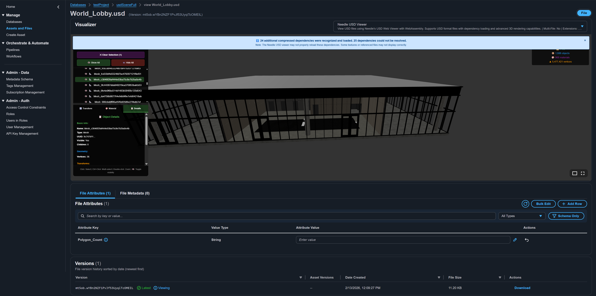
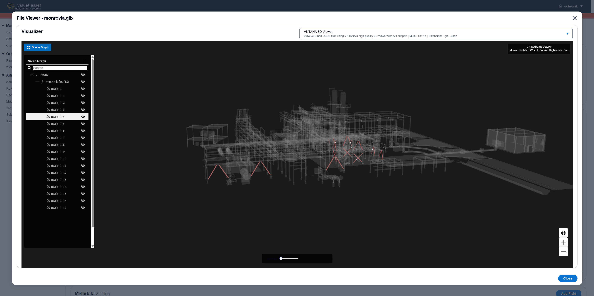
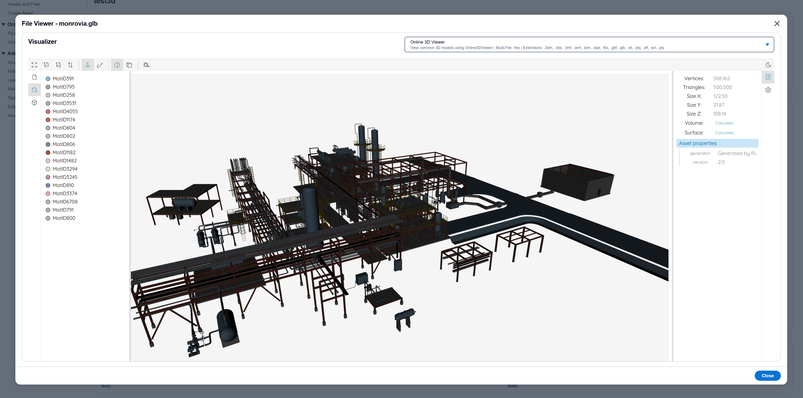

# File Viewers

VAMS includes a plugin-based viewer system that enables browser-based visualization of 3D models, point clouds, media files, documents, and data -- without requiring desktop software or specialized licenses. This page is the single source of truth for all built-in viewers and their supported file extensions.

VAMS ships **21 built-in viewer plugins** across five categories. Fourteen are available in every deployment. The remaining seven are conditional:

-   **Two licensed viewers** — VNTANA and VEERUM, both [add-ons](../developer/addons-overview.md) — ship disabled and require both a vendor license and enabling them in the viewer configuration.
-   **Four viewers require `app.webUi.allowUnsafeEvalFeatures`** — Needle USD, the SuperSplat Editor, ThatOpen IFC BIM, and the Robotics Data Viewer. Their loaders use `eval`, so VAMS does not offer them at all when a deployment has not enabled that setting.
-   **The Physna Viewer** appears only when the Physna Sync add-on is enabled.

The [master viewer table](#master-viewer-table) lists all 21; any other page quoting a viewer count is checked against this one.

## What are file viewers

File viewers are browser-based rendering components that display asset files directly in the VAMS web interface. When you open a file from the file manager, VAMS finds the viewers that support its file extension. If only one viewer supports it, VAMS opens the file in that viewer. If several do, VAMS lists them in a dropdown in the viewer UI and opens the file once you choose one; you can switch between them from the same dropdown.

The viewer system is built on a **plugin architecture**. Each viewer is an independent module with its own dependencies, configuration, and supported file types. New viewers can be added without modifying any core system code -- only a configuration entry and the viewer component are required.

### How viewer selection works

1. VAMS reads the file extension (e.g., `.glb`, `.e57`, `.pdf`) from the last part of the file name. A leading dot does not start an extension and a trailing dot leaves none, so `README`, `LICENSE`, `.gitignore` and `file.` have no extension, `.eslintrc.json` has `.json`, and `.env.example` has `.example`.
2. All enabled viewers that support that extension are identified. A file with no extension is matched by the viewers that accept files without one: the Text Viewer, and the Text Diff Viewer for comparisons.
3. If exactly one viewer matches, VAMS opens the file in it.
4. If multiple viewers match, the dropdown lists them with the **lowest priority number** first, and VAMS loads none of them until you choose one. You can then switch between them from the same dropdown.
5. If the file has a preview image, the file page also offers a **Preview** option that shows the image in the **Preview Viewer**, including for a file whose extension no viewer matches.

---

## Viewer categories

Viewers are organized into five categories based on the type of content they render.

### 3D

Interactive 3D model, point cloud, CAD, BIM, USD, and Gaussian splat viewing. The viewers cover a wide range of spatial data formats, from mesh files (glTF, OBJ, FBX) to point clouds (E57, LAS) to Building Information Models (IFC) to Universal Scene Description (USD). Some 3D viewers support multi-file mode, allowing multiple files to be loaded into a single scene.

### Media

Image, video, and audio playback. The Image Viewer shows each image fitted to the viewer panel. The Video Player and Audio Player provide standard browser-native playback controls.

### Document

Rendering of PDF, HTML, and text-based files. The Text Viewer provides syntax highlighting for over 20 programming and configuration file types, and also opens files that have no extension, such as `README`, `LICENSE`, `Makefile` or `.gitignore`.

Before it shows a file, the Text Viewer reads the first 8 KiB and checks that it is text. When the file contains binary data, such as an image saved without an extension or a renamed archive, the viewer shows a **Binary file** notice instead of the content and does not download the rest of the file; download the file to open it in an application that supports its format. The Text Diff Viewer shows the same notice on the binary side of a comparison while the other side still renders. Text in UTF-8 (with or without a byte-order mark) and in UTF-16 with a byte-order mark is displayed. UTF-32, and UTF-16 without a byte-order mark, are not supported and show a notice that names the encoding.

### Data

Tabular display of columnar data formats (CSV and FCS files), and playback of robotics logs (MCAP, ROS 1 and ROS 2 bags, PX4 ULog) in the Robotics Data Viewer. Other tabular formats, including R serialization (`.rds`) and Apache Parquet (`.parquet`), have no dedicated viewer; when such a file has a preview image, the file page's **Preview** option shows it in the Preview Viewer.

### Preview

Displays a file's preview image when you choose the **Preview** option on the file page, which offers that option only for a file that has a preview image. The Preview Viewer matches all file extensions as a wildcard (priority 10) but is used only for that option and is never listed among a file's viewers, so the file view of a file with no dedicated viewer reports that no compatible viewers were found.

---

## Master viewer table

This table is the definitive reference for all built-in viewer plugins. It is also the source of the [SYSTEM GenAI metadata pipeline](../pipelines/system-genai-metadata.md)'s input allow list: every extension an enabled viewer supports (excluding the Preview Viewer's wildcard), plus the `.docx`, `.pptx`, and `.xlsx` office formats, is analyzed for attributes and metadata on upload.

| Viewer Name                           | Category | Supported Extensions                                                                                                                                                                                 | Priority | Multi-File | Notes                                                                                                                                                                                                                                                                                                                                                                                             |
| ------------------------------------- | -------- | ---------------------------------------------------------------------------------------------------------------------------------------------------------------------------------------------------- | -------- | ---------- | ------------------------------------------------------------------------------------------------------------------------------------------------------------------------------------------------------------------------------------------------------------------------------------------------------------------------------------------------------------------------------------------------- |
| **Three.js Viewer**                   | 3D       | `.gltf`, `.glb`, `.obj`, `.fbx`, `.stl`, `.ply`, `.dae`, `.3ds`, `.3mf`, `.usd`, `.usda`, `.usdc`, `.usdz`, `.stp`, `.step`, `.iges`, `.igs`, `.brep`                                                | 1        | No         | Primary mesh, USD and CAD viewer. Scene graph, material editing, transform controls. Loads the files a model references from the same asset (see [Referenced files](#referenced-files-in-the-threejs-viewer)), but renders one selected file at a time. USD needs no `ALLOWUNSAFEEVAL`. CAD formats (`.stp`, `.step`, `.iges`, `.igs`, `.brep`) require WASM and `ALLOWUNSAFEEVAL`.               |
| **Potree Viewer**                     | 3D       | `.e57`, `.las`, `.laz`, `.ply`                                                                                                                                                                       | 1        | No         | Octree-based point cloud streaming. Requires the Potree preprocessing pipeline. Shows latest version only.                                                                                                                                                                                                                                                                                        |
| **BabylonJS Gaussian Splat Viewer**   | 3D       | `.ply`, `.spz`, `.splat`, `.sog`                                                                                                                                                                     | 1        | No         | Gaussian splat visualization with WebXR support. Opens SPZ versions 2 and 3 and bundled `.sog`. An SPZ version 4 file shows a message instead; where `ALLOWUNSAFEEVAL` is enabled, the message points to the SuperSplat Editor.                                                                                                                                                                   |
| **Needle USD Viewer (Experimental)**  | 3D       | `.usd`, `.usda`, `.usdc`, `.usdz`                                                                                                                                                                    | 1        | No         | Universal Scene Description via WebAssembly. Requires `ALLOWUNSAFEEVAL`. Experimental -- may not display all USD files correctly or load all dependencies.                                                                                                                                                                                                                                        |
| **ThatOpen IFC BIM Viewer**           | 3D       | `.ifc`, `.ifczip`                                                                                                                                                                                    | 1        | No         | Industry Foundation Classes (BIM) via the open-source That Open Engine (web-ifc, WebAssembly). Spatial model tree, element properties, hide/isolate, section planes, and measurements. Uses the multithreaded WASM build when cross-origin isolation is available and falls back to single-thread otherwise. Requires `ALLOWUNSAFEEVAL`.                                                          |
| **SuperSplat Editor (PlayCanvas)**    | 3D       | `.ksplat`, `.lcc`, `.ply`, `.sog`, `.splat`, `.spz`                                                                                                                                                  | 1        | No         | Full PlayCanvas SuperSplat Gaussian-splat **editor** UI embedded via iframe (scene panel, transform/selection tools, camera animation, export menus). Default viewer for splat formats. Sole viewer for `.lcc` (XGRIDS multi-LOD). Requires `ALLOWUNSAFEEVAL` and a WebGPU-capable browser. Editing/export is local-only (not saved back to VAMS). Use bundled `.sog` rather than unbundled SOGS. |
| **Online 3D Viewer**                  | 3D       | `.amf`, `.bim`, `.off`, `.wrl`                                                                                                                                                                       | 2        | Yes        | AMF, BIM, OFF, and VRML formats.                                                                                                                                                                                                                                                                                                                                                                  |
| **Online 3D Viewer (Rhinoceros 3D)**  | 3D       | `.3dm`                                                                                                                                                                                               | 2        | Yes        | Rhinoceros 3D models through the same Online3DViewer bundle. Requires `ALLOWUNSAFEEVAL`: the rhino3dm library it loads for `.3dm` compiles with `eval`.                                                                                                                                                                                                                                           |
| **Cesium 3D Tileset Viewer**          | 3D       | `.json`                                                                                                                                                                                              | 2        | No         | 3D Tileset viewing with geospatial capabilities via the CesiumJS engine (`@cesium/engine`) with VAMS custom scene controls.                                                                                                                                                                                                                                                                       |
| **PlayCanvas Gaussian Splat Viewer**  | 3D       | `.ply`, `.sog`                                                                                                                                                                                       | 5        | No         | Gaussian splat visualization with orbit camera and auto-focus.                                                                                                                                                                                                                                                                                                                                    |
| **VNTANA 3D Viewer**                  | 3D       | `.glb`                                                                                                                                                                                               | 2        | No         | Licensed viewer for high-quality GLB rendering. See [Licensed viewers](#licensed-viewers).                                                                                                                                                                                                                                                                                                        |
| **VEERUM 3D Viewer**                  | 3D       | `.e57`, `.las`, `.laz`, `.ply`, `.json`                                                                                                                                                              | 2        | Yes        | Licensed viewer for point clouds and 3D tilesets. Requires Potree pipeline. Shows latest version only. See [Licensed viewers](#licensed-viewers).                                                                                                                                                                                                                                                 |
| **Physna Viewer**                     | 3D       | `.3ds`, `.asm`, `.catpart`, `.catproduct`, `.glb`, `.iam`, `.iges`, `.igs`, `.ipt`, `.jt`, `.obj`, `.par`, `.prt`, `.sldasm`, `.sldprt`, `.stl`, `.step`, `.stp`, `.x_b`, `.x_t`                     | 5        | No         | Embeds the Physna-hosted 3D/CAD viewer through a VAMS authorization proxy. Requires the Physna Sync add-on. See [Add-on viewers](#add-on-viewers).                                                                                                                                                                                                                                                |
| **Image Viewer**                      | Media    | `.png`, `.jpg`, `.jpeg`, `.svg`, `.gif`                                                                                                                                                              | 1        | No         | Image fitted to the viewer panel. Loads on first use, like every viewer.                                                                                                                                                                                                                                                                                                                          |
| **Video Player**                      | Media    | `.mp4`, `.webm`, `.mov`, `.mkv`, `.m4v`                                                                                                                                                              | 1        | No         | Standard browser-native playback controls.                                                                                                                                                                                                                                                                                                                                                        |
| **Audio Player**                      | Media    | `.mp3`, `.wav`, `.ogg`, `.aac`, `.flac`, `.m4a`                                                                                                                                                      | 1        | No         | Standard browser-native playback controls.                                                                                                                                                                                                                                                                                                                                                        |
| **PDF Viewer**                        | Document | `.pdf`                                                                                                                                                                                               | 1        | No         | Navigation, zoom, and page management controls.                                                                                                                                                                                                                                                                                                                                                   |
| **HTML Viewer**                       | Document | `.html`                                                                                                                                                                                              | 1        | No         | Renders HTML presentations and documents.                                                                                                                                                                                                                                                                                                                                                         |
| **Text Viewer**                       | Document | `.txt`, `.json`, `.xml`, `.html`, `.htm`, `.yaml`, `.yml`, `.toml`, `.ini`, `.ipynb`, `.inf`, `.cfg`, `.md`, `.sh`, `.csv`, `.py`, `.log`, `.js`, `.ts`, `.sql`, `.ps1`, and files with no extension | 1        | No         | Syntax highlighting for 20+ text file types. Shows a notice instead of binary content.                                                                                                                                                                                                                                                                                                            |
| **Columnar Data Viewer**              | Data     | `.fcs`, `.csv`                                                                                                                                                                                       | 2        | No         | Tabular data display with column headers.                                                                                                                                                                                                                                                                                                                                                         |
| **Robotics Data Viewer (Lichtblick)** | Data     | `.mcap`, `.bag`, `.db3`, `.ulg`, `.ulog`                                                                                                                                                             | 1        | Yes        | Lichtblick web app embedded via iframe: plots, 3D scene, images and raw messages on one shared timeline. Several `.mcap` files open on one timeline, and the files of a ROS 2 split bag open together. Requires `ALLOWUNSAFEEVAL`. See [Robotics data viewer](#robotics-data-viewer).                                                                                                             |
| **Preview Viewer**                    | Preview  | `*` (all extensions)                                                                                                                                                                                 | 10       | No         | Displays a file's preview image when you choose the file page's **Preview** option, which appears only for a file that has one. Not offered in the **File** view.                                                                                                                                                                                                                                 |

---

## File extension to viewer mapping

This table provides a quick lookup from file extension to the viewer(s) that handle it. When more than one viewer is available for an extension, VAMS does not open the file automatically: the viewer dropdown lists the viewers with the lowest priority number first, and the file opens once you choose one. You can switch to any other listed viewer from the same dropdown.

### 3D model extensions

| Extension        | Default Viewer                   | Other Available Viewers |
| ---------------- | -------------------------------- | ----------------------- |
| `.3dm`           | Online 3D Viewer (Rhinoceros 3D) | --                      |
| `.3ds`           | Three.js Viewer                  | --                      |
| `.3mf`           | Three.js Viewer                  | --                      |
| `.amf`           | Online 3D Viewer                 | --                      |
| `.bim`           | Online 3D Viewer                 | --                      |
| `.brep`          | Three.js Viewer                  | --                      |
| `.dae`           | Three.js Viewer                  | --                      |
| `.fbx`           | Three.js Viewer                  | --                      |
| `.glb`           | Three.js Viewer                  | VNTANA 3D Viewer        |
| `.gltf`          | Three.js Viewer                  | --                      |
| `.ifc`           | ThatOpen IFC BIM Viewer          | --                      |
| `.ifczip`        | ThatOpen IFC BIM Viewer          | --                      |
| `.iges`          | Three.js Viewer                  | --                      |
| `.igs`           | Three.js Viewer                  | --                      |
| `.obj`           | Three.js Viewer                  | --                      |
| `.off`           | Online 3D Viewer                 | --                      |
| `.step` / `.stp` | Three.js Viewer                  | --                      |
| `.stl`           | Three.js Viewer                  | --                      |
| `.wrl`           | Online 3D Viewer                 | --                      |

The tables in this section list the viewers available in every deployment. The Physna Viewer adds a further set of proprietary CAD formats -- `.asm`, `.catpart`, `.catproduct`, `.iam`, `.ipt`, `.jt`, `.par`, `.prt`, `.sldasm`, `.sldprt`, `.x_b`, `.x_t` -- and becomes an additional choice for several of the formats above, but only on a deployment with the Physna Sync add-on enabled. See [Add-on viewers](#add-on-viewers).

### Point cloud and Gaussian splat extensions

| Extension | Default Viewer                                                                                  | Other Available Viewers                            |
| --------- | ----------------------------------------------------------------------------------------------- | -------------------------------------------------- |
| `.e57`    | Potree Viewer                                                                                   | VEERUM 3D Viewer                                   |
| `.las`    | Potree Viewer                                                                                   | VEERUM 3D Viewer                                   |
| `.laz`    | Potree Viewer                                                                                   | VEERUM 3D Viewer                                   |
| `.ksplat` | SuperSplat Editor (PlayCanvas)                                                                  | --                                                 |
| `.lcc`    | SuperSplat Editor (PlayCanvas)                                                                  | --                                                 |
| `.ply`    | Potree Viewer, BabylonJS Gaussian Splat Viewer, Three.js Viewer, SuperSplat Editor (PlayCanvas) | PlayCanvas Gaussian Splat Viewer, VEERUM 3D Viewer |
| `.sog`    | BabylonJS Gaussian Splat Viewer, SuperSplat Editor (PlayCanvas)                                 | PlayCanvas Gaussian Splat Viewer                   |
| `.splat`  | BabylonJS Gaussian Splat Viewer, SuperSplat Editor (PlayCanvas)                                 | --                                                 |
| `.spz`    | BabylonJS Gaussian Splat Viewer (SPZ v2, v3), SuperSplat Editor (PlayCanvas) (SPZ v2-v4)        | --                                                 |

:::info[PLY files and multiple viewers]
The `.ply` extension is used for both point cloud data and Gaussian splat data. Three viewers match at priority 1 (Potree, BabylonJS Gaussian Splat, Three.js), and the SuperSplat Editor is a fourth when `ALLOWUNSAFEEVAL` is enabled. `.spz` likewise matches the BabylonJS Gaussian Splat Viewer, which opens SPZ versions 2 and 3, and, when `ALLOWUNSAFEEVAL` is enabled, the SuperSplat Editor, which also opens SPZ version 4. VAMS presents all compatible viewers and you can select the appropriate one for your data type.
:::

### USD extensions

| Extension | Default Viewer  | Other Available Viewers                                  |
| --------- | --------------- | -------------------------------------------------------- |
| `.usd`    | Three.js Viewer | Needle USD Viewer (Experimental), with `ALLOWUNSAFEEVAL` |
| `.usda`   | Three.js Viewer | Needle USD Viewer (Experimental), with `ALLOWUNSAFEEVAL` |
| `.usdc`   | Three.js Viewer | Needle USD Viewer (Experimental), with `ALLOWUNSAFEEVAL` |
| `.usdz`   | Three.js Viewer | Needle USD Viewer (Experimental), with `ALLOWUNSAFEEVAL` |

:::info[USD files and two viewers]
Without `ALLOWUNSAFEEVAL`, the Three.js Viewer is the only USD viewer and opens USD files directly. With `ALLOWUNSAFEEVAL` enabled, the Needle USD Viewer and the Three.js Viewer both match at priority 1, so VAMS lists both and you choose one. An operator who wants only Needle for USD removes the four USD extensions from the `threejs-viewer` entry in `viewerConfig.json`.
:::

:::warning[Needle USD Viewer -- Experimental]
The Needle USD Viewer is experimental. It may not display all USD files correctly or load all file dependencies, particularly with compressed USDC files or complex scene hierarchies with external references. The Three.js Viewer opens the same formats without `ALLOWUNSAFEEVAL`. For production workflows requiring full USD composition, consider using a desktop USD viewer such as NVIDIA Omniverse or Pixar's usdview.
:::

### Referenced files in the Three.js Viewer

Many 3D formats name other files. The Three.js Viewer downloads those files from the same asset, through the same authenticated route as the model, before it renders:

| Format             | Referenced files the viewer loads                                                                 |
| ------------------ | ------------------------------------------------------------------------------------------------- |
| glTF (`.gltf`)     | Buffers (`.bin`) and images                                                                       |
| OBJ                | `mtllib` material libraries (`.mtl`) and the textures they name (`map_*`, `bump`, `disp`, `norm`) |
| COLLADA (`.dae`)   | Images named in `<library_images>`                                                                |
| 3DS, FBX           | Textures the model requests (FBX textures embedded in the file need no download)                  |
| USD (all four)     | References, payloads and asset-valued attributes such as texture files, layer by layer            |
| GLB, STL, PLY, 3MF | None: these files are self-contained                                                              |

A name resolves relative to the folder of the file that names it, and the file must exist under exactly that key (keys are case-sensitive). The viewer does not download a name that points above the asset's top folder, an absolute path, or a URL with a scheme (`http:`, `https:`, `file:`, `omniverse:`, `//host`); those, and files that are not in the asset, render without their content, and a notice on the viewer lists them. Limits for one model: 256 referenced files, 512 MiB in total, 256 MiB for one file, and 8 levels of references. A `.usdz` is checked before it is opened: it may hold at most 10,000 entries and expand to at most four times its size plus 64 MiB.

For USD, the viewer packages the root layer and every file it loaded into an in-memory `.usdz` and composes that. UDIM texture sets (`<UDIM>`), a `.usdz` referenced from another layer, and references written in a binary (`.usdc`) layer are not composed; a binary layer's textures are. three.js does not compose sublayers (`subLayers`), so the viewer does not download them and lists each one in the notice as not shown by this viewer. Scenes that place their geometry in sublayers or behind variant sets or payloads may compose only in part or not at all; when a scene opens but nothing in it can be drawn, the viewer says so instead of showing an empty view. Flattening such a scene into one layer (for example with `usdcat --flatten`) usually lets it display. Packaging a scene as one `.usdz` keeps every file it needs together.

### Media extensions

| Extension        | Default Viewer | Other Available Viewers |
| ---------------- | -------------- | ----------------------- |
| `.aac`           | Audio Player   | --                      |
| `.flac`          | Audio Player   | --                      |
| `.gif`           | Image Viewer   | --                      |
| `.jpg` / `.jpeg` | Image Viewer   | --                      |
| `.m4a`           | Audio Player   | --                      |
| `.m4v`           | Video Player   | --                      |
| `.mkv`           | Video Player   | --                      |
| `.mov`           | Video Player   | --                      |
| `.mp3`           | Audio Player   | --                      |
| `.mp4`           | Video Player   | --                      |
| `.ogg`           | Audio Player   | --                      |
| `.png`           | Image Viewer   | --                      |
| `.svg`           | Image Viewer   | --                      |
| `.wav`           | Audio Player   | --                      |
| `.webm`          | Video Player   | --                      |

:::info[Video formats and browser support]
The Video Player plays a file through the browser's built-in `<video>` element, so a file plays only when the browser can open its container and decode its codecs. `.mp4`, `.m4v`, and `.webm` are broadly supported. `.mov` and `.mkv` play in some browsers and not in others. When the browser cannot open a file, the player shows `Error: Failed to load video file`; a file whose video codec the browser cannot decode may play only its audio track. Chrome, Edge, Firefox, and Safari cannot open AVI (`.avi`), Flash Video (`.flv`), or Windows Media Video (`.wmv`) files, so VAMS offers no viewer for them. Download these files to play them in a desktop media player.
:::

### Document and data extensions

| Extension        | Default Viewer       | Other Available Viewers                    |
| ---------------- | -------------------- | ------------------------------------------ |
| `.cfg`           | Text Viewer          | --                                         |
| `.csv`           | Text Viewer          | Columnar Data Viewer                       |
| `.fcs`           | Columnar Data Viewer | --                                         |
| `.htm`           | Text Viewer          | --                                         |
| `.html`          | HTML Viewer          | Text Viewer                                |
| `.inf`           | Text Viewer          | --                                         |
| `.ini`           | Text Viewer          | --                                         |
| `.ipynb`         | Text Viewer          | --                                         |
| `.js`            | Text Viewer          | --                                         |
| `.json`          | Text Viewer          | Cesium 3D Tileset Viewer, VEERUM 3D Viewer |
| `.log`           | Text Viewer          | --                                         |
| `.md`            | Text Viewer          | --                                         |
| `.pdf`           | PDF Viewer           | --                                         |
| `.ps1`           | Text Viewer          | --                                         |
| `.py`            | Text Viewer          | --                                         |
| `.sh`            | Text Viewer          | --                                         |
| `.sql`           | Text Viewer          | --                                         |
| `.toml`          | Text Viewer          | --                                         |
| `.ts`            | Text Viewer          | --                                         |
| `.txt`           | Text Viewer          | --                                         |
| `.xml`           | Text Viewer          | --                                         |
| `.yaml` / `.yml` | Text Viewer          | --                                         |
| (no extension)   | Text Viewer          | --                                         |

A file with no extension opens in the Text Viewer, and two versions of it, or the file and a text file such as `LICENSE` and `LICENSE.txt`, can be compared in the Text Diff Viewer. A selection that mixes a file with no extension and a file no text viewer reads, such as `README` and `model.glb`, has no viewer.

### Robotics log extensions

| Extension | Default Viewer                    | Other Available Viewers |
| --------- | --------------------------------- | ----------------------- |
| `.bag`    | Robotics Data Viewer (Lichtblick) | --                      |
| `.db3`    | Robotics Data Viewer (Lichtblick) | --                      |
| `.mcap`   | Robotics Data Viewer (Lichtblick) | --                      |
| `.ulg`    | Robotics Data Viewer (Lichtblick) | --                      |
| `.ulog`   | Robotics Data Viewer (Lichtblick) | --                      |

These extensions have a viewer only when `ALLOWUNSAFEEVAL` is enabled.

---

## Viewer screenshots

### USD viewer (Needle Engine) -- Experimental

### VEERUM point cloud viewer

### VNTANA 3D viewer

### Three.js 3D model viewer

---

## WebAssembly requirements

Several viewers depend on WebAssembly (WASM) modules for rendering. WASM-based viewers require a Cross-Origin Isolation (COI) service worker to enable `SharedArrayBuffer` support in the browser. VAMS includes this service worker automatically in production deployments.

The following viewers use WASM:

| Viewer                             | WASM Library                                              | Required Feature Flag |
| ---------------------------------- | --------------------------------------------------------- | --------------------- |
| Needle USD Viewer (Experimental)   | `usd-wasm`                                                | `ALLOWUNSAFEEVAL`     |
| Cesium 3D Tileset Viewer           | `@cesium/engine` (draco/KTX2 decoding)                    | None                  |
| SuperSplat Editor (PlayCanvas)     | PlayCanvas engine (WebGL shader compilation)              | `ALLOWUNSAFEEVAL`     |
| Three.js Viewer (CAD formats only) | OpenCascade (`opencascade.js`)                            | `ALLOWUNSAFEEVAL`     |
| ThatOpen IFC BIM Viewer            | `web-ifc` (That Open Engine)                              | `ALLOWUNSAFEEVAL`     |
| Robotics Data Viewer (Lichtblick)  | Lichtblick (SQLite for `.db3`, decompression for `.mcap`) | `ALLOWUNSAFEEVAL`     |

:::warning[Content Security Policy]
Enabling `ALLOWUNSAFEEVAL` adds `unsafe-eval` to the Content Security Policy `script-src` directive. This is required by the SuperSplat Editor, by the Robotics Data Viewer, and by WASM loaders for OpenCascade, Needle USD, web-ifc (the ThatOpen IFC BIM viewer), and rhino3dm (the Online 3D Viewer's `.3dm` support). Review this setting with your organization's security team before enabling. Set `app.webUi.allowUnsafeEvalFeatures` to `true` in the CDK `config.json` to enable.
:::

The Three.js Viewer works without `ALLOWUNSAFEEVAL` for standard mesh formats (`.gltf`, `.glb`, `.obj`, `.fbx`, `.stl`, `.ply`, `.dae`, `.3ds`, `.3mf`) and for USD (`.usd`, `.usda`, `.usdc`, `.usdz`), which it parses in JavaScript. The WASM requirement applies only to CAD formats (`.stp`, `.step`, `.iges`, `.igs`, `.brep`) which use the OpenCascade library.

The ThatOpen IFC BIM Viewer uses the multithreaded `web-ifc-mt.wasm` build when cross-origin isolation is available (provided by the COI service worker) and transparently falls back to the single-threaded `web-ifc.wasm` otherwise. Both builds require `ALLOWUNSAFEEVAL`: the flag gates whether the viewer registers at all, so the thread mode does not affect it.

---

## Licensed viewers

Two viewer plugins are integrations with commercial products and require separate licenses to use.

| Viewer               | Vendor                            | Formats                                 | License Required |
| -------------------- | --------------------------------- | --------------------------------------- | ---------------- |
| **VNTANA 3D Viewer** | [VNTANA](https://www.vntana.com/) | `.glb`                                  | Yes              |
| **VEERUM 3D Viewer** | [Veerum](https://veerum.com/)     | `.e57`, `.las`, `.laz`, `.ply`, `.json` | Yes              |

Both licensed viewers ship disabled in the add-on viewer configuration (`web/src/visualizerPlugin/config/addonViewerConfig.json`), so neither appears in the viewer selector until its entry is set to `"enabled": true`. Enabling one also requires a valid license from the respective vendor: without a license the viewer will not render content. Contact the vendor directly for licensing details.

For more information on partner integrations, see [Partner Integrations](../additional/partner-integrations.md).

---

## Add-on viewers

Some viewers are provided by optional VAMS add-ons and are gated by a feature flag emitted from the backend. They only appear in the viewer selector when the corresponding add-on is enabled in the deployment configuration.

| Viewer            | Vendor                            | Formats                                                                                                                                                                          | Feature flag   | Add-on                                       |
| ----------------- | --------------------------------- | -------------------------------------------------------------------------------------------------------------------------------------------------------------------------------- | -------------- | -------------------------------------------- |
| **Physna Viewer** | [Physna](https://www.physna.com/) | `.3ds`, `.asm`, `.catpart`, `.catproduct`, `.glb`, `.iam`, `.iges`, `.igs`, `.ipt`, `.jt`, `.obj`, `.par`, `.prt`, `.sldasm`, `.sldprt`, `.stl`, `.step`, `.stp`, `.x_b`, `.x_t` | `PHYSNA_ADDON` | `app.addons.usePhysnaSync.enabled` is `true` |

The Physna Viewer renders the Physna-hosted 3D/CAD viewer inside VAMS. A VAMS-authorized endpoint applies both authorization tiers and returns a Physna viewer token to the browser, which then loads the viewer directly from Physna; the Physna client credentials stay in AWS Secrets Manager and never reach the browser. That token carries no asset scope, so Physna-hosted viewer access is flat across every synced database. See the [Physna Integration](../developer/physna-integration.md#physna-viewer) developer guide for architecture, configuration, and the side effects of that limitation.

---

## SuperSplat editor

The SuperSplat Editor is VAMS's first iframe-embedded viewer. It hosts the complete PlayCanvas SuperSplat Gaussian-splat editor UI (https://github.com/playcanvas/supersplat, MIT license) as a self-hosted static build served from `/viewers/supersplat/`. The editor provides a full-featured interface with scene panel, transform and selection tools, camera animation controls, and render/export menus.

SuperSplat is the default viewer for all Gaussian splat formats it supports and the sole viewer for `.ksplat` files and `.lcc` files (XGRIDS proprietary multi-LOD Gaussian-splat format). When loading `.lcc` files, SuperSplat automatically selects the highest level-of-detail under 20 million Gaussians.

The viewer requires the `ALLOWUNSAFEEVAL` feature flag to be enabled in the deployment configuration. Without this flag, the SuperSplat Editor will not register in the viewer system. The editor renders through WebGPU and has no WebGL fallback: it runs in current Chrome and Edge, Safari 26 or later, and Firefox where WebGPU is enabled, and in any other browser it shows a startup message instead of the editor. Supported import formats are `.ksplat`, `.lcc`, `.ply` (including `.compressed.ply`), `.sog`, `.splat`, and `.spz`.

:::warning[Editing is not saved back to VAMS]
The SuperSplat editor's tools and export/download features operate in the browser. Edited or exported splats download to your local machine; VAMS does not currently persist edits back to the asset. Use a bundled single-file `.sog` for best results — unbundled SOGS (a `meta.json` with sibling `.webp` files) is not supported in the embedded editor.
:::

Files are delivered to the SuperSplat editor via presigned Amazon S3 URLs passed through a `?load=` query parameter. The presigned URLs enable direct range-request access to Amazon S3, supporting future streaming capabilities for large splat datasets.

:::note[The file URL is recorded in web logs]
Each SuperSplat view records its working presigned URL in the web access logs and, when `app.useWaf` is `true`, in the AWS WAF log group. See [SuperSplat Editor File URLs in Web Logs](../troubleshooting/known-limitations.md#supersplat-editor-file-urls-in-web-logs) for the log locations, how long they keep the URL, and the settings that limit it.
:::

---

## Robotics data viewer

The Robotics Data Viewer opens robotics logs in [Lichtblick](https://github.com/lichtblick-suite/lichtblick) (MPL-2.0), an open-source robotics visualization web app, embedded via iframe. VAMS builds Lichtblick v1.29.1 from source when the web application is installed and serves it from `/viewers/robotics/`. The app shows the recording on one shared timeline with its panels: plots, a 3D scene, images, raw messages, logs and the topic list. Layouts you arrange stay in your browser; VAMS does not store them.

The viewer opens with the **Topics** tab of its left sidebar, which lists each topic in the recording with its message type, rate and message count.

-   **Show a topic.** Drag the topic from the Topics list onto a panel that displays it, such as Raw Messages, Plot or 3D, or choose it in the panel's topic field or in the panel's settings. The gear icon in a panel's toolbar opens its settings in the sidebar's **Panel** tab.
-   **Add a panel.** The **Add panel** button in the app bar adds a panel, such as Plot, to the layout.
-   **ROS 2 bags.** Panels show the messages of a `.db3` recording during playback.

| Format             | Extensions      | How the file is read                                    | Several files at once                  |
| ------------------ | --------------- | ------------------------------------------------------- | -------------------------------------- |
| MCAP               | `.mcap`         | HTTP Range requests against the presigned Amazon S3 URL | Yes, merged on one timeline            |
| ROS 1 bag          | `.bag`          | HTTP Range requests                                     | No                                     |
| ROS 2 bag (SQLite) | `.db3`          | Downloaded whole, then opened in the browser            | Yes, the `.db3` files of one split bag |
| PX4 ULog           | `.ulg`, `.ulog` | Downloaded whole, then opened in the browser            | No                                     |

A selection opens in the viewer when all its files share one format, and its files may come from different assets: each file is authorized on its own asset, and a file you may not read, an archived version or a missing file is listed as that file's state while the other files open. A selection that mixes formats, or that has several `.bag` or `.ulg` files, is refused before any file is requested.

-   **Range-read formats.** An indexed `.mcap` opens after reading its summary at the end of the file, and seeking reads only the blocks the current time needs. The reader keeps up to 500 MiB of each file in memory; a file at or below that size is read in full in the background once it is open. An unindexed `.mcap` larger than 1 GiB cannot be opened (a Lichtblick limit).
-   **Whole-file formats.** `.db3` and `.ulg` files are downloaded in full before they open. The selection may total at most `customParameters.maxWholeFileBytes` (1 GiB by default, set on the `robotics-data-viewer` entry in `viewerConfig.json`); a larger selection is refused with a message naming each file, its size and the limit, before its contents are downloaded. When you select several files together, VAMS knows their sizes and refuses an oversized selection before it requests any download; for a single file, the viewer refuses it from the size Amazon S3 reports. A ROS 2 `.db3` carries no message definitions, so only messages of well-known ROS 2 types are decoded.
-   **Load errors.** An error the viewer meets while opening a file, including that size refusal, appears in the viewer's **Alerts** tab, next to its **Topics** tab.
-   **Presigned URL lifetime.** The viewer reads range-read files for as long as it is open. Once the presigned URL expires (`app.authProvider.presignedUrlTimeoutSeconds`, 24 hours by default), close and reopen the file.
-   **Extensions and User Scripts.** Lichtblick extensions are not available in VAMS: the viewer installs and loads none, and its Extensions settings say so. Dropping a `.foxe` extension file onto the viewer installs nothing and shows a message that extensions are not available. User Scripts are available: they are code you write in the viewer's User Scripts panel, and they run in your browser, in a web worker, which cannot read the page's local storage.
-   **Map panel base map.** The Map panel draws GPS fixes (`sensor_msgs/NavSatFix`, `foxglove.LocationFix`) and GeoJSON on a blank background. Its base map is made of tile images from a map server, and the Content Security Policy blocks them, so the browser requests no tile from a third-party server. To show a base map, allow a tile server that your organization operates or licenses: add its origin to `imgSrc` in `infra/config/csp/cspAdditionalConfig.json` (see [Content Security Policy](../deployment/configuration-reference.md#content-security-policy-infraconfigcspcspadditionalconfigjson)) and redeploy. Then, in the Map panel's settings, set **Tile layer** to **Custom** and enter the server's tile URL with the `{z}`, `{x}` and `{y}` placeholders. The panel's built-in **Map** and **Satellite** layers load from `tile.openstreetmap.org` and `server.arcgisonline.com`. The OpenStreetMap tile usage policy requires browser requests to carry a `Referer` header, and the viewer page sends none, so do not allow the OpenStreetMap tile servers; review any provider's terms before allowing its origin.

The viewer requires the `ALLOWUNSAFEEVAL` feature flag; without it, VAMS offers no viewer for these extensions. The build adds no source to the Content Security Policy: Lichtblick reads only from the VAMS web origin and the presigned Amazon S3 URLs, and from a tile server only when an operator allows one. An external asset bucket needs the CORS rule in [External Amazon S3 Setup](../deployment/external-s3-setup.md), which exposes the range headers the viewer reads.

Presigned URLs reach the embedded app only in the URL fragment of the viewer frame, which the browser never sends to a server, so they do not appear in the web access logs. The viewer page sends no `Referer`, and the app shows and stores file names instead of the URLs: in its title bar, in its data source name, and in the browser storage where it remembers recent sources.

---

## Related pages

-   [Viewer Plugin Development](../developer/viewer-plugins.md) -- How to create custom viewer plugins
-   [Web Interface Overview](../user-guide/web-interface.md) -- Using viewers in the web UI
-   [Viewer Plugins Reference](../additional/viewer-plugins.md) -- Detailed configuration field reference
-   [Files and Versions](files-and-versions.md) -- File concepts and operations
