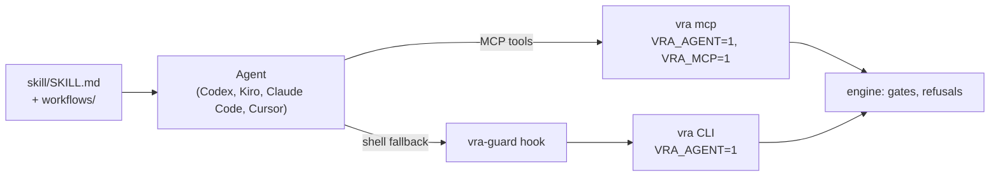

# Agent systems

An AI coding agent can drive release automation: it chooses the next action, resolves merge conflicts,
triages failures and writes the summary, while the engine performs every change and enforces every
gate. The package ships one agent skill and thin adapters for Codex, Kiro, Claude Code and Cursor. The primary
agent surface is the `vra mcp` server; the `vra` CLI is the fallback.

:::warning[Use at your own risk]
AI agents are used at your own risk. Configure their permissions according to your organizational
security standards, give the identities they run with only the access they need, and review every
change before it reaches a production environment.
:::

## How the pieces fit



| Layer                                                                                                                   | Role                                                                                                                  |
| ----------------------------------------------------------------------------------------------------------------------- | --------------------------------------------------------------------------------------------------------------------- |
| [`skill/`](https://github.com/awslabs/visual-asset-management-system/tree/main/tools/VamsReleaseAutomation/skill)       | The only source of agent behaviour: principles, exit-code branching, human approval points, the workflow procedures   |
| `vra mcp`                                                                                                               | The engine as MCP tools, in tiers, with structured errors                                                             |
| [`adapters/`](https://github.com/awslabs/visual-asset-management-system/tree/main/tools/VamsReleaseAutomation/adapters) | Per agent: load the skill, wire the MCP server, permission lists, the guard hook, headless settings                   |
| `vra-guard.py`                                                                                                          | Pre-tool-use hook for the shell fallback: blocks direct AWS and AWS CDK access, history rewrites and human-only flags |
| The engine                                                                                                              | Enforces every gate and refuses every human-only action for an agent                                                  |

The engine is the control. The adapters and the guard are a second layer that keeps an agent from
trying actions the engine would refuse anyway, or from going around the engine with `aws` or `cdk`.
IAM is the final boundary: give the identity an agent runs with credentials for the environments it may
touch, and no more.

## The MCP server

```bash
pip install -e 'tools/VamsReleaseAutomation[mcp]'   # see Installation
vra mcp            # stdio; started by the agent, not by hand
```

Each tool runs `vra --json --non-interactive ...` with `VRA_AGENT=1` and `VRA_MCP=1`, so the same gates
and exit codes apply as on the CLI. Tools are registered in tiers chosen by the server's environment, the
same model as the VAMS MCP server:

| Tier  | Enabled by                                | Tools                                                                                                                                                                                                                                                                                                                                                                                                    |
| ----- | ----------------------------------------- | -------------------------------------------------------------------------------------------------------------------------------------------------------------------------------------------------------------------------------------------------------------------------------------------------------------------------------------------------------------------------------------------------------- |
| Read  | always                                    | `status`, `report`, `ledger_validate`, `ledger_show`, `ledger_diff`, `ledger_graph`, `preflight`, `sync_dry_run`, `history_verify`, `history_show`, `home_show`, `iam_verify`, `pipeline_status`                                                                                                                                                                                                         |
| Write | `VRA_MCP_ENABLE_WRITES=true`              | `sync`, `merge`, `merge_continue`, `build`, `deploy`, `test`, `backup`, `reindex` (deploy, test, backup and reindex only on environments without `requiresApproval`), `resume`, `watch`, `iam_plan`, `pipeline_plan`, `pipeline_sync_ledger`                                                                                                                                                             |
| Gated | `VRA_MCP_ENABLE_GATED=true` (with writes) | `deploy` and `reindex` on approval-gated environments, `promote`, `data_copy` (each needs an `approval` record); `rollback`, `restore`, `migrate` (an `approval` record on approval-gated environments); `pipeline_deploy` (the engine refuses a human-only plan for an agent: a first deploy, IAM changes, removed approvals) and `pipeline_push_source`, for which every adapter asks the person first |

Human-only actions are never exposed. A non-zero exit becomes a tool error whose text is JSON:

```json
{
    "exitCode": 10,
    "meaning": "BLOCKED_ON_IT",
    "message": "deploy.dev.preflight: 3 actions denied; see IT-REQUEST-1.md",
    "runId": "deploy-20260110T101500Z-1a2b",
    "status": "BLOCKED_ON_IT",
    "itRequests": ["..."],
    "result": {}
}
```

`VRA_MCP_TIMEOUT_SECONDS` (default six hours) bounds one tool call. The server finds the home like the
CLI (`VRA_HOME`, then the pointer `vra setup` wrote).

## Supported agents

| Agent       | Install                                                  | MCP wiring                                                   | Guard hook                                                              | Headless                                                           |
| ----------- | -------------------------------------------------------- | ------------------------------------------------------------ | ----------------------------------------------------------------------- | ------------------------------------------------------------------ |
| Claude Code | [Installation: Claude Code](installation.md#claude-code) | `.mcp.json` server `vra`, enabled in `.claude/settings.json` | `PreToolUse` on `Bash`                                                  | `claude -p --agent vra-release-operator --permission-mode dontAsk` |
| Kiro        | [Installation: Kiro](installation.md#kiro)               | `mcpServers.vra` in each agent file in `.kiro/agents/`       | `preToolUse` on the shell tool                                          | `kiro-cli chat --no-interactive --agent vra-cron-operator`         |
| Codex       | [Installation: Codex](installation.md#codex)             | `[mcp_servers.vra]` in `.codex/config.toml`                  | `PreToolUse` in `.codex/hooks.json`                                     | `codex exec --profile vra-cron`                                    |
| Cursor      | [Installation: Cursor](installation.md#cursor)           | `.cursor/mcp.json` server `vra`                              | `beforeShellExecution` and `beforeMCPExecution` in `.cursor/hooks.json` | `agent -p --force --trust --approve-mcps` (gated tier off)         |

Each adapter installs into the package root (the agent's working directory) and keeps the shared home
out of the paths the agent can write. [Installation](installation.md) has the steps, the files, workspace
trust, verification, cron, upgrade and uninstall per agent; each adapter's README in
[`adapters/`](https://github.com/awslabs/visual-asset-management-system/tree/main/tools/VamsReleaseAutomation/adapters)
has the full permission model.

The shipped configurations enable the read and write tiers; the gated tier is off. Turn it on only for
an interactive session in which you want the agent to run an approval-gated action you asked for (Kiro
ships it as the separate agent `vra-gated-operator`; Claude Code reads `VRA_MCP_ENABLE_GATED` from the
environment it starts in; Codex reads it from `.codex/config.toml`; Cursor reads it from its own
environment through `.cursor/mcp.json`). The engine still requires an approval record.

### Cursor

The Cursor adapter guards MCP calls as well as shell calls. Its `beforeMCPExecution` hook allows the read
and write tools of the `vra` server, asks for `deploy` and the gated tools, denies a human-only tool name
or parameter, asks for a `vra` tool it does not know, and denies every other MCP server unless
`VRA_GUARD_MCP_ALLOW` lists it. Every hook fails closed, and Cursor merges hook decisions with deny over ask
over allow, so user or enterprise hooks cannot loosen them. `.cursor/cli.json` gives the Cursor CLI the
same allow and deny lists as the Claude Code settings. Cursor cloud agents do not run
`beforeMCPExecution` hooks; they run `preToolUse` (tool name `MCP:<tool>`), which the adapter also wires
to the guard, with "ask" turned into "deny" because `preToolUse` does not enforce ask. Cloud agents do not
see the shared home either: run release work in the editor or the CLI on an operator machine.
`adapters/install.sh cursor --dest <workspace>` writes the package's absolute path into the hook commands,
so a workspace opened elsewhere still finds the guard.

The Cursor CLI's support for project hooks is not verified, so headless Cursor is allowlist-only: the cron
script runs `agent -p` without `--force`, and only the commands `.cursor/cli.json` `permissions.allow`
lists run.

### Trust the workspace

Each agent loads project configuration only from a trusted folder. Until the package root is trusted,
Claude Code ignores the project permission allow list, Kiro loads no agents, hooks or MCP servers from the
folder (without `--trust-workspace`), Codex ignores project rules, hooks and configuration, and Cursor
runs no project hooks. Accept the
trust prompt once per machine, then run the adapter's post-install check.

Never run an agent for this package with a mode that skips hooks or permissions (`claude --bare`,
`--dangerously-skip-permissions`, `kiro-cli chat --trust-all-tools`, `agent --force`). The engine's
refusals and IAM still apply, but every agent-side control is gone.

## The CLI fallback

When the MCP server is not connected, or for a command that has no tool (`vra setup`, `vra setup
--join`, `vra merge --abort`, `vra home sync`), the agent runs `vra --json ...` in a shell. Every adapter
sets `VRA_AGENT=1` for the shell and runs the guard before each shell command. The guard is
deny-by-default for `vra`: only known subcommands pass, and every human-only flag and command is blocked,
in every spelling (`vra`, `python -m vra`, `uv run vra`). It also blocks `aws`, `cdk` and AWS SDK
one-liners in any spelling, commands whose target cannot be read (`eval`, `source`, a variable as the
command name, a shell reading a script or its input), force pushes, ref and branch deletion, history
rewrites and tag moves. Wrappers are read with their option values (`env -u VRA_AGENT`, `nice -n 5`,
`timeout -s KILL 5`, `stdbuf -o L`, `flock <file>`, `setsid`, `chrt`, `ionice`, `taskset`, `sudo -u`,
`xargs -I`), and `env -S '...'` and `flock -c '...'` are checked as command lines. Programs that run a
command the guard cannot see (`script`, `busybox`, `su`, `runuser`, `unbuffer`, `expect`, `tmux`, ...)
are blocked, and so is any other program whose arguments name `aws`, `cdk` or `git push`.

`vra pipeline plan`, `status` and `sync-ledger` pass; `vra pipeline deploy`, `push-source` and
`sync-ledger --deploy` ask the person (Cursor `ask`; the other agents' ask lists).

The guard runs on Python 3.9 and later (the hooks use the host's `python3`, and Amazon Linux 2023 ships
3.9). It fails closed: an internal error blocks, and every hook command ends in `|| exit 2`, so a missing
interpreter or a moved package blocks every command instead of letting it through.

Even with a pseudo terminal (`script -qc`) and `VRA_AGENT` cleared, an agent cannot confirm a human-only
action by typing: the engine accepts a typed confirmation only at a person's own terminal (no agent or CI
marker, no wrapper's pseudo terminal, no agent CLI in the parent process chain), and otherwise only an
approval record. See [Approvals and gates](approvals-and-gates.md#human-only-actions).

## Human-only actions

The engine refuses these for an agent (exit `20`, `result.humanOnly`), and the agent hands the person
the exact command: `resume --confirm`, `resume --takeover`, `vra unlock`, `--writes-stopped`,
`--abort-workflow-executions`, `--allow-missing-scanners`, `vra ledger import`,
`vra ledger upgrade-config --write`, `vra setup --force`, `vra home migrate` and `vra iam apply`.
An agent may run `vra iam plan` and `vra iam verify`. `--emergency`,
`--allow-replacements`, `--accept-drift` and `--include-auth-tables` are gate waivers the agent never
passes. See [Approvals and gates: human-only actions](approvals-and-gates.md#human-only-actions).

An agent may run `vra setup` (without `--force`) and `vra setup --join`: they create or join a home and
change no environment. A permission prompt in the agent is not a release approval: steps the skill marks
**[HUMAN]** need the person's explicit answer in the conversation.

## Headless cron

One script runs a watch cycle for every agent system:

```bash
# /etc/cron.d/vra
17 6 * * *  vra-bot  VRA_PACKAGE=/opt/vra/VamsReleaseAutomation /opt/vra/VamsReleaseAutomation/adapters/shared/vra-cron.sh --agent kiro
```

[`vra-cron.sh`](https://github.com/awslabs/visual-asset-management-system/blob/main/tools/VamsReleaseAutomation/adapters/shared/vra-cron.sh)
runs `vra watch` with no agent, then branches on its exit code the same way for every agent:

| Exit code       | Action                                                                                      |
| --------------- | ------------------------------------------------------------------------------------------- |
| `0`             | Done; watch wrote its report                                                                |
| `20`, `30`, `1` | The agent triages (conflicts the path policy allows, test failures) with the gated tier off |
| `10`, `40`      | `vra report --notify`; no agent                                                             |

Everything in the script runs with `VRA_AGENT=1` and `VRA_AGENT_SESSION=cron-<agent>`. Before an agent
triages, a canary checks that the guard blocks a direct `aws` call (and, for Cursor, that `cli.json`
allows no catch-all and denies `aws` and `cdk`); when it does not, the script notifies and runs no agent.
No agent is needed for a green run, and nothing in this path can reach an approval-gated environment. Run it as a dedicated user with credentials for the
auto-deploy environments only. `--agent none` runs the watch cycle without any agent.

## Adding an agent system

An agent system needs four things to work with this package:

1. **Instructions**: load `skill/SKILL.md` (most agents read Agent Skills, `AGENTS.md` or a steering
   file that points at it). Do not restate its rules; point at it.
2. **The MCP server**: start `vra mcp` over stdio with `VRA_AGENT=1` and the tier variables, and allow the
   read and write tools without a prompt.
3. **A pre-execution hook** for its shell tool (and its MCP tool calls, if the agent has such a hook) that
   pipes the event to `python3 adapters/shared/vra-guard.py` and treats exit `2` as a block, or reads the
   JSON decision the guard prints in Cursor mode (`--format cursor`). The guard reads
   `tool_input.command` as a string or an argv list; add the agent's field name to `extract_command()` if
   it differs, with a test.
4. **Headless mode**: add a branch for the agent to `adapters/shared/vra-cron.sh` with the gated tier off
   and a mode that refuses anything not pre-approved.

Then run `make check`: the agent policy check compares the human-only set across the engine, the skill,
the MCP server, the guard and the Kiro, Claude Code and Cursor permission lists. See
[Developer guide: extending](developer-extending.md#agent-systems).

## Related pages

-   [Agentic Development](../../developer/agentic-development.md)
-   [Approvals and gates](approvals-and-gates.md)
-   [Command reference: exit codes](command-reference.md#exit-codes)
