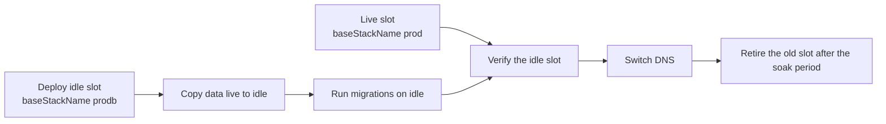

# Backups, restore and migrations

This page describes how `vra` protects an environment's data around a change: the checkpoint it takes
before every deploy, how it restores one, how it chains the VAMS data migrations for a version change,
and when a change needs an A/B (blue/green) deployment.

## Checkpoints

`vra backup --env E` takes a checkpoint; every `vra deploy` takes one before it changes anything (unless
it is the first install or `backupBeforeDeploy: false`). A checkpoint holds:

-   an Amazon DynamoDB on-demand backup of every table listed under the environment's AWS Systems Manager
    Parameter Store prefix, and each table's point-in-time recovery (PITR) status;
-   a manifest of the current Amazon S3 object versions of every bucket the environment uses, including
    every asset bucket registered in VAMS, with each bucket's default-encryption key;
-   optionally (`cognitoExport: true`), an Amazon Cognito user export.

The checkpoint manifest is written to `checkpoints/` in the shared home and its id to the run and the
environment history. Before the backup, the registered asset buckets are listed again, and a bucket or
AWS KMS key the role cannot be shown to use stops the backup with an IT request (exit `10`). Gated
environments refuse a checkpoint with warnings (PITR off, versioning off, a backup that did not complete in
time) unless `backup.allowDegraded`. Keep PITR enabled on every table so you can also restore to any
second within the recovery window. See
[Productionizing VAMS: backups](../productionizing/backups.md).

## Restore

```bash
vra restore --env test --checkpoint <checkpoint-id> [--approval <id|path>]
```

Restoring an approval-gated environment needs an approval record with subject `restore:<checkpointId>`.
VAMS owns its tables through AWS CloudFormation, so the engine restores each table to a temporary table
and copies the items back into the CDK-owned table instead of replacing it:

1. Gate, preflight and a `pre-restore` safety checkpoint.
2. The registered asset buckets are listed again. A bucket the role cannot be shown to use stops the
   restore with an IT request (exit `10`), and a bucket another environment of the ledger uses stops it
   with `20`, naming that environment.
3. The VAMS workflow executions still running are listed and reported.
4. Every temporary-table restore starts at once (`vra-restore-<base>-<region>-<key>-<tag>`; a
   `LimitExceededException` waits and retries).
5. **Write freeze** (below).
6. Each live table is cleared and reloaded from its restored copy, and verified: the live item count
   equals the items copied, checked before any object changes.
7. Each bucket is rolled back to the recorded object versions and verified: the latest object set equals
   the checkpoint's. An object whose latest version already has the recorded ETag and size is not copied
   again.
8. **Settle**: waits `writeFreeze.settleSeconds` (default 60) until the item counts are stable, and
   reports the rows VAMS's own Amazon S3 event processing wrote in response to the rolled-back objects
   (`derivedWrites`; reported, not undone).
9. The freeze is lifted, the Amazon OpenSearch Service indexes are rebuilt with the VAMS reindex utility,
   the temporary tables are deleted, and the history record is written.

The access tables (`apiKeyStorage`, `authEntitiesStorage`, `rolesStorage`, `userRolesStorage`) are left
as they are, so a restore does not bring back revoked keys or roles. `--include-auth-tables` restores them
too; on gated environments it needs an approval scoped `restore-auth-tables`.

A resumed restore whose frozen part is complete does not freeze or ask again. If the frozen part fails
or parks, the freeze is still lifted and the environment stays locked (dirty) because its tables
changed. Rehearse restores on a non-production environment on a schedule; see
[Productionizing VAMS: disaster recovery](../productionizing/disaster-recovery.md).

### Write freeze

Restore (also inside a rollback) and data copy (on the target) clear and reload live tables only while
writes are frozen. The freeze is a pluggable interface with these backends (`writeFreeze.backend` in
`env.yaml`, or `--write-freeze`):

| Backend            | What happens                                                                                                                                                                                                                             | When                                                                       |
| ------------------ | ---------------------------------------------------------------------------------------------------------------------------------------------------------------------------------------------------------------------------------------- | -------------------------------------------------------------------------- |
| `maintenance-mode` | `vra` turns the VAMS maintenance-mode switch on before the reload and restores its previous value afterwards                                                                                                                             | Only when the deployed VAMS publishes the switch (detected, never assumed) |
| `manual`           | A person stops writes (announces the window, pauses integrations, uploads and pipelines) and confirms it: `--writes-stopped`, or `vra resume <run-id> --confirm` when the run parks waiting for it. `vra` records who confirmed and when | Every environment; production still needs its approval record              |
| `auto` (default)   | `maintenance-mode` when supported, otherwise `manual`                                                                                                                                                                                    | -                                                                          |

Both confirmations are human-only. Running workflow executions are only listed and reported;
`--abort-workflow-executions` (human-only) stops them with AWS Step Functions `StopExecution`.

## Data migrations

VAMS ships data migration scripts under `infra/deploymentDataMigration/v<A>_to_v<B>/upgrade/`. Each
directory holds a `v<A>_to_v<B>_migration.py` and a `_migration_config.json` whose
`resource_names_ssm_param_prefix` field tells the script which tables to read through Parameter Store.
Read the repository at your target version for the transitions it has.

```bash
vra --dry-run migrate --env test
vra --dry-run migrate --env test --from <deployed version> --to <target version> --build <build id>
```

`vra deploy` runs the migrations of its own version delta. A standalone `vra migrate` resolves what is
not given on the command line:

| Value               | With vra deploy history                  | Without it (an environment imported with `vra ledger import`)                                                    |
| ------------------- | ---------------------------------------- | ---------------------------------------------------------------------------------------------------------------- |
| Migration scripts   | the deployed build's bundle              | `--source <VAMS tree>/infra/deploymentDataMigration`, else the newest build in the home with a synth for the env |
| `--to` (target)     | that build's VAMS version                | the build's VAMS version, or `VAMS_VERSION` in `infra/config/config.ts` of the `--source` tree                   |
| `--from` (deployed) | the version the last vra deploy replaced | the deployed core stack's version, from its description `(version:X.Y.Z)`, as `vra deploy` reads it              |

The run records each value and where it came from in its `migrate.versions` step. When a value cannot
be determined (no build and no `--source`, a stack description without a version, no core stack), the
run stops with exit `20` and names the flag to pass. Reading the core stack needs
`cloudformation:DescribeStacks` on it (the `CoreStackVersionRead` statement of the migrate manifest).

1. **Discover**: reads the migration directories of the bundle or the source tree.
2. **Order**: builds the chain of transitions from the deployed version to the target.
3. **Annotate**: reads
   [`upgrade-matrix.yaml`](https://github.com/awslabs/visual-asset-management-system/blob/main/tools/VamsReleaseAutomation/engine/vra/data/upgrade-matrix.yaml),
   which records per transition `requiresAB`, `resolvesViaSsm` (older scripts need explicit table names,
   given in `env.yaml` `migrations.configOverrides.<id>`), `manualSteps` and `notes`. Skip a transition
   with `migrations.skip: [<id>]`.
4. **Manual steps**: a transition with `manualSteps` stops before it with exit `20` and lists them. Do
   the work, then run `vra resume <run-id> --confirm`.
5. **Dry run**: each script first runs in its own dry-run mode. With `--dry-run`, only the plan and the
   dry runs happen.
6. **Apply**: only after the deploy's checkpoint exists, each script runs with
   `--confirm-account <account-id> --yes`, so it can never run against another account.

`vra deploy` embeds this chain: checkpoint, data-protection gate, migration plan and A/B check,
`cdk deploy`, then per migration the window re-check, manual-step confirmation, dry run and apply, then
the smoke. The dry runs happen after `cdk deploy`, because a new version's scripts can need tables the
deploy creates.

## In-place and A/B deployment

### In-place

The default. `vra deploy` runs `cdk deploy` against the existing stacks. Use it when no data-bearing
resource is replaced and no forward-only change is involved. The data-protection gate stops an in-place
deploy that would replace or remove a data-bearing resource, and the upgrade matrix stops one whose
transition requires A/B, before anything changes.

### A/B

Some upgrades cannot be expressed as an in-place update: a change that replaces a stateful resource, a
switch between Amazon CloudFront and an Application Load Balancer, or a transition the VAMS migration
documentation marks as A/B-only. Deploy a second stack beside the first and move traffic after you
verify it.



```bash
vra deploy --env prod --build cust-vX.Y.Z-1 --mode ab --approval cust-vX.Y.Z-1
```

```yaml
# ledger/envs/prod/env.yaml
ab:
    slots: { blue: prod, green: prodb } # baseStackName per slot
    slotOverlays: # deep-merged into that slot's config.json at synth
        blue: { app: { useAlb: { domainHost: vams-blue.example.com } } }
        green: { app: { useAlb: { domainHost: vams-green.example.com } } }
    dnsSwitchHook: ./hooks/switch-dns.sh # optional; gets VRA_ENV, VRA_FROM_SLOT, VRA_TO_SLOT, VRA_TARGET_STACK, VRA_SSM_PREFIX
    slotLiveTest: { green: { webUrl: "https://vams-green.example.com" } } # optional per-slot test URLs
```

`vra build` synthesizes both slots when `ab` is set. In A/B mode `vra` deploys to the idle slot (the one
not recorded as live), copies the live slot's data into it (the remap engine of the
[data copy](data-copy.md), with a direct scan), runs the migration chain against the idle slot, runs the
smoke against it, then runs `ab.dnsSwitchHook`. Without a hook it stops with `20`: switch DNS yourself,
then run `vra resume <run-id> --confirm`. If anything fails before the switch, DNS is not touched. `vra`
never deletes the old slot.

On the Application Load Balancer path VAMS names the web application bucket after the domain host, so
each slot needs its own `ab.slotOverlays.<slot>.app.useAlb.domainHost`; `vra ledger validate` refuses A/B
on ALB without distinct hosts, and warns for custom domains without per-slot hosts.

## Forward-only changes

Some changes are not undone by redeploying an older build. Recover from them with the checkpoint, not
with `cdk deploy` of the previous version.

| Change                                     | Why it is forward-only                                                                  | Recovery                                                                        |
| ------------------------------------------ | --------------------------------------------------------------------------------------- | ------------------------------------------------------------------------------- |
| Amazon Cognito user pool schema attributes | An attribute cannot be modified or removed once created; a redeploy that drops it fails | Plan the schema before production; recover users from an export into a new pool |
| Data migration that rewrites records       | The older build's code expects the older shape                                          | Restore the checkpoint, then redeploy the older build                           |
| Resource replacement that discards data    | The old resource and its data are gone                                                  | Restore from the checkpoint or from PITR                                        |

The data-protection gate flags Amazon Cognito schema and retention-policy changes; review the diff report and
the VAMS release notes before you approve a promotion, and prefer A/B for schema-class changes.

## Related pages

-   [Data copy](data-copy.md)
-   [Update the solution](../update-the-solution.md)
-   [Productionizing VAMS: backups](../productionizing/backups.md)
