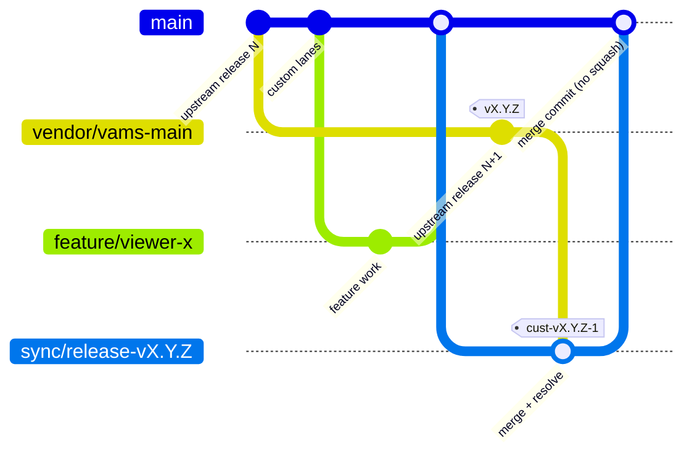

# Branch strategy

This page describes how to set up and maintain a customer fork of VAMS so that upstream releases merge
cleanly and your custom code stays separate and auditable.

## Branch and tag model

| Ref                                     | Contents                                                                         | Moved by                   | Protection                                                      |
| --------------------------------------- | -------------------------------------------------------------------------------- | -------------------------- | --------------------------------------------------------------- |
| `upstream/main`, `upstream/development` | The awslabs repository                                                           | Upstream only              | Read-only remote                                                |
| `vendor/vams-main`                      | Fast-forward-only mirror of upstream `main`, release tags kept                   | `vra sync`                 | Only the automation identity may push; no force-push            |
| `vendor/vams-development`               | Fast-forward-only mirror of upstream `development`                               | `vra sync`                 | Same as above                                                   |
| `main` (trunk)                          | `vendor/vams-main` merged with your custom code                                  | Merge requests only        | Required review, required checks, no force-push, no direct push |
| `preview/main`                          | `vendor/vams-development` merged with your custom code; feeds `dev-preview` only | `vra merge --lane preview` | Only the automation identity may push; no force-push            |
| `sync/<lane>-<ref>`                     | Short-lived merge branch, for example `sync/release-vX.Y.Z`                      | `vra merge`                | Deleted after its merge request merges                          |
| `feature/*`                             | Your feature work, merged into `main` by merge request                           | Your developers            | Normal                                                          |
| `<tagPrefix>v<vams>-<n>`                | Immutable promotable builds, for example `cust-vX.Y.Z-3`                         | `vra build`                | Protected tags; never moved or deleted                          |

The trunk name is configurable in `vra.yaml` (`trunk`). This guide uses `main`.



`vra build` tags the commit it built. In the release lane that is the `sync/*` merge commit, which
`vra watch` deploys to `dev` before the merge request merges. Merging with a merge commit keeps that
tagged commit an ancestor of the trunk, which `vra promote` requires.

## Set up the fork

### Step 1: Create the fork repository

Create an empty private repository on your git host (GitHub, GitLab, Bitbucket, AWS CodeCommit, or a
plain git server). An empty repository is preferred over a host-side "fork" button because it lets you
control visibility and branch protection from the start.

### Step 2: Clone upstream and add the remotes

```bash
git clone https://github.com/awslabs/visual-asset-management-system.git <customer>-vams
cd <customer>-vams
git remote rename origin upstream
git remote add origin https://git.example.com/<customer>/<customer>-vams.git
git fetch upstream --tags
```

### Step 3: Create the vendor mirrors

```bash
git switch -c vendor/vams-main upstream/main
git push -u origin vendor/vams-main
git switch -c vendor/vams-development upstream/development
git push -u origin vendor/vams-development
git push origin --tags
```

From now on only `vra sync` moves these branches, and only by fast-forward. If upstream ever rewrites
history, `vra sync` stops with exit code `20` instead of overwriting the mirror.

The vendor mirrors carry upstream's own CI workflow files. On a git host that runs workflows on any
branch push, a push to `vendor/*` can run upstream-authored CI in your fork with your fork's CI
credentials. Exclude `vendor/**` from your CI triggers (GitHub Actions `on.push.branches-ignore`,
GitLab `workflow:rules`, AWS CodePipeline source branch filter), or set `githost.pushVendorBranches: false`
to keep the mirrors local to the automation host.

### Step 4: Create the trunk and the preview branch

Start the trunk from the release you are currently running, not from the newest tag, so the first
`vra watch` run exercises a real upgrade.

```bash
git switch -c main vX.Y.Z        # the VAMS release you run today
git push -u origin main
git switch -c preview/main vendor/vams-development
git push -u origin preview/main
```

If you already have custom code on an older branch, merge that branch into `main` now and record any
edits outside the fork lanes in the core-patch register (see below).

### Step 5: Protect branches and tags

| Rule                                       | `main`      | `vendor/*`          | `preview/main`      | Tags `<tagPrefix>v*` |
| ------------------------------------------ | ----------- | ------------------- | ------------------- | -------------------- |
| Block force-push and deletion              | Yes         | Yes                 | Yes                 | Yes                  |
| Require merge request with review          | Yes         | No                  | No                  | n/a                  |
| Require status checks (unit suites, synth) | Yes         | No                  | No                  | n/a                  |
| Restrict who can push                      | Merge only  | Automation identity | Automation identity | Automation identity  |
| Require signed commits or tags             | Recommended | Optional            | Optional            | Recommended          |

### Step 6: Record the fork in the ledger

Run `vra setup` (see [Setup and joining](setup.md)). It records the upstream URL, fork URL, git
host type, trunk name, tag prefix and lane sources in `vra.yaml`.

## Why merge, never rebase

`vra merge` merges the vendor branch into a `sync/<lane>-<ref>` branch cut from the trunk with
`git merge --no-ff`, then opens a merge request into the trunk. It never rebases your work onto
upstream, and its push guard refuses force pushes, `+` refspecs and branch deletion.

Merge the sync merge request with a **merge commit**, not squash or rebase: `vra promote` refuses a
build whose commit is not an ancestor of the trunk, and a squash merge creates a new commit that the
tested build never contained.

-   **Upstream commit IDs are preserved.** Every upstream commit in your history has the same SHA as in
    the awslabs repository, so you can prove exactly which upstream release you run with
    `git merge-base --is-ancestor vX.Y.Z main`.
-   **Your history is never rewritten.** Protected branches and signed tags stay valid, and no one has to
    force-push.
-   **Each upgrade is one reviewable merge commit.** The merge commit shows the conflict resolutions in
    one place, which is what a change reviewer or auditor needs.
-   **Rollback is a revert.** A bad upgrade is undone with `git revert -m 1 <merge>` plus a redeploy of the
    previous build, instead of reconstructing a rebased branch.

## Keep custom code in the VAMS fork lanes

VAMS provides fork extension points. Each aggregated list (API routes, handlers, permission types, web
routes, navigation, viewers, CLI commands, MCP tools, CDK resources) has a core part, an add-on part and a
custom part. Upstream ships the custom files as empty stubs and does not change the single line that
splices them in, so code placed there almost never conflicts on upgrade. The authoritative list is
[Extending VAMS in a Fork](../../developer/customizing-vams.md); the default path policy treats these
paths as fork-owned:

| Lane                                          | Paths                                                                                                                                          |
| --------------------------------------------- | ---------------------------------------------------------------------------------------------------------------------------------------------- |
| Backend API routes, constants, resource names | `backend/backend/custom/`                                                                                                                      |
| Backend handlers                              | `backend/backend/handlers/custom/`                                                                                                             |
| Backend models                                | `backend/backend/models/custom/`                                                                                                               |
| Authentication override hooks                 | `backend/backend/customConfigCommon/`                                                                                                          |
| CDK resources (own nested stack)              | `infra/lib/nestedStacks/custom/`                                                                                                               |
| CDK resource-name keys and feature switches   | `infra/common/custom*.ts`                                                                                                                      |
| Fork settings                                 | `infra/config/custom/` (for example `customConfig.json`)                                                                                       |
| Web routes, navigation, services, pages       | `web/src/custom/`                                                                                                                              |
| Viewer plugins                                | `web/src/visualizerPlugin/**/custom*`, `web/src/visualizerPlugin/viewers/custom/**`, `web/src/visualizerPlugin/config/customViewerConfig.json` |
| Viewer install steps                          | `web/customInstalls/custom/`                                                                                                                   |
| CLI constants and commands                    | `tools/VamsCLI/vamscli/custom_*`, `tools/VamsCLI/vamscli/commands/custom/`                                                                     |
| CLI API client                                | `tools/VamsCLI/vamscli/utils/custom_api_client.py`                                                                                             |
| MCP tools                                     | `tools/VamsMCP/vams_mcp/custom_tools.py`                                                                                                       |

Use the VAMS naming conventions for custom additions (`/custom/...` API paths, `custom/<name>` resource
name keys, `custom-*` CLI command and viewer IDs, `custom_*` MCP tool names) so they never collide with a
future upstream name.

Deployment configuration is not code. Keep each environment's `infra/config/config.json`,
`customConfig.json`, CSP additions and SAML or OIDC configuration in the ledger as overlays (see
[Configuration reference: overlays](configuration-reference.md#overlays)), not committed to the trunk.

## Merge path policy

The ledger file `path-policy.yaml` tells `vra merge` how to resolve each path that git could not merge
cleanly. Rules are evaluated in order and the first matching glob wins. Paths listed in
`core-patches.md` always resolve as `agent`, before any rule. `vra setup` writes the default policy
(`engine/vra/data/defaults/path-policy.yaml`; `ledger-template/path-policy.yaml` is the same file).

| Strategy     | Meaning                                                                         | Typical paths                                                                                    |
| ------------ | ------------------------------------------------------------------------------- | ------------------------------------------------------------------------------------------------ |
| `upstream`   | Take the vendor side                                                            | `infra/config/config.json` (ledger-managed); any path you give an explicit `upstream` rule       |
| `fork`       | Keep the trunk side                                                             | The fork lanes above, including `infra/config/custom/**` (`customConfig.json` is customer-owned) |
| `union`      | Keep both sides' lines (`git merge-file --union`)                               | `CHANGELOG.md`, `**/revisions.md`                                                                |
| `regenerate` | Take upstream, then run the rule's `regenerate` command in the file's directory | `**/package-lock.json`, `**/poetry.lock`, `**/uv.lock`                                           |
| `agent`      | Leave for the agent, which proposes a resolution and runs affected suites       | Files in the core-patch register; any path no rule matches (`default: agent`)                    |

```yaml
# path-policy.yaml (excerpt)
default: agent
rules:
    - glob: "**/package-lock.json"
      strategy: regenerate
      regenerate: "npm install --package-lock-only --ignore-scripts"
    - { glob: "backend/backend/custom/**", strategy: fork }
    - { glob: "web/src/custom/**", strategy: fork }
    - { glob: "infra/config/custom/**", strategy: fork }
    - { glob: "infra/config/config.json", strategy: upstream }
    - { glob: "CHANGELOG.md", strategy: union }
    - { glob: "infra/lib/nestedStacks/apiBuilder/**", strategy: agent } # force review of a core area
unregisteredCoreEdits: refuse
```

There is no catch-all rule: a conflict on a path no rule covers goes to the agent (`default: agent`), so
nothing is overwritten silently. Before merging, `vra merge` also lists the files the fork changed since
its last upstream merge (modified, deleted or renamed upstream files) that no rule and no `core-patches.md`
entry covers, and stops with `20` naming them (`merge.core-audit`). Register every core edit in
`core-patches.md`, or give it an explicit rule; `unregisteredCoreEdits: warn` only reports them. To let
upstream win every unregistered conflict, add `{ glob: "**/*", strategy: upstream }` as the last rule;
that is an explicit, reviewed choice in your ledger and counts as registering every path.

The default policy also resolves `tools/VamsReleaseAutomation/**` as `upstream`: the release
automation tool itself is upstream code and is upgraded with each release.

A conflict that no rule resolves is written to `state/runs/<run-id>/conflicts.json` in the shared home
and the run exits with code `20`; the merge stays in progress on the `sync/*` branch in the fork clone
of the machine that ran it (`~/.cache/vra/<home id>/repo`), so resolve it on that machine. The agent reads that file,
resolves each path, runs the affected suites, `git add`s the files and runs
`vra merge --continue --run-id <run-id>`, which commits, pushes and opens the merge request. If it
cannot resolve the conflict, it writes an escalation report for a developer; `vra merge --abort
--run-id <run-id>` abandons the merge.

## Core-patch register

A core patch is any edit you make outside the fork lanes. Every core patch is a merge risk on each
upgrade, so `vra` tracks them in the ledger file `core-patches.md`:

```markdown
| ID     | Path                                                        | Reason               | Upstream issue or PR | Added      | Remove when           |
| ------ | ----------------------------------------------------------- | -------------------- | -------------------- | ---------- | --------------------- |
| CP-001 | infra/lib/nestedStacks/apiBuilder/apiBuilder-nestedStack.ts | Extra stage variable | (link)               | 2026-10-01 | Upstream ships a hook |
```

The goal is for this table to trend to zero. For each entry, either move the change into a fork lane,
contribute a generic version upstream, or ask upstream for a new extension point. `vra` reads the
backticked paths on each table or bullet row of this file; a conflict on one of them always goes to
the agent (`conflicts.json`), so every touched entry is reviewed.

A fix you want to keep out of the fork's history until upstream ships it can live in the ledger as a
unified diff, `core-patches/<name>.patch`, listed on a bullet row of the same file. Every build and IAM
plan applies it to its scratch copy of the fork and records it in the build manifest; once the fork or
upstream contains the change, the build reports the patch as `present`, and you remove the entry. The
package ships two such patches: CP-431, the permission boundary fix for GitHub issue #431 (needed on
VAMS v2.6.6 and earlier; present from v2.6.7), and CP-1210, the API deployment fix for GitHub issue
#1210 after a role-prefix switch
([IAM for strict environments](iam-for-strict-environments.md#permission-boundary-mode-and-github-issue-431)).

## Contribute generic fixes upstream

A fix that is not specific to your organization belongs upstream: it removes a core patch and every
future merge cost that comes with it.

1. Reproduce the defect on an unmodified `vendor/vams-development` checkout.
2. Search the upstream issues and pull requests for an existing report or fix.
3. Read the upstream `CONTRIBUTING.md` and follow it. VAMS pull requests target the `development`
   branch.
4. Cut a branch from `vendor/vams-development` (not from your trunk) so the change contains no
   customer code, and remove any customer names, account IDs, domains and internal references.
5. Report security issues privately as the upstream security policy describes; do not open a public
   issue for an unpatched vulnerability.
6. After the fix ships in a release, remove the matching core patch and its `path-policy.yaml` rule.

## Related pages

-   [Workflows: sync and merge](workflows.md#sync-and-merge)
-   [Environments and topologies](environments-and-topologies.md)
