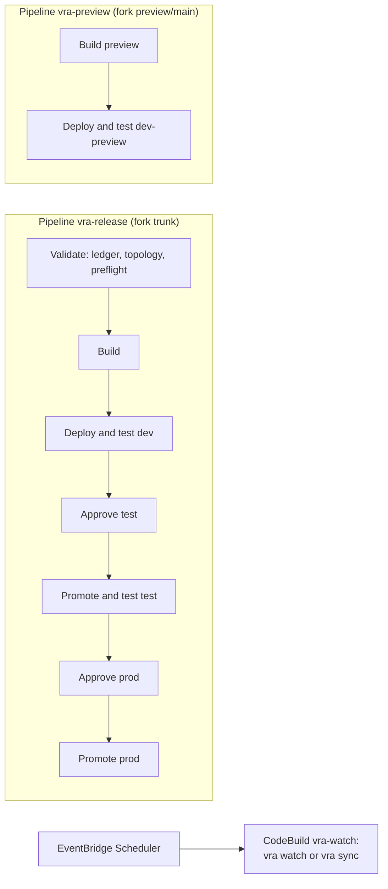

# CI/CD and AWS CodePipeline

The `vra` CLI runs on any host. If your organization standardizes on managed CI/CD,
[`cicd/`](https://github.com/awslabs/visual-asset-management-system/tree/main/tools/VamsReleaseAutomation/cicd)
provides templates that run the same commands in a pipeline. No template re-implements a gate: every job
calls `vra`, so switching between an operator host and a pipeline never changes what is allowed.

| Template                                | Use it when                                                                                            |
| --------------------------------------- | ------------------------------------------------------------------------------------------------------ |
| AWS CodePipeline and AWS CodeBuild      | Build hosts must run inside your AWS accounts; AWS CodePipeline manual approvals gate each environment |
| GitHub Actions                          | The fork or the home repository is on GitHub; see [GitHub Actions](github-actions.md)                  |
| GitLab CI                               | The home repository is on GitLab; protected environments with deployment approvals                     |
| Generic (Jenkins, Azure Pipelines, ...) | Any other CI system, with the generic identity contract                                                |

Operators and pipelines can be mixed: a scheduled watch in CI, promotions from an operator host, or the
reverse. They share one [shared home](shared-home.md), so they see the same runs, locks and history.
`automation.mode` in `vra.yaml` records the mix; [Automation tiers](automation-tiers.md) explains the
four tiers and how to choose one.

## The shared home in CI

Every job works on the same home as every operator machine.
[`vra-home.sh`](https://github.com/awslabs/visual-asset-management-system/blob/main/tools/VamsReleaseAutomation/cicd/codebuild/scripts/vra-home.sh)
gives a job its copy: it clones the home repository (`VRA_HOME_REPO`, branch `VRA_HOME_REF`) or reuses the
CI's checkout, pulls before the job reads state, and publishes at the end of the job, also after a
failure. A push rejected because another job moved first is lock contention (exit `20`).

| `stateStore.type` | What the jobs share                                           | Home repository access per job   |
| ----------------- | ------------------------------------------------------------- | -------------------------------- |
| `home` (default)  | Everything through the home repository (`sync.type: git`)     | Read and push (`VRA_HOME_TOKEN`) |
| `s3`              | Locks, history and run state in Amazon S3 and Amazon DynamoDB | Read only; nothing is pushed     |

With git sync, every job that runs `vra` pushes state, including build and test jobs, which run fork code
(`npm ci`, Playwright). `vra-home.sh` and the engine refuse to publish a job's changes outside `state/`,
`artifacts/` and `checkpoints/`, and in CI a gated environment takes its approval from the platform, not
from `ledger/approvals/`. Where fork code must hold no write access to the home repository, use
`stateStore.type: s3` and give the jobs a read-only clone. Protect `ledger/**` and `vra-home.yaml` with
branch rules (changes through reviewed pull requests only). Bundles move between jobs as CI artifacts,
so every environment deploys the bytes the build produced.

A job holds only its own execution's bundle, so a rollback to the previous build needs that build's
bundle from somewhere else. With `stateStore.type: home`, the pipeline stack sets `VRA_BUNDLE_STORE`
(`s3://<artifact bucket>/vra-bundles`) on its build, deploy and test jobs. The build copies each bundle
there once (create-only, 16 files at a time, `manifest.json` last; `VRA_STORE_WORKERS` changes the
number), and a rollback fetches the previous one. It deploys that bundle only when its
`manifest.json` matches the `manifestSha256` the environment's deploy record holds. A build id names
one bundle forever. When an execution builds a commit that already has a bundle in the store, the build
reuses it if it is still valid (same core patches and IAM settings), and pulls it instead of
synthesizing. Otherwise it takes the next free build id (for example `cust-v2.6.6-11` after
`cust-v2.6.6-10`, after a `vra iam apply`) and leaves the stored bundle as it is. An upload that finds
another manifest under its id writes nothing. With `stateStore.type: s3`, bundles already live in the
state bucket. Deploy records written before 0.5.0 have
no `manifestSha256`; for those builds the bundle's own `manifest.sha256` is the only check.

## Topology from the ledger

`vra --json ledger graph` defines the job graph. No template reads `env.yaml` itself, so no CI file can
disagree with the engine about a gate:

-   **AWS CodePipeline**: one stage per depth of the promotion graph, siblings in parallel, a manual approval
    only before environments that require one. The Validate stage fails when the ledger's topology changed
    since the pipeline was deployed.
-   **GitHub Actions, GitLab CI, generic**: `ci_graph.py render --platform github|gitlab|generic` prints the
    deploy jobs or steps (`--lane preview` for the preview lane); the validate job runs `ci_graph.py check`
    and fails on any difference, including a test step that misses a suite the ledger requires.
-   Deploy jobs ask the ledger whether an environment needs an approval (`ci_graph.py requires-approval`) and
    pass `--approval` only then: an ungated promoted environment gets no record, a gated root gets one
    scoped `deploy`.

Any topology from [Environments and topologies](environments-and-topologies.md) works without code
changes.

## AWS CodePipeline and AWS CodeBuild



The [`cicd/pipeline/`](https://github.com/awslabs/visual-asset-management-system/tree/main/tools/VamsReleaseAutomation/cicd/pipeline)
AWS CDK app creates, in the tools account, the release and preview pipelines, one AWS CodeBuild project pair
per environment (deploy projects run one build at a time), the scheduled watch, an AWS KMS key for
artifacts and logs, and notifications. It applies the cdk-nag AwsSolutions checks; its tests fail on any
unsuppressed finding. AWS CodeBuild projects run as one IAM role per trust tier, and each environment's
deploy role trusts only its own tier:

| Tier role                             | Projects                                        | May assume                                  |
| ------------------------------------- | ----------------------------------------------- | ------------------------------------------- |
| `vra-codebuild-build-<region>`        | Build                                           | Only the build-only `vra-synth-<env>` roles |
| `vra-codebuild-dev-<region>`          | Validate, root ungated environments             | Only those environments' deploy roles       |
| `vra-codebuild-preview-<region>`      | dev-preview deploy and test                     | Only the preview environment's deploy role  |
| `vra-codebuild-watch-<region>`        | The scheduled watch, `vra pipeline push-source` | No environment role                         |
| `vra-codebuild-deploy-<env>-<region>` | Deploy and test of one other environment        | Only `vra-deploy-<env>`                     |
| `vra-codebuild-test-<env>-<region>`   | Isolated tests (gated environments by default)  | Only `vra-test-<env>`                       |

The schedule and the build (which runs `npm ci`, unit suites and customer code in privileged Docker) hold
no credential that can deploy a gated environment; the pipeline's tests assert it. Only the watch tier may
write the Amazon S3 sources and start the pipelines, so the preview lane's upstream code cannot replace the
release source.

Every environment the pipeline runs therefore needs `deployRoleArn` in its `env.yaml` (IT deploys
`vra-deploy-role.yaml` as `vra-deploy-<env>`, trusting that environment's tier role), plus
`synthRoleArn` and, for isolated tests, `testRoleArn` (the same template with `CreateSynthRole=true` and
`CreateTestRole=true`). A local profile or ambient credentials do not exist inside AWS CodeBuild, so
`vra ledger validate` refuses an environment the pipeline runs without `deployRoleArn`.

### Plan and deploy the pipeline with vra

With `automation.mode` `hybrid`, `pipeline` or `pipeline+actions`, the pipeline's configuration lives in
`vra.yaml` (`automation.pipeline`) without its topology, and `vra` renders the rest from
`vra ledger graph`. No pipeline configuration file is edited by hand.

| Command                    | What it does                                                                                                                                                                                                         |
| -------------------------- | -------------------------------------------------------------------------------------------------------------------------------------------------------------------------------------------------------------------- |
| `vra pipeline plan`        | Renders the configuration, synthesizes the CDK app offline (cdk-nag applies), compares it with the deployed stack (read-only), and writes the IT package for the stack's own roles. `--offline` skips the comparison |
| `vra pipeline deploy`      | Synthesizes again and deploys only the planned template (`--plan <id>`); refuses a ledger or template that moved since the plan, and a plan made `--offline`                                                         |
| `vra pipeline status`      | Stack outputs, stage states, pending approvals, recent executions, and whether the deployed topology (output `TopologyDigest`) matches the ledger                                                                    |
| `vra pipeline sync-ledger` | Plans again when the ledger's topology moved away from the deployed pipeline; exits `20` until it is deployed (`--deploy` deploys under the same gates)                                                              |
| `vra pipeline push-source` | For an Amazon S3 source the stack created: uploads the fork branch (or `--package`, the release automation package) when its commit changed, and starts the pipeline                                                 |

Plans are recorded in `state/pipeline/plans/`, deploys in `state/pipeline/deploys/`. A first deploy, a plan
that changes IAM resources, and a plan that removes a manual approval are human-only (`pipeline-deploy`): a
person confirms at a terminal, or an approver of `automation.approvalEnv` writes a record with subject
`human:pipeline-deploy` and scope `pipeline-deploy`, passed with `--approval`. An agent gets exit `20` for
those. `vra pipeline deploy` recomputes the IAM changes and removed approvals against the deployed stack
right before `cdk deploy` and stops with exit `20` when they differ from the plan (another deploy changed
the stack, or the plan record was edited). Agents run `plan`, `status` and `sync-ledger`; every adapter
asks a person before `deploy` and `push-source`. The pipeline's own roles go to IT like the VAMS roles: `vra pipeline
plan` writes `state/iam/pipeline/<n>/`, and with `iamRoles.mode: precreated` a role missing from
`iamRoles.precreatedRoles` stops the plan with exit `10`.

### Sources

| Source type                                                                                        | What it needs                                                                                                                                                                                                          |
| -------------------------------------------------------------------------------------------------- | ---------------------------------------------------------------------------------------------------------------------------------------------------------------------------------------------------------------------- |
| `codeconnections` (`GitHub`, `GitHubEnterpriseServer`, `GitLab`, `GitLabSelfManaged`, `Bitbucket`) | Without `connectionArn` the stack creates the AWS CodeConnections connection in `PENDING` state; a person completes the handshake once in the console. Server providers need `hostArn`. `triggerOnPush` (default true) |
| `codecommit`                                                                                       | An AWS CodeCommit repository that mirrors the fork, where CodeCommit is offered                                                                                                                                        |
| `s3`                                                                                               | Without `bucketName` the stack creates an encrypted, versioned bucket that `vra pipeline push-source` feeds; with `bucketName`, your git host's CI uploads and the pipeline polls                                      |

The `vra` package itself is a second source (`sources.vra`), usually an Amazon S3 object uploaded with
`vra pipeline push-source --package`. In `pipeline+actions` the fork source does not start executions on
push; the GitHub hand-off starts each one for the commit that passed its checks.

In AWS GovCloud (US) and the AWS European Sovereign Cloud, check the availability of CodeConnections (and the
provider you need), CodeCommit, Amazon EventBridge Scheduler, AWS CodePipeline V2 and the AWS CodeBuild image before
choosing a source. The `s3` source fed by `vra pipeline push-source` needs only Amazon S3, AWS CodePipeline and
AWS CodeBuild. Keep the tools account in the partition of the environments.

### Dev ownership

Pick one owner for `dev` deploys. In the pipeline tiers the scheduled `vra-watch` project runs `sync-merge`:
`vra sync` detects new upstream release tags and development commits, `vra merge` opens the release lane's
sync pull request (its merge into the trunk starts the release pipeline) or merges the preview lane (which
starts the preview pipeline), and `vra pipeline push-source` feeds Amazon S3 sources. It never deploys.

### Failed tests and parked runs

-   **Auto-rollback**: the Test action of an environment without an approval runs `vra rollback --env <env>`
    when its tests fail and the environment's `rollbackPolicy` is `auto`. The action still fails, so nothing
    promotes from it. Turn it off with `release.autoRollback: false`.
-   **BLOCKED_ON_IT**: the action fails with exit `10`, and its output artifact holds the IT request and any
    IT role package (`vra-out/BLOCKED_ON_IT.md` lists them). Each run is bound to the execution and the
    action (`cp-<execution>-<action>`), so **Retry failed actions** after IT granted the access (or after
    `vra iam apply` and the ledger push) continues the parked run with `vra resume`. With
    `stateStore.type: s3` the IT packages, apply records and pipeline plans live in the state store
    (`<prefix>/iam/`, `<prefix>/pipeline/`; every tier role may read them and write them create-only), so
    the retried job sees what was applied elsewhere. A run that ended `FAILED` or `TESTS_FAILED` gets a new
    attempt.
-   **Test isolation**: the live tests of every approval-gated environment run under a test-only tier role
    (`TestRole-<env>`, which may assume only `vra-test-<env>`) unless `release.isolateTests` says
    otherwise; `true` isolates every environment, `false` none, and `false` is refused when a prod-class
    environment runs tests. Isolated environments have no auto-rollback (the test tier cannot deploy).

### Trust tiers

| Tier role          | Runs                                                      | May assume                 | Writes the Amazon S3 sources, starts pipelines |
| ------------------ | --------------------------------------------------------- | -------------------------- | ---------------------------------------------- |
| `BuildRole`        | unit suites, synth, bundle                                | `vra-synth-<env>` only     | no                                             |
| `DevRole`          | Validate, ungated root environments                       | their `vra-deploy-<env>`   | no                                             |
| `PreviewRole`      | dev-preview deploy and test (upstream `development` code) | `vra-deploy-<dev-preview>` | no                                             |
| `WatchRole`        | the scheduled `sync-merge`, `vra pipeline push-source`    | none                       | yes (bucket policy: only this role)            |
| `DeployRole-<env>` | deploy and promote of one environment                     | its `vra-deploy-<env>`     | no                                             |
| `TestRole-<env>`   | isolated live tests                                       | its `vra-test-<env>`       | no                                             |

Setup steps and the three-environment example are in the
[pipeline README](https://github.com/awslabs/visual-asset-management-system/blob/main/tools/VamsReleaseAutomation/cicd/pipeline/README.md).

## GitHub Actions

GitHub Enterprise Cloud and GitHub Enterprise Server have their own page: pull request checks and security
scans in the fork, `deploy.yml` and the upstream workflows in the home repository, OpenID Connect (OIDC)
roles per GitHub environment, and the hand-off to AWS CodePipeline. See [GitHub Actions](github-actions.md).

## GitLab CI

Copy
[`cicd/gitlab-ci/.gitlab-ci.yml`](https://github.com/awslabs/visual-asset-management-system/tree/main/tools/VamsReleaseAutomation/cicd/gitlab-ci)
into the home project. Gated environments are manual jobs in protected environments with deployment
approval rules; without deployment approvals the gated jobs refuse to deploy. GitLab's default OIDC subject
is the same for every job on a branch, so each job requests its own token audience (`aud: vra-<env>`) and
each role trusts only its audience. Every deploy job holds `resource_group: vra-<env>`.

## Generic CI

Jenkins, Azure Pipelines and every other CI system run `vra` through
[`cicd/generic/vra-ci.sh`](https://github.com/awslabs/visual-asset-management-system/tree/main/tools/VamsReleaseAutomation/cicd/generic),
one call per step (`home`, `validate`, `build`, `deploy`, `test`, `watch`, `operator`, `cron`, `finish`).
A reference `Jenkinsfile` and Azure Pipelines templates are included. The CI sets the identity contract
before every step:

| Variable                            | Meaning                                                                                                       |
| ----------------------------------- | ------------------------------------------------------------------------------------------------------------- |
| `VRA_CI_PROVIDER`                   | `generic`                                                                                                     |
| `VRA_INITIATOR`                     | Who started the run, as the CI authenticated them (Jenkins build-cause user, Azure `Build.RequestedForEmail`) |
| `VRA_RUN_REF`                       | A unique, stable id of the run (`jenkins:<job>/<build>`); approval records bind to it                         |
| `VRA_APPROVAL_REF`                  | The CI's id of the approval step, recorded in the approval record                                             |
| `VRA_CI_VERIFIED_BY`, `VRA_CI_NAME` | What vouches for these variables, and the CI's name; recorded                                                 |

A gated environment accepts a generic run only with `allowGenericCi: true` in its `env.yaml`. The
initiator and approver are asserted by the CI, not verified through a platform API, so treat the CI
controller and its credential store as part of the trust boundary of every gated environment it deploys.
The CI role's AWS STS caller joins the names compared for separation of duties, and
`approvalSigningKeyArn` can require AWS KMS-signed approval records.

## Approvals in CI

Every template turns the platform's own approval of this run into a `vra` approval record with
[`approval_record.py`](https://github.com/awslabs/visual-asset-management-system/blob/main/tools/VamsReleaseAutomation/cicd/codebuild/scripts/approval_record.py),
bound to the run (`source`), scoped to `promote` (`deploy` for a gated root) and valid for 24 hours.

| Template         | Approver                                                                                           | Initiator                 | Binding (`source`)                      |
| ---------------- | -------------------------------------------------------------------------------------------------- | ------------------------- | --------------------------------------- |
| AWS CodePipeline | The approval action's `updatedBy` in this execution (`ListActionExecutions` filtered by execution) | The execution's trigger   | `codepipeline:<pipeline>/<executionId>` |
| GitHub           | A required reviewer of this run other than the triggering actor                                    | `GITHUB_TRIGGERING_ACTOR` | `github:<repo>/actions/runs/<id>`       |
| GitLab           | A user who approved this deployment (Deployments API), never the user who played the job           | `GITLAB_USER_LOGIN`       | `gitlab:<project>/pipelines/<id>`       |
| Generic          | Passed with `--approver` from the CI's approval step, never a run parameter                        | `VRA_INITIATOR`           | `VRA_RUN_REF`                           |

The approver may add `scope: emergency`, `accept-drift` or `allow-replacements` in the approval comment
(`ticket: CHG-1234; scope: emergency; notes: ...`). Restores, data copies and gated rollbacks are operator
workflows run by a person with the home; a CI approval comment that asks for those scopes is refused. A CI
deploy outside the change window stops with exit `20`; schedule the release inside the window. List
approvers in `env.yaml` the way the platform records them; AWS CodePipeline records an assumed-role ARN, so
list those as ARNs or ARN globs.

Human-only actions never run from a release job. The operator templates (`vra-operator.yml`, the GitLab
`operator` job, `vra-ci.sh operator`) turn the environment's approval into a `human:<action>` record and
run `vra` with `--human-approval`.

## Exit codes in CI

[`run-vra.sh`](https://github.com/awslabs/visual-asset-management-system/blob/main/tools/VamsReleaseAutomation/cicd/codebuild/scripts/run-vra.sh)
maps exit codes to job results and writes `vra-out/<step>.json` and `<step>.result.json`. Every job uploads
`state/runs/**` (state, logs, JUnit, report, IT requests) as artifacts, and JUnit feeds the platform's test
reports.

| Exit code | Job result | Next action                                                                    |
| --------- | ---------- | ------------------------------------------------------------------------------ |
| `0`       | Success    | Continue                                                                       |
| `10`      | Failed     | Send the IT request from the run artifact; then retry or `vra resume <run-id>` |
| `20`      | Failed     | Read the report or `conflicts.json`; resolve, then retry or resume             |
| `30`      | Failed     | Triage the JUnit report; rolled back if the environment's policy is `auto`     |
| `40`      | Failed     | Page the on-call owner ([Troubleshooting](troubleshooting.md#failed-rollback)) |
| `1`, `2`  | Failed     | Fix the job configuration                                                      |

`VRA_SOFT_EXIT_CODES="10 20"` on scheduled watch jobs reports parked runs as success; `vra` still notifies
through the configured channel.

## Concurrency

One job per environment at a time on every template: AWS CodeBuild deploy projects run one build at a time,
GitHub uses the concurrency group `vra-env-<env>`, GitLab the `resource_group` `vra-<env>`, Jenkins
`lock('vra-env-<env>')`. The `vra` environment lock is the second guard: every deploy step passes
`--lock-wait` (`VRA_LOCK_WAIT_MINUTES`, default 30), so a lock an operator or another job holds is waited
for before the step stops with exit `20`. A release waiting for production reviewers holds only
production's group.

## Job environment and toolchain

A CI image or job never exports a VAMS configuration variable (`STACK_NAME`, `REGION`,
`ADMIN_EMAIL_ADDRESS`, `AWS_USE_FIPS_ENDPOINT`, `AWS_USE_WAF` and the like). `vra` synthesizes from an
allowlisted environment and stops a build that sees one unless `env.yaml` `synthEnv` records it;
`run-vra.sh` refuses them before `vra` starts. FIPS endpoints follow `env.yaml` `fips`.

The templates pin Node.js 22, npm (the VAMS CI version), Python 3.12, uv and the CDK CLI from the fork's
`infra/package-lock.json`, and use Docker for CDK asset bundling; third-party GitHub actions are pinned to
commit SHAs. Use a pinned build image (by digest); `vra build` records it in the manifest.

The deploy and test jobs install no VamsCLI of their own. The build stage packs a wheel built from the
fork's `tools/VamsCLI` at the build commit into the bundle (manifest `vamscli`, with its SHA-256), and the
post-deploy smoke and the live tests install exactly that wheel after the hash matched. Its dependencies
come from the job's Python package index (`PIP_INDEX_URL`).

Without internet egress:

-   set `NPM_CONFIG_REGISTRY`, `PIP_INDEX_URL` and `UV_INDEX_URL` to an AWS CodeArtifact or internal mirror;
-   mirror the upstream VAMS repository and point `vra.yaml` `upstream.url` at it;
-   make the IAM endpoint reachable from the job (preflight runs `iam:SimulatePrincipalPolicy`) and run
    AWS CodeBuild projects in a VPC with the endpoints they need.

## Private API endpoints

With `api.apiGatewayRest.endpointType: PRIVATE` in an environment's overlay, the VAMS API is reachable
only inside its VPC. Set `liveTest.runner: in-vpc` in its `env.yaml`, and run that environment's live
suites and customer hooks there: AWS CodeBuild projects in the VPC with the `execute-api` VPC endpoint, or a
self-hosted runner or agent inside it. Deploys call only AWS APIs and work from outside.

## Which identity runs what

```text
tools / CI account                                     environment account (one per environment)
  build tier   vra-codebuild-build-<region>        -> vra-synth-<env>  (CDK lookup role only)
               vra-ci-<provider>-build (OIDC)
  dev tier     vra-codebuild-dev-<region>          -> vra-deploy-<root ungated env>, vra-deploy-dev-preview
               vra-ci-<provider>-dev / vra-watch
  env tier     vra-codebuild-deploy-<env>-<region> -> vra-deploy-<env> -> cdk-*-deploy-role -> CloudFormation
               vra-ci-<provider>-<env>                 (execution role: vra-cdk-execution policy, mandatory boundary)
                                                   -> vra-data-copy-{source,target}-<env>
  test tier    vra-codebuild-test-<env>-<region>   -> vra-test-<env>  (read endpoints and the test secret)
```

Each CI identity reaches only the environments of its tier: the build tier no deploy role at all, the
dev tier the root ungated environments and dev-preview, every other tier only its own environment (OIDC
roles are pinned by the `vra:env` tag). The deploy role's `TrustedPrincipalArns` is the second lock: trust
exactly the environment's own tier. With `stateStore.type: s3`, every CI identity creates history records
and bundles only with conditional writes and never deletes anything in the store. See
[Permissions and IT requests](permissions-and-it-requests.md).

## Long deploys and credentials

AWS caps a role session obtained by role chaining (the CI role assuming `vra-deploy-<env>`) at one hour,
and a VAMS deploy can take longer. `vra` never hands `cdk` static keys for a role-based environment: it
writes a run-scoped AWS config profile whose `credential_process` runs `vra credential-process`, which
assumes the role again whenever the credentials expire. Only the engine's own child processes can use it.
Its own AWS calls use refreshable credentials too. The CI job's base identity (the AWS CodeBuild service role
or the OIDC role) is not chained, so give it a session that outlives the longest run (OIDC roles allow up
to 12 hours with `MaxSessionDuration`). `refreshCredentials: false` in `env.yaml` falls back to static keys.

## Source identity and signing in CI

On gated environments `vra` sets `sts:SourceIdentity` to the run initiator when it assumes
`vra-deploy-<env>` from the CI role, and the gated deploy roles require it by default. The CI roles therefore
carry `sts:SetSourceIdentity` on their environment roles, and the environment account must be bootstrapped
with the [patched bootstrap template](prerequisites.md#cdk-bootstrap). If the CI platform already sets a
source identity on the CI role session, it persists and `vra`'s value must match it.

With `build.signing`, give the build job's identity `kms:Sign` on the key and every deploying identity only
`kms:Verify` and `kms:GetPublicKey`: AWS CodePipeline config `signingKeyArn`; OIDC role parameters
`SigningKeyArn` on every CI role and `AllowSigning=true` on the build role only.

## Related pages

-   [Shared home](shared-home.md)
-   [Approvals and gates](approvals-and-gates.md)
-   [Agent systems](agent-systems.md)
