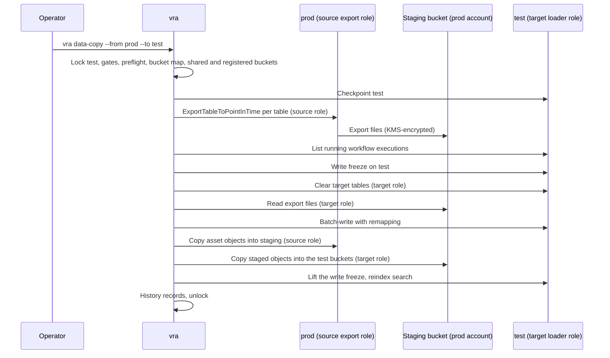

# Data copy

`vra data-copy` copies the full VAMS data set of one environment into another, typically `prod` into
`test`, across accounts. Use it to give user acceptance testing realistic data. It is manual and
approval gated, never runs from `vra watch`, and never copies into a prod-class environment.

:::danger[Copying production data changes what test is]
After a copy, the test environment holds production data. It inherits production's data
classification, and with it every control that classification requires: access restrictions, logging,
encryption, retention, incident handling and any regulatory obligations. Before the first copy, confirm
with your data owner and security team that `test` is approved for that classification and carries the
same controls as `prod`. If it cannot, do not copy; use synthetic data or a masking hook instead.
:::

## What is copied

| Copied                                                                                                                                                                                | Not copied                                                                                                 |
| ------------------------------------------------------------------------------------------------------------------------------------------------------------------------------------- | ---------------------------------------------------------------------------------------------------------- |
| Every VAMS Amazon DynamoDB table resolved under the source's Parameter Store prefix, except those in the next column                                                                  | Amazon Cognito users, groups and passwords                                                                 |
| Objects in the VAMS auxiliary and artefacts buckets, and in every registered asset bucket (stack-owned, customer-named or in another account), each into the target bucket it maps to | `appFeatureEnabledStorage` (feature flags are per deployment), `apiKeyStorage` and `s3AssetBucketsStorage` |
| Search indexes (rebuilt in the target, not copied)                                                                                                                                    | Secrets, AWS KMS keys, IAM roles, configuration                                                            |
| Optionally, user-role assignments (`dataCopy.copyUserRoles: true` on the target)                                                                                                      | Access logs and audit log groups                                                                           |

Users sign in to `test` with test-environment identities. If you copy user-role assignments, the user
ids must already exist in the target identity provider, which is usually the case with an external
identity provider shared by both environments.

## Gates

-   **Target allowed.** `dataCopy.allowAsTarget` in the target's `env.yaml` decides; unset, a prod-class
    environment is refused. `vra ledger validate` rejects `dataCopy.allowedSources` on such an
    environment. The source must be in the target's `dataCopy.allowedSources`.
-   **Target approval.** Required when either environment is approval-gated: subject `data-copy:<source>`,
    filed under the target (default `ledger/approvals/test/data-copy_prod.yaml`), from a listed approver of
    the target who is not the initiator.
-   **Source data-owner approval.** Required when the source is approval-gated or has `dataOwners`:
    subject `data-copy-to:<target>`, filed under the source (default
    `ledger/approvals/prod/data-copy-to_test.yaml`), from someone in the source's `dataOwners` (else its
    `approvers`), passed with `--source-approval`. A record may state `masked: true|false`; the copy is
    refused when its masking differs from what the approver saw.
-   **Versions.** The source must not run a newer VAMS minor version than the target.
-   **Method.** `--method export` (default) needs `dataCopy.stagingBucket`; `--method scan` reads the
    source tables directly (slower, consumes read capacity). A cross-account copy always needs the staging
    bucket.
-   **Bucket map, shared buckets, registered buckets** (below).
-   **Checkpoint.** The target is checkpointed first, so the copy can be undone; on an approval-gated
    target the checkpoint must be complete unless `backup.allowDegraded`.

### Bucket map

Every registered source asset bucket maps to a distinct registered target asset bucket. With exactly
one asset bucket on each side they pair automatically; otherwise set `dataCopy.bucketMap` on the target:

```yaml
# ledger/envs/test/env.yaml
dataCopy:
    allowedSources: [prod]
    stagingBucket: vra-staging-111111111111-us-east-1
    bucketMap:
        prod-assets-bucket: test-assets-bucket
        example-imagery-prod: example-imagery-test
```

A source bucket with no entry, an entry naming a bucket not registered in the target, or two sources
mapped to one target stop the copy with exit `20` before anything is written; the message names each
bucket and the fix. Register a bucket in the target first when it has too few.

### Shared buckets

A target bucket that is also a source bucket, or that another environment of the ledger uses, stops the
copy with exit `20` naming the other environment. Other environments' buckets come from their recorded
history (bucket inventories, checkpoints), their `registeredBuckets.bucketArns` and a best-effort live
discovery. There is no override: a bucket a prod-class environment uses is never written from another
environment.

### Registered buckets

Both sides' buckets are listed again, because operators can register buckets in VAMS at any time. Each
bucket and its AWS KMS key is simulated against that side's role and compared with `registeredBuckets` in
its `env.yaml`. A gap writes an IT request with the exact actions per bucket and key and stops with exit
`10`; `vra resume` checks again. See
[Permissions: registered asset buckets](permissions-and-it-requests.md#registered-asset-buckets).

## Flow



1. **Export.** Each source table is exported with Amazon DynamoDB export to Amazon S3, which reads from the
   PITR backup and consumes no table read capacity. PITR must be enabled on the source tables. See
   [Amazon DynamoDB export to Amazon S3](https://docs.aws.amazon.com/amazondynamodb/latest/developerguide/S3DataExport.HowItWorks.html).
2. **Write freeze.** The target's running VAMS workflow executions are listed and reported. Writes to
   the target are frozen until the load and the object copy end, also when they fail. Only the target is
   frozen; the source is only read. See
   [Backups, restore and migrations: write freeze](backups-restore-and-migrations.md#write-freeze).
3. **Clear.** The target tables are owned by the target's AWS CloudFormation stack, so `vra` loads into the
   existing tables. A KMS grant for the target role on the staging key (`dataCopy.kmsKeyArn`) is created
   and retired after the copy.
4. **Load with remapping.** Items are batch-written with source identifiers rewritten to target ones:
   bucket names and ids (by the bucket map), Parameter Store-resolved resource names, and account ids,
   Regions and partitions inside ARNs of the source account. ARNs of other accounts are left alone.
5. **Copy objects, each side with its own identity.** The source export role copies the asset objects
   into `vra/<run-id>/assets/<bucket>/` in the staging bucket (above
   `dataCopy.batchOperationsThreshold`, default 10000, as an Amazon S3 Batch Operations job in the source
   account run by the source's `dataCopy.batchOperationsRoleArn`). The target loader role then copies them
   into the target buckets with server-side `CopyObject`. Neither role reads or writes the other side's
   VAMS buckets, so no CDK-owned bucket or key policy in production has to trust the test account.
6. **Reindex** the search indexes in the target with the VAMS reindex utility.
7. **Audit.** The run and both environments' history record who copied what, when, under which
   approvals, with item and object counts, and how writes were frozen.

A mask hook (`--mask-hook <cmd>`, or `dataCopy.maskHook` on the target) runs per table on the items
before they are loaded. `--databases <id,...>` copies a subset of VAMS databases. Both are off by
default.

## Accounts, roles and AWS KMS

| Account     | Resource                                                                    | Permission                                                                                                                                                                                              |
| ----------- | --------------------------------------------------------------------------- | ------------------------------------------------------------------------------------------------------------------------------------------------------------------------------------------------------- |
| Production  | Each VAMS table                                                             | `dynamodb:ExportTableToPointInTime` (and `dynamodb:Scan` for `--method scan`) for the source export role                                                                                                |
| Production  | Asset, auxiliary and artefacts buckets                                      | Read for the source export role and the source Batch Operations role only (identity policy; CDK-owned bucket policies are not changed)                                                                  |
| Any account | Registered asset buckets not named after the core stack, and their KMS keys | Read for the source roles, write for the target loader role: `AdditionalBucketArns` / `AdditionalKmsKeyArns` of each side's role stack, plus the bucket and key policy when they are in another account |
| Production  | VAMS AWS KMS key (with `useKmsCmkEncryption`)                               | `kms:Decrypt` through Amazon S3 and Amazon DynamoDB for the source role                                                                                                                                 |
| Production  | Staging bucket and staging key                                              | Write for the source role; read for the target loader role through the bucket and key policies                                                                                                          |
| Test        | VAMS tables, buckets and key                                                | Write, and `kms:Decrypt` / `kms:Encrypt` / `kms:GenerateDataKey` through Amazon DynamoDB and Amazon S3, for the target loader role                                                                      |

When the orchestrator may reach only the target side (for example a CI role pinned to the test
environment), set `dataCopy.chainSourceRole: true` on the target and deploy both role stacks with
`TrustPeerLoaderRole=true`: `vra` assumes the source export role from the target loader role, so the
source is still read only with the source account's identity.

The role templates are in
[`vra-data-copy-roles.yaml`](https://github.com/awslabs/visual-asset-management-system/blob/main/tools/VamsReleaseAutomation/iam/cloudformation/vra-data-copy-roles.yaml)
(one stack per side), and the actions in
[`data-copy-source.yaml`](https://github.com/awslabs/visual-asset-management-system/blob/main/tools/VamsReleaseAutomation/iam/actions/data-copy-source.yaml)
and
[`data-copy-target.yaml`](https://github.com/awslabs/visual-asset-management-system/blob/main/tools/VamsReleaseAutomation/iam/actions/data-copy-target.yaml).
`vra` uses each environment's `dataCopyRoleArn`, falling back to `deployRoleArn`. Keep the staging bucket
private, encrypted, versioned and with a short lifecycle expiration; the staged export is production
data.

## Running a copy

```bash
vra preflight --env test --workflow data-copy-target
vra preflight --env prod --workflow data-copy-source
vra --dry-run data-copy --from prod --to test --approval data-copy_prod --source-approval data-copy-to_test
```

The dry run only reads. Its plan lists, per table, the source and target item counts (Amazon DynamoDB
`ItemCount`, refreshed about every six hours, so approximate) and, per bucket, the object counts. Then
stop writes to `test` (announce the window, pause integrations) and run the copy as a person, confirming
the manual write freeze on the command:

```bash
vra data-copy --from prod --to test --approval data-copy_prod --source-approval data-copy-to_test --writes-stopped
vra test --env test
```

Example records are in
[`ledger-template/approvals/`](https://github.com/awslabs/visual-asset-management-system/tree/main/tools/VamsReleaseAutomation/ledger-template/approvals).

## Cautions

-   **Outbound effects.** Copied records can include notification subscriptions, workflow definitions and
    pipeline settings that point at production resources or people. Review the target after the copy and
    disable integrations that should not fire from `test`.
-   **Size and cost.** Exports, cross-account object copies and reindexing are billed; large copies take
    hours.
-   **Customer-named and other-account buckets.** Give `test` its own bucket for each and grant both roles
    access; never map to a production bucket.
-   **Repeatability.** Each copy replaces the target's data. Anything testers created in `test` is lost
    unless you checkpoint it.

## Undo

```bash
vra restore --env test --checkpoint <pre-copy checkpoint id> --approval restore_<pre-copy checkpoint id>
```

## Related pages

-   [Backups, restore and migrations](backups-restore-and-migrations.md)
-   [Permissions and IT requests](permissions-and-it-requests.md)
