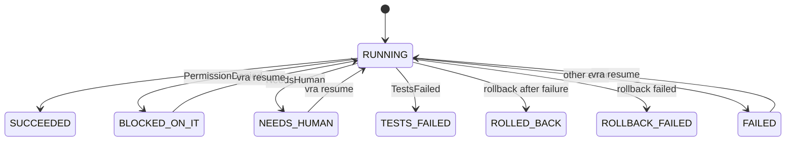

# Developer guide: architecture

This guide is for developers who change release automation itself. It describes the package layout, the
engine's modules, how a run executes, and how state is stored. The component development rules are in
[`tools/VamsReleaseAutomation/CLAUDE.md`](https://github.com/awslabs/visual-asset-management-system/blob/main/tools/VamsReleaseAutomation/CLAUDE.md).

## Package layout

| Path               | Contents                                                                                                                      |
| ------------------ | ----------------------------------------------------------------------------------------------------------------------------- |
| `engine/vra/`      | The engine (Python package `vra`, entry point `vra`)                                                                          |
| `engine/vra/data/` | Schemas, the default path policy, the suite catalogue, the upgrade matrix, the engine's copy of the IAM manifests             |
| `engine/tests/`    | Engine tests (pytest, offline: local bare git repositories, botocore Stubber and moto)                                        |
| `skill/`           | The agent skill and workflow procedures                                                                                       |
| `adapters/`        | Codex, Kiro, Claude Code and Cursor adapters, the shared guard and cron script                                                |
| `cicd/`            | CI templates: the AWS CodePipeline CDK app and AWS CodeBuild buildspecs, GitHub Actions, GitLab CI, generic CI, the OIDC role |
| `iam/`             | Per-workflow IAM action manifests, AWS CloudFormation role templates, the CDK bootstrap guide                                 |
| `ledger-template/` | A starting ledger with commercial and AWS GovCloud (US) examples, and the shipped core patches                                |
| `scripts/`         | The package self-check (`check.sh`) and its helpers                                                                           |

## Engine and agent split

The engine is deterministic: every state change, gate and record is code with a test. Judgment (which
action next, merge conflict resolution, failure triage, report narrative) belongs to a person or an
agent. An agent reaches the engine only through the CLI or the MCP server, which runs the CLI, so there
is one enforcement point. Never put a gate in the skill or an adapter only; the adapters are a second
layer.

## Module map

| Module                                              | Responsibility                                                                                                                                              |
| --------------------------------------------------- | ----------------------------------------------------------------------------------------------------------------------------------------------------------- |
| `cli.py`                                            | Argument parsing, home and context resolution, human-only refusal before any context is built, JSON envelope                                                |
| `context.py`                                        | The execution context every command gets: home, ledger, AWS factory, shell, backend; tests inject fakes here                                                |
| `home.py`                                           | The shared home: layout, `vra-home.yaml`, sync (`none`, `git`, `command`), join, migrate, host registry                                                     |
| `state.py`                                          | Runs (`rev`, create-only), locks (`FileLock`, `DynamoLock`, `LeaseKeeper`), history (`FolderHistory`, `S3History`), approval claims, the `Backend` facade   |
| `runner.py`                                         | Workflow registry (`@workflow`), run execution, step bookkeeping, failure to status mapping, `resume`, environment locks                                    |
| `errors.py`                                         | Exit codes, run statuses and exception types (`BlockedOnIT`, `NeedsHuman`, `TestsFailed`, ...)                                                              |
| `ledger.py`                                         | Ledger loading, schema and semantic validation, identity checks, topology, stack-name derivation                                                            |
| `setup.py`                                          | The setup wizard and its answers file                                                                                                                       |
| `gitops.py`, `githost.py`                           | Vendor sync, merge with the path policy, core audit, publish; git host adapters (pull requests)                                                             |
| `build.py`                                          | Scratch checkout, unit suites, synth with the allowlisted environment, scanners, CDK CLI packing, bundle, tag                                               |
| `core_patches.py`                                   | Ledger core patches (`core-patches/*.patch`) applied to the scratch source of builds and IAM plans                                                          |
| `iam.py`                                            | `vra iam plan`, `apply`, `verify`: the IT role package, the overlay wiring, the preflight and build IAM gates, the assembly check after each synth          |
| `pipeline.py`, `pipeline_cli.py`, `pipeline_iam.py` | `automation.mode` validation, the rendered pipeline configuration, `vra pipeline` plan, deploy, status, sync-ledger, push-source; the pipeline's IT package |
| `deploy.py`                                         | Deploy, promote, rollback: gates, promotion check, diff and change-set gate, migrations, A/B, smoke                                                         |
| `tests_runner.py`                                   | Unit, synth, live and customer suites; JUnit; live-test sign-in                                                                                             |
| `backup.py`, `restore.py`                           | Checkpoints; restore through temporary tables with verification and settle                                                                                  |
| `datacopy.py`, `buckets.py`                         | Data copy with remapping; registered asset buckets, bucket map, shared-bucket guard                                                                         |
| `freeze.py`                                         | Write-freeze backends and running workflow executions                                                                                                       |
| `migrate.py`                                        | Discovery and chaining of the VAMS data migrations, the upgrade matrix                                                                                      |
| `permissions.py`, `preflight_cmd.py`                | Access-denied classification, IAM simulation, IT requests                                                                                                   |
| `approvals.py`, `identity.py`, `human.py`           | Approval records and claims; initiator identity per CI platform; human-only actions                                                                         |
| `aws.py`, `vams_resources.py`                       | Partition-generic sessions and ARNs, refreshable credentials, FIPS endpoints; resource names from Parameter Store                                           |
| `sshsig.py`                                         | SSH-format tag signatures with an AWS KMS key                                                                                                               |
| `report.py`, `watch.py`, `cron.py`                  | Reports, metrics and notifications; the watch cycle; change-window cron matching                                                                            |
| `mcp_server.py`                                     | The MCP server: tool tiers over the CLI, structured errors                                                                                                  |
| `util.py`                                           | Subprocess with logging and redaction, file IO, hashing, time                                                                                               |

## Runs and steps

A command that changes anything is a workflow registered with `@workflow("<name>")` in `runner.py`. It
receives a `Run` and calls `run.step(id, fn, ...)` for each step. A step's status is `pending`,
`running`, `done`, `failed`, `blocked` or `skipped`; `run.step` skips steps already `done`, so a resumed
run continues where it stopped. Gate steps pass `revalidate=True` and run again on every resume.

Exceptions carry the outcome: `PermissionDenied` becomes an IT request and `BLOCKED_ON_IT`, `NeedsHuman`
parks the run, `TestsFailed` maps to exit `30`. `runner.mark_dirty` records that an environment changed,
so its lock is kept on failure.

## State model

`state.Backend` gives every command one interface over two implementations.

| Record          | Shared home (`home`)                                        | Amazon S3 and Amazon DynamoDB (`s3`)                            |
| --------------- | ----------------------------------------------------------- | --------------------------------------------------------------- |
| Run state       | `state/runs/<run>/state.json`, `rev` compared under a flock | S3 object, `If-Match` on the ETag; `If-None-Match: *` to create |
| Locks           | `state/locks/<key>.lock`, O_EXCL under a per-key flock      | DynamoDB item, conditional write on `ver`                       |
| History         | `state/history/<env>/<seq>-<run>.json`, create-only         | S3 object per record, create-only                               |
| Approval claims | `state/approvals-consumed/<env>/<sha256>.json`, create-only | S3 object, create-only                                          |
| Bundles         | `artifacts/<buildId>/`                                      | S3, create-only upload                                          |

Within a machine, decisions are serialized by flock mutexes in `.vra-local/`. Between machines, the home
is pulled before a read and published after a write; a rejected push raises `Contention` (a
`NeedsHuman`), after the engine dropped its local commit. A lock records the sha256 of a per-run owner
token, which only the owning machine holds in its work directory, so a run id alone never grants a lock.
`LeaseKeeper` renews every lock a run holds on a heartbeat thread.

## Gates

Gates live next to the action they protect and run before it: approvals and separation of duties in
`approvals.py`, promotion in `deploy.check_promotion`, the data-protection gate in `deploy.py`, bucket
checks in `buckets.py`, human-only actions in `human.py` (called from `cli.py` before any context is
built, so an agent's refusal never depends on AWS access), the IAM package gates in `iam.py` (before and
after each synth), and the human-only pipeline deploys in `pipeline.py`. Every gate fails closed: an
unreadable input (a diff, a change set, a bucket list, a synthesized template) stops the action.

## Related pages

-   [Developer guide: extending](developer-extending.md)
-   [Developer guide: testing and release](developer-testing-and-release.md)
