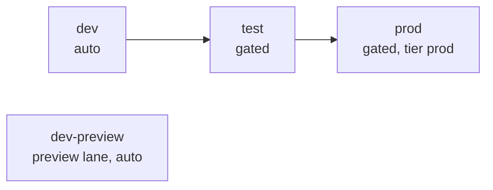
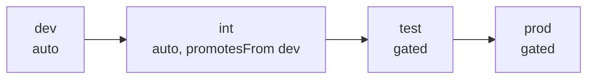
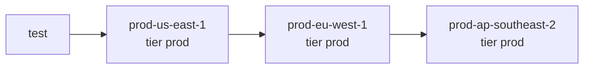
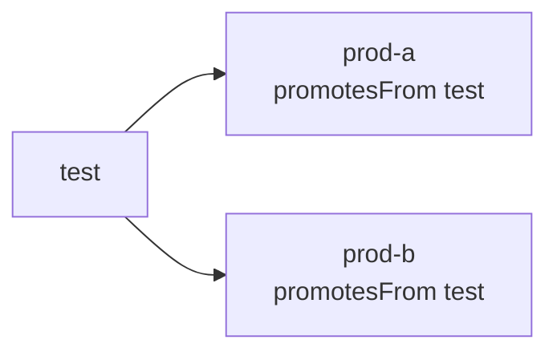

# Environments and topologies

Each environment is a directory `ledger/envs/<env>/` with an `env.yaml` and a configuration overlay.
Three settings connect environments into a topology: `lane` (where its builds come from),
`promotesFrom` (which environment a build must have passed first) and `requiresApproval` (whether a
person approves every change). `tier` says how protected the environment is.

## Tiers

| `tier`    | Meaning                                                                                                                               |
| --------- | ------------------------------------------------------------------------------------------------------------------------------------- |
| `prod`    | Production class: never a data-copy target, refuses builds with waived scanners, its buckets are never written by another environment |
| `nonprod` | Development, integration and test environments                                                                                        |
| `preview` | Preview-lane environments                                                                                                             |

When `tier` is unset, it is derived: `preview` on the preview lane, `prod` for an approval-gated
environment that no environment promotes from, otherwise `nonprod`. Set it explicitly on every
production environment; `vra ledger validate` warns when a gated environment promotes into another
gated environment without a tier, because the derived value then depends on the graph's shape.

## Promotion rules

-   `vra promote --from A --to B` and `vra deploy --env B` (when B has `promotesFrom: A`) accept a build
    only if it deployed to A and passed `vra test` there, with every required suite executed, after its
    last deploy to A.
-   An approval-gated target also requires the build's commit on the fork trunk. An ungated target that
    promotes from an ungated, auto-deploy environment accepts the release-lane sync build that `vra watch`
    just deployed and tested there, before its pull request merges.
-   Preview-lane builds are never promotable.
-   `promotesFrom` across partitions (for example commercial into AWS GovCloud (US)) is a validation
    error unless the target sets `allowCrossPartitionPromotion: true`; different `templateBase` values
    on the two sides are a warning.

## Topologies

### Linear chain (default)



### Chained automatic environments



`vra watch` deploys and tests `dev`, then `int` with the same build, then stops: it never reaches a
gated environment.

### Regional waves



Each wave promotes from the previous one, so a build reaches the next Region only after it passed the
previous one. Set `tier: prod` on every wave; each wave is gated and approved on its own.

### Fan-out



Siblings promote from the same parent and are independent of each other. The CI templates deploy
siblings in parallel after their own approvals.

### Gated root

An approval-gated environment with no `promotesFrom` takes any release-lane build directly. Mark it
`rootEnv: true` to record that this is intended; `vra ledger validate` warns about a gated root without
it.

### No preview lane

`lanes.preview` is optional; `lanes.preview.enabled: false` turns it off. `vra watch` runs only the
lanes that have environments, so a ledger without a preview environment never merges `development`.

## Validation rules

`vra ledger validate` rejects these combinations:

| Rule                                                                                                       | Why                                                    |
| ---------------------------------------------------------------------------------------------------------- | ------------------------------------------------------ |
| `autoDeploy: true` with `requiresApproval: true`                                                           | Scheduled runs never deploy to a gated environment     |
| `promotesFrom` naming an unknown or preview-lane environment, or a preview environment with `promotesFrom` | Preview builds are never promoted                      |
| `lanes.release.autoMerge: true`                                                                            | Release merges always go through a pull request        |
| `tier: prod` without `requiresApproval`                                                                    | Production changes are approved                        |
| Cross-partition `promotesFrom` without `allowCrossPartitionPromotion`                                      | A build synthesized for one partition fails in another |
| Environment names or `baseStackName` / `configName` with upper-case letters                                | Stack and resource names                               |
| The same custom domain host in two environments                                                            | Two deployments cannot serve one host                  |
| `dataCopy.allowedSources` on a prod-class environment                                                      | Production is never overwritten by a copy              |
| An approval-gated environment without an overlay `config.json`                                             | A gated deploy needs a reviewed configuration          |
| `env.yaml` and overlay `config.json` naming different deployments                                          | Every stack name derives from one identity             |

Warnings: a gated root without `rootEnv: true`, gated-into-gated without an explicit tier, a long core
stack name (VAMS derives many resource names from it), a `baseStackName` with a dash-separated suffix
(it can collide with another environment's names), and custom domains without per-slot hosts for A/B
deploys.

## Inspect the topology

```bash
vra ledger graph
vra ledger show --env prod-eu-west-1
```

`vra ledger graph` lists every environment with its parent, gate and tier; the CI templates render
their stages from it. `vra ledger show --env` adds `tier`, `isProdClass`, `requiresApproval` and
`requiredSuites`.

## Accounts

One AWS account per environment is the recommended layout, plus an optional tools account for the
CI pipeline and the state backend. One account is one trust boundary: every role in an account can be
reached by an administrator of that account, so environments that share an account share their blast
radius, and a test environment in the production account can read production data through its own
roles. Several environments in one account are supported for small installations with distinct
`baseStackName` values. See
[Productionizing VAMS: environment strategy](../productionizing/environment-strategy.md).

## Related pages

-   [Branch strategy](branch-strategy.md)
-   [Approvals and gates](approvals-and-gates.md)
-   [Configuration reference: env.yaml](configuration-reference.md#envyaml)
