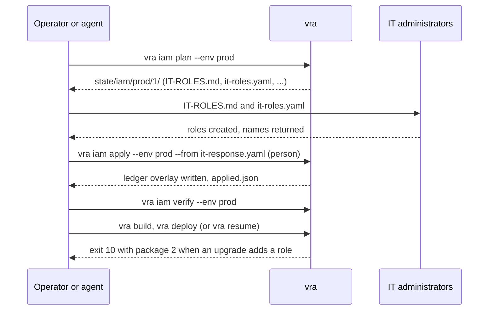

# IAM for strict environments

Many organizations do not let a deployment create IAM roles on its own. IT creates the roles, or
requires every role to carry a permission boundary and a name prefix, or provides the CDK bootstrap
roles itself. VAMS supports all three through its IAM role customization, and release automation drives
it: `vra iam plan` writes the complete list of roles and permissions IT must provide, `vra iam apply`
wires what IT returns into the environment's VAMS configuration, and `vra iam verify` checks it. The
build and preflight gates stop a run with exit `10` (`BLOCKED_ON_IT`) whenever the roles in a build no
longer match what IT provided.

This page covers the roles VAMS creates for itself. The roles release automation runs as (deploy, synth,
data copy, state store, test) are described in [Permissions and IT requests](permissions-and-it-requests.md).

## The three VAMS IAM modes

Each environment chooses a mode in its `env.yaml` (`iam.mode`). Modes combine with `+`, for example
`precreated+bootstrap`; `all` is the three together.

| `iam.mode`           | Who creates the roles                                                   | VAMS configuration that release automation writes                                                                                                                                                          |
| -------------------- | ----------------------------------------------------------------------- | ---------------------------------------------------------------------------------------------------------------------------------------------------------------------------------------------------------- |
| `standard` (default) | VAMS, during each deploy                                                | Nothing                                                                                                                                                                                                    |
| `boundary`           | VAMS, under IT's permission boundary and role name prefix               | `infra/cdk.json` context `environments.aws.PermissionBoundaryArn` and `IamRoleNamePrefix`                                                                                                                  |
| `precreated`         | IT, before the deploy; VAMS creates no role                             | `app.iamRoleConfig.useCustomVamsStackRoles: true` in `config.json`, `vamsStacks.generateReportOnly: false` and `precreatedRoles` (construct path to role name) in `infra/config/policy/iamRoleConfig.json` |
| `bootstrap`          | IT provides the CDK bootstrap roles (or none, with the CLI synthesizer) | `app.iamRoleConfig.useCustomBootstrapRoles: true` and the `bootstrap` section of `iamRoleConfig.json`                                                                                                      |

The VAMS options themselves are documented in the
[VAMS configuration reference](../configuration-reference.md). Release automation never edits the fork
for them: `vra iam apply` writes ledger overlay files, which every build applies to its own copy of
the source.

## How the loop works



1. **Plan.** `vra iam plan --env <env>` synthesizes the environment's build offline with VAMS's discovery
   setting (`generateReportOnly: true`), reads the IAM policy report VAMS writes into `cdk.out`, and
   writes an IT role package into `<home>/state/iam/<env>/<n>/`. It makes no AWS changes. `--ref` picks
   the fork ref (default: the trunk); `--report` reads an existing `iam-policy-report.json` instead of
   synthesizing.
2. **Hand over.** IT reads `IT-ROLES.md` and creates the roles, by hand or by deploying `it-roles.yaml`.
3. **Answer.** IT returns the role names (or role ARNs) and, for `boundary` and `bootstrap`, the boundary
   ARN and bootstrap role ARNs. A person copies `it-response.template.yaml` to `it-response.yaml` and
   fills it in. An optional `itTicket` field (the IT change ticket) is recorded in the history.
4. **Apply.** A person runs `vra iam apply --env <env> --from it-response.yaml`. It checks the response
   against the package and writes the ledger overlay. It is a [human-only action](approvals-and-gates.md#human-only-actions);
   on an approval-gated environment it also needs an approval record with subject
   `iam-apply:<packageId>:<responseSha16>` and scope `iam-apply`, used once. `<responseSha16>` is the
   first 16 hex characters of the response file's SHA-256, so the approver approves that exact answer: a
   different response (other role names) needs its own approval. Without an interactive terminal, that
   record (passed with `--approval`) is also the person's authorization, on every environment. `--dry-run` shows the overlay, the
   response's SHA-256 and the approval subject without writing anything.
5. **Commit.** The person commits and pushes the ledger change through review. The engine never commits a
   person's ledger change.
6. **Verify.** `vra iam verify --env <env>` reads the roles back (read-only) and reports what is missing,
   what is not bounded, untrusted principals and denied actions, and also what is broader than the
   package: trust principals the package does not list, managed policies it does not list (an extra AWS
   managed policy such as `AWSLambdaBasicExecutionRole` is a warning; `AdministratorAccess`,
   `PowerUserAccess` and `IAMFullAccess` are problems) and inline actions it does not grant. Anything it
   cannot read is listed under `notChecked`, never passed.

    Known limitation: `verify` simulates every action the package grants, and VAMS's own synthesized
    policies grant some actions on resources those actions never take (`kms:ListKeys` and
    `kms:ListAliases` on `key/*`, which take only `*`; SNS subscription actions on the topic pattern). IAM
    denies them for the roles VAMS creates itself as well. `verify` lists these under `notEffective`,
    labelled "not effective in VAMS's policy, not an IT gap", and does not count them as problems. Leave
    the IT roles as they are.

7. **Deploy.** `vra build` and `vra deploy` (or `vra resume <run-id>` for the run that stopped) continue.

The gates repeat the loop on their own. `vra preflight` (step `preflight.<env>.iam`), `vra build`
(step `build.iam.<env>`, and a check of every synthesized assembly) and `vra deploy` (step
`deploy.<env>.iam`) stop with exit `10` and an IT request of kind `iam-package` when the environment has
no package, the latest package is not applied, `env.yaml` changed the boundary, or the build needs roles
the applied package does not list. In `precreated` mode the build writes package `n+1` itself, and its
`delta.json` and "Changes since" section list only what changed upstream, so IT reviews the delta.

The gates trust the create-only history record of `vra iam apply`, not the files it writes:
`state/iam/<env>/applied.json` and the overlay must match that record (package, response SHA-256,
overlay digests), otherwise the run stops with exit `20`. A bundle is reused for the same commit only
while the environment's IAM settings (mode, applied package and response, overlay) are the ones it was
built with; after `vra iam apply` or an `iam.mode` change the next build synthesizes again, and
`vra deploy` refuses a bundle built with other IAM settings. One case is accepted: when IT changed only
role policies (the usual answer to a deploy that stopped with exit `10`), the new package is applied and
the overlay files are identical to the bundle's (same mode, boundary and role names), `vra resume`
deploys the parked bundle, because it is what the new package would synthesize. With `stateStore.type: s3` the packages,
responses and apply records travel through the state store (`<prefix>/iam/<env>/`), so a CI job sees
what an operator planned and applied.

## A worked example

The example environment is `prod` in account `111111111111`, Region `us-east-1`, where IT pre-creates
every role under its prefix `ITVAMS-` and boundary `it-vams-boundary`.

### 1. Set the mode in env.yaml

```yaml
# ledger/envs/prod/env.yaml
iam:
    mode: precreated
    rolePrefix: ITVAMS-
    boundaryArn: arn:aws:iam::111111111111:policy/it-vams-boundary
```

`vra ledger validate` checks that the ARN is in the environment's partition and account and that the
prefix is at most 32 characters. `vra setup` asks the same questions per environment.

In `boundary` mode, set `iam.boundaryArn` in `env.yaml` so reviewers see it. When it is blank, the build
takes the ARN IT returned in its response (or the applied `infra/cdk.json.vra-merge.json`), and
`vra ledger validate` warns. With no ARN anywhere the build stops with exit `20`: it never skips the
boundary check.

### 2. Plan the package

```bash
vra iam plan --env prod
```

For the VAMS commercial configuration of the package's test fixtures (Amazon CloudFront, Amazon OpenSearch
Serverless, Amazon Location Service) the package lists 88 roles VAMS needs (13 used only during a deploy by AWS
CloudFormation custom resources, 75 at run time) and one existing service-linked role VAMS references.
An AWS GovCloud (US) configuration (VPC, provisioned Amazon OpenSearch Service, Application Load Balancer
web hosting) lists 92 roles. The package directory holds:

| File                        | Contents                                                                                                                                                                                                                             |
| --------------------------- | ------------------------------------------------------------------------------------------------------------------------------------------------------------------------------------------------------------------------------------ |
| `IT-ROLES.md`               | What IT is asked to do, a summary, the changes since the previous package, and one row per role (suggested name, purpose, construct path, trust, managed policies, inline policy, the VAMS feature and option that causes it, phase) |
| `it-roles.yaml`             | An AWS CloudFormation template IT may deploy that creates every role, with `RolePrefix`, `PermissionsBoundaryArn` and trust parameters                                                                                               |
| `policies/<role>.json`      | One identity policy per role                                                                                                                                                                                                         |
| `roles.json`, `roles.csv`   | The same rows for scripts and ticket systems                                                                                                                                                                                         |
| `delta.json`                | Roles added, removed or changed since package `n-1`                                                                                                                                                                                  |
| `boundary-actions.json`     | `boundary` mode only: the union of actions the boundary must allow                                                                                                                                                                   |
| `IT-ROLES.md` broad grants  | A "Broad grants" section lists every statement on `Resource: "*"` or with a wildcard action that VAMS grants, by role, so IT reviews them explicitly                                                                                 |
| `it-response.template.yaml` | The answer form, prefilled with the suggested names                                                                                                                                                                                  |
| `package.json`              | A SHA-256 per file and the role-set and policy digests the gates compare                                                                                                                                                             |

### 3. IT creates the roles

IT can deploy `it-roles.yaml` in the environment account, or create the roles with its own tooling from
`policies/`. Inline policies stay within the 10,240-character limit; larger ones become managed
policies. One trust is incomplete until VAMS has been deployed once (see
[VAMS behaviour to know](#vams-behaviour-to-know)); its parameter defaults to `PENDING-FIRST-DEPLOY`,
which matches nothing.

### 4. Fill in it-response.yaml

```yaml
# it-response.yaml, copied from it-response.template.yaml
package: prod-1
boundaryArn: arn:aws:iam::111111111111:policy/it-vams-boundary
roles:
    vams-core-prod-us-east-1/ApiBuilder/assetService/ServiceRole: ITVAMS-prod-assetService-7d6d45
    vams-core-prod-us-east-1/ApiBuilder/uploadFile/ServiceRole: ITVAMS-prod-uploadFile-6acbda
    # ... one line per construct path in the package
```

Keys are VAMS construct paths; values are the role names IT created. A role ARN is accepted and reduced
to its name. A role with an IAM path is refused, because VAMS builds role ARNs as
`arn:<partition>:iam::<account>:role/<name>`.

### 5. Apply, commit, verify

```bash
vra --dry-run iam apply --env prod --from it-response.yaml      # prints responseSha256 and approvalSubject
vra iam apply --env prod --from it-response.yaml --approval approvals/prod/iam-apply-prod-1.yaml
git -C ~/vams-release-home add ledger && git -C ~/vams-release-home commit -m "prod: IT roles prod-1"
vra iam verify --env prod
```

`vra iam apply` refuses a response that leaves a construct path out, answers another package, or names
a boundary in another account or partition. It writes, for this environment:

-   `envs/prod/overlay/infra/config/config.json`: `app.iamRoleConfig.useCustomVamsStackRoles: true`;
-   `envs/prod/overlay/infra/config/policy/iamRoleConfig.json`: `vamsStacks.generateReportOnly: false` and
    `precreatedRoles`;
-   `state/iam/prod/applied.json` and a create-only history record with `action: iam-apply` (package,
    response SHA-256, `itTicket`, overlay digests, approval), which the gates check `applied.json` against.

In `boundary` mode it writes `envs/<env>/overlay/infra/cdk.json.vra-merge.json` in addition (with
`boundary` alone, `config.json` keeps both `iamRoleConfig` switches off and no `iamRoleConfig.json` is
written): a file named
`<path>.vra-merge.json` is deep-merged into the fork's `<path>` at build time, so the fork's other
`cdk.json` context stays the fork's.

### 6. Deploy

```bash
vra build --lane release --ref main --envs prod
vra deploy --env prod --build <build-id> --approval approvals/prod/<record>.yaml
```

With every construct path mapped, no `AWS::IAM::Role` remains in any template. After an upstream merge
that adds a Lambda function, the build stops with exit `10`, writes package `prod-2` with one added role,
and names it in the IT request; the loop repeats from step 3.

## Permission boundary mode and GitHub issue #431

:::warning[VAMS v2.6.6 and earlier do not apply the permission boundary]
In VAMS v2.6.6 and earlier
([GitHub issue #431](https://github.com/awslabs/visual-asset-management-system/issues/431)), the
`IamRoleTransform` aspect (`infra/lib/aspects/iam-role-transform.aspect.ts`) overrides
`PermissionsBoundary` with `AWS::NoValue` for every role, so `environments.aws.PermissionBoundaryArn`
never reaches a role. The same override removes a boundary set through the CDK context
`@aws-cdk/core:permissionsBoundary` (`permissionsBoundaryName` in `env.yaml`). VAMS v2.6.7 and later
fix this: the aspect sets the configured boundary on every role and leaves the property alone when the
ARN is empty, so a CDK context boundary is kept.
:::

Release automation never deploys an unbounded build. After every synth, `vra build` checks that every
`AWS::IAM::Role` in the templates carries the boundary the environment names, and stops with exit `20`
otherwise. The check reads the synthesized templates, not a version number, so it passes as soon as the
fork's source applies the boundary.

A fork on VAMS v2.6.7 or later needs nothing more. For a fork on v2.6.6 or earlier there are two
remedies:

-   **The core patch CP-431** (for `boundary` mode and for `permissionsBoundaryName`). The package ships
    `ledger-template/core-patches/iam-role-transform-boundary.patch`, which makes the aspect set
    `PermissionsBoundary` to the ARN when it is not empty and leave the property alone when it is empty.
    Copy it into `<home>/ledger/core-patches/` and list it in `core-patches.md`:

    ```markdown
    -   `core-patches/iam-role-transform-boundary.patch` (CP-431, GitHub issue #431; present from VAMS v2.6.7)
    ```

    `vra build` and `vra iam plan` then apply it to their scratch copy of the fork (never to the fork
    itself) and record it in the build manifest (`corePatches`). The template entry, with the register
    row, is in `ledger-template/core-patches.md`. When the fork reaches VAMS v2.6.7 or later, the upstream
    fix is in a different form, and the patch's `Present-when:` marker line makes the build report the
    patch as `present` (`via: marker`) and change nothing; retire the entry then. You can also commit the
    same change to the fork and register its path; the build then reports the patch as `present` too. A
    patch that neither applies nor is present (upstream changed the file) stops the build with exit
    `20`: refresh it or retire the entry.

-   **`iam.mode: precreated`.** VAMS creates no role, so there is nothing to bound; IT applies its
    boundary when it creates the roles.

With the patch, the commercial fixture synth in `boundary` mode carries the boundary on all 88 roles,
and a synth with `permissionsBoundaryName` carries the CDK boundary on all 88 roles. Release automation
writes the CDK boundary context into the build's own copy of `infra/cdk.json`, because the CDK reads it
only as an object.

Switching an existing environment to `boundary` mode with a `rolePrefix` renames every VAMS role. AWS
CloudFormation creates each replacement before it deletes the old role, so during that deploy the stack
holds about twice its roles (roughly 90 more). Check the account's IAM "Roles per account" quota before
the switch. A deploy that crosses it fails with `Cannot exceed quota for RolesPerAccount` and rolls back.

`vra deploy` checks this before `cdk deploy`. It counts the IAM roles and managed policies the diff adds
or replaces (on a first install, every role in the synthesized templates). It then reads
`iam:GetAccountSummary` and stops with exit `20` when `Roles` plus that count plus a headroom exceeds
`RolesQuota` (the same for `Policies` and `PoliciesQuota`). The message names the numbers. For example,
942 roles + 91 replaced + headroom 10 > 1000. Raise the quota (Service Quotas > IAM > "Roles per
account") or free roles, then resume the run. The headroom defaults to 10; set `iam.quotaHeadroom` in
`env.yaml` to change it. With `iam.mode: precreated` the stacks create no roles, so the count is 0 and
the deploy reads no quota. `vra iam plan` reports the need as `roleQuota.stackRoles`. The deploy role
needs `iam:GetAccountSummary` on `*` (the `IamQuotaRead` statement of `vra-deploy-role.yaml`); preflight
turns a missing grant into an IT request. The same step checks the Amazon CloudFront quotas in every IAM
mode ([Workflows: quota checks](workflows.md#quota-checks)).

### The API deployment after a role-prefix switch (GitHub issue #1210)

:::warning[A new role prefix can leave the API on a deleted role]
In VAMS versions affected by
[GitHub issue #1210](https://github.com/awslabs/visual-asset-management-system/issues/1210), the REST
API's `AWS::ApiGateway::Deployment` changes only when the OpenAPI spec changes. The spec names the
authorizer invoke role through `Fn::GetAtt`, which looks the same after the role is renamed. So the
deploy that introduces a `rolePrefix` replaces every role, but the API stage keeps serving its old
deployment, whose authorizer credentials name the deleted role. Every route, signed in or not, then
answers HTTP 500 with `x-amzn-errortype: AuthorizerConfigurationException`.
:::

The package ships a second core patch for this, CP-1210,
`ledger-template/core-patches/api-deployment-role-name.patch`. It also hashes the literal
`IamRoleNamePrefix` into the deployment's logical id when the prefix is set, so a changed prefix
creates a new deployment that names the new role. With no prefix it changes nothing, so environments
without a prefix keep their deployment. List it next to the boundary patch:

```markdown
-   `core-patches/api-deployment-role-name.patch` (CP-1210, until upstream fixes GitHub issue #1210)
```

`vra ledger validate` warns when an environment sets `iam.rolePrefix` in `boundary` mode and the ledger
does not list this patch. The patch is made against VAMS v2.6.6 and also applies to the v2.7.0
development branch; GitHub issue #1210 is still open, so every current VAMS version needs it in this
case. If an environment already answers HTTP 500 after the switch, add the patch and
deploy a new build; the stage then moves to a new deployment.

## VAMS behaviour to know

These are properties of VAMS's IAM role customization. Release automation works with them; IT should
know them before it starts.

-   **Every role gets an explicit name.** The `IamRoleTransform` aspect sets `RoleName` to
    `<prefix><unique construct name>-<region>` on every role, also when the prefix is empty. Deploys need
    `CAPABILITY_NAMED_IAM`, and a role name collides if two stacks share a base name in one Region.
    Without a prefix the unique construct name starts with the core stack name without its hyphens
    (`vamscore...` for config name `vams`); roles of the other VAMS stacks get CloudFormation names that
    start with `<config name>-`. The scoped CDK execution policy
    (`iam/cloudformation/vra-cdk-execution-policy.yaml`, parameters `ConfigName` and `RoleNamePrefix` from the
    env's `configName` and `iam.rolePrefix`) creates, changes and passes only roles with these names, so
    CloudFormation cannot reach the account's other roles, nor the `cdk-*` and `vra-*` roles. A role IT
    pre-creates for VAMS must start with the `RoleNamePrefix` the IT package's deploy role notes give (the
    env's `iam.rolePrefix`, or `<baseStackName>-` in `precreated` mode without one).
-   **A discovery synth is not deployable.** With `generateReportOnly: true` the templates still contain the
    roles, but functions and services reference `arn:<partition>:iam::<account>:role` without a name.
    `vra iam plan` synthesizes into scratch and never deploys that assembly.
-   **`precreatedRoles` takes role names.** CDK renders `arn:<partition>:iam::<account>:role/<name>`, so
    roles with an IAM path cannot be used. A map that misses one construct path fails synth ("IAM Role is
    being created at path ... preventSynthesis is enabled") but still writes the report; `vra build` turns
    that into the next package. With the full map no `AWS::IAM::Role` remains, including the CDK
    custom-resource provider role.
-   **One role passes another.** `ApiBuilder2/pipelineService` passes `lambdaPipelineRole` and
    `ApiBuilder2/workflowService` passes `VAMSWorkflowIAMRole` (`iam:PassRole`). In `precreated` mode the
    package grants exactly those roles by their suggested names, and the "iam:PassRole between VAMS roles"
    section of `IT-ROLES.md` lists them: when IT names a role differently, it changes the grant to that
    name too, and `vra iam verify` simulates the grant against the names IT returned. (VAMS itself grants
    workflowService `role/*<config name>*`, which IT's names would not match.)
-   **Some topics are created at runtime.** Creating an asset creates the SNS topic
    `AssetTopic<databaseId>-<assetId>`. Seven roles use these topics: `createAsset`, `assetService`,
    `sendEmail`, `subscriptionService`, `unsubscribeService` and the two `sqsBucketSync` handlers.
    VAMS builds the ARN with `Fn::Sub`, so the IAM report shows only an opaque token. The package grants
    these roles `arn:<partition>:sns:<region>:<account>:AssetTopic*`, as VAMS does. Without that grant,
    asset creation fails with "Error creating SNS topic". All other SNS and DynamoDB tokens stay scoped
    to the core stack name.
-   **One trust can only be finished after the first deploy.** `AuthBuilder/Cognito/DefaultUnauthenticatedRole`
    trusts `cognito-identity.amazonaws.com` (`cognito-identity-us-gov.amazonaws.com` in AWS GovCloud (US))
    with the identity pool VAMS creates as its audience. `it-roles.yaml` leaves the pool id as a parameter
    that matches nothing until IT sets it after the first deploy.
-   **The CLI synthesizer has no bootstrap roles.** With `useCliCredentialsSynthesizer`, the assembly names
    no bootstrap role ARNs and the deploy role deploys with its own credentials: deploy
    `vra-deploy-role.yaml` with `CliCredentialsDeploy=true`, `CdkExecutionPolicyArn` (the
    `vra-cdk-execution-policy.yaml` policy), `StagingBucketName` and `StagingRepositoryName`. In AWS GovCloud
    (US) the VPC availability-zone lookup needs the fork's committed `infra/cdk.context.json` or synth
    credentials.
-   **Custom bootstrap roles have IT's names.** vra's deploy role assumes them by the ARNs IT returned:
    deploy `vra-deploy-role.yaml` with `BootstrapRoleArns` (the deploy, lookup and file and image
    publishing roles); the package's `vra-deploy-<env>` notes list them. When IT creates the bootstrap
    resources without `cdk bootstrap`, it also creates the SSM parameter `/cdk-bootstrap/<qualifier>/version`
    that the CDK CLI reads before every deploy. The build checks the publishing roles in the asset
    manifests too.

## Pipelines and gated environments

-   **Agents** may run `vra iam plan` and `vra iam verify` (MCP tools `iam_plan` and `iam_verify`). No tool
    exists for `vra iam apply`, and every adapter blocks it.
-   **AWS CodePipeline**: a blocked build action fails with the IT request and the package in its output
    artifact (`vra-out/BLOCKED_ON_IT.md`). After `vra iam apply` and the ledger push, **Retry failed
    actions** resumes the same run; with `stateStore.type: s3` the job reads the package and the apply
    record from the state store (every tier role may read `<prefix>/iam/*` and write it create-only). `vra pipeline plan` writes a package for the pipeline's own roles too
    (`state/iam/pipeline/<n>/`). See [CI/CD and AWS CodePipeline](codepipeline.md).
-   **Verification** uses the environment's `readOnlyRoleArn`, else its deploy role with
    `EnableIamVerify=true` in `vra-deploy-role.yaml` (manifest `iam/actions/iam-verify.yaml`).

## Related pages

-   [Permissions and IT requests](permissions-and-it-requests.md)
-   [Configuration reference: iam](configuration-reference.md#iam)
-   [IAM governance in production](../productionizing/iam-governance.md)
-   [Troubleshooting: IAM roles](troubleshooting.md#iam-roles-and-it-packages)
