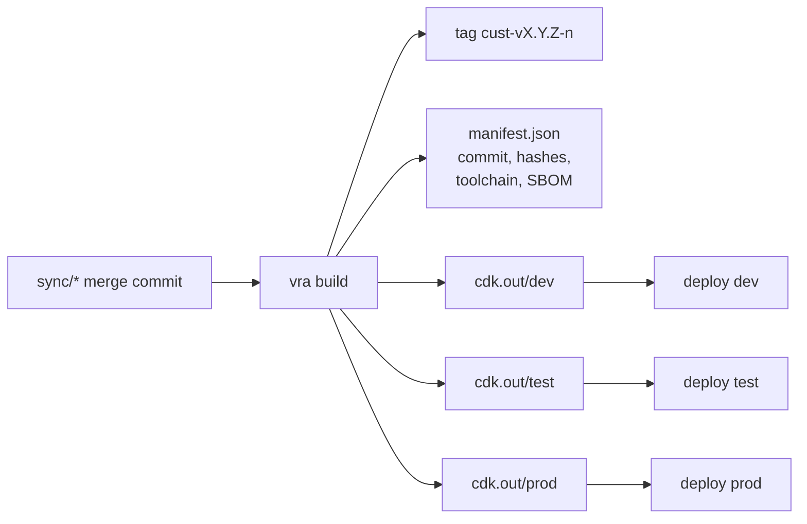
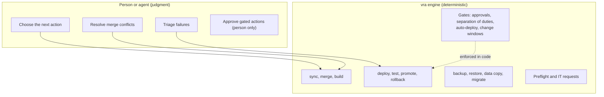

# Release automation

VAMS release automation (`vra`) keeps a customer fork of Visual Asset Management System (VAMS) current
with upstream releases and moves every change through the same path: merge, build, deploy, test,
promote, with a data checkpoint and a rollback plan for each deployment. It is a deterministic engine
with a command line interface and a Model Context Protocol (MCP) server, so it runs from a terminal, a
scheduled job, a CI/CD pipeline or an AI coding agent with the same gates.

The source is in [`tools/VamsReleaseAutomation`](https://github.com/awslabs/visual-asset-management-system/tree/main/tools/VamsReleaseAutomation).

:::warning[Use at your own risk]
Release automation changes AWS resources in the accounts you configure. Review the IAM roles it uses,
the approval settings of each environment and every change before it reaches a production environment.
AI agents that drive it are used at your own risk; configure their permissions according to your
organizational security standards.
:::

## What it does

-   Mirrors upstream VAMS releases and the `development` preview into the fork and merges them with the
    fork's custom code, resolving conflicts by a path policy and handing the rest to a person or an agent.
-   Builds once per change: runs the unit suites, synthesizes one AWS Cloud Development Kit (AWS CDK) cloud
    assembly per environment from the environment's own configuration, scans, signs and tags the build.
-   Deploys the build bundle to an environment after a checkpoint of its data, a data-protection check of
    the planned changes and a check of the IAM permissions the deployment needs.
-   Tests the deployment and rolls it back by policy; promotes the same build to the next environment only
    when it passed on the previous one.
-   Copies production data into a test environment, backs up and restores environments, and runs the VAMS
    data migrations for a version change.
-   Turns permission gaps into IT requests with the exact least-privilege policy, and resumes when they are
    granted. Where IT creates or bounds every IAM role, writes the full list of roles and policies VAMS
    needs, wires the names IT returns into the configuration, and stops a build that needs new roles.
-   Runs from an operator or AI agent, from AWS CodePipeline, or with GitHub Actions in front of
    CodePipeline, with the same gates in each.

## Concepts

### Lanes

A lane is a source of upstream change and the path its builds may take.

| Lane      | Upstream source              | Fork branch    | Default environments    | Promotable |
| --------- | ---------------------------- | -------------- | ----------------------- | ---------- |
| `release` | `main` and its `vX.Y.Z` tags | trunk (`main`) | `dev` → `test` → `prod` | Yes        |
| `preview` | `development`                | `preview/main` | `dev-preview`           | Never      |

The release lane carries published VAMS releases plus the fork's custom code. The preview lane merges
upstream `development` with the custom code and deploys it to a separate environment, so merge
conflicts, breaking changes and test failures show up before the release ships. The preview lane is
optional. See [Branch strategy](branch-strategy.md).

### Environments

An environment is one VAMS deployment: an AWS account and Region, a VAMS configuration, a lane, and
its gates. `vra setup` proposes four; names, count and topology are yours.

| Environment   | Lane    | Deploys                         | Approval | Rollback policy |
| ------------- | ------- | ------------------------------- | -------- | --------------- |
| `dev`         | release | Automatically, from `vra watch` | No       | `auto`          |
| `dev-preview` | preview | Automatically, from `vra watch` | No       | `auto`          |
| `test`        | release | `vra promote --from dev`        | Yes      | `ask`           |
| `prod`        | release | `vra promote --from test`       | Yes      | `ask`           |

Chains, regional waves and fan-out topologies are described in
[Environments and topologies](environments-and-topologies.md).

### Build once, promote the artifact

VAMS reads its configuration at synth time, so each environment needs its own cloud assembly.
`vra build` synthesizes all of them from one commit and writes a bundle whose manifest records the
commit, the per-environment hashes, the toolchain and the scanner results. `vra deploy` and
`vra promote` deploy from the bundle and verify its hashes; they never synthesize again. There are no
environment branches.

### The shared home

Every machine that runs `vra` (operator workstations, a scheduled host, CI jobs, agents) reads one
folder: the shared home. It holds the ledger (environment settings, approvals, merge policy) and the
state (locks, runs, history, consumed approvals). The folder is synchronized with git, with your own
commands, or not at all. See [Shared home](shared-home.md).

### Runs and exit codes

Each command creates or continues a run with an id, a list of steps and a status. A run that cannot
continue parks with a status and an exit code that names the reason: `10` when it needs a permission
(an IT request is written), `20` when it needs a person (a merge conflict, an approval, manual work),
`30` when tests failed, `40` when a rollback failed. `vra resume <run-id>` continues a parked run from
the first step that is not done, and re-checks every gate. See
[Exit codes](command-reference.md#exit-codes).

### Automation tiers

`automation.mode` in `vra.yaml` records who drives the release: `agent` (an operator or AI agent runs
`vra`), `hybrid` (CI runs the watch, the build and dev; people promote), `pipeline` (AWS CodePipeline end
to end) or `pipeline+actions` (GitHub Actions for checks and scans, CodePipeline for deploys). See
[Automation tiers](automation-tiers.md).

### Engine and agent

Every gate is enforced in the engine. An agent that misreads an instruction cannot deploy to a gated
environment without a valid approval record, and cannot run a human-only action at all. The engine runs
the same way with no agent. Codex, Kiro, Claude Code and Cursor are supported. See
[Agent systems](agent-systems.md).

## Where to go next

| Task                                          | Page                                                          |
| --------------------------------------------- | ------------------------------------------------------------- |
| Prepare accounts, roles and the CDK bootstrap | [Prerequisites](prerequisites.md)                             |
| Install the engine and an agent adapter       | [Installation](installation.md)                               |
| Create or join the shared home                | [Setup and joining](setup.md)                                 |
| Run the release workflows                     | [Workflows](workflows.md)                                     |
| Configure environments                        | [Configuration reference](configuration-reference.md)         |
| Choose how much runs unattended               | [Automation tiers](automation-tiers.md)                       |
| Run from AWS CodePipeline or another CI       | [CI/CD and AWS CodePipeline](codepipeline.md)                 |
| Run checks and scans in GitHub Enterprise     | [GitHub Actions](github-actions.md)                           |
| Deploy where IT creates the IAM roles         | [IAM for strict environments](iam-for-strict-environments.md) |
| Drive it from an AI agent                     | [Agent systems](agent-systems.md)                             |
| Operate VAMS in production                    | [Productionizing VAMS](../productionizing/index.md)           |
| Change the tool itself                        | [Developer guide: architecture](developer-architecture.md)    |
