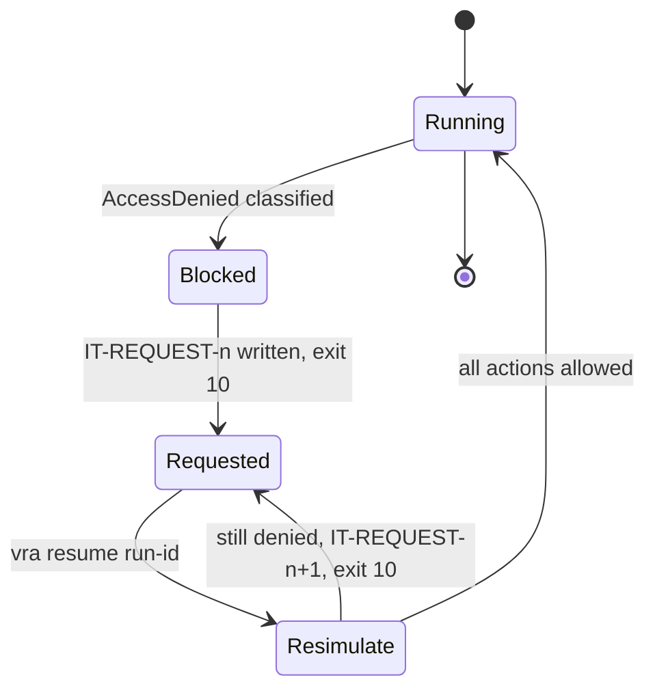

# Permissions and IT requests

Many organizations do not let delivery teams create IAM roles, change key policies or deploy outside
approved guardrails. `vra` is built for that: a permission gap does not fail a run, it pauses it and
produces a precise request for the team that can grant access.

This page covers the roles `vra` itself runs as. When IT also creates or bounds the roles VAMS creates for
itself, the request is an IT role package instead (`kind: iam-package`); see
[IAM for strict environments](iam-for-strict-environments.md).

## How the loop works



1. **Classify.** `vra` recognizes `AccessDenied*`, `UnauthorizedOperation`, `*NotAuthorized*`, AWS
   CloudFormation stack events of the form "is not authorized to perform: `<action>` on resource:
   `<arn>`", and hints that the denial came from an AWS KMS key policy, a service control policy (SCP) or
   a permissions boundary. Encoded authorization messages are decoded with
   `sts:DecodeAuthorizationMessage` when the caller is allowed to.
2. **Write the request.** `vra` writes `state/runs/<run-id>/it-requests/IT-REQUEST-<n>.md` and `.json`
   in the shared home.
3. **Park.** The step is marked `blocked`, the run ends `BLOCKED_ON_IT`, and `vra` exits `10`. Nothing
   after the blocked step has run. The environment lock is released unless the run already changed the
   environment.
4. **Resume.** After IT responds, `vra resume <run-id>` re-simulates exactly the actions in the request.
   If all are now allowed, the run continues from the blocked step. If any is still denied, `vra` writes
   `IT-REQUEST-<n+1>` with only the remaining gaps and exits `10` again.

## Preflight

Preflight finds gaps before a run starts, so the first deploy is not the first time you learn about a
missing permission.

```bash
vra preflight --env prod --workflow deploy
vra preflight --env test --workflow data-copy-target
vra preflight --env prod --workflow data-copy-source
vra preflight --all                  # every env x workflow (data-copy sides only where configured)
```

Each workflow has an action manifest in [`iam/actions/<workflow>.yaml`](https://github.com/awslabs/visual-asset-management-system/tree/main/tools/VamsReleaseAutomation/iam/actions) listing the
actions and resource patterns it needs: `sync`, `build`, `deploy` (also used by `promote` and `watch`),
`backup`, `restore`, `migrate`, `rollback`, `test-live` (used by `test`), `data-copy-source`,
`data-copy-target`, `preflight` and `report`. The engine ships byte-identical copies in
`engine/vra/data/iam-actions/`, so a non-editable install behaves the same; set `VRA_IAM_ACTIONS_DIR` to
use your own reviewed copies first. Placeholders such as `${Partition}`, `${Account}`, `${Region}`,
`${ConfigName}`, `${BaseStackName}`, `${CoreStack}` and `${SsmPrefix}` are filled from the ledger;
`${RegisteredBucket}` and `${RegisteredBucketKmsKey}` from the deployed env (see
[Registered asset buckets](#registered-asset-buckets)).

Preflight calls `iam:SimulatePrincipalPolicy` for the env role named by the manifest's `role`
(`deployRoleArn`, or `dataCopyRoleArn` for the data-copy sides). Statements whose `sid` starts with
`Tools` belong to the orchestrator identity in the tools account (for example `sts:AssumeRole` into the
deploy role) and are not simulated against the env role. When the caller may not call
`iam:SimulatePrincipalPolicy`, preflight falls back to read-only probes for the actions it has a probe
for and reports the rest as unverified. Gaps become an IT request exactly as in a run.

:::note[Preflight is advisory]
Simulation can disagree with the real authorization decision, particularly where SCPs, permissions
boundaries, resource policies or session policies apply. A clean preflight lowers the chance of a
blocked run; it does not guarantee one will not happen. The loop above handles the remainder.
:::

## Registered asset buckets

VAMS lets operators register asset buckets at any time (rows of the `s3AssetBucketsStorage` table),
including customer-named buckets and buckets in other accounts with their own KMS keys. The stock role
templates only grant buckets named after the env's core stack, so `vra` never assumes a fixed bucket list:

-   **Per-bucket manifests.** Amazon S3 statements in `backup`, `restore`, `migrate`, `data-copy-source` and
    `data-copy-target` carry `forEach: registeredBucket` and use `${RegisteredBucket}`; KMS statements for the
    bucket keys carry `forEach: registeredBucketKmsKey` and use `${RegisteredBucketKmsKey}`. Preflight resolves
    the env's real buckets (SSM `s3Buckets/*` plus every registered asset bucket, each with its default
    encryption from `GetBucketEncryption`) and simulates the statements once per bucket and once per distinct
    KMS key (with `kms:ViaService` set to S3). Before the first deploy, or in a dry run, the bucket statements
    fall back to `${CoreStack}*` and the key statements are skipped.
-   **Recorded grants.** `envs/<env>/env.yaml` `registeredBuckets: {granted, bucketArns, kmsKeyArns}` records
    what the env's roles have been granted (asked by `vra setup`). A bucket counts as usable when it is named
    after the core stack or matches `bucketArns` with `granted: true`; a key when it is in the env's own account
    and Region or matches `kmsKeyArns`. The simulation cannot see bucket policies or key policies in other
    accounts, so an uncovered bucket or key needs IT even when the identity policy already allows it.
-   **Checked at the start of every bucket phase**: backup checkpoints (also the ones inside deploy, restore
    and data copy), restore (also inside a rollback), both sides of a data copy, and deploys with data
    migrations or an A/B slot copy. The check is re-validated on every resume. A gap writes an IT request
    with a "Registered asset buckets" table (bucket, KMS key, newly registered, workflows, exact actions and
    resources) and a least-privilege policy built from the concrete bucket and key ARNs, and stops with exit
    `10`. A bucket that was not in the env's last recorded inventory (history action `bucket-inventory`) is
    marked newly registered.
-   **Deploys without bucket phases** (no checkpoint, no migrations, no A/B copy) are not blocked: the IT
    request is written, listed in the report as pending, and the next bucket phase stops on it.
-   **Granting.** IT adds the ARNs to the role stacks (`AdditionalBucketArns`, `AdditionalKmsKeyArns` on
    [`vra-deploy-role.yaml`](https://github.com/awslabs/visual-asset-management-system/blob/main/tools/VamsReleaseAutomation/iam/cloudformation/vra-deploy-role.yaml) and both sides of
    [`vra-data-copy-roles.yaml`](https://github.com/awslabs/visual-asset-management-system/blob/main/tools/VamsReleaseAutomation/iam/cloudformation/vra-data-copy-roles.yaml)) and, for a bucket or key
    in another account, to its bucket policy or key policy. Then record them in `registeredBuckets` and run
    `vra resume <run-id>`.

## Source identity

Approval-gated sessions carry `sts:SourceIdentity` set to the run initiator (`setSourceIdentity`, default
on for gated environments), so AWS CloudTrail in the environment account names the person behind every
call, through every chained role. The gated deploy roles require it (`vra-deploy-role.yaml`
`RequireSourceIdentity=auto` with `EnvTier` test or prod). Every role a session chains into must trust
`sts:SetSourceIdentity`, including the CDK bootstrap roles, which the stock bootstrap template does not
grant: bootstrap gated environment accounts with the patched template (see
[Prerequisites: CDK bootstrap](prerequisites.md#cdk-bootstrap)). `vra deploy` checks the bootstrap roles'
trust (`iam:GetRole`) and stops with `20` before it changes anything when one of them lacks it.

## Quotas

Preflight checks permissions, not quotas. `vra deploy` therefore checks the account's IAM and Amazon
CloudFront quotas before `cdk deploy` ([Workflows: quota checks](workflows.md#quota-checks)).

IAM: `vra deploy` reads `iam:GetAccountSummary`
before `cdk deploy`, whenever the diff adds or replaces IAM roles or managed policies. It stops with `20`
when the account's `Roles` plus that count plus `iam.quotaHeadroom` (default 10) exceeds `RolesQuota`
(the same for `Policies`). The `IamQuotaRead` statement in `deploy.yaml` and `vra-deploy-role.yaml`
grants this read. It is not resource-scoped, IAM accepts only `*`, and it returns counts only. A deploy
role without it gets the usual IT request from preflight or from the run. In `rollback.yaml` the
statement is optional: a rollback only notes the quota and never stops on it. See
[IAM for strict environments](iam-for-strict-environments.md#permission-boundary-mode-and-github-issue-431).

CloudFront: whenever the change adds or replaces CloudFront cache policies, origin request policies,
response headers policies or distributions (a first install or a switch to CloudFront), `vra deploy`
reads the account's custom counts and quotas. It stops with `20` when in use plus needed plus
`cloudfront.quotaHeadroom` (default 2) exceeds a quota. Each read has its reason in the statement notes
of `deploy.yaml`:

| Action                                   | Reason                                                                                        |
| ---------------------------------------- | --------------------------------------------------------------------------------------------- |
| `cloudfront:ListCachePolicies`           | Counts the account's custom cache policies (`Type=custom`); VAMS adds 2                       |
| `cloudfront:ListOriginRequestPolicies`   | Counts the custom origin request policies; VAMS adds 1                                        |
| `cloudfront:ListResponseHeadersPolicies` | Counts the custom response headers policies; VAMS adds 1                                      |
| `cloudfront:ListDistributions`           | Counts the distributions; VAMS adds 1                                                         |
| `servicequotas:GetServiceQuota`          | Reads the applied quotas (service code `cloudfront`); without a value the AWS default is used |

The statements are `CloudFrontQuotaRead` and `CloudFrontQuotaLimitsRead`, on `*` (the CloudFront List
actions support no resource-level permissions), in `deploy.yaml` and `vra-deploy-role.yaml`; in
`rollback.yaml` they are optional. Preflight simulates them only for environments whose overlay deploys
on CloudFront (feature `cloudFrontQuota`): not on an Application Load Balancer, not in AWS GovCloud (US)
or the AWS European Sovereign Cloud. A deploy role without them gets the usual IT request.

## Optional features

Some statements are needed only when a ledger turns a feature on. A manifest statement with `feature:` is
simulated only for environments that enable it; one marked `optional: true` warns instead of blocking.

| Feature                        | Turned on by                                                                                                                               | IAM                                                                                                                                                                                                                                                                                               | Where it is granted                                                                                                                                                                                                                                                                        |
| ------------------------------ | ------------------------------------------------------------------------------------------------------------------------------------------ | ------------------------------------------------------------------------------------------------------------------------------------------------------------------------------------------------------------------------------------------------------------------------------------------------- | ------------------------------------------------------------------------------------------------------------------------------------------------------------------------------------------------------------------------------------------------------------------------------------------ |
| Change-set gate                | `diffGate: changeset` in `env.yaml`                                                                                                        | `cloudformation:CreateChangeSet`, `DescribeChangeSet`, `DeleteChangeSet`, `ListChangeSets` on the env's VAMS stacks and `changeSet/vra-gate-*` (statement `ChangeSetGate` in `deploy.yaml`; the CDK deploy role creates the change sets, `vra` describes and deletes them)                        | `vra-deploy-role.yaml` `EnableChangeSetGate=true`                                                                                                                                                                                                                                          |
| CloudFront quota               | the overlay deploys on CloudFront (`app.useCloudFront.enabled`, the VAMS default in the commercial partition); optional without an overlay | `cloudfront:ListCachePolicies`, `ListOriginRequestPolicies`, `ListResponseHeadersPolicies`, `ListDistributions` and `servicequotas:GetServiceQuota` on `*` (`CloudFrontQuotaRead`, `CloudFrontQuotaLimitsRead` in `deploy.yaml`; optional in `rollback.yaml`)                                     | `vra-deploy-role.yaml` `DeployPolicy` (always granted)                                                                                                                                                                                                                                     |
| Write freeze: maintenance mode | `writeFreeze.backend: maintenance-mode` (optional check for `auto`)                                                                        | `ssm:GetParameter`, `ssm:PutParameter` on `<SsmPrefix>/maintenanceMode*` (`MaintenanceModeSwitch` in `restore.yaml`, `data-copy-target.yaml`)                                                                                                                                                     | Restore policy of `vra-deploy-role.yaml`; target policy of `vra-data-copy-roles.yaml`                                                                                                                                                                                                      |
| Write freeze: manual           | `writeFreeze.backend: manual` (or `auto` without maintenance mode)                                                                         | none                                                                                                                                                                                                                                                                                              | -                                                                                                                                                                                                                                                                                          |
| Running workflow executions    | always before restore, data copy and deploys with migrations                                                                               | `dynamodb:Scan` on the workflow-executions table, `states:DescribeExecution` (`WorkflowExecutionsRead`)                                                                                                                                                                                           | Data policy of `vra-deploy-role.yaml`; target policy of `vra-data-copy-roles.yaml`                                                                                                                                                                                                         |
| Abort them                     | `--abort-workflow-executions`                                                                                                              | `states:StopExecution` (`WorkflowExecutionsAbort`, optional)                                                                                                                                                                                                                                      | `EnableWorkflowAbort=true` on both templates                                                                                                                                                                                                                                               |
| Source identity                | `setSourceIdentity` (default on for gated envs)                                                                                            | `sts:SetSourceIdentity` for the orchestrator and on every chained role: the deploy role's `CdkBootstrapRolesAssume`, the trust of the deploy, synth and data-copy roles, and the CDK bootstrap roles (patched template)                                                                           | `vra-deploy-role.yaml`, `vra-data-copy-roles.yaml`, [CDK bootstrap](https://github.com/awslabs/visual-asset-management-system/blob/main/tools/VamsReleaseAutomation/iam/cdk-bootstrap.md#source-identity); `iam:GetRole` on `role/cdk-*` lets `vra deploy` check the bootstrap trust first |
| IAM package verification       | `vra iam verify`                                                                                                                           | `iam:GetRole`, `iam:GetPolicy`, `iam:SimulatePrincipalPolicy`, `iam:ListAttachedRolePolicies`, `iam:ListRolePolicies`, `iam:GetRolePolicy` on the env's VAMS roles and boundary (`iam-verify.yaml`; the list reads find roles broader than the package); denied reads are reported as not checked | `vra-deploy-role.yaml` `EnableIamVerify=true` (`IamVerifyRolePrefix`), or `readOnlyRoleArn`                                                                                                                                                                                                |
| Pipeline                       | `vra pipeline` (tools account)                                                                                                             | Stack reads, the CDK bootstrap roles of the tools account, pipeline state, the created S3 source (`pipeline.yaml`); `kms:Verify` for a signed `human:pipeline-deploy` record                                                                                                                      | The tools account identity; the pipeline's own roles come with its IT package (`state/iam/pipeline/<n>/`)                                                                                                                                                                                  |
| Signed builds                  | `build.signing` in `vra.yaml`                                                                                                              | Build identity: `kms:Sign`, `kms:GetPublicKey` on the signing key (`ToolsBuildSigning`). Deploying identities: `kms:Verify`, `kms:GetPublicKey` (`ToolsVerifyBuildSignatures`); never `kms:Sign`                                                                                                  | CodePipeline app `signingKeyArn`; OIDC role `SigningKeyArn` (+ `AllowSigning=true` for the build job's role only)                                                                                                                                                                          |

## Sample IT request

```markdown
# IT-REQUEST-1 — vra deploy, environment prod

Run: deploy-20261110T153000Z-1a2b Step: deploy.prod.cdk-deploy Requested: 2026-11-10T15:41:02Z
Principal: arn:<partition>:iam::444444444444:role/vra-deploy
Account / Region: 444444444444 / <region>

## What failed

CloudFormation event on stack vams-core-prod-<region>:
"... is not authorized to perform: kms:CreateGrant on resource: arn:<partition>:kms:<region>:444444444444:key/<key-id>"
Classification: KMS key policy (identity policy already allows the action)

## Requested change

Add the statement below to the key policy of key <key-id>, or grant the equivalent through a KMS grant.

## Least-privilege policy (consolidated)

{
"Version": "2012-10-17",
"Statement": [{
"Sid": "VraDeployCreateGrantForAwsServices",
"Effect": "Allow",
"Principal": { "AWS": "arn:<partition>:iam::444444444444:role/vra-deploy" },
"Action": "kms:CreateGrant",
"Resource": "*",
"Condition": { "Bool": { "kms:GrantIsForAWSResource": "true" } }
}]
}

## How to confirm

The requester runs: vra resume deploy-20261110T153000Z-1a2b
```

The `.json` file carries the same data in machine form, so a ticketing integration can file it
automatically.

## Working with IT

-   **Send the request as written.** It names the principal, actions, resources and the exact error, which
    is what a reviewer needs to approve a least-privilege change.
-   **Prefer roles provisioned by IT.** Hand IT the templates in [`iam/`](https://github.com/awslabs/visual-asset-management-system/tree/main/tools/VamsReleaseAutomation/iam) at setup time. VAMS also
    supports custom bootstrap and stack roles through `app.iamRoleConfig`, which lets IT own every role;
    `vra iam plan` writes the package IT needs for that
    ([IAM for strict environments](iam-for-strict-environments.md)).
-   **Expect several rounds.** Some permissions are only exercised after earlier steps succeed, so a first
    deploy into a new account can take more than one request. `vra` consolidates each round into one
    request instead of failing on every action separately.
-   **Keep requests in the record.** IT requests stay in the run directory and are listed in the report, so
    your change record shows why each permission exists.

## Related pages

-   [Prerequisites](prerequisites.md)
-   [Troubleshooting: registered asset bucket blocked a run](troubleshooting.md#registered-asset-bucket-blocked-a-run)
