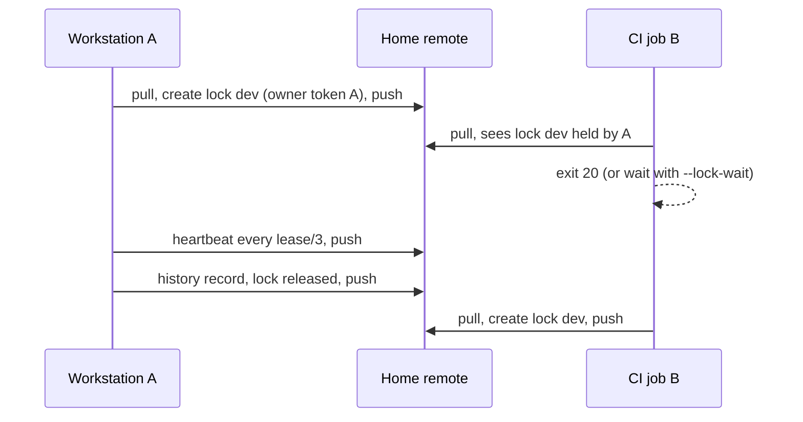

# Shared home

The shared home is one folder that every machine and process using `vra` reads: operator
workstations, the scheduled watch host, CI jobs and agents. It holds the ledger (what you configure and
approve) and the state (what the engine records). Each machine points at the same folder, and the
folder is synchronized between machines in the way you choose.

## Layout

```text
<home>/
  vra-home.yaml          # home id, schema version, sync settings, lock lease, registered hosts
  ledger/                # vra.yaml, envs/, approvals/, path-policy.yaml, tests/, core-patches.md
  state/
    locks/<key>.lock     # one per env, plus watch and run-<run-id>
    runs/<run-id>/       # state.json, logs/, junit/, report.md, report.json, it-requests/, conflicts.json
    history/<env>/<seq>-<run-id>.json      # one write-once record per action, sequence per env
    approvals-consumed/<env>/<sha256>.json # one claim per approval record used
    sync-state.json      # last upstream release and preview commit seen
  artifacts/<buildId>/   # build bundles: manifest.json, cdk.out/<env>/
  checkpoints/           # checkpoint manifests
  .vra-local/            # per-machine mutexes, never synchronized
```

`setup` writes a `.gitignore` for `.vra-local/` and a `.gitattributes` that marks `state/`,
`artifacts/` and `checkpoints/` as binary with no merge. Two machines that changed the same record
therefore conflict instead of producing a file neither wrote.

Each machine also has a machine-local work directory, by default `~/.cache/vra/<home id>/`: the
engine's clone of the fork (`repo/`), scratch checkouts for synth, and the owner tokens of the runs this
machine started. Nothing in it is shared. The pointer file `~/.config/vra/config.yaml` records which
home this machine uses.

## How a command finds the home

| Order | Source                           | Result                                                  |
| ----- | -------------------------------- | ------------------------------------------------------- |
| 1     | `--home <dir>` or `VRA_HOME`     | That home                                               |
| 2     | `--ledger <dir>` or `VRA_LEDGER` | A ledger directory without a home (single-machine mode) |
| 3     | `~/.config/vra/config.yaml`      | The home `vra setup` or `vra setup --join` registered   |
| 4     | `./vra-home.yaml`                | The current directory                                   |

In single-machine mode the state lives in the work directory (`--work-dir`, default `./.vra`), nothing
is shared, and `vra ledger validate` warns about it.

## Synchronization

`vra-home.yaml` `sync.type` decides how the folder reaches other machines.

| `sync.type` | Pull                     | Publish                                  | Use when                                                                  |
| ----------- | ------------------------ | ---------------------------------------- | ------------------------------------------------------------------------- |
| `none`      | nothing                  | nothing                                  | One machine; cron, CLI and agents on it still share one folder            |
| `git`       | `git pull --ff-only`     | commit of the engine's paths, `git push` | Several machines and CI jobs, with a private git repository as the remote |
| `command`   | your `sync.pull` command | your `sync.push` command                 | Any other transport (a file share tool, an object store sync)             |

The engine pulls before it reads state or takes a lock, and publishes after it writes a lock, a history
record, an approval claim or run state. It publishes only `state/` and `checkpoints/`, plus `artifacts/`
when `sync.pushArtifacts` is `true`. The ledger and `vra-home.yaml` change only by a person's commit.
In CI, a change anywhere else in the home stops the publish, so fork code can never change the ledger.
With `pushArtifacts: false`, the build's own `artifacts/` stay on the machine and do not stop it.
A release build's number counts the build ids the home recorded as well as the fork's tags, so a fresh
CI clone with `build.pushTags: false` never gives a new commit an id an earlier build already has.

### Git

```yaml
# vra-home.yaml
schemaVersion: 1
homeId: home-0123456789ab
sync:
    type: git
    pushArtifacts: false
locks:
    leaseSeconds: 900
hosts: []
```

Create the remote as a private repository, protect its default branch for ledger changes (reviews on
`ledger/` and `vra-home.yaml`), and give the CI jobs and operator machines push access. Build bundles are
large: keep `pushArtifacts: false`, so bundles stay on the machine that built them and CI jobs hand them on
as CI artifacts ([CI/CD and AWS CodePipeline](codepipeline.md#the-shared-home-in-ci)), or use the
[Amazon S3 backend](configuration-reference.md#statestore). A CI job holds only its own execution's
bundle, so the pipeline stack also keeps every bundle in its artifact bucket (`VRA_BUNDLE_STORE`), where a
rollback finds the previous build.

### Custom commands

```yaml
sync:
    type: command
    pull: "/opt/vra/bin/home-pull"
    push: "/opt/vra/bin/home-push"
```

The commands run in the home folder with `VRA_HOME` set, and must leave `.vra-local/` alone. Their
contract:

| Command | Must                                                                                                    | Exit code                                                                                             |
| ------- | ------------------------------------------------------------------------------------------------------- | ----------------------------------------------------------------------------------------------------- |
| `pull`  | Bring the folder to the remote's latest state                                                           | Non-zero stops the command with exit `20`                                                             |
| `push`  | Publish local changes only if the remote did not change since the last pull (compare a version or ETag) | Non-zero means another machine moved first; the engine pulls again and reports contention (exit `20`) |

A transport that cannot detect a concurrent change gives no protection against two machines writing
at once; use `git` or the Amazon S3 backend instead.

## Several machines



-   **Locks.** Every environment has a lock, `vra watch` holds the `watch` lock, and every run holds a run
    lock for its whole execution. A lock is created only if it does not exist, and records an owner token
    hash, host, process, run id, lease end and heartbeat. A heartbeat renews the lease every third of
    `locks.leaseSeconds` (default 900 seconds). `--lock-wait <minutes>` waits for a busy lock instead of
    stopping.
-   **No silent reentry.** A run started on one machine cannot be resumed from another while its lease
    is live. After the lease expired, `vra resume <run-id> --takeover` takes it over and records the
    takeover in the run and in the environment history. It is human-only.
-   **Dirty locks.** A run that changed an environment and then parked or failed marks its lock dirty.
    A dirty lock never expires; it is released by the run itself, by a takeover of that run, or by
    `vra unlock` (human-only, recorded).
-   **Contention.** When two machines write at once, the later push is rejected. The engine replays its
    commit on the new remote state and pushes again at once (two CI jobs publishing every second would
    otherwise starve each other); a host that refuses with nothing new upstream is retried with a short
    backoff. When both changed the same file, it drops its local change, pulls again, and stops with exit
    `20` if the lock is now held by another machine.
-   **Stale copies.** Run state carries a revision, and each save refuses to overwrite a newer copy.
    A run id given with `--run-id` never overwrites another machine's run.
-   **A process that died before it published.** Its engine files that another machine has since committed
    are moved to `.vra-local/displaced/<time>/` on the next pull, and the committed copy wins.
-   **A person's unpushed commit.** The engine never publishes it: while a local commit that changes the
    ledger (or anything outside `state/` and `checkpoints/`) is not pushed, every engine publish stops with
    exit `20`. Push it yourself, through review.
-   **A refused first publish.** When a run's first publish is refused (a rejected push, a person's
    unpushed commit, an unreachable remote), the run never starts. It is parked `NEEDS_HUMAN` with the
    reason in `result.publishRefused`, never left `RUNNING`. Fix the home (`vra home sync`), then
    `vra resume <run-id>` or start the command again.
-   **Orphaned runs.** A `RUNNING` run whose run lease expired or is gone has no live owner (its process
    was killed, its machine recycled). `vra status --all` lists it under `orphanedRuns` and
    `vra history verify` warns about it, each with the fix: check nothing of it still runs on its host,
    then `vra resume <run-id> --takeover` (human-only). Nothing is changed or deleted automatically.
-   **Several processes on one machine.** Their pulls and pushes of the home take one machine-local mutex,
    and `vra test` takes the environment lock like every other environment command.
-   **Parked merges.** The conflicts of a parked merge are in the fork clone of the machine that ran it.
    Resolve them and run `vra merge --continue` on that machine.

```bash
vra status --all        # every run and lock of every machine, with host and lease; orphaned runs
vra home show           # path, sync type, lease, registered hosts
vra home sync           # pull, then publish anything written locally
```

## Approvals in the home

Approval records are files in `ledger/approvals/<env>/`, written by the approver. With `sync.type: git`,
an approval-gated command needs a clean `ledger/`, a HEAD equal to the remote after the pull, and the
approval record committed. A record therefore reaches a gated deploy only after it was committed and
pushed through the repository's branch protection. In CI the platform's own approval is used instead
(see [Approvals and gates](approvals-and-gates.md)).

## History

Every action writes one record, `state/history/<env>/<seq>-<run-id>.json`, written once with the next
sequence number of the environment. Every record carries the ledger digest and commit it ran with.

```bash
vra history show --env prod
vra history verify --env prod
```

`vra history verify` fails (exit `20`) on a malformed or edited record, duplicate or misnamed
sequence numbers, records not committed and pushed (git sync), and a history file left in the ledger;
gaps in the sequence and orphaned runs are warnings. Run it in CI and before an audit.

## Optional Amazon S3 and Amazon DynamoDB backend

`stateStore.type: s3` keeps runs, history, approval claims and bundles in an Amazon S3 bucket and the
locks in an Amazon DynamoDB table, with conditional writes for every record. The home is then pulled
for the ledger and never published. Use it when many CI jobs run in parallel or when the state must be
in AWS; create the bucket and table with
[`vra-state-store.yaml`](https://github.com/awslabs/visual-asset-management-system/blob/main/tools/VamsReleaseAutomation/iam/cloudformation/vra-state-store.yaml).

## Moving an older ledger into a home

A ledger whose history is in `envs/<env>/history.jsonl` (a ledger made without a shared home) is
copied into a new home with:

```bash
vra home migrate --from ./old-ledger --old-work-dir ./old-ledger/.vra --to ~/vams-release-home --sync git
```

It copies the ledger without the history files, turns every history line into one record (ordered by
time, sequence from 1), and copies runs, bundles, checkpoints and the sync state. It refuses while the
old work directory holds a lock. `vra home migrate` is human-only.

## Related pages

-   [Setup and joining](setup.md)
-   [Configuration reference: vra-home.yaml](configuration-reference.md#vra-homeyaml)
-   [Troubleshooting: locks and contention](troubleshooting.md#locks-and-contention)
