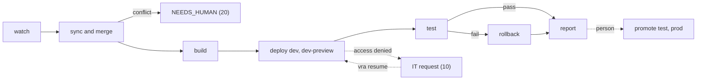

# Workflows

This page describes each release workflow: what starts it, its steps, the gates it enforces, what it
produces and how it handles failure. Data copy, backups, restores, migrations and the permission loop
have their own pages. The agent procedures for the same workflows are in
[`skill/workflows/`](https://github.com/awslabs/visual-asset-management-system/tree/main/tools/VamsReleaseAutomation/skill/workflows).

| Workflow                                                | Command                                           | Started by                                                       | Gate                                                                          |
| ------------------------------------------------------- | ------------------------------------------------- | ---------------------------------------------------------------- | ----------------------------------------------------------------------------- |
| [Watch](#watch)                                         | `vra watch`                                       | Schedule                                                         | Acts only on auto-deploy environments                                         |
| [Sync and merge](#sync-and-merge)                       | `vra sync`, `vra merge`                           | Watch or a person                                                | Pull request review per your policy                                           |
| [Build](#build)                                         | `vra build`                                       | Watch or a person                                                | Unit suites, synth and enabled scanners pass                                  |
| [Deploy](#deploy)                                       | `vra deploy`                                      | Watch (auto environments) or a person                            | Approval record on gated environments; promotion evidence; data protection    |
| [Test](#test)                                           | `vra test`                                        | Deploy or a person                                               | Required suites executed and passed                                           |
| [Rollback](#rollback)                                   | `vra rollback`                                    | Failed deploy or test, or a person                               | Approval record on gated environments                                         |
| [Promote](#promote)                                     | `vra promote`                                     | A person                                                         | Approval record; build passed on the previous environment and is on the trunk |
| [Data copy](data-copy.md)                               | `vra data-copy`                                   | A person                                                         | Target and source data-owner approvals; prod-class targets refused            |
| [Backup and restore](backups-restore-and-migrations.md) | `vra backup`, `vra restore`, `vra migrate`        | Deploy or a person                                               | Approval record to restore a gated environment                                |
| [Permission loop](permissions-and-it-requests.md)       | `vra preflight`, `vra resume`                     | Any access-denied error                                          | IT grants the access                                                          |
| [IAM roles from IT](iam-for-strict-environments.md)     | `vra iam plan`, `vra iam apply`, `vra iam verify` | An environment with an IAM mode, or a build that needs new roles | IT creates the roles; a person applies the answer                             |
| [Pipeline](codepipeline.md)                             | `vra pipeline plan`, `vra pipeline deploy`        | A person, after an `automation` or topology change               | First deploy, IAM changes and removed approvals are human-only                |
| [Report](#report)                                       | `vra report`                                      | End of every run                                                 | None                                                                          |

## Runs, resume and locks

Every workflow writes a run under `state/runs/<run-id>/` in the shared home: `state.json` (steps,
status, approvals, IT requests, locks), step logs, JUnit results and a report. With `--json`, stdout
carries `{exitCode, status, runId, workflow, runDir, message, result}`, plus `buildId` for build,
deploy and promote runs, `prUrl` for merge runs that opened or found a pull request, and `itRequests`.

A run parks with exit `10` (IT request) or `20` (a person is needed). `vra resume <run-id>` continues
from the first step that is not done and runs every gate step again (approval validity, approver list,
change window, promotion evidence), so a resumed run never relies on a gate that passed days earlier.
When a step waits for work only a person can do (a manual migration step, a DNS switch without a hook),
the person does it and runs `vra resume <run-id> --confirm`; a plain resume keeps waiting. Runs that
ended `SUCCEEDED`, `ROLLED_BACK` or `ROLLBACK_FAILED` cannot be resumed.

Environment locks are taken before the gates. A run that parks while the environment is unchanged
releases its lock. A run that parks or fails after it changed the environment keeps the lock and marks
it dirty, so nobody deploys another build onto a half-changed environment; `vra resume` or a rollback
releases it, and `vra unlock --env E --run R --reason "..."` releases it by hand (human-only, recorded).
See [Shared home: several machines](shared-home.md#several-machines).

## Watch

`vra watch` is the scheduled entry point (cron, Amazon EventBridge, a CI scheduler).

1. Takes the `watch` lock, so two machines never run a watch cycle at once.
2. Runs `vra sync`: fetches upstream, fast-forwards `vendor/vams-main` and `vendor/vams-development`,
   and compares them with the last release tag and preview commit recorded in the shared state.
3. For each lane in use with a new upstream ref: merges, builds, deploys to the lane's auto-deploy
   environments, tests, and rolls back by policy.
4. Writes the report and, unless `--no-notify`, notifies.

Watch acts only on environments with `autoDeploy: true`. It cannot deploy to an approval-gated
environment whatever its arguments, and `vra ledger validate` rejects an environment with both
`autoDeploy` and `requiresApproval`. A cycle with no upstream change ends `SUCCEEDED` with a short
report, which also proves that the schedule runs. `vra watch --print-cron` prints a crontab line for this
machine.

A non-fast-forward upstream change stops with `20` and leaves the mirror untouched.

## Sync and merge

`vra merge --lane release|preview [--ref R]` merges an upstream ref into the fork.

1. **Prepare**: resolves the ref (the newest release tag on `vendor/vams-main`, or the
   `vendor/vams-development` head) and the target branch (the trunk for release, `preview/main` for
   preview).
2. **Core audit**: lists the files the fork changed since its last upstream merge that no path rule and
   no `core-patches.md` entry covers, and stops with `20` naming them. `unregisteredCoreEdits: warn` in
   `path-policy.yaml` reports them instead.
3. **Merge**: creates `sync/<lane>-<ref>` from the target, runs `git merge --no-ff --no-commit`,
   resolves conflicted paths by the path policy (paths in `core-patches.md` always go to a person or
   agent), regenerates lockfiles and commits.
4. **Publish**: pushes the branch (plain push, never forced). The release lane opens or finds the pull
   request through the git host adapter; the preview lane with `autoMerge: true` fast-forwards
   `preview/main` instead.

Unresolved conflicts are written to `conflicts.json` in the run and the run exits `20`, with the merge
in progress in the engine's fork clone on that machine. Resolve each path, `git add` it and run
`vra merge --continue`, or abandon the merge with `vra merge --abort`. See
[Branch strategy: merge path policy](branch-strategy.md#merge-path-policy).

`vra watch` builds the release-lane `sync/*` branch and deploys it to the auto-deploy environments
before its pull request merges. Promotion into an approval-gated environment needs the build's commit on
the trunk, so merge sync pull requests with a merge commit, not squash or rebase. Configuration changes
in the new release are a separate step: run `vra ledger upgrade-config --env E --to-ref R` per
environment (see [Configuration reference: configuration upgrades](configuration-reference.md#configuration-upgrades)).

## Build

`vra build --lane L --ref R [--suites S|none] [--envs E1,E2]` produces one bundle for all
environments of the lane.

1. Takes a scratch checkout of the ref and applies the ledger core patches `core-patches.md` lists
   ([Configuration reference: ledger core patches](configuration-reference.md#ledger-core-patches)); a
   patch that no longer applies stops the build with `20`. For an environment with an IAM mode, checks
   that its IT role package is applied and current (`10` otherwise).
2. Runs the unit suites, by default `lint` (lockfile sync of the npm projects, `npm audit`, prettier,
   ESLint), `web`, `infra`, `backend`, `vamscli`, `vamsmcp` and `pipelines`, mirroring the VAMS CI
   workflow; `vams-release-automation` is available for forks that carry this tool. `--suites` or
   `build.unitSuites` overrides the selection. A selection in which nothing executed fails.
3. For each environment of the lane, applies the ledger overlay and runs `cdk synth` with build-only
   credentials (`synthRoleArn`, else `readOnlyRoleArn`; an approval-gated environment without either
   synthesizes with no AWS credentials, never with its deploy role). Synth starts from an allowlisted
   environment and always passes the configuration file, stack name, Region and account; VAMS
   configuration variables in the operator's environment stop the build unless `env.yaml` `synthEnv`
   records them. After each synth, the IAM check compares the assembly with the environment's IAM mode:
   new roles write the next IT package (`10`), and a role without the configured permission boundary
   stops the build (`20`).
4. Runs ASH when `build.ash` is on and writes an SBOM when `build.sbom` is on. An enabled scanner whose
   tool is missing stops the build with `20`; `--allow-missing-scanners` (human-only) waives it, the
   waiver is recorded, and prod-class environments refuse such a build.
5. Packs the exact AWS CDK CLI from `infra/package-lock.json` into the bundle and checks it against the
   lockfile integrity.
6. Writes `artifacts/<buildId>/` with each environment's `cdk.out` and `manifest.json`, signs the
   manifest with AWS KMS when `build.signing` is set, and records a half-rolled VAMS version (the three
   version files disagree) as a run note.
7. Creates and pushes the release tag `<tagPrefix>v<vams>-<n>` (release lane only), signed with the same
   key when `build.signing.tags` is on.

A failed suite exits `30` with JUnit results; nothing is deployed and no tag is created. Building every
environment's assembly in one build catches configuration-specific synth failures (for example an
Application Load Balancer template and an Amazon CloudFront template) before anything deploys.

## Deploy

`vra deploy --env E --build B [--approval A] [--mode in-place|ab]` deploys a bundle to one
environment. The engine runs, in order:

1. Takes the environment lock.
2. Checks the gates: lane, approval record and separation of duties, change window, bundle hashes,
   manifest and tag signatures (with `build.signing`), scanner waivers, the pinned CDK CLI, and that the
   bundle's core stack is this environment's (`stack-identity`). With `sync.type: git`, a gated
   environment also needs a clean ledger at the remote HEAD.
3. Checks promotion evidence when the environment has `promotesFrom` (the same check as
   [Promote](#promote)).
4. Runs the IAM preflight, and on gated environments checks that the CDK bootstrap roles trust
   `sts:SetSourceIdentity`.
5. Takes a backup checkpoint (skipped on first install or with `backupBeforeDeploy: false`; must be
   complete on gated environments unless `backup.allowDegraded`). The registered asset buckets are
   re-listed first.
6. Detects drift (default on for gated environments).
7. Runs the data-protection gate and the quota checks (below).
8. Plans the data migrations for the version change; an upgrade that requires A/B stops an in-place
   deploy. With migrations planned, running VAMS workflow executions are listed and reported.
9. Re-checks the change window and runs `cdk deploy` from `cdk.out/<env>`.
10. A/B only: copies data into the new slot.
11. Per migration: re-checks the window, waits for manual-step confirmation when the upgrade matrix
    lists one, runs the dry run, then applies it.
12. Runs the post-deploy smoke (the required suites must execute, not only pass).
13. A/B only: switches DNS through `ab.dnsSwitchHook`, or parks for a manual switch and `--confirm`.
14. Writes the history record and releases the lock.

AWS CloudFormation rolls back a failed stack update itself; `vra` then applies the environment's
`rollbackPolicy`: `auto` redeploys the previous good build and restores the checkpoint if a migration
ran; `ask` stops and tells you to run `vra rollback`. In A/B mode DNS is never switched on failure.

### Data-protection gate

The gate fails closed. It stops the deploy with `20` when `cdk diff` itself fails, or reports stacks with
differences but no change can be parsed. It flags replacements and removals of data-bearing resources
(Amazon DynamoDB tables, Amazon S3 buckets, Amazon Cognito user pools, AWS KMS keys, Amazon OpenSearch
Service domains and collections, log groups, Amazon EFS file systems) and forward-only changes (an
Amazon Cognito user pool `Schema`, `DeletionPolicy` or `UpdateReplacePolicy` on a data-bearing
resource). In an in-place deploy such a change stops before anything changes. Review
`cdk-diff-<env>.txt` in the run, then re-run with `--mode ab`, or with `--allow-replacements` if the
change is intended. `--allow-replacements` and `--accept-drift` are human-only and need an approval
record scoped `allow-replacements` or `accept-drift` on gated environments.

With `diffGate: changeset` the same rules are checked on AWS CloudFormation change sets: `vra` prepares
a change set for every deployed stack of the environment, reads it with its nested stacks, and deletes
it; nothing is executed. An unreadable nested change set or a change set that failed for any reason
other than "no changes" stops the deploy. The report is `change-sets-<env>.json`. It takes a few minutes
longer and needs the `ChangeSetGate` IAM statement. A `--dry-run` deploy always uses the text gate.

### Quota checks

Preflight checks permissions, not account quotas. The same step therefore counts what the change adds
or replaces (from `cdk diff`, the change sets, or on a first install every synthesized template,
nested stacks included) and compares it with the account's quotas before `cdk deploy`:

-   IAM: roles and managed policies against `iam:GetAccountSummary`, with `iam.quotaHeadroom` (default
    10). See [IAM for strict environments](iam-for-strict-environments.md#permission-boundary-mode-and-github-issue-431).
-   Amazon CloudFront: custom cache policies, origin request policies, response headers policies and
    distributions. A VAMS deployment on CloudFront adds 2 cache policies, 1 origin request policy, 1
    response headers policy and 1 distribution. `vra` reads the custom counts in use
    (`cloudfront:ListCachePolicies`, `ListOriginRequestPolicies`, `ListResponseHeadersPolicies` with type
    `custom`, and `ListDistributions`) and the account's quotas from Service Quotas (service code
    `cloudfront`: `L-7D134442`, `L-C3659C43`, `L-CF0D4FC5`, `L-24B04930`, read in US East (N.
    Virginia)). When a quota cannot be read, the documented AWS default is used and the result says so.
    The headroom is `cloudfront.quotaHeadroom` (default 2).

When in use plus needed plus headroom exceeds a quota, the deploy stops with `20` before anything
changes. The message names the quota, the numbers and the fix: request an increase, or remove unused
policies, roles or distributions, then `vra resume <run-id>`. Without that check a full quota fails
`cdk deploy` several minutes in, and the rollback can get stuck. A check reads nothing when the change
adds none of its resources: deployments on an Application Load Balancer (including AWS GovCloud (US) and
AWS European Sovereign Cloud) and ordinary updates read no CloudFront quota. A denied read is an IT
request (`10`). The step result carries `iamQuota` and `cloudfrontQuota`. Before a rollback redeploy both
checks run as advisory notes and never stop the rollback.

## Test

`vra test --env E [--suites unit,synth,live-cli,live-web,customer]` runs suites against a deployed
environment and appends a `test` record with per-suite counts to the environment history. The result is
`SUCCEEDED` only when something executed, nothing failed and every required suite has at least one
passing test; otherwise `FAILED`, `NO_TESTS` or `INCOMPLETE`, exit `30`, and the record is not
promotion evidence. A failure applies the environment's `rollbackPolicy`. See [Testing](testing.md).

## Rollback

`vra rollback --env E [--to-build B] [--restore-checkpoint C]` redeploys the previous good build from the
environment history (or `--to-build`), restores the checkpoint when a migration ran or one is named, runs
the smoke again and records the result.

-   A manual rollback of a gated environment needs a new approval record for the target build with scope
    `rollback` (`--approval`), and one for `restore:<checkpointId>` to restore data
    (`--restore-approval`). The automatic rollback inside a failed deploy runs under that deploy's
    approval.
-   An automatic rollback that must restore data on a gated environment stops and asks for a person when
    the write freeze needs a manual confirmation; on an ungated environment it proceeds unfrozen and
    records a warning.
-   If the redeploy or restore fails, the run ends `ROLLBACK_FAILED` (exit `40`) and notifies. See
    [Troubleshooting: failed rollback](troubleshooting.md#failed-rollback).

Some changes are forward-only and are not undone by redeploying an older build, such as Amazon Cognito
user pool schema attributes and data a migration rewrote. See
[Backups, restore and migrations: forward-only changes](backups-restore-and-migrations.md#forward-only-changes).

## Promote

`vra promote --from E1 --to E2 --build B --approval A [--mode in-place|ab]` deploys the same bundle to
the next environment.

1. Verifies `E2.promotesFrom` is `E1`.
2. Verifies the build is a release-lane build with a `SUCCEEDED` deploy on `E1` followed by a
   `SUCCEEDED` test that executed every required suite of `E1`, and no later failure.
3. For an approval-gated `E2`, verifies the build's commit is on the fork trunk.
4. Verifies the bundle has a synth for `E2`, then runs [Deploy](#deploy) for `E2` with the approval.

Run `vra test --env E2` afterwards; the deploy's smoke covers the required suites. `vra deploy --env E2`
applies the same promotion checks when `E2` has `promotesFrom`, so promote is not the only way they are
enforced. See [Approvals and gates](approvals-and-gates.md).

## Report

`vra report [run-id] [--notify]` writes `report.md` and `report.json` for a run: steps, tests, diff
highlights, migrations, IT requests, open decisions, and per-environment delivery metrics over the last
30 days of history (deploys, failed deploys, change failure rate, mean minutes to restore, current build
and VAMS version). `--notify` sends it through the configured channel (`notifications.onlyOn` filters by
status). A failed notification is logged and does not change the run status.

## Related pages

-   [Approvals and gates](approvals-and-gates.md)
-   [Command reference](command-reference.md)
-   [Troubleshooting](troubleshooting.md)
