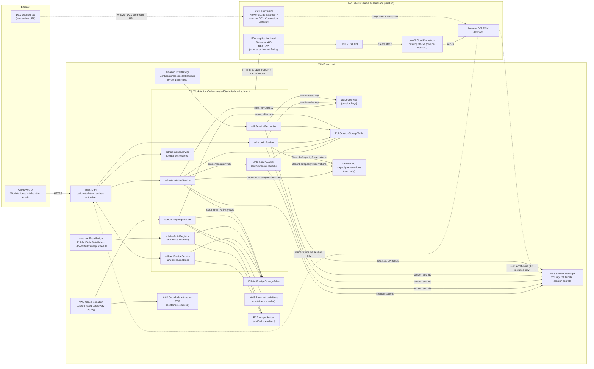
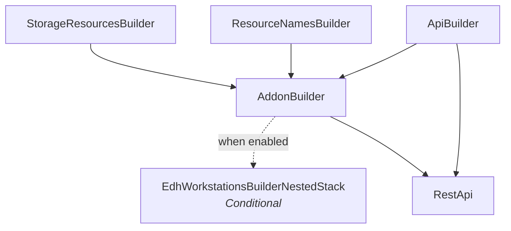

# EDH Workstations Add-on

The EDH Workstations add-on lets VAMS users launch, connect to, stop and delete GPU workstations on an EDH cluster from inside VAMS, and lets administrators register images and reclaim capacity. It is enabled with `app.addons.useEdhWorkstations` and deploys as the `EdhWorkstationsBuilderNestedStack` under `AddonBuilder`. EDH itself calls a workstation a _virtual desktop_ (a DCV session); this page says _workstation_ for the VAMS record and _desktop_ for the EDH object it wraps. To deploy an EDH cluster for VAMS and enable the add-on, follow [Enable the EDH Workstations Add-on](./enable.md).

The add-on's other pages cover the rest: the [EDH Workstations User Guide](./user-guide.md) walks through its web pages, [EDH Workstations Add-on Resources](./resources.md) lists the resources, data, network paths, security controls, costs and limits it adds, [Uninstall the EDH Workstations Add-on](./uninstall.md) removes what it leaves behind, and [EDH Workstations CLI Commands](./cli-commands.md) and [EDH Workstations CLI Troubleshooting](./cli-troubleshooting.md) cover `vamscli edh`.

---

## Use cases

-   **Engineering desktops.** Engineers open Amazon DCV desktops, launched from engineering images an administrator registered, next to the assets they work on in VAMS. With session bootstrap enabled, the VAMS CLI on the desktop is signed in as the launching user.
-   **Robotics and physical AI.** Engineers launch NVIDIA Isaac Sim desktops built from the `isaacsim` AMI recipe, which ships the VAMS Isaac Sim connector pre-installed and, with session bootstrap enabled, signed in as the launching user, so simulation assets move between VAMS and the Isaac Sim stage without a second sign-in. With containers enabled, the same add-on runs containerized simulation jobs on the EDH cluster from the **Simulations** tab.
-   **Digital twins.** Teams that keep their as-built models in VAMS launch Amazon DCV desktops next to those models, optionally with the VAMS CLI signed in on the desktop.

---

## How VAMS integrates with EDH

EDH is a cluster-management platform that provisions GPU desktops (Amazon DCV sessions) and container jobs on AWS. It exposes a REST API on its Application Load Balancer, which is internal or internet-facing according to the EDH deployment mode, authenticates callers with a per-user token, and lets a cluster root key act on behalf of any user by naming that user in a request header. EDH is open source under the Apache-2.0 license; see [Partner Integrations](../../additional/partner-integrations.md#cloud-workstations).


The diagram shows the add-on as a whole and separates what every VAMS deployment already provides, what the add-on deploys and the operator's EDH cluster. Inside the cluster, it shows how EDH deploys each desktop as an Amazon EC2 instance in its own AWS CloudFormation stack and how the Amazon DCV Connection Gateway relays the browser's session to it; [How EDH deploys a desktop](#how-edh-deploys-a-desktop) lists the main services involved. [Architecture](#architecture) traces every add-on function and the services each one calls, [Session bootstrap](#session-bootstrap) draws the per-session credential that signs the desktop's `vamscli` in, and [AMI recipes](#ami-recipes) draws a recipe's build from seeding to registration in EDH. The network topology — where the functions, VPC endpoints and AMI build instance sit and how they reach EDH — is drawn under [Network](./resources.md#network).

VAMS uses EDH's root-key path as a **management path**. The add-on's AWS Lambda functions in the VAMS VPC call the EDH API over HTTPS with the root key read from AWS Secrets Manager: `edhWorkstationService` and `edhAdminService` behind the API, joined by `edhContainerService` when containers are enabled and `edhAmiRecipeService` when AMI builds are enabled, and `edhLaunchWorker`, `edhCatalogRegistration`, `edhSessionReconciler` and, with AMI builds, `edhAmiBuildRegistrar` outside it. EDH's write routes take form-encoded requests, which the add-on's client produces; the VAMS API itself accepts JSON only.

Every call carries `X-EDH-USER`, which names one of three principals (see [Identity mapping](#identity-mapping)): the hashed EDH uid of the user whose desktop or job the call acts on, the administrator's own uid for the admin session views and image registration, or the service actor `vamsservice` for the deployment's own calls and the cluster-scoped reads. Every request passes the API tier of VAMS two-tier Casbin authorization before any EDH call; the object tier is decided before any EDH write and filters what a read returns. The workstation, admin and container services and the launch worker record each EDH call in the VAMS audit log as an `edhProxy` action with the EDH method, route and status (see [Audit](#audit)). EDH quotas, projects, profiles and instance limits stay authoritative; VAMS adds no quota engine of its own.

The **desktop path** is separate. When a user clicks **Connect**, the browser opens a new blank tab inside the click, then asks VAMS for the session's connection URL; VAMS reads that one desktop's Amazon DCV connection URL from EDH and returns it, and the tab is navigated to it (see [Desktop reads and connection tokens](#desktop-reads-and-connection-tokens)). The URL points at the EDH cluster's DCV entry point: in EDH's default high-scale layout, a Network Load Balancer in front of the Amazon DCV Connection Gateway, which relays the session to the desktop instance, or, in its standard layout, the EDH Application Load Balancer, which forwards the session there.

Nothing is requested before the click, the URL is never kept in the page, and a request that fails closes the tab and shows the error. Because VAMS never proxies, frames or stores DCV traffic, it needs no VPC path for that traffic, and the add-on contributes no source to any Content Security Policy directive: the desktop opens in a new browser tab rather than in a frame, and the add-on's pages call the VAMS REST API like every other page. The user's browser therefore needs its own network path to the DCV entry point; for an internal EDH load balancer, that means the corporate network or a VPN.

One Amazon DynamoDB table, the [EDH Session Storage Table](./resources.md#edh-session-storage-table), records every launch: it makes a launch idempotent, ties each session to the VAMS user who owns it, and gives the admin views and the reconciler their inventory. A second table, the [EDH AMI Recipe Storage Table](./resources.md#edh-ami-recipe-storage-table) (`EdhAmiRecipeStorageTable`), holds the AMI recipes and their builds; both are listed under [Amazon DynamoDB tables](./resources.md#amazon-dynamodb-tables). The add-on deploys as the `EdhWorkstationsBuilderNestedStack` nested stack under `AddonBuilder` (see [Nested stack](#nested-stack)), registers its routes into the shared REST API route registry, and is absent from a deployment that leaves `app.addons.useEdhWorkstations.enabled` at `false`.

Three capabilities are optional. With session bootstrap, each Linux desktop receives a short-lived VAMS API key at launch, so its `vamscli` is signed in as the launching user (see [Session bootstrap](#session-bootstrap)). With containers, the container images VAMS builds are registered as AWS Batch job definitions that the cluster lists and that users run from the **Simulations** tab (see [Containers](#containers)). With AMI builds, administrators build versioned desktop AMIs with EC2 Image Builder from recipes on the **AMI Recipes** tab (see [AMI recipes](#ami-recipes)); the shipped `isaacsim` recipe installs the VAMS Isaac Sim connector, pre-configured for the desktop's CLI profile.

Administrators can also register Amazon EC2 capacity reservations on the **Settings** tab of the Workstation Admin page. A launch that names a registered reservation is placed in it; a deployment that registers none, and a launch that names none, launches on-demand as before (see [Capacity reservations](#capacity-reservations)).

### Request flow

1. The **Workstations** page calls `POST /addon/edh/workstations`. The `edhWorkstationService` function authorizes the request, records the launch and answers at once, and the `edhLaunchWorker` function ensures the EDH directory user exists and creates the desktop (see [Launch sequence](#launch-sequence)).
2. The page polls `GET /addon/edh/workstations` until the desktop reports a connection. When the user selects **Connect**, `GET /addon/edh/workstations/{sessionId}/connect` returns the URL that the newly opened tab navigates to.
3. Stop, start, renew and delete run through `edhWorkstationService`; the administration routes, the lease settings and the capacity reservation registry among them, run through `edhAdminService`; the container routes, when enabled, through `edhContainerService`; and the AMI recipe routes, when enabled, through `edhAmiRecipeService`, with `edhAmiBuildRegistrar` registering each finished build from an Amazon EventBridge rule and a 30-minute sweep.

### How EDH deploys a desktop

When the launch worker asks the EDH REST API for a desktop, EDH places the desktop in a private subnet of the cluster and creates one AWS CloudFormation stack for it, which launches the desktop's Amazon EC2 instance from a launch template. The instance boots from the scripts EDH stages for it in Amazon S3, installs the Amazon DCV server and, where its operating system supports them, mounts the cluster's shared file systems and joins the cluster directory, then reports its progress until its Amazon DCV session is ready. Stopping a desktop stops the instance and keeps its root volume, and deleting it deletes the stack; these resources belong to the EDH cluster rather than to the VAMS deployment.

| Service                                  | What EDH uses it for                                                                                                                                                                                                                                                                                                                                                                                                                                                                                                                                                      |
| ---------------------------------------- | ------------------------------------------------------------------------------------------------------------------------------------------------------------------------------------------------------------------------------------------------------------------------------------------------------------------------------------------------------------------------------------------------------------------------------------------------------------------------------------------------------------------------------------------------------------------------- |
| Amazon EC2                               | The desktop itself: one instance per desktop, tagged with the session name VAMS chose and launched from a launch template that carries the software stack's AMI, the instance type, the root volume, the instance profile, the security group and the user data. By default, before each launch and start, EDH takes a short-lived, targeted On-Demand Capacity Reservation in the chosen subnet's Availability Zone.                                                                                                                                                     |
| AWS CloudFormation                       | One top-level stack per desktop, holding the launch template, the instance and a metrics custom resource. Deleting the desktop deletes the stack, and EDH also deletes the stack of a desktop whose instance is terminated, failed or orphaned.                                                                                                                                                                                                                                                                                                                           |
| Amazon EBS                               | One encrypted root volume per desktop, gp3 by default, under the account's default Amazon EBS encryption key (the AWS managed key `aws/ebs` unless the account names another). The volume is kept while the desktop is stopped and is deleted with the instance when the stack is deleted.                                                                                                                                                                                                                                                                                |
| AWS Lambda and Amazon SQS                | In EDH's default asynchronous placement, a create request passes through Amazon SQS queues to EDH's AWS Lambda functions that reserve the capacity and create the stack, and another function processes the desktop's stack and instance events. While it boots, the desktop sends its progress and its session-ready event to an Amazon SQS queue.                                                                                                                                                                                                                       |
| AWS Identity and Access Management (IAM) | The desktop instance role, which EDH creates once with the cluster and attaches to every desktop through an instance profile. It grants AWS Systems Manager access and read access to the bootstrap scripts, the cluster configuration and the directory secret, and lets the desktop send its boot events and publish its metrics. An EDH cluster installed with existing IAM roles gives desktops the compute-node role instead.                                                                                                                                        |
| Amazon VPC                               | The cluster's private subnets, in which the desktop has no public IP address and reaches the internet through a NAT gateway, and the desktop security group, which admits the Amazon DCV traffic on port 8443.                                                                                                                                                                                                                                                                                                                                                            |
| Amazon S3                                | The cluster bucket, which the operator creates before installing EDH. It holds the bootstrap scripts EDH renders for each desktop and the installers EDH mirrors there, such as the Amazon DCV server and the AWS Systems Manager Agent (SSM Agent).                                                                                                                                                                                                                                                                                                                      |
| AWS Systems Manager                      | AWS Systems Manager Parameter Store holds the cluster configuration from which EDH renders the bootstrap scripts, and the desktop reads a few parameters at boot, such as the file systems to mount. Every desktop runs the SSM Agent; in the standard layout, the EDH controller uses Run Command to check that a desktop's Amazon DCV session is still alive.                                                                                                                                                                                                           |
| Amazon EFS or Amazon FSx                 | The shared `/apps` and `/data` file systems, with the home directories under `/data/home`, which Linux desktops mount at boot. Windows desktops map only Amazon FSx for NetApp ONTAP shares.                                                                                                                                                                                                                                                                                                                                                                              |
| AWS Directory Service or OpenLDAP        | The cluster directory: AWS Directory Service for Microsoft Active Directory by default, OpenLDAP on the EDH controller, or an existing directory the operator names. Linux desktops join it at boot; a Windows desktop joins an Active Directory, or signs in with a local user when the directory is OpenLDAP.                                                                                                                                                                                                                                                           |
| AWS Secrets Manager                      | The directory's service-account secret, which a Windows desktop reads to join an Active Directory; Linux desktops read a copy the EDH controller keeps on the shared file system.                                                                                                                                                                                                                                                                                                                                                                                         |
| Amazon CloudWatch                        | In the high-scale layout, the Amazon CloudWatch agent on each desktop publishes host metrics, and a collector publishes Amazon DCV streaming metrics. The desktop sends no logs to Amazon CloudWatch Logs by default.                                                                                                                                                                                                                                                                                                                                                     |
| Elastic Load Balancing                   | In EDH's default high-scale layout, a Network Load Balancer in front of the Amazon DCV Connection Gateway is the DCV entry point, and an internal Network Load Balancer fronts the Amazon DCV Session Manager broker. The Application Load Balancer serves the EDH web UI and REST API, and in the standard layout it is also the DCV entry point, with a target group and listener rule per desktop that the EDH controller adds. Either entry point is internet-facing or internal according to the EDH deployment mode. No load balancer belongs to the desktop stack. |
| Amazon DCV                               | The Amazon DCV server on each desktop streams the session. In the high-scale layout, the Amazon DCV Session Manager broker creates the session through its agent on the desktop and issues and validates the connection token, and the Amazon DCV Connection Gateway relays the browser's session to the desktop on port 8443. The broker and the gateway run in Amazon EC2 Auto Scaling groups in the private subnets.                                                                                                                                                   |
| Amazon EC2 (EDH controller)              | The EDH controller instance runs the EDH web UI and the REST API that VAMS calls, and the desktop schedules. In the high-scale layout it creates each desktop's Amazon DCV session through the broker when the desktop reports that it is ready, and its session watcher creates any session that was missed and removes the stacks of failed desktops.                                                                                                                                                                                                                   |
| Amazon Aurora and Amazon DynamoDB        | By default, Amazon Aurora PostgreSQL-Compatible Edition (Amazon Aurora Serverless v2) holds EDH's session record for each desktop and the software stacks and profiles a launch reads. Amazon DynamoDB tables hold the placement state and the broker's state. Desktops connect to neither.                                                                                                                                                                                                                                                                               |
| Amazon SNS and Amazon EventBridge        | Each desktop stack sends its events to an Amazon SNS topic, and an Amazon EventBridge rule reacts when a desktop instance enters the running state; both feed EDH's desktop event processing. The desktop schedules run on the EDH controller, not in Amazon EventBridge.                                                                                                                                                                                                                                                                                                 |

EDH creates no Amazon Route 53 records for a desktop, and desktops do not use Amazon ElastiCache.

---

## Configuration

Enable the add-on in `infra/config/config.json` under `app.addons.useEdhWorkstations`. The deployment must run in the `aws` or `aws-us-gov` partition and have `app.useGlobalVpc.enabled` set to `true`; configuration validation rejects any other partition and lists `addons.useEdhWorkstations` among the features that require the VPC when it is off.

The example assumes an ALB certificate of your own that chains to a public root and names the endpoint host. For the certificate `--tls-certificate auto` imports, set `edhApiCaBundleSecretArn` and `edhApiTlsServerName` as [TLS trust](./enable.md#tls-trust) describes.

```json
{
    "app": {
        "addons": {
            "useEdhWorkstations": {
                "enabled": true,
                "edhApiEndpoint": "https://edh-alb.internal.example.com",
                "edhAdminApiKeySecretArn": "arn:aws:secretsmanager:us-east-1:111122223333:secret:edh-root-key-AbCdEf",
                "edhApiCaBundleSecretArn": "",
                "edhApiTlsServerName": "",
                "edhClusterId": "edh-prod",
                "autoProvisionUsers": true,
                "edhAllowedInstanceTypes": ["g5.xlarge", "g5.2xlarge"],
                "vdi": {
                    "defaultProject": "default",
                    "virtualDesktopProfileId": 1,
                    "lease": {
                        "enabled": false,
                        "leaseHours": 8,
                        "forced": false,
                        "graceHours": 24
                    }
                },
                "sessionBootstrap": {
                    "enabled": false,
                    "sessionKeyTtlMinutes": 480,
                    "secretNamePrefix": "vams/edh-session/",
                    "workstationInstanceRoleArns": [],
                    "launchManifest": false
                },
                "amiBuilds": {
                    "enabled": false,
                    "includeShippedRecipes": true,
                    "buildSubnetId": "",
                    "buildTimeoutMinutes": 180,
                    "keepVersionsDefault": 3
                },
                "predefinedImages": {
                    "vdi": [],
                    "simulationAmis": [],
                    "amiRecipes": [],
                    "registrationRevision": 1
                },
                "containers": {
                    "enabled": false,
                    "buildAndPushImages": [],
                    "existingEcrImages": [],
                    "jobDefinitions": [],
                    "eksEnabled": false,
                    "imagePullRoleArns": []
                }
            }
        }
    }
}
```

| Field                                          | Required     | Description                                                                                                                                                                                                                                                                                                                                                                                                                                                                                                                                                                                                          |
| ---------------------------------------------- | ------------ | -------------------------------------------------------------------------------------------------------------------------------------------------------------------------------------------------------------------------------------------------------------------------------------------------------------------------------------------------------------------------------------------------------------------------------------------------------------------------------------------------------------------------------------------------------------------------------------------------------------------- |
| `enabled`                                      | Yes          | Deploys the add-on stack, its routes and the `EDH_WORKSTATIONS` feature flag.                                                                                                                                                                                                                                                                                                                                                                                                                                                                                                                                        |
| `edhApiEndpoint`                               | Yes          | Scheme and host of the EDH management Application Load Balancer, without a path (`https://edh-alb.internal.example.com`); a trailing `/` is accepted. Private, RFC 1918 and `.internal`/`.local` hosts are accepted; loopback and link-local hosts are not. Validation does not reject a path, but one makes every add-on function fail at initialization, so the deploy-time catalog registration fails and the deployment rolls back.                                                                                                                                                                              |
| `edhAdminApiKeySecretArn`                      | Yes          | Complete ARN (with the 6-character suffix) of the operator-managed secret, in the Region VAMS deploys to, holding the EDH root key. See [Credentials](#credentials).                                                                                                                                                                                                                                                                                                                                                                                                                                                 |
| `edhApiCaBundleSecretArn`                      | No           | Complete ARN, in the Region VAMS deploys to, of a secret whose value is a PEM bundle that verifies the ALB certificate: the self-signed certificate `--tls-certificate auto` imports, or the certificate of the private CA that issued a certificate of your own (see [TLS trust](#tls-trust)). Empty when the ALB certificate chains to a public root.                                                                                                                                                                                                                                                              |
| `edhApiTlsServerName`                          | No           | Name the ALB certificate is verified against when it is not the host in `edhApiEndpoint`: its subject alternative names or, for a certificate without them, its common name. Requires `edhApiCaBundleSecretArn`. The certificate the EDH installer creates with `--tls-certificate auto` carries only the name `EDH.DEFAULT.CREATE.YOUR.OWN.CERTIFICATE`. Empty verifies the endpoint host.                                                                                                                                                                                                                          |
| `edhClusterId`                                 | Yes          | The EDH cluster identifier; recorded in audit rows and the health response, and the value of the `edh:visibility:<edhClusterId>` tag that makes VAMS-built container repositories and registered job definitions visible to the cluster. 1–113 characters of letters, digits, spaces and `_ . : / = + @ -`: the id is the suffix of that tag key, which is capped at 128 characters.                                                                                                                                                                                                                                 |
| `autoProvisionUsers`                           | No           | When `true`, a VAMS user who launches a desktop is created in the EDH directory on first use. When `false`, a launch by a user EDH does not know ends `ORPHANED` with `lastError` `USER_NOT_PROVISIONED`.                                                                                                                                                                                                                                                                                                                                                                                                            |
| `edhAllowedInstanceTypes`                      | No           | Instance types users may pick. Empty defers to the EDH profile. Entries match `family.size`, where either part may carry hyphens (`g5.xlarge`, `c7i.metal-24xl`); the JSON encoding of the list is at most 2048 bytes.                                                                                                                                                                                                                                                                                                                                                                                               |
| `vdi.defaultProject`                           | Yes          | EDH project every VAMS-launched desktop is created in. Validated whenever the add-on is enabled, as is `vdi.virtualDesktopProfileId`; the desktop routes and the Workstations page deploy whenever the add-on is enabled, since the `vdi` block has no `enabled` switch and validation rejects a `vdi.enabled` key. The project must be linked to the desktop images users may launch and admit the VAMS-derived EDH uids; a launch outside that rule ends `ORPHANED` with `IMAGE_UNAVAILABLE`, because EDH answers that the software stack does not exist or is inactive, or that the user lacks permission for it. |
| `vdi.virtualDesktopProfileId`                  | Yes          | EDH virtual-desktop profile id whose allowed instance types the launch catalog lists; each desktop launches under the profile its image is bound to. A positive integer, so the value `0` the configuration templates ship, which an omitted field also takes, fails validation (EDH seeds profile `1`).                                                                                                                                                                                                                                                                                                             |
| `vdi.lease.enabled`                            | No           | Seeds the lease policy on: desktops carry an expiry, the reconciler enforces it, and users may renew. See [Leases](#leases).                                                                                                                                                                                                                                                                                                                                                                                                                                                                                         |
| `vdi.lease.leaseHours`                         | No           | Seeds the lease length in hours (1–720): the longest a launch may ask for, and the length a renewal grants. See [Leases](#leases).                                                                                                                                                                                                                                                                                                                                                                                                                                                                                   |
| `vdi.lease.forced`                             | No           | Seeds the policy to stamp `leaseHours` on every launch, leaving the user no choice of expiry. See [Leases](#leases).                                                                                                                                                                                                                                                                                                                                                                                                                                                                                                 |
| `vdi.lease.graceHours`                         | No           | Seeds the hours a lease-stopped desktop is kept before it is deleted (0–168). See [Leases](#leases).                                                                                                                                                                                                                                                                                                                                                                                                                                                                                                                 |
| `sessionBootstrap.enabled`                     | No           | Places a per-session VAMS API key on each launched Linux desktop. See [Session bootstrap](#session-bootstrap).                                                                                                                                                                                                                                                                                                                                                                                                                                                                                                       |
| `sessionBootstrap.sessionKeyTtlMinutes`        | When enabled | Hard lifetime of each session key, at least 1 minute.                                                                                                                                                                                                                                                                                                                                                                                                                                                                                                                                                                |
| `sessionBootstrap.secretNamePrefix`            | When enabled | Prefix of the per-session secret names; ends with `/` and covers neither the root key nor the CA bundle secret. Checked whenever the add-on is enabled.                                                                                                                                                                                                                                                                                                                                                                                                                                                              |
| `sessionBootstrap.workstationInstanceRoleArns` | When enabled | IAM role ARNs of the EDH desktop instance profiles that may read a session secret, each only from the Amazon EC2 instance of that session's desktop. At least one; each is `arn:<partition>:iam::<account>:role/<path/name>` using only `A-Z a-z 0-9 _ + = , . @ / -` — wildcards and whitespace are refused at deploy time because IAM rejects them in a policy `Principal`.                                                                                                                                                                                                                                        |
| `sessionBootstrap.launchManifest`              | No           | Reserved; has no effect.                                                                                                                                                                                                                                                                                                                                                                                                                                                                                                                                                                                             |
| `amiBuilds.enabled`                            | No           | Builds AMIs for EDH with EC2 Image Builder from recipes shipped in the repository and defined on the Workstation Admin page. See [AMI recipes](#ami-recipes).                                                                                                                                                                                                                                                                                                                                                                                                                                                        |
| `amiBuilds.includeShippedRecipes`              | No           | Seeds the recipe directories shipped under `backendAddons/edh/amiRecipes/` as config recipes with `buildOnDeploy` off. See [AMI recipes](#ami-recipes).                                                                                                                                                                                                                                                                                                                                                                                                                                                              |
| `amiBuilds.buildSubnetId`                      | No           | Subnet the EC2 Image Builder build instance launches in; empty selects the first VAMS private subnet, or the first isolated subnet when the VPC has no private subnet. See [Networking](#networking).                                                                                                                                                                                                                                                                                                                                                                                                                |
| `amiBuilds.buildTimeoutMinutes`                | No           | Minutes after which the sweep fails a build EC2 Image Builder still reports running and cancels its image creation (30–720). See [AMI recipes](#ami-recipes).                                                                                                                                                                                                                                                                                                                                                                                                                                                        |
| `amiBuilds.keepVersionsDefault`                | No           | AMIs kept per recipe when the recipe sets no `keepVersions` (1–20). See [AMI recipes](#ami-recipes).                                                                                                                                                                                                                                                                                                                                                                                                                                                                                                                 |
| `predefinedImages.amiRecipes`                  | No           | Recipe directories seeded at deploy time in addition to (or overriding) the shipped ones. See [AMI recipes](#ami-recipes).                                                                                                                                                                                                                                                                                                                                                                                                                                                                                           |
| `predefinedImages.vdi`                         | No           | Desktop images registered in EDH at deploy time (`amiId`, `stackName`, `baseOs`, `rootSize`, `virtualDesktopProfileId`, optional `launchTenancy`, `description`).                                                                                                                                                                                                                                                                                                                                                                                                                                                    |
| `predefinedImages.simulationAmis`              | No           | Simulation (target-node) images registered at deploy time (`amiId`, `stackName`, `rootSize`, `targetNodeProfileId`, optional `targetNodeUserDataId` — the EDH user-data template, `1` when omitted — `userDataVariables`, `description`).                                                                                                                                                                                                                                                                                                                                                                            |
| `predefinedImages.registrationRevision`        | No           | Non-negative integer recorded with each catalog registration run. Registration runs on every deployment whatever its value, so a redeploy retries the entries a previous run reported as warnings. See [Administration](#administration).                                                                                                                                                                                                                                                                                                                                                                            |
| `containers.enabled`                           | No           | Deploys `edhContainerService`, the container routes, the image builds and the `EDH_CONTAINERS` feature flag. Forced to `false` when the add-on itself is disabled. See [Containers](#containers).                                                                                                                                                                                                                                                                                                                                                                                                                    |
| `containers.buildAndPushImages`                | No           | Images AWS CodeBuild builds into VAMS-owned Amazon ECR repositories (`name`, `dockerfileDir` relative to the repository root, optional `platform`).                                                                                                                                                                                                                                                                                                                                                                                                                                                                  |
| `containers.existingEcrImages`                 | No           | Images already in Amazon ECR that job definitions may reference (`imageUri`, `displayName`).                                                                                                                                                                                                                                                                                                                                                                                                                                                                                                                         |
| `containers.jobDefinitions`                    | No           | AWS Batch job definitions the catalog registration function registers with AWS Batch at deploy time and tags for the cluster (`name`, `imageRef` naming a built image or an existing image URI, `vcpus`, `memory` in MiB, optional `gpu`; `EC2` platform only).                                                                                                                                                                                                                                                                                                                                                      |
| `containers.eksEnabled`                        | No           | Accepts the `eks` backend on the container routes and lists EKS clusters in the container catalog. Experimental.                                                                                                                                                                                                                                                                                                                                                                                                                                                                                                     |
| `containers.imagePullRoleArns`                 | No           | IAM role ARNs granted pull access to each VAMS-built repository by a repository policy — the Amazon ECS container instance role of the Amazon EC2 compute environment behind the EDH job queue, which pulls the image because the job definitions VAMS registers name no execution role, when its IAM policy grants `ecr:GetAuthorizationToken` but not the pull actions. Each entry follows the role-ARN rule of `sessionBootstrap.workstationInstanceRoleArns`. Empty adds no policy.                                                                                                                              |

Defaults, types and the validation applied to each field are in the [configuration reference](../../deployment/configuration-reference.md#edh-workstations-appaddonsuseedhworkstations); the interactive [configuration builder](../../deployment/config-builder.mdx) carries the scalar and string-list fields. The image, recipe, container-image and job-definition lists (`predefinedImages.vdi`, `predefinedImages.simulationAmis`, `predefinedImages.amiRecipes`, `containers.buildAndPushImages`, `containers.existingEcrImages` and `containers.jobDefinitions`) are edited in the downloaded `config.json`, and CDK synthesis applies the complete validation.

VAMS does not install EDH; the add-on expects a running EDH cluster at the supported revision, reachable from the VAMS VPC. [Enable the EDH Workstations Add-on](./enable.md) is the procedure: getting EDH at the [supported version](./enable.md#supported-edh-version), the installer settings VAMS depends on, the EDH-side settings ([Configure EDH for VAMS](./enable.md#step-3-configure-edh-for-vams)), connecting the networks and deploying VAMS.

### Feature flags

The add-on publishes three add-on feature switches (`ADDON_APP_FEATURES` in `infra/common/addonAppFeatures.ts`) in the `featuresEnabled` list of `/api/secure-config`, next to the core switches. The web interface reads them to decide which navigation sections, pages and tabs to show, and `vamscli` and the MCP server read them from the profile's last `vamscli auth login` to decide which commands and tools to run.

| Feature Flag       | Description                                                                                                                                                                                                                                       |
| ------------------ | ------------------------------------------------------------------------------------------------------------------------------------------------------------------------------------------------------------------------------------------------- |
| `EDH_WORKSTATIONS` | Enables the **Virtual Workstations** and **Admin - Workstations** navigation sections, the Workstations and Workstation Admin pages and the `vamscli edh` commands. Emitted automatically when `app.addons.useEdhWorkstations.enabled` is `true`. |
| `EDH_CONTAINERS`   | Enables the **Simulations** tab and navigation link and the `vamscli edh container` commands. Emitted automatically when `app.addons.useEdhWorkstations.containers.enabled` is also `true`.                                                       |
| `EDH_AMI_RECIPES`  | Enables the **AMI Recipes** tab and the `vamscli edh admin ami-recipe` commands. Emitted automatically when `app.addons.useEdhWorkstations.amiBuilds.enabled` is also `true`.                                                                     |

The deployment publishes `EDH_CONTAINERS` and `EDH_AMI_RECIPES` only while the add-on itself is enabled. A switch enabled after a user's last `vamscli auth login` reaches that profile at its next login (see [CLI troubleshooting](./cli-troubleshooting.md)).

---

## Credentials

### EDH root key

The add-on authenticates to EDH with the cluster root key, which it reads from the operator-managed AWS Secrets Manager secret named by `edhAdminApiKeySecretArn`. VAMS never creates, populates or rotates that secret, and the key never passes through CDK synthesis, a Lambda code asset or a CloudFormation template. The secret's value is a JSON object with one field:

```json
{ "rootKey": "<EDH root key>" }
```

```bash
aws secretsmanager create-secret \
    --name edh-root-key \
    --secret-string '{"rootKey":"..."}'
# then set app.addons.useEdhWorkstations.edhAdminApiKeySecretArn to the returned ARN
```

The Lambda functions cache the value for one hour and re-read it when EDH answers `401`, so a rotated key is picked up without a redeploy. The secret may be encrypted with the AWS managed key `aws/secretsmanager` or with a customer managed key whose key policy grants `kms:Decrypt` to the add-on's Lambda execution roles; a secret under any other key is readable by nobody in the deployment and every EDH call fails with `502`. The root key can act as any EDH user, so treat the secret as a cluster-wide administrative credential: scope `secretsmanager:GetSecretValue` on it to the add-on roles and audit reads of it with AWS CloudTrail.

### Root key rotation

EDH regenerates its root key each time its web interface starts, including after every controller reboot, and does not publish the new value. Each time the key changes, write the current key into the secret again:

```bash
aws secretsmanager put-secret-value \
    --secret-id <edhAdminApiKeySecretArn> \
    --secret-string '{"rootKey":"<current EDH root key>"}'
```

Until the secret carries the current key, every EDH call from VAMS answers `502` with `EDH rejected the deployment credential.`, `GET /addon/edh/admin/health` answers `502` with `reason: credentialRejected` (the Workstation Admin page reads "credential rejected — re-sync the EDH root key secret"), and the session reconciler logs `EDH list_all failed; the sweep is skipped` and examines no row. That invocation fails, so the reconciler's AWS Lambda `Errors` metric in Amazon CloudWatch is the signal to alarm on, and the AWS Lambda asynchronous retries run it up to twice more before the next scheduled sweep. The client re-reads the secret when EDH answers `401`, so the re-published key takes effect on the next call without a redeploy.

### TLS trust

The EDH ALB presents a certificate that the Lambda functions verify against the system trust store. When the certificate is self-signed, such as the one `--tls-certificate auto` imports, or issued by a private CA, put that certificate or the CA bundle (PEM) into a second secret and name it in `edhApiCaBundleSecretArn`; the client then verifies against it. Certificate verification is always on — there is no setting that disables it.

The certificate's name is verified against the host in `edhApiEndpoint`. When the certificate is named differently — the certificate the EDH installer creates with `--tls-certificate auto` carries only the name `EDH.DEFAULT.CREATE.YOUR.OWN.CERTIFICATE`, in its subject — set `edhApiTlsServerName` to the name it carries. The client then verifies the chain against the bundle and the name against that value, matching the subject alternative names or, for a certificate without them, the common name. The option requires `edhApiCaBundleSecretArn`: against the public trust store it would accept any publicly issued certificate for that name.

### Session credentials

With `sessionBootstrap.enabled`, each launched Linux desktop receives its own short-lived VAMS API key in a secret encrypted under the add-on's dedicated `EdhSessionSecretsKey`. Those secrets, their lifecycle and the key are described under [Session bootstrap](#session-bootstrap) and inventoried in [AWS Secrets Manager](./resources.md#aws-secrets-manager). Each role in `sessionBootstrap.workstationInstanceRoleArns` exists before deployment and holds `ec2:DescribeTags`, and each session secret's resource policy allows it to read the secret from the Amazon EC2 instance of that session's desktop. The desktop image carries `vamscli`, the AWS CLI, `curl`, `jq`, the sign-in script with an XDG autostart entry that starts it when the user's desktop session starts, and the secret name prefix, as described there.

---

## Identity mapping

VAMS and EDH share no identity provider. Every EDH call names the acting VAMS user as an opaque EDH uid derived from the normalized VAMS user id:

```text
edhUid = "v" + base32(sha256(userId))[:15].lower()
```

The result is 16 characters from the set `a-z2-7`, so it satisfies directory user-name rules, is stable across sessions and deployments, and reveals nothing about the VAMS identity. The derivation is one-way; the session table holds the `userId` and `edhUid` pair for the sessions VAMS launched, and the admin Sessions view shows both. `SYSTEM_USER` is never relayed as an EDH principal: every `/addon/edh/*` route answers `403` to it after the API-tier check (see [Permissions](#permissions)).

Before creating a desktop, the launch worker makes sure the EDH directory user exists: it probes for the uid and, when `autoProvisionUsers` is `true`, creates the user with a generated one-time password that is never stored or logged (a user signs in to the desktop through the DCV connection, never with it), tolerating a user that already exists. An answer that says the EDH directory could not be searched, on the probe or on the create, is an outage and not an answer about the user: the launch is retried like any other transient failure rather than ending `USER_NOT_PROVISIONED` or carrying on as if the user existed. When `autoProvisionUsers` is `false` and the uid is absent, the launch ends `ORPHANED` with `lastError` `USER_NOT_PROVISIONED`; the operator creates the directory user under the uid shown in the admin Sessions view for that VAMS user (`edhUid` in `vamscli edh workstation get --json-output`).

`X-EDH-USER` names one of three principals, according to what the call acts on:

| Principal                          | Calls                                                                                                                                                                                                                                                                                                                                                                                                                                                                            |
| ---------------------------------- | -------------------------------------------------------------------------------------------------------------------------------------------------------------------------------------------------------------------------------------------------------------------------------------------------------------------------------------------------------------------------------------------------------------------------------------------------------------------------------- |
| The uid of the user a call acts on | The user's own listing, get, connect, stop, start and delete; the launch worker's lookup and creation of the desktop; container job listing, submission and termination; an administrative stop, sent as the session's owner because EDH accepts a stop only from the owner; the lease sweep's stop and delete, sent as the owner recorded on the row; the schedule update of the launch worker and the reconciler, sent as the owner because EDH finds the desktop by its owner |
| The administrator's own uid        | The desktop listings behind the **Sessions** tab, its stale view and the **Capacity** session count; image registration, project attachment and deletion on the **Images** tab                                                                                                                                                                                                                                                                                                   |
| `vamsservice`                      | The reconciler's listing of every desktop; every software-stack and profile listing (the image and instance-type catalogs, the admin image list, the health probe, the capacity profiles); the directory probe and user creation; the container catalog listings; deploy-time catalog registration; AMI build registration and retirement; administrative deactivation                                                                                                           |

EDH records the named principal as the acting user in its audit table and as the creator or deactivator of the entry.

---

## Architecture

The following view traces the add-on function by function, with the trigger of each function and the tables and services it reaches; the [overview diagram](#how-vams-integrates-with-edh) shows the add-on as a whole.



Solid edges are the management path; inside the EDH cluster, EDH creates one AWS CloudFormation stack per desktop, which launches the desktop's Amazon EC2 instance (see [How EDH deploys a desktop](#how-edh-deploys-a-desktop)). Dotted edges are the desktop path and the desktop's own calls to VAMS. The `DescribeCapacityReservations` edge reads the capacity reservations administrators register; no add-on function creates, changes or cancels one, and the launch worker's one Amazon EC2 write moves a stopped desktop's instance off a reservation that has ended (see [Capacity reservations](#capacity-reservations)). The DCV entry point is drawn as EDH's default high-scale layout, a Network Load Balancer in front of the Amazon DCV Connection Gateway, which relays the session to the desktop; in the standard layout, the EDH Application Load Balancer forwards the session. The `apiKeyService` edge exists with `sessionBootstrap.enabled`, and for the reconciler also without it, so that keys minted earlier can still be revoked (see [Session bootstrap](#session-bootstrap)). Every add-on function reads the root key and, when one is configured, the CA bundle from AWS Secrets Manager and calls the EDH REST API through its Application Load Balancer, which the functions reach through the VPC's routing: privately when the load balancer is internal (the same VPC, or an operator-managed peering or transit path) and through a NAT gateway when it is internet-facing. They reach AWS Secrets Manager, Amazon DynamoDB and the other AWS services they call through VPC endpoints when `app.useGlobalVpc.addVpcEndpoints` is `true`, which adds an AWS Batch endpoint when containers are enabled and the EC2 Image Builder, Amazon EC2 and AWS Systems Manager message endpoints when AMI builds are enabled; without those endpoints, the subnets need their own route to the services, such as a NAT gateway.

The desktop reads its session secret and signs `vamscli` in against the VAMS REST API (see [Session bootstrap](#session-bootstrap)). The secret's resource policy names the desktop's instance-role session in the secret's own partition and account, and the secret lives in the VAMS Region, so a deployment that uses session bootstrap runs its EDH desktops in the same AWS account and Region as VAMS.

### Nested stack

The add-on deploys as `EdhWorkstationsBuilderNestedStack`, a nested stack that `AddonBuilder` creates only when `app.addons.useEdhWorkstations.enabled` is `true`. `AddonBuilder` deploys after `StorageResourcesBuilder`, `ResourceNamesBuilder` and `ApiBuilder`: the add-on invokes the `apiKeyService` function built in `ApiBuilder` to mint and revoke session keys. `RestApi` deploys after `AddonBuilder`, because it renders the routes the add-on registers into the shared REST API route registry.



Each solid arrow is an explicit stack dependency in `infra/lib/core-stack.ts`, drawn from the prerequisite stack to the stack that deploys after it, and the dotted arrow marks the nested stack `AddonBuilder` creates when the add-on is enabled. [Nested Stack Dependency Chain](../../architecture/details.md#nested-stack-dependency-chain) draws every stack of the deployment.

### Lambda functions

| Function                 | Runs                                                                                        | Timeout    | Notes                                                                                                                                                                                                                                                                                                                                                                                                                                                                                                                                                                                                                     |
| ------------------------ | ------------------------------------------------------------------------------------------- | ---------- | ------------------------------------------------------------------------------------------------------------------------------------------------------------------------------------------------------------------------------------------------------------------------------------------------------------------------------------------------------------------------------------------------------------------------------------------------------------------------------------------------------------------------------------------------------------------------------------------------------------------------- |
| `edhWorkstationService`  | Behind `/addon/edh/workstations*` and `/addon/edh/catalog/*`                                | 29 seconds | `api` client profile; with `amiBuilds.enabled`, reads `EdhAmiRecipeStorageTable` to mark the recipe images of the [launch catalog](#launch-catalog)                                                                                                                                                                                                                                                                                                                                                                                                                                                                       |
| `edhLaunchWorker`        | Invoked asynchronously by the workstation service, once per launch                          | 5 minutes  | `batch` client profile; a failed invocation is retried twice within 20 minutes; each start claims the row by raising `launchAttempts` conditionally, and a delivery that loses the claim returns `settled`; sets the desktop's EDH schedule once it has read the session id back (see [Desktop schedule](#desktop-schedule))                                                                                                                                                                                                                                                                                              |
| `edhAdminService`        | Behind `/addon/edh/admin/*`                                                                 | 29 seconds | `api` client profile                                                                                                                                                                                                                                                                                                                                                                                                                                                                                                                                                                                                      |
| `edhContainerService`    | Behind `/addon/edh/containers/*` (`containers.enabled`)                                     | 29 seconds | `api` client profile; holds no Amazon ECR, AWS Batch or Amazon EKS permission                                                                                                                                                                                                                                                                                                                                                                                                                                                                                                                                             |
| `edhCatalogRegistration` | Deploy-time AWS CloudFormation custom resource, on every deployment                         | 15 minutes | `batch` client profile; acts as `vamsservice`; seeds the lease policy row and, with `amiBuilds.enabled`, the AMI recipes; the one add-on function with AWS Batch permissions, granted only with `containers.enabled`                                                                                                                                                                                                                                                                                                                                                                                                      |
| `edhSessionReconciler`   | The `EdhSessionReconcilerSchedule` rule, every 15 minutes                                   | 15 minutes | `batch` client profile; lists desktops as `vamsservice` and sends the lease sweep's stop and delete and the schedule update as the desktop's owner; enforces expired leases ahead of everything else (see [Leases](#leases)), reconciles session state always, sets the schedule of each desktop that does not carry it yet (see [Desktop schedule](#desktop-schedule)) and revokes credentials with or without `sessionBootstrap.enabled` — its revocation grants follow the add-on, so the keys and secrets a switched-off session bootstrap left behind are still cleaned; see [Session bootstrap](#session-bootstrap) |
| `edhAmiRecipeService`    | Behind `/addon/edh/admin/ami-recipes*` (`amiBuilds.enabled`)                                | 29 seconds | `batch` client profile for its EDH calls (build registration and retirement, and the lookup of an EDH software-stack parent image), which act as `vamsservice`                                                                                                                                                                                                                                                                                                                                                                                                                                                            |
| `edhAmiBuildRegistrar`   | The `EdhAmiBuildStateRule` event and the `EdhAmiBuildSweepSchedule` rule (every 30 minutes) | 15 minutes | `batch` client profile; acts as `vamsservice`                                                                                                                                                                                                                                                                                                                                                                                                                                                                                                                                                                             |

The workstation service, the launch worker and the admin service also read Amazon EC2 capacity reservations, live and never stored, with `ec2:DescribeCapacityReservations`: the workstation service for its reservation catalog and a launch's checks, the launch worker before its one retry of a refused create and before the start of a desktop launched into one, and the admin service for the registry (see [Capacity reservations](#capacity-reservations)). The grant is read-only, and no add-on function may create, change or cancel a reservation. The workstation service and the admin service also read EDH's private subnets, `ssm:GetParameter` on exactly `/edh/<edhClusterId>/configuration/PrivateSubnets` and `ec2:DescribeSubnets` on `*`, to check that EDH has a private subnet in a reservation's Availability Zone. The launch worker holds one Amazon EC2 write, `ec2:ModifyInstanceCapacityReservationAttributes` on the instances of the deployment's account and Region tagged `edh:ClusterId` with the configured `edhClusterId` and `edh:NodeType` `dcv_node`, the two tags EDH puts on every desktop (its controller, login node, broker and gateway carry other node types): it moves a stopped desktop off a reservation that has ended, onto on-demand capacity, before its start.

The EDH client runs with one of two profiles. The `api` profile gives every EDH call of one request a shared 20-second budget, which leaves room within the 29-second API Gateway integration timeout, and retries a failed `GET` once. The `batch` profile gives each client a 240-second budget with longer connect and read timeouts, and makes up to three attempts at a `GET`. Under both profiles, only a `GET` is repeated after a failure, and a `401` re-reads the root key from AWS Secrets Manager and re-sends the call once, whatever its method. A call that is not repeated reads for what remains of the budget after its connect phase under the `api` profile, and for 60 seconds under `batch`. When such a call loses its answer after it may have reached EDH — a read timeout, or a connection reset or closed while the request was sent or its answer read — EDH may have carried it out, and the route answers `502` `EDH did not confirm the request in time; it may still be in progress. Refresh before trying again.` with `"outcomeUnknown": true`; workstation stop, start and delete first read the desktop's state again and answer that only when that read does not show the request carried out. A call that fails while connecting never reached EDH and answers `EDH is unavailable. Try again later.`

### Launch catalog

`GET /addon/edh/catalog/images` lists the EDH desktop (`dcv`) software stacks the caller may launch, each checked with `GET` on `edhImage`, and gives each a `category`. An image is `amiRecipe` when an `AVAILABLE` build of an AMI recipe registered it: the build row's `edhStackId` is the image's `imageId`, and the build registered a desktop image (its `edhKind`, or its recipe's `kind` when the row carries none, is `vdi`), so a simulation build whose target-node stack id matches never labels a desktop image. Such an image also carries `recipeId`, `recipeDisplayName` and `recipeVersion`, the build's version; when two such builds name one stack, the later version wins. It carries `launchInstanceTypes` as well when its recipe lists any: the instance types the recipe offers its desktops, in the recipe's order; the field is absent on a recipe image whose recipe lists none and on every baseline image. Every other image is `baseline`, among them the images registered on the **Images** tab or by the deployment and the stack of a build that is no longer `AVAILABLE`. The recipe images come first and the baseline images follow, each group sorted by name without regard to case, with each run of digits compared as a number.

With `amiBuilds.enabled` the workstation service holds a read-only grant on `EdhAmiRecipeStorageTable` and reads the recipe rows and the `AVAILABLE` build rows in one scan per request, once at least one image has passed authorization; a read that fails logs `AMI recipe builds not read; catalog images listed as baseline (<code>)`, where `<code>` is the AWS error code or the exception's class name, and lists every image as `baseline`. With AMI builds off the function holds no grant on the table and does not read it, so every image is `baseline`. `GET /addon/edh/catalog/instance-types` sorts its instance types by the same rule (`g5.2xlarge` before `g5.12xlarge`) once the `edhAllowedInstanceTypes` filter has applied. The launch wizard shows the two groups as **Custom AMI Recipe** and **Baseline Image**, leaving out a group with no images, marks each recipe image with its version as `v<N>`, and sorts each group and the instance types again by the same rule.

Each image also carries `architecture`, the CPU architecture EDH registered for its software stack (`ami_arch`, such as `x86_64` or `arm64`), or `null` when EDH records none. Each instance type carries `architectures`, the architecture groups of the deployment's virtual desktop profile (`vdi.virtualDesktopProfileId`) that list it, in EDH's order; a profile whose allowed types are not grouped by architecture gives `[]`. An instance type runs an image when the image's `architecture` is `null`, the type's `architectures` is empty, or `architectures` contains the image's `architecture`. An image that carries `launchInstanceTypes` is offered only the types that list names. The launch wizard and `vamscli edh catalog instance-types --image-id` offer only the types that run the chosen image by this rule and that it is offered; the wizard clears a chosen type when the image chosen next does not offer it. The deployment's profile selects only the instance-type list: each desktop launches under the profile its image is bound to, so an image bound to another profile can still be offered a type that profile does not allow, and that launch ends `ORPHANED` with `EDH_REFUSED`.

### Launch sequence

`POST /addon/edh/workstations` runs these steps in order:

1. API-tier authorization, then a `403` for the `SYSTEM_USER` identity and for a caller that authenticated with an API key (`Workstation launch is not available to API key sessions`).
2. Request validation: `400` `Request body is not valid JSON` for a body that is not JSON, and a `400` for a body outside the bounds of the [request body](../../api/addon.md#post-addonedhworkstations) — a 36-character UUID `bootstrapId`, a `rootSizeGb` from 10 to 2048, an `osFamily` of `linux` or `windows`, and an optional `leaseHours` from 1 to 720, among others.
3. The allow-list check: `400` `instanceType is not permitted in this deployment` for an instance type outside `edhAllowedInstanceTypes` when the list is non-empty.
4. One EDH read of the desktop software-stack catalog (audited as `catalogImages`) that must list `imageId` (`400` `imageId is not a registered VDI image`) with a determinable OS family (`400` `The image's OS family cannot be determined`) equal to the body's `osFamily` (`400` `osFamily does not match the image`).
5. Object-tier authorization on `edhWorkstation` with the image's family.
6. The architecture check: `400` `instanceType does not match the image's architecture` when the image's own EDH profile lists the instance type only under architectures of another family than the image's `architecture` (`x86_64` and `i386` are one family, `arm64` another). The check makes no EDH call. It passes, leaving EDH to decide at create, when EDH records no architecture for the image, the image's software stack carries no profile or one that cannot be read, or the profile lists the type under no architecture.
7. The recipe check: `400` `instanceType is not offered for this image` when an `AVAILABLE` build of an AMI recipe registered the image and the recipe lists `launchInstanceTypes` that leave the instance type out. The check reads the recipe and build rows as the [launch catalog](#launch-catalog) does, in one scan of `EdhAmiRecipeStorageTable` and only with `amiBuilds.enabled`. It passes for an image no recipe build registered and for a recipe that lists none; a read that fails logs `AMI recipe builds not read; launch instance type not checked against the image's recipe (<code>)` and refuses nothing, as the catalog lists every image as `baseline` on the same failure.
8. The root disk floor: `400` `Root disk size must be at least <n> GB for this image` when `rootSizeGb` is below the root size EDH registered for the image, when that size is a positive whole number.
9. The capacity reservation checks, only when the body names a `capacityReservationId`: the reservation must be registered and enabled, the caller must hold `POST` on it, and the reservation, read from Amazon EC2, must be active, in an Availability Zone EDH has a private subnet in, of the request's instance type and of a platform that suits the image's OS family, with a free slot or a registration that falls back to on-demand. Each check and its answer are listed under [Launch checks](#launch-checks). A body without the field skips the step, and the launch is the on-demand launch it has always been.
10. The lease decision under the deployment's lease policy: `400` `Leases are disabled for this deployment` or `leaseHours must be 1-<cap>` for a `leaseHours` the policy refuses; a granted lease is written to the row as `leaseExpiresAt` and `leaseHoursAtLaunch` (see [Leases](#leases)).
11. A conditional write of the session row in state `CREATING` keyed by the client-supplied `bootstrapId`, carrying the `capacityReservationId` the launch is sent with, or the fallback fields of a launch the full reservation sent on-demand (see [Fallback and the worker's retry](#fallback-and-the-workers-retry)).
12. The session-credential mint when session bootstrap is enabled and the workstation is not Windows; a Windows workstation answers `disabled` (see [Windows desktops](#windows-desktops)).
13. An asynchronous invocation of `edhLaunchWorker`. When the invocation fails, the minted credential is revoked, the row is removed so the same `bootstrapId` can be retried, and the request answers `500`.
14. A `202` with the row (`state: CREATING`, `sessionId: null`) and the `sessionBootstrap` outcome.

The catalog read is the request's only EDH call: it mutates nothing in EDH, the row and the record carry the image's own family, and an EDH failure on the read answers the [common error mapping](../../api/addon.md#common-error-responses) before anything is written. A launch that names a capacity reservation also reads that reservation from Amazon EC2, which changes nothing either.

The `bootstrapId` is the idempotency key. A repeated `POST` with the caller's own `bootstrapId` answers `200` with the stored row, without a `sessionBootstrap` field, and invokes nothing; a `bootstrapId` that belongs to another user's row answers `409` with `bootstrapId is already in use` and is written to the authorization audit stream.

The worker claims the launch by raising `launchAttempts` with a conditional write: the row must still be `CREATING`, carry no session id and hold the count the worker read. A duplicated or overlapping delivery that loses the claim returns `settled` and asks EDH for nothing. The worker then ensures the EDH directory user (see [Identity mapping](#identity-mapping)) and looks for a desktop EDH already lists under the launch's session name. A first attempt looks once; a retried invocation looks up to six times, five seconds apart, for the previous attempt's desktop, because EDH accepts a duplicate session name and a second create would leave a desktop no row adopts. The worker then creates the desktop with the instance type, software stack, root disk size, the session name (the `bootstrapId` without its hyphens, which EDH keeps as the desktop's `edh:JobName` tag), the project `vdi.defaultProject` and the Amazon DCV session type (`console` for a Windows workstation, which EDH requires for Windows, `virtual` for any other; see [Windows desktops](#windows-desktops)), and reads the session id back from EDH's cluster listing, filtered to the row's owner and session name, up to six times five seconds apart. A desktop EDH has not listed by then is completed by the session reconciler's next sweep. Once it has read the session id back, the worker sets the desktop's EDH schedule so that EDH never starts it (see [Desktop schedule](#desktop-schedule)). A refused or failed schedule update leaves the launch as it is; a later reconciler sweep sets the schedule instead, as it does for a desktop EDH listed only after the worker's last look.

A row that carries `capacityReservationId` adds `capacity_reservation_id` to the create and sends `subnet_id` as `auto`, so EDH places the desktop in a private subnet of the reservation's Availability Zone; a row without one sends neither, exactly as before. When EDH refuses the create of such a row, the worker reads the reservation and its registration again and retries the create at most once, on-demand, when the reservation is now full and its registration falls back (see [Fallback and the worker's retry](#fallback-and-the-workers-retry)).

When the listing names the desktop's Amazon EC2 instance, the worker records the instance id on the row and, with session bootstrap enabled, binds the session secret to that instance (see [Session bootstrap](#session-bootstrap)); a desktop listed without an instance yet leaves the secret unreadable to the workstation until a later list, get, connect, start or reconciler sweep binds it. A definite EDH refusal moves the row to `ORPHANED` with a `lastError` code. A transient failure (EDH unreachable, the root key rejected, or a not-found answer to a read of the cluster listing, since EDH may still list the desktop a create asked for) leaves the row `CREATING`, the invocation is retried twice within twenty minutes, and the third attempt records `LAUNCH_ERROR`.

The web polls the list every 5 seconds while any row is `CREATING` or active and not yet connectable, every 20 seconds while every row is settled, and not at all while the list is empty. A `502` or `504` on the launch request is treated as an unknown outcome: the wizard closes with the notification **"Launch outcome unknown"** and the polled list settles it, since a repeat with the same `bootstrapId` is answered with the same row. Stop, start and delete, and on the admin and container pages the session stop and deactivation, the image registration and deletion and the job submission and kill, treat a `504`, or a `502` that carries `outcomeUnknown`, as an unknown outcome as well: a warning notification such as **"Start not confirmed"** takes the place of the failure notification, and the list is read again. A start refused with the `409` that carries `"startInProgress": true` (`A start of this workstation is already in progress`) raises **"Start already in progress"**. Renew and connect, and any other `502`, report a failure. **Stop**, **Start**, **Renew lease** and **Delete** are disabled on a workstation while any of its own requests is in flight, so a second start is not sent before the first answers; the API refuses one sent from another tab or client with the same `409`. **Start** is also disabled on a `STOPPED` row whose `edhState` is set and is not `stopped`, with the hint `The workstation is still <edhState>; it can be started once it has stopped.`; straight after a stop the hint names `running`, the `edhState` the stop leaves on the row, until the next list reads EDH's state.

### Windows desktops

A Windows desktop runs an Amazon DCV console session: the launch worker sends the session type `console` for a row whose `osFamily` is `windows`, which EDH requires for Windows, and `virtual` for every other row. Windows does not sign in on its own, so the desktop opens at its lock screen and the owner signs in with the password VAMS shows. A desktop built from the shipped `windows2022-desktop` recipe does not lock while it is connected and idle, nor when the last connection closes, so until it is stopped that first sign-in is the only one. Amazon DCV still locks a desktop built from an older image when the last connection closes, and the same password unlocks it; see [Windows Server 2022 desktop recipe](#windows-server-2022-desktop-recipe).

`GET /addon/edh/workstations/{sessionId}/windows-sign-in` returns the Windows sign-in of the caller's own `ACTIVE` Windows desktop (see [the route](../../api/addon.md#get-addonedhworkstationssessionidwindows-sign-in)). It authorizes as connect does — the API tier, then `GET` on `edhWorkstation` from the stored record, owner only — answers `400` `Workstation is not a Windows workstation` for any other row and the same `409` responses as connect for a desktop that is not connectable, and reads that desktop from EDH's per-user listing, audited as `workstationWindowsSignIn`. The user name is the `username` value of the desktop's connection string, else the EDH session owner, else the caller's EDH uid. For a directory account, a name of the form `DOMAIN\user`, the route returns no password; otherwise it returns EDH's `session_local_admin_password` exactly as EDH lists it, or `409` `Windows password is not available yet` when EDH lists none. The password appears in the response body only, which carries `Cache-Control: no-cache, no-store`; the route's log line names the session and the caller, and no MCP tool calls the route.

Session bootstrap does not apply to a Windows desktop: no Windows image carries a consumer for the key, so the launch, start and renewal mints answer `disabled` and place no key, while a start, stop, delete or reconciler sweep still clears any key the row holds.

### Desktop schedule

EDH gives every desktop it creates its default schedule, under which EDH's scheduler starts any desktop that is not running on weekdays between 08:00 and 19:00 in EDH's configured time zone (its `TIMEZONE` setting, UTC by default) once 2 hours have passed since its last state change, whoever stopped it. VAMS sets every desktop it launches to a schedule that is stopped all day on every day of the week instead (a `start` and `stop` of `0` for each day), through EDH's `PUT /api/dcv/virtual_desktops/schedule` sent as the desktop's owner. EDH's scheduler never starts a desktop on that schedule, so a stopped workstation stays stopped until it is started from VAMS or from EDH's own console. EDH keeps a desktop's schedule across its stops and starts.

The launch worker sets the schedule once it has read the session id back (see [Launch sequence](#launch-sequence)), and the row then records `scheduleAppliedAt`, which the API does not return. Every 15 minutes the session reconciler sets it on each row that is not `DELETED`, carries a `sessionId` EDH lists and has no `scheduleAppliedAt`, `ORPHANED` rows included. That covers a desktop whose update from the launch worker failed, one EDH listed only after the worker's last look, and one whose row was written without the attribute. The launch worker and the reconciler both record a desktop EDH already lists on that schedule without sending the update. The reconciler sets the schedule only on a pass with nothing else to write or revoke for the row, so a row the lease step or a revoke is working on receives it on a later sweep. It sends at most 50 updates in one sweep, none once less than 120 seconds of its run remain, and none for the rest of the sweep once one fails with anything other than not found, whether EDH answered with an error, could not be reached or lost the answer; the rows left over are taken up by the next sweep. A desktop EDH already lists on the schedule is recorded without an update, so none of these limits holds it back. The sweep's summary counts the rows it records `scheduleAppliedAt` on as `scheduled`. The reconciler records it without changing the row's `updatedAt`, so the stamp does not move the last-change time the admin stale view reads.

The schedule is set once. A row that carries `scheduleAppliedAt` is not set again, so VAMS leaves a later change made through EDH's API as it is, and EDH's scheduler starts the desktop inside any start window that change holds. A later sweep sets the schedule again on a row whose `scheduleAppliedAt` is removed from the EDH session table. EDH accepts the update only while `DCV_ALLOW_DEFAULT_SCHEDULE_UPDATE` is `True` (see [Desktop schedule updates](./enable.md#desktop-schedule-updates)); otherwise the launch worker logs the failed update, the reconciler counts one `failed` on each sweep that tries it, and the desktop keeps EDH's default schedule. EDH's reason for a refusal is in the log of the function that sent the update, in Amazon CloudWatch Logs.

EDH's idle timer still stops a running desktop on the stopped-all-day schedule, and at any hour. At each run of its scheduler, at minutes 0, 16, 32 and 47 of every hour, EDH stops a desktop when no Amazon DCV client is connected to it, no RDP session is active on it (Windows), its CPU use is below 15 percent and its NVIDIA GPU use is below 10 percent, once `DCV_SCHEDULE_GRACE_PERIOD_IN_HOURS` hours (2 by default) have passed since its last state change and `DCV_LINUX_STOP_IDLE_SESSION` or `DCV_WINDOWS_STOP_IDLE_SESSION` hours (0 by default) since its last DCV client disconnected. Under EDH's default schedule that check applies only outside the weekday window; on the stopped-all-day schedule it applies around the clock. A desktop that is not idle keeps running, and EDH may probe it twice in the same run, because two of the scheduler's checks match a running desktop whose schedule is stopped all day.

### Session states

| `state`    | Meaning                                                                                                                                                                                                                                                                                                                                                                                                                                                                                                                                                                                                                                                                                                                                                                                                                                                    |
| ---------- | ---------------------------------------------------------------------------------------------------------------------------------------------------------------------------------------------------------------------------------------------------------------------------------------------------------------------------------------------------------------------------------------------------------------------------------------------------------------------------------------------------------------------------------------------------------------------------------------------------------------------------------------------------------------------------------------------------------------------------------------------------------------------------------------------------------------------------------------------------------- |
| `CREATING` | The launch is recorded; the launch worker has not yet read the desktop's session id back from EDH (`sessionId` absent; the session reconciler's next sweep completes a launch the worker missed), or EDH reports it `pending` or `placing`. The Workstations list and the admin Sessions tab show the row as **Creating** while `sessionId` is absent and as **Starting** once it carries one — a stopped desktop being started again, or a fresh launch whose desktop EDH still reports `pending` or `placing`.                                                                                                                                                                                                                                                                                                                                           |
| `ACTIVE`   | EDH reports the desktop `running`. `edhState` carries EDH's own state string; `connectionAvailable` is `true` while EDH reports the desktop `running`, and the web shows an active workstation that is not yet connectable as **Starting**, save one whose remote display session has ended (`connectionUnavailableReason` `DISPLAY_SESSION_ENDED`), which reads **Active** with **Connect** inactive until it is stopped and started again.                                                                                                                                                                                                                                                                                                                                                                                                               |
| `STOPPED`  | EDH reports `stopping`, `stopped`, `interrupting` or `interrupted` (including EDH's idle timer, which stops an idle desktop at any hour); also written by a stop from VAMS or by an administrator, and by the reconciler's lease sweep at an expiry, which records `LEASE_EXPIRED` in `lastError` (see [Leases](#leases)). EDH's scheduler does not start the desktop again (see [Desktop schedule](#desktop-schedule)), so it stays stopped until it is started from VAMS or from EDH's own console. EDH starts the desktop again only once it reports it `stopped`, so a start before then answers `409`. A start in progress, or a stop EDH has not finished, shows as `activity` `starting` or `stopping` (see [Starting a stopped workstation](#starting-a-stopped-workstation)), and the start-failure codes stay on the row while it stays stopped. |
| `DELETED`  | Deleted from VAMS, deactivated by an administrator, or no longer listed by EDH, which the reconciler records. A session-less launch deleted from VAMS is re-adopted by the reconciler if EDH lists its desktop within 24 hours (see [Session bootstrap](#session-bootstrap)). Once no credential is left on it, the row carries `expiresAt` and Amazon DynamoDB removes it seven days later.                                                                                                                                                                                                                                                                                                                                                                                                                                                               |
| `ORPHANED` | The launch was refused or failed (`lastError` names why, and `edhFailure` the AWS error or setup step EDH recorded, once VAMS has read it; see [Launch failure reasons](#launch-failure-reasons)), or EDH reports the desktop in `error`.                                                                                                                                                                                                                                                                                                                                                                                                                                                                                                                                                                                                                  |

The list route reads the caller's own rows other than `DELETED` ones, merges onto them on every call the state EDH reports for their sessions and persists the state EDH implies, so `state`, `edhState` and `connectionAvailable` follow the cluster; a caller with no row that holds a session id causes no EDH call, and a launch without one is returned as recorded until the launch worker, or else the session reconciler's next sweep, reads its session id back. Every read of a desktop's state sets `connectionAvailable`, a reconciler sweep included: `true` while EDH reports the desktop `running`, and `false` once EDH reports it in another state. A row deleted, or removed from the table, after the list or get route read it is returned as read on that call, and nothing is written onto it or bound for it. It returns only the rows the caller may read under `GET` on `edhWorkstation`. A start EDH accepts returns the row to `CREATING` with `edhState` `pending` until EDH reports the desktop `running` again (see [Starting a stopped workstation](#starting-a-stopped-workstation)). A launch still `CREATING` whose session id EDH's session-state read leaves out is recorded `ORPHANED` on that call, with `LAUNCH_ERROR` unless the launch recorded another code, and its session key is revoked and its secret removed: EDH answers only the desktops it holds active, and it deactivates a desktop whose placement failed within minutes of recording it in `error`, so without this the workstation would read as starting until the reconciler's next sweep. A session id EDH answers with a successor's values is not left out (see [What VAMS does](#what-vams-does)), and a read that fails changes nothing. A row that is, or on that call becomes, `ORPHANED` with a session id is then read for the reason EDH recorded (see [Launch failure reasons](#launch-failure-reasons)). Any other desktop EDH no longer lists keeps the state VAMS last wrote until the reconciler's next sweep records it `DELETED`; between sweeps, the admin stale view lists it as `missingInEdh`.

### Starting a stopped workstation

A start is asynchronous, as a launch is: EDH answers its start only once its own capacity work is done, which can outlast an API request, so `POST /addon/edh/workstations/{sessionId}/start` hands the EDH call to the launch worker.

1. The start route runs its checks (owner and Tier 2 `POST`, not an API key, a session id, not `DELETED`, the lease, EDH's state read showing the desktop `stopped`, no other start inside its window), claims the row with `startRequestedAt`, mints the desktop's session key (see [What VAMS does](#what-vams-does)), marks the row `activity: starting`, invokes the launch worker asynchronously with `{"action": "start", "bootstrapId", "startRequestedAt"}` and answers `202` with the record. It never calls EDH's start. A worker invocation that fails takes the key back, releases the claim and answers `500`.
2. The launch worker re-reads the row and acts only while it is still that start's `STOPPED`, marked row. It records `startSentFor` (the start's stamp) with a conditional write before it calls EDH, so of any number of deliveries of one start, Lambda's retries included, exactly one sends EDH's start, and the start is sent at most once. It sends the start under the EDH client's `start` profile, whose request reads EDH's answer for up to 240 seconds, and only while the start's window still holds that whole budget; a start that reaches the worker later is recorded `START_FAILED` unsent.
3. The worker records the outcome:
    - **EDH accepts:** the row is `CREATING` with `edhState` `pending`; the start's stamp, the lease-stop stamp and any `lastError` and `startFailure` an earlier start left are cleared; the new key's secret is bound to the instance the row last observed; and every other key of the desktop is deleted.
    - **EDH refuses for capacity:** EDH found no on-demand capacity (`CAPACITY_UNAVAILABLE`), or the row was launched into a capacity reservation that, read again, is full (`RESERVATION_FULL`; see [Start of a stopped desktop](#start-of-a-stopped-desktop)). The row stays `STOPPED` with that `lastError` and a `startFailure` of `errorCode` (`InsufficientInstanceCapacity` or `ReservationCapacityExceeded` when EDH's text names it), `availabilityZone` (read with `ec2:DescribeInstances` on the row's instance, left out when the read fails) and `observedAt`; the key the start minted is taken back and the claim released.
    - **EDH refuses otherwise**, the start never left, or EDH rejected the credential: the same, with `lastError` `START_FAILED`.
    - **The reservation has ended:** before EDH's start, the worker reads the capacity reservation a row carries; one that has ended is moved off first, and one Amazon EC2 refuses to move records `RESERVATION_ENDED` without the start being sent (see [Start of a stopped desktop](#start-of-a-stopped-desktop)).
    - **The answer is lost** (a read timeout, a `502` or `504` from the tier in front of EDH, or an unreadable success): the worker reads the desktop's state every 15 seconds until EDH reports it past `stopped`, which it records as an accepted start, or until the start's window ends (`START_IN_PROGRESS_SECONDS`, 7 minutes from the stamp, or the worker's own 6-minute timeout, less 30 seconds for the work after it). A desktop EDH still reports `stopped` then keeps the row `STOPPED`, marked, claimed and holding its key. The worker never sends the start a second time.
4. The session sweep resolves a start the worker could not: a `STOPPED` row still marked `activity: starting` whose `startRequestedAt` is at least 10 minutes old (`START_RESOLVE_SECONDS`), and whose desktop EDH lists `stopped`, loses the mark and the stamp and records `START_FAILED`, and its key is revoked as any stopped desktop's is. A desktop EDH lists `pending` or `running` settles the row as any read does.
5. The session sweep records a start EDH accepted that has not finished: the worker stamps `startAcceptedAt` on the `CREATING` row it records (a new launch never carries it, and every write that moves the row out of `CREATING` clears it), and a row whose stamp is 30 minutes old (`START_STALL_SECONDS`) and whose desktop EDH still lists `pending` or `placing` records `START_STALLED` with a `startFailure` of `observedAt`, under a write conditioned on the row as the sweep read it. Nothing else is done to it: the desktop is not stopped, deleted or orphaned and its key is kept. Its `activity` is `null`, so the web enables Stop and Delete; a stop clears the code, the failure and the stamp, and the workstation starts again.

**A refused start never deletes, terminates or orphans the desktop.** A stopped workstation keeps its instance and its root volume; the worker and the sweep leave the row `STOPPED` and make no EDH call but the one start, so the desktop can be started again. EDH's own start of a stopped desktop first reserves a fresh short-lived capacity reservation for the instance type in the instance's Availability Zone (a desktop launched into an administrator's reservation keeps that one, until VAMS moves it off a reservation that has ended); when the zone has no capacity it starts the instance on-demand, provided EDH's `/configuration/FeatureFlags/VirtualDesktops/ResumeODCRFallback` setting is on, as it is by default (see [Resume capacity fallback](./enable.md#resume-capacity-fallback)). A stopped instance starts only in its own Availability Zone, so a zone out of capacity for the instance type refuses the start until capacity returns: start it again later.

`activity` is derived on every read of a record, from the row as it is then, so the web, the CLI and the MCP tools agree:

| `activity` | When                                                                                                                                                                                                                                                                  |
| ---------- | --------------------------------------------------------------------------------------------------------------------------------------------------------------------------------------------------------------------------------------------------------------------- |
| `starting` | The row is `STOPPED` and marked with a start whose stamp is less than 7 minutes old; or it is `CREATING` with a session id (EDH took a start, or placed a new desktop) and does not record `START_STALLED`; or it is `ACTIVE` and the desktop is not connectable yet. |
| `stopping` | EDH reports the desktop `stopping` (the row maps it to `STOPPED`); or the row was stopped through VAMS, by its owner or an administrator, less than 5 minutes ago (`stopRequestedAt`) and EDH still reports it `running`. Neither rule makes a further EDH call.      |
| `null`     | Anything else, and always for a `DELETED` or `ORPHANED` row.                                                                                                                                                                                                          |

A start's claim holds off another start for 7 minutes (`START_IN_PROGRESS_SECONDS`): the worker's 6-minute run and a minute for the hand-over, so no second start is claimed while the first can still reach EDH. `CAPACITY_UNAVAILABLE`, `RESERVATION_FULL`, `RESERVATION_ENDED` and `START_FAILED` stay on a `STOPPED` row, with its `startFailure`, until a start is accepted or EDH reports the desktop past stopped, as `LEASE_EXPIRED` does.

### Desktop reads and connection tokens

EDH's per-user desktop list issues an Amazon DCV connection token for every desktop it renders, so VAMS reads a desktop through whichever of three EDH reads the request needs:

| VAMS request                                                                                                                                    | EDH read                                                                                                             | Connection tokens EDH issues                                              |
| ----------------------------------------------------------------------------------------------------------------------------------------------- | -------------------------------------------------------------------------------------------------------------------- | ------------------------------------------------------------------------- |
| List and get, the start route's check of the desktop's state, and the read after a stop, start or delete EDH does not answer                    | The session-state read (`GET /api/dcv/virtual_desktops/session_state`), for the session ids of the caller's rows     | None                                                                      |
| Connect and the Windows sign-in                                                                                                                 | The caller's per-user list (`GET /api/dcv/virtual_desktops/list`), narrowed to the row's session                     | At most one per request EDH answers, for that desktop                     |
| The launch-failure read of an `ORPHANED` row, from list, get and the reconciler's sweep (see [Launch failure reasons](#launch-failure-reasons)) | The row owner's per-user list, narrowed to the row's session, active and then, when that answers no record, inactive | None: a desktop that never ran has no Amazon DCV session to issue one for |
| The launch worker's read-back, the reconciler's sweep, and the administrative **Sessions** and **Capacity** views, stop and deactivation        | The cluster listing (`GET /api/dcv/virtual_desktops/list_all`)                                                       | None                                                                      |

VAMS repeats a read once after a transport failure or a gateway error, which can make EDH issue a second token for one connect or sign-in request; nobody receives that token. The session-state read has no owner filter, so VAMS asks it only for the session ids of rows whose ownership the request has already proven, and takes only each desktop's state and instance from it. A row's session id comes only from a record matched to the row's owner — the launch worker's read-back, filtered to the row's owner and session name, or the reconciler's match on the same pair — and never from the session-state read. The cluster listing carries the credentials of every active desktop on the cluster, which VAMS does not keep (see [EDH root key](./resources.md#edh-root-key)).

### Launch failure reasons

EDH records why a desktop failed in its own events, which VAMS cannot see in a refusal: its asynchronous placement emits `placement_failed` with the AWS error it met, for example `An error occurred (InsufficientInstanceCapacity) when calling the CreateCapacityReservation operation (reached max retries: 4): Insufficient capacity.`, and a desktop whose setup failed emits `session-failed` with the name of the setup step (`checkpoint`). EDH's per-user list returns a desktop's last four events, for a desktop EDH has deactivated too.

When a row is `ORPHANED` and has a `sessionId`, the list and get routes and the reconciler's sweep read that one session from the row owner's per-user list, as active and then, when EDH answers no record of it, as inactive, and take the newest failure event. VAMS stores it on the row as `edhFailure`:

| Field        | Value                                                                                                                                             |
| ------------ | ------------------------------------------------------------------------------------------------------------------------------------------------- |
| `event`      | `placement_failed` or `session-failed`                                                                                                            |
| `errorCode`  | The AWS error code named in EDH's text, such as `InsufficientInstanceCapacity`; absent when EDH's text names no AWS error in the form shown above |
| `operation`  | The AWS operation that returned it, such as `CreateCapacityReservation`; absent with `errorCode`                                                  |
| `checkpoint` | For `session-failed`, the setup step EDH names, when it is a plain name of at most 64 letters, digits, `_`, `.` or `-`                            |
| `observedAt` | When VAMS read it, in UTC                                                                                                                         |

EDH's own text is logged, cut to 300 characters, and never stored or returned. A row whose `lastError` is `LAUNCH_ERROR`, or none, then records:

| `errorCode`                                                                                                                               | `lastError`            |
| ----------------------------------------------------------------------------------------------------------------------------------------- | ---------------------- |
| `InsufficientInstanceCapacity`, `InsufficientCapacity`, `InsufficientHostCapacity`, `InsufficientReservedInstanceCapacity`, `Unsupported` | `CAPACITY_UNAVAILABLE` |
| `VcpuLimitExceeded`, `InstanceLimitExceeded`, `ReservationCapacityExceeded`, `MaxSpotInstanceCountExceeded`                               | `QUOTA_EXCEEDED`       |
| Any other code, or none                                                                                                                   | `LAUNCH_ERROR`         |

On a row that carries `capacityReservationId`, the launch was sent into a registered reservation, so `ReservationCapacityExceeded` and the capacity codes of the first row record `RESERVATION_FULL` instead: the reservation had no free slot, which says nothing about the account's limits or AWS capacity. A row without the field keeps the mapping above.

A more specific code the launch worker recorded is kept. VAMS reads a row at most once every five minutes (it stamps `edhFailureReadAt`, which the API does not return) and not again once it holds `edhFailure`; a read that fails, or finds no failure event, changes nothing but that stamp, and a row deleted since it was read is not written. The sweep reads as the row's EDH uid, since EDH's per-user list answers only the owner's desktops, makes at most 50 such reads per run and none in its last two minutes, and counts the reasons it stored as `failuresCaptured`. The workstation record and the admin **Sessions** items carry `edhFailure`, or `null`; the web shows it as a line beneath the failure sentence, such as `AWS: InsufficientInstanceCapacity (CreateCapacityReservation)` or `Desktop setup failed at <checkpoint>`, and `vamscli edh workstation get` as an `EDH failure:` line.

### Failure codes

A row carries one of these codes in `lastError`: an `ORPHANED` row records why the launch did not succeed, and a `STOPPED` row records `LEASE_EXPIRED` when the lease sweep is what stopped it, or `CAPACITY_UNAVAILABLE`, `RESERVATION_FULL`, `RESERVATION_ENDED` or `START_FAILED` when its last start did not happen, and a `CREATING` row records `START_STALLED` when a start EDH accepted has not finished (see [Starting a stopped workstation](#starting-a-stopped-workstation)). EDH's own wording is logged for the operator and never stored or returned; the web shows the sentence in the third column, and beneath it the detail of `edhFailure` when the row carries one (see [Launch failure reasons](#launch-failure-reasons)).

| `lastError`            | Meaning                                                                                                                                                                                                                                                                                                                                                                                                                                                                                                                                                                               | Shown in the web as                                                                                                                                         |
| ---------------------- | ------------------------------------------------------------------------------------------------------------------------------------------------------------------------------------------------------------------------------------------------------------------------------------------------------------------------------------------------------------------------------------------------------------------------------------------------------------------------------------------------------------------------------------------------------------------------------------- | ----------------------------------------------------------------------------------------------------------------------------------------------------------- |
| `USER_NOT_PROVISIONED` | `autoProvisionUsers` is `false` and the user's EDH uid does not exist in the directory.                                                                                                                                                                                                                                                                                                                                                                                                                                                                                               | Your EDH user account has not been provisioned. Ask an administrator to enable it.                                                                          |
| `QUOTA_EXCEEDED`       | EDH refused the desktop for a quota, session count or budget, or EDH's asynchronous placement failed with an AWS account-limit error (`edhFailure`).                                                                                                                                                                                                                                                                                                                                                                                                                                  | EDH refused the launch because a desktop, session or budget quota is used up. Delete a workstation or ask an administrator.                                 |
| `CAPACITY_UNAVAILABLE` | EDH refused the desktop because it found no available AWS capacity for the instance type, or EDH's asynchronous placement failed with an AWS capacity error (`edhFailure`).                                                                                                                                                                                                                                                                                                                                                                                                           | EDH found no available AWS capacity for the chosen instance type. Launch again later or choose another instance type.                                       |
| `IMAGE_UNAVAILABLE`    | EDH no longer knows the image the launch named, or the launch falls outside the project's rules, which EDH answers the same way.                                                                                                                                                                                                                                                                                                                                                                                                                                                      | The chosen image is no longer available in EDH.                                                                                                             |
| `EDH_REFUSED`          | EDH rejected the request otherwise: an instance type the image's own profile omits, and so on. A type the profile lists only under another architecture family is refused at launch with a `400` instead.                                                                                                                                                                                                                                                                                                                                                                             | EDH refused the launch request. Try another image or instance type, or ask an administrator.                                                                |
| `LAUNCH_ERROR`         | The launch failed for a transient reason on its last attempt, or EDH reports the desktop in `error`, or EDH no longer has the desktop of a launch that never ran (EDH deactivates a desktop whose placement failed), and the reason EDH recorded, if VAMS has read one, names no AWS capacity or limit error.                                                                                                                                                                                                                                                                         | EDH reported an error while starting the workstation.                                                                                                       |
| `CREATE_TIMED_OUT`     | The reconciler closed a launch still `CREATING` 30 minutes after its row's last write (5 minutes once all three launch attempts have started).                                                                                                                                                                                                                                                                                                                                                                                                                                        | The launch did not complete in time.                                                                                                                        |
| `LEASE_EXPIRED`        | The lease sweep stopped the desktop because its lease had run out. Cleared by a renewal or a start.                                                                                                                                                                                                                                                                                                                                                                                                                                                                                   | The workstation's lease has expired and it was automatically stopped.                                                                                       |
| `RESERVATION_FULL`     | The launch was sent into a registered capacity reservation that had no free slot: either EDH refused the create and the launch worker, reading the reservation again, found it full with a registration that does not fall back to on-demand, or EDH's asynchronous placement failed with `ReservationCapacityExceeded` or a capacity error (`edhFailure`). A launch request that finds the reservation full without a fallback is refused with `409` instead, and records no row. See [Capacity reservations](#capacity-reservations).                                               | The capacity reservation had no free capacity and does not allow an on-demand launch. Launch again later, choose On-demand, or ask an administrator.        |
| `RESERVATION_ENDED`    | A start of a `STOPPED` workstation launched into a capacity reservation that has since ended (Amazon EC2 reports it `expired`, `cancelled` or `failed`, or no longer finds it): the launch worker could not move the instance to on-demand capacity, so EDH's start was not sent. The `startFailure` names Amazon EC2's error code and the Availability Zone; an administrator checks the worker's `ec2:ModifyInstanceCapacityReservationAttributes` grant and the instance's `edh:ClusterId` and `edh:NodeType` tags. See [Start of a stopped desktop](#start-of-a-stopped-desktop). | The capacity reservation this workstation was launched into has ended, and VAMS could not move the workstation to on-demand capacity. Ask an administrator. |
| `START_FAILED`         | A start of a `STOPPED` workstation did not happen for a reason other than capacity: EDH refused it, it never reached EDH, or EDH still reported the desktop stopped 10 minutes after it. The workstation stays stopped with its disk.                                                                                                                                                                                                                                                                                                                                                 | The workstation did not start; it is still stopped with its disk. Start it again, or ask an administrator.                                                  |
| `START_STALLED`        | A start of a `STOPPED` workstation EDH accepted has not finished: the row is still `CREATING` and EDH still lists the desktop `pending` or `placing` 30 minutes (`START_STALL_SECONDS`) after the launch worker recorded the start. The session sweep records it; the desktop is not stopped, deleted or orphaned and keeps its key, since it may still finish starting. The code stays while the row stays `CREATING`, and a stop or EDH reporting the desktop in another state clears it.                                                                                           | EDH has not finished starting this workstation after 30 minutes. Stop it, then start it again; if it stalls again, ask your administrator.                  |

EDH refuses a launch for capacity only on a cluster whose `AsyncPlacement` is `false` and `EnableCapacityReservation` is `true`, where it probes its subnets for capacity before it creates the desktop. With asynchronous placement, EDH's default, a shortage arrives later as a desktop in `error`, which VAMS first records as `LAUNCH_ERROR`; EDH then deactivates that desktop within minutes, and VAMS keeps the workstation `ORPHANED` until its owner deletes it. VAMS then reads the AWS error EDH recorded for the placement and records `CAPACITY_UNAVAILABLE` or `QUOTA_EXCEEDED` in its place (see [Launch failure reasons](#launch-failure-reasons)); a reason it cannot read leaves `LAUNCH_ERROR`. EDH reserves the capacity in one of its subnets and does not try the others when that reservation is refused, so an instance type short in that subnet fails every launch until capacity returns; choose another instance type. A start EDH refuses for capacity leaves the workstation `STOPPED` with `CAPACITY_UNAVAILABLE`, which the web shows as `AWS had no capacity for <instanceType> in this workstation's Availability Zone (<az>) when it was started. A stopped workstation keeps its disk and starts only in that zone, so it stays stopped; start it again later.`, with the `startFailure` detail beneath it.

### Identifiers

Every `/addon/edh/workstations/{sessionId}` route, and the administrative stop and deactivate routes, take the EDH session id or the `bootstrapId`, which addresses the record for its whole life: while a launch has no session id (`CREATING`, or `ORPHANED` after a refusal) and after EDH has assigned one. The session index is read first, then the record by its `bootstrapId`; once the record has a session id, the route sends EDH and answers with that session id whichever value the path named. The web and the CLI pass whichever the record carries. A session-less `CREATING` launch can be deleted once 15 minutes have passed since its last change (`409` with `Workstation is still being created` before that) and a session-less `ORPHANED` one at once, in both cases without an EDH call; stop, start and connect of a session-less launch answer `409` with `Workstation has no EDH session`.

### Audit

The workstation, admin and container services and the launch worker write every EDH call they make to the VAMS audit log as an `edhProxy` action carrying the EDH uid, the EDH method and route, the EDH status and the VAMS operation (`workstationCreate`, `workstationConnect`, `workstationWindowsSignIn`, `adminImageRegister`, and so on); the launch's own EDH calls, the schedule update among them, are written by the launch worker under the same `workstationCreate` operation. The EDH uid on the record is the principal VAMS acts for, which is not always the `X-EDH-USER` value sent: a user's catalog reads record the user although they are sent as `vamsservice`, an administrator's listings and catalog reads record the administrator, an administrative stop records the session's owner and a deactivation records `vamsservice`.

The AMI recipe service writes its own operations as `edhAmiRecipe` actions (see [AMI recipes](#ami-recipes)), and session bootstrap writes its key operations as `edhSessionApiKeyCreate` and `edhSessionApiKeyRevoke`: a key a renewal re-issues is created with `operation` `reissue`, and each key a revoke deletes is written as a row of its own. The session reconciler, the catalog registration function and the AMI build registrar write no `edhProxy` record; the schedule updates the reconciler sends appear only in its log. The connection URL is a credential and is never logged, never written to the audit record and never stored on the row. The Windows password the sign-in route returns is handled the same way (see [Windows desktops](#windows-desktops)). EDH's own error text is logged for the operator and never returned to the caller; callers receive the curated messages in [Troubleshooting](#troubleshooting). The two lease actions are written under their own names: a saved policy as `edhLeasePolicyUpdate` and a renewal as `edhWorkstationRenew`, which also carries `sessionBootstrap` whenever the row was `ACTIVE` with no start in progress and the caller did not authenticate with an API key (see [Leases](#leases)). The capacity reservation registry writes `edhCapacityReservationRegister`, `edhCapacityReservationUpdate` and `edhCapacityReservationDelete` (see [The registry](#the-registry)).

---

## Permissions

The add-on adds four object types to the [permissions model](../../concepts/permissions-model.md#object-types-and-constraint-fields), registered as add-on permission object types in `backend/backend/common/addonConstants.py`:

| Object type              | Constraint fields                              | Governs                                                                                                                                                                                     |
| ------------------------ | ---------------------------------------------- | ------------------------------------------------------------------------------------------------------------------------------------------------------------------------------------------- |
| `edhWorkstation`         | `edhImageId`, `edhOsFamily`, `edhInstanceType` | Launching (from the request body), listing (per item), connecting, reading the Windows sign-in, stopping, starting, renewing and deleting workstations; the admin session views and actions |
| `edhImage`               | `edhImageId`, `edhOsFamily`                    | The image catalog (per item), the admin image list, image registration and deletion, and AMI recipes and their builds                                                                       |
| `edhCapacityReservation` | `edhCapacityReservationId`                     | The capacity reservation catalog (`GET`, per item) and a launch that names a reservation (`POST`, from the body); see [Who may use a reservation](#who-may-use-a-reservation)               |
| `edhContainer`           | `edhJobDefinition`                             | Container job submission (from the body), the job definitions the container catalog lists (per item), the job list (per item) and job termination                                           |

`GET /addon/edh/catalog/instance-types`, `/addon/edh/catalog/lease`, `/addon/edh/admin/capacity` and `/addon/edh/admin/health`, both methods of `/addon/edh/admin/settings`, and every method of `/addon/edh/admin/capacity-reservations` and `/addon/edh/admin/capacity-reservations/{capacityReservationId}`, are API-tier only; `/addon/edh/containers/catalog` filters its job definitions through `edhContainer` and lists queues and clusters unfiltered. When the add-on is enabled, the seeded `admin` role holds an allow-all constraint on each of the four types, and the seeded `basicReadOnly` role also receives the `/edh/workstations` web route and `GET` on `/addon/edh/workstations` and `/addon/edh/catalog`, together with `GET` on `edhWorkstation` and `edhImage`, so a read-only user can list and connect to their own workstations and browse the catalog, but cannot launch, stop, start, renew or delete. No seeded role but `admin` holds an `edhCapacityReservation` constraint.

The Workstations and Workstation Admin pages implement Tier-1 action graying as the orchestration pages do (see [Tier 1 -- API route authorization](../../concepts/permissions-model.md#tier-1----api-route-authorization)): they read `GET /auth/routes/api/allowed` and hide or disable each action the role may not call, and the check fails closed. [Permissions you need](./user-guide.md#permissions-you-need) in the user guide lists, by task, what a role needs.

### Web routes

| Route Path                      | Page                                                                                | Navigation                                       |
| ------------------------------- | ----------------------------------------------------------------------------------- | ------------------------------------------------ |
| `/edh/workstations`             | Workstations                                                                        | **Virtual Workstations** → **My Workstations**   |
| `/edh/workstations/simulations` | The Workstations page on its **Simulations** tab, present with `containers.enabled` | **Virtual Workstations** → **Simulations**       |
| `/edh/admin`                    | Workstation Admin                                                                   | **Admin - Workstations** → **Workstation Admin** |

The two navigation sections follow **User** in the side navigation and appear only while the deployment publishes `EDH_WORKSTATIONS`; the **Simulations** link also needs `EDH_CONTAINERS` (see [Feature flags](#feature-flags)). A `web` constraint with `route__path` `starts_with` `/edh/workstations`, as both templates and the seeded `basicReadOnly` grant write it, covers the Workstations page and its Simulations tab, whose deep link is `#/edh/workstations/simulations`. The Simulations panel is gated by the `/addon/edh/containers/*` API routes as well: a role that cannot call `GET /addon/edh/containers/jobs` sees a notice in place of the job list.

### API routes

| Route                                                               | Methods          | Tier 2 Object Type       | Tier 2 Fields                                                                                                                                                                                |
| ------------------------------------------------------------------- | ---------------- | ------------------------ | -------------------------------------------------------------------------------------------------------------------------------------------------------------------------------------------- |
| `/addon/edh/workstations`                                           | GET, POST        | `edhWorkstation`         | `edhImageId`, `edhOsFamily`, `edhInstanceType` (GET lists the caller's own sessions only; a POST that names `capacityReservationId` is also checked with `POST` on `edhCapacityReservation`) |
| `/addon/edh/workstations/{sessionId}`                               | GET, DELETE      | `edhWorkstation`         | `edhImageId`, `edhOsFamily`, `edhInstanceType` (owner only)                                                                                                                                  |
| `/addon/edh/workstations/{sessionId}/stop`                          | POST             | `edhWorkstation`         | `edhImageId`, `edhOsFamily`, `edhInstanceType` (owner only)                                                                                                                                  |
| `/addon/edh/workstations/{sessionId}/start`                         | POST             | `edhWorkstation`         | `edhImageId`, `edhOsFamily`, `edhInstanceType` (owner only)                                                                                                                                  |
| `/addon/edh/workstations/{sessionId}/connect`                       | GET              | `edhWorkstation`         | `edhImageId`, `edhOsFamily`, `edhInstanceType` (owner only)                                                                                                                                  |
| `/addon/edh/workstations/{sessionId}/windows-sign-in`               | GET              | `edhWorkstation`         | `edhImageId`, `edhOsFamily`, `edhInstanceType` (owner only)                                                                                                                                  |
| `/addon/edh/workstations/{sessionId}/renew`                         | POST             | `edhWorkstation`         | `edhImageId`, `edhOsFamily`, `edhInstanceType` (owner only)                                                                                                                                  |
| `/addon/edh/catalog/images`                                         | GET              | `edhImage`               | `edhImageId`, `edhOsFamily`                                                                                                                                                                  |
| `/addon/edh/catalog/instance-types`                                 | GET              | API-level only           | —                                                                                                                                                                                            |
| `/addon/edh/catalog/lease`                                          | GET              | API-level only           | —                                                                                                                                                                                            |
| `/addon/edh/catalog/capacity-reservations`                          | GET              | `edhCapacityReservation` | `edhCapacityReservationId`                                                                                                                                                                   |
| `/addon/edh/admin/images`                                           | GET              | `edhImage`               | `edhImageId`, `edhOsFamily`                                                                                                                                                                  |
| `/addon/edh/admin/images/vdi`                                       | POST             | `edhImage`               | `edhImageId`, `edhOsFamily`                                                                                                                                                                  |
| `/addon/edh/admin/images/simulation`                                | POST             | `edhImage`               | `edhImageId`, `edhOsFamily`                                                                                                                                                                  |
| `/addon/edh/admin/images/vdi/{imageId}`                             | DELETE           | `edhImage`               | `edhImageId`, `edhOsFamily`                                                                                                                                                                  |
| `/addon/edh/admin/images/simulation/{imageId}`                      | DELETE           | `edhImage`               | `edhImageId`, `edhOsFamily`                                                                                                                                                                  |
| `/addon/edh/admin/instances`                                        | GET              | `edhWorkstation`         | `edhImageId`, `edhOsFamily`, `edhInstanceType`                                                                                                                                               |
| `/addon/edh/admin/instances/stale`                                  | GET              | `edhWorkstation`         | `edhImageId`, `edhOsFamily`, `edhInstanceType`                                                                                                                                               |
| `/addon/edh/admin/instances/{sessionId}/stop`                       | POST             | `edhWorkstation`         | `edhImageId`, `edhOsFamily`, `edhInstanceType`                                                                                                                                               |
| `/addon/edh/admin/instances/{sessionId}/deactivate`                 | POST             | `edhWorkstation`         | `edhImageId`, `edhOsFamily`, `edhInstanceType`                                                                                                                                               |
| `/addon/edh/admin/capacity`                                         | GET              | API-level only           | —                                                                                                                                                                                            |
| `/addon/edh/admin/health`                                           | GET              | API-level only           | —                                                                                                                                                                                            |
| `/addon/edh/admin/settings`                                         | GET, PUT         | API-level only           | —                                                                                                                                                                                            |
| `/addon/edh/admin/capacity-reservations`                            | GET, POST        | API-level only           | —                                                                                                                                                                                            |
| `/addon/edh/admin/capacity-reservations/{capacityReservationId}`    | PUT, DELETE      | API-level only           | —                                                                                                                                                                                            |
| `/addon/edh/admin/ami-recipes`                                      | GET, POST        | `edhImage`               | `edhImageId`, `edhOsFamily`                                                                                                                                                                  |
| `/addon/edh/admin/ami-recipes/{recipeId}`                           | GET, PUT, DELETE | `edhImage`               | `edhImageId`, `edhOsFamily`                                                                                                                                                                  |
| `/addon/edh/admin/ami-recipes/{recipeId}/builds`                    | GET, POST        | `edhImage`               | `edhImageId`, `edhOsFamily`                                                                                                                                                                  |
| `/addon/edh/admin/ami-recipes/{recipeId}/builds/{version}`          | DELETE           | `edhImage`               | `edhImageId`, `edhOsFamily`                                                                                                                                                                  |
| `/addon/edh/admin/ami-recipes/{recipeId}/builds/{version}/register` | POST             | `edhImage`               | `edhImageId`, `edhOsFamily`                                                                                                                                                                  |
| `/addon/edh/containers/catalog`                                     | GET              | `edhContainer`           | `edhJobDefinition` (job-definition items only)                                                                                                                                               |
| `/addon/edh/containers/jobs`                                        | GET, POST        | `edhContainer`           | `edhJobDefinition`                                                                                                                                                                           |
| `/addon/edh/containers/jobs/{jobId}`                                | DELETE           | `edhContainer`           | `edhJobDefinition`                                                                                                                                                                           |

The `/addon/edh/*` routes are deployed only when `app.addons.useEdhWorkstations.enabled` is `true`; the `/addon/edh/containers/*` routes also need `containers.enabled`, and the `/addon/edh/admin/ami-recipes*` routes need `amiBuilds.enabled`, both under `app.addons.useEdhWorkstations`. On `/addon/edh/containers/catalog` only the job-definition items are filtered through `edhContainer`; job queues and Amazon EKS clusters are listed to any caller who holds the route. On the `/addon/edh/workstations/{sessionId}` routes the handler also refuses a session that is not the caller's (see [Ownership](#ownership)), and [What the fields hold](#what-the-fields-hold) gives the value each field holds on each route.

### What the fields hold

The same field carries a different value on different routes, so a narrowed constraint admits different things from route to route:

| Field                      | Value                                                                                                                                                                                                                                                                                                                                                                                                                                                                               |
| -------------------------- | ----------------------------------------------------------------------------------------------------------------------------------------------------------------------------------------------------------------------------------------------------------------------------------------------------------------------------------------------------------------------------------------------------------------------------------------------------------------------------------- |
| `edhImageId`               | The EDH software-stack id on the catalog, launch, workstation, admin session, admin image list and image deletion routes; the requested `stackName` on image registration, because the stack has no id yet; the recipe id on the AMI recipe routes                                                                                                                                                                                                                                  |
| `edhOsFamily`              | The family EDH's catalog reports for the software stack on the catalog, admin image list and image deletion routes, and on launch, where the body's `osFamily` must match it; on the other workstation and admin session routes, the family recorded on the session (or EDH's record for a desktop VAMS did not launch); the family derived from `baseOs` on desktop image registration; `linux` on simulation image registration; the recipe's `osFamily` on the AMI recipe routes |
| `edhInstanceType`          | The instance type in the launch request body; on the other workstation and admin session routes, the type recorded on the session (or EDH's record for a desktop VAMS did not launch)                                                                                                                                                                                                                                                                                               |
| `edhJobDefinition`         | The AWS Batch job-definition name, without its ARN or revision, for the `batch` backend; the container image URI for the `eks` backend                                                                                                                                                                                                                                                                                                                                              |
| `edhCapacityReservationId` | The capacity reservation id (`cr-` followed by 17 hexadecimal digits): of each registered reservation the capacity reservation catalog lists, and the body's `capacityReservationId` on a launch                                                                                                                                                                                                                                                                                    |

A constraint narrowed to stack ids therefore admits no registration, and one written on a stack name admits registering that name but not the catalog, image list or image delete routes for the resulting stack. The `is_one_of` operator is a substring test on these string fields — `edhImageId` `is_one_of` `4` also matches the stack ids `14` and `42` — so narrow them with `equals` or `starts_with`, and combine several values through `criteriaOr`.

### Ownership

Every `/addon/edh/workstations/{sessionId}` route loads the session row by session id or `bootstrapId` and refuses a session that belongs to another user with the same `404` `Workstation not found` it returns for a session that does not exist, writing the refusal to the authorization audit stream. Ownership is enforced in the handler because Casbin has no "owner equals caller" criterion. Routes under `/addon/edh/admin` act on any session: an administrative stop is sent to EDH as the session's owner (EDH accepts a stop only from the owner), a deactivation as the service actor `vamsservice`.

Some refusals do not depend on the role's constraints:

-   Although `SYSTEM_USER` holds `admin`, every `/addon/edh/*` route answers `403` to that identity after the API-tier check, so no workflow, pipeline or Lambda cross-call acting as the system identity can drive EDH.
-   Launch, start, connect and the Windows sign-in answer `403` to a caller that authenticated with an API key, including a workstation session key, so a session key on one desktop cannot connect to the user's other desktops or read a Windows password (see [Limits](#limits)); the other workstation routes follow the roles.
-   A launch whose `bootstrapId` belongs to another user's row answers `409` `bootstrapId is already in use`, written to the authorization audit stream (see [Launch sequence](#launch-sequence)).
-   Container job termination looks the job up in the caller's own EDH job listing and answers `404` `Job not found` for a job that listing does not hold (see [Containers](#containers)).
-   A workstation session key cannot create or update API keys, whatever the user's roles grant (see [Limits](#limits)).

### Roles

An administrator role for the Workstation Admin page is created with `mfaRequired` set to `true` so that its constraints apply only in an MFA-authenticated session. `apply_template.py` creates the role when it does not exist (see [Templates](#templates)); `--mfa-required` applies only when it creates the role, so set it on an existing role with `vamscli role update -r edh-admin --mfa-required`. To import the constraints with `vamscli role constraint template import`, which imports constraints only, create the roles first:

```bash
vamscli role create --role-name edh-admin --description "EDH workstation administration" --mfa-required
vamscli role create --role-name edh-user --description "EDH workstation users"
```

`mfaRequired` is inert — the role's constraints never apply, and a user whose only roles require MFA is denied — in four cases: an external OAuth identity provider instead of Amazon Cognito (no MFA state is available); `app.useGlobalVpc.useForAllLambdas` set to `true` (the Cognito MFA lookup is not made); a user who signs in through Amazon Cognito SAML or OIDC federation (Amazon Cognito does not manage a federated user's MFA); and every request authenticated with a VAMS API key (`vams_...`) — a desktop signed in with a [session key](#session-bootstrap), or a CLI or MCP session that uses an API key through `vamscli auth set-override` or `--token-override`. A CLI or MCP session signed in with `vamscli auth login` sends the user's Amazon Cognito token and carries the same MFA state as the web interface. In a deployment that meets one of the first two cases, or where administrators sign in through federation, leave out `--mfa-required` when creating the administrator role.

### Templates

Two constraint templates ship in `documentation/permissionsTemplates/`. Both take the single variable `ROLE_NAME`, apply only to a deployment with the add-on enabled, and follow the format of the core templates under [Permission templates](../permissions.md#permission-templates):

| Template  | File             | Constraints | Grants                                                                                                                                                                                                                                                                                                                                                                                                                       |
| --------- | ---------------- | ----------- | ---------------------------------------------------------------------------------------------------------------------------------------------------------------------------------------------------------------------------------------------------------------------------------------------------------------------------------------------------------------------------------------------------------------------------- |
| EDH User  | `edh-user.json`  | 6           | Web route `/edh/workstations`; `GET` on `/addon/edh/workstations` and `/addon/edh/catalog`, `POST` and `DELETE` on `/addon/edh/workstations`; `GET` and `POST` on `/auth/loginProfile` and `GET` on `/secure-config` (the web shell reads both at sign-in); `GET` on `/auth/routes` (the route listing the pages read to decide which actions to offer); `edhWorkstation` on `GET`, `POST` and `DELETE`; `edhImage` on `GET` |
| EDH Admin | `edh-admin.json` | 8           | Everything in EDH User plus web route `/edh/admin`, `GET`, `POST`, `PUT` and `DELETE` on `/addon/edh/admin`, `edhImage` widened to `GET`, `POST`, `PUT` and `DELETE`, and `edhCapacityReservation` on `GET` and `POST` for every reservation                                                                                                                                                                                 |

```bash
python tools/permissionsSetup/apply_template.py \
    --template documentation/permissionsTemplates/edh-user.json --role-name edh-user
python tools/permissionsSetup/apply_template.py \
    --template documentation/permissionsTemplates/edh-admin.json --role-name edh-admin --mfa-required
```

`apply_template.py` substitutes `ROLE_NAME`, creates the role when it does not exist and imports the constraints through the template import API; `vamscli role constraint template import -j` imports a template whose JSON carries `variableValues` (see [role constraint template import](../../cli/commands/permissions.md#role-constraint-template-import)). Both templates grant `GET` on `/auth/routes`; neither grants `/auth/user/api-keys` or `/auth/subscriptions` in any method, any `/addon/edh/containers` route, or an `edhContainer` constraint. EDH User grants no `edhCapacityReservation` constraint, so its users reach the capacity reservation catalog and see no reservation in it until an administrator grants them one (see [Who may use a reservation](#who-may-use-a-reservation)).

The web console reads `GET /auth/routes/api/allowed` to decide which actions to enable, and that route passes the API tier only for a role that holds `GET` on it, which both templates grant with a `route__path` `starts_with` `/auth/routes` criterion. In a role without that grant, the Workstations page offers no actions and each tab of the Workstation Admin page reports that the user has no access. When containers are enabled, a role that runs container jobs also needs `GET`, `POST` and `DELETE` on `route__path` `starts_with` `/addon/edh/containers`, and an `edhContainer` constraint on `GET`, `POST` and `DELETE`.

---

## Session bootstrap

With `app.addons.useEdhWorkstations.sessionBootstrap.enabled` set to `true`, every Linux workstation launched from VAMS receives its own VAMS API key, so the desktop's `vamscli` is signed in as the launching user without a second login. A Windows workstation receives none: no Windows image carries a consumer for the key, so the launch, start and lease-renewal responses answer `disabled` for it.


The diagram follows one session credential from the launch request through the per-session secret and its binding to the desktop's Amazon EC2 instance, which EDH launches from a per-desktop AWS CloudFormation stack, to the desktop's sign-in and the revocation paths.

### What VAMS does

1. When a launch is requested, the workstation service writes the session row, mints an API key named `temporary-session-edh-<bootstrapId>` for the user through the API key service, a temporary session key because its name carries the `temporary-session-` prefix VAMS reserves (see [Limits](#limits)) (the audit row `edhSessionApiKeyCreate` names the user as the actor) and writes the AWS Secrets Manager secret `<secretNamePrefix><bootstrapId>` — all before the launch is handed to the launch worker, so the secret exists before the desktop's first boot. The secret value is:

    ```json
    {
        "apiKey": "vams_...",
        "userId": "<VAMS user id>",
        "baseUrl": "https://<vams host>",
        "expiresAt": "2026-09-08T20:00:00Z"
    }
    ```

    `baseUrl` is the `app.useAlb.domainHost` of an Application Load Balancer deployment when one is set, else the Amazon CloudFront custom domain when one is configured, else the deployed web URL the function reads from AWS Systems Manager Parameter Store. The secret is encrypted with the add-on's dedicated `EdhSessionSecretsKey` and is created with no resource policy, so no workstation can read it yet. VAMS stores the plaintext key nowhere else; once the desktop signs in, its `vamscli` also holds the key in the owner-only profile files of the `edh-<instance-id>` and `edh` profiles under `~/.config/vamscli/profiles/` in the desktop user's home directory (see [Linux desktop sign-in](#linux-desktop-sign-in)).

    The mint runs inside a budget derived from the request's remaining time (15 seconds when that cannot be read), so a slow API key service cannot delay the launch. A mint whose secret step fails takes the key back and removes the secret container, and a mint refused for a duplicate key name deletes the stale `temporary-session-edh-<bootstrapId>` key and retries once.

    Once EDH reports the desktop's Amazon EC2 instance — to the launch worker after it has correlated the session, to a later list, get, connect or start of the workstation, or to the reconciler for a row whose secret is unbound or whose instance has changed — VAMS records the instance id on the session row and puts the secret's resource policy. The policy is one statement that allows `secretsmanager:GetSecretValue` to the session each role in `sessionBootstrap.workstationInstanceRoleArns` carries on that instance, `arn:<partition>:sts::<account>:assumed-role/<role name>/<instance id>`, with the partition and account taken from the secret's own ARN; Amazon EC2 names an instance-profile session after the instance, and the session ARN drops the role's path. A listed role that AWS Secrets Manager cannot resolve, such as one deleted since the deployment, is left out of the policy and named in the function's log; the binding fails only when none of the listed roles resolves. The instance is named in the principal because a Secrets Manager resource policy accepts only `secretsmanager:` and global condition keys, so `ec2:SourceInstanceARN` is refused there. The key policy grants those roles `kms:Decrypt` for requests made through AWS Secrets Manager against secrets under the prefix, so the secret policy is the only gate VAMS sets, and the roles' identity policies must not grant the read (see [Limits](#limits)). A secret whose instance is never learned stays unreadable, and the reconciler removes it when it closes the launch.

2. EDH accepts no per-launch tags, so no pointer is passed to it. The desktop finds its secret through the session name VAMS gives every launch: the `bootstrapId` without its hyphens, which EDH stores as the desktop's `edh:JobName` instance tag. The launch response, the response to a start (step 3) and the response to a renewal that re-issues the key (see [Key re-issue on renewal](#key-re-issue-on-renewal)) name the credential outcome in `sessionBootstrap`: `provisioned`, `skipped` (the user holds no roles, so no key can be minted), `unavailable` (the credential could not be placed; the desktop launches without it) or `disabled`. The web console shows a warning for `skipped` and `unavailable` after a launch, a start or a renewal. If the launch cannot be handed to the worker at all, the key is revoked and the secret removed with the launch record. If EDH later refuses the launch, the record is marked failed and the key is revoked by the next reconciler sweep.
3. Stopping a workstation revokes every key of the desktop — the key the row names (`DELETE /auth/api-keys/{apiKeyId}`, audit row `edhSessionApiKeyRevoke`) and then every other session key whose name carries the row's `bootstrapId`, found by listing the session keys, a listing that fails leaving those keys to the reconciler's orphan sweep — and overwrites the secret value with `{"revoked": true}`; the secret itself stays. A stop revokes from the row as its own `STOPPED` write left it, so a key a renewal named on the row a moment earlier is revoked with the others. Starting it again mints a fresh key and writes it into that same secret; once EDH has accepted the start, the launch worker re-applies the instance binding from the instance the row last observed (EDH keeps the instance across a stop and start), so the desktop's next boot signs in again; the start response reports the mint's outcome in `sessionBootstrap`. A key the row still names, one a stop could not revoke, is deleted ahead of the mint without listing the session keys, so no listing holds the mint up; once EDH has accepted the start, the worker deletes every key of the desktop but the one the start minted, within 20 seconds, and a listing or delete that fails or does not fit is logged and leaves those keys to the next revoke or to their own expiry. Every start first claims the row, before the key is minted, with a conditional write of `startRequestedAt`; while another start's claim is less than 7 minutes old and EDH still reports the desktop stopped, the start is refused with `409` and nothing is minted, which covers a second tab or client. A renewal's credential claim less than 5 minutes old refuses a start the same way (see [Key re-issue on renewal](#key-re-issue-on-renewal)). The reconciler takes the same claim while it revokes the key of a desktop it records stopped, so a start in that window, seconds long, is refused the same way; a revoke that fails, or whose clear another write overtakes, gives the claim up at once, while a sweep that ends part-way through its revoke leaves it to age out, which holds a start off for up to 5 minutes. A claim refused because the row was deleted, or removed from the table, after the start read it answers `409` `A deleted workstation cannot be started` instead, again with nothing minted. A start that does not happen gives its claim up, and one EDH refused or never received also takes the fresh key back at once. A start whose answer is lost keeps both, since EDH records a start only once any capacity reservation it makes has settled and the instance is starting, and the worker reads the desktop's state until the start's window ends (see [Starting a stopped workstation](#starting-a-stopped-workstation)); a second start within 7 minutes is refused. Any read that finds the desktop past `stopped`, the reconciler's included, clears the claim, and the reconciler revokes the key of a desktop still stopped once 7 minutes have passed since the start, recording `START_FAILED` once 10 have. A stop whose answer is lost revokes the key only once the read of the desktop's state after it shows the desktop stopping or stopped. Deleting a workstation revokes every key of the desktop the same way and removes the secret without a recovery window.
4. Every 15 minutes the `edhSessionReconciler` function lists every desktop in the cluster as `vamsservice` and follows what EDH reports, row by row:

    | What the sweep finds                                                                                                                                  | Row                                                                                                                                                                              | Credential                                                                                                                                              |
    | ----------------------------------------------------------------------------------------------------------------------------------------------------- | -------------------------------------------------------------------------------------------------------------------------------------------------------------------------------- | ------------------------------------------------------------------------------------------------------------------------------------------------------- |
    | EDH reports the desktop stopped                                                                                                                       | Recorded `STOPPED`                                                                                                                                                               | Key revoked, unless a start claimed the row less than 7 minutes ago and the key has not expired; the secret stays, overwritten with `{"revoked": true}` |
    | EDH no longer lists the desktop of a row that has a `sessionId` (removed outside VAMS)                                                                | Recorded `DELETED`                                                                                                                                                               | Key revoked and secret removed                                                                                                                          |
    | EDH no longer has the desktop of a `CREATING` row that has a `sessionId` (a launch whose placement failed, which EDH deactivates)                     | `ORPHANED` with `LAUNCH_ERROR`, unless the launch recorded another code; not stamped `edhUnlistedAt`                                                                             | Key revoked and secret removed                                                                                                                          |
    | A row the sweep leaves `ORPHANED` has a `sessionId`, no `edhFailure`, and no read for one in the last five minutes                                    | Given the reason EDH recorded for the failed launch, read from the row owner's per-user list (see [Launch failure reasons](#launch-failure-reasons)), at most 50 reads per sweep | Unchanged                                                                                                                                               |
    | EDH never listed a launch, and its 30-minute grace window has passed or the launch worker has used up its attempts and its last attempt has timed out | Marked failed: `ORPHANED` with `CREATE_TIMED_OUT`                                                                                                                                | Key revoked and secret removed                                                                                                                          |
    | A `STOPPED`, `ORPHANED` or `DELETED` row still names a key — a stop, deletion or administrative action whose inline revoke did not complete           | Unchanged                                                                                                                                                                        | Handled the same way from its recorded state                                                                                                            |
    | A key has passed `keyExpiresAt`                                                                                                                       | As EDH reports it                                                                                                                                                                | Key revoked, whatever the row's state                                                                                                                   |
    | A row holds a credential claim less than 5 minutes old: a renewal is re-issuing its key (see [Key re-issue on renewal](#key-re-issue-on-renewal))     | As EDH reports it                                                                                                                                                                | Held: nothing revoked or removed until a later sweep, counted `deferred`                                                                                |
    | EDH lists the desktop on an instance its secret is not yet bound to                                                                                   | As EDH reports it                                                                                                                                                                | Secret bound to that instance                                                                                                                           |
    | EDH lists the desktop of a row other than `DELETED` that has no `scheduleAppliedAt` (see [Desktop schedule](#desktop-schedule))                       | Schedule set to stopped all day; `scheduleAppliedAt` recorded                                                                                                                    | Unchanged                                                                                                                                               |
    | EDH lists the desktop created for a session-less launch deleted from VAMS, within 24 hours of the row's last change                                   | Re-adopted: its state follows EDH and its `sessionId` is completed                                                                                                               | None: a key the row still held is revoked and its secret removed                                                                                        |
    | EDH lists, under a row's owner and session name, a desktop with another session id: EDH's Save and Resume continued the row's desktop                 | Follows it: `sessionId` is the new one, its state follows EDH, and its schedule is set again                                                                                     | Kept and bound to the resumed desktop's instance                                                                                                        |
    | EDH lists such a desktop for a row the sweep recorded `DELETED` because EDH had stopped listing its desktop (`edhUnlistedAt`)                         | Re-adopted: `sessionId` is the new one and its state follows EDH                                                                                                                 | None: the key was revoked when the row was recorded `DELETED`                                                                                           |

    A re-adopted workstation carries no credential, so the user re-mints one by a stop and start or by renewing its lease where it carries one, or deletes the workstation again; a `DELETED` row that has a `sessionId` is never re-adopted. The sweep then lists the deployment's API keys and deletes every `temporary-session-edh-*` record that no session row names once it has expired or is older than 15 minutes, while a key some row names is left to that row. A key whose name carries the `bootstrapId` of a live row — stored `ACTIVE` or `CREATING`, holding a start claim or a credential claim still inside its window, or whose desktop EDH lists `pending`, `placing` or `running` — is kept until its own expiry whatever its age, since the desktop may be signed in with it; the keys of a row that is not live are deleted like any other. An orphan deleted past its expiry is audited with `operation` `expire`, and any other with `operation` `revoke`.

    Each row is re-read before it is decided and written conditionally, and a row written within the last two minutes is left to the next sweep, as is the key of a stopped desktop whose start claim is less than 7 minutes old; an expired key is revoked regardless. A sweep that revokes the key of a desktop it records `STOPPED` first writes `startRequestedAt`, unless a start's claim already holds it, and clears it with the credential. Every revoke the sweep makes also first writes `credentialClaimedAt`, the claim a renewal takes to re-issue the key, and removes it with the credential, so the sweep and a renewal never work on a row's credential at once; a row under a renewal's claim less than 5 minutes old has every revoke and secret removal left to a later sweep. A revoke that fails, or whose clear another write overtakes, removes each of the two at once, provided the row still holds the value the sweep wrote, and leaves the credential for the next sweep; a sweep that ends part-way through its revoke leaves both to age out, which holds a start of the desktop off for up to 5 minutes. A row the sweep records `DELETED` with no credential left on it receives `expiresAt`, and Amazon DynamoDB removes it seven days later; a re-adopted row loses that expiry.

    EDH's idle timer stops desktops without calling VAMS, so this sweep is the soft bound on a key's life; `sessionKeyTtlMinutes` is the hard bound. Credential work runs only while the function's environment names the API key service function, which the stack always sets. The sweep's summary counts `examined`, `updated`, `revoked`, `deferred` — a row left to the next sweep: written within the last two minutes, written by another writer first, a stopped desktop's key held for a start in progress, or a revoke held for a renewal's credential claim — `skipped` — a row gone since the scan, or a credential this deployment may not touch — `failed`, which also counts a sweep that could not read the lease policy and so took no lease action, and a schedule update that failed with anything other than not found (EDH answered with an error, could not be reached or lost the answer) — `scheduled` — a row set to the stopped-all-day schedule, or found on it — `orphanKeysDeleted`, and `failuresCaptured` — a launch-failure reason stored on a row (a read for one that fails counts `failed`).

A revoked key can keep authorizing for up to about 45 seconds: the API Gateway authorizer caches its decision for 30 seconds per `Authorization` header and the authorizer Lambda caches the key record for 15 seconds.

With `sessionBootstrap.enabled` set to `false`, the reconciler still runs every 15 minutes and keeps its revocation grants — the invoke on the API key service, and the AWS Secrets Manager actions that overwrite and delete a session secret under the prefix. The keys and secrets a deployment minted before turning the feature off are therefore still taken back: a row that still names a key is revoked when EDH reports its desktop stopped or no longer lists it, or when the key passes `keyExpiresAt`, and its secret is removed once the desktop is gone. A row that names no key is reconciled without credential work, and the orphan-key pass is skipped.

The `EdhSessionSecretsKey` leaves the stack with the feature, so that removal skips the `{"revoked": true}` overwrite a revoke otherwise writes — the value the container holds is unreadable already — and a container kept for a stopped desktop is left as it is. The same holds for a secret written under a session-secrets key a later redeploy replaced, whose overwrite AWS Secrets Manager refuses with `EncryptionFailure`.

With the feature off, the reconciler holds no minting grant (`CreateSecret`, `TagResource`, `PutResourcePolicy`) and no read of the deployed web URL parameter, and the workstation service, the launch worker and the admin service hold no invoke grant on the API key service, no grant on the session secrets and no read of that parameter. With the feature on, the reconciler holds the same session-bootstrap grants as the workstation service, including the `PutResourcePolicy` its binding of a secret to an instance uses.

The reconciler signs in to EDH with the cluster root key held in the AWS Secrets Manager secret that `app.addons.useEdhWorkstations.edhAdminApiKeySecretArn` names. EDH regenerates its root key each time its web interface starts and does not publish the new value, so each time the key changes the operator writes the current root key into that secret again (see [Root key rotation](#root-key-rotation)). Until then every EDH call from VAMS fails, the function logs `EDH list_all failed; the sweep is skipped` and no row is examined; the invocation fails, which the function's `Errors` metric in Amazon CloudWatch shows, and AWS Lambda's asynchronous retries run it up to twice more before the next scheduled sweep. `sessionKeyTtlMinutes` remains the bound on any key left behind, and the EDH client re-reads the secret when EDH answers `401`, so the re-published key is picked up by the next sweep without a redeploy.

### Key re-issue on renewal

A lease renewal (`POST /addon/edh/workstations/{sessionId}/renew`, see [Renewal](#renewal)) of a workstation whose row is stored `ACTIVE`, with no start in progress, also re-issues the desktop's session key, so a desktop that outlives its key can be signed in again without a stop and start. The renewal writes the lease first, and the re-issue never changes that result: every failure answers `sessionBootstrap: "unavailable"`, with the lease renewed and the `edhWorkstationRenew` audit record written.

1. The renewal claims the row with a conditional write of `credentialClaimedAt`, refused while another credential claim is less than 5 minutes old or a start's `startRequestedAt` is less than 7 minutes old; a refused claim answers `unavailable`. With `sessionBootstrap.enabled` set to `false`, or for a Windows workstation, it takes no claim and answers `disabled`.
2. It mints a key for the user through the API key service, named `temporary-session-edh-<bootstrapId>-r<YYYYmmddHHMMSS>` after the UTC second of the re-issue and expiring `sessionKeyTtlMinutes` after it; the audit row `edhSessionApiKeyCreate` carries `operation` `reissue`. The key is written nowhere yet. A user without roles answers `skipped`, and a mint that fails `unavailable`.
3. It names the new key on the row, in `apiKeyId` and `keyExpiresAt`, with a write conditioned on its own claim, on the row still being `ACTIVE` and on the key the row named after the claim. A write that does not land — the desktop was stopped or deleted, or the row changed — deletes the new key, which nothing has delivered, and answers `unavailable`.
4. It writes the key into the session secret, overwriting the value and keeping the resource policy that binds the secret; a row without a secret gets a new container, bound to the desktop's instance once the claim is released. A write that fails deletes nothing, since the secret still holds a key of the desktop, and answers `unavailable`.
5. It records the secret on the row and removes its claim, with a write conditioned on its own claim, on the row still being `ACTIVE` and on the row naming the new key. When a stop or a delete has overtaken it, the new key is deleted and the secret's value revoked again; on a row that is still live, the new key is left with the desktop.

A conditional write that is refused is re-read first, and one that evidently landed, such as a retried request refused by its own condition, counts as landed. The secret therefore only ever holds a key of the desktop that VAMS does not delete while the desktop runs. The keys a renewal replaces are not recorded on the row: a key belongs to the row whose `bootstrapId` its name carries, and the reconciler's orphan sweep keeps every unexpired key of a live row, so a replaced key stays valid until its own expiry — a desktop signs in with whichever key its secret held when it read it. A stop, a delete, an administrative stop or deactivation and the reconciler's revoke each delete every key of the desktop, and a start, once EDH has accepted it, deletes every key of the desktop but the one it minted, as far as the time the request has left allows. A stop that lands while a renewal writes the secret can leave a stopping desktop's secret holding a deleted key, which the next start overwrites.

While the claim is less than 5 minutes old, a start of the workstation answers `409` `A start of this workstation is already in progress` and the reconciler revokes nothing on the row; a stop, a delete and the administrative actions are never held by it. A claim a failed request leaves ages out after 5 minutes.

A renewal by a caller that authenticated with an API key, a desktop's own session key included, renews the lease and re-issues nothing, and its response carries no `sessionBootstrap`, so a desktop cannot extend its own credential; nor is a key re-issued for a workstation in any other state. A desktop built from a shipped Linux recipe signs in with the re-issued key within about a minute (see [Linux desktop sign-in](#linux-desktop-sign-in)). A desktop that signs in only at boot, such as one running the unit below, picks it up at its next boot, or when the bootstrap script is run on it again. A desktop without a lease to renew is signed in again by a stop and start, or by a sign-in made by hand on the desktop (see [The workstation's VAMS sign-in](./user-guide.md#the-workstations-vams-sign-in)).

### Golden-image boot unit

The desktop image runs the bootstrap on every boot, not only on the first boot, because the key is replaced on each start. The unit below signs in at boot only, so a key a renewal re-issues reaches such a desktop at its next boot, or when the script is run again; a desktop built from a shipped Linux recipe checks the secret every minute instead. The unit runs as the desktop user so the profile lands in that user's `~/.config/vamscli`. The instance role needs `ec2:DescribeTags` (the one permission to add to it; `DescribeTags` takes no resource-level scope) to read the desktop's own `edh:JobName` tag; the secret's resource policy — bound to this desktop's instance once VAMS has correlated the launch — and the key policy grant the read of the value.

A desktop that boots before the binding is applied reads `AccessDeniedException`, which the unit's restart covers; `ResourceNotFoundException` means the desktop was not launched from VAMS. VAMS binds the secret to the desktop's instance the first time it observes that instance — through the launch worker, a list or get of the workstation, a connect, a start, or the reconciler's sweep — so the window the desktop retries in begins once EDH has placed the desktop. The secret name prefix is a deployment constant, set in the image as the script's `SECRET_PREFIX` default or as the unit's `Environment=VAMS_SESSION_SECRET_PREFIX=` line; a component of an AMI recipe can write it as `${DEPLOY_sessionSecretPrefix}`, which the build replaces with the deployment's value (see [Recipes](#recipes)).

Both shipped Linux desktop recipes, `al2023-desktop` and `isaacsim`, install the bootstrap, so an image built from either needs neither the script nor the unit below; a Windows image takes no key at all. The recipes install the script at the same path and start it through a retry wrapper, `vams-session-bootstrap-retry.sh`, launched from `/etc/xdg/autostart/vams-session-bootstrap.desktop` (twelve attempts ten seconds apart, then one a minute until 20 minutes have passed, then a check every minute for the rest of the desktop session) rather than from a systemd unit; see [Linux desktop sign-in](#linux-desktop-sign-in). An image built any other way needs the script and unit below.

`/usr/local/bin/vams-session-bootstrap.sh`:

```bash
#!/usr/bin/env bash
set -euo pipefail

# The deployment's sessionBootstrap.secretNamePrefix.
SECRET_PREFIX="${VAMS_SESSION_SECRET_PREFIX:-vams/edh-session/}"

TOKEN="$(curl -fsS --retry 3 --retry-connrefused -X PUT http://169.254.169.254/latest/api/token -H 'X-aws-ec2-metadata-token-ttl-seconds: 300')"
INSTANCE_ID="$(curl -fsS --retry 3 --retry-connrefused -H "X-aws-ec2-metadata-token: ${TOKEN}" http://169.254.169.254/latest/meta-data/instance-id)"
REGION="$(curl -fsS --retry 3 --retry-connrefused -H "X-aws-ec2-metadata-token: ${TOKEN}" http://169.254.169.254/latest/meta-data/placement/region)"

# Under this desktop's own directory of the shared home, and per user: a capture in the shared
# temporary directory is readable by every other session on the desktop.
HOST_DIR="${HOME}/.vams/hosts/${INSTANCE_ID}"
ERR="${HOST_DIR}/session-bootstrap.err"
mkdir -p "${HOST_DIR}"

# This desktop's own profile can still hold the key of an earlier boot, which VAMS revoked when the
# desktop stopped; signed out, it reads as not signed in rather than as forbidden. 'edh' is left alone:
# it may hold another running desktop's key.
nothing_to_sign_in() {
    echo "$1; nothing to sign in" >&2
    vamscli --profile "edh-${INSTANCE_ID}" auth logout --json-output >&2 || true
    exit 3
}

# EDH tags the desktop with its session name; a VAMS launch names the session after its bootstrap id
# with the hyphens removed (32 hex digits). Any other desktop has no VAMS credential to look for.
JOB_NAME="$(aws ec2 describe-tags --region "${REGION}" \
    --filters "Name=resource-id,Values=${INSTANCE_ID}" "Name=key,Values=edh:JobName" \
    --query 'Tags[0].Value' --output text)"
if ! [[ "${JOB_NAME}" =~ ^[0-9a-fA-F]{32}$ ]]; then
    nothing_to_sign_in "edh:JobName '${JOB_NAME}' is not a VAMS launch"
fi
BOOTSTRAP_ID="$(sed -E 's/^(.{8})(.{4})(.{4})(.{4})(.{12})$/\1-\2-\3-\4-\5/' <<<"${JOB_NAME}")"

if ! SECRET_JSON="$(aws secretsmanager get-secret-value --region "${REGION}" \
        --secret-id "${SECRET_PREFIX}${BOOTSTRAP_ID}" --query SecretString --output text 2>"${ERR}")"; then
    if grep -q ResourceNotFoundException "${ERR}"; then
        nothing_to_sign_in "no VAMS session secret for this desktop"
    fi
    cat "${ERR}" >&2
    exit 1
fi
if [ "$(jq -r '.revoked // false' <<<"${SECRET_JSON}")" = "true" ]; then
    nothing_to_sign_in "the VAMS session secret is revoked"
fi

BASE_URL="$(jq -r .baseUrl <<<"${SECRET_JSON}")"
USER_ID="$(jq -r .userId <<<"${SECRET_JSON}")"
EXPIRES_AT="$(jq -r .expiresAt <<<"${SECRET_JSON}")"

# 'edh-<instance id>' is this desktop's own profile, which no other desktop writes. 'edh' is the alias
# every desktop on this home writes, so it holds the key of the desktop that signed in last.
for PROFILE in "edh-${INSTANCE_ID}" edh; do
    vamscli --profile "${PROFILE}" setup "${BASE_URL}" --skip-version-check --json-output
    jq -r .apiKey <<<"${SECRET_JSON}" | vamscli --profile "${PROFILE}" auth login \
        --user-id "${USER_ID}" --token-override-stdin --expires-at "${EXPIRES_AT}" \
        --skip-version-check --json-output
done
```

`/etc/systemd/system/vams-session-bootstrap@.service` (enable once per desktop user with `systemctl enable vams-session-bootstrap@<user>.service`):

```ini
[Unit]
Description=Sign the VAMS CLI in with this workstation's session credential
After=network-online.target
Wants=network-online.target

[Service]
Type=simple
User=%i
Environment=VAMS_SESSION_SECRET_PREFIX=vams/edh-session/
ExecStart=/usr/local/bin/vams-session-bootstrap.sh
SuccessExitStatus=3
Restart=on-failure
RestartSec=30

[Install]
WantedBy=multi-user.target
```

The key is piped on stdin, never passed as an argument, so it does not appear in the process table. Every desktop of a user mounts the same home directory, so the script keeps its capture under the desktop's instance id and signs in two profiles: `edh-<instance-id>`, which only that desktop writes, and the `edh` alias, which holds the key of the desktop that signed in last and stops authorizing when that desktop stops. A desktop launched from EDH's own console, one whose secret is already gone and one whose secret is revoked sign the desktop's own profile out, so a key VAMS revoked at the last stop reads as not signed in rather than as refused, and exit with status 3 and a message, which `SuccessExitStatus=3` treats as complete. Any other failure exits non-zero and `Restart=on-failure` retries it every 30 seconds, which covers a desktop that boots before its tags are readable or before VAMS has bound its secret to the instance (the read answers `AccessDeniedException` until then).

The unit uses `Type=simple` because systemd releases before 244, such as those of Amazon Linux 2 and RHEL 8, refuse `Restart=` on a `Type=oneshot` service. See [Setup and Authentication](../../cli/commands/setup-and-auth.md) for the two commands.

### Limits

-   A session key acts as the user with the user's full set of roles that do not require MFA. API-key principals carry no MFA state, so roles with `mfaRequired` do not apply inside the workstation, and a user whose only roles require MFA receives a key that authorizes nothing.
-   A user with no role assignments (for example one relying only on `defaultUserRoleName`) cannot be minted a key. The workstation still launches with `sessionBootstrap: "skipped"`; the audit log records no `edhSessionApiKeyCreate` row for that session.
-   A workstation cannot launch or start workstations with its session key: `POST /addon/edh/workstations` and `POST /addon/edh/workstations/{sessionId}/start` refuse callers that authenticated with an API key. A renewal from such a caller renews the lease and re-issues no key.
-   A workstation cannot create or extend API keys with its session key: `POST` and `PUT` on `/auth/api-keys*` and `/auth/user/api-keys*` answer `403` `API keys cannot be created or updated with a temporary session key` to a caller whose key is named `temporary-session-*`, which covers every session key the add-on mints (`temporary-session-edh-<bootstrapId>[-r<YYYYmmddHHMMSS>]`), whatever the user's roles grant; `GET` and `DELETE` on those routes follow the roles. A user who deletes the session key from the API Keys page breaks that workstation's CLI sign-in until the next stop and start, or the next renewal that re-issues the key.
-   The `temporary-session-` name prefix is reserved for temporary session keys: creating an API key whose name carries it through the API answers `400`, so a user cannot create a key that the API key routes or the add-on's reconciler would treat as a session key.
-   Deployments that restrict `app.authProvider.authorizerOptions.allowedIpRanges` must include the EDH workstation egress addresses, or every key-based call is denied before the key is examined.
-   The instance roles must exist before deployment: AWS KMS rejects a key policy whose principal does not exist. A listed role deleted later is left out of each secret's binding, which fails only when none of the listed roles resolves.
-   A desktop reads its own `edh:JobName` tag to find its secret, so the instance role must hold `ec2:DescribeTags`; without it every sign-in fails at the tag read, which the shipped recipes retry as [Linux desktop sign-in](#linux-desktop-sign-in) describes and the unit above every 30 seconds.
-   A session secret's resource policy allows the read only to the instance role's session on the Amazon EC2 instance EDH created for that session, so the policy gives a copy of the instance role on another host, or another desktop in the cluster that derives the secret's name from its own `edh:JobName` tag, no access. Another desktop's isolation also depends on the instance role's identity policy: the secret policy only allows access, and the key policy grants `kms:Decrypt` to the whole role, so an identity policy that allows `secretsmanager:GetSecretValue` on the secrets under the prefix, or on `*`, lets every desktop with that role read every session's secret.

---

## Leases

A lease time-boxes a workstation. The record carries the instant its lease runs out, the session reconciler stops the desktop once that instant has passed, and the desktop is deleted after a grace window. Leases bound what a forgotten GPU desktop costs; they apply only where a deployment turns them on.

### The policy

One deployment-wide policy governs every workstation. It lives in a reserved row of the EDH session table, which a deployment seeds from `vdi.lease` only when no such row exists and never rewrites afterwards, so an edit to `vdi.lease` after the first deployment does not reach the policy, even where no administrator has saved one. The policy is changed on the **Settings** tab of the Workstation Admin page, through `PUT /addon/edh/admin/settings`, or with `vamscli edh admin settings set`. The registration function's log lists the row as `leasePolicy` among the registered entries on the run that seeds it, and as `leasePolicy (admin-owned)` among the skipped entries on every later run.

| Field        | Meaning                                                                                                                                                                          |
| ------------ | -------------------------------------------------------------------------------------------------------------------------------------------------------------------------------- |
| `enabled`    | Whether leases apply. While `false` no launch is stamped with an expiry, the sweep takes no lease action, and a renewal answers `409` `Leases are disabled for this deployment`. |
| `leaseHours` | The lease a renewal grants, and the longest a launch may ask for; an integer from 1 to 720.                                                                                      |
| `forced`     | Whether every launch is stamped with `leaseHours` regardless of what it asked for.                                                                                               |
| `graceHours` | How long a desktop the sweep stopped is kept before it is deleted; an integer from 0 to 168.                                                                                     |

`GET /addon/edh/catalog/lease` returns those four fields to any workstation user, which is how the launch wizard learns whether to offer an expiry and what to cap it at. `GET /addon/edh/admin/settings` adds `updatedAt` and `updatedBy`, the audit of the last change; the deploy-time seed writes both and records the system user, so a policy no administrator has saved names it. Both are `null` only where no settings row exists at all.

Every policy an administrator saves is written to the VAMS audit log as an `edhLeasePolicyUpdate` action carrying the merged policy and the administrator who saved it, and every renewal as an `edhWorkstationRenew` action carrying the session, its new expiry, the policy hours the renewal granted and, whenever the row was `ACTIVE` with no start in progress and the caller did not authenticate with an API key, `sessionBootstrap`.

A policy change does not move an expiry already stamped. The expiry stands until that workstation is renewed, so shortening `leaseHours` does not bring existing desktops forward, and turning `enabled` off leaves the stamped expiries in place while the sweep stops acting on them. Nor does a policy change reach a workstation launched without a lease: enabling or forcing leases stamps only later launches, and renewing such a workstation answers `409` `This workstation has no lease to renew`. `graceHours` is read at each sweep, so shortening it brings forward the removal of a desktop the sweep has already stopped, and lengthening it extends that desktop's window.

### At launch

The policy decides what a launch may ask for, in three modes:

-   **Disabled** — `POST /addon/edh/workstations` takes no `leaseHours`, and a body that carries one is refused with `400` `Leases are disabled for this deployment`. The launch wizard offers no expiry field.
-   **Enabled** — `leaseHours` is optional, from 1 up to the policy's `leaseHours`; a larger value is refused with `400` `leaseHours must be 1-<cap>`. Omitting it launches a workstation with no expiry. The wizard offers **Expires in (hours)**, blank by default and capped at the policy's value.
-   **Forced** — the handler stamps the policy's `leaseHours` on every launch and ignores the value the body asked for. The wizard offers no field, and its review step reports the administrator's value.

In every mode, a `leaseHours` outside 1–720 fails request validation with `400` before the policy is read, so a forced policy ignores only a value inside that range. A launch that carries a lease records `leaseExpiresAt` and `leaseHoursAtLaunch` on its row; a launch without one records neither.

### Renewal

`POST /addon/edh/workstations/{sessionId}/renew` resets the lease. It follows the ownership rule of every other workstation route — another user's workstation answers `404` — checks `POST` on the `edhWorkstation` object, and asks EDH for nothing. Unlike launch and start, renewal is not refused to a caller that authenticated with an API key, so a desktop's own session key or an API-key override in the CLI or MCP server can renew it:

-   The new `leaseExpiresAt` is the policy's **current** `leaseHours` counted from the renewal, not the row's `leaseHoursAtLaunch`. A workstation launched with a two-hour lease under an eight-hour policy is renewed to eight hours.
-   `leaseStoppedAt` is cleared, so a desktop the sweep had already stopped starts its lease over instead of ageing toward deletion.
-   `lastError` is cleared when it is `LEASE_EXPIRED` and left alone otherwise, since any other code is the owner's to read.
-   For a row stored `ACTIVE` with no start in progress, the renewal then re-issues the desktop's session key (a Windows workstation takes none and answers `disabled`) and reports the outcome in `sessionBootstrap` (see [Key re-issue on renewal](#key-re-issue-on-renewal)); a caller that authenticated with an API key renews the lease only.
-   A workstation carrying no lease answers `409` `This workstation has no lease to renew`, a deleted one, or one deleted or removed after the renew read it, `409` `A deleted workstation cannot be renewed` with no lease written, and every renewal answers `409` while leases are disabled.

A renewed workstation is then started the ordinary way. While leases are enabled, a start before the renewal is refused with `409` `The lease on this workstation has expired; renew it before starting`; a start under a disabled policy is not refused, because an expiry the policy does not enforce counts as no lease. A start that succeeds also clears `leaseStoppedAt` and the expiry code, since the desktop is running again.

No route renews another user's lease: the administrative Sessions tab stops or deactivates a session but does not renew it, and a policy change does not move an expiry that is already stamped, so the only deployment-wide lever over one is turning `enabled` off, which freezes enforcement for every workstation.

### Expiry and removal

The reconciler's sweep runs every 15 minutes and takes its lease decision for a row before anything else it does with that row, so an expired workstation is normally acted on within 15 minutes of its expiry. The lease step considers only rows whose `state` is `ACTIVE` or `STOPPED` and that carry an EDH session id and a readable `updatedAt`, and it leaves a row written in the last 120 seconds for the next sweep; a sweep whose listing of the cluster fails does nothing at all, and one that cannot read the lease policy takes no lease action and counts that as `failed`. Either can delay the action by one or more sweeps. The action itself has two steps:

1.  The first sweep to find a row past `leaseExpiresAt` stops the desktop when EDH lists it running or starting, records `state: STOPPED` with `lastError: LEASE_EXPIRED`, clears the connection, and stamps `leaseStoppedAt`. A desktop EDH already reports stopped is not stopped again, but its row is recorded the same way: the stamp is what starts the grace, so a desktop stopped before its lease ran out still ages to deletion.
2.  The desktop is deleted once `graceHours` have passed since the later of `leaseExpiresAt` and `leaseStoppedAt` — measuring from the later of the two keeps a stamp that landed late from shortening the owner's window. The row is recorded `DELETED` and, once no credential is left on it, left to the table's expiry.

Each step is checked against EDH's live view first, and inaction is the safe direction throughout, because acting means stopping or deleting someone's desktop: a desktop EDH reports running or starting is stopped but never deleted, one EDH no longer lists is recorded as gone without a call, a stop or delete EDH refuses is left for the next sweep, and a lease timestamp that cannot be read is logged and the row left alone. A sweep that cannot read the policy takes no lease action and reconciles state and credentials as usual.

A desktop the lease sweep stopped stays stopped: EDH's scheduler does not start it again, because of the schedule VAMS sets on every desktop it launches (see [Desktop schedule](#desktop-schedule)). A row that does not carry `scheduleAppliedAt` yet receives the schedule a sweep or two after the stop, normally inside the 2 hours EDH waits after a stop before its scheduler acts on the desktop.

A desktop started again outside VAMS after a lease stop, for example from EDH's own console, loses its `leaseStoppedAt` once the sweep sees it running, and the next sweep stops it again because its expiry has still passed. Such a desktop is never deleted while it keeps being restarted, since deletion waits for EDH to report it stopped; only a renewal through VAMS resets the expiry.

### CLI and MCP

`vamscli edh catalog lease` prints the policy a launch sees, `vamscli edh workstation create --lease-hours` asks for an expiry, `vamscli edh workstation renew` renews one workstation, and `vamscli edh admin settings get` and `vamscli edh admin settings set` read and patch the policy. `set` refuses an empty patch before sending any request; the route itself accepts one, rewrites the row with a new `updatedAt` and `updatedBy`, and records it as an `edhLeasePolicyUpdate` like any other save. The MCP server exposes `get_edh_catalog_lease` and `get_edh_admin_settings` as reads, and `renew_edh_workstation` and `update_edh_admin_settings` in its write tier.

---

## Capacity reservations

By default EDH places every desktop in a short-lived, targeted On-Demand Capacity Reservation of its own (see [How EDH deploys a desktop](#how-edh-deploys-a-desktop)), so an open reservation the account already holds is not used by a desktop VAMS launches unless the launch names it. Administrators register the Amazon EC2 capacity reservations VAMS may launch into, and a launch that names a registered reservation is sent to EDH with it, so EDH places the desktop in that reservation. Nothing changes for a deployment that registers none or for a launch that names none: the launch worker then sends EDH no reservation, as before. The EDH settings a reservation needs, and how it is billed, are in [Capacity reservations](./enable.md#capacity-reservations) of the enablement guide.

### The registry

Each registered reservation is one row of the [EDH Session Storage Table](./resources.md#edh-session-storage-table) under the reserved partition-key value `SETTINGS#capacityReservation#<cr-id>`, as the lease policy sits under `SETTINGS#lease`: the key cannot collide with a session row, whose key is a 36-character UUID, and the row carries no `state`, so no scan that reads session rows yields it. At most 100 reservations are registered at once.

| Field                    | Meaning                                                                                                                                             |
| ------------------------ | --------------------------------------------------------------------------------------------------------------------------------------------------- |
| `capacityReservationId`  | The reservation's id, `cr-` followed by 17 hexadecimal digits.                                                                                      |
| `label`                  | The name the launch wizard and the record show, 1–64 characters of the display-name character set.                                                  |
| `fallbackToOnDemand`     | Whether a launch into the reservation while it has no free slot runs as an ordinary on-demand launch (`true`, the default) or is refused (`false`). |
| `enabled`                | Whether launches may name the reservation (`true`, the default). A disabled reservation stays registered and is listed to administrators only.      |
| `createdAt`, `createdBy` | When, and by whom, the reservation was registered.                                                                                                  |
| `updatedAt`, `updatedBy` | When, and by whom, the registration last changed.                                                                                                   |

VAMS stores no fact about the reservation itself. Every view reads the registered reservations from Amazon EC2 when it is asked for, in one `ec2:DescribeCapacityReservations` call for all of them, and takes from each its instance type, Availability Zone, platform, state, total and available instance counts, match criteria (`targeted` or `open`), end date and type (`default`, or `capacity-block` for a Capacity Block). When EC2 no longer finds one of the ids, it refuses the whole call with `InvalidCapacityReservationId.NotFound`, so VAMS reads the ids one at a time and reports the missing one with `state` `notFound`; a read that fails otherwise reports `state` `unknown`. Each view also says whether EDH has a private subnet in the reservation's Availability Zone (`edhSubnetAvailable`; see [EDH's private subnets](#edhs-private-subnets)). The fields of that view are listed under [`GET /addon/edh/admin/capacity-reservations`](../../api/addon.md#get-addonedhadmincapacity-reservations).

Administrators register, edit and unregister reservations on the **Settings** tab of the Workstation Admin page, below the lease policy, through the `/addon/edh/admin/capacity-reservations` routes, or with `vamscli edh admin capacity-reservation list`, `add`, `update` and `remove` (see [EDH Workstations CLI Commands](./cli-commands.md)). The routes are API-tier only, like the lease settings, and make no EDH call:

-   **Register** (`POST`) reads the reservation from Amazon EC2 first and refuses one it does not find in the deployment's account and Region with `400` `Capacity reservation not found in this account and Region`, one Amazon EC2 reports `expired`, `cancelled` or `failed` with `400` `The capacity reservation is not active`, one in an Availability Zone EDH has no private subnet in with `400` `The capacity reservation's Availability Zone (<az>) has no EDH private subnet, so EDH cannot launch into it` (see [EDH's private subnets](#edhs-private-subnets)), an id already registered with `409` `Capacity reservation is already registered`, and a 101st reservation with `400`; a read Amazon EC2 does not answer is `503` `The capacity reservation could not be read; try again`, and registers nothing. It is audited as `edhCapacityReservationRegister`.
-   **Update** (`PUT`) changes `label`, `fallbackToOnDemand` and `enabled`, and answers `404` `Capacity reservation is not registered` for an id that is not registered. It is audited as `edhCapacityReservationUpdate`.
-   **Unregister** (`DELETE`) removes the VAMS row and nothing else: the reservation itself is left as it is in Amazon EC2, and the desktops launched into it keep running in it. Their records keep the `capacityReservationId`, and their `capacityReservationLabel` reads `null` from then on. It is audited as `edhCapacityReservationDelete`.

### Who may use a reservation

The `edhCapacityReservation` object type, with the single field `edhCapacityReservationId`, decides who sees and uses each reservation: `GET` on it lists the reservation in the capacity reservation catalog, and `POST` on it lets a launch name it. EDH itself checks no permission on the reservation a create names, so this constraint is the only gate on it. A role that holds `GET` but not `POST` sees the reservation in the catalog with `launchAllowed` `false`, the launch wizard offers it as `<label> (view only)`, disabled and never preselected, and a launch that names it is refused `403` `Your role may view this capacity reservation but not launch into it` with `code` `RESERVATION_NOT_PERMITTED`; a role without `GET` gets the generic `403`, which does not disclose the reservation. The seeded `admin` role holds an allow-all constraint on the type and the `edh-admin.json` template grants `GET` and `POST` on every reservation, while the `edh-user.json` template and the seeded `basicReadOnly` role grant none: an administrator grants each reservation to the roles that may launch into it, with a constraint on its id narrowed with `equals` (the `is_one_of` operator is a substring test; see [What the fields hold](#what-the-fields-hold)).

### Capacity reservation catalog

`GET /addon/edh/catalog/capacity-reservations` lists the reservations a launch may name: registered, enabled, permitted under `GET` on `edhCapacityReservation`, and reported `active` by Amazon EC2, each with its live view and `launchAllowed` (`POST` on it). A reservation in an Availability Zone EDH has no private subnet in is left out; one whose zone could not be checked is listed. The optional `instanceType` query parameter keeps the reservations of that type, and `osFamily` the ones whose platform suits the family: `linux` keeps a platform that starts with `Linux/UNIX`, `windows` one that starts with `Windows`. When the read from Amazon EC2 fails, the route answers `200` with `Items: []` and logs a warning, so the launch wizard offers on-demand only.

The launch wizard shows a **Capacity** field after **Instance type** once the catalog lists a reservation for the chosen instance type and image, offering **On-demand** and each such reservation with its free and total slots. It preselects the first reservation with a free slot, offers a full one that falls back as launching on-demand and disables a full one that does not, and clears a choice that the next instance type or image no longer matches; see [the user guide](./user-guide.md). `vamscli edh catalog capacity-reservations` prints the same list.

### Launch checks

A launch that names `capacityReservationId` (`^cr-[0-9a-f]{17}$`) is checked in this order, after the root disk floor of the [launch sequence](#launch-sequence) and before any row, credential, launch worker or EDH create:

| Check | Requires                                                                                    | Answer when it fails                                                                                                                                                                                                                                                                         |
| ----- | ------------------------------------------------------------------------------------------- | -------------------------------------------------------------------------------------------------------------------------------------------------------------------------------------------------------------------------------------------------------------------------------------------- |
| 1     | The reservation is registered and `enabled`                                                 | `400` `capacityReservationId is not registered`                                                                                                                                                                                                                                              |
| 2     | `POST` on `edhCapacityReservation` for the id                                               | `403`; with `GET` on it, the body is `{"message": "Your role may view this capacity reservation but not launch into it", "code": "RESERVATION_NOT_PERMITTED"}`                                                                                                                               |
| 3     | Amazon EC2 answers the read of the reservation                                              | `503` `The capacity reservation could not be read; try again`. A read that fails does not fall back to on-demand, since VAMS cannot tell whether the reservation is full.                                                                                                                    |
| 4     | Its `state` is `active`                                                                     | `400` `The capacity reservation is not active`, also for a reservation Amazon EC2 no longer finds                                                                                                                                                                                            |
| 5     | EDH has a private subnet in its Availability Zone, when EDH's private subnets could be read | `400` `The capacity reservation's Availability Zone (<az>) has no EDH private subnet; choose another reservation or On-demand`; not known passes                                                                                                                                             |
| 6     | Its instance type equals the request's `instanceType`                                       | `400` `instanceType does not match the capacity reservation`                                                                                                                                                                                                                                 |
| 7     | Its platform suits the image's OS family, as in the catalog                                 | `400` `The capacity reservation's platform does not match the image`                                                                                                                                                                                                                         |
| 8     | It has at least one free slot (`availableInstanceCount`)                                    | With `fallbackToOnDemand`, none: the launch continues as an on-demand launch (see [Fallback and the worker's retry](#fallback-and-the-workers-retry)). Without it, `409` `{"message": "The capacity reservation has no free capacity", "code": "RESERVATION_FULL"}`, and nothing is written. |

A launch that passes every check stores `capacityReservationId` on its row, and the launch worker reads it from there. A body without the field skips the checks and is the on-demand launch it has always been: the worker sends EDH no reservation and no subnet.

### Fallback and the worker's retry

A launch whose reservation is full at check 8 and falls back runs as an ordinary on-demand launch: its row carries no `capacityReservationId`, records `capacityReservationFallback: true` with `capacityReservationFallbackReason` `full`, and keeps the id the user asked for in `capacityReservationRequested`.

The launch worker sends a reservation-bound row's create with `capacity_reservation_id` and with `subnet_id` `auto`. With EDH's asynchronous placement on, EDH reads the reservation, chooses one of its private subnets in the reservation's Availability Zone, and checks before it accepts the create that the reservation exists and is `active`, that its instance type is the requested one, that it has a free instance, that its platform equals the AMI's `PlatformDetails` and that its Availability Zone is the subnet's. It refuses the create at once when one of them fails, passes the reservation to its placement untouched, and launches the desktop from a launch template that targets that reservation alone (`capacity-reservations-only`).

The reservation can fill between the launch checks and the create. When EDH refuses the create of a row that carries a reservation, the worker reads the reservation and its registry row again:

1. When the reservation is now full and its registration has `fallbackToOnDemand`, the worker retries the create once, with no reservation, and records `capacityReservationFallback: true`, `capacityReservationFallbackReason` `full` and `capacityReservationRequested` on the row in place of `capacityReservationId`.
2. When it is full and the registration does not fall back, the row is recorded `ORPHANED` with `lastError` `RESERVATION_FULL`.
3. Otherwise the refusal takes the launch-error path of any other launch (see [Failure codes](#failure-codes)).

The worker never retries a create whose answer EDH did not confirm, since EDH may have carried it out. A reservation-bound launch whose asynchronous placement EDH later records as failed with `ReservationCapacityExceeded`, or a capacity error, records `RESERVATION_FULL` once VAMS reads that reason (see [Launch failure reasons](#launch-failure-reasons)).

### Start of a stopped desktop

A stopped desktop holds no slot of its reservation, and EDH starts it again with the reservation it was launched into. When EDH refuses the start of a workstation whose row carries `capacityReservationId` and the reservation, read again by the launch worker, is full, the worker records `lastError` `RESERVATION_FULL` (the shared `reservation_refusal_last_error` rule) with its `startFailure`, and the workstation stays `STOPPED`; the start route itself answers `202` and no longer refuses with `409`. Start it again once a slot is free, or have an administrator free one.

A reservation that has ended is different: EDH leaves an instance launched into an administrator's reservation with `capacity-reservations-only` targeting it for life, so once the reservation has expired, been cancelled or failed, or Amazon EC2 no longer finds it, every start would fail with `ReservationCapacityExceeded`. After it claims the start and before it sends EDH's start, the launch worker reads the reservation of a row that carries `capacityReservationId` and an instance. When the reservation has ended (`expired`, `cancelled`, `failed` or `notFound`), it calls `ec2:ModifyInstanceCapacityReservationAttributes` with `CapacityReservationPreference` `open` on the stopped instance, as EDH's own resume fallback does for the reservations EDH makes, records `capacityReservationFallback: true`, `capacityReservationFallbackReason` `ended` and `capacityReservationRequested` in place of `capacityReservationId`, logs the ids, and sends EDH's start, which then starts the instance on-demand. When Amazon EC2 refuses the move, EDH's start is not sent: the row stays `STOPPED` with `lastError` `RESERVATION_ENDED` and a `startFailure` of Amazon EC2's error code and the instance's Availability Zone, and the key the start minted is taken back. A reservation that is active, not yet active, or that could not be read changes nothing, and the start goes ahead as before.

### EDH's private subnets

EDH launches a desktop into a reservation from one of its private subnets in the reservation's Availability Zone, and refuses the create when it has none there. VAMS reads EDH's private subnets from EDH's String parameter `/edh/<edhClusterId>/configuration/PrivateSubnets`, whose value is a Python list of subnet ids (read with a pattern, never evaluated), maps them to their zones with `ec2:DescribeSubnets`, and keeps the zones for five minutes per function instance. A reservation's view carries `edhSubnetAvailable`: `true`, `false`, or `null` when the parameter or the subnets could not be read, or the parameter names none, which is logged once per five minutes. Registering a reservation in a zone without one is refused, the catalog leaves it out, and a launch into it is refused at check 5; when the zones are not known, each goes ahead as before.

### What VAMS does not do

-   **Move an instance, but off a reservation that has ended.** VAMS never retargets a desktop EDH has launched to another reservation, nor moves one off a reservation that has not ended: EDH owns the instance's reservation setting. The one change VAMS makes is the move of a stopped desktop to on-demand capacity when its reservation has ended (see [Start of a stopped desktop](#start-of-a-stopped-desktop)).
-   **Change a reservation.** VAMS never creates, modifies or cancels a capacity reservation, and unregistering one removes only the VAMS row. The add-on's functions hold `ec2:DescribeCapacityReservations` and no Amazon EC2 action that changes a reservation; the launch worker's `ec2:ModifyInstanceCapacityReservationAttributes` changes the instance's preference only (see [IAM scope](./resources.md#iam-scope)).
-   **Store what Amazon EC2 reports.** The instance type, Availability Zone, platform, state and counts of a reservation are read live on every view and check, never kept.

The workstation record, the admin **Sessions** items, `vamscli edh workstation get` and the MCP tools carry `capacityReservationId`, `capacityReservationRequested`, `capacityReservationLabel`, joined from the registry when the record is read for `capacityReservationId` or, without one, `capacityReservationRequested`, `capacityReservationFallback` and `capacityReservationFallbackReason` (`full`, or `ended`; a fallback row stored before the field existed reads `full`); the web shows them as a **Capacity** detail: the reservation's label and id, `On-demand (reservation full)` for a launch that fell back, or `On-demand (reservation <label or id> ended)` for a workstation moved off a reservation that ended.

---

## Administration

The **Workstation Admin** page (`/edh/admin`, navigation **Admin - Workstations** → **Workstation Admin**) and the `/addon/edh/admin/*` routes give administrators the views below, in the order of the page's tabs, with **AMI Recipes** present when `app.addons.useEdhWorkstations.amiBuilds.enabled` is `true`; the page says _session_ for an EDH session, and the API and CLI keep the `instances` resource name. The page opens on the first tab whose `GET` route the caller's roles allow, and on **Sessions**, with its no-access notice, when they allow none; the selected tab is not kept in the URL. [Administering workstations](./user-guide.md#the-workstation-admin-page) walks through each tab. The views are:

-   **Sessions** — every session on the cluster joined with the VAMS session row (owner, VAMS user, state, launch failure code, image, instance type, creation and last-change times), and the **stale** view.
    -   The stale view lists sessions whose state is `STOPPED` or `ORPHANED` — EDH reports them stopped, interrupted or in `error` — and whose record last changed at least `idleMinutes` ago (`staleReason: "stopped"`; such a session VAMS never launched is listed at once), and sessions VAMS recorded that EDH no longer lists (`staleReason: "missingInEdh"`). `idleMinutes` is a query parameter of `GET /addon/edh/admin/instances/stale` (`--idle-minutes` in the CLI): it defaults to 120, must be an integer of at least 1 or the request answers `400`, and is echoed in the response.
    -   **Stop** and **Deactivate** act on any session regardless of owner, addressed by its EDH session id or by its `bootstrapId`, before or after EDH assigned the session id (EDH is sent the session id either way); an identifier that matches neither answers `404` `Session not found`. A stop is sent to EDH as the session's owner, a deactivation as the service actor. A session EDH no longer lists cannot be stopped (`409` `Session is not running in EDH`) but is deactivated — recorded `DELETED` — without an EDH call, except a `CREATING` launch whose record changed less than 15 minutes ago, which answers `409` `Workstation is still being created`. Both clear `connectionAvailable` and, when the row still names a session credential, revoke it inline once EDH has acted — a stop overwrites the secret's value, a deactivation removes the secret — and a revoke that fails is logged and left to the reconciler's next sweep. A deactivated row is handed to the table's expiry once it holds no credential, at once when it held none.
-   **Capacity** — the EDH virtual desktop profiles (id, name, allowed instance types grouped by architecture, maximum root size, subnets), the total number of sessions, a count per EDH state and the number of distinct owners. **Health**, shown in the page header, is one cheap EDH read under the root key, a listing of the virtual desktop profiles sent as `vamsservice`: `200` with the cluster id and the round-trip latency, or `502` with a `reason` — `credentialRejected` (EDH refused the root key, or its secret could not be read; see [Root key rotation](#root-key-rotation)), `unreachable` (the network path, the security group rule, the certificate, or a CA bundle that could not be loaded) or `refused` (EDH answered the probe with a refusal).
-   **Images** — every desktop (`vdi`) and simulation (`simulation`) image registered in EDH, each with the CPU architecture EDH registered for its software stack (`architecture`, read from `ami_arch` as the launch catalog reads it, or `null`), with registration of a new image from an AMI and deletion of an image. Registration posts the AMI, stack name, root size and profile (and, for a simulation image, the user-data template) to EDH; EDH answers with prose, so VAMS reads the new entry back by stack name and returns its id. The new stack is attached to the project named by `vdi.defaultProject`, since EDH resolves a user's launchable stacks through the projects a stack is attached to. An assignment EDH refuses, a read-back that fails and a read-back that does not list the entry each answer `registered in EDH but not assigned to project '<project>' (<reason>)` and leave the stack registered outside the project; EDH refuses a second active stack of the same name, so such an image is attached to the project in EDH, or deleted on the **Images** tab and registered again. Images carry no thumbnail: the VAMS API is JSON-only.
-   **AMI Recipes** — the recipes of [AMI recipes](#ami-recipes) and their builds (present with `app.addons.useEdhWorkstations.amiBuilds.enabled`). A config recipe is listed, built, read and duplicated; a recipe an administrator defined is also edited and deleted. A row's menu starts a build with **Build now**, and **Builds** lists the builds of a recipe newest version first, with **Retry registration** on a `REGISTER_FAILED` build and **Retire** on an `AVAILABLE` one; a `REGISTER_FAILED` build is retired through the API or `vamscli edh admin ami-recipe retire`. A recipe whose stored content hash has moved on since its newest build is marked as newer than that build. **Duplicate**, on every row for a role allowed `POST` on the recipes route, opens the recipe form in create mode prefilled from the row — an empty recipe id, `<displayName> (copy)`, `<stackName> Copy`, every other field and the recipe's `parameters` copied, and the source's bundled files named read-only — and saves with `duplicateOf` (see [Duplicating a recipe](#duplicating-a-recipe)); **Edit** of a duplicated recipe names its bundled files read-only and sends no `assets`.
-   **Settings** — the lease policy of [Leases](#leases): whether leases are enabled, the lease length in hours, whether a lease is forced on every launch, and the grace hours between an expiry and the removal that follows it. **Save** writes all four; the tab reports who last changed the policy and when, and is read-only to an administrator whose roles do not grant `PUT` on the route. Below the policy, **Capacity reservations** lists the registered reservations with what Amazon EC2 reports for each (label, id, instance type, Availability Zone, platform, state, free and total slots, end date, fallback, enabled) and registers, edits and, after a confirmation, unregisters them (see [Capacity reservations](#capacity-reservations)).

### Deploy-time catalog registration

The `edhCatalogRegistration` custom resource runs on every `cdk deploy`, acting as the service actor. It registers `predefinedImages.vdi` and `predefinedImages.simulationAmis` in EDH and, with containers enabled, `containers.jobDefinitions` with AWS Batch, then seeds the AMI recipes (with `amiBuilds.enabled`) and the lease policy row. It lists what exists, skips an entry whose natural key is present (`stackName` for an image; `name` for a job definition whose tagged active revision already names the same image, resources and platform) and creates the rest, so a redeploy is idempotent.

An image whose `stackName` EDH already lists under another AMI is skipped with the warning `<kind>:<name>: already registered in EDH with a different AMI; not updated (delete it from the Images tab or register it under a new stackName)`, so an AMI roll needs a new `stackName` or a deletion of the old image first. A job definition whose image or resources changed receives a new revision, and the VAMS-tagged revisions it supersedes are deregistered. Every entry's stack — created here or already present under its name — is attached to the project named by `vdi.defaultProject`, which is how EDH resolves a user's launchable stacks; a stack the project already carries is left alone, and an assignment that fails is the warning `<kind>:<name>: registered in EDH but not assigned to project '<project>' (<reason>)`.

A per-item failure is a warning, not a deployment failure, and so is a listing that fails — for example when the root-key secret cannot be read — which is one warning per kind (`<kind>: listing existing software stacks failed; N entries not attempted`). The resource returns `registered`, `skipped`, `queued` and `warnings`, each a semicolon-separated list or `none` when empty; only `warnings` is surfaced, as the `EdhCatalogRegistrationWarnings` output of the add-on's nested stack, and the function's log records the full result. Because the resource runs on every deployment, fixing the cause of a warning and redeploying retries the entry.

Removing an entry from the configuration deletes nothing in EDH or AWS Batch; delete an image from the **Images** tab. An image deleted there while it is still configured is registered again by the next deployment, so take it out of the configuration as well.

---

## AMI recipes

With `amiBuilds.enabled`, VAMS builds AMIs for EDH with EC2 Image Builder from recipes it holds itself and registers each finished build in EDH as a versioned software stack. The EC2 Image Builder objects are derived from recipe content at runtime rather than declared in the stack. On the build side the stack declares the build instance profile, the egress-only build security group, the upload of every seeded recipe directory and of each asset tree a recipe declares to the artefacts bucket, the `EdhAmiBuildStateRule` Amazon EventBridge rule and the 30-minute `EdhAmiBuildSweepSchedule`; recipes and builds are rows in `EdhAmiRecipeStorageTable`. The feature adds the `EDH_AMI_RECIPES` flag, the five `/addon/edh/admin/ami-recipes*` routes, the `edhAmiRecipeService` and `edhAmiBuildRegistrar` functions and the **AMI Recipes** tab.

The following diagram shows how a recipe is seeded at deployment, built by EC2 Image Builder in the build subnet, completed through Amazon EventBridge and registered in EDH as a software stack, from which EDH launches Amazon EC2 desktops.


### Recipes

-   A recipe is a directory holding `recipe.json` and every component document the manifest names. The manifest carries `recipeId` (2–40 characters of lower-case letters, digits and hyphens, beginning with a letter or digit), `displayName`, `kind` (`vdi` or `simulation`), `osFamily`, `baseOs`, `architecture` (`x86_64` or `arm64`), `parentImage`, `buildInstanceType` (one Amazon EC2 instance type, or a list of 1–8 distinct types that EC2 Image Builder chooses among by availability), `rootSizeGb` (10–2048), `stackName` (at most 200 characters), `profileId` (0 or greater), `components[]`, and the optional `launchInstanceTypes` (1–64 distinct instance types), `keepVersions` (1–20), `recipeRevision` (1 or greater, default 1), `description` (at most 256 characters) and `enabled`.
-   `baseOs` is required on a `vdi` recipe and refused on a `simulation` one. It is one of the EDH DCV base-OS keys `amazonlinux2`, `amazonlinux2023`, `rhel7`, `rhel8`, `rhel9`, `rocky8`, `rocky9`, `ubuntu2204`, `ubuntu2404`, `windows2019`, `windows2022` or `windows2025` (`centos7` is refused), and it must agree with `osFamily`.
-   `architecture` is `x86_64` on a recipe whose `osFamily` is `windows`, because the Amazon DCV server for Windows runs on x86_64 only: the API answers `400` `Windows recipes support x86_64 only`, and a `recipe.json` the deployment seeds fails synthesis with `a Windows recipe must be x86_64`.
-   Every `buildInstanceType` runs the recipe's `architecture`. VAMS reads each type's supported architectures from Amazon EC2, and a type EC2 lists under another architecture family only (`x86_64` and `i386` are one family) is refused with `buildInstanceType does not match the recipe's architecture`: `400` when an admin recipe is created, updated or duplicated, and `409` when a build starts. A lookup that fails, a type EC2 reports no known architecture for, and a type EC2 does not offer (the other types are still checked) refuse nothing.
-   `launchInstanceTypes` narrows the instance types a desktop of the recipe's image launches on. Each entry is spelled as a `buildInstanceType` entry is (`family.size`, at most 64 characters), and the list is kept in the order given. The [launch catalog](#launch-catalog) carries it on the image an `AVAILABLE` build of the recipe registered, the launch wizard offers only the deployment's types it names, and a launch of another type is refused (see [Launch sequence](#launch-sequence)). Absent, `null` or empty leaves the recipe's desktops every type the deployment's profile and `edhAllowedInstanceTypes` allow, as for a baseline image. The list is not checked against Amazon EC2 or the cluster's profile, and a type the deployment does not allow is never offered whatever the list says. Of the shipped recipes only `isaacsim` sets one (see [Isaac Sim recipe](#isaac-sim-recipe)).
-   `enabled` applies to recipes authored through the API. A recipe seeded from the configuration is enabled while it is configured, whatever its manifest says, and is disabled by taking it out of the configuration.
-   `parentImage` is an AMI id (`ami-` followed by 8–17 hex digits), an AWS Systems Manager Parameter Store path under `ssm:/aws/service/` (read when the build starts so the latest published AMI is used), or `edhStack:{stack name}`, naming an EDH software stack (up to 256 letters, digits, spaces, hyphens, periods and underscores) whose AMI becomes the parent, which chains a recipe onto an image EDH already knows. A parameter that cannot be read, or a stack name EDH does not list with an AMI, answers `409` and starts nothing; a build queued behind a running one is resolved only when it is launched (see [Builds](#builds)). When a build starts, VAMS describes the AMI the parent resolves to before it creates any EC2 Image Builder object: an AMI Amazon EC2 does not find answers `409` `the parent image could not be found`, and one EC2 reports as of another architecture family than `architecture` answers `409` `the parent image's architecture does not match the recipe's architecture`. Creating, updating or duplicating an admin recipe whose `ami-` or `ssm:` parent EC2 reports as of another family answers `400` `parentImage does not match the recipe's architecture`; a lookup that fails, and an `edhStack:` parent, refuse nothing until the build starts, and a parent EC2 reports no known architecture for refuses nothing at either point. For Amazon Linux 2023 desktops the parent must come from the kernel-6.1 line (`ssm:/aws/service/ami-amazon-linux-latest/al2023-ami-kernel-6.1-<arch>`, the line EDH's own images use): the EDH bootstrap installs `kernel-devel` for the running kernel under that package name, and the `kernel-default` parameter resolves to the kernel-6.12/6.18 line, whose development package is named `kernel6.x-devel`, so a desktop launched from such an image never finishes its bootstrap.
-   A recipe carries 1–20 `components[]` entries, each in one of three forms. `{ "arn": … }` names a component that already exists — `${AWS::Partition}` and `${AWS::Region}` are substituted. `{ "file": "components/010-baseline.yml" }` names a document in the recipe directory; it is uploaded with the directory to `addon/edh/amiRecipes/{bundleHash}/{recipeId}/`, an upload that leaves out only `.env` and `.env.*` files, at any depth, and inlined onto the recipe row as `{ name, data }` when the recipe is seeded, named after the file's base name without `.yml` or `.yaml` (`010-baseline`). `{ "name": …, "data": … }` carries the document inline; a recipe authored through the API uses this form or `{ "arn": … }`. A component name is 1–64 letters, digits, hyphens and underscores beginning with a letter or digit, and an inline document is at most 16,000 characters, as written and once its placeholders are resolved, and must declare `schemaVersion`.
-   A recipe may declare `assets[]` — repository directory trees the deployment uploads beside the recipe's own files, as `{ "id": "vamscli", "repoPath": "tools/VamsCLI" }`. `id` is 1–32 characters of lower-case letters, digits and hyphens beginning with a letter, and is unique within the recipe; `repoPath` is relative to the repository root, carries no `..` segment and sits under `tools/`; a recipe declares at most eight. A component reaches its tree as `${ASSET_<id>}`, which resolves to that tree's `s3://` prefix with a trailing slash; the build instance role reads the deployment's `addon/edh/amiRecipes/` prefix, and the component fetches with `aws s3 cp --recursive`. Assets are supported on recipes seeded from the repository only: a recipe an administrator authors through the API is answered `409` (`assets are only supported on shipped recipes`), because nothing uploads a tree for it; a duplicate takes the trees of its source instead (see [Duplicating a recipe](#duplicating-a-recipe)).
-   Each tree is uploaded to `addon/edh/amiRecipes/{bundleHash}/{recipeId}/assets/{id}/` without `.git`, `.mypy_cache`, `.pytest_cache`, `.ruff_cache`, `.venv`, `__pycache__`, `build`, `dist`, `node_modules`, `temp`, `*.egg-info`, `*.pyc`, `*.pyo`, `.env` and `.env.*`, at any depth, so an untracked `.env` or `.env.*` file in an asset tree never reaches a build instance, and a symbolic link outside those excluded directories fails synthesis. `bundleHash` is one hash over every seeded recipe — its id, its `buildOnDeploy` flag, its recipe files and its asset trees less the excluded files — so a change to any seeded recipe or to any tree one installs from, including an edit under `tools/VamsCLI`, moves the prefix. The hash reads text files with CRLF folded to LF (a file whose first 8 KiB hold a NUL byte is read as is), the rule CDK applies to its asset hash, so a Windows and a Linux checkout of the same content produce the same hash and prefixes. The prefix joins the content hash of every recipe that declares assets, so such a recipe is then marked newer than its latest build; it builds only where its `buildOnDeploy` is on, which it is not for the shipped recipes. The uploads never prune, so each bundle hash leaves its own copy under `addon/edh/amiRecipes/` in the artefacts bucket.
-   A component document may read the instance metadata service at `http://169.254.169.254/...`. With `app.useWaf` on, both web ACLs relax the AWS Common Rule Set rules `EC2MetaDataSSRF_BODY` and `GenericRFI_BODY` on the `/addon/edh/admin/ami-recipes*` routes only (the shipped policy already counts `GenericRFI_BODY` on every path), so such a body is accepted on create, update and duplicate. Every other managed rule still applies, and a body another rule in block mode matches is answered `403` by AWS WAF before it reaches VAMS, which `vamscli` reports as `Request Blocked`. [AWS WAF exemption for AMI recipes](./resources.md#aws-waf-exemption-for-ami-recipes) describes the rules, how the exemption follows the policy's own overrides, and the synthesis warning for each rule it leaves enforced that a recipe body can match. The shipped Linux recipes' `060-session-bootstrap` component reads the desktop's instance id and Region from the instance metadata service, and `065-profile-cleanup` reads its Region.
-   A recipe may declare `parameters` — a flat map of at most sixteen `{ "key": "value" }` string entries, keys of 1–64 letters, digits and underscores beginning with a letter, and values of up to 1024 characters. A component reaches one as `${PARAM_<key>}`, and reaches a deployment value as `${DEPLOY_<key>}`; the one deployment key is `sessionSecretPrefix`, the deployment's `sessionBootstrap.secretNamePrefix`, which must keep that setting's form (letters, digits and `/ _ + = . @ -`, ending with `/`). The substitutions happen in one pass when the build is materialized, before any EC2 Image Builder call, so a document that names an asset, a parameter or a deployment value that is not declared, a deployment value not in its form, or a document longer than 16,000 characters once resolved starts nothing: **Build now** answers `409` — `unresolved placeholder(s) in component document: …`, `deployment value(s) not in the expected form for: …` or `component <n> is <length> characters once its placeholders are resolved; Image Builder accepts at most 16000` — and a deploy-time build is reported as the warning `amiRecipe:<id>: build not started (…)`, in both cases without a build row or a version. Creating or updating a recipe through the API resolves its documents the same way and answers the same `409`. A build requested while another is running, for content not already queued or in progress, is recorded `QUEUED` (`202`), with its version, before that check runs; see [Builds](#builds). Parameters are how a deployment redirects a download to an internal mirror or pins a checksum without editing a component.
-   `includeShippedRecipes` seeds the recipe directories under `backendAddons/edh/amiRecipes/` — `al2023-desktop`, `windows2022-desktop` and `isaacsim`, all `vdi`, all leaving Amazon DCV to EDH's own first-boot install — with `buildOnDeploy` off. `predefinedImages.amiRecipes[]` names further directories as `{ recipeDir, buildOnDeploy }` and overrides a shipped entry carrying the same recipe id.
-   All three shipped recipes name `profileId: 1` in their `recipe.json`, so each build registers its EDH software stack against virtual desktop profile id 1. That id is EDH's own first profile on a stock cluster and is not guaranteed on any other. Before turning a shipped recipe's builds on, confirm on the admin **Capacity** tab, which lists each profile's allowed instance types by architecture, that profile 1 exists and allows the recipe's `buildInstanceType` under its `architecture`, or copy the directory and name a profile the cluster does have, adding it through `predefinedImages.amiRecipes[]` under the same recipe id. A stack registered against a profile the cluster does not hold registers cleanly and refuses every launch from it.
-   A recipe seeded from the configuration carries `source: "config"`: the tab lists, builds and reads it, `PUT` and `DELETE` answer `409` (`a config recipe is edited in the repository, not here`, `a config recipe is removed from the configuration, not here`), and taking it out of the configuration disables it (see [Redeploy behaviour](#redeploy-behaviour)). A recipe an administrator creates carries `source: "admin"`, is editable and deletable, and is never overwritten by seeding — a configuration entry whose recipe id an administrator already owns is reported `(admin-owned)` and skipped. A config recipe is changed through VAMS by duplicating it into an `admin` recipe.
-   The `edhCatalogRegistration` custom resource seeds the recipes on every deployment and records each one in its result (see [Deploy-time catalog registration](#deploy-time-catalog-registration)): `amiRecipe:<id>` under `registered` when the recipe is new or its content hash changed and under `skipped` when it is unchanged, `amiRecipe:<id> (admin-owned)` or `amiRecipe:<id> (disabled)` under `skipped`, and `amiRecipe:<id> v<N> (started)` or `amiRecipe:<id> v<N> (queued)` under `queued` for a build it requested. A seeding failure is the warning `amiRecipe:<id>: <error type>` and never fails the deployment. When any bundle cannot be read, the run adds `AMI recipe seeding: N bundle(s) could not be read; disable pass skipped` and disables no recipe, since an unread bundle cannot be told apart from a removed one.

### Duplicating a recipe

`POST /addon/edh/admin/ami-recipes` with `duplicateOf` copies a shipped or administrator-defined recipe into a new `admin` recipe, which is how a config recipe is changed through VAMS. The service checks `POST` on the new recipe id and OS family first, then reads the source — `409` `the recipe to duplicate does not exist` when there is none — and checks `GET` on it under the source's own recipe id and `osFamily`. The copy takes the source's `assets` and `assetPrefix`, whether the source was seeded from the configuration or is itself a duplicate, and records the source's id as `duplicatedFrom`. Its asset prefix names the trees the deployment uploaded for the seeded recipe they come from, which the uploads never prune, so the copy builds with the source's files as they were when it was duplicated: a later change to a seeded recipe or to a tree one installs from moves the shipped recipe's prefix and leaves the copy's. Everything else comes from the body. The copy carries none of the source's builds, nor its `latestVersion` or `imageBuilder`, its `buildOnDeploy` is `false`, and its content hash covers the inherited prefix.

The web's **Duplicate** action, `vamscli edh admin ami-recipe duplicate` and the MCP tool `duplicate_edh_ami_recipe` send the source's request fields — `kind`, `osFamily`, `baseOs`, `architecture`, `parentImage`, `buildInstanceType`, `launchInstanceTypes`, `rootSizeGb`, `profileId`, `components`, `parameters`, `keepVersions`, `recipeRevision` and `description` — with the new recipe id, the display name `<displayName> (copy)` and the stack name `<stackName> Copy` unless others are given, and without `enabled`, so the copy starts enabled even when its source is disabled. The web form, `--keep-versions` and the tool's `keep_versions` also replace the copied `keepVersions`. Creating the copy starts no build.

A duplicate's body leaves `assets` out or repeats the source's exactly, in any order, and an update keeps the copy's `assets`, `assetPrefix` and `duplicatedFrom` the same way and ignores `duplicateOf`; other `assets` answer `409` `the assets of a duplicated recipe cannot be changed`, on create and on update. A recipe created without `duplicateOf`, and an update of an `admin` recipe that holds no assets, refuse `assets` with `assets are only supported on shipped recipes`.

Each recipe registers, or adopts, the EDH stacks named `<stackName> v<version>`, so creating or updating an `admin` recipe whose `stackName`, with surrounding spaces removed and without regard to case, matches another recipe's answers `409` `stackName is already used by recipe '<id>'`; a recipe keeps its own name on update. Seeding a recipe from the configuration does not run this check, so a configuration recipe can take the stack name of an existing `admin` recipe, and the next update of that `admin` recipe answers this `409` until one of the two is renamed. A recipe's `displayName` takes parentheses as well as letters, digits, spaces, hyphens, periods and underscores, so the default copy name is valid; `stackName` follows the VAMS object-name rules, which the default `<stackName> Copy` keeps.

### Content hash and versions

-   `contentHash` is a SHA-256 over the canonical JSON of `parentImage`, `architecture`, `baseOs`, `rootSizeGb`, `recipeRevision` and the ordered `components[]`, each component reduced to its ARN or to its name and document; `assetPrefix`, `assets` and `parameters` join the hash only when the recipe carries them, and the deployment values its inline documents name as `${DEPLOY_<key>}` only when it names one, so a changed `secretNamePrefix` is a content change for a recipe that writes it and for no other. Everything else — `displayName`, `kind`, `osFamily`, `stackName`, `description`, `profileId`, `keepVersions`, `buildInstanceType`, `launchInstanceTypes` and `enabled` — sits outside the hash, so editing it refreshes the row without provoking a build.
-   `recipeRevision` is the manual lever. Bump it to rebuild when nothing hashed has changed, which is how a deploy-time build picks up a newer AMI behind an unchanged Parameter Store path; **Build now** reads the parameter afresh whatever the hash, unless a build of the same content hash is already queued or in progress, which it answers instead.
-   Builds are numbered per recipe from `1` upwards; the number is the build's `version` and appears in the EDH stack name. `latestVersion` on the recipe row is the newest number handed out, a queued build's included; a start refused before any EC2 Image Builder call hands out none.
-   EC2 Image Builder objects are named `{config.name}-{app.baseStackName}-edh-{recipeId}` — one image pipeline, image recipe, infrastructure configuration and distribution configuration per recipe — and each inline component is `{prefix}-{recipeId}-c{NN}-{slug}`, where `NN` is the component's position in `components[]` counted from `01` and `slug` the first 40 characters of its name, lower-cased, with each character other than a letter, digit, hyphen or underscore replaced by a hyphen.
-   Their semantic versions are derived from hashes rather than counted. A component takes `1.{a}.{b}` from the recipe's materialization hash — the `contentHash`, or for a recipe that declares `assets` a hash of the `contentHash` joined with the artefacts bucket name, joined in turn with the build-time values of the deployment values its documents name — and the image recipe takes the same arithmetic over a build key combining that materialization hash with the resolved parent AMI, where `{a}` and `{b}` are the first and second six hex digits read as integers. Unchanged content therefore re-uses the object that exists, and a change creates a new version of it beside the old one.
-   Every object VAMS creates carries `vams:edhAmiRecipe` (the recipe id), `vams:edhAmiRecipeHash` (the content hash) and `vams:deployment` (the name prefix). The AMI and its snapshots carry those three and `edh:visibility:{clusterId}` set to `true`, spelled with the deployment's `edhClusterId`, which records the cluster the image was built for; EDH reads that tag on AWS Batch, Amazon ECR and Amazon EKS resources, and offers an image through its registered software stack. The distribution configuration applies the set to the AMI it publishes, and the build's completion applies it again to the AMI and each snapshot.

### Linux desktop sign-in

Both shipped Linux desktop recipes, `al2023-desktop` and `isaacsim`, install the VAMS CLI into `/opt/vams/vamscli-venv`, with `/usr/local/bin/vamscli` as a symlink, and carry the same session sign-in and profile cleanup components, `060-session-bootstrap.yml` and `065-profile-cleanup.yml`, file for file. A desktop built from either recipe signs the CLI in as the launching user when its desktop session starts, checks the sign-in every minute for the rest of the session and, at each desktop login, removes the CLI profiles of the user's deleted desktops. Each recipe builds the CLI's environment in its own way; see [Amazon Linux 2023 desktop recipe](#amazon-linux-2023-desktop-recipe) and [Isaac Sim recipe](#isaac-sim-recipe).

-   **The federated session** starts from `/etc/xdg/autostart/vams-session-bootstrap.desktop`, inside the logged-in desktop user's session, so the profile lands in that user's home. The entry runs `/usr/local/bin/vams-session-bootstrap-retry.sh`, which runs `/usr/local/bin/vams-session-bootstrap.sh --fresh` twelve times ten seconds apart and then once a minute until 20 minutes have passed — the session secret becomes readable only once VAMS has bound it to the instance, and the window outlasts the reconciler's 15-minute sweep, which repairs a binding. Every desktop of a user mounts the same home directory, so the sign-in keeps its state under `~/.vams/hosts/<instance-id>/`, reading the id from `/usr/local/bin/vams-instance-id` over IMDSv2. The wrapper writes the `session-ready` marker there, holding the id of the boot it signed in, with its log at `session-bootstrap.log`; when the window passes without a sign-in, the log records `session bootstrap did not complete within 20 minutes; it keeps retrying every minute, or sign in with 'vamscli --profile edh-<instance-id> auth login'`, and the refresher below goes on trying. The sign-in writes two profiles: `edh-<instance-id>`, which no other desktop writes and which the Isaac Sim connector uses, and the `edh` alias for terminals, which every desktop on the home writes, so it holds the key of the desktop that signed in last and stops authorizing when that desktop stops. At login, `--fresh` re-creates the desktop's own profile with `setup --force`, so each login signs in to a fresh profile; the `edh` alias is never re-created, since other desktops' terminals may be using it. A desktop with nothing to sign in to is not retried: one whose `edh:JobName` tag is not a VAMS launch, one with no session secret and one whose secret is revoked each sign the desktop's own profile out, leave `edh` alone, and end the sign-in at once with the `session-none` marker instead.
-   **The sign-in refresher.** Once the login's sign-in has completed or given up and the profile cleanup has run, the wrapper checks the sign-in every minute for the rest of the desktop session with `vams-session-bootstrap.sh --if-changed`, so a key a renewal re-issues is signed in within about a minute. The sign-in records the `expiresAt` of the key it last signed in with, or `none` once it finds nothing to sign in, in `session-key-applied` — never the key, and the file is written whole or not at all. A check whose secret still carries that `expiresAt` makes no `vamscli` call and logs nothing; one that finds another signs both profiles in again without re-creating either and logs `<time> signed in; the key expires at <expiresAt>`, and a sign-in that fails leaves the record as it was, so the next check tries again. A check that finds the secret revoked or gone, or the desktop not launched from VAMS, records `none` and signs nothing out, logging one line the first time, so a sign-in made by hand after the key expired stays in place; checking goes on, so a later renewal signs the desktop in again. One refresher runs per user on a desktop, across desktop logins: it holds a non-blocking `flock` on `${XDG_RUNTIME_DIR:-/tmp}/vams-session-refresh-<uid>.lock`, on a path local to the desktop, and the wrapper of a later login that finds the lock held logs `this user's refresher from an earlier login checks the sign-in` and ends. Where `flock` is missing, no refresher runs and the log says `flock is not available, so the sign-in is not checked again in this session`. Run by hand without an argument, `vams-session-bootstrap.sh` signs both profiles in from the secret at once, which picks up a re-issued key on an image built without the refresher.
-   **The profile cleanup** installs `/usr/local/bin/vams-profile-cleanup.sh`, which the wrapper runs once per desktop login, after the login's sign-in has completed or given up, appending its output to `profile-cleanup.log` and ignoring its exit status. It removes the `edh-<instance-id>` CLI profile and the `~/.vams/hosts/<instance-id>/` directory of every other desktop whose id it finds among the profiles and host directories and that Amazon EC2 no longer lists, which is a desktop that was deleted. It asks with `ec2:DescribeTags` about at most 50 ids a call, each call naming this desktop as well, and removes nothing when a call fails or an answer does not list this desktop; a desktop that still exists, running or stopped, keeps both, since EDH tags every desktop it creates. This desktop's own profile and directory, the `edh` alias, `default`, any other profile not named `edh-i-` followed by 8–17 hex digits, a symbolic link and anything else in `~/.vams` are never touched, and the script reads no credential: only directory names, EC2's answer and the active profile's name. Because `setup --force` makes the desktop's own profile the active one, the cleanup then makes the profile that was active before the sign-in active again, unless that was a desktop's own profile or one that no longer exists, in which case it makes `edh` active; a terminal opened while the login's sign-in runs uses the desktop's own profile. A desktop's own profile that a later check of the session creates, because the login's sign-in wrote none — for example once a lease renewal delivers a first key — also becomes the active profile, and the next login's cleanup then makes `edh` active rather than the profile that was active before.
-   The sign-in reads the secret under the deployment's `sessionBootstrap.secretNamePrefix`, which the build writes into the script as the `SECRET_PREFIX` default through `${DEPLOY_sessionSecretPrefix}`; a `VAMS_SESSION_SECRET_PREFIX` variable in the session's environment overrides it. A changed prefix is a content change for each of these recipes (see [Content hash and versions](#content-hash-and-versions)), so a desktop reads the prefix of the deployment that built its image. This needs `sessionBootstrap.enabled` and the workstation instance role in `sessionBootstrap.workstationInstanceRoleArns`; without it the desktop still launches and the user signs in by hand, with `vamscli --profile edh-<instance-id> auth login` or, on an Isaac Sim desktop, under **Authentication** in the connector window. CDK synthesis prints a `Configuration Warning` when `includeShippedRecipes` seeds these recipes while `sessionBootstrap.enabled` is `false`.

The sign-in and the profile cleanup keep these files under `~/.vams/hosts/<instance-id>/`:

| File                    | Written by                                       | Holds                                                                                                                        |
| ----------------------- | ------------------------------------------------ | ---------------------------------------------------------------------------------------------------------------------------- |
| `session-ready`         | The retry wrapper                                | The id of the boot whose sign-in completed; removed at each login                                                            |
| `session-none`          | The retry wrapper                                | The id of the boot that found nothing to sign in; removed at each login                                                      |
| `session-key-applied`   | The sign-in                                      | The `expiresAt` of the key last signed in, or `none` once nothing was found to sign in; never the key; removed at each login |
| `session-bootstrap.log` | The retry wrapper, the sign-in and the refresher | Each login's attempts, then each re-sign by the refresher and the line it logs when it first finds nothing to sign in        |
| `session-bootstrap.err` | The sign-in                                      | The error of the last secret read                                                                                            |
| `profile-cleanup.log`   | The profile cleanup                              | Each removed profile, and the reason when nothing was removed, with timestamps                                               |

The table below covers sign-in problems on a desktop built from either recipe.

| Symptom                                                                                                                                                 | Cause and remedy                                                                                                                                                                                                                                                                                                                                                                                                                                                                                             |
| ------------------------------------------------------------------------------------------------------------------------------------------------------- | ------------------------------------------------------------------------------------------------------------------------------------------------------------------------------------------------------------------------------------------------------------------------------------------------------------------------------------------------------------------------------------------------------------------------------------------------------------------------------------------------------------ |
| `vamscli` on the desktop is not signed in, and `session-bootstrap.log` records no sign-in                                                               | The sign-in has not completed yet, or did not complete within its 20-minute window. Read `~/.vams/hosts/<instance-id>/session-bootstrap.log`; check `sessionBootstrap.enabled`, that the workstation instance role is in `sessionBootstrap.workstationInstanceRoleArns` and that it holds `ec2:DescribeTags`. An image built before `sessionBootstrap.secretNamePrefix` was last changed reads the secret under the earlier prefix; build the recipe again.                                                  |
| `vamscli` on the desktop reports `Override token has expired`, or `session-bootstrap.log` records `the VAMS session secret is revoked` during a session | The session key has passed its expiry, `sessionKeyTtlMinutes` after the launch, the last start or the last renewal that re-issued it, and the reconciler revoked it. Renew the lease; on an image built without the refresher, run `/usr/local/bin/vams-session-bootstrap.sh` afterwards. Without a lease, stop and start the workstation, or sign in by hand with `vamscli --profile "edh-$(/usr/local/bin/vams-instance-id)" auth login -u <user-id>` and `vamscli --profile edh auth login -u <user-id>`. |
| A deleted desktop's `edh-<instance-id>` profile is still listed, or `profile-cleanup.log` records `nothing removed`                                     | The cleanup removes a profile only once Amazon EC2 no longer lists the desktop, and removes nothing when a call fails or an answer does not list the desktop running it. Read `profile-cleanup.log`, check that the instance role holds `ec2:DescribeTags`, and sign in to the desktop again: each desktop login runs the cleanup once.                                                                                                                                                                      |

### Linux desktop screen lock

Both shipped Linux desktop recipes carry `066-no-screen-lock.yml`, file for file, which turns the GNOME screen lock and idle blanking off for every user of the desktop. EDH creates the desktop user with a random local password that nobody is given, and Amazon DCV signs in the connection that **Connect** opens, so a locked GNOME screen would ask for a password the user does not hold; Amazon DCV's sign-in is what controls access to the desktop.

-   The component installs dconf when the parent image lacks it (`dconf-cli` from apt, or `dconf` from dnf), and makes the `user` dconf profile, which every desktop session reads, include the `local` system database: it writes `/etc/dconf/profile/user` as `user-db:user` and `system-db:local` where none exists, as on Ubuntu, adds `system-db:local` to one that lacks it, and leaves the profile the Amazon Linux 2023 `dconf` package ships, which already includes it.
-   `/etc/dconf/db/local.d/00-vams-no-screen-lock` sets `org.gnome.desktop.screensaver` `lock-enabled` and `idle-activation-enabled` to `false` and `lock-delay` to `0`, `org.gnome.desktop.session` `idle-delay` to `0`, so the screen never blanks, `org.gnome.desktop.lockdown` `disable-lock-screen` to `true`, so GNOME Shell refuses every lock, including the keyboard shortcut and **Lock** in the system menu, and `org.gnome.settings-daemon.plugins.power` `idle-dim` to `false` and `sleep-inactive-ac-type` and `sleep-inactive-battery-type` to `'nothing'`.
-   `/etc/dconf/db/local.d/locks/00-vams-no-screen-lock` locks `lock-enabled`, `idle-activation-enabled`, `idle-delay` and `disable-lock-screen`, so neither a change in Settings nor a value an earlier desktop left in the user's own dconf database, which lives in the shared home directory, turns them back on. The component then runs `dconf update`, and its validate phase checks the profile, the two files and the values the compiled database answers for `lock-enabled` and `disable-lock-screen`.

A desktop launched from an image built before the recipe carried this component locks after its idle delay as before. Build the recipe again and launch desktops from the new version; [Troubleshooting](user-guide.md#troubleshooting) in the user guide covers unlocking one that is already locked.

### Amazon Linux 2023 desktop recipe

The shipped `al2023-desktop` recipe builds an Amazon Linux 2023 virtual desktop carrying baseline tooling and the VAMS CLI, signed in as the launching user when the desktop session starts. It is seeded with the other shipped recipes and built on demand from the **AMI Recipes** tab or `vamscli edh admin ami-recipe build al2023-desktop`; `buildOnDeploy` is off.

Its parent is the latest Amazon Linux 2023 kernel-6.1 image (`ssm:/aws/service/ami-amazon-linux-latest/al2023-ami-kernel-6.1-x86_64`), read from AWS Systems Manager Parameter Store when the build starts. Six recipe components run in order: the AWS `update-linux` component, then five shipped documents for the baseline tooling, the CLI, the session sign-in, the profile cleanup and the screen-lock defaults. The recipe declares one repository asset, `vamscli` (`tools/VamsCLI`), which the CLI component installs from. It installs no Amazon DCV server, no desktop environment and no GPU driver, which EDH's own first boot installs for `amazonlinux2023`.

-   **The baseline** installs `git`, `htop`, `jq`, `python3-pip` and `python3.12`, and writes `/etc/vams-image-release` (`recipe=al2023-desktop` and `builtOn=`), which identifies the image on a running desktop. Its validation checks for the AWS CLI v2, `python3.12` with its `venv` and `ensurepip` modules, `curl`, `jq` and `flock`, and fails the build when `gnome-terminal` is installed, because EDH's first boot installs the GNOME desktop only when `gnome-terminal` is absent.
-   **The VAMS CLI** installs into `/opt/vams/vamscli-venv`, built from the `python3.12` package the baseline installs, with `/usr/local/bin/vamscli` as a symlink; Amazon Linux 2023 keeps `python3` at 3.9, and the CLI requires Python 3.12. The component fetches the `vamscli` asset with the image's own AWS CLI, `/usr/bin/aws`.
-   **The session sign-in and the profile cleanup** are the `isaacsim` recipe's components, file for file; see [Linux desktop sign-in](#linux-desktop-sign-in).
-   **The screen-lock defaults** are the `isaacsim` recipe's component, file for file; see [Linux desktop screen lock](#linux-desktop-screen-lock).

An image built from `al2023-desktop` before the recipe carried the CLI, sign-in and cleanup components has none of them, so a desktop launched from it has no `vamscli`; build the recipe again and launch desktops from the new version.

The build reaches the Amazon Linux 2023 package repositories for the `update-linux` component and the baseline packages, and PyPI over HTTPS for the CLI's Python packages. See [Networking](#networking) for the build subnet.

### Isaac Sim recipe

The shipped `isaacsim` recipe builds an Ubuntu 24.04 virtual desktop carrying NVIDIA Isaac Sim, the VAMS CLI and the VAMS Isaac Sim connector. It is seeded with the other shipped recipes and built on demand from the **AMI Recipes** tab or `vamscli edh admin ami-recipe build isaacsim`; `buildOnDeploy` is off, so turning `amiBuilds.enabled` on does not start a 45-minute pipeline run by itself.

Isaac Sim and the Omniverse Kit it bundles are proprietary NVIDIA software, and VAMS redistributes none of it: the build downloads the archive from the URL the recipe names. An operator who builds the recipe accepts the NVIDIA Software License Agreement, and the image exports `OMNI_KIT_ACCEPT_EULA=Y`, `PRIVACY_CONSENT=Y` and `ACCEPT_EULA=Y` from `/etc/profile.d/vams-isaacsim.sh` for every user of every desktop launched from it, so no desktop user is shown the license or telemetry-consent prompt. EDH installs the NVIDIA GPU driver when the desktop first boots, which is subject to NVIDIA license terms as well. See [EDH Workstations Add-on Notice](../../additional/notices.md#edh-workstations-add-on-notice) for the licenses that apply.

Its parent is the Canonical Ubuntu 24.04 image at serial `20260714` (`ssm:/aws/service/canonical/ubuntu/server/24.04/stable/20260714/amd64/hvm/ebs-gp3/ami-id`), read from AWS Systems Manager Parameter Store when the build starts. Eleven recipe components run in order: the first holds the five kernel metapackages, installs the running kernel's headers and extra modules, failing the build when the archive carries none for that kernel, and keeps the `nouveau` driver from loading; the AWS `update-linux` component follows it; then come nine shipped documents for the OS packages Isaac Sim and the CLI need, Isaac Sim itself, the CLI, the connector, the session sign-in, the profile cleanup, the screen-lock defaults, the optional Nucleus server and the auto-launch entry.

The serial is dated rather than the `current` alias because EDH's first boot installs `linux-modules-extra-$(uname -r)` before it builds the NVIDIA driver, and the alias follows Ubuntu onto kernel series for which the archive publishes no such package. The hold travels into the image, so a desktop built from it stays on that kernel and receives no kernel security updates until the recipe is rebuilt from a newer serial whose kernel has published extra modules. The recipe installs no Amazon DCV server, no desktop environment and no GPU driver — EDH's own first boot installs all three for `ubuntu2404` exactly as it does for `amazonlinux2023`, and a recipe that installed them would fight that bootstrap.

The extra modules carry `nouveau`, the open-source driver for NVIDIA GPUs, which Ubuntu loads at boot. On Ubuntu, EDH's first boot blacklists `nouveau` and runs the NVIDIA installer in the same boot, before the reboot that would unload it, and the installer aborts while `nouveau` is loaded, leaving the desktop with no NVIDIA driver. The kernel component therefore writes `/etc/modprobe.d/vams-blacklist-nouveau.conf` (`blacklist nouveau`, `options nouveau modeset=0`) into the image and its initramfs, and adds `modprobe.blacklist=nouveau nouveau.modeset=0` to the kernel command line through `/etc/default/grub.d/90-vams-nouveau.cfg`; its validate phase checks both. A copied Ubuntu recipe for GPU desktops keeps this step.

-   **Isaac Sim** unpacks to `/opt/isaacsim-{isaacSimVersion}` with `/opt/isaacsim` as the stable symlink, and `post_install.sh` runs under a virtual display with the license variables set. The download URL, version, launcher script name, the archive's SHA-256 and the minimum NVIDIA driver major version are recipe `parameters`. NVIDIA publishes no SHA-256 for the standalone archive, so the shipped value is the digest of the archive the shipped URL serves, and the component verifies the checksum only when the parameter is set. A deployment that needs another Isaac Sim release copies the recipe and sets `isaacSimVersion`, `isaacSimDownloadUrl` and `isaacSimSha256` to that release; NVIDIA's documentation states which releases are supported. The build writes `/etc/vams-image-release` (`recipe=isaacsim`, `isaacSimVersion=` and `builtOn=`), which identifies the image on a running desktop.
-   **The VAMS CLI** installs into `/opt/vams/vamscli-venv`, built from Ubuntu's system Python 3.12, with `/usr/local/bin/vamscli` as a symlink, and its source is fetched from the `vamscli` asset with the AWS CLI that `020-runtime-deps.yml` installs; the `al2023-desktop` recipe builds the same environment from its `python3.12` package (see [Amazon Linux 2023 desktop recipe](#amazon-linux-2023-desktop-recipe)). The CLI requires Python 3.12 and Isaac Sim bundles an older interpreter, so the two never share an environment; the connector calls the executable rather than importing it, which is why that separation costs nothing.
-   **The connector** installs at `/opt/vams/isaacsim-connector/vams.connector.isaacsim`, with `profile = "edh"` and `vamscli_path = "/opt/vams/vamscli-venv/bin/vamscli"` written into its `extension.toml`; the launcher overrides the profile with the desktop's own, `edh-<instance-id>`, through `--/exts/vams.connector.isaacsim/profile=`. The launcher names the parent folder, `/opt/vams/isaacsim-connector`, on `--ext-folder`.
-   **The session sign-in and the profile cleanup** are the components described in [Linux desktop sign-in](#linux-desktop-sign-in), and **the screen-lock defaults** the one described in [Linux desktop screen lock](#linux-desktop-screen-lock), which the `al2023-desktop` recipe carries as well.
-   **The Nucleus server** (`068-nucleus-server.yml`) lists an NVIDIA Omniverse Nucleus server in Isaac Sim when the recipe's optional `nucleusServer` parameter names one, and does nothing when it is empty, as it is in the shipped recipe; see [Nucleus server (optional)](#nucleus-server-optional).
-   **Auto-launch** runs `/usr/local/bin/vams-isaacsim-launch.sh` from `/etc/xdg/autostart/vams-isaacsim.desktop`. Autostart entries are not ordered against each other, so the launcher waits up to 120 seconds for a `session-ready` or `session-none` marker written in this boot; when neither appears, a desktop notification says the sign-in is still being retried and names its log, and Isaac Sim starts anyway. Once the sign-in completes, **Refresh Databases** in the connector window takes the session over, as the connector does at startup for a profile already signed in; closing Isaac Sim leaves a session taken over this way signed in, and signs out one entered under the connector's **Authentication**. A launcher that cannot read the instance id, or finds no connector under `/opt/vams/isaacsim-connector`, shows a notification and does not start Isaac Sim. The launcher then reads `nvidia-smi`: no driver, or a driver older than the `nvidiaDriverMinMajor` branch, is a desktop notification and no launch rather than a black Isaac Sim window. Isaac Sim runs from a private working directory the launcher creates for each launch under the session's runtime directory, a `vams-isaacsim.<random>` directory in `$XDG_RUNTIME_DIR` (or `/tmp` when the session has none) that only the desktop user can read or write, so nothing Kit resolves against its working directory is read from the shared home directory and the asset importers can write their intermediate files there; when the directory cannot be created, a notification names the location and Isaac Sim does not start. Just before it starts Isaac Sim, the launcher runs the Nucleus server helper, which adds the image's Nucleus server to the user's server list when the image names one; a helper that fails is a notification naming the launch log, and Isaac Sim starts anyway. The first launch warms shaders for five to ten minutes, which the launcher announces, and its log is at `~/.vams/hosts/<instance-id>/isaacsim-launch.log`.
-   A boot-time oneshot unit (`vams-isaacsim-preflight.service`) runs `nvidia-smi` and writes `/var/log/vams-isaacsim-preflight.log` (`result=ok|no-driver|no-gpu|driver-too-old|driver-install-failed`), readable through AWS Systems Manager Session Manager without a desktop session.

**Requirements for this recipe.** The recipe's `launchInstanceTypes` offers its desktops the instance types that meet one rule — x86_64 NVIDIA RTX GPUs with ray-tracing cores, at least 16 GB of video memory per GPU, at least 32 GiB of instance memory, and NVIDIA GRID driver support for the Amazon DCV desktop: `g5.2xlarge`, `g5.4xlarge`, `g5.8xlarge`, `g5.12xlarge`, `g5.16xlarge`, `g5.24xlarge`, `g5.48xlarge`, `g6.2xlarge`, `g6.4xlarge`, `g6.8xlarge`, `g6.12xlarge`, `g6.16xlarge`, `g6.24xlarge`, `g6.48xlarge`, `gr6.4xlarge`, `gr6.8xlarge`, `g6e.xlarge`, `g6e.2xlarge`, `g6e.4xlarge`, `g6e.8xlarge`, `g6e.12xlarge`, `g6e.16xlarge`, `g6e.24xlarge`, `g6e.48xlarge`, `g7e.2xlarge`, `g7e.4xlarge`, `g7e.8xlarge`, `g7e.12xlarge`, `g7e.24xlarge` and `g7e.48xlarge`. It leaves out `g4dn` (T4, Turing, the oldest generation, exactly at the 16 GB floor), `g6f` and `gr6f` (fractional L4, 3–11 GB of video memory), `g5g` (arm64, with a Tesla-only driver), and `g5.xlarge` and `g6.xlarge` (16 GiB of memory). It also leaves out every P instance type (`p3dn`, `p4d`, `p4de`, `p5`, `p5e`, `p5en`, `p6-b200`, `p6-b300`): their V100, A100, H100, H200 and Blackwell B200 and B300 data-center GPUs have no ray-tracing cores, which NVIDIA's Isaac Sim requirements list as unsupported, and EDH's `tesla_drivers_only` setting gives these families the Tesla compute driver rather than the GRID driver, so the desktop's driver check would fail as well. Model training on P instances belongs in VAMS's headless pipelines, run as workflows on AWS Batch without a desktop, rather than on a workstation: see [Pipelines](../../pipelines/overview.md). Each pipeline sets its own GPU instance types — the [NVIDIA Isaac Lab training pipeline](../../pipelines/nvidia-isaac-lab.md) runs on G6, G6E and G5 instances, and the Cosmos and GR00T pipelines take an `instanceTypes` list in their configuration, which may name P types. EDH virtual desktop profile 1, and `edhAllowedInstanceTypes` when it is set, must allow at least one of them, or the launch wizard offers the image no instance type; the profile must also allow a root volume of at least 150 GB, which is the image's own root size. The cluster's GPU driver pin must be on the R595 branch or newer, the `nvidiaDriverMinMajor` the recipe ships and the branch NVIDIA tests Isaac Sim 6.0.1 to 6.2.0 on; EDH's default pin, `grid-19.4`, is driver 580, so a cluster needs the change in [GPU desktops and the NVIDIA driver](enable.md#gpu-desktops-and-the-nvidia-driver). Each retained version keeps its AMI's Amazon EBS snapshots, so three retained versions of a 150 GB image hold up to about 450 GB of snapshots, plus those of older builds whose AMI a desktop still uses; lower `keepVersions` on the recipe to trade history for cost.

The build reaches four outside sources: the Ubuntu archive over HTTP for the kernel, `update-linux` and OS-package components; `awscli.amazonaws.com` over HTTPS for the AWS CLI, which `020-runtime-deps.yml` downloads from a fixed URL; PyPI over HTTPS for the CLI's Python packages; and the host `isaacSimDownloadUrl` names. An air-gapped build therefore needs a copied recipe with Ubuntu and PyPI mirrors configured in its components, an edited `020-runtime-deps.yml` for the AWS CLI source, and `isaacSimDownloadUrl` and `isaacSimSha256` set for an internal copy of the archive. See [Networking](#networking) for the build subnet.

| Symptom                                                                                                                                           | Cause and remedy                                                                                                                                                                                                                                                                                                                                                                                                                                                                       |
| ------------------------------------------------------------------------------------------------------------------------------------------------- | -------------------------------------------------------------------------------------------------------------------------------------------------------------------------------------------------------------------------------------------------------------------------------------------------------------------------------------------------------------------------------------------------------------------------------------------------------------------------------------- |
| Isaac Sim's window is black for several minutes on the first launch                                                                               | The shader warmup. The launcher's notification says so; `~/.vams/hosts/<instance-id>/isaacsim-launch.log` records the start.                                                                                                                                                                                                                                                                                                                                                           |
| A desktop notification says the driver is older than the minimum, and Isaac Sim does not start                                                    | The cluster's GPU driver pin is behind the branch Isaac Sim needs. Raise EDH's `grid_drivers/version` pin to an R595 driver (see [GPU desktops and the NVIDIA driver](enable.md#gpu-desktops-and-the-nvidia-driver)); a desktop already running keeps its driver, so launch a new one.                                                                                                                                                                                                 |
| A notification says `nvidia-smi` reported no usable NVIDIA driver version                                                                         | Read `/var/log/vams-isaacsim-preflight.log`. `result=no-driver` means the desktop's first boot has not finished installing it: reboot the workstation and check `nvidia-smi`. `result=driver-install-failed` means EDH's driver install ran and failed; its reason is in `/var/log/nvidia-installer.log`, and with `reason=nouveau-loaded` the image was built from a recipe without the kernel component's `nouveau` step, so rebuild it from the shipped recipe.                     |
| The connector reports no VAMS session, or a notification says the VAMS sign-in has not completed yet                                              | The sign-in has not completed yet, or did not complete within its 20-minute window; see [Linux desktop sign-in](#linux-desktop-sign-in). Once `session-bootstrap.log` records the sign-in, select **Refresh Databases**.                                                                                                                                                                                                                                                               |
| The connector's status line reads `access refused - if this desktop was just started, its VAMS sign-in may not have completed; …`                 | The desktop's own profile still holds the key VAMS revoked at the last stop, because this boot's sign-in has not completed; the key has expired, which a refresher check does not sign out; or VAMS refused the session for another reason. Select **Refresh Databases** once `session-bootstrap.log` records the sign-in. For an expired key, renew the workstation's lease, which the desktop signs in with within a minute, stop and start it, or sign in under **Authentication**. |
| The connector window does not appear in Isaac Sim                                                                                                 | Kit did not load the extension. Check `~/.vams/hosts/<instance-id>/isaacsim-launch.log` for the extension resolution, and that `/opt/vams/isaacsim-connector/vams.connector.isaacsim/config/extension.toml` exists.                                                                                                                                                                                                                                                                    |
| The build fails in the kernel component naming `linux-modules-extra-<kernel>`                                                                     | The serial's kernel has no published extra modules, or the archive dropped them. Re-pin `parentImage` to a serial whose kernel still carries them.                                                                                                                                                                                                                                                                                                                                     |
| The build fails downloading Isaac Sim, the AWS CLI or a package                                                                                   | A source moved or the build subnet has no egress. Give the build subnet outbound access to the sources above, or point `isaacSimDownloadUrl` and the other sources at reachable mirrors on a copied recipe, and rebuild.                                                                                                                                                                                                                                                               |
| **Build now** answers `409` `unresolved placeholder(s) in component document: …`, or the deployment warns `amiRecipe:<id>: build not started (…)` | A component names an `${ASSET_…}` or `${PARAM_…}` the recipe does not declare, or a `${DEPLOY_…}` other than `${DEPLOY_sessionSecretPrefix}`. Add the declaration, or fix the spelling; no build row was written and no version consumed. `deployment value(s) not in the expected form for: …` means the deployment's `secretNamePrefix` is not letters, digits and `/ _ + = . @ -` ending with `/`.                                                                                  |

#### Nucleus server (optional)

The `isaacsim` recipe's `nucleusServer` parameter names an NVIDIA Omniverse Nucleus server that Isaac Sim lists on every desktop built from the image, so users can browse, open and save USD content on that server from Isaac Sim's Content browser and `omniverse://` paths, alongside the VAMS connector. The connector is unchanged and works the same with or without the server: content on Nucleus and assets in VAMS stay separate, and VAMS does not copy between them.

-   **Value.** `omniverse://<host>` or `omniverse://<host>:<port>`: a DNS name or IP address, with an optional port from 1 to 65535, and no path, user name or query. Surrounding spaces and one trailing slash are dropped. The shipped recipe sets `""`, which names no server. Any other value fails the build in `068-nucleus-server.yml` with `nucleusServer must be omniverse://<host> or omniverse://<host>:<port>, with no path, user or query`, before an image is made.
-   **Setting it.** The shipped `isaacsim` recipe is a config recipe, so it is changed in the repository: set `parameters.nucleusServer` in `backendAddons/edh/amiRecipes/isaacsim/recipe.json`, deploy, and build the recipe (**Build now** on the **AMI Recipes** tab, or `vamscli edh admin ami-recipe build isaacsim`). To set it through VAMS instead, duplicate the recipe (see [Duplicating a recipe](#duplicating-a-recipe)), change the copy's `parameters.nucleusServer` with `vamscli edh admin ami-recipe update --file`, since the web form does not edit parameters, and build the copy. `parameters` is part of a recipe's `contentHash`, so a new value is a new build. A desktop keeps the image it was launched from, so users get the server on desktops launched from that build.
-   **What a desktop does.** The image records the server in `/etc/vams-isaacsim-nucleus-server` and installs `/usr/local/bin/vams-isaacsim-nucleus-register`. Each time the launcher starts Isaac Sim, the helper adds the server to the `[servers]` table of the user's `~/.nvidia-omniverse/config/omniverse.toml`, keyed by its URL with the host as its display name, when the table does not list it yet. That table is the server list Isaac Sim 6's connection manager reads. Every other entry and table in the file is kept. A file that is not valid TOML, or whose `servers` is not a `[servers]` table, is left unchanged, and the user gets a notification naming the launch log; Isaac Sim starts without the server.
-   **Shared home directory.** All of a user's desktops share the same home directory, so the entry carries across them. A server a user removes in Isaac Sim is added again at the next start. Building the recipe without the parameter does not remove the entry from users' files.
-   **Signing in.** VAMS supplies no Nucleus credentials. When Isaac Sim first connects, Nucleus asks the user to sign in with whatever authentication the Nucleus deployment uses.

**Set up everything below before you build the image.** VAMS only names the server: it creates no network path, DNS record, account or permission for it, and none of the add-on's stacks change.

-   **The server.** The Nucleus server is deployed and running. NVIDIA retired Nucleus Workstation with the Omniverse Launcher on October 1, 2025, so this is an Enterprise Nucleus Server deployment; see NVIDIA's Nucleus documentation.
-   **Network path.** The private subnets the EDH cluster places desktops in reach the server: the same VPC, or VPC peering, AWS Transit Gateway, AWS Site-to-Site VPN or AWS Direct Connect, with routes in both directions.
-   **Ports.** Security groups and network ACLs on both sides allow the desktops' traffic on every port the Nucleus deployment uses, as NVIDIA's Nucleus documentation lists them.
-   **Name resolution.** The host in `nucleusServer` resolves from those subnets, for example through an Amazon Route 53 private hosted zone associated with the EDH VPC, or a Route 53 Resolver forwarding rule to your DNS.
-   **TLS.** When the server uses TLS, its certificate chains to a certificate authority the desktop trusts.
-   **Accounts and permissions.** Each user who will connect has a Nucleus account, or sign-in through the deployment's identity provider, with the permissions they need on its folders.

Check the path from one desktop before rolling the image out: `getent hosts <host>` in a terminal resolves the name, and Isaac Sim's Content browser lists the server and opens its folders after the user signs in.

| Symptom                                                                                          | Cause and remedy                                                                                                                                                                                                                                                                     |
| ------------------------------------------------------------------------------------------------ | ------------------------------------------------------------------------------------------------------------------------------------------------------------------------------------------------------------------------------------------------------------------------------------ |
| A notification says the Nucleus server could not be added to Isaac Sim's server list             | The helper could not update `~/.nvidia-omniverse/config/omniverse.toml`. `~/.vams/hosts/<instance-id>/isaacsim-launch.log` gives the reason: not valid TOML, `servers` not a `[servers]` table, or a file it cannot write. Correct or move the file; the next start adds the server. |
| The server is listed, but Isaac Sim cannot reach it or the connection times out                  | The desktop has no path to the server. Check name resolution from the desktop (`getent hosts <host>`), the routes, the security groups, the network ACLs and the ports, as listed above.                                                                                             |
| Isaac Sim reaches the server, but the user cannot sign in or open its folders                    | Nucleus authentication or permissions. Manage them in the Nucleus deployment; VAMS holds no Nucleus credentials.                                                                                                                                                                     |
| The build fails in `068-nucleus-server.yml` with `nucleusServer must be omniverse://<host> or …` | The value is not `omniverse://<host>` or `omniverse://<host>:<port>`. Correct it and build again.                                                                                                                                                                                    |

### Windows Server 2022 desktop recipe

The shipped `windows2022-desktop` recipe builds a Windows Server 2022 desktop from the latest English Full Base image (`ssm:/aws/service/ami-windows-latest/Windows_Server-2022-English-Full-Base`), read from AWS Systems Manager Parameter Store when the build starts. Three recipe components run in order: the AWS `update-windows` component, then two shipped documents, the baseline, which writes `C:\ProgramData\VAMS\image-release.json` (`recipe` and `builtOn`), and the screen-lock component, `020-no-screen-lock.yml`. It installs no Amazon DCV server, which EDH's first boot installs.

-   **The screen-lock component** keeps a desktop from asking for the Windows password again after its first sign-in, whether it is left idle while connected or the connection closes. It sets two machine policies: **Do not display the lock screen** (`HKLM\SOFTWARE\Policies\Microsoft\Windows\Personalization`, `NoLockScreen` = `1`) and **Require a password when a computer wakes**, plugged in and on battery, disabled (`HKLM\SOFTWARE\Policies\Microsoft\Power\PowerSettings\0e796bdb-100d-47d6-a2d5-f7d2daa51f51`, `ACSettingIndex` and `DCSettingIndex` = `0`), creating each key only where it is missing. It turns the display and sleep timeouts off with `powercfg /change monitor-timeout-ac 0` and `powercfg /change standby-timeout-ac 0`.
-   **Enable screen saver**, **Password protect the screen saver** and **Screen saver timeout** are per-user policies, which Windows reads from each user's own `Software\Policies` key, so the component writes `ScreenSaveActive`, `ScreenSaverIsSecure` and `ScreenSaveTimeOut` as `0` under `Software\Policies\Microsoft\Windows\Control Panel\Desktop` in the default user profile, `C:\Users\Default\NTUSER.DAT`, from which Windows creates the profile of the account EDH sets up for the desktop user.
-   **Amazon DCV's lock on disconnect** is set by EDH's first-boot DCV setup, after the image is built: it writes DCV's session security parameter `os-auto-lock` as `1` under `HKEY_USERS\S-1-5-18\Software\GSettings\com\nicesoftware\dcv\security`, which locks the Windows session when the last client connection ends (see the [Amazon DCV parameter reference](https://docs.aws.amazon.com/dcv/latest/adminguide/config-param-ref.html)), although its log line reads `Disable DCV os-auto-lock`. The component therefore writes `C:\ProgramData\VAMS\dcv-no-lock-on-disconnect.ps1` and registers it as the scheduled task `VAMS-DcvNoLockOnDisconnect`, run as `SYSTEM` at every startup, two minutes in. EDH's setup can finish on the first boot without a restart, after the task has started, so the script waits up to 30 minutes for `os-auto-lock` to appear. It then exits without a change when the `dcvserver` service is not installed; when `os-auto-lock` is not `0`, it sets it to `0` and restarts `dcvserver`, and otherwise it changes nothing.
-   Its validate phase reads each policy value back, checks that the task runs as `SYSTEM` and that its script sets `os-auto-lock` to `0`, and fails the build on anything missing or different.

The component leaves the Windows sign-in as it is: the first sign-in uses the password VAMS shows (see [Windows desktops](#windows-desktops)), and the desktop does not lock when the last connection closes. The task restarts `dcvserver` once, during EDH's first-boot setup, so a connection opened in the seconds before that restart is dropped and reconnects. After a stop and start, Windows opens at its lock screen again and the same password signs in. A desktop launched from an image built before the recipe carried the component also locks when idle, and one from an image built before the component carried the `VAMS-DcvNoLockOnDisconnect` task still locks when the last connection closes; the same password unlocks either. Build the recipe again and launch desktops from the new version.

### Builds

| `status`          | Meaning                                                                                                                                                                                                                                                                                                                                                                                                                                                                                                                                                               |
| ----------------- | --------------------------------------------------------------------------------------------------------------------------------------------------------------------------------------------------------------------------------------------------------------------------------------------------------------------------------------------------------------------------------------------------------------------------------------------------------------------------------------------------------------------------------------------------------------------- |
| `QUEUED`          | Recorded while another build of the same recipe is `BUILDING` or `REGISTERING`. It starts when that build ends, at the next sweep, or at the next build request that finds nothing active, from the recipe's content at that moment; a start that fails records `not started: <reason>` in `error` and leaves it `QUEUED`.                                                                                                                                                                                                                                            |
| `BUILDING`        | The image pipeline is running. The row carries the image build version ARN, the resolved parent AMI and the build key. A row a request has claimed, whose pipeline is not yet started, carries `claimedAt` and no ARN.                                                                                                                                                                                                                                                                                                                                                |
| `REGISTERING`     | The image reports an AMI; VAMS is tagging it and registering the software stack in EDH.                                                                                                                                                                                                                                                                                                                                                                                                                                                                               |
| `AVAILABLE`       | The stack is registered in EDH. The build whose registration completed last is the recipe's current image; see [Registration and retirement](#registration-and-retirement).                                                                                                                                                                                                                                                                                                                                                                                           |
| `FAILED`          | EC2 Image Builder reported `FAILED`, `CANCELLED`, `DELETED` or `DEPRECATED` (`error` carries its reason), the image finished without an AMI in the deployment Region (`the image reports no AMI for the deployment region`), the sweep found the image gone (`the Image Builder image no longer exists`), the build was still running `buildTimeoutMinutes` after it started (`no result after <N> minutes`, followed by `; cancel failed (<error>)` when the cancel was refused), or a claimed launch never recorded its pipeline start (`launch did not complete`). |
| `REGISTER_FAILED` | The AMI exists but registration did not complete, and `error` names the step that stopped. The AMI is kept, the sweep retries a limited number of times, and **Retry registration** re-attempts it.                                                                                                                                                                                                                                                                                                                                                                   |
| `RETIRED`         | Deactivated in EDH when another build completed registration, retired by an administrator, or pruned past `keepVersions`. `amiDeregisteredAt` is present once the AMI is deregistered; until then, on a build that pruning or a retire would otherwise deregister, `amiInUseBy` names the Amazon EC2 instances that keep the AMI, and `amiRemovalPending` marks a build an administrator retired whose AMI the sweep removes once no instance uses it.                                                                                                                |

-   A build starts at deploy time for a recipe whose `buildOnDeploy` is `true`, or from **Build now** on the tab (`POST /addon/edh/admin/ami-recipes/{recipeId}/builds`), which answers `202` with an `outcome` of `started` or `queued`, or `200` with `outcome: in-progress` and the build already queued or in progress for the recipe's current content, starting nothing. A disabled recipe starts neither way; **Build now** answers `409` `the recipe is disabled`.
-   The deploy-time start is conditional: it is skipped when the newest build carries the same `contentHash` and is `QUEUED`, `BUILDING`, `REGISTERING` or `AVAILABLE`. An administrator's **Build now** is skipped only for content already `QUEUED`, `BUILDING` or `REGISTERING`, and otherwise takes the next version, even over an `AVAILABLE` build of the same content.
-   One build per recipe runs at a time. A start requested while a build is active records the next version as `QUEUED` instead. A request claims its version with a conditional write before anything starts; one that finds the version taken reads the builds again and decides anew, and after five such attempts answers `409` `the recipe's builds changed while the request was placed; try again`. A launch that fails before its pipeline starts gives its version back. The oldest queued build is launched when the active build ends — completed, failed or left unregistered — by a build request, manual or at deploy time, that finds nothing active, which answers `started` with it, and by the sweep as a fallback; it is built from the recipe's content at launch rather than the content it was queued with, and it is launched even if the recipe was disabled in the meantime. The parent-image, architecture and placeholder checks that refuse a direct start with `409` run for a queued build only at that launch; a check that fails there leaves the build `QUEUED` with `not started: <reason>` in its `error`, and every sweep tries it again and reports it as a warning until the cause is fixed; the reason is cleared when the build starts.
-   Completion arrives through the `EdhAmiBuildStateRule` Amazon EventBridge rule, which routes `aws.imagebuilder` `EC2 Image Builder Image State Change` events to `edhAmiBuildRegistrar`. The rule filters on the source and detail type only, so every image state change in the account and Region invokes the function; an event is matched to a build row by image build version ARN, and one that matches no row is ignored. An `AVAILABLE` image is completed and registered; the four terminal states fail the row; anything else is left alone.
-   `EdhAmiBuildSweepSchedule` invokes the same function every 30 minutes with `{ "sweep": true }` as the safety net for a lost event. It describes each `BUILDING` build that has an image build version ARN and completes or fails it, retries the registration of a `REGISTER_FAILED` build that still holds an AMI, sets a `REGISTERING` build whose row has not changed for 30 minutes to `REGISTER_FAILED` with `registration did not complete` so that a later sweep retries it, fails a claimed `BUILDING` build that has no image build version ARN 30 minutes after its claim with `launch did not complete`, and launches queued builds. It fails a `BUILDING` build whose image no longer exists, and one still running `buildTimeoutMinutes` after it started, whose image creation it then cancels; a refused cancel is appended to the build's `error` and reported as the warning `<recipeId> v<N>: cancel failed (<error>)`, since the build instance may still be running. A failure is written only while the build is still `BUILDING`, so a completion that claimed the build first keeps it. It then prunes the AMIs of every recipe that is not being deleted, as described in [Registration and retirement](#registration-and-retirement), so an AMI kept while an instance used it is removed at the first sweep after that instance is terminated; a recipe whose pruning step fails is reported as the warning `<recipeId>: prune <error type>`, and a failure on one build is recorded only as that build's `pruneWarning`. It returns `checked`, `completed`, `failed`, `retried`, `promoted`, `pruned` and `warnings`.
-   Automatic registration attempts are capped at five per build. The registration at completion, a `completion failed (…)` failure, a `registration did not complete` timeout and every sweep retry count toward the cap; once five have failed, the sweep stops retrying, appends `registration retries exhausted; use Retry registration` to `error` and reports the same as a warning. An administrator's **Retry registration** resets the count, so after a retry that fails again the sweep resumes its automatic attempts.

### Registration and retirement

-   Registration creates an EDH software stack named `"{stackName} v{version}"` — a DCV stack for `kind: vdi`, carrying `baseOs`, `rootSizeGb`, the recipe's `profileId` as the virtual desktop profile and the recipe `description`; a target-node stack for `kind: simulation`, carrying `rootSizeGb` and `profileId`. EDH exposes no update route, so each build registers its own stack rather than moving an existing one to the new AMI. Before registering, VAMS reads the catalog for that name and adopts a stack already carrying it, whatever AMI that stack names, instead of registering a second one.
-   The stack id is then read back by listing the catalog for that name and stored on the row. A read-back that fails sets `REGISTER_FAILED` with `registered in EDH but not assigned to project '<project>' (the catalog could not be read back)`, and one that answers without the name sets it with `registered in EDH but not assigned to project '<project>' (its EDH id could not be read back)`. Neither stores a stack id or attempts the project assignment, and the recipe's current `AVAILABLE` build stays as it is; the sweep's retry and **Retry registration** adopt the stack by its name. A registration EDH rejects sets `REGISTER_FAILED` with `EDH registration failed (…)` and keeps the AMI.
-   The stack is attached to the project named by `vdi.defaultProject`, which is how EDH resolves a user's launchable stacks. An assignment EDH refuses sets `REGISTER_FAILED` with `registered in EDH but not assigned to project '<project>' (<reason>)` and records no stack id, so the sweep's retry and **Retry registration** adopt the stack EDH holds under that name and attach it again. A failure at completion that is not EDH's answer is `completion failed (…)`, and one during a retry `retry registration failed (…)`.
-   **Retry registration** (`POST /addon/edh/admin/ami-recipes/{recipeId}/builds/{version}/register`) answers `200` with the build row, which is `REGISTER_FAILED` again when the retry fails. It answers `409` for a build that is not `REGISTER_FAILED` (`only a REGISTER_FAILED build can be re-registered`), one whose AMI has been deregistered (`the build's AMI has been deregistered`), or one whose status another process changed first (`the build status changed`).
-   Every registration that succeeds, including an administrator's or the sweep's retry of an older `REGISTER_FAILED` build, then deactivates every other `AVAILABLE` build of the recipe in EDH and sets it `RETIRED`, whatever its version. The build that completes registration last therefore becomes the recipe's current image even when it is not the newest version, and a `REGISTER_FAILED` build that EDH never registered cannot be retired first (see below). A build without a stored stack id is looked up by its recorded stack name; one that still cannot be deactivated keeps its status and records `retireWarning` — `stack id unknown; not deactivated`, or `deactivation failed (…)`.
-   Pruning follows, and the sweep runs it again every 30 minutes. It keeps the `keepVersions` newest builds that still hold an AMI (`keepVersionsDefault` when the recipe sets none) and, of the rest, removes the AMI of those that are `RETIRED`, `REGISTER_FAILED` or `FAILED`; it also removes the AMI of a `RETIRED` build carrying `amiRemovalPending`, inside the window or outside it. Before it removes an AMI, VAMS lists the Amazon EC2 instances in the deployment account and Region whose image is that AMI and whose state is `pending`, `running`, `stopping` or `stopped`, desktops launched outside VAMS included, and keeps the AMI and its snapshots while any exists, so a stopped desktop can still be started: the build keeps its status and records the instance ids in `amiInUseBy`, sorted and at most 20. A check that fails keeps the AMI as well and records `pruneWarning` `in-use check failed (<code>)`, where `<code>` is the AWS error code, or the exception class name for an error that is not an AWS error. The next pass checks again, and the row is written only when the ids or the warning change. An AMI no instance uses is deregistered with its snapshots, the EC2 Image Builder image resource is deleted with it, and the build is recorded `RETIRED` with `amiDeregisteredAt` and without `amiInUseBy`, `amiRemovalPending` or `pruneWarning`. Each build's status is claimed before anything is removed, so a build a registration retry has taken since the listing is skipped. Every write pruning makes to a build row is conditional on the status it read or claimed, so a row that a recipe delete removes meanwhile is not written again. A build still `AVAILABLE` is never pruned, and pruning makes no EDH call, so a pruned `REGISTER_FAILED` build whose stack EDH holds leaves that stack in EDH. A failure on one build is recorded as its `pruneWarning` (`pruning failed (…)`) and removes its `amiInUseBy`; a failure of the whole step is recorded as `registered; retirement or pruning of earlier versions failed (…)` in the new build's `error`, which stays `AVAILABLE`.
-   The recipe row takes `keepVersions`, or `keepVersionsDefault` when the recipe names none, each time the row is written: at every seeding for a config recipe, and at create and update for an administrator's recipe, which picks up a changed `keepVersionsDefault` only when it is next saved.
-   An administrator retires an `AVAILABLE` or `REGISTER_FAILED` build directly with `DELETE /addon/edh/admin/ami-recipes/{recipeId}/builds/{version}` or `vamscli edh admin ami-recipe retire <recipeId> <version> --confirm`, which deactivates the stack, marks the build `amiRemovalPending` and, when the same in-use check that pruning makes finds no instance using the AMI, deregisters the AMI and its snapshots and deletes the image resource; the build's status is claimed first, so a build a registration retry, another retire or pruning has taken since it was read answers `409` `the build status changed`. Each later write lands only on the claimed `RETIRED` row, so a build row that a recipe delete removes meanwhile is not written again, and the call answers `409` `the recipe is being deleted`. An AMI an instance uses, or whose check fails, is kept: the call answers `200` with the build `RETIRED`, carrying `retiredAt`, `amiRemovalPending` and `amiInUseBy` or `pruneWarning` but no `amiDeregisteredAt`, and the sweep removes the AMI once no instance uses it, inside the `keepVersions` window or outside it. An EDH refusal of the deactivation answers `500` and leaves the build's status unchanged; an AMI that cannot be deregistered once the stack is deleted answers `500` and leaves the build `RETIRED` with `amiRemovalPending` and without `amiDeregisteredAt`, and the next sweep deregisters it. A build without a stored stack id is looked up by its recorded stack name first; when EDH lists no such stack, as for a build whose registration EDH rejected, the call answers `409` `stack id unknown; cannot deactivate` and changes nothing. Such a `REGISTER_FAILED` build's AMI stays until pruning removes it, and an `AVAILABLE` one's until it is deregistered outside VAMS, since pruning never touches an `AVAILABLE` build. Any other status answers `409` `only an AVAILABLE or REGISTER_FAILED build can be retired`.
-   Deleting an administrator's recipe first marks the recipe row with `deletingAt`, then reads its builds; it answers `409` `a build is in progress` while one of them is `QUEUED`, `BUILDING` or `REGISTERING`, `409` `a build's AMI removal is pending` while pruning still has an AMI to remove (a `RETIRED` build with `amiRemovalPending`, or a `RETIRED`, `REGISTER_FAILED` or `FAILED` build outside the `keepVersions` newest that hold an AMI), and `409` `the recipe is being deleted` while another delete holds the mark. A build written while the delete runs stands down with `409` `the recipe is being deleted`: a new version is not recorded, and a queued build started meanwhile goes back to `QUEUED` with that reason. A refused or failed delete removes the mark, and a mark older than 30 minutes, left by a delete that did not finish, holds nothing off. It deletes the recipe row and every build row, and removes only the EC2 Image Builder objects the row records — the image pipeline, the current image recipe version, the components the account owns, and the infrastructure and distribution configurations — returning any clean-up failure in `warnings`. Earlier image recipe and component versions, and the AMIs, snapshots, EC2 Image Builder images and EDH stacks the builds still hold, remain, untracked by VAMS; a build whose AMI an administrator's retire or pruning deregistered holds no AMI, snapshot or image. Retire the `AVAILABLE` builds, and the `REGISTER_FAILED` builds whose EDH stack exists, first to remove their AMIs, images and stacks: a retire keeps an AMI an instance still uses, and the delete is refused until the sweep has removed it. Retire refuses a build whose stack id cannot be resolved, as for a `REGISTER_FAILED` build EDH never registered (see above). Retiring first also matters because a recipe created again under the same id numbers its builds from `1` and adopts any stack left under the same versioned name.

### Redeploy behaviour

| Change on redeploy                                                      | Effect                                                                                                                                                                                                                                                                                                                                                                                                                                       |
| ----------------------------------------------------------------------- | -------------------------------------------------------------------------------------------------------------------------------------------------------------------------------------------------------------------------------------------------------------------------------------------------------------------------------------------------------------------------------------------------------------------------------------------- |
| Recipe directories unchanged                                            | Rows upserted (metadata refresh), `contentHash` unchanged, **no build** — unless `buildOnDeploy` is `true` and the recipe has no build yet or its newest build is `FAILED`, `RETIRED` or `REGISTER_FAILED`, in which case the next version starts.                                                                                                                                                                                           |
| Component or parent image changed, `buildOnDeploy: true`                | Row updated; build `v(N+1)` starts, or is queued behind a running build; on completion stack `"<stackName> v<N+1>"` is registered, every other `AVAILABLE` build is deactivated, AMIs beyond `keepVersions` that no instance uses are removed.                                                                                                                                                                                               |
| Same change, `buildOnDeploy: false`                                     | Row updated and marked "newer than latest build" in Admin; nothing builds until an administrator chooses **Build now**.                                                                                                                                                                                                                                                                                                                      |
| `recipeRevision` bumped                                                 | Same as a content change.                                                                                                                                                                                                                                                                                                                                                                                                                    |
| Any seeded recipe file or asset tree changed                            | The bundle hash moves, so every recipe that declares `assets` (`al2023-desktop` and `isaacsim` among the shipped ones) receives a new asset prefix and content hash and is treated as a content change.                                                                                                                                                                                                                                      |
| Recipe removed from `amiRecipes`, or `includeShippedRecipes` turned off | Row set `enabled: false`; nothing new builds, though a build already queued still launches. The row, its builds, its EC2 Image Builder objects, AMIs and EDH stacks all stay, and no route deletes a config recipe's row (`409`). Builds can still be retired; remove the `{config.name}-{app.baseStackName}-edh-{recipeId}` EC2 Image Builder objects outside VAMS when they are no longer wanted. Adding the recipe back enables it again. |
| `sessionBootstrap.secretNamePrefix` changed                             | A content change for each recipe whose documents name `${DEPLOY_sessionSecretPrefix}` (`al2023-desktop` and `isaacsim` among the shipped ones), and for no other recipe.                                                                                                                                                                                                                                                                     |
| `stackName` edited                                                      | Future registrations use the new name; existing stacks keep theirs.                                                                                                                                                                                                                                                                                                                                                                          |
| Deploy while a build runs                                               | With `buildOnDeploy: true`, the new content is recorded `QUEUED`; it starts when the running build ends, or at the next sweep, from the recipe's content at that moment.                                                                                                                                                                                                                                                                     |
| `amiBuilds.enabled` turned off                                          | Routes, AWS Lambda functions, rules and the tab are removed, and seeding stops. The workstation service loses its read grant on `EdhAmiRecipeStorageTable`, so the launch catalog lists every image as `baseline`. The table keeps its rows; EC2 Image Builder objects, AMIs, snapshots and EDH stacks stay.                                                                                                                                 |

### Permissions

-   Tier 1 is the `api` object type on the five `/addon/edh/admin/ami-recipes*` routes. The EDH Admin template covers them with `starts_with` `/addon/edh/admin` constraints on `GET`, `POST`, `PUT` and `DELETE`. Its `PUT` constraint also admits `PUT /addon/edh/admin/settings`, so a role built without it can create and delete recipes but can neither edit one nor save the lease policy on the **Settings** tab.
-   Tier 2 is the `edhImage` object type, keyed by `edhImageId` (the recipe id) and `edhOsFamily`. Listing returns only the recipes the caller may `GET`; creating checks `POST` against the recipe id and OS family in the body and, with `duplicateOf`, `GET` against the source recipe's id and OS family; reading a recipe or its builds checks `GET`; updating checks `PUT`; deleting a recipe checks `DELETE`; starting a build and retrying a registration check `POST`; retiring a build checks `DELETE`.
-   The catalog images share that object type, so a role that may register images reaches the recipes as well. Narrow a role by putting a recipe-id or OS-family pattern on its `edhImage` constraint rather than by removing the route.
-   Every recipe or build change is written to the VAMS audit log as an `edhAmiRecipe` action carrying the operation (`create`, `update`, `delete`, `build`, `register`, `retire`) and the recipe id; `build`, `register` and `retire` also carry the build's version, `build` its `outcome` (`started`, `queued` or `in-progress`), and the `create` of a duplicate its `duplicatedFrom`.

### Networking

-   The build instance launches in `amiBuilds.buildSubnetId`, or in the first VAMS private subnet, or in the first isolated subnet when the VPC has no private subnet. A VPC that VAMS creates has private subnets and NAT gateways only when another feature needs them — an ALB in public subnets, or a pipeline whose compute runs in private subnets — and the EDH add-on adds none, so in an EDH-only VPC the build lands in an isolated subnet with no route to the internet. The shipped recipes install packages from the internet, so their build subnet needs NAT egress; set `amiBuilds.buildSubnetId` to a subnet with a route to a NAT gateway when the VPC's first private subnet is not one or the VPC has none.
-   [Network paths](./resources.md#network-paths) lists the VPC endpoints the feature adds and how a build reaches Amazon S3 and Amazon CloudWatch Logs, and [EDH AMI build security group](./resources.md#edh-ami-build-security-group) describes the egress-only group the build instance runs in, which EC2 Image Builder reaches through AWS Systems Manager.
-   The instance profile carries `EC2InstanceProfileForImageBuilder` and `AmazonSSMManagedInstanceCore`, and the infrastructure configuration terminates the instance on failure as well as on success, so a failed build leaves nothing running. It requires IMDSv2 on the build instance with a hop limit of 2, and offers the recipe's `buildInstanceType` list for EC2 Image Builder to choose among by availability.
-   The infrastructure configuration sets no Amazon S3 logging, so build logs go to Amazon CloudWatch Logs (`/aws/imagebuilder/{config.name}-{app.baseStackName}-edh-{recipeId}`). A recipe whose components fetch from public mirrors needs egress of its own; see [Amazon Linux 2023 desktop recipe](#amazon-linux-2023-desktop-recipe) and [Isaac Sim recipe](#isaac-sim-recipe) for the shipped Linux recipes' sources.

---

## Containers

With `containers.enabled`, VAMS builds and registers container images and lets users submit and follow EDH container jobs. The [overview diagram](#how-vams-integrates-with-edh) shows the deployment path that builds each image with AWS CodeBuild into Amazon ECR and registers its job definitions with AWS Batch, and the runtime path from the **Simulations** tab through EDH to its job queues.

-   Each `buildAndPushImages[]` entry gets a VAMS-owned Amazon ECR repository named `{config.name}-{app.baseStackName}-edh-{name}` (lower-cased), tagged `edh:visibility:{edhClusterId}=true` so EDH discovers it, with image scanning on push, the last ten images retained, Amazon ECR's default AES-256 encryption at rest (as on the pipeline repositories), and a `DESTROY` removal policy that empties the repository on teardown. When `containers.imagePullRoleArns` names roles, the repository carries a policy granting them `ecr:BatchGetImage`, `ecr:GetDownloadUrlForLayer` and `ecr:BatchCheckLayerAvailability`.
-   AWS CodeBuild builds the image from the repository-relative `dockerfileDir` with the shipped `backendAddons/edh/buildspec.yml`. The whole directory is the build source, less `.git`, `.env`, `.env.*`, `.venv`, `__pycache__`, `node_modules` and `*.pyc` at any depth, and the image tag is derived from its content hash, so a change to any file in it — not only the Dockerfile — rebuilds the image; a mutable `latest` alias is pushed beside the tag as the next build's layer cache. The CodeBuild project runs outside the VPC. In the `aws-us-gov` partition the Dockerfile must not fetch packages from commercial endpoints; use in-partition mirrors.
-   A deployment starts each image build and does not wait for it: `cdk deploy` completes while the image is still building and does not fail when the build does. A build starts again only when the directory's content, the project name or the repository URI changes, and it times out after two hours. The nested stack's `EdhImageBuildProject<name>` output (the image name with every character other than a letter or digit removed) names the AWS CodeBuild project to watch.
-   `existingEcrImages[]` names images that already exist in Amazon ECR, for deployments that build elsewhere.
-   `jobDefinitions[]` entries carry `name`, `imageRef` (a `buildAndPushImages[].name` or an `existingEcrImages[].imageUri`), `vcpus`, `memory` in MiB, and the optional `gpu` and `platform`. They are registered with AWS Batch directly by the `edhCatalogRegistration` function, after the image builds have started: EDH exposes no route that creates a job definition, so that one function holds `batch:RegisterJobDefinition`, `batch:DescribeJobDefinitions`, `batch:TagResource` and `batch:DeregisterJobDefinition`, and tags each definition `edh:visibility:{edhClusterId}=true`, which is the tag EDH's catalog lists by. EDH submits jobs under its controller role, which allows `batch:SubmitJob` only on job definitions and job queues whose names begin with `edh-`, so `name` and the name of the Amazon EC2 job queue both begin with `edh-`, and CDK synthesis rejects a `name` that does not.
-   A registered definition is a `container` definition carrying only the image, the `VCPU` and `MEMORY` resource requirements (and `GPU` when `gpu` is above 0), the platform and that tag; it names no job role, execution role, command, log configuration, retry strategy or timeout. Only `EC2` definitions are registered; a `FARGATE` entry appears in `EdhCatalogRegistrationWarnings` as `only EC2 job definitions are registered here`. A definition can be registered before its image has finished pushing, so a job submitted at once may fail to pull until the build completes.
-   With `useGlobalVpc.addVpcEndpoints`, enabling containers also creates the AWS Batch interface endpoint when no container pipeline already does; see [Conditional VPC endpoints](./resources.md#conditional-vpc-endpoints). The API-facing functions hold no Amazon ECR, AWS Batch or Amazon EKS permission.
-   `edhContainerService` proxies the catalog (`GET /addon/edh/containers/catalog`: the job definitions the caller's `edhContainer` constraints allow, every job queue and, with `containers.eksEnabled`, the Amazon EKS clusters — each in a curated shape rather than EDH's record — plus the `eksEnabled` flag), whose listings are sent to EDH as `vamsservice` and audited under the caller's EDH uid, and, under the caller's EDH uid, job submission and listing (`/addon/edh/containers/jobs`; a listed job is a curated item — `backend`, `jobId`, `jobName`, `status`, `edhJobDefinition`, `jobHandle` and the backend's own timing or placement fields — rather than EDH's record) and termination (`DELETE /addon/edh/containers/jobs/{jobId}`). Every call is written to the audit log as `edhProxy`.
-   A submission names the backend in its body and must name a job queue (the Amazon EKS cluster for `eks`); it answers `202`, and its job name and memory rules — memory is at least 512 MiB and is sent to EDH in GB — are in the [Add-on API reference](../../api/addon.md#post-addonedhcontainersjobs). For `eks`, `jobDefinition` is the container image URI rather than a job definition name, so the `edhJobDefinition` constraint is matched against that image, and the job always runs in the `default` namespace. The list and kill routes take the backend as the `backend` query parameter (`batch` when omitted) and, for `eks`, a required `cluster` and an optional `namespace`; a kill of a job the caller's own listing does not include answers `404` `Job not found`.
-   The `eks` backend is experimental. The Workstations page gains a **Simulations** tab (shown to every caller; a caller who may not list jobs sees a notice inside it), the navigation a **Simulations** link under **Virtual Workstations**, and the `EDH_CONTAINERS` feature flag is emitted alongside `EDH_WORKSTATIONS`.

---

## API reference

Every `/addon/edh/*` route — parameters, request bodies, responses and the authorization tier each enforces — is documented with the other add-on surfaces in the [Add-on API reference](../../api/addon.md#edh-workstations-add-on). The `vamscli edh` command group is documented in [EDH Workstations CLI Commands](./cli-commands.md), and the MCP server exposes the same operations as read tools plus gated write and destructive tools (`tools/VamsMCP/README.md`); the connect tool issues a DCV credential, so it sits with the write tools behind `VAMS_ENABLE_WRITES` and is never auto-approved. The CLI commands and the MCP tools both refuse before any request when the profile's login-time feature switches show the add-on (or container jobs) as not enabled. The CLI's error scenarios, including the launch failure codes, are in [EDH Workstations CLI Troubleshooting](./cli-troubleshooting.md).

---

## Current limitations

-   **Containers are optional and disabled by default.** Without `containers.enabled` there is no `edhContainerService`, no Simulations tab, no `EDH_CONTAINERS` flag and no image build. Job definitions VAMS registers use the `EC2` platform only, and the `eks` backend is experimental.
-   **AMI recipe builds run no image tests.** The image pipeline is created without a test configuration, so a build is registered as soon as EC2 Image Builder reports the image `AVAILABLE`.
-   **A recipe AMI is distributed to the deployment Region only.** The distribution configuration carries one entry, for the Region VAMS runs in; copying an image to another Region is done outside VAMS.
-   **No cross-account AMI sharing.** The distribution sets no launch permissions and no target accounts, so an AMI a recipe builds is usable only in the deployment account.
-   **Removing a recipe from the configuration only disables it.** No route deletes a config recipe's row or its EC2 Image Builder objects, and deleting an administrator's recipe leaves the AMIs, snapshots and EDH stacks its builds still hold behind, untracked; see [Redeploy behaviour](#redeploy-behaviour) and [Registration and retirement](#registration-and-retirement).
-   **The EDH root key rotates each time the EDH web interface starts.** VAMS reads the key from the operator's secret and receives no new value from EDH; until the operator re-publishes it, every EDH call fails. See [Root key rotation](#root-key-rotation).
-   **A launch is asynchronous.** Its outcome is read from the record (`state`, `lastError`) by polling, not from the launch response.
-   **A stopped desktop keeps its capacity reservation.** VAMS does not move a desktop to another reservation or to on-demand, so a desktop whose reservation is full cannot be started until a slot is free, and VAMS never creates, changes or cancels a reservation. See [Capacity reservations](#capacity-reservations).
-   **A Windows desktop opens at its lock screen.** Windows does not sign in on its own: the owner reads the user name and password in VAMS and signs in with them after choosing Send Ctrl + Alt + Del in the Amazon DCV toolbar, and again after each stop and start. A desktop from the current image then stays signed in across reconnects; Amazon DCV still locks a desktop from an older image when the last connection closes. A Windows desktop receives no session key. See [Windows desktops](#windows-desktops).
-   **No image thumbnails.** Registration through VAMS carries no thumbnail; the VAMS API accepts JSON only and the REST API declares no binary media types. Upload a thumbnail through EDH's own interface.
-   **Air-gapped topologies are not validated.** The add-on is exercised with `useGlobalVpc.useForAllLambdas` at `false` and a `REGIONAL` API endpoint. Its own path needs no internet egress, but `useForAllLambdas = true` and `endpointType = "PRIVATE"` are untested with it, and `useForAllLambdas = true` makes `mfaRequired` roles inert.
-   **No cost view.** VAMS shows sessions, profiles and counts, not spend.
-   **Same account and partition.** EDH and VAMS run in one AWS account and partition; cross-account or cross-partition clusters are not reachable through the root-key path.
-   **Commercial and GovCloud partitions only.** Configuration validation accepts `app.addons.useEdhWorkstations.enabled: true` only in the `aws` and `aws-us-gov` partitions, so the add-on is not available in the AWS European Sovereign Cloud (`aws-eusc`).
-   **AMI builds need internet access.** The shipped AMI recipes fetch operating system updates and packages, and the `isaacsim` recipe also fetches NVIDIA Isaac Sim, from the internet at build time, so an AMI build does not complete on an air-gapped network.
-   **Deleting a VAMS user does not delete their desktops.** EDH's idle timer, the admin stale view, the reconciler and, for a workstation launched with a lease, the lease sweep are the only clean-up; the reconciler records a desktop EDH stops as `STOPPED` and one EDH no longer lists as `DELETED`, and revokes the credentials rows still name whether or not session bootstrap is enabled.
-   **The desktop schedule is set once.** VAMS leaves a later change made through EDH's API as it is, and EDH's scheduler starts the desktop inside any start window that change holds; a cluster whose `DCV_ALLOW_DEFAULT_SCHEDULE_UPDATE` is `False` refuses the update, and its desktops keep EDH's default schedule. See [Desktop schedule](#desktop-schedule).
-   **Session keys carry the user's full non-MFA role set.** A per-key scope narrower than the user's roles is not available.
-   **Network plumbing is operator-managed.** VAMS exports the add-on's AWS Lambda security group and creates no peering, transit or DNS resources.

---

## Troubleshooting

The add-on reports most problems through the workstation record (`state`, `lastError`) and the health route, `GET /addon/edh/admin/health`, which reports whether EDH is unreachable, rejected the root key or refused the probe, rather than through a web interface error. Look up the symptom or failure code below; [CLI troubleshooting](./cli-troubleshooting.md) covers the CLI error scenarios.

| Symptom                                                                                                                                                                                                   | Cause                                                                                                                                                                                                                                                                                                                                                                                                                                                                                                    | Action                                                                                                                                                                                                                                                                                                                                                                                                                                                            |
| --------------------------------------------------------------------------------------------------------------------------------------------------------------------------------------------------------- | -------------------------------------------------------------------------------------------------------------------------------------------------------------------------------------------------------------------------------------------------------------------------------------------------------------------------------------------------------------------------------------------------------------------------------------------------------------------------------------------------------- | ----------------------------------------------------------------------------------------------------------------------------------------------------------------------------------------------------------------------------------------------------------------------------------------------------------------------------------------------------------------------------------------------------------------------------------------------------------------- |
| The **Virtual Workstations** or **Admin - Workstations** navigation section does not appear                                                                                                               | The add-on is not deployed (`app.addons.useEdhWorkstations.enabled`), or the role lacks the `/edh/workstations` or `/edh/admin` web route.                                                                                                                                                                                                                                                                                                                                                               | Enable the add-on, or grant the web route together with the matching `/addon/edh/*` API routes (see [Templates](#templates)); a user signs in again after a role change.                                                                                                                                                                                                                                                                                          |
| `cdk deploy` fails: `... require a VPC: addons.useEdhWorkstations`                                                                                                                                        | `app.useGlobalVpc.enabled` is `false`.                                                                                                                                                                                                                                                                                                                                                                                                                                                                   | Set it to `true`; the add-on's AWS Lambda functions run in the isolated subnets.                                                                                                                                                                                                                                                                                                                                                                                  |
| `cdk deploy` fails on the partition                                                                                                                                                                       | The deployment targets a partition other than `aws` or `aws-us-gov`.                                                                                                                                                                                                                                                                                                                                                                                                                                     | The add-on is available in those two partitions only.                                                                                                                                                                                                                                                                                                                                                                                                             |
| Every EDH call answers `502` `EDH is unavailable. Try again later.`; `GET /addon/edh/admin/health` reports `reason: unreachable`                                                                          | The ALB is not reachable from the isolated subnets, the ALB security group does not admit the add-on's calls, the certificate does not verify — its chain, or its name against the endpoint host (the AWS Lambda log records `SSLError`) — or the CA bundle secret cannot be read.                                                                                                                                                                                                                       | In a connected VPC, admit `EdhAddonLambdaSecurityGroupId` or the VAMS isolated subnet ranges (internal ALB), or the NAT gateway address (internet-facing ALB), on the ALB security group on the port `edhApiEndpoint` names; the shared-VPC layout needs no rule. Check the routes between the VPCs; set `edhApiCaBundleSecretArn` for a self-signed or private-CA certificate and `edhApiTlsServerName` when the certificate is not named for the endpoint host. |
| Every EDH call answers `502` `EDH rejected the deployment credential.`; health reports `reason: credentialRejected`; the reconciler logs `EDH list_all failed; the sweep is skipped`                      | The secret does not hold the cluster's current root key (EDH regenerates it each time its web interface starts), is encrypted under a key the AWS Lambda functions cannot decrypt, or cannot be read at all.                                                                                                                                                                                                                                                                                             | Re-publish the key (see [Root key rotation](#root-key-rotation)); verify the value is `{"rootKey": "..."}` and the AWS KMS key policy grants the add-on roles `kms:Decrypt`.                                                                                                                                                                                                                                                                                      |
| Health reports `reason: refused`                                                                                                                                                                          | EDH answered the probe with a refusal. The probe lists the virtual desktop profiles as the service actor `vamsservice`, whatever the administrator's uid, so an EDH allow list or rule that does not admit `vamsservice` produces it.                                                                                                                                                                                                                                                                    | Admit `vamsservice` in EDH's allow lists and rules, and check EDH's audit table for the refused request.                                                                                                                                                                                                                                                                                                                                                          |
| A launch stays `CREATING`                                                                                                                                                                                 | The worker is retrying a transient EDH failure, or EDH created the desktop but has not listed it yet.                                                                                                                                                                                                                                                                                                                                                                                                    | Wait; read the `edhLaunchWorker` log group. After 15 minutes without progress the record can be deleted by its `bootstrapId`; the reconciler closes it as `CREATE_TIMED_OUT` after 30 minutes.                                                                                                                                                                                                                                                                    |
| A started workstation shows **Start stalled** (`state` `CREATING`, `lastError` `START_STALLED`) and Start is disabled                                                                                     | EDH accepted the start of the stopped workstation and Amazon EC2 may be running its instance, but EDH has not reported the desktop ready: it still lists it `pending` or `placing` 30 minutes after the start, so the session sweep recorded the stall. VAMS keeps the desktop and its key, since it may still finish starting.                                                                                                                                                                          | The owner stops the workstation, which clears the code, then starts it again. If it stalls again, read the desktop's boot events in EDH and the instance's console output; an administrator can also stop it from the Sessions tab.                                                                                                                                                                                                                               |
| A launch ends `ORPHANED` with `USER_NOT_PROVISIONED`                                                                                                                                                      | `autoProvisionUsers` is `false` and the user's EDH uid does not exist in the EDH directory.                                                                                                                                                                                                                                                                                                                                                                                                              | Create the directory user under the uid shown in the admin Sessions view, or enable `autoProvisionUsers`; delete the record and launch again.                                                                                                                                                                                                                                                                                                                     |
| A launch ends `ORPHANED` with `QUOTA_EXCEEDED`                                                                                                                                                            | EDH refused the desktop for a quota, session count or budget.                                                                                                                                                                                                                                                                                                                                                                                                                                            | Quotas are EDH's; free capacity in the admin **Sessions** view or raise the EDH limit; delete the record.                                                                                                                                                                                                                                                                                                                                                         |
| A launch ends `ORPHANED` with `CAPACITY_UNAVAILABLE`, or a started workstation stays `STOPPED` with `CAPACITY_UNAVAILABLE`                                                                                | EDH found no available AWS capacity for the instance type in the subnets it places desktops in. A launch records the code at once where EDH's `AsyncPlacement` is `false` and `EnableCapacityReservation` is `true`; with asynchronous placement, EDH's default, the launch first records `LAUNCH_ERROR` and VAMS records `CAPACITY_UNAVAILABLE` once it has read the AWS error EDH's placement met, which `edhFailure` names (such as `InsufficientInstanceCapacity` from `CreateCapacityReservation`). | Delete the orphaned workstation, then launch again later or with another instance type; administrators can add EDH subnets in more Availability Zones for new launches. Start a stopped workstation again later: it starts on its own instance, in that instance's Availability Zone (`startFailure.availabilityZone`), and is never deleted for a refused start.                                                                                                 |
| A launch ends `ORPHANED` with `QUOTA_EXCEEDED` and `edhFailure` names an AWS limit, such as `VcpuLimitExceeded`                                                                                           | EDH's asynchronous placement was refused by an Amazon EC2 account limit in the cluster's account and Region (`VcpuLimitExceeded`, `InstanceLimitExceeded`, `ReservationCapacityExceeded`, `MaxSpotInstanceCountExceeded`); VAMS recorded `LAUNCH_ERROR` first and `QUOTA_EXCEEDED` once it read that error.                                                                                                                                                                                              | Stop or delete a workstation of the same instance family, or raise the Amazon EC2 quota named by `edhFailure` in Service Quotas, in the cluster's account and Region; then delete the orphaned workstation and launch again.                                                                                                                                                                                                                                      |
| A launch ends `ORPHANED` with `IMAGE_UNAVAILABLE` or `EDH_REFUSED`                                                                                                                                        | The image is no longer registered, the instance type is outside the image's EDH profile, or `vdi.defaultProject` is not linked to the image or does not admit the uid.                                                                                                                                                                                                                                                                                                                                   | Pick an image and instance type from the catalog; confirm the project rule in EDH (see [Project and virtual desktop profile](./enable.md#project-and-virtual-desktop-profile)); delete the record.                                                                                                                                                                                                                                                                |
| A launch ends `ORPHANED` with `IMAGE_UNAVAILABLE` and the log records EDH's `Stack does not exist, is inactive or user do not have permissions`                                                           | The software stack is attached to no project, so EDH resolves it for no user: one registered outside VAMS, or one an assignment warning named.                                                                                                                                                                                                                                                                                                                                                           | Attach the stack to `vdi.defaultProject` in EDH. A predefined image is attached again by the next `cdk deploy`, an admin registration by attaching the stack to the project in EDH, or deleting the image on the **Images** tab and registering it again, and a `REGISTER_FAILED` build by **Retry registration**.                                                                                                                                                |
| A launch ends `ORPHANED` with `LAUNCH_ERROR` or `CREATE_TIMED_OUT`                                                                                                                                        | EDH reports the desktop in `error`, or has deactivated a desktop that never ran, and the reason EDH recorded names no AWS capacity or limit error (`edhFailure` names another AWS error, or the setup step `checkpoint` at which a desktop's `session-failed` stopped, or is `null` while VAMS has read no reason); or the launch failed for a transient reason on its last attempt, or it made no progress within the reconciler's grace window.                                                        | Read `edhFailure` (`vamscli edh workstation get --json-output`, or the line beneath the badge); give a setup step name to the cluster operator. Check the cluster; confirm the proxy's view with `GET /addon/edh/admin/health`; delete the record and launch again.                                                                                                                                                                                               |
| Launch or start answers `403` with no EDH call                                                                                                                                                            | The caller authenticated with an API key (an API-key override in the CLI or MCP server, a desktop session key). Launch and start refuse API-key principals; renewal and the other workstation routes do not, though a renewal from such a caller re-issues no session key.                                                                                                                                                                                                                               | Launch and start from the web UI with an ID token.                                                                                                                                                                                                                                                                                                                                                                                                                |
| Launch answers `400` `instanceType is not permitted in this deployment`                                                                                                                                   | The instance type is not in `edhAllowedInstanceTypes`.                                                                                                                                                                                                                                                                                                                                                                                                                                                   | Pick a listed type or extend the list (the JSON encoding stays under 2048 bytes).                                                                                                                                                                                                                                                                                                                                                                                 |
| Launch answers `400` `instanceType does not match the image's architecture`                                                                                                                               | The image's own EDH profile lists the instance type only under architectures of another family than the image's `architecture`.                                                                                                                                                                                                                                                                                                                                                                          | Pick a type the catalog offers for the image: the launch wizard lists only those, and `vamscli edh catalog instance-types --image-id <id>` prints them.                                                                                                                                                                                                                                                                                                           |
| Launch answers `400` `instanceType is not offered for this image`                                                                                                                                         | An `AVAILABLE` build of an AMI recipe registered the image, and the recipe's `launchInstanceTypes` does not list the instance type.                                                                                                                                                                                                                                                                                                                                                                      | Pick a type the catalog offers for the image: the launch wizard lists only those, and `vamscli edh catalog instance-types --image-id <id>` prints them. To offer another type, change the recipe's list — an admin recipe on the **AMI Recipes** tab, a seeded recipe in its `recipe.json` — which starts no build.                                                                                                                                               |
| Launch answers `400` `imageId is not a registered VDI image`, `The image's OS family cannot be determined` or `osFamily does not match the image`                                                         | The image is not in EDH's desktop catalog, EDH reports neither an OS family nor a base OS for it, or the body's `osFamily` is not the image's.                                                                                                                                                                                                                                                                                                                                                           | Pick the image and its `osFamily` from `GET /addon/edh/catalog/images`; a stack without a determinable family is not offered there.                                                                                                                                                                                                                                                                                                                               |
| Launch answers `400` `Root disk size must be at least <n> GB for this image`                                                                                                                              | `rootSizeGb` is below the root size EDH registered for the image, which EDH raises to the AMI's root volume at registration.                                                                                                                                                                                                                                                                                                                                                                             | Launch with a `rootSizeGb` of at least the image's `rootSize` from `GET /addon/edh/catalog/images`.                                                                                                                                                                                                                                                                                                                                                               |
| Launch answers `400` `capacityReservationId is not registered` or `The capacity reservation is not active`                                                                                                | The reservation the body names is not registered, or is disabled; or Amazon EC2 reports it in a state other than `active`, such as `expired` or `cancelled`, or no longer finds it.                                                                                                                                                                                                                                                                                                                      | Pick a reservation from `GET /addon/edh/catalog/capacity-reservations`, which lists only those a launch can name, or launch on-demand. An administrator re-enables a reservation, or registers a new one, on the **Settings** tab (see [The registry](#the-registry)).                                                                                                                                                                                            |
| Launch answers `400` `instanceType does not match the capacity reservation` or `The capacity reservation's platform does not match the image`                                                             | The reservation's instance type is not the launch's, or its platform does not suit the image's OS family (`Linux/UNIX` for a Linux image, `Windows` for a Windows image).                                                                                                                                                                                                                                                                                                                                | Pick a reservation from `GET /addon/edh/catalog/capacity-reservations` with the chosen `instanceType` and `osFamily`; the launch wizard offers only those.                                                                                                                                                                                                                                                                                                        |
| Launch answers `409` `The capacity reservation has no free capacity`, with `"code": "RESERVATION_FULL"`                                                                                                   | Every instance of the reservation is in use, and its registration has `fallbackToOnDemand` off, so VAMS refuses the launch rather than launching it on-demand. Nothing was written.                                                                                                                                                                                                                                                                                                                      | Launch on-demand or into another reservation, or again once a slot is free. An administrator can turn `fallbackToOnDemand` on for the reservation, or free a slot by stopping or deleting a desktop in it.                                                                                                                                                                                                                                                        |
| Launch answers `503` `The capacity reservation could not be read; try again`                                                                                                                              | Amazon EC2 did not answer the read of the reservation, or refused it, for example under throttling or when the workstation service's role lacks `ec2:DescribeCapacityReservations`. VAMS does not fall back to on-demand on a read it could not make.                                                                                                                                                                                                                                                    | Launch again; when the refusal persists, read the workstation service's log and confirm the deployment is current (see [IAM scope](./resources.md#iam-scope)).                                                                                                                                                                                                                                                                                                    |
| A launch ends `ORPHANED` with `RESERVATION_FULL`                                                                                                                                                          | The reservation filled between the launch's checks and EDH's create, and its registration does not fall back, or EDH's placement of the reservation-bound launch failed for lack of a free slot (`edhFailure` names `ReservationCapacityExceeded` or a capacity error).                                                                                                                                                                                                                                  | Delete the record, then launch again once a slot is free, on-demand or into another reservation.                                                                                                                                                                                                                                                                                                                                                                  |
| Start answers `409` `The capacity reservation has no free capacity; the workstation stays stopped`, with `"code": "RESERVATION_FULL"`                                                                     | The workstation was launched into a capacity reservation, a stopped desktop holds no slot of it, and every slot is in use. VAMS does not move the desktop to another reservation or to on-demand.                                                                                                                                                                                                                                                                                                        | Start it again once a slot is free, or ask an administrator to free one.                                                                                                                                                                                                                                                                                                                                                                                          |
| The launch wizard shows no **Capacity** field, or does not list a reservation                                                                                                                             | No registered, enabled, `active` reservation of the chosen instance type and the image's platform is granted to the user's roles under `GET` on `edhCapacityReservation`, or the read from Amazon EC2 failed, which the workstation service logs as a warning.                                                                                                                                                                                                                                           | Register the reservation, grant `GET` and `POST` on `edhCapacityReservation` for its id (see [Who may use a reservation](#who-may-use-a-reservation)), and check its state on the **Settings** tab.                                                                                                                                                                                                                                                               |
| Register answers `400` `Capacity reservation not found in this account and Region`                                                                                                                        | Amazon EC2 does not find the id in the account and Region VAMS runs in: it is mistyped, belongs to another account or Region, or has been deleted.                                                                                                                                                                                                                                                                                                                                                       | Register a reservation in the deployment's account and Region, where EDH launches its desktops (see [Capacity reservations](./enable.md#capacity-reservations)).                                                                                                                                                                                                                                                                                                  |
| Stop, start or connect answers `409` `Workstation has no EDH session`                                                                                                                                     | The launch has not received a session id (`CREATING`, or `ORPHANED` after a refusal).                                                                                                                                                                                                                                                                                                                                                                                                                    | Wait for `ACTIVE`, or delete the record by its `bootstrapId`.                                                                                                                                                                                                                                                                                                                                                                                                     |
| Start answers `409` `Workstation is already running` or `Workstation is not stopped`                                                                                                                      | The record is `ACTIVE`, or in a state other than `STOPPED`.                                                                                                                                                                                                                                                                                                                                                                                                                                              | Only a stopped workstation can be started; wait for the current transition to settle.                                                                                                                                                                                                                                                                                                                                                                             |
| Start answers `409` `The workstation is still <state> in EDH; start it again once it has stopped.`                                                                                                        | The record is `STOPPED`, but EDH still reports the desktop in another state: `stopping` while Amazon EC2 stops the instance and until EDH next checks the desktop's state, which can take several minutes, or `interrupted`. EDH starts only a desktop it reports `stopped`. The refusal follows EDH's state read; nothing is minted or claimed and EDH is sent no start.                                                                                                                                | Wait until the list or get route reports `edhState` `stopped`, then start again. The web keeps **Start** disabled until then.                                                                                                                                                                                                                                                                                                                                     |
| A request answers `502` `EDH did not confirm the request in time; it may still be in progress. Refresh before trying again.`, with `"outcomeUnknown": true`, and the change takes effect shortly after    | EDH did not answer within the request's budget, so the request may have been carried out. Workstation stop and delete answer this only when the read of the desktop's state after the request does not show it carried out; the administrative and container routes do not read EDH again. A start never answers it: the launch worker sends the start and reads the desktop's state after a lost answer itself.                                                                                         | List the workstations, sessions, images or jobs until the outcome shows before sending the request again.                                                                                                                                                                                                                                                                                                                                                         |
| Start answers `409` `A start of this workstation is already in progress`                                                                                                                                  | Another start of the workstation, from another tab or client, was handed over less than 7 minutes ago, the reconciler is revoking the stopped desktop's key, or a lease renewal is re-issuing it, and EDH still reports the desktop stopped. Nothing is minted and nothing is handed over.                                                                                                                                                                                                               | Wait for the list to show the desktop starting; 7 minutes after that start, or 5 minutes after the renewal or a reconciler sweep that ended part-way through its revoke, a start is sent to EDH again.                                                                                                                                                                                                                                                            |
| A stopped workstation is running again and nobody started it from VAMS                                                                                                                                    | EDH's scheduler started it under a schedule with a start window: the desktop is not on the stopped-all-day schedule yet (its row has no `scheduleAppliedAt` until a sweep sets it, because the launch worker's update did not complete or the row was written without one), EDH refused the update because `DCV_ALLOW_DEFAULT_SCHEDULE_UPDATE` is `False`, or a call to EDH's API changed the schedule after VAMS set it. A start from EDH's console looks the same.                                     | Stop the workstation and read the reconciler's log: it counts `scheduled` for each row it sets and `failed` for a failed update, and carries EDH's reason. Set `DCV_ALLOW_DEFAULT_SCHEDULE_UPDATE` back to `True` on a cluster that refuses it. When a row carries `scheduleAppliedAt` but EDH lists another schedule, remove `scheduleAppliedAt` from the row in the EDH session table; a later sweep sets the schedule again.                                   |
| A workstation is `STOPPED` with `lastError` `LEASE_EXPIRED` and nobody stopped it                                                                                                                         | The lease sweep stopped it: the record's `leaseExpiresAt` had passed. `leaseStoppedAt` records when, and the grace window runs from it.                                                                                                                                                                                                                                                                                                                                                                  | Renew the lease (**Renew lease** on the Workstations page, or `vamscli edh workstation renew`) and start the workstation again. Raise `leaseHours` on the admin **Settings** tab if the lease is too short for the work.                                                                                                                                                                                                                                          |
| Start answers `409` `The lease on this workstation has expired; renew it before starting`                                                                                                                 | The record's lease has run out, and a workstation with an expired lease is renewed before it is started.                                                                                                                                                                                                                                                                                                                                                                                                 | Renew the lease and start again. While `enabled` is `false` on the lease policy a renewal is refused and a start is not, so the workstation starts without one.                                                                                                                                                                                                                                                                                                   |
| A workstation the lease sweep stopped is `DELETED` and gone from EDH                                                                                                                                      | The grace window elapsed: `graceHours` passed since the later of `leaseExpiresAt` and `leaseStoppedAt`, and the sweep deleted the desktop.                                                                                                                                                                                                                                                                                                                                                               | The desktop cannot be recovered; launch a new one. Raise `graceHours` on the admin **Settings** tab to leave users longer to renew, and warn owners while the **Remaining** column still counts down.                                                                                                                                                                                                                                                             |
| `POST` or `PUT` on `/auth/api-keys*` or `/auth/user/api-keys*` answers `403` `API keys cannot be created or updated with a temporary session key`                                                         | The caller's API key is a `temporary-session-*` session key.                                                                                                                                                                                                                                                                                                                                                                                                                                             | Create or update API keys from a web session or with an ordinary API key; a workstation credential cannot mint or extend one.                                                                                                                                                                                                                                                                                                                                     |
| Connect answers `409` `Workstation is not ready for connection`                                                                                                                                           | The record is not `ACTIVE`, or EDH does not yet report the desktop `running`.                                                                                                                                                                                                                                                                                                                                                                                                                            | Wait for `connectionAvailable` to become `true`; start a stopped desktop first.                                                                                                                                                                                                                                                                                                                                                                                   |
| Connect or Windows sign-in answers `409` `DISPLAY_SESSION_ENDED`; Amazon DCV shows `Error 10: Failed to communicate with server`                                                                          | EDH reports the desktop `running` but lists it with a connection link that signs no user in, its fallback when its Amazon DCV broker holds no session for the desktop. In the high-scale layout EDH registers a desktop's session with the broker only while it places or starts the desktop.                                                                                                                                                                                                            | Stop the workstation, then start it again; a reboot from inside the desktop does not help in the high-scale layout.                                                                                                                                                                                                                                                                                                                                               |
| A Windows desktop opens at the Windows lock screen, and opens there again after a reconnect                                                                                                               | Windows does not sign in on its own on an Amazon DCV console session. Amazon DCV also locks the console when the last connection closes on a desktop from an image built before the `windows2022-desktop` recipe carried its `VAMS-DcvNoLockOnDisconnect` task (see [Windows Server 2022 desktop recipe](#windows-server-2022-desktop-recipe)).                                                                                                                                                          | Read the sign-in from `GET /addon/edh/workstations/{sessionId}/windows-sign-in` (**Show Windows password** in the web app, `vamscli edh workstation connect --show-windows-password`), choose Send Ctrl + Alt + Del in the Amazon DCV toolbar, choose the user name if Windows offers another account, and type the password. To keep a reconnect signed in, launch the desktop from an image built from the current recipe.                                      |
| Windows sign-in answers `409` `Windows password is not available yet`                                                                                                                                     | The desktop is `ACTIVE` and connectable, but EDH lists no `session_local_admin_password` for it.                                                                                                                                                                                                                                                                                                                                                                                                         | Try again later; check the desktop in EDH's own console if the refusal persists.                                                                                                                                                                                                                                                                                                                                                                                  |
| A Windows launch ends `ORPHANED` with `QUOTA_EXCEEDED`                                                                                                                                                    | EDH limits each user's desktops per operating system family, four by default, and stopped desktops count against the limit.                                                                                                                                                                                                                                                                                                                                                                              | Delete stopped Windows workstations that are no longer needed, or raise the limit in EDH; delete the record.                                                                                                                                                                                                                                                                                                                                                      |
| Delete answers `409` `Workstation is still being created`                                                                                                                                                 | The launch is session-less and `CREATING`, and its record changed less than 15 minutes ago.                                                                                                                                                                                                                                                                                                                                                                                                              | Wait; the worker may still complete or orphan it.                                                                                                                                                                                                                                                                                                                                                                                                                 |
| Administrative stop answers `409` `Session is not running in EDH`                                                                                                                                         | EDH no longer lists the session.                                                                                                                                                                                                                                                                                                                                                                                                                                                                         | Use **Deactivate**, which records the row `DELETED` without an EDH call.                                                                                                                                                                                                                                                                                                                                                                                          |
| `EdhCatalogRegistrationWarnings` output is not `none`                                                                                                                                                     | One or more predefined images, job definitions, AMI recipes or the lease policy row could not be registered or seeded (`only EC2 job definitions are registered here` names a `FARGATE` entry; `build not started (…)` a deploy-time build that was refused).                                                                                                                                                                                                                                            | Read the warning, fix the entry (AMI id, profile id, image reference, platform, recipe) and redeploy; registration runs on every deployment and retries the entry.                                                                                                                                                                                                                                                                                                |
| A container job fails to pull its image, or fails soon after a deployment                                                                                                                                 | The image build is still running or failed: a deployment starts each AWS CodeBuild build without waiting for it and registers the job definitions at once. The role that pulls may also lack Amazon ECR read access, which `containers.imagePullRoleArns` grants on the repository.                                                                                                                                                                                                                      | Open the project named by the `EdhImageBuildProject<name>` output in the AWS CodeBuild console and wait for the build, which times out after two hours. Fix a failed build and redeploy, or start the project's build again from the console when the source is unchanged.                                                                                                                                                                                        |
| A launch, start or renewal response says `sessionBootstrap: "skipped"` or `"unavailable"`                                                                                                                 | The user has no roles, or the key or secret could not be placed within the request's budget; after a renewal, also another request holding the row's credential claim.                                                                                                                                                                                                                                                                                                                                   | See [Session bootstrap](#session-bootstrap); once the desktop is active, stop and start it to place the credential, or, after a renewal, renew again. After a renewal, a key the desktop still holds keeps working until its own expiry.                                                                                                                                                                                                                          |
| The CLI and the EDH MCP tools report the feature as not enabled before any request                                                                                                                        | `EDH_WORKSTATIONS` (or `EDH_CONTAINERS`) was absent from `/api/secure-config` at the profile's last `vamscli auth login`; both surfaces read that login-time snapshot, so an add-on enabled afterwards needs another login.                                                                                                                                                                                                                                                                              | Check `vamscli features check`; enable the add-on and redeploy, then run `vamscli auth login` again.                                                                                                                                                                                                                                                                                                                                                              |
| A build stays `BUILDING`                                                                                                                                                                                  | The completion event did not reach `edhAmiBuildRegistrar`, or the image pipeline is still running.                                                                                                                                                                                                                                                                                                                                                                                                       | Open the image pipeline `{config.name}-{app.baseStackName}-edh-{recipeId}` in the EC2 Image Builder console for the image's own state and logs. The sweep completes or fails the row from that state within 30 minutes, and fails a build still running `buildTimeoutMinutes` after it started and cancels its image creation.                                                                                                                                    |
| A build ends `REGISTER_FAILED`                                                                                                                                                                            | The AMI exists but the software stack was not registered and attached. `error` names the step: `EDH registration failed (…)` (EDH refused the stack; `EdhAuthError` is a stale root key), `registered in EDH but not assigned to project '<project>' (<reason>)`, `completion failed (…)`, `retry registration failed (…)` or `registration did not complete`. A trailing `registration retries exhausted; use Retry registration` means the sweep has stopped retrying.                                 | The AMI is kept. Fix the cause and use **Retry registration** (`POST /addon/edh/admin/ami-recipes/{recipeId}/builds/{version}/register`, or `vamscli edh admin ami-recipe register`), which resets the automatic attempt count; until five automatic attempts have failed, the sweep retries on its own while the AMI is still there. A retry that succeeds retires the recipe's other `AVAILABLE` builds, a newer one included.                                  |
| Retire answers `409` `stack id unknown; cannot deactivate`                                                                                                                                                | The build has no stored stack id and EDH lists no stack under its recorded name, as for a build whose registration EDH rejected.                                                                                                                                                                                                                                                                                                                                                                         | Nothing was changed. A `REGISTER_FAILED` build's AMI stays until pruning removes it; an `AVAILABLE` build is never pruned. Deregister the AMI in Amazon EC2 outside VAMS when it must go sooner.                                                                                                                                                                                                                                                                  |
| A build outside `keepVersions`, or a retired build, keeps its AMI, with `amiInUseBy`, `amiRemovalPending` or `pruneWarning` and no `amiDeregisteredAt`                                                    | An Amazon EC2 instance in the account and Region, such as a stopped desktop, uses the AMI; the in-use check failed, which `pruneWarning` records as `in-use check failed (…)`, where `UnauthorizedOperation` means the AMI recipe functions' role does not hold `ec2:DescribeInstances`; or the deregistration failed, which `pruneWarning` records as `pruning failed (…)`.                                                                                                                             | Nothing is needed while the desktops are wanted: the sweep removes the AMI within 30 minutes of the last such instance's termination, so delete those desktops when they are no longer needed. For a failed check, correct its cause, for example by deploying the stack so the AMI recipe functions hold `ec2:DescribeInstances`; the next sweep checks again and retries a deregistration that failed.                                                          |
| Retire or Retry registration answers `409` `the build status changed`                                                                                                                                     | Another retire, a registration retry or pruning claimed the build between the request's read and its write.                                                                                                                                                                                                                                                                                                                                                                                              | Nothing was changed by this request. Refresh the builds and act on the status they now show.                                                                                                                                                                                                                                                                                                                                                                      |
| A build ends `FAILED` with `launch did not complete`                                                                                                                                                      | A request claimed the build's version but never recorded its pipeline start, as when the request's function timed out or stopped; the sweep fails such a row 30 minutes after its claim.                                                                                                                                                                                                                                                                                                                 | Choose **Build now** again. An image the interrupted launch did start is not tracked by the row; find it on the image pipeline `{config.name}-{app.baseStackName}-edh-{recipeId}` in the EC2 Image Builder console.                                                                                                                                                                                                                                               |
| Delete or Build now answers `409` `the recipe is being deleted`                                                                                                                                           | A delete of the recipe is running, or one that did not finish marked the recipe less than 30 minutes ago.                                                                                                                                                                                                                                                                                                                                                                                                | Wait for the delete to finish. A mark older than 30 minutes holds nothing off, and the next delete takes it over.                                                                                                                                                                                                                                                                                                                                                 |
| Create or update of a recipe answers `409` `stackName is already used by recipe '<id>'`                                                                                                                   | Recipe `<id>` holds the stack name, compared with surrounding spaces removed and without regard to case; each recipe registers and adopts the EDH stacks named after its own `stackName`.                                                                                                                                                                                                                                                                                                                | Choose a stack name no other recipe uses. A second duplicate of one source collides with the first copy's default `<stackName> Copy`, so give it a name of its own.                                                                                                                                                                                                                                                                                               |
| Create or update of a recipe answers `409` `the assets of a duplicated recipe cannot be changed`                                                                                                          | The body carries `assets` other than the bundled files the source of a duplicate, or the duplicated recipe being updated, holds.                                                                                                                                                                                                                                                                                                                                                                         | Leave `assets` out of the body, or send the recipe's own `assets` unchanged; a duplicate keeps its source's bundled files.                                                                                                                                                                                                                                                                                                                                        |
| A recipe's current image is listed as `baseline`, under **Baseline Image** in the launch wizard                                                                                                           | `amiBuilds.enabled` is `false`, so the workstation service does not read the recipe table; no `AVAILABLE` build of a desktop recipe records the image's id as its `edhStackId`; or the read failed, which the workstation service logs as `AMI recipe builds not read; catalog images listed as baseline (<code>)`.                                                                                                                                                                                      | Check the recipe's builds on the **AMI Recipes** tab, and after a failed read the workstation service's log and its read grant on `EdhAmiRecipeStorageTable`.                                                                                                                                                                                                                                                                                                     |
| Build now answers `409` `EDH lists no vdi stack named …`                                                                                                                                                  | The recipe's `parentImage` is `edhStack:{stack name}` and EDH's catalog holds no stack of that kind under that name carrying an AMI.                                                                                                                                                                                                                                                                                                                                                                     | Check the name on the admin **Images** tab, register the parent image in EDH first, or point `parentImage` at an AMI id or an AWS Systems Manager Parameter Store path.                                                                                                                                                                                                                                                                                           |
| Create, update or duplicate of a recipe answers `400` `buildInstanceType does not match the recipe's architecture` or `parentImage does not match the recipe's architecture`                              | Amazon EC2 lists a build instance type under architectures of another family only, or reports the `ami-` or `ssm:` parent AMI as of another family than the recipe's `architecture`; `x86_64` and `i386` are one family.                                                                                                                                                                                                                                                                                 | Name build instance types of the recipe's architecture (Graviton types for `arm64`), point `parentImage` at an image of that architecture, or change `architecture`.                                                                                                                                                                                                                                                                                              |
| Build now answers `409` `the parent image could not be found`, `the parent image's architecture does not match the recipe's architecture` or `buildInstanceType does not match the recipe's architecture` | Amazon EC2 does not find the AMI the parent resolves to in the deployment Region, or reports it or a build instance type as running another architecture family than the recipe's. The build creates nothing; a queued build stays `QUEUED` with `not started: <reason>` and each sweep tries it again.                                                                                                                                                                                                  | Correct `parentImage` or `buildInstanceType` (a seeded recipe in its `recipe.json`, an admin recipe on the **AMI Recipes** tab); a queued build then starts at the next sweep.                                                                                                                                                                                                                                                                                    |
| A desktop launched from a recipe stack stays `CREATING` (EDH `pending`) and the instance's `install_required_packages.sh.log` reports `Unable to find a match: kernel-devel-<version>`                    | The recipe's parent image is not from the kernel-6.1 line; EDH's bootstrap installs `kernel-devel` for the running kernel and the kernel-6.12/6.18 images name that package `kernel6.x-devel`.                                                                                                                                                                                                                                                                                                           | Point `parentImage` at the `al2023-ami-kernel-6.1-<arch>` parameter (or an AMI built from it), press **Build now**, delete the stuck desktop with `vamscli edh workstation delete <sessionId> --confirm` or have an administrator deactivate it on the **Sessions** tab (the Workstations page keeps **Delete** disabled while the desktop is starting), and launch from the new version.                                                                         |
| A launch from a recipe's stack ends `ORPHANED` with `EDH_REFUSED`, EDH logging `Instance type … is not allowed for this stack`                                                                            | The virtual desktop profile the recipe names in `profileId` does not list that instance type for the recipe's `architecture`.                                                                                                                                                                                                                                                                                                                                                                            | Pick a type the profile allows for that architecture — the admin **Capacity** tab lists them per profile and architecture — or point the recipe at a profile that allows it.                                                                                                                                                                                                                                                                                      |
