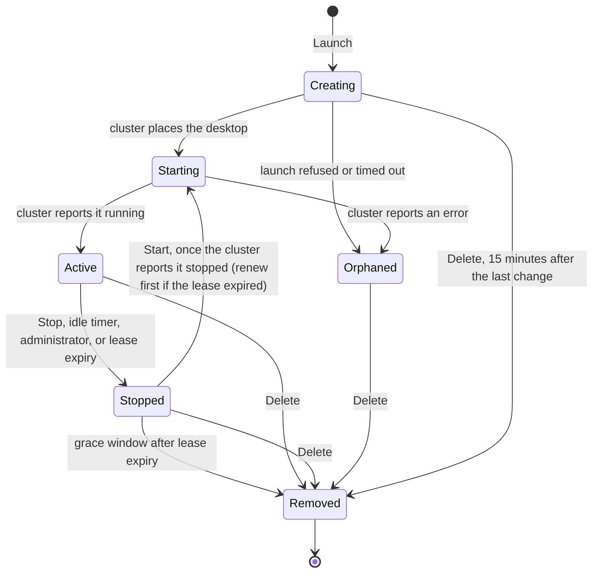

# EDH Workstations User Guide

The EDH Workstations add-on lets you launch GPU workstations on a connected EDH cluster from VAMS, open them in your browser as Amazon DCV desktops, and, where the deployment enables container jobs, run simulation jobs on the same cluster. EDH itself calls a workstation a _virtual desktop_; this page says _workstation_ for the VAMS record and _desktop_ for the EDH object it wraps. Administrators register the images users launch, review and reclaim sessions, set the lease policy and, where enabled, build images from AMI recipes.

:::note
The workstation pages appear only when the deployment enables the EDH Workstations add-on and your role allows them. For how the add-on works internally, see [EDH Workstations Add-on](overview.md).
:::

---

## Before you begin

### Deployment features

The add-on and its optional parts are turned on in the deployment configuration. The pages read the enabled features at sign-in, so a section that is not enabled is not shown.

| Feature                               | Deployment setting                                                                                                | What it adds                                                                                                         |
| ------------------------------------- | ----------------------------------------------------------------------------------------------------------------- | -------------------------------------------------------------------------------------------------------------------- |
| EDH Workstations add-on               | `app.addons.useEdhWorkstations.enabled`                                                                           | The **Virtual Workstations** and **Admin - Workstations** navigation sections                                        |
| Container jobs                        | `app.addons.useEdhWorkstations.containers.enabled`                                                                | The **Simulations** tab of the Workstations page                                                                     |
| Amazon EKS backend for container jobs | `app.addons.useEdhWorkstations.containers.eksEnabled`                                                             | The **Amazon EKS (experimental)** backend on the **Simulations** tab                                                 |
| AMI builds                            | `app.addons.useEdhWorkstations.amiBuilds.enabled`                                                                 | The **AMI Recipes** tab of the Workstation Admin page and the **Custom AMI Recipe** images of **Launch Workstation** |
| Leases                                | The lease policy on the Workstation Admin **Settings** tab, seeded from `app.addons.useEdhWorkstations.vdi.lease` | The **Remaining** column, **Expires in (hours)** and **Renew lease**                                                 |

See [EDH Workstations](../../deployment/configuration-reference.md#edh-workstations-appaddonsuseedhworkstations) in the configuration reference for every setting. To deploy an EDH cluster and enable the add-on, an administrator follows [Enable the EDH Workstations Add-on](enable.md).

### Permissions you need

Workstation access follows the VAMS [two-tier permission model](../../user-guide/permissions.md): a web route shows a page, an API route allows an action, and a constraint on an EDH object type decides which images, instance types and job definitions that action may use.

| To                                                                                                                                            | Your role needs                                                                                                                            |
| --------------------------------------------------------------------------------------------------------------------------------------------- | ------------------------------------------------------------------------------------------------------------------------------------------ |
| See **Virtual Workstations** and the Workstations page                                                                                        | Web route `/edh/workstations`                                                                                                              |
| List, launch, connect to, stop, start, renew and delete your own workstations, and show the Windows password of your own Windows workstations | `GET`, `POST` and `DELETE` on `/addon/edh/workstations`, with `edhWorkstation` constraints for the same methods                            |
| See image names, the launch catalog, the instance types and the lease policy                                                                  | `GET` on `/addon/edh/catalog`, with `edhImage` `GET` constraints for the images you may launch                                             |
| Use the **Simulations** tab                                                                                                                   | `GET`, `POST` (submit) and `DELETE` (kill) on `/addon/edh/containers`, with `edhContainer` constraints for the job definitions you may use |
| See **Admin - Workstations** and the Workstation Admin page                                                                                   | Web route `/edh/admin`, and the `/addon/edh/admin` routes each tab reads and changes, with `edhImage` and `edhWorkstation` constraints     |

The side navigation checks each link's web route. **My Workstations** checks `/edh/workstations`, and **Simulations** checks the `/edh/workstations/simulations` route beneath it, so a `starts_with` constraint on `/edh/workstations` shows both; **Workstation Admin** checks `/edh/admin`.

In a deployment with the add-on, the default `basicReadOnly` role can also open the **Workstations** page, list and connect to its own workstations, and browse the image catalog, but cannot launch, stop, start, renew or delete a workstation. The default `admin` role has full access to workstations, images and container jobs. See [Default roles](../../user-guide/permissions.md#default-roles).

The **EDH User** and **EDH Admin** permission templates (`edh-user.json` and `edh-admin.json`) grant the workstation and administration rows and `GET` on the `/auth/routes` prefix, which covers the `GET /auth/routes/api/allowed` call the **Workstations** and **Workstation Admin** pages make to decide which actions to offer; neither grants the container job routes that the **Simulations** tab uses. For the templates, the constraint fields and the roles to create, see [Permissions](overview.md#permissions).

:::info[Administrator roles that require MFA]
The administrator role for the **Workstation Admin** page is created with **Require Multi-Factor Authentication** selected before the `edh-admin.json` template is imported into it (see [Roles](overview.md#roles)). Such a role applies only in a session signed in with multi-factor authentication through Amazon Cognito, so **Admin - Workstations** appears only after an MFA sign-in. See [MFA-required roles](../../user-guide/permissions.md#mfa-required-roles).
:::

:::tip[When a workstation request is refused]

-   Another user's workstation answers `404` `Workstation not found` rather than `403`, because each user reaches only their own workstations.
-   Launching or starting a workstation requires an interactive sign-in. A session authenticated with a VAMS API key, such as `vamscli` signed in with a workstation's session key, receives `403`; use the web interface or a CLI session signed in with `vamscli auth login`.
-   If the **Workstations** page opens but offers no actions, or every **Workstation Admin** tab reports `You do not have access to …`, the role lacks `GET` on `/auth/routes/api/allowed`, which these pages call to check which actions are allowed; a `GET` grant on the `/auth/routes` prefix covers it.
-   The **Simulations** tab reports `You do not have access to container jobs.` when the role cannot call `GET /addon/edh/containers/jobs` (or `GET /auth/routes/api/allowed`). With the routes but no `edhContainer` constraint, the tab lists no jobs and offers no job definitions.

:::

---

## Navigation

The add-on adds two sections to the side navigation panel: **Virtual Workstations** in the main menu, after **Orchestrate & Automate**, and **Admin - Workstations** with the administration sections, after **Admin - Auth** and before **User**. They are present when the deployment enables the add-on and appear as soon as you sign in, without a reload. Each link shows only when your role allows its web route (see [Permissions you need](#permissions-you-need)).

### Virtual Workstations

| Navigation Item     | Description                                                                                                                      |
| ------------------- | -------------------------------------------------------------------------------------------------------------------------------- |
| **My Workstations** | Launch, connect to, stop, start, renew and delete your GPU workstations on the connected EDH cluster.                            |
| **Simulations**     | Submit, follow and kill container jobs on the cluster. This item is only visible when container jobs are enabled for the add-on. |

### Admin - Workstations

| Navigation Item       | Description                                                                                                                                                                                        |
| --------------------- | -------------------------------------------------------------------------------------------------------------------------------------------------------------------------------------------------- |
| **Workstation Admin** | Review and reclaim every workstation session on the cluster, check capacity, register images, manage and duplicate AMI recipes where AMI builds are enabled, and set the workstation lease policy. |

---

## How workstations work

When you launch a workstation, VAMS asks the connected EDH cluster to create a desktop for you, and the cluster starts it as an Amazon EC2 instance. When you connect, your browser opens the desktop's Amazon DCV session directly from the cluster rather than through VAMS, which is why your browser needs a network path to the cluster. The following diagram shows both paths.


A launch is accepted at once and runs in the background, so a new workstation appears in the list straight away and moves through its states as the cluster reports them. Stopping a workstation stops its Amazon EC2 instance and keeps its root disk, and starting it again starts the same instance; deleting it destroys both. VAMS sets each workstation so that the cluster does not start it on its own; once that setting is in place, a stopped workstation stays stopped until it is started again (see [Stopping and starting a workstation](#stopping-and-starting-a-workstation)). Where the deployment time-boxes workstations with a lease, an expired workstation is stopped and, after a grace window, removed.



_Removed_ is not a status badge: a deleted workstation leaves the list at the next refresh. The status badges are:

| Badge        | Meaning                                                                                                                                              |
| ------------ | ---------------------------------------------------------------------------------------------------------------------------------------------------- |
| **Creating** | The launch is recorded and the cluster has not yet created a desktop for it.                                                                         |
| **Starting** | The cluster has a desktop for the workstation and is still bringing it up: the last phase of a launch, or a stopped workstation being started again. |
| **Active**   | The desktop is running, so **Connect** opens it.                                                                                                     |
| **Stopped**  | Stopped by you, by an administrator, by the cluster's idle timer, or by the lease sweep when the lease expired.                                      |
| **Orphaned** | The launch was refused or failed. The reason is shown beneath the badge; delete the workstation to clear it.                                         |

Hovering over a badge shows the cluster's own state for the desktop (for example `running`), or the explanation for an orphaned or lease-expired workstation. For the full state model, see [Session states](overview.md#session-states).

---

## The Workstations page

The **Workstations** page (**Virtual Workstations** > **My Workstations**, `#/edh/workstations`) lists the GPU workstations you have launched on the connected EDH cluster, and each one opens in a browser tab as an Amazon DCV desktop. Where container jobs are enabled, the page shows a **Workstations** tab and a **Simulations** tab under one heading; see [The Simulations view](#the-simulations-view).

Opened in a deployment without the add-on, for example from a bookmark, the page shows "EDH Workstations is not enabled in this deployment. Ask a VAMS administrator to enable the add-on."

### The workstation list

**Launch Workstation** sits above the list when your role allows launching, beside a search box and a refresh button. The search matches a workstation's name, image, operating system, instance type, state and identifiers. The list refreshes every 20 seconds, and every 5 seconds while a workstation is being created or started; a list left open in a hidden browser tab is not refreshed until you return to it.

| Column            | Description                                                                                                                                                                                    |
| ----------------- | ---------------------------------------------------------------------------------------------------------------------------------------------------------------------------------------------- |
| **Name**          | The workstation name.                                                                                                                                                                          |
| **Status**        | The status badge. An orphaned or lease-expired workstation shows the reason beneath it.                                                                                                        |
| **Image**         | The image name with the image id beneath it, or the id alone for an image no longer in the catalog.                                                                                            |
| **OS**            | Linux or Windows.                                                                                                                                                                              |
| **Instance type** | The Amazon EC2 instance type.                                                                                                                                                                  |
| **Created**       | When the workstation was launched, in your local time.                                                                                                                                         |
| **Remaining**     | What is left of the workstation's lease. Present only while the deployment's lease policy is enabled.                                                                                          |
| **Connect**       | Opens the desktop, or shows why it cannot be opened yet.                                                                                                                                       |
| **Actions**       | The **⋮** menu: **Stop**, **Start**, **Renew lease**, **Show Windows password** (a Windows workstation) and **Delete**, limited to the actions your permissions allow. A dash when none apply. |

Select a column header to sort by it; the list shows 10 workstations per page. An action that does not apply to the workstation's state is shown disabled, with the reason beneath it.

The **Remaining** column counts down the lease — `in 2 d 4 h`, `in 3 h 20 min`, `in 40 min` — and turns orange in the final hour. Once the lease expires it reads, in red, `Expired, stopping`, then `Expired, removed in 20 h` while the stopped workstation waits out the grace window, then `Expired, removing`. Hovering over the value shows the expiry date and time. A workstation launched without an expiry shows a dash.

---

## Launching a workstation

1. On the Workstations page, choose **Launch Workstation**. The **Launch workstation** dialog opens on the **Image** step.
2. Choose an image. The list holds the desktop images your role may launch, in two groups: **Custom AMI Recipe**, the images built from an AMI recipe, and **Baseline Image**, every other image; a group with no images is not shown. Each group is sorted by name without regard to case, with numbers in numeric order, so `Ubuntu 9` comes before `Ubuntu 22`. Each card shows the image name, its operating system, its CPU architecture (such as `x86_64` or `arm64`) when the image records one, and its description, and a **Custom AMI Recipe** image also shows the version of the build it comes from, such as `v3`. Simulation images are never offered here.
3. Choose **Next**, and complete the **Name and size** step. A field's message appears once you leave the field, and **Next** stays disabled until every field on the step is valid.

| Field                   | Description                                                                                                                                                                                                                                                                                                                                                                                                   | Required |
| ----------------------- | ------------------------------------------------------------------------------------------------------------------------------------------------------------------------------------------------------------------------------------------------------------------------------------------------------------------------------------------------------------------------------------------------------------- | -------- |
| **Workstation name**    | 1-256 letters, digits, spaces, hyphens, periods or underscores. Prefilled with the image name when that name fits the rule, and follows the chosen image until you type a name of your own.                                                                                                                                                                                                                   | Yes      |
| **Instance type**       | The instance types the deployment allows that run the chosen image's architecture, sorted by name with numbers in numeric order, so `g5.2xlarge` comes before `g5.12xlarge`; an image that records no architecture is offered every allowed type. Choosing another image clears an instance type that does not run it. Larger types carry more vCPUs and GPU memory and cost more while the workstation runs. | Yes      |
| **Root disk size (GB)** | A whole number from 10 to 2048. Defaults to the chosen image's root size within those bounds, or 100 when the image records none. It cannot be smaller than the root size the image records.                                                                                                                                                                                                                  | Yes      |
| **Expires in (hours)**  | Present when the lease policy is enabled and an administrator has not forced the lease. A whole number from 1 to the policy's lease hours; leave it blank for a workstation with no expiry.                                                                                                                                                                                                                   | No       |

4. Choose **Next**. The **Review** step lists the name, image, operating system, architecture (`-` when the image records none), instance type and root disk and, under a lease policy, **Expires in**: the hours you chose, `No expiry`, or the administrator's value followed by `(set by administrator)`.
5. Choose **Launch**. The dialog closes with the notification **Workstation launch requested**, and the workstation appears in the list as **Creating**.

A launch that the service refuses keeps the dialog open with **Launch failed:** and the reason on the **Review** step. Choosing **Launch** again in the same dialog never creates a second workstation, because the retry carries the same launch key. When the launch request receives no reply, the dialog closes with the notification **Launch outcome unknown**: the workstation may still be starting, so wait for the list to refresh before launching again.

Where the deployment gives each Linux workstation its own VAMS sign-in for `vamscli`, a launch or a start that could not place that sign-in raises a **Workstation sign-in not provisioned** warning that stays on screen until you dismiss it. The warning says whether your account holds no roles (ask an administrator to assign one, then stop and start the workstation once it is active) or the sign-in could not be provisioned (the workstation still starts; stop and start it to try again). A lease renewal that could not replace the sign-in raises the same warning, whose text says to renew the lease again; see [The workstation's VAMS sign-in](#the-workstations-vams-sign-in). See [Session bootstrap](overview.md#session-bootstrap).

---

## Connecting to a workstation

**Connect** is available when the workstation is **Active**. Until then the control is inactive and shows the reason beneath it: `Available once the workstation is running.`, `Start the workstation to connect.` or `The launch did not complete.`

Choosing **Connect** opens a new browser tab at once, requests the connection address, and loads the Amazon DCV desktop in that tab. The address is requested only when you choose **Connect** and is never kept in the page. If the browser blocks the new tab, a **Connect failed** notification asks you to allow pop-ups for the site and try again.

The address is the Amazon DCV connection URL that EDH returns for the desktop. It points at the EDH cluster's DCV entry point, which passes the session on to the desktop instance: in EDH's default high-scale layout, a Network Load Balancer in front of the Amazon DCV Connection Gateway, which relays the session, or, in its standard layout, the EDH Application Load Balancer. VAMS never proxies, frames or stores the desktop traffic. Your browser therefore needs a network path to that entry point: where the cluster's load balancer is internal, connect from the corporate network or over a VPN. See [Architecture](overview.md#architecture).

In EDH's default configuration that entry point presents a self-signed certificate, so the browser warns that the connection is not private before the desktop opens: accept the certificate for that host to continue or, where browser policy does not allow that, ask your administrator (see [Browser access to Amazon DCV](enable.md#browser-access-to-amazon-dcv)).

### Signing in to a Windows workstation

A Windows workstation opens at the Windows lock screen: Windows does not sign in on its own, and VAMS shows you the user name and password the workstation signs in with.

1. In the workstation's **⋮** menu, choose **Show Windows password**. It is available while **Connect** is, and otherwise shows the same reason beneath it.
2. The **Windows sign-in** dialog for the workstation shows the **User name** and the **Password**, masked. Choose **Copy user name** and **Copy password** to copy them, or **Show password** to read the password and **Hide password** to mask it again.
3. Choose **Close**, then **Connect**. The desktop opens in a new tab at the Windows lock screen; choose **Show Windows password** again in the VAMS tab to read the sign-in while you type it.
4. In the Amazon DCV toolbar, open the menu under the computer name and choose **Send Ctrl + Alt + Del**. If Windows offers another account, as the first sign-in does with **Administrator**, choose your user name in the lower-left corner, then enter the password.

Amazon DCV locks Windows when the last connection to the desktop closes, so the next **Connect** opens at the lock screen again, and the same password unlocks it. After a stop and start, the desktop opens at the lock screen again and the same password signs in; Windows then shows the **Shutdown Event Tracker**, which **Cancel** closes. The password is requested only when you open the dialog and is dropped when you close it; it is never written to the page address or to browser storage. Where the workstation signs in with a directory account, the dialog shows the user name and **Sign in with your directory password.** in place of a password: use your own directory password.

From the command line, `vamscli edh workstation connect SESSION_ID --show-windows-password` prints the same user name and password; see [edh workstation connect](cli-commands.md#edh-workstation-connect).

---

## Stopping and starting a workstation

1. In the workstation's row, open the **⋮** menu.
2. Choose **Stop** to stop an **Active** workstation, or **Start** to start a **Stopped** one the cluster has finished stopping. Neither asks for confirmation.

**Stop** stops the workstation's Amazon EC2 instance and keeps its root disk, and **Start** starts the same instance again. The badge reads **Stopped** as soon as the stop is accepted, but the cluster reports the desktop `stopping` while the instance stops and until it next checks the desktop's state, which can take several minutes. Until the cluster reports it `stopped`, **Start** is disabled with the hint `The workstation is still <state>; it can be started once it has stopped.`, naming the cluster's state, for example `stopping` or `interrupted`; straight after a stop the hint can name `running` until the list is next refreshed. After **Start**, the badge reads **Starting** until the cluster reports the desktop running again. The cluster can also stop an idle workstation on its own, at any hour: once it has been running for 2 hours, it is stopped when no client is connected to it and it is using little CPU and GPU. Unsaved work in its open applications is lost when it stops, so save before you disconnect. VAMS sets each workstation so that the cluster does not start it on its own, and a stopped workstation then stays stopped until you start it again. A workstation VAMS has not set yet, or one on a cluster that refuses the setting, can still be started by the cluster's own schedule. For the exact conditions, see [Desktop schedule](overview.md#desktop-schedule). Neither action is offered for a launch that never received a desktop. While a stop, start, lease renewal or delete of a workstation is in progress, **Stop**, **Start**, **Renew lease** and **Delete** are all disabled for it, with the hint `A start of this workstation is in progress.`, `A stop of this workstation is in progress.`, `A renew of this workstation is in progress.` or `A delete of this workstation is in progress.`

A notification confirms the request (**Workstation stop requested** or **Workstation start requested**). A request that fails shows **Stop failed** or **Start failed** and a red banner above the list naming the workstation and the reason, which you dismiss with **×**. When the cluster does not confirm the request in time, the warning **Stop not confirmed** or **Start not confirmed** shows instead, without a banner, and the list is read again: the request may still be in progress, so wait for the list to show its outcome before trying again. While the cluster still reports the workstation stopped, choosing **Start** shows **Start already in progress** when another start of it is still being processed, for example from a second browser tab, when a start the cluster did not confirm was sent less than 3 minutes earlier, while VAMS is taking back the stopped workstation's sign-in key, or while a lease renewal is still replacing that key.

---

## Renewing a lease

**Renew lease** appears in the **⋮** menu when the lease policy is enabled and the workstation carries an expiry. Its hint states the new window, for example `Extends the lease to 8 hours from now`. The renewal sets the expiry to the policy's current lease hours counted from now, whatever length the workstation was launched with, and a notification confirms it with **Workstation lease renewed**.

A workstation the lease sweep stopped shows "The workstation's lease has expired and it was automatically stopped." beneath its badge. To use it again:

1. In the workstation's row, open the **⋮** menu and choose **Renew lease**.
2. Open the menu again and choose **Start**.

Starting it before the renewal fails with "The lease on this workstation has expired; renew it before starting". A lease-stopped workstation is deleted once the grace window has passed, so renew it before the window runs out. Administrators cannot renew another user's lease. For the sweep schedule and the grace window, see [Leases](overview.md#leases).

### The workstation's VAMS sign-in

Where the deployment gives each Linux workstation its own VAMS sign-in for `vamscli`, that sign-in lasts a fixed time from the workstation's launch or its last start: 8 hours, unless the deployment sets another length. A Windows workstation receives none; where `vamscli` is installed on it, sign it in by hand with `vamscli auth login` (see [Setup and Authentication](../../cli/commands/setup-and-auth.md)). Renewing the lease of an **Active** Linux workstation also gives it a new sign-in, which lasts as long from the renewal, and the sign-in it replaces keeps working until it expires. A Linux workstation whose image was built from a shipped recipe, such as an Amazon Linux 2023 or Isaac Sim desktop, picks the new sign-in up within about a minute. If its image was built from an earlier Isaac Sim recipe, which signs in only when the desktop session starts, run `/usr/local/bin/vams-session-bootstrap.sh` in a terminal on the workstation after the renewal; an image built from an earlier Amazon Linux 2023 recipe carries no VAMS CLI, so build the recipe again, or ask an administrator to, and launch a new workstation from the new image. A renewal that could not place a new sign-in raises the **Workstation sign-in not provisioned** warning: a sign-in the workstation still holds keeps working until it expires, and renewing the lease again tries once more. A renewal sent from the workstation's own `vamscli`, which is signed in with the workstation's sign-in, renews the lease only.

Once the sign-in has expired, `vamscli` on the workstation reports `Override token has expired`, and the Isaac Sim connector's status line reads `access refused`. To sign the workstation in again, renew its lease where it carries one. Where it does not — the deployment does not use leases, or the workstation was launched with no expiry — do either of the following:

-   **Stop the workstation, then start it.** A start gives it a new sign-in, which it signs in with when its desktop session starts.
-   **Sign in by hand** in a terminal on the workstation, as yourself:

    ```bash
    vamscli --profile "edh-$(/usr/local/bin/vams-instance-id)" auth login -u <user-id>
    vamscli --profile edh auth login -u <user-id>
    ```

    The first command signs in the workstation's own profile, which the Isaac Sim connector uses, and the second the `edh` profile terminals use. Both prompt for your password; for the other ways to sign in, see [Setup and Authentication](../../cli/commands/setup-and-auth.md). In Isaac Sim, **Authentication** in the connector window signs in the workstation's own profile as well. The workstation's next start or lease renewal replaces a sign-in made by hand.

---

## Deleting a workstation

1. In the workstation's row, open the **⋮** menu and choose **Delete**.
2. In the confirmation dialog, choose **Delete**.

Deleting a workstation destroys it and its root disk and cannot be undone. For a launch that never received a desktop, such as an **Orphaned** workstation, only the launch record is removed. A notification confirms the deletion with **Workstation deleted**, and the workstation leaves the list at the next refresh. A deletion the cluster does not confirm in time shows the warning **Delete not confirmed**; wait for the list to show its outcome before deleting again.

**Delete** is disabled while a launch or a start is still in progress, and while a stop, start, lease renewal or delete of the workstation you sent is still being answered, with the hint that names it (for example `A delete of this workstation is in progress.`). A launch that has no desktop yet becomes deletable 15 minutes after its last change, as the item's hint says. A workstation whose desktop the cluster is still placing or starting becomes deletable once the cluster reports it running.

---

## The Simulations view

The **Simulations** view runs container jobs on the cluster. It is present when the deployment enables container jobs, as the **Simulations** tab of the Workstations page, and has a route of its own beneath the page's, `#/edh/workstations/simulations`. **Virtual Workstations** > **Simulations** opens it directly, and choosing either tab changes the address, so each tab can be bookmarked. A role that may not list container jobs sees "You do not have access to container jobs." inside the tab.

The toolbar holds the **Backend** selector — **AWS Batch** and, where the deployment enables it, **Amazon EKS (experimental)** — a refresh button and **Submit Job**. For Amazon EKS, choose a **Cluster** first; the list stays empty with "Choose a cluster to list its jobs." until you do. The list shows your jobs with their **Name**, **Job id**, **Definition** and **Status** (**Queued**, **Running**, **Succeeded** or **Failed**), and refreshes every 15 seconds.

### Submitting a job

1. On the **Simulations** tab, choose **Submit Job**. The **Submit container job** dialog opens.
2. Complete the fields:

| Field                                 | Description                                                                                                                                                                                                  | Required |
| ------------------------------------- | ------------------------------------------------------------------------------------------------------------------------------------------------------------------------------------------------------------ | -------- |
| **Job definition** or **Image URI**   | For AWS Batch, one of the job definitions your role may use. For Amazon EKS, the container image URI.                                                                                                        | Yes      |
| **Job queue** or **EKS cluster**      | For AWS Batch, the job queue; for Amazon EKS, the cluster, preset to the one chosen on the toolbar.                                                                                                          | Yes      |
| **Job name**                          | For AWS Batch, 1-128 letters, digits, hyphens and underscores, starting with a letter or digit. For Amazon EKS, up to 63 lower-case letters, digits and hyphens, starting and ending with a letter or digit. | Yes      |
| **Command**                           | The command to run, split on whitespace.                                                                                                                                                                     | No       |
| **vCPUs**, **Memory (MiB)**, **GPUs** | Resource overrides as whole numbers: at least 1 vCPU, at least 512 MiB of memory, and 0 or more GPUs. Leave a field blank to keep the default.                                                               | No       |

3. Choose **Submit**. The dialog closes with the notification **Job submitted**. A submission the service refuses keeps the dialog open with the reason. A submission the cluster does not confirm, because it did not answer in time or its answer could not be read, closes the dialog with the warning **Submission not confirmed**: the job may be running, so wait for the list to refresh before submitting it again.

Which job definitions the dialog offers depends on your `edhContainer` constraints; see [Containers](overview.md#containers).

### Killing a job

1. In the job's row, open the **⋮** menu and choose **Kill**. The item is disabled once a job has succeeded or failed.
2. In the **Kill container job** dialog, choose **Kill**. A killed job stops and cannot be resumed.

A notification confirms the request with **Job kill requested**; a failure shows **Kill failed** and a red banner above the list, and a kill the cluster does not confirm in time shows the warning **Kill not confirmed** without a banner.

---

## The Workstation Admin page

The **Workstation Admin** page (**Admin - Workstations** > **Workstation Admin**, `#/edh/admin`) gives administrators a view of the whole cluster. It calls each EDH desktop a _session_ and has four tabs — **Sessions**, **Capacity**, **Images** and **Settings** — plus **AMI Recipes** between **Images** and **Settings** where the deployment enables AMI builds (`app.addons.useEdhWorkstations.amiBuilds.enabled`). The page opens on the first tab your role may read, or on **Sessions** when it may read none; the selected tab is not kept in the URL.

| Tab             | What it shows                                                                                                                                                                                                                                                                      |
| --------------- | ---------------------------------------------------------------------------------------------------------------------------------------------------------------------------------------------------------------------------------------------------------------------------------- |
| **Sessions**    | Every session on the cluster with its VAMS owner, the cluster's state and the reason a launch failed, and a **Stale sessions** view of sessions to reclaim, which **Stop** and **Deactivate** act on. See [Reviewing and reclaiming sessions](#reviewing-and-reclaiming-sessions). |
| **Capacity**    | The cluster's virtual desktop profiles, the total number of sessions, a count per cluster state and the number of distinct owners. See [Checking capacity](#checking-capacity).                                                                                                    |
| **Images**      | Every VDI (desktop) and simulation image registered on the cluster, which administrators register from an AMI and delete. See [Registering and deleting images](#registering-and-deleting-images).                                                                                 |
| **AMI Recipes** | The AMI recipes the deployment ships and the ones administrators define, with their builds. See [Managing AMI recipes](#managing-ami-recipes).                                                                                                                                     |
| **Settings**    | The workstation lease policy. See [Setting the lease policy](#setting-the-lease-policy).                                                                                                                                                                                           |

Each tab shows its contents only when your role may read them; otherwise it reads `You do not have access to <what>.`, for example `You do not have access to the lease policy.` While your permissions load, the tab reads `Loading permissions...`.

Where your role allows the health check, the page header shows whether VAMS can reach the cluster: `EDH <cluster id>: reachable (<n> ms)`, or a reason in red — `unreachable`, `probe refused by EDH`, or `credential rejected — re-sync the EDH root key secret`, which asks an operator to write the cluster's current root key into its secret (see [Root key rotation](overview.md#root-key-rotation)). With no answer at all, the header reads `EDH is unreachable or rejected the configured credential`. The check runs when the page opens and when you return to the browser window, unless the last answered check is less than 30 seconds old.

### Reviewing and reclaiming sessions

The **Sessions** tab lists every session on the cluster, whoever owns it, with the columns **Name**, **Session**, **EDH state**, **Owner** (the VAMS user, with the EDH user id beneath), **Status**, **Instance type**, **Created** and **Actions**. It refreshes every 20 seconds. The **Status** badge reads **Starting** for a session being started, **Active** as soon as the cluster reports it running, and **Deleted** for a session VAMS has recorded as deleted.

To find sessions to reclaim, set **View** to **Stale sessions**. The view lists sessions stopped or orphaned for at least the number of minutes in **Stopped for at least (minutes)** (default 120; a new value applies when you leave the field or press Enter), stopped desktops VAMS did not launch, and sessions VAMS recorded that the cluster no longer lists. Its **Why stale** column reads **Stopped in EDH** or **Not listed by EDH**.

1. In the session's row, open the **⋮** menu and choose **Stop** or **Deactivate**.
2. Confirm in the dialog. **Stop** is confirmed with the blue button, and the owner can start the session again from the Workstations page. **Deactivate** is confirmed with the red button: the cluster deletes the desktop and its root disk, so the owner's work on it is lost.

**Stop** is not offered for a session the cluster no longer lists; deactivating such a session records it as deleted without a call to the cluster. A launch that has no desktop yet can be deactivated 15 minutes after its last change. Where each workstation has its own VAMS sign-in, both actions revoke it, and the desktop's `vamscli` stops authorizing within about 45 seconds. A stop or deactivation the cluster does not confirm in time shows the warning **Stop not confirmed** or **Deactivate not confirmed**, and the list is read again. See [Administration](overview.md#administration).

### Checking capacity

The **Capacity** tab reads the cluster live: the **Total sessions**, **Distinct owners** and **Virtual desktop profiles** counts, the sessions per EDH state, and a table of the virtual desktop profiles with their **Id**, **Name**, **Allowed instance types**, **Max root size (GB)** and **Subnets**. **Allowed instance types** groups a profile's types by architecture, such as `x86_64: g5.xlarge, g5.2xlarge · arm64: g5g.xlarge`, when the profile groups them. A registered VDI image names one of these profiles by its id. The tab has no timed refresh: it reads the cluster again when you reopen the tab or return to the browser window more than 30 seconds after the last read, or when you use the refresh button.

### Registering and deleting images

The **Images** tab lists every desktop (**VDI**) and **Simulation** image registered on the cluster, with the columns **Kind**, **Stack name**, **AMI**, **OS**, **Architecture**, **Root (GB)**, **Profile**, **Description** and **Actions**. The architecture column names the CPU architecture the cluster reports for the image, such as `x86_64` or `arm64`, and shows — when the cluster reports none. The toolbar holds a search box, a refresh button, the image count, **Register VDI image** and **Register simulation image**, each shown when your role allows it. Only VDI images are offered in **Launch Workstation**.

1. Choose **Register VDI image** or **Register simulation image**.
2. Complete the fields:

| Field                                                         | Image kind | Description                                                                                                                                                                                                 |
| ------------------------------------------------------------- | ---------- | ----------------------------------------------------------------------------------------------------------------------------------------------------------------------------------------------------------- |
| **AMI ID**                                                    | Both       | `ami-` followed by 8 to 17 hexadecimal characters, for example `ami-0123456789abcdef0`.                                                                                                                     |
| **Stack name**                                                | Both       | The name the image is listed under in the EDH catalog; users see a VDI image under this name in **Launch Workstation**.                                                                                     |
| **Base OS**                                                   | VDI        | The operating system EDH supports for a desktop image: Ubuntu, Amazon Linux, Rocky Linux, Red Hat Enterprise Linux or Windows Server releases.                                                              |
| **Root size (GB)**                                            | Both       | A whole number of 1 or more. Defaults to 100.                                                                                                                                                               |
| **Virtual desktop profile** or **Virtual desktop profile ID** | VDI        | The cluster profile the desktop launches under: a list of the cluster's profiles when your role can read the **Capacity** tab and the cluster returns profiles, otherwise the profile id shown on that tab. |
| **Target node profile ID**                                    | Simulation | The id of an EDH target-node profile, a whole number of 0 or more.                                                                                                                                          |
| **Launch tenancy**                                            | VDI        | **Default (shared hardware)** or **Dedicated instance**.                                                                                                                                                    |
| **User data template ID**                                     | Simulation | The EDH user-data template the image boots with, a whole number of 1 or more. Defaults to 1.                                                                                                                |
| **User data variables (optional)**                            | Simulation | `key=value` pairs separated by commas, for example `env=prod,team=sim`.                                                                                                                                     |
| **Description (optional)**                                    | Both       | A description shown with the image.                                                                                                                                                                         |

3. Choose **Register**. A field's message appears beneath it after the first attempt, with a summary above the form asking you to correct the highlighted fields. A registration the cluster refuses, or one the cluster accepted that VAMS could not attach to the deployment's default EDH project, shows **Registration failed** and keeps the dialog open; a successful one shows **Image registered**. A registration the cluster does not confirm in time closes the dialog with the warning **Registration not confirmed**, since the image may be registered; check the list before registering it again. The cluster refuses a second image under a stack name it already holds, so an image left unattached is attached to the project in EDH, or deleted on the **Images** tab and registered again.

The registered image is attached to the deployment's default EDH project, which is how users see it. To delete an image, open its **⋮** menu, choose **Delete**, and confirm; sessions already launched from it are not affected. A deletion the cluster does not confirm in time shows the warning **Delete not confirmed**.

### Managing AMI recipes

The **AMI Recipes** tab is present where the deployment enables AMI builds. An AMI recipe describes an image that Amazon EC2 Image Builder builds and VAMS registers in the EDH catalog.

The list shows each recipe's **Kind**, **Recipe** (display name and recipe id), **Source**, **OS**, **Latest build**, **EDH stack** and **Enabled**. A recipe whose **Source** is **Config** comes from the deployment configuration: it can be built, viewed and duplicated, and is changed in the configuration and redeployed, or by duplicating it into a recipe of your own. A recipe whose **Source** is **Admin** was defined on this tab. **Latest build** shows the newest build's status and version, or `Never built`, and `Recipe is newer than latest build` once the recipe has changed since that build.

To define a recipe, choose **New recipe**, complete the fields, and choose **Create recipe**:

| Field                   | Description                                                                                                                                                                                                   | Required |
| ----------------------- | ------------------------------------------------------------------------------------------------------------------------------------------------------------------------------------------------------------- | -------- |
| **Recipe id**           | 2-40 lowercase letters, digits and hyphens, starting with a letter or a digit. Cannot be changed after the recipe is created.                                                                                 | Yes      |
| **Display name**        | The name shown in the list: up to 256 letters, digits, spaces, hyphens, periods, underscores and parentheses.                                                                                                 | Yes      |
| **Kind**                | **VDI desktop** or **Simulation**.                                                                                                                                                                            | Yes      |
| **OS family**           | Linux or Windows. Changing it clears **Base OS**.                                                                                                                                                             | Yes      |
| **Base OS**             | For a VDI recipe, a base operating system of the chosen family.                                                                                                                                               | VDI only |
| **Architecture**        | `x86_64` or `arm64`. A Windows recipe takes `x86_64` only, and choosing Windows selects it.                                                                                                                   | Yes      |
| **Parent image**        | An AMI id, an AWS Systems Manager public parameter path starting `ssm:/aws/service/`, or `edhStack:` followed by an EDH stack name. An AMI of another architecture family is refused.                         | Yes      |
| **Build instance type** | The Amazon EC2 instance type the build runs on, for example `m7i.large`, which must run the recipe's architecture. Up to eight, separated by commas, let EC2 Image Builder choose among them by availability. | Yes      |
| **Root disk size (GB)** | A whole number from 10 to 2048. Defaults to 100.                                                                                                                                                              | Yes      |
| **Stack name**          | The name the built image is registered under in the EDH catalog: up to 200 letters, digits, spaces, hyphens, periods and underscores, and not the stack name of another recipe, whatever its case.            | Yes      |
| **Profile id**          | The EDH profile the registered image launches under, a whole number of 0 or more.                                                                                                                             | Yes      |
| **Keep versions**       | 1 to 20. The AMIs of retired and failed builds beyond this many are deregistered, unless a desktop still uses one. Leave it empty for the deployment default.                                                 | No       |
| **Recipe revision**     | A whole number of 1 or more. Defaults to 1; raise it to rebuild from an unchanged recipe.                                                                                                                     | No       |
| **Description**         | Up to 256 characters.                                                                                                                                                                                         | No       |
| **Components**          | 1 to 20 Amazon EC2 Image Builder components, each a **Managed component ARN** or an **Inline document** (a name and a YAML document that declares `schemaVersion`). **Add component** adds one.               | Yes      |

A recipe's **⋮** menu holds **Build now**, **Builds**, **View** (a configuration recipe) or **Edit** (an administrator's recipe), **Duplicate**, and **Delete** (an administrator's recipe). **Build now** is disabled for a recipe whose **Enabled** column reads No, and while its request for the recipe is being answered, with the hint `A build request for this recipe is in progress.` It reports **Build started**; **Build queued** when a build of other content is in progress, which the new build then waits behind; or **Build already in progress** when the recipe's current content is already queued, building or registering, in which case nothing new starts. The list refreshes every 20 seconds while any build is queued, building or registering.

**Builds** lists the recipe's builds, newest first, with their **Version**, **Status**, **AMI**, **EDH stack**, **Requested** and **Completed** times. A build that becomes **Available** is registered in the EDH catalog as the recipe's stack name followed by its version (for example `Desktop v3`), appears on the **Images** tab and, for a VDI recipe, in **Launch Workstation**, and retires the recipe's other available builds. **Retry registration** retries a build whose status is **Registration failed**, and **Retire** removes an **Available** build's stack from the catalog, so no new session can be launched from it. VAMS deregisters the retired build's AMI once no desktop uses it, so existing desktops can still be started. Until then the line `AMI deregistered once no desktop uses it` appears beneath the build's status, followed by the ids of the instances that use the AMI when the last check found some. An older build whose AMI VAMS keeps for the same reason shows `AMI kept while in use: <instance ids>` there. When VAMS could not check which instances use the AMI, the red warning `in-use check failed (...)` appears beneath the status; a retired build still shows its line, without instance ids unless an earlier check found some.

**Duplicate** opens the recipe form as **Duplicate recipe**, filled in from the recipe: **Recipe id** is empty, **Display name** holds the recipe's display name followed by ` (copy)`, **Stack name** its stack name followed by ` Copy`, and every other field is copied. A recipe that installs files bundled from the repository names them above **Components** as `Bundled files from <recipe id>: <ids>`; the copy keeps those files, and they cannot be changed. Enter a recipe id, change what you need, and choose **Create recipe**. The copy is an administrator's recipe, enabled even when the recipe it copies is not, and is not built until you choose **Build now**; the tab reports **Recipe duplicated**. A duplicate the service refuses, for example because another recipe uses the stack name, reports **Duplicate failed** with the reason and keeps the form open, so give a second copy of the same recipe a stack name of its own. **Edit** on a duplicated recipe names its bundled files the same way.

Deleting an administrator's recipe removes the recipe and its build history. A recipe with a build that is queued, building or registering cannot be deleted until that build ends. Nor can a recipe with a build whose AMI VAMS has yet to remove, such as a build that shows `AMI deregistered once no desktop uses it` or `AMI kept while in use`: the delete reports **Delete failed** with `a build's AMI removal is pending`. VAMS checks such AMIs every 30 minutes and removes each one once no desktop uses it; delete the recipe again after that. The AMIs it has built and their EDH stacks are left in place. For build states and redeploy behaviour, see [AMI recipes](overview.md#ami-recipes).

### Setting the lease policy

The **Settings** tab holds the one lease policy that applies to every workstation:

| Field                     | Description                                                                                    |
| ------------------------- | ---------------------------------------------------------------------------------------------- |
| **Enabled**               | When selected, workstations are subject to time-boxed leases.                                  |
| **Lease hours**           | Hours until a workstation lease expires, from 1 to 720. Also the length a renewal grants.      |
| **Force on all launches** | When selected, every launch receives **Lease hours** and users cannot choose their own expiry. |
| **Grace hours**           | Hours a workstation stopped for an expired lease is kept before it is deleted, from 0 to 168.  |

Choose **Save** to write all four. A value out of range is reported beneath its field, and the tab shows who last changed the policy and when. A role without permission to save sees the values with "You do not have permission to save settings." A policy change does not move an expiry already set on a workstation, while a change to **Grace hours** applies at the next sweep; see [The policy](overview.md#the-policy).

---

## Direct URLs

The add-on's pages use the same hash-based URLs as the rest of the web interface (see [Hash-Based URLs and Deep Linking](../../user-guide/web-interface.md#hash-based-urls-and-deep-linking)):

| Target            | URL Pattern                                             |
| ----------------- | ------------------------------------------------------- |
| Workstations      | `https://<VAMS_WEBSITE>/#/edh/workstations`             |
| Simulations       | `https://<VAMS_WEBSITE>/#/edh/workstations/simulations` |
| Workstation Admin | `https://<VAMS_WEBSITE>/#/edh/admin`                    |

---

## Troubleshooting

| Message                                                                                                                                                                                       | Where                                                                                                | What to do                                                                                                                                                                                                                                                                                                                                                                   |
| --------------------------------------------------------------------------------------------------------------------------------------------------------------------------------------------- | ---------------------------------------------------------------------------------------------------- | ---------------------------------------------------------------------------------------------------------------------------------------------------------------------------------------------------------------------------------------------------------------------------------------------------------------------------------------------------------------------------- |
| EDH Workstations is not enabled in this deployment. Ask a VAMS administrator to enable the add-on.                                                                                            | Workstations or Workstation Admin page                                                               | The deployment does not enable the add-on. An administrator enables it in the configuration and redeploys.                                                                                                                                                                                                                                                                   |
| No images are available to launch.                                                                                                                                                            | **Launch workstation** dialog                                                                        | No desktop image is registered, or none that your role may launch. Ask an administrator.                                                                                                                                                                                                                                                                                     |
| No instance types are available in this deployment.                                                                                                                                           | **Launch workstation** dialog                                                                        | The deployment allows no instance type of the cluster's desktop profile. Ask an administrator.                                                                                                                                                                                                                                                                               |
| `No instance type in this deployment runs this image's architecture (<architecture>). Choose another image or ask an administrator.`                                                          | **Launch workstation** dialog                                                                        | No instance type the deployment allows runs the chosen image's architecture. Choose an image of another architecture, or ask an administrator to allow a matching instance type.                                                                                                                                                                                             |
| Your EDH user account has not been provisioned. Ask an administrator to enable it.                                                                                                            | Beneath an **Orphaned** badge                                                                        | Ask an administrator to create your EDH account, then delete the workstation and launch again.                                                                                                                                                                                                                                                                               |
| EDH refused the launch because a desktop, session or budget quota is used up. Delete a workstation or ask an administrator.                                                                   | Beneath an **Orphaned** badge                                                                        | Delete a workstation you no longer need, or ask an administrator to raise the quota, then launch again.                                                                                                                                                                                                                                                                      |
| EDH found no available AWS capacity for the chosen instance type. Launch again later or choose another instance type.                                                                         | Beneath an **Orphaned** badge                                                                        | Delete the workstation, then launch again later or with another instance type. If it recurs, ask an administrator to add cluster subnets in more Availability Zones.                                                                                                                                                                                                         |
| The chosen image is no longer available in EDH.                                                                                                                                               | Beneath an **Orphaned** badge                                                                        | Delete the workstation and launch from another image.                                                                                                                                                                                                                                                                                                                        |
| EDH refused the launch request. Try another image or instance type, or ask an administrator.                                                                                                  | Beneath an **Orphaned** badge                                                                        | Delete the workstation and launch with another image or instance type.                                                                                                                                                                                                                                                                                                       |
| EDH reported an error while starting the workstation. / The launch did not complete in time. / The launch did not complete.                                                                   | Beneath an **Orphaned** badge                                                                        | Delete the workstation and launch again. If it recurs, ask an administrator to check the cluster.                                                                                                                                                                                                                                                                            |
| The workstation's lease has expired and it was automatically stopped.                                                                                                                         | Beneath a **Stopped** badge                                                                          | Choose **Renew lease**, then **Start**.                                                                                                                                                                                                                                                                                                                                      |
| The lease on this workstation has expired; renew it before starting                                                                                                                           | **Start failed** banner                                                                              | Choose **Renew lease**, then **Start**.                                                                                                                                                                                                                                                                                                                                      |
| `The workstation is still <state> in EDH; start it again once it has stopped.`                                                                                                                | **Start failed** banner                                                                              | The cluster has not finished stopping the workstation. Wait a few minutes, until hovering over the **Stopped** badge shows `stopped`, then choose **Start** again.                                                                                                                                                                                                           |
| EDH found no available AWS capacity for this instance type. Try again later.                                                                                                                  | **Start failed** banner                                                                              | The cluster found no capacity to start the workstation, which stays stopped. Choose **Start** again later.                                                                                                                                                                                                                                                                   |
| Launch outcome unknown                                                                                                                                                                        | Notification after **Launch**                                                                        | Wait for the list to refresh. The workstation may have been created.                                                                                                                                                                                                                                                                                                         |
| Stop not confirmed / Start not confirmed / Delete not confirmed                                                                                                                               | Notification after **Stop**, **Start** or **Delete**                                                 | Wait for the list to refresh. The cluster may still be carrying out the request; send it again only once the list shows it was not carried out.                                                                                                                                                                                                                              |
| Start already in progress                                                                                                                                                                     | Notification after **Start**                                                                         | Wait for the list to show the workstation starting. Another start of it is being processed, one the cluster did not confirm was sent less than 3 minutes ago, VAMS is taking back the workstation's sign-in key, or a lease renewal is replacing it; a start is sent to the cluster again once 3 minutes have passed, or 5 minutes after a renewal or a take-back cut short. |
| Submission not confirmed / Kill not confirmed / Registration not confirmed / Delete not confirmed / Stop not confirmed / Deactivate not confirmed                                             | **Simulations** tab or Workstation Admin page                                                        | Wait for the list to refresh before sending the request again; the cluster may have carried it out.                                                                                                                                                                                                                                                                          |
| Workstation sign-in not provisioned                                                                                                                                                           | Notification after **Launch**, **Start** or **Renew lease**                                          | Follow the message: ask for a role, stop and start the workstation once it is active, or, after a renewal, renew the lease again.                                                                                                                                                                                                                                            |
| `Override token has expired` / `access refused`                                                                                                                                               | `vamscli` or the Isaac Sim connector on the workstation                                              | The workstation's VAMS sign-in has expired. Renew the lease, stop and start the workstation, or sign in by hand; see [The workstation's VAMS sign-in](#the-workstations-vams-sign-in).                                                                                                                                                                                       |
| `<name>: the browser blocked the new tab. Allow pop-ups for this site and try again.`                                                                                                         | **Connect failed** notification                                                                      | Allow pop-ups for the VAMS site in the browser and choose **Connect** again.                                                                                                                                                                                                                                                                                                 |
| The desktop tab stays blank or shows the browser's own cannot-reach error (no VAMS message)                                                                                                   | The tab opened by **Connect**                                                                        | The browser cannot reach the EDH cluster's DCV entry point. Where the cluster's load balancer is internal, connect from the corporate network or over a VPN, then choose **Connect** again.                                                                                                                                                                                  |
| Windows sign-in unavailable / Windows password is not available yet                                                                                                                           | Notification and the **Windows sign-in** dialog after **Show Windows password**                      | The workstation is running, but the cluster has not published its Windows password yet. Close the dialog, wait a few minutes and choose **Show Windows password** again.                                                                                                                                                                                                     |
| The desktop tab shows the Windows lock screen (`Press Ctrl+Alt+Delete to unlock`)                                                                                                             | The tab opened by **Connect**                                                                        | Windows does not sign in on its own. Choose **Send Ctrl + Alt + Del** from the menu under the computer name in the Amazon DCV toolbar, choose your user name, and enter the password from **Show Windows password**; see [Signing in to a Windows workstation](#signing-in-to-a-windows-workstation).                                                                        |
| `Root disk size must be a whole number between <n> and 2048 GB for this image.`                                                                                                               | **Name and size** step of **Launch workstation**                                                     | The chosen image records a root size larger than the size entered, and a workstation cannot launch with less. Enter at least the size the message names.                                                                                                                                                                                                                     |
| Available once the launch has been creating for 15 minutes.                                                                                                                                   | Hint on a disabled **Delete**                                                                        | Wait for the launch to finish, or for 15 minutes after its last change.                                                                                                                                                                                                                                                                                                      |
| `A start of this workstation is in progress.` / `A stop of this workstation is in progress.` / `A renew of this workstation is in progress.` / `A delete of this workstation is in progress.` | Hint on a disabled **Stop**, **Start**, **Renew lease** or **Delete**                                | Wait for the request to be answered; the actions are available again once it has.                                                                                                                                                                                                                                                                                            |
| `The workstation is still <state>; it can be started once it has stopped.`                                                                                                                    | Hint on a disabled **Start**                                                                         | The cluster has not finished stopping the workstation, which can take several minutes after a stop. **Start** is enabled once the cluster reports the workstation `stopped` and the list refreshes.                                                                                                                                                                          |
| `A build request for this recipe is in progress.`                                                                                                                                             | Hint on a disabled **Build now**                                                                     | Wait for the notification that reports the build.                                                                                                                                                                                                                                                                                                                            |
| `stackName is already used by recipe '<id>'`                                                                                                                                                  | **Duplicate failed**, **Create failed** or **Update failed** notification on the **AMI Recipes** tab | Recipe `<id>` registers its images under that stack name, whatever its case. Choose a stack name no other recipe uses.                                                                                                                                                                                                                                                       |
| An image built from an AMI recipe is listed under **Baseline Image**                                                                                                                          | **Launch workstation** dialog                                                                        | The recipe's build that registered the image is no longer available, or VAMS could not read the recipe builds. An administrator checks the recipe's builds on the **AMI Recipes** tab.                                                                                                                                                                                       |
| You do not have access to container jobs.                                                                                                                                                     | **Simulations** tab                                                                                  | Ask an administrator for the container routes and an `edhContainer` constraint.                                                                                                                                                                                                                                                                                              |
| `You do not have access to <what>.`                                                                                                                                                           | A Workstation Admin tab                                                                              | Ask an administrator for `GET` on that tab's `/addon/edh/admin` route. If every tab reads this, the role may lack `GET` on `/auth/routes`.                                                                                                                                                                                                                                   |
| `EDH <cluster id>: credential rejected — re-sync the EDH root key secret`                                                                                                                     | Workstation Admin page header                                                                        | An operator writes the cluster's current root key into its secret; see [Root key rotation](overview.md#root-key-rotation).                                                                                                                                                                                                                                                   |

For the launch failure codes behind the orphaned messages, see [Failure codes](overview.md#failure-codes). For command-line error messages, see [EDH Workstations CLI Troubleshooting](cli-troubleshooting.md).

:::tip[CLI alternative]
Workstation, container job and administration operations can also be performed from the command line. See [EDH Workstations CLI Commands](cli-commands.md).
:::

## Related topics

-   [EDH Workstations Add-on](overview.md) -- Configuration, architecture, permissions, leases and AMI recipes
-   [Enable the EDH Workstations Add-on](enable.md) -- Deploying an EDH cluster for VAMS and enabling the add-on
-   [Permissions](../../user-guide/permissions.md) -- How roles and constraints determine what you can reach
-   [EDH Workstations add-on API](../../api/addon.md#edh-workstations-add-on) -- The routes behind these pages
