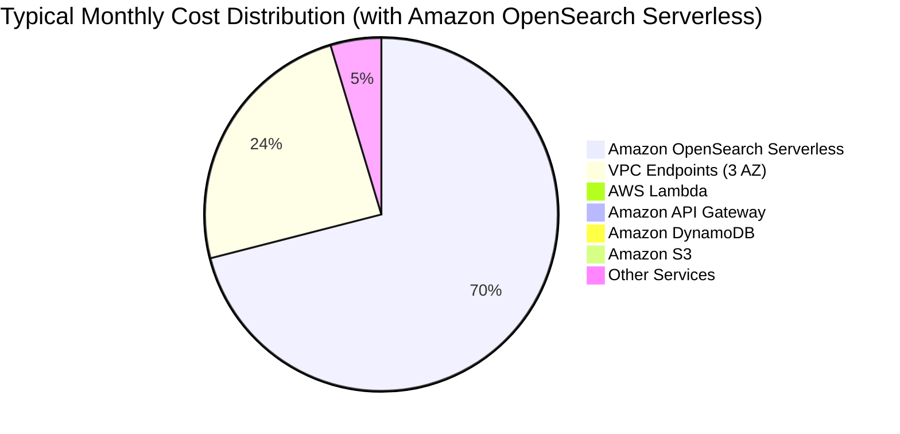

# Cost

This page provides cost guidance for deploying and operating Visual Asset Management System (VAMS) on AWS. Costs vary based on the deployment configuration, the volume of assets managed, and the processing pipelines enabled.

:::warning[Cost Responsibility]
You are responsible for the cost of the AWS services used while running VAMS. We strongly recommend setting up [billing alarms](https://docs.aws.amazon.com/AmazonCloudWatch/latest/monitoring/monitor_estimated_charges_with_cloudwatch.html) to monitor spending within the constraints of your budget.
:::

---

## Cost Model

VAMS costs are composed of two primary categories:

1. **Fixed infrastructure costs** -- Base costs for always-on services such as Amazon DynamoDB tables, Amazon API Gateway, AWS Lambda, and optionally Amazon OpenSearch Service, Amazon VPC endpoints, and web distribution (Amazon CloudFront or Application Load Balancer)
2. **Variable usage costs** -- Costs that scale with the volume of assets stored in Amazon S3, the number of API requests, and the processing pipelines executed

The most significant cost driver for most deployments is Amazon OpenSearch Service, which is optional but required for full-text search capabilities. VPC endpoints, when enabled, also contribute a meaningful fixed monthly cost. With natural-language search enabled, the per-file analysis by the SYSTEM GenAI metadata pipeline is the main variable cost; see [Natural-language (vector) search](#natural-language-vector-search).

The tables on this page show Commercial and GovCloud pricing. AWS European Sovereign Cloud deployments use the same service configuration as GovCloud (Application Load Balancer, VPC required); consult the AWS pricing pages for that partition's rates.



---

## Configuration Options

VAMS cost varies based on the deployment features you enable. The following configuration options affect your monthly costs:

| Configuration                    | Description                                                                                                                       | Cost Impact                                                                                                                                                                                                                                  |
| -------------------------------- | --------------------------------------------------------------------------------------------------------------------------------- | -------------------------------------------------------------------------------------------------------------------------------------------------------------------------------------------------------------------------------------------- |
| **C-0: VPC**                     | Deploy VPC with variable endpoints based on pipeline and service needs. Option to import existing VPC and subnets with endpoints. | $0 -- ~$504 (commercial) or ~$594 (GovCloud) per month for the endpoints the VPC stack creates, depending on endpoint count and number of Availability Zones                                                                                 |
| **C-1: Web Distribution**        | Amazon CloudFront (default) or Application Load Balancer                                                                          | Amazon CloudFront: $0 (free tier for first 1 TB). Application Load Balancer: ~$25 -- $53 per month.                                                                                                                                          |
| **C-2: Amazon OpenSearch**       | Serverless (default), Provisioned, or disabled                                                                                    | Serverless: ~$703 per month. Provisioned: ~$744 -- $916 per month. Disabled: $0.                                                                                                                                                             |
| **C-3: AWS Lambda in VPC**       | Deploy all AWS Lambda functions inside VPC (optional)                                                                             | Included in VPC endpoint costs                                                                                                                                                                                                               |
| **C-4: Amazon Location Service** | Map tile retrieval for database location views (default in commercial)                                                            | ~$40 per month for 1,000 tile retrievals                                                                                                                                                                                                     |
| **C-5: Processing Pipelines**    | Use-case specific pipelines (optional). Requires VPC.                                                                             | Variable based on pipeline usage (see pipeline costs below)                                                                                                                                                                                  |
| **C-6: Natural-language search** | Amazon DynamoDB vector index fed by the SYSTEM GenAI metadata pipeline (on in the commercial template)                            | ~$0.01 -- ~$0.05 per new file version and ~$0.10 per 1,000 queries; no standing charge without the Fargate renderer, ~$175 per month for its VPC endpoints with it. See [Natural-language (vector) search](#natural-language-vector-search). |
| **C-6: Add-ons**                 | Optional integrations with external solutions (see [Add-ons Overview](../developer/addons-overview.md))                           | Variable; each add-on's page lists the costs it adds                                                                                                                                                                                         |

---

## Service-by-Service Cost Estimates

The following tables provide approximate monthly cost estimates based on three deployment sizes. All estimates exclude AWS Free Tier credits and are based on US East (N. Virginia) pricing unless otherwise noted.

### Core Infrastructure Services

| AWS Service            | Small | Medium | Large  | Notes                                                                                |
| ---------------------- | ----- | ------ | ------ | ------------------------------------------------------------------------------------ |
| **Amazon S3**          | $0.26 | $2.50  | $25.00 | 10 GB / 100 GB / 1 TB storage with proportional PUT/GET requests                     |
| **Amazon DynamoDB**    | $1.18 | $5.00  | $15.00 | On-demand pricing. Scales with number of assets, versions, and metadata records.     |
| **AWS Lambda**         | $6.00 | $15.00 | $40.00 | 5,308 MB memory, 15-minute timeout. Scales with API request volume.                  |
| **Amazon API Gateway** | $0.16 | $1.50  | $5.00  | REST API pricing at $3.50 per million requests (low-volume estimate)                 |
| **AWS Step Functions** | $2.21 | $10.00 | $30.00 | Scales with workflow execution frequency                                             |
| **AWS KMS**            | $1.00 | $1.00  | $3.00  | $1 per month per CMK + $0.03 per 10,000 API calls                                    |
| **Amazon Cognito**     | $0.00 | $0.00  | $27.50 | Free for first 50,000 MAU. $0.0055 per MAU beyond.                                   |
| **Amazon CloudWatch**  | $3.28 | $8.00  | $20.00 | Log ingestion and storage for audit logs, VPC flow logs, and Amazon API Gateway logs |
| **AWS CloudTrail**     | $0.00 | $2.00  | $5.00  | First trail free. Additional data events charged per 100,000 events.                 |

### Search Services (Choose One or None)

| AWS Service                          | Monthly Cost (Commercial)                              | Monthly Cost (GovCloud)                      | Notes                                                                                                                                                                                                                                                                                                                                                                                                                                                                                        |
| ------------------------------------ | ------------------------------------------------------ | -------------------------------------------- | -------------------------------------------------------------------------------------------------------------------------------------------------------------------------------------------------------------------------------------------------------------------------------------------------------------------------------------------------------------------------------------------------------------------------------------------------------------------------------------------- |
| **Amazon OpenSearch Serverless**     | $0 -- ~$703.20                                         | N/A                                          | Next-generation Serverless scales to zero OCUs when idle (cost approaches $0 between uses); a minimum of 2 index + 2 search OCUs applies when minimums are held above zero. 100 GB data included.                                                                                                                                                                                                                                                                                            |
| **Amazon OpenSearch Provisioned**    | ~$743.66                                               | ~$915.52                                     | Data nodes (r7g.large.search, one per Availability Zone) + 2 master nodes (r7g.large.search), 120 GB EBS per node. Cost varies with instance type and node count.                                                                                                                                                                                                                                                                                                                            |
| **No Amazon OpenSearch**             | $0.00                                                  | $0.00                                        | Search features disabled. Asset browsing and management remain functional.                                                                                                                                                                                                                                                                                                                                                                                                                   |
| **Natural-language (vector) search** | ~$0.03 per new file version + ~$0.10 per 1,000 queries | Not estimated (off in the GovCloud template) | No standing charge without the pipeline's Fargate renderer. Each new file version runs the SYSTEM GenAI metadata pipeline: one Amazon Bedrock analysis call, Amazon Bedrock Guardrails screening, and Amazon Titan Text Embeddings V2 embeddings, stored in an on-demand Amazon DynamoDB vector table. Each query is one embedding and Amazon DynamoDB `SearchVectors` reads. Independent of the OpenSearch choice. See [Natural-language (vector) search](#natural-language-vector-search). |

:::info[Amazon OpenSearch Serverless Minimum]
Classic Serverless and any deployment that holds minimum OCUs above zero carry a continuous charge of at least 2 index OCUs and 2 search OCUs, which is the largest fixed cost in most VAMS deployments. Next-generation Serverless can set `minIndexingOcu` and `minSearchOcu` to `0` so the collection scales to zero when idle, reducing the standing cost to near zero between uses. The trade-off is a cold start of about 10–20 seconds on the first request after roughly 10 minutes of inactivity. Consider disabling Amazon OpenSearch entirely if full-text search is not required for your use case.
:::

### Web Distribution (Choose One)

| AWS Service                   | Monthly Cost (Commercial) | Monthly Cost (GovCloud) | Notes                                                                          |
| ----------------------------- | ------------------------- | ----------------------- | ------------------------------------------------------------------------------ |
| **Amazon CloudFront**         | $0.00                     | N/A                     | First 1 TB data transfer included in free tier. Not available in AWS GovCloud. |
| **Application Load Balancer** | ~$24.43                   | ~$52.56                 | 1 ALB with 1 TB processed. Required for AWS GovCloud deployments.              |

### Networking (Conditional)

| AWS Service                 | Monthly Cost (Commercial) | Monthly Cost (GovCloud) | Notes                                                                                                                                                                                                                                                                                                                                                                                                                                                                                |
| --------------------------- | ------------------------- | ----------------------- | ------------------------------------------------------------------------------------------------------------------------------------------------------------------------------------------------------------------------------------------------------------------------------------------------------------------------------------------------------------------------------------------------------------------------------------------------------------------------------------ |
| **VPC Endpoints**           | $0 -- ~$503.70            | $0 -- ~$593.98          | 9--23 interface endpoints (up to 21 in GovCloud) that the VPC stack creates when `addVpcEndpoints` is enabled, each billed in every Availability Zone (up to 3 AZ). Cost depends on enabled features. A private Amazon OpenSearch Serverless collection and the Application Load Balancer web distribution each add one more endpoint, and each other Region that holds an external asset bucket adds a cross-Region Amazon S3 endpoint when `addCrossRegionS3Endpoints` is enabled. |
| **Amazon Location Service** | ~$40.00                   | N/A                     | 1,000 map tile retrievals. Commercial regions only.                                                                                                                                                                                                                                                                                                                                                                                                                                  |
| **AWS WAF**                 | ~$5.00                    | ~$5.00                  | Base cost for web ACL. Additional rules and request volume add cost.                                                                                                                                                                                                                                                                                                                                                                                                                 |

---

## Pipeline Costs

Processing pipeline costs are variable and depend on the number of assets processed, file sizes, and processing duration. The following estimates are based on moderate usage patterns.

| Pipeline Service                               | Quantity                                         | Cost (Commercial) | Cost (GovCloud)            |
| ---------------------------------------------- | ------------------------------------------------ | ----------------- | -------------------------- |
| **AWS Batch (Fargate)**                        | 10 hours of processing                           | $3.56             | $4.88                      |
| **Amazon S3 (Pipeline Output)**                | 300 GB storage, 30 GB transfer out               | $9.60             | $16.34                     |
| **Amazon CloudWatch (Pipeline Logs)**          | 1 GB logs                                        | $3.28             | $4.12                      |
| **Amazon Bedrock (SYSTEM GenAI metadata)**     | 1M input + 200K output tokens (Claude Haiku 4.5) | ~$2.00            | ~$9.00 (Claude Sonnet 4.5) |
| **AWS Lambda (SYSTEM GenAI metadata renders)** | 1,000 files at 10 GB memory, 60 s average        | ~$10.00           | ~$12.00                    |
| **Amazon Transcribe (Video SOP/BOM)**          | 100 audio minutes (batch)                        | $0.60             | N/A                        |
| **Amazon Bedrock (Video SOP/BOM)**             | 1M tokens (Claude Sonnet)                        | $18.00            | N/A                        |
| **Amazon ECR**                                 | 40 GB container images (in-region)               | $4.00             | $4.00                      |

:::tip[Pipeline Cost Optimization]
Pipelines are only deployed when their configuration flag is enabled. Disable unused pipelines to avoid container image storage costs and unnecessary VPC endpoint charges. Use `autoRegisterAutoTriggerOnFileUpload` selectively to prevent unintended pipeline executions on every upload.
:::

---

## Natural-language (vector) search

[Natural-language search](../concepts/vector-search.md) has two cost parts. The [SYSTEM GenAI metadata pipeline](../pipelines/system-genai-metadata.md) analyzes and embeds every new file version, and each search request embeds the query and reads the vector index. The pipeline is the larger part, and it scales with the number of new file versions per month rather than with the size of the library. With the pipeline's Fargate renderer off, the feature has no hourly charge: Amazon Bedrock, AWS Lambda, AWS Step Functions, and the on-demand Amazon DynamoDB vector table bill per use.

:::info[How these figures are estimated]
The figures in this section are estimates at US East (N. Virginia) on-demand prices at the time of publication. They use the commercial template's models: Anthropic Claude Haiku 4.5 through its `global.` cross-Region inference profile for the analysis, and Amazon Titan Text Embeddings V2 at 1,024 dimensions for the embeddings. Token counts, function durations, and item sizes are estimates for typical files, not measurements. Use the [AWS Pricing Calculator](https://calculator.aws/) for your own volumes and Region.
:::

### Prerequisites and minimum configuration

Configuration validation accepts `app.vectorSearch.enabled: true` only when:

-   `app.pipelines.useSystemGenAiMetadata.enabled`, `autoRegisterWithVAMS`, and `autoRegisterAutoTriggerOnFileUpload` are all `true`. The pipeline's upload trigger runs it on every new file version, and the pipeline produces the embeddings the vector index holds.
-   `bedrockModels.embeddingModelId` names an embedding model and `embeddingDimensions` its vector width (`amazon.titan-embed-text-v2:0` and `1024` by default).
-   The pipeline creates an Amazon Bedrock guardrail (`bedrockGuardrail.create.enabled`, the default) or names an operator-owned one (`bedrockGuardrail.guardrailIdentifier`).
-   `embeddingDimensions` is a width the embedding model's family produces, and `app.vectorSearch.indexingConcurrency` is an integer from 2 to 1000.
-   The Region is in the commercial (`aws`) or AWS GovCloud (US) (`aws-us-gov`) partition. Validation refuses vector search in every other partition, including the AWS European Sovereign Cloud, where Amazon DynamoDB vector search is not offered. In AWS GovCloud (US) the feature is supported once Amazon Bedrock model access is enabled by hand; see [Prerequisites](../deployment/prerequisites.md#amazon-bedrock-model-access).

Natural-language search needs neither a VPC nor Amazon OpenSearch Service. The following block is the minimum configuration for the full functionality: generated descriptions, a guardrail on the analysis prompts and on the embedded text, whole-file and content-chunk vectors, and the search API. Every field the block omits takes its default, which creates the Amazon Bedrock guardrail and leaves the Fargate renderer off:

```json
{
    "app": {
        "vectorSearch": { "enabled": true },
        "pipelines": {
            "useSystemGenAiMetadata": {
                "enabled": true,
                "autoRegisterWithVAMS": true,
                "autoRegisterAutoTriggerOnFileUpload": true,
                "bedrockModels": {
                    "analysisModelId": "global.anthropic.claude-haiku-4-5-20251001-v1:0",
                    "embeddingModelId": "amazon.titan-embed-text-v2:0",
                    "embeddingDimensions": 1024
                }
            }
        }
    }
}
```

The settings below change what each file costs:

| Setting                                                                       | Effect on cost                                                                                                                                                                                            |
| ----------------------------------------------------------------------------- | --------------------------------------------------------------------------------------------------------------------------------------------------------------------------------------------------------- |
| `useGenAiAnalysis` (default `true`)                                           | Adds one analysis-model call per file version, the largest per-file cost. With `false`, no analysis call is made and the embeddings are built from the extracted text, attributes, and existing metadata. |
| `bedrockGuardrail.create.enabled` (default `true` in the commercial template) | Adds Amazon Bedrock Guardrails charges on the analysis prompt, on the model's response, and on every text that is embedded.                                                                               |
| `CONTENT_CHUNKING` template tag (default `true`)                              | Adds one embedding and its guardrail screening for each 1,600-character chunk of a document, text, or data file up to 50 MiB, at most 1,000 chunks per file version.                                      |
| `useFargateRenderer` (default `false`)                                        | Renders files above the Lambda limits on AWS Fargate. Requires `app.useGlobalVpc.enabled`, which adds the standing VPC endpoint charge.                                                                   |
| `VIDEO_SEGMENT_SECONDS` template tag (default `0`)                            | A value of `2` or more adds one analysis call and one embedding per video window.                                                                                                                         |

Without the Fargate renderer, a file above `lambdaLimits.maxInputFileSizeMb` (2,048 MB by default), or a point cloud above `lambdaLimits.maxPointCloudPoints` (20,000,000 points by default), is analyzed from its name, attributes, and asset context alone, with no rendered views.

### Standing monthly cost

| Configuration                                    | Monthly cost     | What is billed                                                                                                                                                                                                                                                                                                                                                             |
| ------------------------------------------------ | ---------------- | -------------------------------------------------------------------------------------------------------------------------------------------------------------------------------------------------------------------------------------------------------------------------------------------------------------------------------------------------------------------------- |
| Fargate renderer off (commercial template)       | ~$0 plus storage | No hourly resources. Storage of the vectors (see [Vector storage](#vector-storage)), of the pipeline's three container images in Amazon ECR at $0.10 per GB-month, and of its logs in Amazon CloudWatch Logs.                                                                                                                                                              |
| Fargate renderer on, VPC created for it          | ~$175.20         | 12 interface VPC endpoints in each of two Availability Zones at $0.01 per endpoint-hour: the nine common endpoints of a deployment with a `REGIONAL` API and no customer managed key, and the AWS Batch, Amazon ECR API, and Amazon ECR Docker endpoints the renderer adds. Data through the endpoints adds $0.01 per GB, and the VPC flow logs add $0.50 per GB ingested. |
| Fargate renderer on, VPC already enabled         | ~$43.80          | The AWS Batch, Amazon ECR API, and Amazon ECR Docker endpoints in two Availability Zones; $0 when another AWS Batch pipeline already creates them.                                                                                                                                                                                                                         |
| Lambda functions in the VPC (`useForAllLambdas`) | ~$14.60 more     | The Amazon Bedrock Runtime endpoint the in-VPC pipeline and search functions call. The same endpoint is created when the search functions run in the VPC for a provisioned Amazon OpenSearch Service domain or a private Serverless collection.                                                                                                                            |

The endpoint figures are for the default two Availability Zones; a VPC of three Availability Zones (`openSearch.useProvisioned.availabilityZoneCount: 3`) costs one and a half times as much. See [Networking](../architecture/networking.md#vpc-endpoints) for every endpoint and its condition.

### Cost per new file version

The pipeline runs once for every new version of a file, such as an upload, a copy, move, or rename into an asset, or a revert to an earlier version, and once for every file a reindex enumerates.

| Component                                                                                                                                            | Price (US East (N. Virginia))                                                                                                                                                                                             | Estimate per file version                                                                                                                                                                                                   |
| ---------------------------------------------------------------------------------------------------------------------------------------------------- | ------------------------------------------------------------------------------------------------------------------------------------------------------------------------------------------------------------------------- | --------------------------------------------------------------------------------------------------------------------------------------------------------------------------------------------------------------------------- |
| Analysis model (one Amazon Bedrock Converse call)                                                                                                    | Claude Haiku 4.5: $1.00 per million input tokens, $5.00 per million output tokens                                                                                                                                         | ~$0.0125 for about 9,000 input tokens (instructions, vocabulary, attributes, text excerpt, and up to eight rendered views, pages, or keyframes) and 700 output tokens; ~$0.008 for an image file (about 4,500 input tokens) |
| Amazon Bedrock Guardrails on the analysis call                                                                                                       | $0.15 (content filter, which holds the prompt-attack filter) plus $0.10 (PII filter) per 1,000 text units on the screened prompt text; $0.10 per 1,000 text units on the response. A text unit is up to 1,000 characters. | ~$0.002 -- ~$0.006                                                                                                                                                                                                          |
| Amazon Bedrock Guardrails on a structured answer (`ApplyGuardrail`), when the run carries the metadata schema and the model answers through its tool | The same two filters, on the answer's text units                                                                                                                                                                          | Under $0.001                                                                                                                                                                                                                |
| Amazon Bedrock Guardrails on the embedded text (`ApplyGuardrail`)                                                                                    | The same two filters                                                                                                                                                                                                      | ~$0.001 -- ~$0.004                                                                                                                                                                                                          |
| Embedding                                                                                                                                            | Amazon Titan Text Embeddings V2: $0.02 per million input tokens                                                                                                                                                           | Under $0.0001                                                                                                                                                                                                               |
| AWS Lambda                                                                                                                                           | $0.0000166667 per GB-second. The 3D render functions run at 10,240 MB, the media function at 3,008 MB, and the other functions at 5,308 MB.                                                                               | ~$0.012 for a 3D model with a 60-second render; ~$0.003 for other files                                                                                                                                                     |
| Amazon DynamoDB writes                                                                                                                               | $0.625 per million write request units; $0.52 per GB written to the vector index                                                                                                                                          | Under $0.0001 per vector                                                                                                                                                                                                    |
| AWS Step Functions, Amazon S3 requests, Amazon EventBridge, Amazon CloudWatch Logs                                                                   | $0.025 per 1,000 state transitions; $0.005 per 1,000 PUT requests; $1.00 per million events; $0.50 per GB ingested                                                                                                        | ~$0.001                                                                                                                                                                                                                     |

| File                                                     | Estimate per new version                                                                                                           |
| -------------------------------------------------------- | ---------------------------------------------------------------------------------------------------------------------------------- |
| Image                                                    | ~$0.015                                                                                                                            |
| 3D model with eight rendered views                       | ~$0.03                                                                                                                             |
| 10-page PDF with about 30 content chunks                 | ~$0.045                                                                                                                            |
| Each additional content chunk                            | ~$0.0006, mostly the guardrail screening of about two text units                                                                   |
| Each video window (`VIDEO_SEGMENT_SECONDS` of 2 or more) | ~$0.005, about $2 per hour of video at a 10-second interval                                                                        |
| Fargate render of a file above the Lambda limits         | ~$0.016 per minute of render time (16 vCPU, 64 GiB of memory, and 200 GiB of storage, billed per second with a one-minute minimum) |

With Claude Sonnet 4.5 ($3.00 per million input tokens and $15.00 per million output tokens through its `global.` profile) as the analysis model, the analysis call costs about three times as much, about $0.038 for the 9,000-token file. The pipeline sends the rendered views to the guardrail with the prompt text. Amazon Bedrock Guardrails bills image content filtering at $0.75 per 1,000 images when a guardrail's content filters are configured for images; the created guardrail's prompt-attack filter names no image modality, and these estimates bill no images.

### Cost per asset summary

Each run of the [asset summary](../pipelines/system-genai-metadata.md#asset-summary-workflow) is one Amazon Bedrock Converse call without images on `bedrockModels.textModelId`, or on the analysis model when no text model is set. Its input grows with the number of described files, up to 40,000 characters of file lines plus the asset's metadata, about 12,000 input tokens at the cap. With Claude Haiku 4.5 and the created guardrail, a summary at the cap costs about $0.03: about $0.016 for the model call and about $0.011 to screen some 45 text units of guarded content. With the asset's metadata schema in the run, a tool answer adds one `ApplyGuardrail` call of a few text units. The summary runs only on request.

### Cost per query

Each `POST /search/nlp` request embeds the query once and reads the vector index. It calls no analysis model and no guardrail.

| Component                                  | Price                                                                 | Estimate per query                      |
| ------------------------------------------ | --------------------------------------------------------------------- | --------------------------------------- |
| Query embedding (at most 1,000 characters) | $0.02 per million tokens                                              | Under $0.00001                          |
| `SearchVectors` calls                      | $0.002 per GB of vector data searched, metered at least 1 KB per call | ~$0.000004 for two calls of 1 MB each   |
| Vector search Lambda function (5,308 MB)   | $0.0000166667 per GB-second                                           | ~$0.00009 for one second                |
| Amazon API Gateway request                 | $3.50 per million requests                                            | ~$0.0000035                             |
| Asset record reads (`BatchGetItem`)        | $0.125 per million read request units                                 | Under $0.00001                          |
| **Total**                                  |                                                                       | **~$0.0001 (~$0.10 per 1,000 queries)** |

A caller who can read every database is served by two `SearchVectors` calls, one over whole-file vectors and one over all vectors; any other caller, and any request that names databases, is served by two calls per database searched instead, up to 200 databases. A request with `includeSegments: false` makes one call per target. Amazon DynamoDB meters each call on the bytes it examines and returns, so the 1 MB per call above is an assumption; the `VectorSearchRequestBytes` Amazon CloudWatch metric reports the actual figure.

### Vector storage

Each vector — the whole-file vector of a file version, and one for each of its content chunks or video windows — is an item of about 10--16 KB in the vector table (the 1,024-number vector, up to 8,000 characters of source text, and the identifiers), plus a copy of about 5 KB in the vector index (the vector and its projected attributes). At $0.25 per GB-month of storage and $0.20 per GB-month for point-in-time recovery, which every VAMS table enables, 100,000 vectors (about 2 GB) cost about $0.90 per month. Every version of a file keeps its own vectors, so storage grows with the number of file versions, not only with the number of files.

### Worked example

The following monthly totals are for natural-language search alone, at about $0.03 per new file version and three vectors per file version on average. Add the deployment's other costs from the tables above.

|                                                                  | Small                      | Medium                     | Large                        |
| ---------------------------------------------------------------- | -------------------------- | -------------------------- | ---------------------------- |
| New file versions per month                                      | 1,000                      | 10,000                     | 100,000                      |
| Natural-language queries per month                               | 5,000                      | 50,000                     | 500,000                      |
| Pipeline (analysis, guardrail, embeddings, compute)              | ~$30                       | ~$300                      | ~$3,000                      |
| Queries                                                          | ~$0.50                     | ~$5                        | ~$50                         |
| Storage of the month's new vectors                               | ~$0.03                     | ~$0.27                     | ~$2.70                       |
| **Monthly total, Fargate renderer off**                          | **~$31**                   | **~$305**                  | **~$3,053**                  |
| **Monthly total, Fargate renderer on with a VPC created for it** | **~$206** plus render time | **~$480** plus render time | **~$3,228** plus render time |

Storage accumulates: each month's vectors are added to the vectors already stored.

### Backfilling an existing library

Enabling the feature on a deployment that already holds files, re-enabling it, changing the embedding model, and setting `app.vectorSearch.reindexOnCdkDeploy` all run the vector reindexer, which launches the pipeline for the latest live version of every file in scope. The reindex is not incremental, so it costs the per-file figure once for every file: about $300 for 10,000 files, $3,000 for 100,000 files, and $30,000 for 1,000,000 files at $0.03 each. `reindexOnCdkDeploy` repeats the run on every deployment while it is `true`. The reindexer's `databaseId` and `limit` keys narrow a run; see [Reindexing](../concepts/vector-search.md#reindexing). With vector search off, the reindexer still exists while the SYSTEM GenAI metadata pipeline is on, and its `enqueue` (or the migration's opt-in `metadataBackfill` step) costs one analysis run per file in scope, without the embedding.

### Cost controls

-   **Keep `useFargateRenderer` off** unless files above the Lambda limits need rendered views. It is the only setting of the feature with a standing charge.
-   **Choose the analysis model.** Claude Haiku 4.5 is the commercial default; Claude Sonnet 4.5 costs about three times as much per file. `useGenAiAnalysis: false` removes the analysis call, its guardrail charges, and the renders, for about $0.005 per file version; natural-language search then finds documents, text, and data files by their content and every other file by its attributes.
-   **Tune the template tags.** `RENDER_VIEWS` (8 by default; each 768-pixel view is about 800 input tokens), `MAX_TEXT_CHARS` (12,000 by default), `CONTENT_CHUNKING`, and `VIDEO_SEGMENT_SECONDS` set how much each file sends to Amazon Bedrock. See [Template](../pipelines/system-genai-metadata.md#template).
-   **Match the PII filter to the data.** The created guardrail's PII filter is $0.10 of the $0.25 charged per 1,000 text units; `bedrockGuardrail.create.piiFilter: off` suits data that holds no personal information.
-   **Set `lambdaLimits`.** AWS Lambda does not render a file above `maxInputFileSizeMb` or a point cloud above `maxPointCloudPoints`; with the Fargate renderer on, AWS Fargate renders it instead.
-   **Plan reindex runs.** `app.vectorSearch.indexingConcurrency` (default 5) caps how many workflow executions a reindex has running at once, from launch to end, which spreads its cost over time without reducing it. A file waiting for a free place costs a few Amazon SQS and Amazon DynamoDB requests per look, at most one look every 15 minutes once it has waited a while. Because a waiting file looks again only after a delay that grows from 30 seconds to 15 minutes, the last files of a run can start up to 15 minutes after a slot frees. Set `reindexOnCdkDeploy` back to `false` after the deployment that needed it.

The pipeline has no per-file-type exclusion: its trigger runs on every new file version except the preview thumbnails that the preview pipelines write.

---

## Cost Variation Factors

The following factors significantly influence your monthly VAMS costs:

### Storage Volume

Amazon S3 costs are directly proportional to the total volume of assets stored, including original uploads, pipeline-generated outputs, and preview thumbnails. Point cloud processing through the Potree pipeline generates octree representations that can be 1--2x the size of the original data.

### API Request Volume

AWS Lambda and Amazon API Gateway costs scale with the number of API requests. High-frequency programmatic access through the CLI or API, particularly for search and listing operations, increases compute costs.

### Pipeline Execution Frequency

Each pipeline execution incurs AWS Batch Fargate compute costs, Amazon S3 data transfer costs, and Amazon CloudWatch logging costs. Enabling auto-trigger on file upload for multiple pipelines multiplies processing costs per asset.

### Amazon OpenSearch Configuration

The choice between Amazon OpenSearch Serverless and Provisioned significantly affects costs. Serverless charges by OCU-hour, so the cost depends on the minimum OCUs the collection holds: a deployment that holds minimums above zero pays for at least 2 index and 2 search OCUs continuously, while next-generation Serverless with both minimums set to `0` scales to zero between uses. Provisioned charges by instance type and Amazon EBS volume regardless of activity. Either option is typically the largest fixed cost component of a deployment.

### VPC Endpoint Count

Each VPC interface endpoint costs approximately $7.30 per month per Availability Zone. Enabling more pipelines, services, and add-ons increases the number of required VPC endpoints. A deployment that creates its own endpoints starts with 9 interface endpoints, and one with every pipeline and service enabled can require up to 23 (21 in GovCloud) in each of up to 3 Availability Zones. A private Amazon OpenSearch Serverless collection and the Application Load Balancer web distribution each add one endpoint outside this count, and the Application Load Balancer creates its Amazon S3 endpoint even when `addVpcEndpoints` is disabled, unless `app.useAlb.addAlbS3SpecialVpcEndpoint` is `false`. Each other Region that holds an external asset bucket adds a cross-Region Amazon S3 endpoint when `addCrossRegionS3Endpoints` is enabled.

---

## Deployment Size Estimates

The following estimates represent approximate total monthly costs for these deployment profiles.

| Deployment Profile                                | Configuration                                                                                                                                             | Estimated Monthly Cost                 |
| ------------------------------------------------- | --------------------------------------------------------------------------------------------------------------------------------------------------------- | -------------------------------------- |
| **Minimal**                                       | Amazon CloudFront, no Amazon OpenSearch, no VPC, no pipelines                                                                                             | $10 -- $15                             |
| **Standard**                                      | Amazon CloudFront, Amazon OpenSearch Serverless, VPC (1 AZ), basic pipelines                                                                              | $800 -- $1,000                         |
| **Full-Featured**                                 | Amazon CloudFront or ALB, Amazon OpenSearch Provisioned, VPC (3 AZ), all pipelines, Amazon Location Service                                               | $1,200 -- $1,800+                      |
| **GovCloud Full**                                 | ALB, Amazon OpenSearch Provisioned, VPC (3 AZ), AWS KMS CMK, FIPS, pipelines                                                                              | $1,500 -- $2,200+                      |
| **Natural-language search**                       | Amazon CloudFront, no Amazon OpenSearch, no VPC, SYSTEM GenAI metadata pipeline with vector search, 10,000 new file versions and 50,000 queries per month | $315 -- $350                           |
| **Natural-language search with Fargate renderer** | As above, with `useFargateRenderer` and a VPC (2 AZ) created for it                                                                                       | $490 -- $550, plus Fargate render time |

:::note[Estimates Only]
These cost estimates are approximations based on typical usage patterns. Actual costs vary based on your specific usage, data volumes, API request rates, and AWS pricing changes. Use the [AWS Pricing Calculator](https://calculator.aws/) for detailed estimates tailored to your deployment.
:::

---

## Cost Optimization Recommendations

1. **Disable Amazon OpenSearch if not needed** -- This removes the largest fixed cost ($700+ per month). Basic asset browsing and management work without search.
2. **Use Amazon OpenSearch Serverless over Provisioned** -- Serverless provides zero operational overhead with comparable cost for typical VAMS workloads.
3. **Minimize VPC endpoints** -- Only enable VPC when required by pipelines or AWS GovCloud. Import an existing VPC with endpoints to avoid duplicate costs.
4. **Enable pipelines selectively** -- Each pipeline adds container image storage and VPC endpoint costs. Enable only the pipelines you actively use.
5. **Monitor auto-trigger pipelines** -- Auto-triggered pipelines execute on every file upload. Ensure this behavior is intended to avoid unexpected processing costs.
6. **Set billing alarms** -- Configure Amazon CloudWatch billing alarms at 50%, 75%, and 100% of your budget threshold.
7. **Review Amazon S3 storage classes** -- For infrequently accessed assets, consider configuring Amazon S3 lifecycle policies on asset buckets.
8. **Use Amazon CloudFront** -- When deploying in commercial regions, Amazon CloudFront provides free tier data transfer and caching that reduces origin request costs.
9. **Size natural-language search to the upload volume** -- Its cost follows the number of new file versions, about $0.03 each with the default models. Keep the pipeline's Fargate renderer off unless large files need rendered views, and see [Cost controls](#cost-controls) for the model and template settings.
