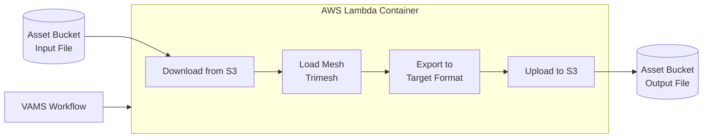
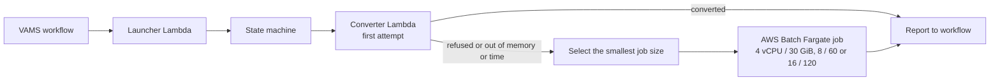

# 3D Basic Conversion Pipeline

The 3D Basic Conversion pipeline converts 3D models between common interchange formats using the Trimesh and OpenUSD libraries. It runs as a containerized AWS Lambda function, making it a lightweight and fast option for format conversion without requiring a VPC or AWS Batch infrastructure. This pipeline is enabled by default in new VAMS deployments.

## Supported Formats

The pipeline reads the formats below. All but XYZ, the generic `.usd` extension, FBX, and STEP are also available as a conversion target.

| Format | Extension               | Direction        | Description                                                                                     |
| ------ | ----------------------- | ---------------- | ----------------------------------------------------------------------------------------------- |
| STL    | `.stl`                  | Input and output | Stereolithography -- widely used in 3D printing and CAD                                         |
| OBJ    | `.obj`                  | Input and output | Wavefront OBJ -- common mesh interchange format                                                 |
| PLY    | `.ply`                  | Input and output | Polygon File Format -- supports vertex colors, normals, and point clouds                        |
| GLTF   | `.gltf`                 | Input and output | GL Transmission Format -- open standard for 3D scenes                                           |
| GLB    | `.glb`                  | Input and output | Binary GLTF -- single-file variant of GLTF                                                      |
| USD    | `.usda` `.usdc` `.usdz` | Input and output | OpenUSD: text layer, binary (crate) layer, and a single-file package that carries its textures  |
| USD    | `.usd`                  | Input only       | OpenUSD layer in either encoding; a USD output names its encoding (`.usdc`, `.usda` or `.usdz`) |
| DAE    | `.dae`                  | Input and output | COLLADA -- 3D interchange between content tools                                                 |
| 3MF    | `.3mf`                  | Input and output | 3D Manufacturing Format -- a zip package used in 3D printing                                    |
| OFF    | `.off`                  | Input and output | Object File Format -- plain text polygon meshes                                                 |
| FBX    | `.fbx`                  | Input only       | Autodesk FBX, binary or ASCII, read with the Assimp tool                                        |
| STEP   | `.step` `.stp`          | Input only       | ISO 10303 CAD exchange, read with cascadio (Open CASCADE) when `enableStepInput` is `true`      |
| XYZ    | `.xyz`                  | Input only       | Point cloud text format -- simple ASCII coordinate data                                         |

:::note[Conversion Directions]
A model in any format marked **Input and output** can be converted to any other format marked **Input and output**, for example STL to GLB, a USDZ to OBJ, or a 3MF to USDC. The pipeline uses Trimesh's import and export capabilities and OpenUSD's `usd-core` library to handle the translation.

XYZ is an input-only format. Trimesh reads an XYZ file as a point cloud, and its XYZ exporter cannot write one back, so a run that names `.xyz` as its target is rejected before the input file is downloaded. The same holds for the generic `.usd` extension, which is only read.

STL, DAE, 3MF, and OFF store triangle meshes only. An OFF file with vertices and no faces is read as a point cloud. A point cloud -- an XYZ file, or a PLY file that has vertices and no faces -- converts to PLY, OBJ, GLB, GLTF, or USD, which keep the points; a run that converts a point cloud to STL, DAE, 3MF, or OFF fails with a message saying so. An input that contains no geometry at all is refused for every target.
:::

### USD

A USD file is read as a stage: meshes (with their world transforms, texture coordinates, and the base color or base color texture of a UsdPreviewSurface material) and points become the converted model's geometry. The implicit shapes `Cube`, `Sphere`, `Cylinder`, `Cone`, `Capsule`, and `Plane` are tessellated at their authored size and axis (a sphere as a 642-vertex icosphere, round shapes with 48 segments), coloured by their bound material or `displayColor`. Other prim types (curves, volumes, skinned or animated data) are not converted. Hidden prims and prims with a purpose other than default or render (guides and proxies) are left out, and a scene that expands past the function's limits through instancing fails instead of being cut short.

A USD output writes one `UsdGeom` mesh per placement under an Xform, with normals and a `st` texture coordinate primvar, a UsdPreviewSurface material, and an explicit `metersPerUnit`, `upAxis`, and `defaultPrim`. A `.usdz` output is one file that holds its textures; a `.usdc` or `.usda` output with a texture is written in a folder named after the model, with the texture beside the layer, as GLTF buffers and OBJ materials are. When the run has an output path prefix (a launch's, or the workflow's `defaultOutputFileBaseExecutionPathExtension`), which the workflow inserts before each output file's own name, the pipeline rewrites every layer's references to where the files land, so a `.usdc` or `.usda` with textures, and the layers `convert-linked` writes in sub-folders, keep resolving. A multi-layer scene packaged as `.usdz` keeps its layers as authored; some viewers, including the VAMS web viewer, show only a single-layer package, so choose `flatten` when the result is for viewing. The written USD is checked in the project's tests with the OpenUSD validators of the `usd-core` wheel (`pxr.UsdValidation`, all 30 registered validators; `UsdUtils.ComplianceChecker` is not part of that wheel) and reports no errors, and the USDZ packaging is checked with `UsdUtils.CreateNewARKitUsdzPackage`. No ARKit-specific conformance check beyond those runs.

A USD file may name other files: sublayers, references, payloads, and textures. Each name must be a path relative to the file that names it that stays inside the input's own asset. A name that is absolute, carries a URI scheme such as `http://` or `s3://`, leaves the asset, or is not among the files fetched with the input is removed from the pipeline's working copy of the layer before the scene is opened, so the USD library never opens it, and it is reported as described in [Multi-File Models](#multi-file-models). Before the scene is opened, the pipeline counts from the layers how many prims its references, payloads, inherits, specializes, sublayers, and variants compose (an instanceable prim counts once), and refuses a scene that composes more than 1,000,000 prims (more on a function with more memory) or whose prim composes itself. The read of the opened scene also stops with a message when it passes its share of the function's time. A run whose scene has no geometry left fails, naming the geometry layers that could not be used. A `.usdz` package cannot be edited, so a package that names a layer outside itself by an absolute path, a URI scheme, or `..` fails the run.

### FBX

An FBX file is read by the Assimp command-line tool, version 6.0.6, which the image builds from a git clone of Assimp's `v6.0.6` release tag, checked against the pinned commit `a79ff6bbce54d3e01186a918dc6374ed55317426`, with only the FBX importer and the glTF exporter. Before the tool reads a file, the pipeline counts from the file how many models the scene places, how many triangles and vertices its instances place, and how deeply its records nest, with the 3D Preview Thumbnail's check: a file that places more than 1,000,000 models, more than 30,000,000 triangles (or 90,000,000 vertices) beyond what it stores once, or nests deeper than 256 levels is refused with a message saying which bound it passed, because Assimp expands every placement before it returns. The tool runs in the isolated worker process, with its memory, file-size, and time limits, and converts the file to GLB, which is then loaded like any GLB: textures the FBX names are read only if they were fetched from the asset. Assimp applies the file's up axis; its unit (`UnitScaleFactor`, centimetres per unit) is read from the file and handled as described in [Units and up axis](#units-and-up-axis).

### STEP (opt-in)

STEP is read only when `app.pipelines.useConversion3dBasic.enableStepInput` is `true`. CDK then builds the conversion image with cascadio 0.1.1, which bundles Open CASCADE (LGPL-2.1 with the OCCT exception); the default image holds no Open CASCADE code. While the key is `false` or absent, `*.step` and `*.stp` stay selectable and a run on one fails before the file is downloaded, with a message naming the key. A STEP file is tessellated in metres with its Z axis up. Before Open CASCADE reads it, the components its assembly places are counted from the file's text, and a file that places more than 1,000,000 is refused. Product and manufacturing information (PMI) is not converted.

### DAE, 3MF, and OFF

Every XML document -- a DAE file and the model parts of a 3MF package -- is read through a hardened parser first. A document type declaration or an entity declaration is refused, because neither format needs one. A 3MF package's central directory is checked before any part is read: members that would expand past the function's free disk, that compress implausibly, or that are named with an absolute path or `..` are refused.

Before a DAE input is loaded, the pipeline counts from the file how many nodes its scene places through `instance_node` (one for each primitive element of each geometry placed), and refuses a scene that places more than 1,000,000 nodes (more on a function with more memory), or more triangles or vertices than a function converts beyond what the file stores once, or that places a node inside itself. A DAE output keeps one mesh per placement and does not carry textures; use USD or GLB when textures matter. DAE and 3MF files declare their unit, see [Units and up axis](#units-and-up-axis).

OBJ, ASCII STL, XYZ, OFF, and GLTF files are text, and the pipeline reads that text as UTF-8, as it does the JSON inside a GLB file. ASCII text is UTF-8, so a file without accented or other non-ASCII characters is unaffected. A file whose text is not UTF-8 -- binary data with one of these extensions, or text saved in another encoding such as Windows-1252 -- fails before any referenced file is downloaded, with a message naming the file and the first byte that is not UTF-8. The pipeline does not guess another encoding, because a wrong guess would change the object, group, and material names in the converted model. Save the file as UTF-8 and run the conversion again. A binary STL file is read whatever its 80-byte header holds.

## Units and up axis

CAD exports are usually in millimetres and Z up, while glTF and USD tools expect metres and Y up. Every template has optional drop-downs that state what the file's numbers mean and what the result should be:

| Option         | Values                                          | Default | Meaning                                                                      |
| -------------- | ----------------------------------------------- | ------- | ---------------------------------------------------------------------------- |
| Source units   | `auto`, `mm`, `cm`, `m`, `km`, `in`, `ft`, `yd` | `auto`  | Unit of the numbers in the input. `auto` uses the unit the file declares.    |
| Target units   | `keep`, `mm`, `cm`, `m`, `km`, `in`, `ft`, `yd` | `keep`  | Unit to scale to. `keep` leaves the scale unchanged.                         |
| Source up axis | `auto`, `y`, `z`                                | `auto`  | Which axis points up in the input. `auto` uses the axis the file declares.   |
| Target up axis | `keep`, `y`, `z`                                | `keep`  | Which axis points up in the result. `keep` leaves the orientation unchanged. |

With the defaults, no number in the geometry changes, and every conversion that existed before these options gives the same output. The GLB and GLTF templates have no target options.

What a file declares: USD (`metersPerUnit` and `upAxis`, or USD's own default of 0.01 and Y), COLLADA (the `unit` and `up_axis` of its asset, or its defaults of one metre and Y), 3MF (its `unit` attribute, millimetres by default, and always Z up). 3MF is Z up because the 3MF core specification defines its coordinate system that way, so a Y-up source written as 3MF is rotated and `Target up axis` `y` is refused for it, and glTF and GLB (always metres and Y up). STL, OBJ, PLY, OFF, and XYZ declare nothing.

| Output             | What the result declares                                                                                                                                                                          |
| ------------------ | ------------------------------------------------------------------------------------------------------------------------------------------------------------------------------------------------- |
| GLB, GLTF          | Always metres and Y up. A source that declares another convention, or one set in Source units and Source up axis, is scaled and rotated to it. Target options other than `m` and `y` are refused. |
| USDA, USDC, USDZ   | `metersPerUnit` and `upAxis` are written. By default the source's own are kept; a source that declares none is written as metres and Y up, without changing any number.                           |
| DAE                | `unit` and `up_axis` are written in the same way.                                                                                                                                                 |
| 3MF                | The `unit` attribute is written (`micron`, `millimeter`, `centimeter`, `inch`, `foot` or `meter`; a source in km or yd is written in metres). 3MF is always Z up, so a Y-up source is rotated.    |
| OBJ, STL, PLY, OFF | Nothing is declared, so the scale and rotation are applied to the vertices.                                                                                                                       |

Z up to Y up maps `(x, y, z)` to `(x, z, -y)`, and Y up to Z up maps `(x, y, z)` to `(x, -z, y)`.

A Target option other than `keep` needs a known source. For STL, OBJ, PLY, OFF, and XYZ inputs, which declare nothing, the run fails before the file is downloaded with a message naming Source units or Source up axis. A CAD file converted to USD with the defaults is written as metres and Y up without changing its numbers, so set Source units and Source up axis for such a file.

## Multi-File Models

A GLTF file, and an OBJ file with materials, keep part of the model in other files: GLTF buffers (`.bin`) and texture images, and the OBJ material library (`.mtl`) with the base color textures (`map_Kd`) it names. A GLB or PLY file can also name an external texture. A USD file names sublayers, references, payloads, value clips, and textures, and those layers name further files; a COLLADA file names images (`init_from`); an FBX file names its textures. The pipeline reads every file the selected input references and downloads each one from the same asset before it loads the model, so upload the companion files to the asset at the paths the model names. For an asset created on a single existing object (a `bucketExistingKey` without a trailing `/`), the asset holds that file and its companion folder `{key}/`, and the model's references are looked up in that folder: `textures/wood.png` named by the asset's file is `{key}/textures/wood.png`, the file the asset lists at `/textures/wood.png`. Other keys in the object's own Amazon S3 folder are not part of the asset and are not read. A model that this pipeline wrote as GLTF or as a textured OBJ can be converted again, because its companion files are written beside it.

Each reference is checked before anything is downloaded:

-   It must be a path relative to the file that names it (for example `textures/wood.png` or `../shared/wood.png`) that resolves to a file inside the input's own asset. Absolute paths, URLs, and paths that leave the asset are rejected. Data embedded in the model (a `data:` URI) needs no download.
-   A GLTF or GLB buffer holds the geometry. A rejected buffer reference, or a buffer that is not in the asset, fails the run with a message naming it.
-   A material library or a texture image only adds appearance. One that is rejected, not in the asset, or over a limit is skipped, the run log records a warning naming it, and the model converts without it: an OBJ without its material library converts as geometry only.
-   A USD, COLLADA, or FBX file is read for its references in the isolated worker process, not in the function process: a USD layer is parsed by the USD library and a COLLADA document by the hardened XML parser. A USD layer that is fetched is read for its own references in turn, up to 8 levels deep. A COLLADA file's instance of a node in another COLLADA file is reported and not fetched, because the COLLADA loader does not compose other files.
-   A model may reference at most 1,000 files totalling 2 GiB. Only an OBJ file's material library and the USD layers a USD file names are read for further references. Texture images are limited by their decoded size, see [Input size limits](#input-size-limits); one left out for size is named in the run's completion message.
-   Names are read the way the model loader reads them: an OBJ file's material library is everything after `mtllib` on the first line that contains it, and a texture is everything after `map_Kd` on its line, so a name may contain spaces but not texture options such as `-s`.

### Reference handling and missing references

Every template has two optional drop-downs for the files a model names:

| Option             | Values                                                                                 | Default                              | Meaning                                                                          |
| ------------------ | -------------------------------------------------------------------------------------- | ------------------------------------ | -------------------------------------------------------------------------------- |
| Reference handling | `flatten`, `selected-only`; on Convert to USD also `auto`, `package`, `convert-linked` | `flatten` (`auto` on Convert to USD) | See below.                                                                       |
| Missing references | `skip`, `fail`                                                                         | `skip`                               | What a referenced file that is missing, outside the asset, or over a limit does. |

-   **flatten** composes the scene, with every file it names that is inside the asset, and writes one converted file. Every format other than USD can only hold one file's worth of model, so this is what every mainstream exporter does. USD variant sets are baked to the selection in the file.
-   **package** (`.usdz` output only) keeps the USD layers and their composition as authored and packs the selected layer and every file it names, textures included, into one `.usdz`. It cannot change units or the up axis; `auto` on Convert to USD chooses `package` for `.usdz` unless a unit or axis option is set, and `flatten` otherwise.
-   **convert-linked** (a `.usd`, `.usda`, or `.usdc` input to `.usdc` or `.usda`) converts the selected file and every USD layer it names, leaves first, each to the chosen encoding, and rewrites each layer's references to the converted names. The converted files keep the input's sub-folders inside the output folder (a layer outside the selected file's folder goes under `_linked/` at its path in the asset), textures are copied beside them, and nothing is composed, so every layer keeps its own unit and up axis. The output keeps the source's composition as authored: a scene whose layers reference or instance each other is still nested the same way in the converted files, and opening them composes it as the source would. A reference cycle, or two layers that would get the same converted name, fails the run before anything is written. With a `.usda` output, a layer holding an array whose text would reach 2 GB fails the same way (use `.usdc`), because the text writer would drop the array without an error.
-   **selected-only** converts the selected file alone. No referenced file is downloaded, and each one it names is reported as not included; a GLTF buffer the model cannot load without still fails the run.

With **skip**, a run that could not include a referenced file still succeeds, its completion message says the converted file is incomplete and counts the files by kind (geometry layers, data files, textures and other files), the run log lists each file with its reason, and a `conversion-incomplete.json` result document is written to the run's results (Output Results on the execution). The document has the same shape and limits as the 3D Preview Thumbnail's `preview-incomplete.json`: at most 100 files are listed with a `truncated` flag, paths are relative to the asset, and a reference outside the asset is named only by its file name. A complete run writes no document. With **fail**, the run stops before it converts and its error names up to 20 of the files and why each could not be used.

## Architecture



### Execution Type

By default this pipeline uses the **Lambda** execution type with synchronous invocation. It does not require an AWS Step Functions task token callback because the Lambda function returns results directly. The pipeline is registered in VAMS as a synchronous pipeline.

:::warning[No Task Token]
With the Batch tier off, this pipeline must be registered as NOT needing a task token callback. If a workflow passes a `TaskToken` to the converter function, it will reject the request with an error.
:::

With `batchTier.enabled` set to `true`, the same pipeline (`conversion-3d-basic`, the same templates) is registered with the callback enabled and a task timeout of 6.5 hours, and the function the workflow calls is a small launcher that starts a state machine (see [AWS Batch tier](#aws-batch-tier)). The converter function never receives the task token in either mode.

### Processing Flow

1. The Lambda function receives the workflow step's request body, which carries the Amazon S3 locations of the workflow input manifest and of the pipeline's input configuration. A request that carries a task token is rejected before anything is logged or read.
2. The function reads the manifest, which names the input file (its bucket, key, asset-relative path, and the bucket's AWS Region) and the run's output files location, and reads the target format (`outputType`) from the input configuration, which the selected pipeline template supplies.
3. The function reads the input's size with a `HeadObject` request at the version the run was launched on and refuses an input larger than the function can convert, before anything is downloaded (see [Input Size Limits](#input-size-limits)).
4. The input file is downloaded from the asset bucket to the Lambda container's `/tmp` directory at its path within the asset, followed by the files it references (see [Multi-File Models](#multi-file-models)).
5. The function starts a worker process that runs Trimesh. The worker has none of the function's AWS credentials in its environment, and the function process closes its own `/proc` files to it. It runs under an address-space limit set from the function's memory, a limit on the size of any one file it writes, no core dumps, and a time limit set from the invocation's remaining time; a limit that cannot be applied fails the run. The worker still runs as the function's user and shares its network namespace, so it can reach whatever network the function reaches, including the Lambda runtime API, which does not return credentials. Trimesh loads the model, detecting the format from the file extension, and reads referenced files only from those downloads. The model is exported to the target format using Trimesh's export capabilities.
6. The converted file, and any companion files the export writes, are uploaded to the run's output files location using multipart upload for large files. The workflow then writes them back to the output asset in the input's folder, inside a further folder when the export writes several files or keeps the input's format (see [Output Naming](#output-naming)).

## AWS Batch tier

A model the Lambda function cannot convert is, by default, refused. With the Batch tier on, the run continues once on AWS Batch with AWS Fargate, on the smallest job that can hold it. Turn it on with `app.pipelines.useConversion3dBasic.batchTier.enabled`; it needs the global VPC (`app.useGlobalVpc.enabled`) and is off in every shipped configuration.



-   **Every run starts on the Lambda function.** A small model converts there at the same cost and speed as without the tier; no job is queued and the run adds only a few Step Functions state transitions.
-   **What escalates.** An input over the function's size limit (found before the download, or after it for a referenced file or a 3MF's declared uncompressed size), a worker killed for memory, and a worker out of time continue on Batch. The result is the same output files, names and folders, the same `conversion-incomplete.json`, the same completion message, and the same error text for the same input.
-   **What never escalates.** A scene-expansion refusal (too many nodes or placements, or a scene that takes too long to read), a format limit (see [Limits no memory lifts](#limits-no-memory-lifts)), a corrupt file, a STEP file when `enableStepInput` is `false`, and a PLY over 4 GiB fail on both tiers with the same message.
-   **Job sizes.** 4 vCPU / 30 GiB, 8 vCPU / 60 GiB and 16 vCPU / 120 GiB, each with 200 GiB of ephemeral storage. `batchTier.maxMemoryGiB` (30, 60 or 120, default 120) caps the largest. The smallest size whose limit admits the input runs. An input over the largest permitted size fails before any job starts, with a message that names the file, its size, the limit, the format pair, the resource and the largest job size.
-   **Time bounds.** A job stops after its own attempt bound of 4 hours (the container ends the run itself first, at 4 hours; Batch terminates a wedged one at 4 hours 15 minutes). A job that stays in `RUNNABLE` for more than one hour (see [Troubleshooting](#troubleshooting)) fails the run. The whole run is bounded at 6 hours, and the workflow's task at 6.5 hours.
-   **Failures.** A failed job reports the message the container wrote (the same text the function would have reported, for example `XMLSyntaxError: Comment too big`), read from `conversion-run.json`. When the container left none (it was killed, or never started), the run reports the job's own status reason and exit code, and points to the conversion job container log of the execution. A refusal on a job size says that the limit is set by the job memory.
-   **Stopping.** Stopping the workflow execution terminates the Batch job. A failed or aborted run reports the failure to the workflow within about a minute, not at the task timeout.
-   **Where the run is visible.** The run's stages list the Lambda attempt and, when it ran, the Batch job. Both container logs are registered as log sources of the execution (the converter function, and the job's log group under `/aws/vendedlogs/Pipelines/`). A run in a deployment with the tier on writes `conversion-run.json` with the results: the tier that ran, why the run continued, the job's vCPU and memory, the seconds each phase took, and the measured peak memory of the conversion worker (`peakWorkerMemoryMiB`; `requiredMemoryMiB` is the size check's estimate, not a measurement). A failed Batch run writes it too, with `failed: true` and the error.
-   **Forcing a tier.** The input configuration accepts the optional keys `computeTier` (`auto`, `lambda` or `batch`) and `batchMemoryGiB` (30, 60 or 120; the size of a forced Batch run, 30 by default). They are for administrators and tests, are not template fields, and are not in the web form. `lambda` keeps the run on the function, so a refusal stays a refusal.
-   **Security.** The Batch job runs the same image code as the function: the parent and worker split, the scrubbed worker environment (which also drops the Fargate credential variables), the address-space, file-size and time limits, the referenced-file confinement and the archive and XML guards. The job runs as a non-root user. Its role can read the asset buckets and write only under `<baseAssetsPrefix>pipelines/*/output/*`; it holds no Step Functions permission and never receives the workflow's task token. The job runs in the isolated pipeline subnets, which have no internet route.
-   **Regions.** The job reaches Amazon S3 in the deployment Region and in the Regions served by the cross-Region S3 endpoints. A run on an input in another Region fails with a message naming the Region (a function outside the VPC can read any Region).

### Batch limits

The limit of a job is computed as the function's is: `(0.9 x memory - 300 MB) / factor`, with the same factors. Disk does not bind on a job (200 GiB). Sizes are in MB of 1,048,576 bytes, as the run's messages print them. The 120 GiB job admits about 12 times what the function does.

| Input to output           | Factor | Lambda 10,240 MB | 4 vCPU / 30 GiB | 8 vCPU / 60 GiB | 16 vCPU / 120 GiB |
| ------------------------- | -----: | ---------------: | --------------: | --------------: | ----------------: |
| STL to GLB, OBJ, PLY, STL |     14 |              636 |           1,953 |           3,928 |             7,878 |
| STL to `.usda`            |     21 |              424 |           1,302 |           2,618 |             5,252 |
| STL to `.usdc`            |     22 |              405 |           1,243 |           2,499 |             5,013 |
| OBJ to GLB                |      9 |              990 |           3,038 |           6,110 |            12,254 |
| PLY to GLB                |     25 |              356 |           1,093 |           2,199 |             4,411 |
| GLB to GLB                |     27 |              330 |           1,012 |           2,036 |             4,084 |
| GLB to `.usdc`            |     42 |              212 |             651 |           1,309 |             2,626 |
| USDC to GLB               |     46 |              193 |             594 |           1,195 |             2,397 |
| USDC to `.usdc`           |     54 |              165 |             506 |           1,018 |             2,042 |
| STEP to GLB               |     70 |              127 |             390 |             785 |             1,575 |
| STEP to `.usdc`           |    109 |               81 |             250 |             504 |             1,011 |
| 3MF to any, by zip size   |    106 |               84 |             258 |             518 |             1,040 |

The scene walks of USD, STEP and FBX inputs have a triangle budget of 30 million on the function. On a job it is `(0.9 x memory - 300 MB) / 270 bytes`: about 106, 214 and 428 million triangles at 30, 60 and 120 GiB (73, 147 and 295 million for an STL output, which needs about 1.45 times the memory per triangle). The node bounds of a scene expansion grow in proportion to the job's memory.

Measured on a 120 GiB job (spike, November 2026): peak memory is flat per input byte from 1 to 6 GiB, so the factors hold on a job. Time is linear: about 49 seconds per GiB for STL to GLB, 78 for STL to `.usdc`, 105 for STL to `.usda`, 124 for PLY to `.usdc`, 230 for USDC to GLB, 310 for USDC to `.usdc`, and about 890 and 940 for 3MF and STEP. The slowest admitted input converts in under 40 minutes, inside the 4-hour bound. A job starts 26 to 53 seconds after it is created when its image is already in the registry, and can take 1 to 3 minutes the first time.

### Costs

Fargate bills a job's vCPU and memory by the second (us-east-1 on-demand list price, to be re-checked before you quote it): about $0.30 per hour for 4 vCPU / 30 GiB, $0.59 for 8 / 60 and $1.18 for 16 / 120, so a 30-minute run on the largest job is about $0.60. The function at 10,240 MB costs about $0.60 per hour. A run that escalates pays for its Lambda attempt (a refusal before the download costs a fraction of a second) and the job, plus one to three minutes of job start time. The state machine (logged at error level, without execution data, so the workflow's task token is never stored in its log group), the launcher functions and the job's log group are billed at their usual rates. The compute environment is capped at 128 vCPUs, which bounds how many jobs run at once (eight of the largest). See [Costs](../overview/costs.md).

### Troubleshooting

-   **The run waits, then fails with a timeout in `RUNNABLE`.** The account's Fargate On-Demand vCPU quota can be as low as 6 in a new account, so a 16 vCPU job never starts. Raise the quota in Service Quotas, or lower `batchTier.maxMemoryGiB`.
-   **The run fails before any job starts, naming the largest job size.** The input is over the limit of the largest job size the deployment permits (see [Batch limits](#batch-limits)). Reduce the model, convert to a format with a smaller factor, or raise `maxMemoryGiB`.
-   **The run fails naming a Region.** The input is in a bucket in a Region the isolated subnets do not reach. Copy the asset to a bucket in the deployment Region.
-   **`batchTier.enabled` fails the deployment naming `useGlobalVpc.enabled`.** The tier needs the global VPC; it is not enabled for you.
-   **A custom workflow that uses the pipeline fails with "TaskToken not found" after the tier was turned on or off.** The workflow was generated for the other registration. Turning the tier on or off re-registers the pipeline and VAMS redeploys the workflows that reference it; the redeploy runs after the stack update, and a run that started before it finishes on the form it started with. Wait for the redeploy and run again.

## Configuration

Enable this pipeline in `infra/config/config.json`:

```json
{
    "app": {
        "pipelines": {
            "useConversion3dBasic": {
                "enabled": true,
                "autoRegisterWithVAMS": true,
                "enableStepInput": false,
                "batchTier": {
                    "enabled": false,
                    "maxMemoryGiB": 120
                }
            }
        }
    }
}
```

### Configuration Options

| Option                   | Default | Description                                                                                                                                                                                                                  |
| ------------------------ | ------- | ---------------------------------------------------------------------------------------------------------------------------------------------------------------------------------------------------------------------------- |
| `enabled`                | `true`  | Deploy the 3D basic conversion pipeline. All three templates enable it; the commercial template also enables SYSTEM - GenAI Metadata Generation.                                                                             |
| `autoRegisterWithVAMS`   | `true`  | Automatically register the pipeline and workflow during CDK deployment.                                                                                                                                                      |
| `enableStepInput`        | `false` | Read STEP (`.step`, `.stp`) input; adds cascadio (Open CASCADE, LGPL-2.1 with the OCCT exception) to the image.                                                                                                              |
| `batchTier.enabled`      | `false` | Continue a model the function cannot convert on an AWS Batch Fargate job (see [AWS Batch tier](#aws-batch-tier)). Needs `app.useGlobalVpc.enabled`; a configuration error names the key when it is off. Not enabled for you. |
| `batchTier.maxMemoryGiB` | `120`   | Memory of the largest job: `30`, `60` or `120`. Any other value is a configuration error.                                                                                                                                    |

:::tip[Enabled by Default]
Unlike most built-in pipelines, the 3D Basic Conversion pipeline is enabled by default (`enabled: true`) because, with the Batch tier off, it is a lightweight Lambda-based pipeline that does not require a VPC or additional compute infrastructure.
:::

## Input Parameters

When executing the pipeline through a workflow, the request body carries the following parameters:

| Parameter                      | Required | Description                                                                                                                                   |
| ------------------------------ | -------- | --------------------------------------------------------------------------------------------------------------------------------------------- |
| `inputManifestS3Location`      | Yes      | Amazon S3 URI of the workflow input manifest, which names the single input file and the run's output files location                           |
| `inputConfigurationS3Location` | Yes      | Amazon S3 URI of the pipeline's input configuration, whose `outputType` is the target file extension including the dot (e.g., `.glb`, `.ply`) |

For a direct invocation without a manifest, the function falls back to the `inputS3AssetFilePath`, `outputS3AssetFilesPath`, and `outputType` body fields.

`outputType` comes from the configuration body of the pipeline template the run uses. Selecting a template is mandatory for this pipeline (`systemConfig.requireTemplate` is `true`); deployment registers seven templates: `convert-to-glb`, `convert-to-gltf`, `convert-to-obj`, `convert-to-ply`, and `convert-to-stl` (one target format each), `convert-to-usd` (an Output format drop-down with `.usdc`, `.usda` and `.usdz`), and `convert-to-interchange` (an Output format drop-down with `.dae`, `.3mf` and `.off`). Each template has the optional [unit and up-axis drop-downs](#units-and-up-axis), and the five template ids that existed before keep their ids and their output. A run can also override the selected template's body (`systemConfig.allowCustomTemplateOverride` is `true`). An `outputType` the pipeline cannot write fails the execution with `Output format <extension> not supported by Trimesh pipeline`.

### Output Naming

The output file keeps the input's file name with the new extension, in the input's folder. For example, converting `pump.stl` to GLB produces `pump.glb` in the folder that holds `pump.stl`. Two cases add a folder:

-   An export that writes several files -- a GLTF file and its buffers, or an OBJ file and its material library -- goes in a folder named after the input, with the companion files beside the model. Converting `Box.glb` to GLTF produces `Box/Box.gltf`.
-   A conversion to the input's own format goes in an `optimized` folder, so the output never replaces its input. Converting `Box.glb` to GLB produces `optimized/Box.glb`, and converting `Duck.gltf` to GLTF produces `optimized/Duck/Duck.gltf`.

## Prerequisites

### No VPC Required (Batch tier off)

With the Batch tier off, this pipeline runs as a containerized Lambda function and does not require a VPC. It operates independently of the global VPC setting, although it will be placed in the VPC if `app.useGlobalVpc.useForAllLambdas` is set to `true`.

### VPC Required (Batch tier on)

`batchTier.enabled` requires `app.useGlobalVpc.enabled`. The Batch compute runs in the isolated pipeline subnets, which gain the AWS Batch and Amazon ECR interface endpoints; the converter and launcher functions stay outside the VPC unless `useForAllLambdas` is set.

### Container Image

The Lambda container image is built during CDK deployment from `backendPipelines/conversion/3dBasic/lambdaContainer/Dockerfile`, on the AWS Lambda Python 3.12 base image pinned by digest. It includes:

-   **Python 3.12** -- Lambda runtime
-   **Trimesh** -- 3D mesh loading and export library
-   **Pillow** -- texture image decoding and encoding for Trimesh
-   **usd-core** -- OpenUSD, for reading and writing USD, USDA, USDC, and USDZ
-   **pycollada**, **lxml**, and **networkx** -- the packages Trimesh needs to read and write COLLADA and 3MF
-   **Assimp 6.0.6** command-line tool -- FBX input, built in a separate build stage from a shallow git clone of the `v6.0.6` tag; the build fails unless the clone is the pinned commit (`ASSIMP_COMMIT`). The `ASSIMP_REPO` build argument points the build at a mirror for a build host without GitHub access, and the commit is still checked
-   **cascadio 0.1.1** -- STEP input, only in the image built with `enableStepInput`
-   **boto3** -- AWS SDK for Amazon S3 operations, from the base image

The installed versions are those in the container's lock file, from which its `requirements.txt` is exported with the SHA-256 hash of every package (see [Managing Python Dependencies](../developer/setup.md#managing-python-dependencies) for how the image's lock is updated). The Dockerfile installs it with `pip install --require-hashes`, so the image holds exactly the locked packages and `NOTICE.md` lists those versions.

## Infrastructure Components

| Resource                      | Service            | Purpose                   |
| ----------------------------- | ------------------ | ------------------------- |
| Container Lambda Function     | AWS Lambda         | Mesh conversion execution |
| Container Image               | Amazon ECR         | Trimesh container image   |
| Step Functions State Machine  | AWS Step Functions | Workflow orchestration    |
| Lambda Function (vamsExecute) | AWS Lambda         | Pipeline coordination     |

With the Batch tier on, the deployment also holds:

| Resource                                                                                   | Service                | Purpose                                                              |
| ------------------------------------------------------------------------------------------ | ---------------------- | -------------------------------------------------------------------- |
| Fargate compute environment (128 vCPU ceiling), job queue, job definition                  | AWS Batch              | Large conversions                                                    |
| Batch target of the container image                                                        | Amazon ECR             | The same conversion code, run as a non-root job                      |
| State machine                                                                              | AWS Step Functions     | Lambda attempt, tier selection, Batch job, report to the workflow    |
| Launcher, `openPipeline`, `selectJobSize`, `constructPipeline` and `pipelineEnd` functions | AWS Lambda             | Start the run, pick the job size, report the result                  |
| Job role and execution role                                                                | AWS IAM                | Least-privilege access of the job; image pull and log write          |
| Container log group and state machine log group                                            | Amazon CloudWatch Logs | Logs of the job and the run (KMS-encrypted when a key is configured) |

## Limitations

| Constraint        | Details                                                                                                                                                                                  |
| ----------------- | ---------------------------------------------------------------------------------------------------------------------------------------------------------------------------------------- |
| Maximum file size | Bounded by function memory, not by disk -- see [Input Size Limits](#input-size-limits)                                                                                                   |
| Execution timeout | 15 minutes on the function (Lambda maximum); with the Batch tier, a run the function cannot finish continues on a job of up to 4 hours                                                   |
| Geometry only     | Converts mesh and point geometry, transforms, and the base color material; complex materials, animations, skinning, or scene hierarchies may not transfer between all formats            |
| Textures          | The base color texture is carried into OBJ, GLTF, GLB, and USD output; a PLY output keeps texture coordinates without the image. Other texture maps may not transfer, and none are baked |
| Referenced files  | Must be in the input's own asset, at relative paths -- see [Multi-File Models](#multi-file-models)                                                                                       |
| Text encoding     | OBJ, ASCII STL, XYZ, and GLTF text, and the JSON inside a GLB, must be UTF-8 -- see [Supported Formats](#supported-formats)                                                              |

Two AWS Lambda quotas bound the largest model the pipeline can convert:

| Bound             | Value                                                                                          | What it holds                                                                                                                |
| ----------------- | ---------------------------------------------------------------------------------------------- | ---------------------------------------------------------------------------------------------------------------------------- |
| Function memory   | 10,240 MB, the Lambda maximum (`CONVERSION_MEMORY_SIZE_MB` in `conversion3dBasicFunctions.ts`) | The whole mesh, loaded by trimesh before it is exported                                                                      |
| Ephemeral storage | `CONVERSION_EPHEMERAL_STORAGE` (`conversion3dBasicFunctions.ts`)                               | The downloaded input and the files it references, the export, and any companion files the export writes -- all in one `/tmp` |

:::note[Memory is the binding constraint, not disk]
trimesh loads the whole mesh into memory to export it, so the practical ceiling comes from the configured function memory. The ephemeral storage budget only has to be large enough that disk is not the limit reached first -- raising it past the memory bound moves where the failure happens rather than raising the supported file size. An uncompressed export (STL from GLB, for example) is larger than the input it came from, so both copies count against the same budget.
:::

### Input Size Limits

The limits below are those of the Lambda function. With the Batch tier on, an input over them continues on a job whose limits are in [Batch limits](#batch-limits).

The function refuses an input that is too large before it downloads it, and the failed step reports the file, its size, the limit for its format and the output format, and the resource that sets the limit, for example `huge.ply is 900.0 MB, over the 217.5 MB limit for converting .ply to .usdc. The limit is set by the function memory. Reduce the model's size and run the conversion again. A conversion to another format may accept it.`

The limit comes from the running function, not from a fixed number. It is the smaller of two figures:

-   **Memory.** 90% of the function memory, less 300 MB for the runtime, divided by the format's expansion factor, which is the peak memory a conversion used per byte of input when measured. The input and the files it references count together.
-   **Working disk.** The free space in `/tmp`, less 64 MB, divided by 4.5: the input plus an output up to 3.5 times its size, which is what a binary PLY or GLB written as OBJ text needs. The function has 6 GiB of `/tmp`, so disk allows about 1,300 MB and memory is the smaller figure for every format.

| Input format    | Expansion factor | Limit at 10,240 MB function memory |
| --------------- | ---------------- | ---------------------------------- |
| `.stl`          | 14               | 636.9 MB                           |
| `.obj`          | 9                | 990.7 MB                           |
| `.ply`          | 25               | 356.6 MB                           |
| `.glb`          | 27               | 330.2 MB                           |
| `.gltf`         | 27               | 330.2 MB                           |
| `.xyz`          | 13               | 685.8 MB                           |
| `.usd`          | 46               | 193.8 MB                           |
| `.usda`         | 15               | 594.4 MB                           |
| `.usdc`         | 46               | 193.8 MB                           |
| `.usdz`         | 46               | 193.8 MB                           |
| `.dae`          | 18               | 495.3 MB                           |
| `.3mf`          | 106 per zip byte | 84.1 MB of zip                     |
| `.off`          | 20               | 445.8 MB                           |
| `.fbx`          | 27               | 330.2 MB                           |
| `.step`, `.stp` | 70               | 127.4 MB                           |

The factors above apply to conversions to STL, OBJ, PLY, GLTF, GLB, OFF, and 3MF. A conversion to USD holds the scene as USD data beside the model, and one to COLLADA holds it as Python objects as well, so those outputs need more memory per input byte and have factors of their own wherever they need more than 10 percent above the input's factor. Limits at 10,240 MB function memory:

| Input format (factor and limit) | To `.usdc`    | To `.usda`    | To `.usdz`    | To `.dae`     |
| ------------------------------- | ------------- | ------------- | ------------- | ------------- |
| `.stl`                          | 22 (405.3 MB) | 21 (424.6 MB) | 21 (424.6 MB) | 26 (342.9 MB) |
| `.obj`                          | 13 (685.8 MB) | 13 (685.8 MB) | 13 (685.8 MB) | 13 (685.8 MB) |
| `.ply`                          | 41 (217.5 MB) | 41 (217.5 MB) | 41 (217.5 MB) | 43 (207.3 MB) |
| `.glb`, `.gltf`, `.fbx`         | 42 (212.3 MB) | 41 (217.5 MB) | 42 (212.3 MB) | 52 (171.5 MB) |
| `.off`                          | 24 (371.5 MB) | 24 (371.5 MB) | 24 (371.5 MB) | 29 (307.4 MB) |
| `.usda`                         | 15 (594.4 MB) | 17 (524.5 MB) | 15 (594.4 MB) | 27 (330.2 MB) |
| `.usdc`                         | 54 (165.1 MB) | 54 (165.1 MB) | 46 (193.8 MB) | 90 (99.1 MB)  |
| `.usdz`                         | 54 (165.1 MB) | 54 (165.1 MB) | 54 (165.1 MB) | 88 (101.3 MB) |
| `.3mf`                          | 106 (84.1 MB) | 106 (84.1 MB) | 106 (84.1 MB) | 149 (59.8 MB) |
| `.step`, `.stp`                 | 109 (81.8 MB) | 107 (83.3 MB) | 109 (81.8 MB) | 135 (66.0 MB) |

The conversions between STL, OBJ, PLY, GLTF, GLB, and XYZ keep the limits they had before USD and COLLADA output were added. The factors of the formats added with USD, DAE, 3MF, and OFF were measured on a model of 0.33 to 1.3 million triangles and rounded up by at least 15 percent. A 3MF package and a binary USD layer are compressed on disk, which is why their factors are high. A 3MF's memory follows the XML it holds (measured 20.3 to 20.4 per uncompressed byte, 128 to 136 per zip byte at a 6.3 to 1 ratio), so its zip size only gives an estimate before the download (the `.3mf` row above is that estimate). After the download, and before any part is parsed, the declared uncompressed size from the package's central directory is checked at 26 per byte (37 for a COLLADA output), which is 342.9 MB at 10,240 MB (241.0 MB to `.dae`); a package over it is refused with a message naming its uncompressed size.

The function runs at 10,240 MB, the Lambda maximum, rather than the 5,308 MB of the other VAMS functions, so it can take the larger CAD and USD files; a run bills at that memory size for its duration (see [Costs](../overview/costs.md)). The factors were measured at 5,308 MB and checked again at 10,240 MB, where a conversion at its limit peaked at 16 to 69 percent of the function memory (STL to STL 618 MB: 69 percent; STL to USDA 412 MB: 47 percent; STEP to USDC 54.6 MB: 16 percent and 70 seconds) and every measured run finished in under 2 minutes, well inside the 15-minute timeout. A different function memory moves these limits in proportion. The worker's address space is capped at the function memory plus 2 GiB, so a model that still grows past the size check fails with a message that the model needs more memory than the function has, and one that runs past the invocation's remaining time (less 90 seconds kept for the upload) is stopped with a message naming the time.

Texture images are budgeted apart from these figures, by their decoded size. An image's memory follows its pixels, not its file size: a 12,000 x 12,000 PNG of one colour is under 1 MB on disk and needs 576 MB decoded. After the input and the files that carry geometry (GLTF buffers, OBJ material libraries) are counted at the factors above, the memory that remains is divided by 5, the peak memory measured per decoded RGBA byte of texture, and that many decoded bytes of texture images are fetched, so four 4096 x 4096 textures or one 12,000 x 12,000 texture fit even at 5,308 MB of function memory, and at 10,240 MB about twice as much does. A texture over what remains is skipped and the model converts without it. The run still succeeds, and its completion message says the model is incomplete and names each file left out and why, for example `Converted BoomBox.gltf, but 1 referenced file could not be included because of the function's size limits, so the converted model is incomplete: ...`. A GLTF buffer that does not fit fails the run.

<a id="limits-no-memory-lifts"></a>

Some file formats have limits of their own, which no function memory (and no Batch job size) raises. The run fails with a message naming the format's limit:

-   A PLY input over 4 GiB is refused before it is downloaded, because 4 GiB is the largest PLY file the reader can address.
-   A `.usda` output refuses a mesh with an array whose text would reach 2 GB (the text writer would drop the array without an error). The text size is not known before the file is written, so it is estimated from the array's length: a mesh of 50 million vertices or more is refused even when its numbers are short. Convert it to `.usdc` instead.
-   A `.usdc` or `.usdz` output refuses a mesh with an array over about 2 GB of data (`0x7E000000` bytes), the largest block the binary format compresses.

### Run time

Each conversion starts a new worker process, which starts an interpreter and imports Trimesh. A small model takes about 0.4 seconds longer than when the parsers ran inside the function process (median 0.6 seconds against 0.2 seconds measured on a warm function). The worker is not forked from the function process, because a forked worker would inherit the function's AWS credentials from memory.

## Related Resources

-   [Pipeline System Overview](overview.md)
-   [SYSTEM - GenAI Metadata Generation Pipeline](system-genai-metadata.md) -- extracts attributes and generates metadata for the same file formats
-   [3D Preview Thumbnail Pipeline](3d-thumbnail.md) -- generates visual previews from converted files
