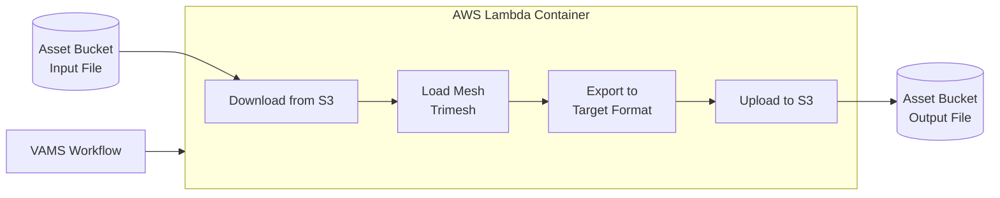

# 3D Basic Conversion Pipeline

The 3D Basic Conversion pipeline converts 3D mesh files between common interchange formats using the Trimesh library. It runs as a containerized AWS Lambda function, making it a lightweight and fast option for format conversion without requiring a VPC or AWS Batch infrastructure. This pipeline is enabled by default in new VAMS deployments.

## Supported Formats

The pipeline reads the following formats. Five of them are also available as a conversion target; XYZ is read only.

| Format | Extension | Direction        | Description                                                              |
| ------ | --------- | ---------------- | ------------------------------------------------------------------------ |
| STL    | `.stl`    | Input and output | Stereolithography -- widely used in 3D printing and CAD                  |
| OBJ    | `.obj`    | Input and output | Wavefront OBJ -- common mesh interchange format                          |
| PLY    | `.ply`    | Input and output | Polygon File Format -- supports vertex colors, normals, and point clouds |
| GLTF   | `.gltf`   | Input and output | GL Transmission Format -- open standard for 3D scenes                    |
| GLB    | `.glb`    | Input and output | Binary GLTF -- single-file variant of GLTF                               |
| XYZ    | `.xyz`    | Input only       | Point cloud text format -- simple ASCII coordinate data                  |

:::note[Conversion Directions]
A mesh in any format marked **Input and output** can be converted to any other format marked **Input and output**. For example, you can convert STL to GLB, OBJ to PLY, or PLY to GLTF. The pipeline uses Trimesh's import/export capabilities to handle the translation.

XYZ is an input-only format. Trimesh reads an XYZ file as a point cloud, and its XYZ exporter cannot write one back, so a run that names `.xyz` as its target is rejected before the input file is downloaded.

STL stores triangle meshes only. A point cloud -- an XYZ file, or a PLY file that has vertices and no faces -- converts to PLY, OBJ, GLB, or GLTF, which keep the points; a run that converts a point cloud to STL fails with a message saying so. An input that contains no geometry at all fails for every target. When a scene holds both meshes and point clouds, GLB and GLTF keep both, and STL, OBJ, and PLY keep the meshes.
:::

OBJ, ASCII STL, XYZ, and GLTF files are text, and the pipeline reads that text as UTF-8, as it does the JSON inside a GLB file. ASCII text is UTF-8, so a file without accented or other non-ASCII characters is unaffected. A file whose text is not UTF-8 -- binary data with one of these extensions, or text saved in another encoding such as Windows-1252 -- fails before any referenced file is downloaded, with a message naming the file and the first byte that is not UTF-8. The pipeline does not guess another encoding, because a wrong guess would change the object, group, and material names in the converted model. Save the file as UTF-8 and run the conversion again. A binary STL file is read whatever its 80-byte header holds.

## Multi-File Models

A GLTF file, and an OBJ file with materials, keep part of the model in other files: GLTF buffers (`.bin`) and texture images, and the OBJ material library (`.mtl`) with the base color textures (`map_Kd`) it names. A GLB or PLY file can also name an external texture. The pipeline reads every file the selected input references and downloads each one from the same asset before it loads the model, so upload the companion files to the asset at the paths the model names. A model that this pipeline wrote as GLTF or as a textured OBJ can be converted again, because its companion files are written beside it.

Each reference is checked before anything is downloaded:

-   It must be a path relative to the file that names it (for example `textures/wood.png` or `../shared/wood.png`) that resolves to a file inside the input's own asset. Absolute paths, URLs, and paths that leave the asset are rejected. Data embedded in the model (a `data:` URI) needs no download.
-   A GLTF or GLB buffer holds the geometry. A rejected buffer reference, or a buffer that is not in the asset, fails the run with a message naming it.
-   A material library or a texture image only adds appearance. One that is rejected, not in the asset, or over a limit is skipped, the run log records a warning naming it, and the model converts without it: an OBJ without its material library converts as geometry only.
-   A model may reference at most 1,000 files totalling 2 GiB, and only an OBJ file's material library is read for further references.
-   Names are read the way the model loader reads them: an OBJ file's material library is everything after `mtllib` on the first line that contains it, and a texture is everything after `map_Kd` on its line, so a name may contain spaces but not texture options such as `-s`.

## Architecture



### Execution Type

This pipeline uses the **Lambda** execution type with synchronous invocation. It does not require an AWS Step Functions task token callback because the Lambda function returns results directly. The pipeline is registered in VAMS as a synchronous pipeline.

:::warning[No Task Token]
This pipeline must be registered as NOT needing a task token callback. If a workflow passes a `TaskToken` to this pipeline, it will reject the request with an error.
:::

### Processing Flow

1. The Lambda function receives the workflow step's request body, which carries the Amazon S3 locations of the workflow input manifest and of the pipeline's input configuration. A request that carries a task token is rejected before anything is logged or read.
2. The function reads the manifest, which names the input file (its bucket, key, asset-relative path, and the bucket's AWS Region) and the run's output files location, and reads the target format (`outputType`) from the input configuration, which the selected pipeline template supplies.
3. The input file is downloaded from the asset bucket to the Lambda container's `/tmp` directory at its path within the asset, followed by the files it references (see [Multi-File Models](#multi-file-models)).
4. Trimesh loads the model, detecting the format from the file extension, and reads referenced files only from those downloads.
5. The model is exported to the target format using Trimesh's export capabilities.
6. The converted file, and any companion files the export writes, are uploaded to the run's output files location using multipart upload for large files. The workflow then writes them back to the output asset in the input's folder, inside a further folder when the export writes several files or keeps the input's format (see [Output Naming](#output-naming)).

## Configuration

Enable this pipeline in `infra/config/config.json`:

```json
{
    "app": {
        "pipelines": {
            "useConversion3dBasic": {
                "enabled": true,
                "autoRegisterWithVAMS": true
            }
        }
    }
}
```

### Configuration Options

| Option                 | Default | Description                                                                                     |
| ---------------------- | ------- | ----------------------------------------------------------------------------------------------- |
| `enabled`              | `true`  | Deploy the 3D basic conversion pipeline. This is the only built-in pipeline enabled by default. |
| `autoRegisterWithVAMS` | `true`  | Automatically register the pipeline and workflow during CDK deployment.                         |

:::tip[Enabled by Default]
Unlike other built-in pipelines, the 3D Basic Conversion pipeline is enabled by default (`enabled: true`) because it is a lightweight Lambda-based pipeline that does not require a VPC or additional compute infrastructure.
:::

## Input Parameters

When executing the pipeline through a workflow, the request body carries the following parameters:

| Parameter                      | Required | Description                                                                                                                                   |
| ------------------------------ | -------- | --------------------------------------------------------------------------------------------------------------------------------------------- |
| `inputManifestS3Location`      | Yes      | Amazon S3 URI of the workflow input manifest, which names the single input file and the run's output files location                           |
| `inputConfigurationS3Location` | Yes      | Amazon S3 URI of the pipeline's input configuration, whose `outputType` is the target file extension including the dot (e.g., `.glb`, `.ply`) |

For a direct invocation without a manifest, the function falls back to the `inputS3AssetFilePath`, `outputS3AssetFilesPath`, and `outputType` body fields.

`outputType` comes from the configuration body of the pipeline template the run uses. Selecting a template is mandatory for this pipeline (`systemConfig.requireTemplate` is `true`); deployment registers one template per target format -- `convert-to-glb`, `convert-to-gltf`, `convert-to-obj`, `convert-to-ply`, and `convert-to-stl`. A run can also override the selected template's body (`systemConfig.allowCustomTemplateOverride` is `true`). An `outputType` the pipeline cannot write fails the execution with `Output format <extension> not supported by Trimesh pipeline`.

### Output Naming

The output file keeps the input's file name with the new extension, in the input's folder. For example, converting `pump.stl` to GLB produces `pump.glb` in the folder that holds `pump.stl`. Two cases add a folder:

-   An export that writes several files -- a GLTF file and its buffers, or an OBJ file and its material library -- goes in a folder named after the input, with the companion files beside the model. Converting `Box.glb` to GLTF produces `Box/Box.gltf`.
-   A conversion to the input's own format goes in an `optimized` folder, so the output never replaces its input. Converting `Box.glb` to GLB produces `optimized/Box.glb`, and converting `Duck.gltf` to GLTF produces `optimized/Duck/Duck.gltf`.

## Prerequisites

### No VPC Required

This pipeline runs as a containerized Lambda function and does not require a VPC. It operates independently of the global VPC setting, although it will be placed in the VPC if `app.useGlobalVpc.useForAllLambdas` is set to `true`.

### Container Image

The Lambda container image is built during CDK deployment from `backendPipelines/conversion/3dBasic/lambdaContainer/Dockerfile`, on the AWS Lambda Python 3.12 base image pinned by digest. It includes:

-   **Python 3.12** -- Lambda runtime
-   **Trimesh** -- 3D mesh loading and export library
-   **Pillow** -- texture image decoding and encoding for Trimesh
-   **boto3** -- AWS SDK for Amazon S3 operations, from the base image

The installed versions are those in the container's `poetry.lock`, from which its `requirements.txt` is exported.

## Infrastructure Components

| Resource                      | Service            | Purpose                   |
| ----------------------------- | ------------------ | ------------------------- |
| Container Lambda Function     | AWS Lambda         | Mesh conversion execution |
| Container Image               | Amazon ECR         | Trimesh container image   |
| Step Functions State Machine  | AWS Step Functions | Workflow orchestration    |
| Lambda Function (vamsExecute) | AWS Lambda         | Pipeline coordination     |

## Limitations

| Constraint        | Details                                                                                                                                                                             |
| ----------------- | ----------------------------------------------------------------------------------------------------------------------------------------------------------------------------------- |
| Maximum file size | Bounded by function memory, not by disk -- see the note below                                                                                                                       |
| Execution timeout | 15 minutes (Lambda maximum)                                                                                                                                                         |
| Geometry only     | Converts mesh geometry; complex materials, animations, or scene hierarchies may not transfer between all formats                                                                    |
| Textures          | The base color texture is carried into OBJ, GLTF, and GLB output; a PLY output keeps texture coordinates without the image. Other texture maps may not transfer, and none are baked |
| Referenced files  | Must be in the input's own asset, at relative paths -- see [Multi-File Models](#multi-file-models)                                                                                  |
| Text encoding     | OBJ, ASCII STL, XYZ, and GLTF text, and the JSON inside a GLB, must be UTF-8 -- see [Supported Formats](#supported-formats)                                                         |

Two AWS Lambda quotas bound the largest model the pipeline can convert:

| Bound             | Value                                                            | What it holds                                                                                                                |
| ----------------- | ---------------------------------------------------------------- | ---------------------------------------------------------------------------------------------------------------------------- |
| Function memory   | `LAMBDA_MEMORY_SIZE` (`infra/config/config.ts`)                  | The whole mesh, loaded by trimesh before it is exported                                                                      |
| Ephemeral storage | `CONVERSION_EPHEMERAL_STORAGE` (`conversion3dBasicFunctions.ts`) | The downloaded input and the files it references, the export, and any companion files the export writes -- all in one `/tmp` |

:::note[Memory is the binding constraint, not disk]
trimesh loads the whole mesh into memory to export it, so the practical ceiling comes from the configured function memory. The ephemeral storage budget only has to be large enough that disk is not the limit reached first -- raising it past the memory bound moves where the failure happens rather than raising the supported file size. An uncompressed export (STL from GLB, for example) is larger than the input it came from, so both copies count against the same budget.
:::

## Related Resources

-   [Pipeline System Overview](overview.md)
-   [CAD/Mesh Metadata Extraction Pipeline](cad-mesh-extraction.md) -- extracts metadata from similar file formats
-   [3D Preview Thumbnail Pipeline](3d-thumbnail.md) -- generates visual previews from converted files
