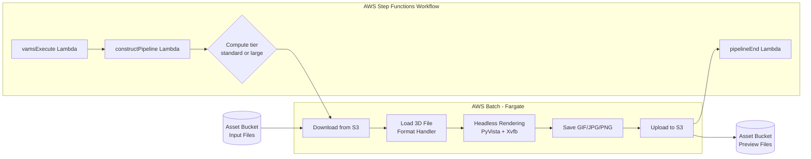

# 3D Preview Thumbnail Pipeline

The 3D Preview Thumbnail pipeline generates animated GIF or static image previews from 3D files, providing visual thumbnails for assets in the VAMS web interface. It supports a wide range of mesh, point cloud, CAD, and USD file formats. The pipeline uses CPU-based headless rendering with PyVista, VTK, and Xvfb inside an AWS Batch Fargate container.

## Supported Formats

### Mesh Formats

| Format      | Extension | Library                                     |
| ----------- | --------- | ------------------------------------------- |
| PLY         | `.ply`    | Trimesh                                     |
| STL         | `.stl`    | Trimesh                                     |
| OBJ         | `.obj`    | Trimesh                                     |
| GLB         | `.glb`    | Trimesh                                     |
| GLTF        | `.gltf`   | Trimesh (with external dependency download) |
| FBX         | `.fbx`    | Trimesh                                     |
| DRC (Draco) | `.drc`    | Trimesh                                     |

### Point Cloud Formats

| Format | Extension | Library        |
| ------ | --------- | -------------- |
| LAS    | `.las`    | laspy          |
| LAZ    | `.laz`    | laspy + laszip |
| E57    | `.e57`    | pye57          |
| PTX    | `.ptx`    | Open3D         |
| PCD    | `.pcd`    | Open3D         |
| FLS    | `.fls`    | Open3D         |
| FWS    | `.fws`    | Open3D         |

### CAD Formats

| Format | Extension       | Library                 |
| ------ | --------------- | ----------------------- |
| STEP   | `.stp`, `.step` | CadQuery / Open CASCADE |

### USD Formats

| Format | Extension | Library       |
| ------ | --------- | ------------- |
| USD    | `.usd`    | OpenUSD (pxr) |
| USDA   | `.usda`   | OpenUSD (pxr) |
| USDC   | `.usdc`   | OpenUSD (pxr) |
| USDZ   | `.usdz`   | OpenUSD (pxr) |

## Architecture



### Processing Steps

1. **Download** -- The container downloads the input file from the asset Amazon S3 bucket. For GLTF files, external dependencies (buffers, textures) are also downloaded.
2. **Load** -- A format-specific handler loads the file into a PyVista PolyData object. The handler is selected based on file extension: mesh, point cloud, CAD, or USD.
3. **Normalize** -- The pipeline detects and normalizes the coordinate up-axis to Y-up for consistent rendering. Z-up formats (LAS, LAZ, E57, STL, etc.) are rotated automatically. Variable formats use a bounding-box heuristic.
4. **Render** -- PyVista generates rotating preview frames using headless off-screen rendering via Xvfb. If animated rendering fails, the pipeline falls back to a single static frame.
5. **Save** -- The requested format is written: `auto` assembles multiple frames into an animated GIF and saves a single frame as a JPEG, while `gif`, `jpg` and `png` write that format whatever the frame count. The pipeline ensures the output stays under a size limit for efficient web display.
6. **Upload** -- The preview file is uploaded to the asset bucket alongside the source file, preserving the relative directory structure.

### Output Files

The pipeline generates preview files with the following naming convention:

```
<original_filename>.previewFile.gif    (animated, multi-frame)
<original_filename>.previewFile.jpg    (static, single-frame fallback)
```

These files are written to `outputS3AssetFilesPath`, which maps to the asset bucket. The relative subdirectory from the input path is preserved so the VAMS process-output step can locate and register the previews correctly.

:::note[Relative Path Preservation]
If the input file is at `<assetId>/subfolder/model.glb`, the preview is written to `<assetId>/subfolder/model.glb.previewFile.gif`. The `assetId` is threaded through the pipeline from the workflow state to ensure correct path computation.
:::

### Example Output

The following are example animated GIF previews generated by the pipeline across different file types:

| GLTF Mesh                                                                      | USD Scene                                                                         | Point Cloud (E57)                                                         | Point Cloud (LAZ)                                                           |
| ------------------------------------------------------------------------------ | --------------------------------------------------------------------------------- | ------------------------------------------------------------------------- | --------------------------------------------------------------------------- |
|  |  |  |  |
| `Avocado.gltf`                                                                 | `gramophone.usdz`                                                                 | `pump.e57`                                                                | `autzen.laz`                                                                |

## Configuration

Enable this pipeline in `infra/config/config.json`:

```json
{
    "app": {
        "pipelines": {
            "usePreview3dThumbnail": {
                "enabled": true,
                "autoRegisterWithVAMS": true,
                "autoRegisterAutoTriggerOnFileUpload": true,
                "computeTiers": {
                    "standard": { "vcpu": 4, "memoryGiB": 16 },
                    "large": { "vcpu": 16, "memoryGiB": 120 }
                },
                "largeTierThresholdGiB": 2
            }
        }
    }
}
```

### Configuration Options

| Option                                | Default | Description                                                                                                         |
| ------------------------------------- | ------- | ------------------------------------------------------------------------------------------------------------------- |
| `enabled`                             | `false` | Deploy the 3D thumbnail pipeline infrastructure. Enables the global VPC.                                            |
| `autoRegisterWithVAMS`                | `false` | Automatically register the pipeline and workflow during CDK deployment.                                             |
| `autoRegisterAutoTriggerOnFileUpload` | `false` | Automatically trigger the pipeline when supported 3D files are uploaded.                                            |
| `computeTiers.standard.vcpu`          | `4`     | AWS Fargate vCPU of the standard tier, which runs inputs below the large-tier threshold.                            |
| `computeTiers.standard.memoryGiB`     | `16`    | Memory (GiB) of the standard tier. Must be a size AWS Fargate supports for the tier's vCPU.                         |
| `computeTiers.large.vcpu`             | `16`    | AWS Fargate vCPU of the large tier, which runs inputs at or above the large-tier threshold.                         |
| `computeTiers.large.memoryGiB`        | `120`   | Memory (GiB) of the large tier. Must be a size AWS Fargate supports for the tier's vCPU.                            |
| `largeTierThresholdGiB`               | `2`     | Input size (GiB) at or above which a run takes the large tier when its `computeTier` parameter is `auto`. Positive. |

:::warning[License Notice]
This pipeline is disabled by default because it depends on libraries with LGPL licenses (CadQuery/Open CASCADE for STEP file support). Review the `requirements.txt` file in the container directory and consult your legal team before enabling this pipeline. Other format handlers use MIT-licensed or Apache-licensed libraries.
:::

## Input Parameters

Parameters reach the pipeline through the template selected for the run. Deployment registers the `preview-3d-thumbnail-default` template, whose configuration body carries the parameters below and declares the three tags that the execute screen prompts for.

| Parameter                       | Template tag                       | Type    | Default | Description                                                                                                                                                                                                |
| ------------------------------- | ---------------------------------- | ------- | ------- | ---------------------------------------------------------------------------------------------------------------------------------------------------------------------------------------------------------- |
| `overwriteExistingPreviewFiles` | `OVERWRITE_EXISTING_PREVIEW_FILES` | boolean | `true`  | When `true`, regenerates preview files even if they already exist for the input file. When `false`, the pipeline skips files that already have a preview.                                                  |
| `outputType`                    | `OUTPUT_TYPE`                      | enum    | `auto`  | The preview file format written for the input file. `auto` writes an animated GIF when the renderer produces several frames and a JPG otherwise; `gif`, `jpg` and `png` write that format for every input. |
| `computeTier`                   | `COMPUTE_TIER`                     | enum    | `auto`  | The compute tier the job runs on. `auto` chooses by input size (see [Compute and limits](#compute-and-limits)); `standard` and `large` run that tier for every input.                                      |

### Template configuration body

```json
{
    "overwriteExistingPreviewFiles": {{OVERWRITE_EXISTING_PREVIEW_FILES}},
    "outputType": "{{OUTPUT_TYPE}}",
    "computeTier": "{{COMPUTE_TIER}}"
}
```

`{{OVERWRITE_EXISTING_PREVIEW_FILES}}`, `{{OUTPUT_TYPE}}` and `{{COMPUTE_TIER}}` are template tags: the execute screen presents the first as a checkbox and the other two as lists of their values, and substitutes all three before the pipeline receives the configuration. The template also allows per-run edits, so a single run can supply a replacement body without changing the registered template. A body without `computeTier` is treated as `auto`.

## Compute and limits

Each run executes on one of two AWS Fargate sizes, both submitted from one AWS Batch job definition. Before the state machine starts, the pipeline's `openPipeline` Lambda reads the input file's size with an Amazon S3 `HeadObject` call and picks the tier; a `Choice` state then routes the job to that tier's Batch state, which overrides the job's vCPU and memory and sets the container environment variable `VAMS_COMPUTE_TIER` to `standard` or `large`.

| Tier       | Runs                                                 | vCPU (default) | Memory (default) | Attempt duration |
| ---------- | ---------------------------------------------------- | -------------- | ---------------- | ---------------- |
| `standard` | inputs below `largeTierThresholdGiB` (default 2 GiB) | 4              | 16 GiB           | 1 hour           |
| `large`    | inputs at or above `largeTierThresholdGiB`           | 16             | 120 GiB          | 3 hours          |

-   **Choosing the tier.** A run's `computeTier` parameter forces a tier; `auto` (the default) leaves the choice to the input size. When the input size cannot be read, the run uses the standard tier and logs a warning.
-   **Sizing.** vCPU and memory are configured per tier (see [Configuration Options](#configuration-options)). Deployment validates each pair against the AWS Fargate Linux task sizes (4 vCPU: 8–30 GiB in 1 GiB steps; 8 vCPU: 16–60 GiB in 4 GiB steps; 16 vCPU: 32–120 GiB in 8 GiB steps), because AWS Batch checks an override only when a job is submitted.
-   **Time bounds.** The attempt durations are fixed. The pipeline's state machine times out after 4 hours and the registered pipeline's task timeout is 14,400 seconds, so neither gives up on a large-tier job that AWS Batch still allows to run.
-   **Ephemeral storage.** Both tiers have 200 GiB, the AWS Fargate maximum; ephemeral storage is a property of the job definition and cannot be overridden per job.
-   **Concurrency.** The Fargate compute environment allows 256 vCPU at a time, so up to 64 standard-tier jobs or 16 large-tier jobs run at once; further jobs wait in the job queue. The account's AWS Fargate vCPU quota in the Region also applies.

:::note[Existing workflows]
A workflow bakes each pipeline's task timeout into its state machine when the workflow is saved. Deployment re-registers the built-in 3D thumbnail workflow with the new 14,400-second timeout; a workflow you created that includes this pipeline keeps the previous one-hour timeout until you save it again, and a large-tier job that runs past one hour fails that workflow's step.
:::

| Constraint                         | Value                       |
| ---------------------------------- | --------------------------- |
| Maximum input file size            | 100 GB                      |
| Container ephemeral storage        | 200 GiB                     |
| Point cloud downsampling threshold | 20 million points           |
| Rendering method                   | CPU-based (no GPU required) |

:::tip[Large Point Clouds]
Point clouds exceeding 20 million points are automatically downsampled for rendering performance. The original file is not modified; only the rendering input is reduced.
:::

## Prerequisites

### VPC

This pipeline runs on AWS Batch with AWS Fargate and requires the global VPC. Set `app.useGlobalVpc.enabled` to `true` when enabling this pipeline — deployment fails with a configuration error otherwise (the VPC is not enabled automatically). With the VPC enabled, the VPC builder creates the necessary VPC endpoints for AWS Batch, Amazon ECR, and Amazon ECR Docker.

### Container Image

The container image is built during CDK deployment from `backendPipelines/preview/3dThumbnail/container/Dockerfile`. It is based on Python 3.12 slim and includes:

-   **PyVista / VTK** -- 3D rendering engine (MIT license)
-   **Trimesh** -- Mesh loading for PLY, STL, OBJ, GLB, GLTF, FBX, DRC (MIT license)
-   **laspy** -- LAS/LAZ point cloud reading (BSD license)
-   **pye57** -- E57 point cloud reading (MIT license)
-   **Open3D** -- Additional point cloud formats: PTX, PCD, FLS, FWS (MIT license)
-   **CadQuery** -- STEP/STP CAD file support (LGPL license)
-   **OpenUSD (pxr)** -- USD format support (Modified Apache 2.0 license)
-   **Xvfb** -- Virtual framebuffer for headless rendering

## How It Works

1. The workflow triggers the `vamsExecute` Lambda function with the input file path, all S3 output paths, and the `assetId`.
2. The `constructPipeline` Lambda function builds a `PREVIEW_3D_THUMBNAIL` stage definition, directing output to `outputS3AssetFilesPath` (the asset bucket).
3. AWS Batch submits an AWS Fargate job. The container starts Xvfb for headless rendering, then runs the preview pipeline.
4. The container downloads the input file, loads it with the appropriate format handler, normalizes the up-axis, renders rotating frames, saves the output in the requested format (GIF, JPEG, or PNG), and uploads it to Amazon S3.
5. AWS Step Functions receives the task token callback, and the process-output step registers the preview file in VAMS.

## Related Resources

-   [Pipeline System Overview](overview.md)
-   [Potree Point Cloud Viewer Pipeline](potree-viewer.md) -- interactive point cloud visualization (complementary to thumbnail previews)
-   [CAD/Mesh Metadata Extraction Pipeline](cad-mesh-extraction.md) -- extracts metadata from similar file formats
