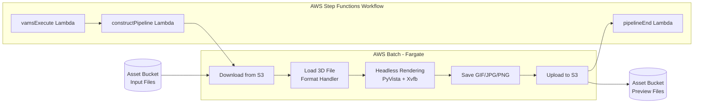

# 3D Preview Thumbnail Pipeline

The 3D Preview Thumbnail pipeline generates animated GIF or static image previews from 3D files, providing visual thumbnails for assets in the VAMS web interface. It supports a wide range of mesh, point cloud, CAD, USD and Gaussian splat file formats. The pipeline uses CPU-based headless rendering with PyVista, VTK, and Xvfb in an AWS Batch job on AWS Fargate.

## Supported Formats

### Mesh Formats

| Format      | Extension | Library                                          |
| ----------- | --------- | ------------------------------------------------ |
| PLY         | `.ply`    | Trimesh                                          |
| STL         | `.stl`    | Trimesh                                          |
| OBJ         | `.obj`    | Trimesh                                          |
| GLB         | `.glb`    | Trimesh                                          |
| GLTF        | `.gltf`   | Trimesh (with its referenced buffers and images) |
| FBX         | `.fbx`    | Open3D (Assimp)                                  |
| DRC (Draco) | `.drc`    | DracoPy (with vertex colours)                    |
| OFF         | `.off`    | Trimesh                                          |
| 3MF         | `.3mf`    | built-in (hardened XML parsing)                  |
| COLLADA     | `.dae`    | built-in (hardened XML parsing)                  |

3MF and COLLADA files are parsed with DTDs and external entities disabled, so a crafted file cannot read local files or reach the network. The up axis comes from the file where it says (FBX `UpAxis`, COLLADA `<up_axis>`, 3MF and survey formats Z-up, glTF Y-up); other meshes, STL included, render as authored. FBX quad and polygon faces are triangulated, each part is placed by its node transforms, and parts keep their vertex colours or material base colour; textures are not sampled.

### Point Cloud Formats

| Format              | Extension | Library        |
| ------------------- | --------- | -------------- |
| LAS                 | `.las`    | laspy          |
| LAZ                 | `.laz`    | laspy + laszip |
| E57                 | `.e57`    | pye57          |
| PTX                 | `.ptx`    | built-in       |
| PTS                 | `.pts`    | built-in       |
| PCD                 | `.pcd`    | Open3D         |
| PLY (vertices only) | `.ply`    | built-in       |

FARO scans (`.fls`, `.fws`) are not supported: reading them needs the proprietary FARO SDK. Convert them to E57 or LAS first.

### CAD Formats

| Format | Extension       | Library                 |
| ------ | --------------- | ----------------------- |
| STEP   | `.stp`, `.step` | CadQuery / Open CASCADE |

STEP files are read with their assembly placements and their part, component and face colours. Tessellation detail is relative to the model's size, so a part renders with the same detail in millimetres or metres, and free surfaces beside solids are kept.

### Gaussian Splat Formats

| Format             | Extension         | Library                          |
| ------------------ | ----------------- | -------------------------------- |
| 3DGS PLY           | `.ply`            | built-in (routed by PLY header)  |
| Compressed PLY     | `.compressed.ply` | PlayCanvas splat-transform (CPU) |
| SPZ                | `.spz`            | PlayCanvas splat-transform (CPU) |
| SOG                | `.sog`            | PlayCanvas splat-transform (CPU) |
| antimatter15 splat | `.splat`          | built-in                         |
| KSPLAT             | `.ksplat`         | PlayCanvas splat-transform (CPU) |
| XGRIDS LCC         | `.lcc`            | PlayCanvas splat-transform (CPU) |
| XGRIDS LCC2        | `.lcc2`           | PlayCanvas splat-transform (CPU) |

Splats render on the CPU as flat discs in their base (degree-0) spherical-harmonic colour, each with the coverage of its Gaussian, so a faint or elongated splat does not draw as a large opaque blob. Faint splats are dropped and the rest are sampled by opacity to the splat budget. A captured scene usually surrounds its subject with background (room walls, sky, distant trees), so the preview shows the scene's core: the region where the capture holds its detail, found from where small, opaque splats concentrate. The background around it, and oversized fog splats inside it, are left out, and a tilted ground plane is levelled. A compact subject, such as a scanned object or a single room, is drawn whole. A `.ply` with faces still renders as a mesh and a vertex-only `.ply` as a point cloud.

An XGRIDS `.lcc` or `.lcc2` scene holds several levels of detail; the preview reads the finest level whose splat count is at most twice the splat budget. An `.lcc` scene needs its `data.bin` and `index.bin` (and `shcoef.bin` and `environment.bin` when the scene has them) in the same folder. An `.lcc2` scene needs the chunk files its description names, usually in a `data/3dgs/` folder beside it; only the chosen level's chunk files are downloaded. The file-upload trigger skips files in a `data/3dgs/` folder, so uploading an `.lcc2` scene starts one run for the scene rather than one for each chunk file.

### USD Formats

| Format | Extension | Library       |
| ------ | --------- | ------------- |
| USD    | `.usd`    | OpenUSD (pxr) |
| USDA   | `.usda`   | OpenUSD (pxr) |
| USDC   | `.usdc`   | OpenUSD (pxr) |
| USDZ   | `.usdz`   | OpenUSD (pxr) |

A USD stage is rendered as composed: instanced prims and point instancers are drawn at every instance, invisible prims and `guide` or `proxy` purpose prims are skipped, and implicit shapes (cube, sphere, cylinder, cone, capsule) are drawn. Colour comes from the diffuse texture or constant `diffuseColor` of the bound `UsdPreviewSurface`, else `displayColor`; an uncoloured prim is drawn in neutral grey. MaterialX materials are not read.

## Architecture



### Processing Steps

1. **Download** -- The container downloads the input file from the asset Amazon S3 bucket, then the files it references from the same asset: a glTF file's buffers and images, a USD layer's sublayers, references, payloads and asset-valued attributes such as texture paths (followed through each fetched layer), an OBJ file's material libraries and the texture maps they name, an FBX file's texture files, an `.lcc` scene's data files, and the chunk files of the level of detail an `.lcc2` scene is read at. A reference is fetched only when it is a relative path that stays inside the input's own asset; absolute paths, `..` segments that leave the asset, and URIs (`s3://`, `http(s)://`, `file:`) are skipped. At most 2,000 referenced files and 50 GiB are fetched, each checked against free disk space first. A skipped or missing reference is logged and does not fail the run.
2. **Load** -- A format-specific handler (mesh, point cloud, CAD, USD, Gaussian splat, or the built-in 3MF and COLLADA reader) loads the file into a PyVista PolyData object. The handler is chosen by extension, except that a `.ply` is routed by its header: splat properties to the splat handler, faces to the mesh handler, and vertices only to the point cloud handler.
3. **Normalize** -- The pipeline turns the model Y-up from what the file or its format declares. LAS, LAZ, E57, PTX, PTS and PCD are Z-up and are rotated; FBX `UpAxis`, COLLADA `<up_axis>`, the USD stage up axis and the 3MF specification are applied; glTF is Y-up. Gaussian splat scenes are turned from the 3D Gaussian Splatting (COLMAP) Y-down convention. Other formats, STL included, render as authored.
4. **Render** -- PyVista renders with headless off-screen rendering via Xvfb: a 36-frame orbit for an animated or `auto` output, or one front three-quarter view for a `jpg` or `png` output. A mesh is framed on its full bounds and a point cloud on its 2nd-98th percentile bounds, which ignores stray points. If the orbit fails, the pipeline falls back to the single still view.
5. **Save** -- The requested format is written: `auto` assembles multiple frames into an animated GIF and saves a single frame as a JPEG, while `gif`, `jpg` and `png` write that format whatever the frame count. A preview is kept under 5 MiB: a GIF over the limit is re-encoded with 18, 12 and then 8 frames, then at lower resolution, and finally written as a single PNG or JPEG still, so a run that asks for `gif` can write a `.previewFile.png` or `.previewFile.jpg`.
6. **Upload** -- The preview file is uploaded to the asset bucket alongside the source file, preserving the relative directory structure. When a file holds previews in several formats (for example a `.gif` from an earlier run and a `.png` from a later one), the file listing shows the most recently written one.

### Output Files

The pipeline generates preview files with the following naming convention:

```
<original_filename>.previewFile.gif    (animated, multi-frame)
<original_filename>.previewFile.png    (still)
<original_filename>.previewFile.jpg    (still)
```

GIF and PNG previews have a transparent background; a JPEG preview is composited onto white. A still shows the front three-quarter view, 45 degrees around the orbit and 25 degrees above it.

These files are written to `outputS3AssetFilesPath`, which maps to the asset bucket. The relative subdirectory from the input path is preserved so the VAMS process-output step can locate and register the previews correctly.

:::note[Relative Path Preservation]
If the input file is at `<assetId>/subfolder/model.glb`, the preview is written to `<assetId>/subfolder/model.glb.previewFile.gif`. The `assetId` is threaded through the pipeline from the workflow state to ensure correct path computation.
:::

### Example Output

The following are example animated GIF previews generated by the pipeline across different file types:

| GLTF Mesh                                                                      | USD Scene                                                                         | Point Cloud (E57)                                                         | Point Cloud (LAZ)                                                           |
| ------------------------------------------------------------------------------ | --------------------------------------------------------------------------------- | ------------------------------------------------------------------------- | --------------------------------------------------------------------------- |
|  |  |  |  |
| `Avocado.gltf`                                                                 | `gramophone.usdz`                                                                 | `pump.e57`                                                                | `autzen.laz`                                                                |

## Configuration

Enable this pipeline in `infra/config/config.json`:

```json
{
    "app": {
        "pipelines": {
            "usePreview3dThumbnail": {
                "enabled": true,
                "autoRegisterWithVAMS": true,
                "autoRegisterAutoTriggerOnFileUpload": true
            }
        }
    }
}
```

### Configuration Options

| Option                                | Default | Description                                                              |
| ------------------------------------- | ------- | ------------------------------------------------------------------------ |
| `enabled`                             | `false` | Deploy the 3D thumbnail pipeline infrastructure. Enables the global VPC. |
| `autoRegisterWithVAMS`                | `false` | Automatically register the pipeline and workflow during CDK deployment.  |
| `autoRegisterAutoTriggerOnFileUpload` | `false` | Automatically trigger the pipeline when supported 3D files are uploaded. |

:::warning[License Notice]
This pipeline is disabled by default because it depends on libraries with LGPL licenses (CadQuery/Open CASCADE for STEP file support). Review `requirements.lock` (every Python package, pinned) and `splat-transform/package-lock.json` (the Node.js packages) in the container directory and consult your legal team before enabling this pipeline. Other format handlers use MIT-licensed or Apache-licensed libraries.
:::

## Input Parameters

Parameters reach the pipeline through the template selected for the run. Deployment registers the `preview-3d-thumbnail-default` template, whose configuration body carries the parameters below and declares the two tags that the execute screen prompts for.

| Parameter                       | Template tag                       | Type    | Default | Description                                                                                                                                                                                                |
| ------------------------------- | ---------------------------------- | ------- | ------- | ---------------------------------------------------------------------------------------------------------------------------------------------------------------------------------------------------------- |
| `overwriteExistingPreviewFiles` | `OVERWRITE_EXISTING_PREVIEW_FILES` | boolean | `true`  | When `true`, regenerates preview files even if they already exist for the input file. When `false`, the pipeline skips files that already have a preview.                                                  |
| `outputType`                    | `OUTPUT_TYPE`                      | enum    | `auto`  | The preview file format written for the input file. `auto` writes an animated GIF when the renderer produces several frames and a JPG otherwise; `gif`, `jpg` and `png` write that format for every input. |

### Template configuration body

```json
{
    "overwriteExistingPreviewFiles": {{OVERWRITE_EXISTING_PREVIEW_FILES}},
    "outputType": "{{OUTPUT_TYPE}}"
}
```

`{{OVERWRITE_EXISTING_PREVIEW_FILES}}` and `{{OUTPUT_TYPE}}` are template tags: the execute screen presents the first as a checkbox and the second as a list of the supported formats, and substitutes both values before the pipeline receives the configuration. The template also allows per-run edits, so a single run can supply a replacement body without changing the registered template.

## Limits and Constraints

| Constraint                  | Value                                                                      |
| --------------------------- | -------------------------------------------------------------------------- |
| Maximum input file size     | The free space of the work volume, less 1 GiB kept for the output          |
| Container ephemeral storage | 200 GiB                                                                    |
| Point budget                | 5 million per vCPU, at most 20 million (and 35% of the memory limit)       |
| Triangle budget             | 5 million per vCPU, at most 30 million (and 35% of the memory limit)       |
| Splat budget                | 1 million per vCPU, at most 5 million (and 35% of the memory limit)        |
| Task size                   | 16 vCPU and 64 GiB of memory on AWS Fargate                                |
| Run time                    | 1 hour per job (AWS Batch attempt duration and AWS Step Functions timeout) |
| Gaussian splat conversion   | 30 minutes                                                                 |
| Preview file size           | 5 MiB                                                                      |
| Rendering method            | CPU-based (Mesa llvmpipe, one rasteriser thread per vCPU; no GPU)          |

The container reads its memory limit and vCPU count from its cgroup and derives the budgets from them, so it stays within whichever task size runs it. At the shipped task size the budgets are 20 million points, 30 million triangles and 5 million splats. Each budget has a floor (1 million points, 1 million triangles, 250,000 splats) that applies on a task too small to reach it.

-   **Point clouds** -- A point cloud above the point budget is sampled while it is read (E57 scan by scan, PTX and PTS streamed from Amazon S3 with no local copy).
-   **Meshes** -- A mesh above the triangle budget is decimated with VTK quadric clustering.
-   **Repeated placements** -- A 3MF, COLLADA or STEP file that places the same part many times is expanded until its placed geometry reaches the triangle budget, and the remaining placements are skipped. A STEP assembly that places more than 1,000,000 components fails.
-   **FBX** -- An FBX scene is counted before it is read, since its reader expands every placement at once. One that places more than 1,000,000 models, or whose repeated parts add up to more triangles than the triangle budget beyond the file's own geometry, fails. An FBX file whose scopes or node records nest deeper than 256 levels, more than any model an exporter produces, is refused before it is read.
-   **Disk** -- An input larger than the free disk fails before the download with a message naming both sizes.
-   **Log** -- The execution log records the input size, the budgets and each phase's duration (download, fetch, load, render, encode, upload).

The full list of fixed limits is in [Quotas](../additional/quotas.md).

:::tip[Large Point Clouds]
The original file is never modified; only the rendering input is reduced. Every scan of a multi-scan E57 or PTX file is read and placed by its pose or transform.
:::

## Prerequisites

### VPC

This pipeline runs on AWS Batch with AWS Fargate and requires the global VPC. Set `app.useGlobalVpc.enabled` to `true` when enabling this pipeline — deployment fails with a configuration error otherwise (the VPC is not enabled automatically). With the VPC enabled, the VPC builder creates the necessary VPC endpoints for AWS Batch, Amazon ECR, and Amazon ECR Docker.

### Container Image

The container image is built during CDK deployment from `backendPipelines/preview/3dThumbnail/container/Dockerfile`. It is based on Python 3.12 slim and includes:

-   **PyVista / VTK** -- 3D rendering engine (MIT license)
-   **Trimesh** -- Mesh loading for PLY, STL, OBJ, GLB, GLTF, OFF (MIT license)
-   **DracoPy** -- Draco (`.drc`) decoding (Apache-2.0 license)
-   **laspy** -- LAS/LAZ point cloud reading (BSD license)
-   **pye57** -- E57 point cloud reading (MIT license)
-   **Open3D** -- PCD point clouds and FBX meshes (MIT license)
-   **CadQuery** -- STEP/STP CAD file support (LGPL license)
-   **OpenUSD (pxr)** -- USD format support (Modified Apache 2.0 license)
-   **PlayCanvas splat-transform** -- Gaussian splat format conversion on the CPU (MIT license), run on **Node.js** 22 (MIT license)
-   **Xvfb** -- Virtual framebuffer for headless rendering

## How It Works

1. The workflow triggers the `vamsExecute` Lambda function with the input file path, all S3 output paths, and the `assetId`.
2. The `constructPipeline` Lambda function builds a `PREVIEW_3D_THUMBNAIL` stage definition, directing output to `outputS3AssetFilesPath` (the asset bucket).
3. AWS Batch submits an AWS Fargate job. The container starts Xvfb for headless rendering, then runs the preview pipeline.
4. The container downloads the input file, loads it with the appropriate format handler, normalizes the up-axis, renders rotating frames, saves the output in the requested format (GIF, JPEG, or PNG), and uploads it to Amazon S3.
5. AWS Step Functions receives the task token callback, and the process-output step registers the preview file in VAMS.

## Related Resources

-   [Pipeline System Overview](overview.md)
-   [Potree Point Cloud Viewer Pipeline](potree-viewer.md) -- interactive point cloud visualization (complementary to thumbnail previews)
-   [CAD/Mesh Metadata Extraction Pipeline](cad-mesh-extraction.md) -- extracts metadata from similar file formats
