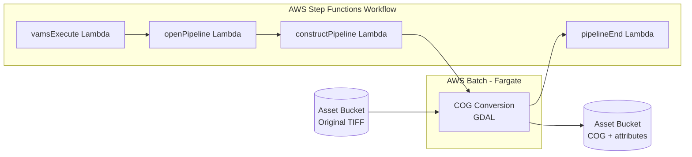

# COG Conversion Pipeline

The COG Conversion pipeline converts a georeferenced TIFF into a Cloud Optimized GeoTIFF (COG) in EPSG:3857 (Web Mercator) and stores it beside the original in the same asset. The Search map viewer draws a raster only when it is a COG in EPSG:3857, so this pipeline is how an ordinary GeoTIFF becomes drawable. The pipeline runs as an AWS Batch Fargate container with GDAL and never changes the original file.

:::warning[The output is resampled]
A COG in EPSG:3857 is written with GDAL's `GoogleMapsCompatible` tiling scheme. The source's pixels are reprojected into Web Mercator and resampled, so the output is not a pixel copy of the input: a geographic or UTM source changes pixel size and grid, and the pixel values of a continuous raster are interpolated. Keep the original for measurement work; use the COG for display. The output coordinate system and tiling scheme are one setting in the container (`OUTPUT_CRS` and `TILING_SCHEME` in `convert.py`) so they can change without touching the rest of the pipeline.
:::

## What It Does

| Input                                                     | Result                                                                                                                                                                                                                           |
| :-------------------------------------------------------- | :------------------------------------------------------------------------------------------------------------------------------------------------------------------------------------------------------------------------------- |
| Georeferenced TIFF that is not a COG                      | `<file name>.cog.tif` is written beside it                                                                                                                                                                                       |
| COG in a CRS other than EPSG:3857 (for example EPSG:4326) | Converted to a COG in EPSG:3857, same output name                                                                                                                                                                                |
| COG already in EPSG:3857                                  | No output. The run succeeds and writes a note, `cog-convert-skipped.json`, to the run's results                                                                                                                                  |
| TIFF with no georeference                                 | No output, same note                                                                                                                                                                                                             |
| A file named `*.cog.tif`                                  | The upload trigger excludes the name, so a result is never converted again on upload. The pipeline itself excludes nothing: a manual run converts a `*.cog.tif` in another CRS, and one already in EPSG:3857 is skipped as above |

## Output Name and Location

The suffix `.cog.tif` is appended to the whole input file name: `maps/north/a.tif` becomes `maps/north/a.tif.cog.tif`, and `a.tiff` becomes `a.tiff.cog.tif`. `a.tif` and `a.tiff` in one folder cannot collide, and the source name is the COG name without the suffix. The output stays in the same asset and the same folder, and the default template sets no output path extension so the file is not moved into a subfolder.

Running the pipeline again on a new version of the original writes a new version of the same COG file.

## Link Attributes

The pipeline writes file attributes in the same run so the viewer and other tools can tell which file belongs to which.

| File         | Attribute                 | Value                                                        |
| :----------- | :------------------------ | :----------------------------------------------------------- |
| The COG      | `cog_link_cogOf`          | Asset-relative path of the original (`/maps/north/a.tif`)    |
| The COG      | `cog_link_cogOfVersionId` | Version of the original that was converted                   |
| The COG      | `cog_link_cogCompression` | `deflate`                                                    |
| The COG      | `cog_link_cogToolVersion` | `gdal <version>`                                             |
| The COG      | `cog_link_sourceCrs`      | CRS of the original (`EPSG:32633`)                           |
| The COG      | `cog_link_outputCrs`      | CRS of the COG (`EPSG:3857`)                                 |
| The original | `cog_link_cogFile`        | Asset-relative path of its COG (`/maps/north/a.tif.cog.tif`) |

A COG is stale when its `cog_link_cogOfVersionId` differs from the latest version of the original.

## Architecture



### Processing Flow

1. `vamsExecute` receives the workflow event, resolves the input, output, metadata and results locations from the manifest, and invokes `openPipeline`.
2. `openPipeline` checks the file extension (`.tif` or `.tiff`) and starts the pipeline's state machine.
3. `constructPipeline` reads the template configuration, checks it against the allowed settings and builds the definition for the container.
4. AWS Batch runs the container on AWS Fargate (8 vCPU, 32 GiB, 200 GiB of ephemeral storage, a limit of 3 hours 30 minutes that includes the time the job waits in the job queue). The container checks free disk, downloads the one input file at the version the run was launched on, and reads the TIFF header without decoding it.
5. A COG in EPSG:3857, or a file with no georeference, ends the run cleanly with a note. Otherwise the container checks the size limits, runs `gdal_translate -of COG`, reads the result back and checks that it is a COG in EPSG:3857, then uploads it and the link attributes.
6. The container reports success or failure on the task token. Every failure route reports, including an unexpected error in the container's entry point. `pipelineEnd` finishes the workflow execution.

If the COG was uploaded but its link attributes could not be written, the run is recorded as failed through the results channel (`execution.status.json`) instead of discarding the COG: the file is still ingested and the execution shows `CogLinkAttributesNotWritten`.

## Limits and Sizing

| Limit              | Value                                                                                                                                                                                                                                                                                                                                                                                                                                            |
| :----------------- | :----------------------------------------------------------------------------------------------------------------------------------------------------------------------------------------------------------------------------------------------------------------------------------------------------------------------------------------------------------------------------------------------------------------------------------------------- |
| Input file size    | 100 GiB, refused before the download                                                                                                                                                                                                                                                                                                                                                                                                             |
| Uncompressed size  | 256 GiB (width x height x bands x bytes per sample)                                                                                                                                                                                                                                                                                                                                                                                              |
| Bands              | 16                                                                                                                                                                                                                                                                                                                                                                                                                                               |
| Run time           | 3 hours 30 minutes for the conversion job, counting the time it waits in the AWS Batch job queue as well as its run; the pipeline's state machine times out after 3 hours 45 minutes. A job still waiting or running at the bound fails the run with a timeout cause and is ended, so a job that waited past it never runs; run the pipeline again later.                                                                                        |
| Disk               | The task volume is 200 GiB, the Fargate maximum. The file must fit with one GiB to spare; then the container estimates the output from the pixel grid GDAL will write (a warped view of the input, rounded up for the zoom level it picks) times the bands plus an alpha band, uncompressed, and needs twice that for the temporary and the final file. A run that does not fit is refused with the sizes in the message, before any conversion. |
| Threads and memory | GDAL uses every CPU the task has and half of the task memory for its block cache. The task memory is passed to the container as `VAMS_TASK_MEMORY_MIB`.                                                                                                                                                                                                                                                                                          |

The output is not sized from the input file: a compressed JPEG-in-TIFF of 152 MB (16,716 x 16,716 RGB) became a 1.44 GB RGBA DEFLATE COG, and the disk estimate allows for that. In practice the two limits that decide are the volume and the pixel grid, so the 100 GiB input limit is a ceiling that only a heavily compressed file can reach; a file whose estimated output needs more than the volume holds fails with a message to split or downsample it.

## Nodata and Transparency

A source with a nodata value and no alpha band is converted through a mask band: the nodata pixels become transparent (an alpha band is added) and the data bands carry no nodata value, so a valid pixel is never rewritten. A source that already has an alpha band, or a palette, is converted as it is. A one-band source gets an alpha band in the output.

## Antimeridian

A raster whose extent straddles longitude 180 (for example 178.75 E to 178.95 W) is refused. Reprojected into Web Mercator it would become a world-wide grid holding a few valid pixels. A whole-world raster (a 0 to 360 degree global grid) is accepted. The run ends as failed and its error shows this text: "This raster crosses the antimeridian (longitude 180), which COG conversion does not support: in Web Mercator it would become a world-wide grid of almost empty pixels. Split the file at longitude 180 into a western and an eastern part (for example with gdal_translate -projwin on each side), upload the parts, and convert each one."

## Failed and Refused Runs

A refused file (over a limit, no room, crossing the antimeridian) or a failed conversion ends the VAMS execution as failed, with the reason as the error text. The failure name is short (`CogConvertRefused` for a refusal, `CogConvertFailed` otherwise) and the text travels as the failure cause, because AWS Step Functions rejects a failure whose name is over 256 characters and the run would otherwise stay in progress. A rejected failure call is logged and retried once with a minimal message, never dropped.

## Execution Logs

The execution's log view reads these sources for a run:

-   The pipeline's state machine log group. It records errors only, without execution input or output, because the input carries the workflow's task token. The run's states and their input and output are in the AWS Step Functions execution history.
-   The log groups of the three AWS Lambda functions the state machine runs: `constructPipeline` (`ConstructPipelineTask`), `executeBatchJob` (`CogConvertBatchJob`) and `pipelineEnd` (`PipelineEndTask`). Every run shares these groups, so the view shows only the lines that carry the run's workflow and pipeline execution ids, and each function puts both ids on every line it logs.
-   The conversion container's log (`CogConvertBatchJob`), registered when the AWS Batch job is submitted.

## Configuration

Enable this pipeline in `infra/config/config.json`:

```json
{
    "app": {
        "useGlobalVpc": { "enabled": true },
        "pipelines": {
            "useCogConversion": {
                "enabled": true,
                "useCodeBuild": false,
                "autoRegisterWithVAMS": true,
                "autoRegisterAutoTriggerOnFileUpload": false
            }
        }
    }
}
```

| Option                                | Default | Description                                                                                                                                     |
| :------------------------------------ | :------ | :---------------------------------------------------------------------------------------------------------------------------------------------- |
| `enabled`                             | `false` | Deploy the COG conversion pipeline. Requires `app.useGlobalVpc.enabled`; `getConfig()` fails with a message naming the key when the VPC is off. |
| `useCodeBuild`                        | `false` | Build the container image with AWS CodeBuild instead of local Docker. Supported in the commercial and AWS GovCloud (US) partitions.             |
| `autoRegisterWithVAMS`                | `true`  | Register the pipeline, workflow and template in the global VAMS database during deployment.                                                     |
| `autoRegisterAutoTriggerOnFileUpload` | `false` | Run the pipeline when a `.tif` or `.tiff` is uploaded. The trigger ships disabled; turn it on only when you want every upload converted.        |

The pipeline's compute runs in the isolated subnets and reaches Amazon S3 through the VPC endpoints, with no NAT gateway. It adds roughly ten IAM roles to the stack (thirteen with `useCodeBuild`).

## Template Settings

The default template, `cog-convert-deflate`, carries `{"compression": "DEFLATE"}`. DEFLATE is the only accepted value today; any other value fails the run with a message. Asset metadata is not read by this pipeline.

## Container Security

The image has two stages, each pinned by digest. The build stage (`condaforge/miniforge3`) installs the GDAL packages from `conda-explicit.txt`, which lists every package by URL and SHA-256 and is installed without a solver, and the Python packages from the hashed `requirements.txt` exported from the container's `uv.lock`, installed with `--require-hashes`. The runtime stage is a Debian slim image that receives only the finished `/opt/cog` environment, so conda, its own Python and its tools never run on an uploaded file. The package manager is removed from the environment and the container runs as a non-root user.

The job role is read-only on the asset buckets (the input at its launch version) and can write only under the `output/` folders of the run area of each registered bucket (`pipelines/*/*/output/*`), where the workflow collects a run's output. It cannot overwrite an original, write a template or a run input, delete anything, or reach the auxiliary bucket, and it carries no managed policies. The write path cannot be narrowed to one run: the first two path segments are the names of the first pipeline and job of the workflow, and the execution id is created per run, so none of them is known when the role is created.

When the container receives SIGTERM, which AWS Batch sends when a job is terminated, it stops GDAL, reports the failure on the task token and exits within a few seconds, so the workflow does not wait out its four-hour limit.

GDAL is run with an argument list, never a shell, and only on two local paths the container creates. Its environment is a fixed allow-list that carries no AWS credentials or task token, sidecar discovery and the PROJ network are off, and the pipeline's compute has no route to the internet.

## Partitions

The pipeline deploys in AWS GovCloud (US) and the EU Sovereign Cloud: the base image and conda packages are needed at build time only, and the Batch and Amazon ECR pieces are partition-aware. The Search map raster viewer is not offered in those partitions.

## Related

-   [Coordinate Transform](coordinate-transform.md) reprojects point clouds and shares this pipeline's Batch Fargate layout.
-   [Pipelines overview](overview.md)
