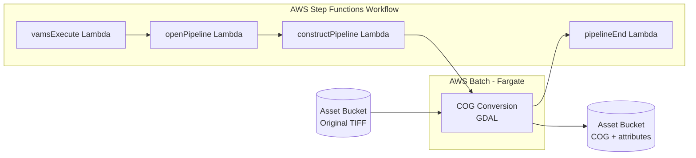

# COG Conversion Pipeline

The COG Conversion pipeline converts a georeferenced TIFF into a Cloud Optimized GeoTIFF (COG) in EPSG:3857 (Web Mercator) and stores it beside the original in the same asset. The Search map viewer draws a raster only when it is a COG in EPSG:3857, so this pipeline is how an ordinary GeoTIFF becomes drawable. The pipeline runs as an AWS Batch Fargate container with GDAL and never changes the original file.

:::warning[The output is resampled]
A COG in EPSG:3857 is written with GDAL's `GoogleMapsCompatible` tiling scheme. The source's pixels are reprojected into Web Mercator and resampled, so the output is not a pixel copy of the input: a geographic or UTM source changes pixel size and grid, and the pixel values of a continuous raster are interpolated. Keep the original for measurement work; use the COG for display. The output coordinate system and tiling scheme are one setting in the container (`OUTPUT_CRS` and `TILING_SCHEME` in `convert.py`) so they can change without touching the rest of the pipeline.
:::

## What It Does

| Input                                                     | Result                                                                                                     |
| :-------------------------------------------------------- | :--------------------------------------------------------------------------------------------------------- |
| Georeferenced TIFF that is not a COG                      | `<file name>.cog.tif` is written beside it                                                                 |
| COG in a CRS other than EPSG:3857 (for example EPSG:4326) | Converted to a COG in EPSG:3857, same output name                                                          |
| COG already in EPSG:3857                                  | No output. The run succeeds and writes a note, `cog-convert-skipped.json`, to the run's results            |
| TIFF with no georeference                                 | No output, same note                                                                                       |
| A file named `*.cog.tif`                                  | Never an input: the pipeline and its upload trigger exclude the name, so a result is never converted again |

## Output Name and Location

The suffix `.cog.tif` is appended to the whole input file name: `maps/north/a.tif` becomes `maps/north/a.tif.cog.tif`, and `a.tiff` becomes `a.tiff.cog.tif`. `a.tif` and `a.tiff` in one folder cannot collide, and the source name is the COG name without the suffix. The output stays in the same asset and the same folder, and the default template sets no output path extension so the file is not moved into a subfolder.

Running the pipeline again on a new version of the original writes a new version of the same COG file.

## Link Attributes

The pipeline writes file attributes in the same run so the viewer and other tools can tell which file belongs to which.

| File         | Attribute                 | Value                                                        |
| :----------- | :------------------------ | :----------------------------------------------------------- |
| The COG      | `cog_link_cogOf`          | Asset-relative path of the original (`/maps/north/a.tif`)    |
| The COG      | `cog_link_cogOfVersionId` | Version of the original that was converted                   |
| The COG      | `cog_link_cogCompression` | `deflate`                                                    |
| The COG      | `cog_link_cogToolVersion` | `gdal <version>`                                             |
| The COG      | `cog_link_sourceCrs`      | CRS of the original (`EPSG:32633`)                           |
| The COG      | `cog_link_outputCrs`      | CRS of the COG (`EPSG:3857`)                                 |
| The original | `cog_link_cogFile`        | Asset-relative path of its COG (`/maps/north/a.tif.cog.tif`) |

A COG is stale when its `cog_link_cogOfVersionId` differs from the latest version of the original.

## Architecture



### Processing Flow

1. `vamsExecute` receives the workflow event, resolves the input, output, metadata and results locations from the manifest, and invokes `openPipeline`.
2. `openPipeline` checks the file extension (`.tif` or `.tiff`) and starts the pipeline's state machine.
3. `constructPipeline` reads the template configuration, checks it against the allowed settings and builds the definition for the container.
4. AWS Batch runs the container on AWS Fargate (8 vCPU, 32 GiB, 200 GiB of ephemeral storage, a four-hour limit). The container checks free disk, downloads the one input file at the version the run was launched on, and reads the TIFF header without decoding it.
5. A COG in EPSG:3857, or a file with no georeference, ends the run cleanly with a note. Otherwise the container checks the size limits, runs `gdal_translate -of COG`, reads the result back and checks that it is a COG in EPSG:3857, then uploads it and the link attributes.
6. The container reports success or failure on the task token. Every failure route reports, including an unexpected error in the container's entry point. `pipelineEnd` finishes the workflow execution.

If the COG was uploaded but its link attributes could not be written, the run is recorded as failed through the results channel (`execution.status.json`) instead of discarding the COG: the file is still ingested and the execution shows `CogLinkAttributesNotWritten`.

## Limits and Sizing

| Limit              | Value                                                                                                                                                                                                                                                                                            |
| :----------------- | :----------------------------------------------------------------------------------------------------------------------------------------------------------------------------------------------------------------------------------------------------------------------------------------------- |
| Input file size    | 100 GiB                                                                                                                                                                                                                                                                                          |
| Uncompressed size  | 256 GiB (width x height x bands x bytes per sample)                                                                                                                                                                                                                                              |
| Bands              | 16                                                                                                                                                                                                                                                                                               |
| Free disk          | The container needs 3.5 times the input size free beside it: GDAL writes a temporary file of about the output size before the final one, and reprojecting into Web Mercator can enlarge the pixel grid. A run that does not fit is refused before the download with both figures in the message. |
| Threads and memory | GDAL uses every CPU the task has and half of the task memory for its block cache. The task memory is passed to the container as `VAMS_TASK_MEMORY_MIB`.                                                                                                                                          |

The 3.5x headroom is an estimate that will be tightened against measured runs. A file over a limit fails the run with the limit named.

## Configuration

Enable this pipeline in `infra/config/config.json`:

```json
{
    "app": {
        "useGlobalVpc": { "enabled": true },
        "pipelines": {
            "useCogConversion": {
                "enabled": true,
                "useCodeBuild": false,
                "autoRegisterWithVAMS": true,
                "autoRegisterAutoTriggerOnFileUpload": false
            }
        }
    }
}
```

| Option                                | Default | Description                                                                                                                                     |
| :------------------------------------ | :------ | :---------------------------------------------------------------------------------------------------------------------------------------------- |
| `enabled`                             | `false` | Deploy the COG conversion pipeline. Requires `app.useGlobalVpc.enabled`; `getConfig()` fails with a message naming the key when the VPC is off. |
| `useCodeBuild`                        | `false` | Build the container image with AWS CodeBuild instead of local Docker.                                                                           |
| `autoRegisterWithVAMS`                | `true`  | Register the pipeline, workflow and template in the global VAMS database during deployment.                                                     |
| `autoRegisterAutoTriggerOnFileUpload` | `false` | Run the pipeline when a `.tif` or `.tiff` is uploaded. The trigger ships disabled; turn it on only when you want every upload converted.        |

The pipeline's compute runs in the isolated subnets and reaches Amazon S3 through the VPC endpoints, with no NAT gateway. It adds roughly ten IAM roles to the stack (thirteen with `useCodeBuild`).

## Template Settings

The default template, `cog-convert-deflate`, carries `{"compression": "DEFLATE"}`. DEFLATE is the only accepted value today; any other value fails the run with a message. Asset metadata is not read by this pipeline.

## Container Security

The image starts from a digest-pinned `condaforge/miniforge3` base in both stages. The GDAL packages come from `conda-explicit.txt`, which lists every package by URL and SHA-256 and is installed without a solver; Python packages come from a hash-locked `requirements.lock` installed with `--require-hashes`. The package manager is removed from the runtime image and the container runs as a non-root user.

GDAL is run with an argument list, never a shell, and only on two local paths the container creates. Its environment is a fixed allow-list that carries no AWS credentials or task token, sidecar discovery and the PROJ network are off, and the pipeline's compute has no route to the internet.

## Partitions

The pipeline deploys in AWS GovCloud (US) and the EU Sovereign Cloud: the base image and conda packages are needed at build time only, and the Batch and Amazon ECR pieces are partition-aware. The Search map raster viewer is not offered in those partitions.

## Related

-   [Coordinate Transform](coordinate-transform.md) reprojects point clouds and shares this pipeline's Batch Fargate layout.
-   [Pipelines overview](overview.md)
