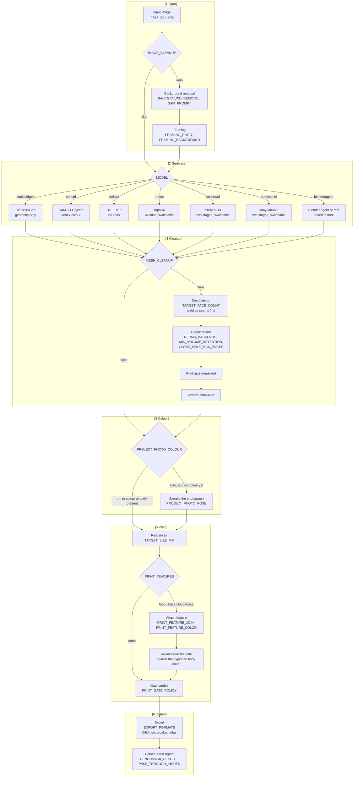

# Image to 3D: Stages, Models and Options

A reference for choosing a path through the Image to 3D pipeline. Every run is the same ordered set of
stages; what varies is which model generates the mesh, which stages are switched on, and what each one is
tuned to. This page lays out the stages, the option each stage takes, which combinations produce colour,
what each component is licensed under, and what has actually been measured.

For how the pipeline is built and deployed, see [Image to 3D Pipeline](./image-to-3d.md). Every option
named here is a template tag set on the execute form or in a configuration template's body.

:::info[What decides whether you get colour]
Five of the six reconstruction models generate their own colour, and the Blender agent bakes a texture
from the materials it authors. Stable3DGen generates none and can instead take colour from the input
photograph. TripoSR, Step1X-3D and Hunyuan3D-2 can each be run with their texture stage off, in which case
they too are geometry only. The [Colour paths](#colour-paths) table is the short answer.
:::

## Stage map

Each subgraph is one of the stages a template's form groups its fields under.



Three orderings in that map are load-bearing rather than incidental:

-   **Per-vertex colour stays per vertex.** glTF carries a colour array natively and exactly, and a
    renderer interpolates it across a triangle correctly, so the GLB the viewer reads is the colour the
    pipeline produced. A texture is built only for the OBJ, at export, once no further geometry will be
    added — an OBJ carries a colour array only through a non-standard extension that many readers ignore.
    That atlas is **baked**: the colour is rasterised into the charts an unwrap lays out, so neighbouring
    texels are neighbouring points on the surface. A colour _palette_ — one texel per distinct colour, in
    deduplication order — is not something a renderer can sample, because a renderer interpolates the uv
    across each triangle and reads per fragment rather than per vertex. Measured on a 99,581-vertex mesh,
    97.5% of triangles had their three corners more than eight palette texels apart, a median of 68 of a
    184-wide palette, and 43% of rendered pixels came out badly wrong against the colour the mesh
    carried.
-   **A preserved atlas is delivered by how the model laid it out.** A contiguous atlas — a texture
    stage's own 2048x2048 output — ships intact, its unwritten texels flooded from the nearest written
    colour. A densely chart-packed one — the agent bakes thousands of small auto-unwrap islands with
    unwritten background between them — tears when a renderer samples across an island edge, so it is
    collapsed to per-vertex colour (`resampledFromAtlas`), read a texel and a half inside each of a
    vertex's faces and averaged, so a vertex on an island's border takes the island's colour rather than
    the border texel where the next island's bake margin bleeds in. A sample that lands on the atlas's
    cleared background — the bake writes nothing for an island narrower than a texel — is left out, and a
    vertex with no written sample takes the colour of the copies that meet at its position. Only the
    chart-packed model is collapsed; a per-vertex model (SAM 3D) never had an atlas, and a contiguous one
    is untouched. Because that leaves the agent's mesh with no atlas, the GLB export then welds the
    per-vertex splits the bake left behind — each merged vertex taking the mean colour of its copies — and
    recomputes smooth normals, so the viewer reads a smooth surface at a fraction of the vertices. A mesh
    that still carries an atlas keeps its uv seams split.
-   **The rescale precedes the print features**, because a feature's dimensions are millimetres of the
    printed object. With `TARGET_SIZE_MM` left at `0` the mesh keeps the model's own arbitrary scale and a
    millimetre dimension has no fixed meaning.

## Models

| Model                                           | Key            | Colour it generates                              | Licence                                                                                                                                                   | GPU memory                                                                  | Enabled by default |
| ----------------------------------------------- | -------------- | ------------------------------------------------ | --------------------------------------------------------------------------------------------------------------------------------------------------------- | --------------------------------------------------------------------------- | ------------------ |
| Stable-X Stable3DGen (Hi3DGen)                  | `stable3dgen`  | **None** — can take colour from the photograph   | MIT / Apache-2.0 weights, **no NVIDIA component**                                                                                                         | ~16 GiB                                                                     | Yes                |
| Meta SAM 3D Objects                             | `sam3d`        | Per-vertex colour                                | Meta SAM License, gated weights; deps include `kaolin`                                                                                                    | ~24 GiB                                                                     | No                 |
| Microsoft TRELLIS.2                             | `trellis2`     | uv atlas                                         | MIT, **plus nvdiffrast: non-commercial only**                                                                                                             | ~24 GiB                                                                     | No                 |
| VAST-AI TripoSR                                 | `triposr`      | uv atlas, switchable off                         | MIT                                                                                                                                                       | ~24 GiB                                                                     | No                 |
| StepFun Step1X-3D                               | `step1x3d`     | Two stages, texture switchable off               | Apache-2.0, **plus nvdiffrast: non-commercial only**                                                                                                      | 22 GiB geometry; **>22 GiB textured**                                       | No                 |
| Tencent Hunyuan3D-2                             | `hunyuan3d`    | Two stages, texture switchable off               | Tencent Hunyuan 3D 2.0 Community License, **territorial**; **no NVIDIA component**                                                                        | ~6 GiB geometry; ~16 GiB textured                                           | No                 |
| **Blender agent** (Codex CLI on Amazon Bedrock) | `blenderagent` | Baked image texture the agent or the refit makes | Blender GPL-2.0-or-later (tooling), Codex Apache-2.0, LiteLLM MIT, MoGe-2 MIT (the refit's depth model); model terms per Bedrock; **no NVIDIA component** | None required (Cycles and the refit's depth model use the GPU when present) | No                 |

:::danger[Two models cannot be used commercially as built]
TRELLIS.2 and Step1X-3D both pull **NVlabs nvdiffrast**, distributed under the NVIDIA Source Code
License (1-Way Commercial). Its Use Limitation restricts licensees other than NVIDIA to "research or
evaluation purposes only and not for any direct or indirect monetary gain". Neither model's own licence
says so — the limitation arrives through a transitive dependency, and Step1X-3D's was found only when an
image build failed compiling it. Treat both as research and comparison paths. See
[Licences](#licences).
:::

:::danger[Hunyuan3D-2 is not licensed in the European Union, the United Kingdom or South Korea]
The Tencent Hunyuan 3D 2.0 Community License Agreement permits commercial use, but only inside a
Territory defined as "the worldwide territory, excluding the territory of the European Union, United
Kingdom and South Korea", and states that "any such use outside the Territory is unlicensed and
unauthorized". A deployment above **one million monthly active users** needs a separate licence from
Tencent. The deployment configuration rejects the model in an AWS Region inside the excluded territory,
which catches the unambiguous case only — a deployment in a permitted Region can still serve excluded
users, and no synthesis-time check can see that. See [Licences](#licences).
:::

## Colour paths

The question this table answers: which model-and-setting combination ships a coloured mesh, and by what
route. `IMAGE_TO_3D_TEXTURE_STATUS` in the run report names the route that was actually taken.

| Model                                | Settings                                        | Reported status                                                                 | Colour source                                                                                      |
| ------------------------------------ | ----------------------------------------------- | ------------------------------------------------------------------------------- | -------------------------------------------------------------------------------------------------- |
| `sam3d`                              | default                                         | `fromVertexColors`                                                              | The model's own per-vertex colour                                                                  |
| `trellis2`                           | default                                         | `preserved` or `rebakedFromAtlas`                                               | The model's own uv atlas                                                                           |
| `triposr`                            | `TRIPOSR_BAKE_TEXTURE=true`                     | `preserved` or `rebakedFromAtlas`                                               | The model's own baked atlas                                                                        |
| `triposr`                            | `TRIPOSR_BAKE_TEXTURE=false`                    | `none`                                                                          | —                                                                                                  |
| `step1x3d`                           | `STEP1X3D_GENERATE_TEXTURE=true`                | `preserved`, or `none` if the texture stage fails                               | The model's SD-XL texture module                                                                   |
| `step1x3d`                           | `STEP1X3D_GENERATE_TEXTURE=false`               | `none`                                                                          | —                                                                                                  |
| `hunyuan3d`                          | `HUNYUAN3D_GENERATE_TEXTURE=true`               | `preserved` or `rebakedFromAtlas`                                               | The model's own multi-view paint stage                                                             |
| `hunyuan3d`                          | `HUNYUAN3D_GENERATE_TEXTURE=false`              | `none`                                                                          | —                                                                                                  |
| `stable3dgen`                        | `PROJECT_PHOTO_COLOUR=off`                      | `none`                                                                          | —                                                                                                  |
| **`stable3dgen`**                    | **`PROJECT_PHOTO_COLOUR=auto`**                 | **`projectedFromPhotograph`**                                                   | **The input photograph, sampled onto the surface the camera saw**                                  |
| `triposr` / `step1x3d` / `hunyuan3d` | texture off **and** `PROJECT_PHOTO_COLOUR=auto` | `projectedFromPhotograph`                                                       | As above                                                                                           |
| `blenderagent`                       | default                                         | `resampledFromAtlas`, or `rebakedFromAtlas` if the cleanup changed the topology | An image the agent baked from the materials it authored in Blender, delivered as per-vertex colour |

The status names the route, and the routes differ in fidelity:

| Status                    | What it means                                                                                                                                                                                                                                                                                                                                                                                                                                                                                                                                                                                                                                                                                                           |
| ------------------------- | ----------------------------------------------------------------------------------------------------------------------------------------------------------------------------------------------------------------------------------------------------------------------------------------------------------------------------------------------------------------------------------------------------------------------------------------------------------------------------------------------------------------------------------------------------------------------------------------------------------------------------------------------------------------------------------------------------------------------- |
| `preserved`               | The cleanup left every vertex where the uv field was measured, so the model's own atlas and uv array go back on unchanged.                                                                                                                                                                                                                                                                                                                                                                                                                                                                                                                                                                                              |
| `rebakedFromAtlas`        | The cleanup changed the topology, so each cleaned vertex is located on the model's **original surface**, the uv field is read there, and the original atlas is rasterised into a fresh layout over the cleaned mesh. Detail is limited by the new atlas's resolution.                                                                                                                                                                                                                                                                                                                                                                                                                                                   |
| `resampledFromAtlas`      | The atlas collapsed to per-vertex colour. Used deliberately for a model whose atlas is densely chart-packed and would tear when a renderer samples across its islands — the agent's atlas, read a texel and a half inside each of a vertex's faces and averaged, with samples on the atlas's unwritten background left out and a vertex with none written taking its coincident copies' colour, then averaged again across the copies a uv seam split, so a vertex on an island's border takes the island's colour and not the border's — and as a fallback when a topology change leaves the original surface unsearchable. Valid — colour is continuous over a surface — but detail is limited to the vertex spacing. |
| `fromVertexColors`        | The model returned colour per vertex rather than an atlas. Detail is the vertex spacing.                                                                                                                                                                                                                                                                                                                                                                                                                                                                                                                                                                                                                                |
| `projectedFromPhotograph` | Colour sampled from the input photograph. Ranks below any colour a model produced, because only the surface the camera could see is measured and the rest is inferred.                                                                                                                                                                                                                                                                                                                                                                                                                                                                                                                                                  |
| `reprojected`             | A last resort before shipping loose files. The atlas's uv values are copied onto the cleaned vertices by nearest neighbour, which is unsound for a coordinate into a discontinuous chart layout — see the measurements below.                                                                                                                                                                                                                                                                                                                                                                                                                                                                                           |
| `sidecarsOnly`            | The mesh could carry no colour, and the model's raw texture files ship beside it.                                                                                                                                                                                                                                                                                                                                                                                                                                                                                                                                                                                                                                       |
| `none`                    | No colour.                                                                                                                                                                                                                                                                                                                                                                                                                                                                                                                                                                                                                                                                                                              |

### What projected colour can and cannot do

-   **It only touches a mesh that has no colour**, so it can never overwrite a model's own appearance.
-   **The view comes from the model, not the run.** A reconstruction is written into a canonical frame
    keyed to the input photograph, so the view is declared per model (`INPUT_VIEW_AZIMUTH`, 0° for
    Stable3DGen) and only the tilt is searched. This matters because a silhouette search alone does not
    merely lose confidence on a near-symmetric subject — it can prefer a wrong view. Measured on a
    standing figure: it scored a view 225° from the correct one _higher_ (0.838 against 0.776), and the
    colour that view projected landed the photograph's tones on the wrong parts of the body while every
    number the run reported looked healthy.
-   **A model with no declared view falls back to searching**, and reports what that search is worth.
    Step1X-3D has no calibrated view yet, so its projected runs report `poseDecisive: false`.
-   **`PROJECT_PHOTO_POSE`** overrides both, for a photograph not taken from the view its model expects.
-   **It refuses rather than guesses** when the best view scores below 0.35 intersection-over-union, when
    a mask guessed from the background colour covers more than 85% of the frame, or when the sample comes
    back a single flat tone.

## Options by stage

### Image cleanup

| Option               | Values                                      | Default  | Notes                                                                                                                                                                                                                                                                  |
| -------------------- | ------------------------------------------- | -------- | ---------------------------------------------------------------------------------------------------------------------------------------------------------------------------------------------------------------------------------------------------------------------- |
| `IMAGE_CLEANUP`      | `auto`, `skip`                              | `auto`   | `skip` bypasses background removal **and** framing together, which removes both stages' time and cost. The choice for an input already known to be a clean cut-out.                                                                                                    |
| `BACKGROUND_REMOVAL` | `none`, `rembg`, `birefnet`, `rmbg2`, `sam` | `rembg`  | Runs only under `IMAGE_CLEANUP=auto`. The first three decide for themselves which object the photograph is of; `sam` segments what `SAM_PROMPT` points at. `rmbg2` is BRIA RMBG-2.0, whose commercial terms should be reviewed before use and whose weights are gated. |
| `SAM_PROMPT`         | `centre`, `x,y`, `x0,y0,x1,y1`              | `centre` | Used only by `BACKGROUND_REMOVAL=sam`. Coordinates are fractions of the image between 0 and 1, not pixels, so one value holds at any resolution.                                                                                                                       |
| `FRAMING_RATIO`      | `auto`, `0.70`–`0.95`                       | `auto`   | Fraction of the frame the subject fills. `auto` uses the framing the selected model expects. Ignored when `BACKGROUND_REMOVAL` is `none`, since without a mask there is nothing to locate.                                                                             |
| `FRAMING_BACKGROUND` | `auto`, `none`, `gray`, `black`, `white`    | `auto`   | What sits behind the subject. `none` keeps the alpha channel, which a model reading alpha as an object mask requires.                                                                                                                                                  |

Background removal also produces the subject mask the colour projection later uses, which is why a
projected run should not be given `BACKGROUND_REMOVAL=none` unless the input already carries alpha.

### Generation

Model-specific; see [Per-model options](#per-model-options).

### Mesh cleanup and the print gate

| Option                         | Values                                                                      | Default      | Notes                                                                                                                                                                      |
| ------------------------------ | --------------------------------------------------------------------------- | ------------ | -------------------------------------------------------------------------------------------------------------------------------------------------------------------------- |
| `MESH_CLEANUP`                 | `true`, `false`                                                             | `true`       | `false` exports the mesh exactly as generated: no decimation, no repair, no gate, and **no guarantee it is printable**. The rescale still runs.                            |
| `TARGET_FACE_COUNT`            | integer                                                                     | `200000`     | `0` skips decimation. A textured mesh has its uv and normal seams welded before reduction, so the reduction cannot open the surface at a seam.                             |
| `REPAIR_BACKENDS`              | `trimesh,manifold3d,pymeshfix,pymeshlab` · `trimesh,manifold3d` · `trimesh` | full ladder  | Applied in that fixed order whatever order they are named. The short lists exclude the GPL-3.0 backends from being _used_; they are installed in every image regardless.   |
| `PRINT_GATE_POLICY`            | `failClosed`, `bestEffort`                                                  | `failClosed` | `failClosed` writes no mesh when a check fails, only the gate report.                                                                                                      |
| `MIN_VOLUME_RETENTION`         | `0.5`, `0.25`, `0.75`, `0.9`, `0`                                           | `0.5`        | Fraction of volume a repair rung must leave for its result to be kept. A rung that removes the model satisfies every printability check while producing nothing printable. |
| `CLOSE_HOLE_MAX_EDGES`         | `10000`, `1000`, `100`, `30`, `0`                                           | `10000`      | Largest hole `pymeshlab` will close. Lower it when a hole is part of the subject — the opening of a cup.                                                                   |
| `NEGLIGIBLE_FRAGMENT_FRACTION` | number                                                                      | `0.1`        | How large a detached piece must be, against the bounding-box diagonal, to count as part of the subject. Not on any form; set through a custom configuration body.          |

The gate checks watertightness, non-manifold edges and vertices, positive volume, broken faces, **and
connectivity** — one body for the model plus one per feature attached by `concat`. Connectivity is there
because a mug whose handle had come away passed every other criterion.

### Colour from the photograph

| Option                 | Values            | Default | Notes                                                                                                                                    |
| ---------------------- | ----------------- | ------- | ---------------------------------------------------------------------------------------------------------------------------------------- |
| `PROJECT_PHOTO_COLOUR` | `off`, `auto`     | `off`   | `auto` applies only to a mesh with no colour of its own. On the Stable3DGen and Step1X-3D templates.                                     |
| `PROJECT_PHOTO_POSE`   | `auto`, `0`–`315` | `auto`  | The view the photograph was taken from. An angle alone states the direction and leaves the tilt to the search; `angle,tilt` states both. |

The view each model reconstructs from is a per-MODEL constant, not one pipeline setting: Stable3DGen writes its reconstruction at azimuth 0 and Step1X-3D at 180. Both were established by pinning each candidate and comparing what the projection reaches, because a silhouette search cannot settle a near-symmetric subject on its own — on a standing figure Step1X-3D's search prefers 180 by a margin of only 0.031. `auto` uses the model's declared view and refines it within 15 degrees, which is the right answer unless the photograph was taken from somewhere else.

### Rescale and print features

| Option                                  | Values                              | Default   | Notes                                                                                                                                                                                                  |
| --------------------------------------- | ----------------------------------- | --------- | ------------------------------------------------------------------------------------------------------------------------------------------------------------------------------------------------------ |
| `TARGET_SIZE_MM`                        | number                              | `0`       | Longest edge in millimetres. `0` keeps the model's own scale. Runs whether or not cleanup is on.                                                                                                       |
| `PRINT_FEATURES`                        | `none`, `loop`, `base`, `loop+base` | `none`    | Parametric geometry the reconstruction cannot produce: a hanging ring, a flat-bottomed stand, or both.                                                                                                 |
| `PRINT_FEATURE_JOIN`                    | `auto`, `concat`, `union`           | `auto`    | `union` fuses one solid and **discards the texture**; `concat` keeps it and leaves the feature as an overlapping shell. `auto` picks `concat` for a coloured mesh and `union` for a geometry-only one. |
| `PRINT_FEATURE_COLOR`                   | `#RRGGBB`                           | `#3C3C3C` | Flat colour for the added geometry, so it prints as a deliberate fitting rather than a smear of the subject's colours. No effect under `union`.                                                        |
| `LOOP_DIAMETER_MM`, `LOOP_THICKNESS_MM` | number                              | `0`       | `0` sizes the loop from the model's height. Thickness must stay below the hole diameter.                                                                                                               |
| `BASE_DIAMETER_MM`, `BASE_HEIGHT_MM`    | number                              | `0`       | `0` sizes the base from the model's own footprint and height.                                                                                                                                          |

### Export and reporting

| Option                   | Values                         | Default       | Notes                                                                                                                                                                                                                                                                                                                                                                                                                                                                                                                                                                                                                                                                                                                             |
| ------------------------ | ------------------------------ | ------------- | --------------------------------------------------------------------------------------------------------------------------------------------------------------------------------------------------------------------------------------------------------------------------------------------------------------------------------------------------------------------------------------------------------------------------------------------------------------------------------------------------------------------------------------------------------------------------------------------------------------------------------------------------------------------------------------------------------------------------------- |
| `EXPORT_FORMATS`         | `glb,obj,stl` and every subset | `glb,obj,stl` | `glb` carries geometry and texture in one file, `obj` writes the texture as a separate file set, `stl` is geometry only and is the 3D-printing format. Where the colour is held per vertex, the formats take it differently: the `glb` carries the colour array itself, exactly, and the `obj` is written from a baked atlas with an MTL naming it, because an OBJ carries a colour array only through a non-standard extension that many readers ignore.                                                                                                                                                                                                                                                                         |
| `BENCHMARK_REPORT`       | `false`, `true`                | `false`       | Records per-stage seconds, the instance type and GPU, the resolved settings, the gate verdict and shape descriptors into the run report. The descriptors include the mesh's **genus**, the number of tunnels through it, and two shell descriptors: `medianCrossings` is the median number of times a lattice of parallel rays along the mesh's longest axis crosses its surface, and `shellLineShare` is the share of those rays that cross more than twice. A solid reads 2 with a share near 0; a second wall inside the first reads 4 or 6 on every ray through the void it seals, and the share says how much of the object that void spans — which neither genus, the print gate nor an exterior view can see. No GPU cost. |
| `INVALIDATE_MODEL_CACHE` | `false`, `true`                | `false`       | Clears the Amazon EFS cache and its Amazon S3 backup for the selected model. Not on any form.                                                                                                                                                                                                                                                                                                                                                                                                                                                                                                                                                                                                                                     |

## Templates

The pipeline ships a base template per model and a set of variations that pre-select a stage configuration,
and the template is how a run chooses both. A template carries the model's configuration body and declares
the options the execute form renders and the API validates; a variation is the same form with different
defaults, so anything it pre-selects can still be changed on the form. The identifier is what an execution
names in `templateId`; the pipeline itself is `genai-image-to-3d` in the `GLOBAL` database.

| Template ID                            | Name on the form                                                 | Model key      | Default | What it selects                                                                                                                                                    |
| -------------------------------------- | ---------------------------------------------------------------- | -------------- | ------- | ------------------------------------------------------------------------------------------------------------------------------------------------------------------ |
| `image-to-3d-stable3dgen`              | Stable3DGen (Stable-X): mesh from one photograph                 | `stable3dgen`  | **Yes** | Geometry only, print cleanup on                                                                                                                                    |
| `image-to-3d-stable3dgen-photo-colour` | Stable3DGen (Stable-X): mesh, coloured from the photograph       | `stable3dgen`  | No      | `PROJECT_PHOTO_COLOUR=auto`: the photograph sampled onto the geometry                                                                                              |
| `image-to-3d-sam3d`                    | SAM 3D Objects (Meta): mesh from one photograph                  | `sam3d`        | No      | The model's own per-vertex colour                                                                                                                                  |
| `image-to-3d-sam3d-print-ready`        | SAM 3D Objects (Meta): print-ready, with a base                  | `sam3d`        | No      | `PRINT_GATE_POLICY=failClosed`, `PRINT_FEATURES=base`                                                                                                              |
| `image-to-3d-sam3d-then-refine`        | SAM 3D Objects (Meta): step 1 of reconstruct, then refine        | `sam3d`        | No      | `PASS_THROUGH_INPUTS=true`: the photograph travels with the mesh to the next step                                                                                  |
| `image-to-3d-trellis2`                 | TRELLIS.2 (Microsoft): textured mesh from one photograph         | `trellis2`     | No      | The model's own uv atlas                                                                                                                                           |
| `image-to-3d-triposr`                  | TripoSR (VAST-AI): mesh from one photograph                      | `triposr`      | No      | The model's own baked atlas                                                                                                                                        |
| `image-to-3d-triposr-geometry-photo`   | TripoSR (VAST-AI): geometry, coloured from the photograph        | `triposr`      | No      | `TRIPOSR_BAKE_TEXTURE=false`, `PROJECT_PHOTO_COLOUR=auto`                                                                                                          |
| `image-to-3d-step1x3d`                 | Step1X-3D (StepFun): mesh from one photograph                    | `step1x3d`     | No      | Both stages                                                                                                                                                        |
| `image-to-3d-step1x3d-geometry-photo`  | Step1X-3D (StepFun): geometry, coloured from the photograph      | `step1x3d`     | No      | `STEP1X3D_GENERATE_TEXTURE=false`, `PROJECT_PHOTO_COLOUR=auto`                                                                                                     |
| `image-to-3d-hunyuan3d`                | Hunyuan3D-2 (Tencent): mesh from one photograph                  | `hunyuan3d`    | No      | Both stages                                                                                                                                                        |
| `image-to-3d-hunyuan3d-multiview`      | Hunyuan3D-2 (Tencent): mesh from several views                   | `hunyuan3d`    | No      | Up to four named views                                                                                                                                             |
| `image-to-3d-hunyuan3d-geometry-photo` | Hunyuan3D-2 (Tencent): geometry, coloured from the photograph    | `hunyuan3d`    | No      | `HUNYUAN3D_GENERATE_TEXTURE=false`, `PROJECT_PHOTO_COLOUR=auto`                                                                                                    |
| `image-to-3d-blenderagent`             | Blender agent: build a model from the photographs                | `blenderagent` | No      | Build from one to eight photographs                                                                                                                                |
| `image-to-3d-blenderagent-refine`      | Blender agent: refine an existing mesh with the photographs      | `blenderagent` | No      | One mesh plus its photograph; the agent keeps the body and re-textures it                                                                                          |
| `image-to-3d-blenderagent-refit`       | Blender refit: fit an existing mesh to the photograph (scripted) | `blenderagent` | No      | `BLENDERAGENT_MODE=refit`: one mesh plus its photograph; a fixed Blender chain fits the mesh to the photograph and re-textures it, with no agent and no model call |
| `image-to-3d-blenderagent-refit-agent` | Blender refit + agent: fit an existing mesh, then refine it      | `blenderagent` | No      | `BLENDERAGENT_MODE=refit-agent`: the scripted refit, then the agent refining its result                                                                            |
| `image-to-3d-blenderagent-quick`       | Blender agent: quick draft from the photographs                  | `blenderagent` | No      | 4 iterations, 15 minutes, medium reasoning effort                                                                                                                  |

**How a template's form reads.** Every field is labelled with the stage that reads it -- `[1 Input]`,
`[2 Generate]`, `[3 Cleanup]`, `[4 Colour]`, `[5 Print]` and `[6 Output]`, the subgraphs of the
[Stage map](#stage-map) -- and the fields are ordered the way a run executes them, so the form reads top to
bottom as the run does. A template shows only the stages its model uses: the SAM 3D Objects, TRELLIS.2 and
Blender agent templates carry no `[4 Colour]` fields, because those paths bring their own colour. Each
template's instructions end with a FORM paragraph that says the same.

Every template also carries `PASS_THROUGH_INPUTS`, off by default: a later pipeline in a workflow receives
only the prior step's outputs, so a first step that must hand the photograph on copies it into its outputs
beside the mesh.

**A second pipeline and a two-step workflow.** When the Blender agent is enabled, the deployment also
registers `genai-image-to-3d-refine`, the agent's refine mode as a pipeline of its own on the same Lambda
and images, and the workflow **Image to 3D: reconstruct, then refine** (`genai-image-to-3d-refine`), which
runs the reconstruction pipeline and then the refine pipeline on one photograph. A workflow may not list one
pipeline twice, which is why the refine mode is a pipeline of its own. Choose a first-step template that
passes the photograph on, such as `image-to-3d-sam3d-then-refine`; the second step then receives the mesh
and the photograph together, keeps the mesh's body, and projects the photograph onto it. Both pipelines
also carry the two refit templates, so that step can run the scripted refit alone, or the refit and then
the agent, in place of the agent alone. The same result is
had by hand in two executions: run a reconstruction template, then the refine template selecting that
output beside the photograph. Run end to end on the standing person -- SAM 3D then Astra -- this workflow produced the pipeline's most faithful person likeness so far, first of five in the blind round; the measured run is recorded with the Blender agent runs below.

Each template's instructions name the STAGES that model's run performs, which differ: Stable3DGen ends with the photograph-projection stage that supplies its colour, Step1X-3D and Hunyuan3D-2 each run a second texture stage of their own, and SAM 3D Objects, TRELLIS.2 and TripoSR carry colour out of the generate stage with the geometry. See [Stage map](#stage-map) for the shared sequence.

A template is registered only for a model the deployment enables, so the list an operator sees is the
subset switched on in `app.pipelines.useImageTo3d`. Naming a template whose model is not enabled is
rejected at execution.

Selecting one is optional on the execute form: the pipeline sets `requireTemplate`, and Stable3DGen is
the default, so an execution that names no template runs that model. It also sets
`allowCustomTemplateOverride`, so a caller may supply a configuration body of its own instead of naming a
template — which is how an option that is deliberately absent from the form (see
[Per-model options](#per-model-options)) is set.

The pipeline takes **one** input file per run, filtered to `*.png`, `*.jpg` and `*.jpeg`, and reads no
asset or file metadata. Its own outputs are written back as new files on the output asset, each carrying
the file-level metadata described in [What each output carries](#what-each-output-carries).

```bash
# List the templates a deployment has registered, and inspect one
vamscli pipeline template list -d GLOBAL -p genai-image-to-3d
vamscli pipeline template get -d GLOBAL -p genai-image-to-3d -t image-to-3d-step1x3d
```

## Per-model options

Each template carries the common options above plus its own. Values that are deployment-level choices —
attention backends, sparse-convolution algorithms, weight subfolders — are in the allow-list but
deliberately not on any form; set them through a custom configuration body.

### Stable3DGen (`stable3dgen`) — the default template

| Option                              | Values               | Default | What it does                                                                                                      |
| ----------------------------------- | -------------------- | ------- | ----------------------------------------------------------------------------------------------------------------- |
| `STABLE3DGEN_SEED`                  | integer              | `1`     | Same seed and settings reproduce the same mesh.                                                                   |
| `STABLE3DGEN_SPARSE_STEPS`          | integer              | `50`    | Denoising steps for the stage that decides the overall shape. **The decisive quality setting, not a speed dial.** |
| `STABLE3DGEN_SPARSE_CFG_STRENGTH`   | number               | `3.0`   | How strongly that stage follows the predicted normal map.                                                         |
| `STABLE3DGEN_SLAT_STEPS`            | integer              | `6`     | Steps for the stage that resolves surface detail.                                                                 |
| `STABLE3DGEN_SLAT_CFG_STRENGTH`     | number               | `3.0`   | How strongly the detail stage follows the normal map.                                                             |
| `STABLE3DGEN_NORMAL_RESOLUTION`     | `768`, `512`, `1024` | `768`   | The normal map is the bridge geometry is generated from, so this is the main fidelity dial.                       |
| `STABLE3DGEN_PREPROCESS_RESOLUTION` | `1024`, `768`, `512` | `1024`  | Subject resolution before the normal map is predicted.                                                            |

Off-form: `STABLE3DGEN_ATTN_BACKEND`, `STABLE3DGEN_SPARSE_BACKEND`, `STABLE3DGEN_SPCONV_ALGO`.

### SAM 3D Objects (`sam3d`)

| Option                         | Values          | Default | What it does                                                                                                                                                                                                                                                                                                                                                                                                                                                                                              |
| ------------------------------ | --------------- | ------- | --------------------------------------------------------------------------------------------------------------------------------------------------------------------------------------------------------------------------------------------------------------------------------------------------------------------------------------------------------------------------------------------------------------------------------------------------------------------------------------------------------- |
| `SAM3D_SEED`                   | integer         | `1`     | Reproducible on a fixed GPU model; the geometry moves between GPU models.                                                                                                                                                                                                                                                                                                                                                                                                                                 |
| `SAM3D_SOLID_INTERIOR`         | `false`, `true` | `true`  | Fills the reconstruction's interior before the mesh is extracted, so the outer surface alone is emitted rather than a shell with a second wall one voxel inside it. On by default; see below.                                                                                                                                                                                                                                                                                                             |
| `SAM3D_SOLID_INTERIOR_OPENING` | integer, `auto` | `auto`  | Radius, in grid vertices, of the morphological opening the interior flood runs through: a puncture in the surface up to twice this wide is sealed, and an exterior gap up to twice this wide is shut out of the flood too and then handed back wherever the outer skin does not enclose it. `0` floods the positive field as it is; `auto` grows the radius from zero, up to six, and settles on the last of the consecutive steps that seal the inner layer, or on zero when none does. Not on any form. |
| `SAM3D_DUMP_FIELD`             | `false`, `true` | `false` | Writes the extractor's vertex grid as the model seeded it — the active mask bit-packed, the signed distance as float16 and the grid resolution, in one compressed `sam3d_field.npz` — onto the run's auxiliary prefix, with its key listed in the `agent/bulky_diagnostics.json` diagnostic beside the report. Not on any form.                                                                                                                                                                           |

Off-form: `SAM3D_CONFIG_RELPATH` — the pipeline configuration path inside the gated weights repository —
the interior-fill opening and the field dump above.
Upstream's mesh postprocessing and texture baking are both declined, because both rasterize through
`nvdiffrast`, which this image does not carry; the model is asked for vertex colour instead.

`SAM3D_SOLID_INTERIOR` is on by default. Off, the raw mesh is a closed outer shell with a second,
inward-facing wall a few voxels inside it: the model's mesh extractor seeds every vertex of its grid that
the sparse structure does not carry as outside, and that structure is a band around the surface rather
than a filled volume, so the field reads outside, inside and outside again across the band and then
outside through the whole interior; a wall is emitted at each sign change, sealing a void inside the
object that the cleanup ladder then has to resolve. The mesh is watertight and one body, so every gate
criterion accepts it and no exterior view shows it; the shell descriptors under `BENCHMARK_REPORT` are
what do. On, the driver floods the grid from its boundary through its positive vertices, marks the
positive vertices the flood cannot reach as inside wherever the outer skin encloses them, and hands the
field back to the extractor, which emits the outer surface alone. The outer face stays where the model
put it, except across the narrow gaps the fill closes, described below. The space beyond the grid counts
as outside, so a reconstruction standing on a face of the grid keeps the floor under it. The flood runs through the positive field eroded by
`SAM3D_SOLID_INTERIOR_OPENING` vertices and its reach is dilated back by the same amount, so a puncture
in the model's inner layer up to twice that opening wide does not let the flood pour into the interior;
an exterior gap that narrow is shut out of the flood in exchange, and a puncture wider than that leaves
the interior as the model wrote it. The widest puncture differs from one reconstruction to
the next, so under `auto` the driver grows the radius from zero, up to six, and reads each step's growth
in filled vertices against the number of vertices the reconstruction carries: sealing a crease fills a
sliver, sealing the inner layer fills a volume. The search ends at the first step after a seal that does
not seal, and the radius settles on the last of the consecutive steps that filled at least six percent
of them, or on zero when no step does, so an inner layer the opening cannot close is left as the model
wrote it rather than bridged ever wider in the attempt.

What the flood leaves unreached is then read against the outer skin, the part of the surface that
straight rays from beyond the grid reach along at least six of the 26 lattice directions. The skin's
winding number, solved over the grid by FFT, is near one inside the skin and near zero outside it, and
an unreached vertex below one half is handed back to the outside: a gap the outside sees into —
between two legs, behind an ear, at the root of a handle — stays open, while an interior the skin
encloses stays filled whatever the model wrote there. A narrow gap the skin covers stays filled too, and
the mesh carries a flat, stair-stepped plate across its mouth: behind a strand of hair or a strap lying
against the face, or along a groove under a body. Of what remains, the largest connected piece is
the interior, and any other piece touching the outside is the mouth of a gap and is handed back too,
unless its mean winding is at least 0.9 with at most a quarter of its vertices touching. A sealed
puncture therefore settles one layer in, as a dent the width of the hole. Each filled vertex takes the
negative of its own value, so a band vertex that held a small positive value crosses zero where the
model's surface already was, and a vertex the hand-backs cut off from the outside is filled after all,
so the field seals no void. Each end of a new crossing that the sparse structure does not carry takes
the colour of the nearest vertex it does carry, rather than the mid grey an uncarried vertex decodes to.

A run with the option on stops rather than deliver the double wall if the upstream extractor is not
where the driver expects it. Every run, on or off, writes `sam3d_stats.json` beside the mesh — what the
fill did to the grid, the raw and exported mesh sizes, how many exported vertices carry that mid grey,
the sampler values the pipeline resolved to, the GPU that ran and the upstream revision it ran — and it reaches the
execution as the `agent/sam3d_stats.json` diagnostic and, compacted, as `sam3dStats` in the report's
generation notes. With `SAM3D_DUMP_FIELD` on, the grid is written before the fill touches it, so the file
holds the model's own field whether or not the fill ran.

### TRELLIS.2 (`trellis2`)

| Option                                                   | Values                                        | Default      | What it does                                                                              |
| -------------------------------------------------------- | --------------------------------------------- | ------------ | ----------------------------------------------------------------------------------------- |
| `TRELLIS2_SEED`                                          | integer                                       | `1`          | Does **not** make a run reproducible — see [Measurements](#measurements).                 |
| `TRELLIS2_PIPELINE_TYPE`                                 | `1024`, `512`, `1024_cascade`, `1536_cascade` | `1024`       | Which upstream pipeline variant runs.                                                     |
| `TRELLIS2_SPARSE_STEPS` / `TRELLIS2_SPARSE_CFG_STRENGTH` | integer / number                              | `50` / `7.5` | The structure stage.                                                                      |
| `TRELLIS2_SHAPE_STEPS` / `TRELLIS2_SHAPE_CFG_STRENGTH`   | integer / number                              | `50` / `3.0` | The shape stage.                                                                          |
| `TRELLIS2_TEX_STEPS` / `TRELLIS2_TEX_CFG_STRENGTH`       | integer / number                              | `25` / `3.0` | The texture stage.                                                                        |
| `TRELLIS2_TEXTURE_SIZE`                                  | `2048`, `1024`, `4096`                        | `2048`       | Atlas resolution.                                                                         |
| `TRELLIS2_DECIMATION_TARGET`                             | integer                                       | `1000000`    | Upstream's own reduction, before the pipeline's `TARGET_FACE_COUNT`.                      |
| `TRELLIS2_PREPROCESS_IMAGE`                              | `false`, `true`                               | `false`      | Upstream's own preprocessing. Left off because it reaches for a gated background remover. |

Off-form: `TRELLIS2_ATTN_BACKEND`, `TRELLIS2_SPCONV_ALGO`, `TRELLIS2_MAX_NUM_TOKENS`,
`TRELLIS2_RASTERIZER_FACE_LIMIT`.

### TripoSR (`triposr`)

| Option                       | Values                 | Default | What it does                                                                                                                                                                                                                                     |
| ---------------------------- | ---------------------- | ------- | ------------------------------------------------------------------------------------------------------------------------------------------------------------------------------------------------------------------------------------------------ |
| `TRIPOSR_MC_RESOLUTION`      | `128`–`512`            | `384`   | Marching-cubes resolution. **A printability setting, not only a detail dial**: at `256` a subject kept 28 non-manifold edges the repair ladder could not close, and at `384` the same subject came out watertight. `512` exhausts a 22 GiB card. |
| `TRIPOSR_BAKE_TEXTURE`       | `true`, `false`        | `true`  | `false` gives geometry only, which `PROJECT_PHOTO_COLOUR` can then colour.                                                                                                                                                                       |
| `TRIPOSR_TEXTURE_RESOLUTION` | `1024`, `2048`, `4096` | `2048`  | Baked atlas resolution.                                                                                                                                                                                                                          |

### Step1X-3D (`step1x3d`)

| Option                       | Values                              | Default  | What it does                                                                                                                                                                                                                                                                                                                                                                                                                                                                                                                                                                                                       |
| ---------------------------- | ----------------------------------- | -------- | ------------------------------------------------------------------------------------------------------------------------------------------------------------------------------------------------------------------------------------------------------------------------------------------------------------------------------------------------------------------------------------------------------------------------------------------------------------------------------------------------------------------------------------------------------------------------------------------------------------------ |
| `STEP1X3D_SEED`              | integer                             | `1`      | Passed to upstream as a generator, so it genuinely reproduces.                                                                                                                                                                                                                                                                                                                                                                                                                                                                                                                                                     |
| `STEP1X3D_GUIDANCE_SCALE`    | number                              | `7.5`    | Geometry guidance strength.                                                                                                                                                                                                                                                                                                                                                                                                                                                                                                                                                                                        |
| `STEP1X3D_GEOMETRY_STEPS`    | integer                             | `50`     | Denoising steps for the geometry stage.                                                                                                                                                                                                                                                                                                                                                                                                                                                                                                                                                                            |
| `STEP1X3D_OCTREE_RESOLUTION` | `256`, `320`, `384`, `512`          | `384`    | Surface extraction resolution.                                                                                                                                                                                                                                                                                                                                                                                                                                                                                                                                                                                     |
| `STEP1X3D_MAX_FACE_NUM`      | integer                             | `400000` | Upstream's own face cap. The texture stage reduces further, as upstream does.                                                                                                                                                                                                                                                                                                                                                                                                                                                                                                                                      |
| `STEP1X3D_GENERATE_TEXTURE`  | `true`, `false`                     | `true`   | The expensive half, an SD-XL multi-view pipeline. `false` yields geometry in a fraction of the time.                                                                                                                                                                                                                                                                                                                                                                                                                                                                                                               |
| `STEP1X3D_TEXTURE_LOW_VRAM`  | `auto`, `off`, `slicing`, `offload` | `auto`   | How hard the texture stage works to fit the card it lands on. `auto` selects `slicing`, which is VAE slicing alone and is enough for a 22 GiB card. `off` runs the stage as the model ships it and runs out of memory on that card. **Neither attention slicing nor component offload is safe on this model** — both interfere with the custom attention processor its texture adapter lives in, attention slicing by replacing it and offload by raising inside it. Attention slicing is never applied at all, and `offload` is retained only for a future upstream version that fixes it, warning when selected. |

Off-form: `STEP1X3D_GEOMETRY_SUBFOLDER`, `STEP1X3D_TEXTURE_SUBFOLDER`, and
`STEP1X3D_LABEL_SYMMETRY` / `STEP1X3D_LABEL_EDGE_TYPE`, which together select the label-conditioned
geometry checkpoint and the label it conditions on. Both halves are needed; the base checkpoint is the
default because selecting the label variant without a label leaves its conditioning inert.

### Hunyuan3D-2 (`hunyuan3d`)

| Option                        | Values                                                 | Default | What it does                                                                                                                                                                                                                                                                                                                        |
| ----------------------------- | ------------------------------------------------------ | ------- | ----------------------------------------------------------------------------------------------------------------------------------------------------------------------------------------------------------------------------------------------------------------------------------------------------------------------------------- |
| `HUNYUAN3D_SEED`              | integer                                                | `1`     | Passed to upstream as a generator, so it genuinely reproduces.                                                                                                                                                                                                                                                                      |
| `HUNYUAN3D_GUIDANCE_SCALE`    | number                                                 | `5.0`   | Shape guidance strength. Upstream's own default for the flow-matching pipeline.                                                                                                                                                                                                                                                     |
| `HUNYUAN3D_GEOMETRY_STEPS`    | integer                                                | `50`    | Sampling steps for the shape stage.                                                                                                                                                                                                                                                                                                 |
| `HUNYUAN3D_OCTREE_RESOLUTION` | `256`, `320`, `380`, `384`, `512`                      | `384`   | Surface extraction resolution.                                                                                                                                                                                                                                                                                                      |
| `HUNYUAN3D_GENERATE_TEXTURE`  | `true`, `false`                                        | `true`  | The multi-view painting stage. `false` yields geometry in roughly half the time and drops the run from about 16 GiB of GPU memory to about 6 GiB.                                                                                                                                                                                   |
| `HUNYUAN3D_POSTPROCESS`       | `off`, `floaters`, `degenerate`, `floaters,degenerate` | `off`   | Upstream's own tidy-up steps, applied to the shape before it is painted. `floaters` discards disconnected fragments; `degenerate` drops zero-area faces. Face reduction is deliberately **not** offered: `TARGET_FACE_COUNT` decimates once, after the repair ladder, and decimating twice loses detail the ladder could have kept. |
| `HUNYUAN3D_REMOVE_BG`         | `auto`, `true`, `false`                                | `auto`  | Whether the model runs its own background removal. It reads the alpha channel as the object mask and recentres the subject from it, so an image with no alpha is never cropped to the subject and the whole composition is reconstructed instead. `auto` runs it only when the image reaching the model carries no transparency.    |

The `FRAMING_BACKGROUND` this model declares is `none` for the same reason: it needs the cutout's alpha
intact, and compositing a flat colour behind the subject removes the mask it reads.

Off-form: `HUNYUAN3D_SHAPE_SUBFOLDER` and `HUNYUAN3D_VARIANT`, which name the checkpoint inside the
weights repository and its precision, and `HUNYUAN3D_NUM_CHUNKS`, which trades GPU memory against time in
the surface extractor and changes nothing about the mesh.

:::note[Not yet calibrated]
Two per-model constants are declared but unmeasured for this model. Its output up-axis is set to Y on
glTF's convention rather than from a measured run, and the azimuth its output frame puts the input
photograph at is left uncalibrated — so `PROJECT_PHOTO_COLOUR` falls back to recovering the pose from the
silhouette here. Neither affects a textured run, which is the default. See
[Where a path currently stops](#where-a-path-currently-stops).
:::

### Blender agent (`blenderagent`)

This is not a reconstruction model. It is OpenAI's Codex CLI, reasoning with a vision-capable foundation
model on Amazon Bedrock, driving a headless Blender: it studies the photographs, writes Blender Python to
build the subject, renders what it built from fixed views, looks at the renders beside the photographs, and
iterates until the comparison says it is done or the budget says stop. The output is a textured glTF like
any other model's and flows into the same cleanup, gate and export.

| Option                          | Values                                              | Default  | What it does                                                                                                                                               |
| ------------------------------- | --------------------------------------------------- | -------- | ---------------------------------------------------------------------------------------------------------------------------------------------------------- |
| `BLENDERAGENT_GUIDANCE`         | text                                                | empty    | Passed to the agent verbatim: what the photographs cannot say -- real size, material, the hidden side, what matters most.                                  |
| `BLENDERAGENT_MAX_ITERATIONS`   | integer                                             | `12`     | The most build-render-compare cycles. The agent is told to finish inside it.                                                                               |
| `BLENDERAGENT_MAX_MINUTES`      | integer                                             | `45`     | Wall-clock budget; the agent is stopped a few minutes past it and whatever it exported is taken.                                                           |
| `BLENDERAGENT_REASONING_EFFORT` | `low`, `medium`, `high`, `xhigh`                    | `high`   | How much the model deliberates per step.                                                                                                                   |
| `BLENDERAGENT_RENDER_ENGINE`    | `CYCLES`, `BLENDER_WORKBENCH`, `BLENDER_EEVEE_NEXT` | `CYCLES` | The engine for comparison renders. Cycles uses the GPU when the driver exposes one and the CPU otherwise; an engine that cannot start headless falls back. |
| `BLENDERAGENT_RENDER_SAMPLES`   | integer                                             | `32`     | Cycles samples per comparison render.                                                                                                                      |

Off-form: `BLENDERAGENT_BRIDGE_PORT`, the loopback port of the model bridge.

The Amazon Bedrock model the agent reasons with is deployment configuration,
`app.pipelines.useImageTo3d.models.blenderagent.bedrockModelId`, and not a run option: the job role's
`bedrock:InvokeModel` grant names that model, so a run naming another would be refused. To compare
models on the same photographs, deploy with each in turn.

**The refit modes.** `BLENDERAGENT_MODE` is set by the template rather than on the form, and chooses what a
run does: `agent`, the agent alone, as described here; `refit`, a fixed chain of Blender steps with no
agent and no model call; or `refit-agent`, that chain and then the agent refining its result. The refit
takes ONE existing mesh and the photograph it was made from, and `bl_refit.py` runs it a step at a time.
A refit run whose input files lack the mesh or the photograph is refused before an instance is
provisioned, as is a `BLENDERAGENT_MODE` other than these three. It joins the mesh into one
body and turns it to the view whose outline best matches the photograph's cutout, searched
over azimuth in 15° steps at elevations of 0°, 15°, -15° and 30°. It rebuilds the
surface if asked, then warps the mesh in the photograph's plane until its front outline matches the
cutout, moving no part more than 3% of the subject's height and leaving depth alone. It raises and lowers
the photographed side where a MoGe-2 depth estimate of the photograph shows relief the reconstruction
smoothed away, fading towards the outline and held back wherever the surface would cross itself. It
brings the mesh to `TARGET_FACE_COUNT`, removes loose fragments, fills holes, turns the faces outwards,
and projects the photograph onto the side it shows, keeping the reconstruction's own colour everywhere
else. When the registered view's outline matches the cutout at an IoU under 0.5, no searched view shows
the photograph's subject, so the outline fit and the relief are skipped. Each step records what it
measured, did and skipped in `refit_report.json`, attached to the execution with the outline before and
after drawn over the photograph's.

The refit reads the subject's outline from the cutout, so a photograph that reaches it with no
transparent background -- `BACKGROUND_REMOVAL=none`, or `IMAGE_CLEANUP=skip` on an opaque photograph --
is refused before Blender starts, naming `BACKGROUND_REMOVAL`. With several photographs the refit uses
the first, and in `refit-agent` the agent sees them all. `refit-agent` checks the agent's settings before
the refit starts, hands the agent the refitted mesh as its starting mesh, wearing the reconstruction's
colour on its vertices as any refine's starting mesh does, beside the refit's own baked result
(`refit/refit.glb`), its report, its outline pictures and the mesh it started from, and delivers the
refit's result when the agent fails, with the failure in the run report. Its workspace also holds
`bl_refit.py`, which the instructions tell the agent not to run on its scene. The refit's options are on
the two refit templates only:

| Option                               | Values                      | Default    | What it does                                                                                                                                                                                                                                                                       |
| ------------------------------------ | --------------------------- | ---------- | ---------------------------------------------------------------------------------------------------------------------------------------------------------------------------------------------------------------------------------------------------------------------------------- |
| `BLENDERAGENT_REFIT_REBUILD`         | `voxel`, `metaball`, `none` | `none`     | How the surface is rebuilt before it is fitted: an even closed voxel remesh, overlapping spheres, or the reconstruction's own surface. A rebuild that moves the surface more than 2% of the height on average, or keeps less of its volume than `MIN_VOLUME_RETENTION`, is undone. |
| `BLENDERAGENT_REFIT_RESOLUTION`      | number, 0.001 to 0.05       | `0.004`    | The rebuild's voxel size or sphere spacing, and that of the leak check's last-resort remesh, as a fraction of the subject's height.                                                                                                                                                |
| `BLENDERAGENT_REFIT_OUTLINE_FIT`     | `true`, `false`             | `true`     | Run the outline fit.                                                                                                                                                                                                                                                               |
| `BLENDERAGENT_REFIT_RELIEF`          | `true`, `false`             | `true`     | Add relief from the depth estimate.                                                                                                                                                                                                                                                |
| `BLENDERAGENT_REFIT_RELIEF_STRENGTH` | number, 0 to 0.05           | `0.01`     | The most the relief moves the surface, as a fraction of the subject's height.                                                                                                                                                                                                      |
| `BLENDERAGENT_REFIT_RETOPO`          | `decimate`, `quadriflow`    | `decimate` | How a mesh over `TARGET_FACE_COUNT` is brought down to it. QuadriFlow rebuilds it as even quads, smoothing fine detail, and falls back to decimation when it cannot remesh the surface.                                                                                            |

Measured locally under Blender 4.5 on five SAM 3D meshes, with no rebuild and without the relief, the
chain raised the front IoU against the photograph's cutout from 0.877 to 0.950 on the cat, 0.805 to 0.918
on the dog, 0.784 to 0.920 on the horse, 0.905 to 0.943 on the mug and 0.860 to 0.977 on the person, and
each came out one closed body. The cat's chain, with a synthetic depth map standing in for MoGe-2, took
about 40 s on a workstation. A voxel rebuild reached the same IoU but raised the self-intersection count
from 0 to 25 on the dog, 131 on the horse and 472 on the person, and left the cat's surface open after
decimation. A metaball rebuild came out lumpy, with blunted ears. The outline fit made the mug's rim and
base wavy where it followed the cutout's edge, which is what `BLENDERAGENT_REFIT_OUTLINE_FIT=false` is
for.

**Inputs.** One to eight photographs, plus optionally ONE existing mesh (`.glb`, `.gltf`, `.obj`, `.stl`,
`.ply`) to REFINE rather than build from scratch -- which is how this stage runs after another model:
select that model's output alongside the photographs it was made from. Photographs named `front`, `left`,
`back` or `right` tell the agent which side it is looking at. A mesh with no photograph is accepted for a
tidy-up without a reference. Every other model is REFUSED a mesh, at the Lambda boundary, before any GPU is
provisioned.

**What the agent receives** is a fresh workspace holding the photographs as supplied and as cutouts, the
starting mesh if any, a brief with the mode and budget, thirteen tools and an instruction document. Eleven
of the tools are Blender-side: import a starting mesh; build a **silhouette base** -- a closed body whose
front outline is the photograph's, inflated to a depth, with the photograph projected on its front and the
outline's own edge colours on its back and sides; reshape the depth or width of a horizontal band; render
from fixed orthographic views with each render's and each reference's mean colour named; inspect bodies
and closedness; solidify the parts into one closed body with the colour baked across; bake a single
object's material; **project the photograph** onto any one mesh, which is how a reconstruction model's
body gets the photograph's face and clothing; write the mask of the atlas texels the camera never saw;
render the current texture from a fixed view with a mask of what the photograph never covered, and bake
an image model's completion of it back; export with re-import verification. `agent_image_edit.py` reaches an image model on Bedrock through the
pipeline (below). And `agent_gate.py` is **the pipeline's own judge**: plain Python that
imports the pipeline's gate, shape-descriptor and silhouette code and runs them on the agent's export --
pass or fail, bodies, height/width beside the photograph's, front silhouette IoU, which horizontal bands
are too narrow or too wide and by how much, whether the model faces -Y, colour per band in words. The
method is: audit the references, take the silhouette from the photograph, shape the depth, add what
projects, match materials, solidify, export, measure, and finish only when the measurement says so.
Completion is a set of FILES -- `output/model.glb` and a `DONE.json` carrying the measured numbers -- and
`complete` is allowed only with the gate passed and a front IoU of 0.85 or better; the stage checks for
the mesh rather than believing the final message.

**How it is confined.** Codex runs its commands in its own sandbox in `workspace-write` mode with the
default `/tmp` carve-outs switched off, so the only writable location is the agent's workspace, which sits
outside `/tmp` deliberately -- the pipeline's own directories live there. Its commands have no network. The
workspace is wiped before every run. Credentials are excluded from the environment its commands see; the
model is reached by the Codex process alone, through a loopback bridge that calls Bedrock on the task role.
The sandbox mode is fixed, and no run option widens it.

**How it reaches an image model.** The photograph covers the surface the camera saw and nothing else, so
the back and the sides of a projected model carry the colour of the nearest outline, which is flat. GPT-6
Astra produces text, not images, so it directs an image model rather than painting itself: once the model
is one body with a real atlas, `bl_view_fill.py` renders its current texture, unlit, from one of the fixed
views and writes a mask of the visible surface the photograph never covered; `agent_image_edit.py` asks a
Stability AI model on Amazon Bedrock -- structure-guided regeneration, inpainting, search-and-replace,
recolouring, style transfer, erasing -- to complete that picture with a prompt describing the subject from
that side (the structure-guided model keeps the render's outline and pose, where an inpainting model given
a mask over most of a figure redrew the figure); and the same tool bakes the result back
onto exactly the faces that view saw, depth-tested, marking them so the next view fills only what remains.
`bl_uv_mask.py` still writes a mask of the atlas texels the camera never saw, for a patch fixed in the atlas
itself. The agent's commands still have no network: the tool writes a request file into `requests/` and a
broker in the pipeline process serves it with the task role, confines every path to the workspace,
allows only the listed operations, runs the model through its `us.` inference profile, and writes the
result back, with every pixel outside a mask returned as it was. The agent is told to look at each result
and keep it only if it beats the flat colour, and
the gate tool's `SEAM` lines -- the camera-facing colour against the rest, band by band -- are how it
checks the join. For fine corrections the atlas is a PNG it edits with numpy from a Blender script.

**How the model is reached.** Codex speaks only the OpenAI Responses API; Bedrock exposes OpenAI-compatible
Chat Completions and nothing else. A LiteLLM proxy inside the container bridges the two on loopback and
calls Bedrock's Converse API with the task role's credentials, so no API key is minted or stored. The model
id is deployment configuration (`bedrockModelId`); the commercial template carries the GPT-6 Astra
cross-Region inference profile, and the runs recorded below name the model each used.

A new model id is not only a setting, though, and the first Astra runs showed why. The bridge library
decides which request fields a Bedrock model accepts by looking the id up in its own model map, and
silently drops anything it decides is unsupported; an id it has never seen therefore gets no tools, and
the agent answers in seconds that it has no terminal. It also recognises an OpenAI model on Bedrock by the
substring `openai.gpt-5` in the id, so a `gpt-6` id was sent Anthropic's `thinking` field and rejected by
Bedrock before the first turn. The bridge hook registers the configured id from its nearest known sibling
and widens that detection to any `openai.gpt-<digit>` id, so the id really is the only change.
Measured before this was built: GPT-5.6 Terra through that bridge read an image, called a function tool,
took the tool result, and streamed with high reasoning effort, which is every shape Codex uses.

One shape needed help, and the first live run found it. The agent's `view_image` tool returns the image it
looked at as the tool call's result; the bridge translates that into a Converse tool result carrying an
image, and the OpenAI models on Bedrock reject exactly that -- "This model doesn't support the image field
for user messages" -- while accepting the same image beside the tool result in the same user turn.
Measured across every placement a mid-conversation image can take: only the image _inside_ the tool
result fails. A pre-call hook on the bridge lifts image parts out of any tool output into an adjacent
user message, which is the accepted shape; the agent looked at its first render and the run died before
the hook existed.

**What each run leaves behind.** Beside the run report on the execution: the agent's notes, its brief,
its build scripts, its self-assessment with known deviations, and an index naming where the rest went.
The renders and the full event transcript go to the auxiliary prefix, because the workflow reads
everything beside the report as text onto the execution record, and a PNG or a half-megabyte transcript
there fails the run after the model has been delivered. Read the notes and the deviations before reading
the mesh.

**Measured.** Two finished runs on the studio photograph of a standing person -- the subject every other
model has been measured on -- with GPT-5.6 Terra at high reasoning effort, 25 minutes and 8 iterations
of budget, a 60 mm target size:

| Build run | What changed before it                               | Agent time / iterations / commands | Tokens in / out | Print gate                                                         | Colour in the delivered file                                                                                                 | Blind judge (sil / str / face / cloth / col / surf), rank of 5                                                             |
| --------- | ---------------------------------------------------- | ---------------------------------- | --------------- | ------------------------------------------------------------------ | ---------------------------------------------------------------------------------------------------------------------------- | -------------------------------------------------------------------------------------------------------------------------- |
| 1         | --                                                   | 482 s / 5 / 19                     | 1.27 M / 16 K   | **failed**: 34 bodies, repair rejected                             | preserved (no cleanup could run)                                                                                             | not judged                                                                                                                 |
| 2         | solidify made mandatory                              | 396 s / 4 / 11                     | 0.90 M / 9.4 K  | passed unrepaired, 1 body, genus 9                                 | preserved (103,756 faces, under the budget)                                                                                  | 5 / 4 / 2 / 5 / 6 / 6, **3rd**                                                                                             |
| 3         | body-count tools, diagnostics partitioned            | 739 s / 5 / 14                     | 1.89 M / 14.8 K | passed unrepaired, 1 body, genus 2                                 | **none**: re-bake died on a NaN uv                                                                                           | 3 / 2 / 2 / 1 / 0 / 6, 5th                                                                                                 |
| 4         | NaN-safe re-bake, raw texture sidecar                | 461 s / 3 / 11                     | 0.90 M / 9.9 K  | passed unrepaired, 1 body, genus 10                                | **one flat colour**: unwrap collapsed at 0.06 units                                                                          | 4 / 3 / 2 / 3 / 1 / 7, 5th                                                                                                 |
| 5         | unwrap at unit scale, layout measured                | 513 s / 4 / 13                     | 1.05 M / 13.5 K | passed unrepaired, 1 body, genus 2                                 | preserved, full layout (105,877 distinct uvs)                                                                                | 3 / 2 / 2 / 4 / **7** / 5, 5th                                                                                             |
| 6         | colour words in the render report                    | 618 s / 3 / 13                     | 0.90 M / 10.3 K | passed unrepaired, 1 body, genus 7                                 | re-baked, full layout (199,998 faces)                                                                                        | 4 / 3 / 2 / 5 / 6 / 5, **3rd** ("toy-like but coherent")                                                                   |
| 7         | silhouette base + the gate tool in the agent's hands | 683 s / 3 / 8                      | 0.83 M / 6.7 K  | passed unrepaired, 1 body, genus 2; agent-measured front IoU 0.924 | per-vertex only: the re-bake declined a layout with 1.2% unplaced (tolerance since raised)                                   | **8 / 7 / 7 / 8 / 9 / 5, 2nd** ("best texture and colour match, but nearly flat")                                          |
| 8         | per-part inflation, depth guidance                   | 275 s / 2 / 7                      | 0.43 M / 4.7 K  | passed unrepaired, 1 body, genus 2; agent-measured front IoU 0.925 | **smeared**: the solidify unwrap squashed every island to 2% of the atlas (aspect correction against a 4-pixel strip; fixed) | 4 / 3 / 1 / 4 / 6 / 2, 5th ("collapses in side view")                                                                      |
| 9         | unwrap aspect fix, one-image base                    | 584 s / 3 / 11                     | 1.07 M / 7.2 K  | passed unrepaired, 1 body, genus 2; agent-measured front IoU 0.925 | preserved, full layout (uv spans 0.99 x 0.91)                                                                                | **7 / 4 / 8 / 8 / 9 / 3, 3rd** ("looks best in front but is essentially a flat card")                                      |
| 10        | **GPT-6 Astra** instead of GPT-5.6, same tools       | 619 s / 7 / 42                     | 3.03 M / 30.6 K | passed unrepaired, 1 body, genus 2; agent-measured match IoU 0.919 | re-baked, full layout (200,000 faces)                                                                                        | **9 / 8 / 8 / 9 / 9 / 8, 1st** ("by far the most faithful likeness, despite a thin side profile"); printable as a likeness |

Runs 1 to 9 used GPT-5.6 Terra; run 10 used GPT-6 Astra with everything else unchanged. Refine runs on
the same photograph with SAM 3D's person mesh as the start: GPT-5.6 reached a match IoU of 0.834 in 573 s
and 1.42 M tokens and was judged 7 / 7 / 3 / 8 / 8 / 5, second; **Astra reached 0.918 in 770 s, 50 commands
and 4.47 M tokens and was judged 8 / 8 / 6 / 8 / 8 / 7, first**, printable as a likeness -- it measured the
imported body, narrowed the head and shoulders, moved the pocket hand to the hip, then solidified,
projected and re-measured, which is the loop the tools were built for.

Runs 1 to 6 self-assessed silhouette 7, proportions 7, colour 7 and surface 5 or 6, and all but the first
called itself `complete`. Run 7 is the first with the silhouette base and the gate tool: the agent took
the outline from the photograph, measured its own export at a front IoU of 0.924 with the pipeline's
code, and the blind judge -- looking at the delivered file with its colour reduced to one value per
vertex by a re-bake fallback -- moved it from fifth to **second**, with the best colour score of any
candidate and a face score of 7 where every earlier run had 2. Its one criticism, "nearly flat", is the
depth the photograph cannot supply; the base now inflates each part against its own width rather than the
whole figure's, and the depth of any band is one `bl_reshape.py` call. Run 8 then shipped a smear: the
agent's own post-solidify render was already streaked, because Blender's smart unwrap corrects for the
active image's aspect ratio and the active image at that moment was the base's 4-pixel-wide colour strip,
so every island was squashed into two percent of the atlas -- a uv span of 0.49 to 0.51 in the delivered
file. The solidify tool now assigns its bake material before unwrapping, unwraps without aspect
correction, and refuses to save a layout that spans less than half the atlas; the base carries the
photograph and its row colours in one ordinary image. The gate tool also reports a best-view match IoU
beside the front one, because the refine run against a three-quarter photograph spent its whole budget
failing to reach a front IoU that no model of that photograph can reach, and honestly marked itself
partial. The shape descriptors put the figure at 4.6 to 5.1 times taller than wide
against about 3.9 for the photograph, with a fill ratio of 0.37 to 0.57.

Each finished build was put through the same blind likeness judgement as the four reconstruction models,
on the same photograph, the same per-fragment renders of the delivered file, by the same judge model.
Stable3DGen's uncoloured geometry won every round and SAM 3D came second every round. Run 2 ranked
**third**, ahead of TRELLIS.2 and TripoSR; runs 3 to 5 ranked last, and the judge's words are consistent
across them: cartoonish proportions, a blocky featureless face, legs too thin, shoes too large, hair in
blocks, arms that read as detached. The **colour** column is the one that moved, and it moved with the
pipeline, not the agent: 6 when the agent's own texture was preserved, 0 when the re-bake died, 1 when
the unwrap collapsed, **7 -- the highest colour score of any candidate** -- once the layout was carried
faithfully. That is the pipeline's colour path proven by an independent reader. Read the rest with the
other rows of this section: today the agent is the path that produces a **clean, correctly coloured,
print-ready body on the first try**, and not yet the path that produces a likeness. It stops at three to
five of its eight iterations calling itself complete, and it scores itself 7 for silhouette and
proportions where the judge gives 3 and 2, so the budget is not what limits it; its comparison step is,
and its self-assessment is not evidence of anything.

**The first REFINE run** took SAM 3D's clean, genus-0 cat mesh beside the photograph it was made from,
with the same budget. The agent imported it, judged it "untextured, tall and toy-like", and rebuilt the
cat from primitives instead of editing it -- against its instructions, which allowed a rebuild only for an
unsalvageable start. It used all eight iterations, 867 s and 2.3 M input tokens, and delivered a cat whose
ears, eyes, paws and three tail segments float apart from the body: ten pieces to the print gate, every
one of them closed. Its own inspection had said "one mesh, watertight" and it believed it, because the
inspection counted closed shells and not connected pieces, and fusing cannot bridge a gap. Three changes
follow. The inspection now counts bodies and reports `printable` only for one mesh in one piece; the
solidify tool refuses to save a result that is more than one body and lists the detached parts with their
positions; and the instructions say in so many words that every part must intersect its neighbour and that
on a refine run the starting mesh is the model delivered, edited, with grey a reason to texture and not
to rebuild. Both finished runs were also reported FAILED by the workflow after their models had reached
the asset, because their renders were uploaded beside the run report and the workflow reads that prefix
as text; see "What each run leaves behind".

**The second REFINE run**, with those changes in place, did what the mode is for: it kept SAM 3D's cat
body and raised tail, coloured it as a ginger tabby with faint striping, green eyes and pale paws, baked
that to an image, and delivered one closed body of genus 0 that passed the gate unrepaired -- in 612 s,
4 iterations, 13 commands and 1.09 M input tokens, with the workflow's results step succeeding. The
texture survived the pipeline's decimation to the face budget through the atlas re-bake. Run 3 of the
build, on the same image, did not: its 245,706-face body was decimated and the re-bake hit a vertex the
unwrap had left with no uv, which ended the whole colour transfer and shipped a grey model that the
blind judge then scored last, colour zero. The rasteriser now skips a face it cannot place and the unwrap's
NaN vertices are parked rather than exported, and the agent's baked image ships as a raw sidecar for the
case where no transfer is possible.

Run 4 of the build then carried its texture through the pipeline -- and still rendered one flat colour,
and the refine run's texture, read back from its file, turned out to be flat too. The cause was scale.
The agent models at its 60 mm print size in Blender's metres, so its mesh reaches the re-bake 0.06 units
tall, a thousand times smaller than the reconstruction models' output, and xatlas -- which works in
absolute units with fixed epsilons -- put 99,980 of 100,028 atlas vertices at the uv origin and said
nothing. The 48 placed seam vertices fanned huge triangles from the corner, so the rasteriser reported
13% coverage, the export carried an image, and every check passed. Shrinking the delivered geometry a
thousandfold on a workstation reproduced the numbers to the vertex; at full size it charted completely,
on Linux and Windows alike. The unwrap now runs at unit scale whatever size the model was built at,
measures the fraction of vertices left at the origin, retries with bounded charts, and the re-bake declines
a layout that stays collapsed in favour of per-vertex colour.

**The third REFINE run**, on the fixed image, again kept the SAM 3D body, passed the gate as one genus-0
body, and delivered a full re-baked layout (114,884 distinct uvs) in 492 s, 3 iterations and 0.54 M
input tokens -- and the cat is blue. The agent's material script set a Hue/Saturation node's `Hue` to
0.99, which in Blender is a half-turn of the colour wheel rather than "almost unchanged", and turned the
ginger vertex colours teal; its notes then described the final renders as "ginger colouring" for three
iterations. Reproduced locally to the shade by running its script under Blender 4.5. So the agent's
account of its own renders is not evidence either. `bl_render.py` now prints the mean colour of every
render and of every reference cutout as a hex value and a word, and flags a `COLOUR MISMATCH` when they
share none; the instructions require those words in the notes for every comparison, and list the Blender
conventions that bit here.

**The fourth REFINE run**, with the colour words in the report, delivered a ginger cat: the agent's notes
quote the tool -- "three-quarter reports orange (`#a16633`) versus the reference orange (`#a67f55`)" --
and the delivered file's atlas averages to orange. It kept the SAM 3D body, passed the gate as one
genus-0 body, and cost 932 s, 5 iterations, 21 commands and 1.38 M input tokens; its self-assessment came
down to 6 / 5 / 6 / 5. The coat is a flat ginger, the tabby striping the agent tried to rebake procedurally
failed and was reverted, and the model is the SAM 3D geometry smoothed by the voxel fuse. Six builds and
four refines in, the stage does what was asked of it -- a coloured, one-body, print-ready model from a
photograph, or from another model's output, with its own record on the execution -- and its likeness sits
third of five behind a geometry-only model and SAM 3D.

Run 9, with the unwrap fixed, delivered the photograph intact at full resolution: face 8, clothing 8, colour 9, and
the judge's verdict was "looks best in front but is essentially a flat card". Depth from one photograph is the
limit of the base, and the reconstruction models already have depth. So the next tool joins the two:
`bl_project_photo.py` takes ONE mesh -- SAM 3D's person, imported on a refine run -- turns it so the side whose
outline best matches the photograph faces -Y, projects the photograph onto every face that faces the camera,
and gives the rest the row colour at its height. Measured locally on SAM 3D's person mesh before any agent
work: gate PASS, match IoU 0.843, the photograph's face and clothing on a body with a real profile. The refine
method now reads import, gate, geometry fixes, solidify, project, export, gate.

The first refine of SAM 3D's person with GPT-5.6 did that: it kept the body, projected the photograph,
measured itself at a match IoU of 0.834 and marked the result partial, and the blind judge ranked the
delivered file **second of five** with silhouette 7, structure 7, face 3, clothing 8, colour 8 and surface
5 -- "best texture and clothing fidelity but a broken face". The face lands off because SAM 3D's head is
wider than the photograph's and the agent did not narrow it before projecting; the gate tool names that
band, and `bl_reshape.py --width` is the edit. With GPT-6 Astra the same refine made those edits itself and
the blind judge ranked the result **first of five**, the first agent model judged printable as a likeness
of the person; the Astra build from the silhouette base ranked first too, with a thin side profile its
one criticism. The model matters as much as the tools: the same instructions, tools and budget produced a
third place with GPT-5.6 and a first with Astra, at three to four times the tokens.

**With the texture-completion broker in place**, a single-step Astra refine of SAM 3D's person was
measured with the Stability AI image-edit tools available to the agent for the first time. It passed the
gate unrepaired as one watertight body (199,326 faces, match IoU 0.912) in 782 s, 8 iterations and 48
commands, 4.02 M input tokens / 31 K out, and the blind judge ranked it **first of five** -- silhouette 8,
structure 8, face 5, clothing 8, colour 8, surface 7, "the closest textured likeness with clean geometry
and correct pose". The broker served without incident, but Astra made **zero image-edit requests**: the
colour is the photograph projected onto the faces the camera saw with each hidden band filled from its
row, and on this subject the agent judged that enough and never reached for inpainting. The image model is
there for the surfaces a camera never sees; a subject that turns more of itself from the lens is where it
should earn its place, and that has not yet been measured.

**The two-step workflow then ran end to end**, and it drew the broker's first live use.
`genai-image-to-3d-refine` reconstructed the person with SAM 3D, passed the photograph on, and handed the
whole first-step output to an Astra refine -- 30.7 minutes over the two pipelines. Astra kept the body,
reshaped it to a front IoU of 0.909 and a match IoU of 0.921, solidified one watertight body, projected
the photograph, and passed the gate unrepaired (199,994 faces, genus 8, re-baked atlas) in 913.9 s, 8
iterations, 47 commands and 4.04 M input tokens. This time the guidance asked it to fill the hidden
surfaces, so it issued a Stability inpaint request -- and rejected the result, whose atlas "replaced all
hidden materials with uniform grey-brown", texturing the hidden side from the starting model's segmented
back instead. So the image-edit plumbing works end to end, the single-step run's zero requests were the
prompt and not the model, and the agent declines an edit it judges worse than what it has. The blind judge
ranked the delivered file **first of five** -- silhouette 8, structure 8, face 6, clothing 8, colour 8,
surface 7, printable as a likeness -- its faults a little texture smearing on the face and a slightly
awkward hand. Its scores edge the single-step Astra refine on the face and match it elsewhere -- the
highest-scored person likeness the pipeline has produced -- and the two-step workflow reached it in one
execution.

**Two things that run changed.** The broker had been shipping the model's whole output, resized back
from 1024 px, so a masked edit blurred every texel the photograph had placed -- the distorted detail the
agent rejected; a masked operation now returns the input's own pixels outside the mask, exactly. And the
grey-brown was the atlas itself: an inpainting model completes pictures, and a packed uv layout hands it
islands with nothing to continue. `bl_view_fill.py` turns the hidden-surface work into pictures: `prepare`
renders the current texture, unlit, from one of the fixed views and masks the visible surface the
photograph never covered; the agent inpaints that -- the subject from behind, the photographed parts as
context -- and `apply` bakes the result onto exactly the faces that view saw, depth-tested, marking them so
the next view fills only what remains.

**Measured on the next two-step run.** Astra used the loop as written -- back, then left and right, with a
second back attempt when it rejected the first -- and the tool filled 50,014 faces from the back and about
8,000 from each side, every inpaint answering in about 17 s with its unmasked pixels untouched. The
inpainting model twice redrew the figure inside the mask (a blue shirt, dark skinny jeans, a smaller
silhouette), because a mask that runs to the outline leaves it nothing fixed to keep; the agent applied
corrected hybrids instead of the raw pictures, and the mask now stops three pixels short of the background
so the outline is pinned. Match IoU 0.933, gate passed, one body of 199,922 faces; the blind judge ranked
it **first of five** again at 8 / 8 / 5 / 8 / 8 / 6 -- face and surface a point below the prior run, on a
different SAM 3D body. Given a back view as well, the judge scored the prior run 8 / 8 / 6 / 8 / 8 / 7 and
this one 8 / 7 / 5 / 8 / 8 / 6: it did not reward the painted back -- long wavy hair, a black shirt and
jeans with rear pockets where there had been flat inferred colour -- and every fault it named is on the
front. Its faults are
the agent's own colour-classified corrections -- a skin-coloured patch on one hip, dark blotches low on
the legs behind. The tool also stopped suggesting a view for faces that faced it but were hidden in it. Probed on that run's
real back render, Stability's structure-guided model kept the outline and pose and returned a photographic
back -- hair, black shirt, jeans with pockets -- where the inpainter had redrawn the figure, following the
colours only partly; it is now the broker's `structure` operation and the instructions' first choice for a
hidden side, with `search_replace` for a colour it got wrong.

**Measured, the structure operation in a two-step run.** With the pipeline redeployed clean, the whole of
it was re-validated -- all six reconstruction models re-run on the standing person, then the two-step
workflow. The workflow ran SAM 3D with the photograph passed on, then GPT-6 Astra on an A10G
(`g5.2xlarge`), 22.7 minutes over the two pipelines; Astra kept SAM 3D's body, reshaped it (front IoU
0.831 to 0.902, match IoU 0.91), projected the photograph, filled the hidden surfaces, and passed the
gate unrepaired as one watertight body of 199,990 faces with a re-baked atlas. It filled every hidden
side through the `structure` operation and never the inpainter -- eight `structure` requests and two
`search_replace`, no `inpaint`, at control strength 0.90 to 0.94 -- which is the routing the instructions
ask for. The blind judge, scoring this round's fresh meshes, ranked the delivered file **second of five**:
silhouette 8, structure 7, face 3, clothing 8, colour 8, surface 7 -- level with TRELLIS.2 on silhouette,
clothing and colour, and ahead of it on surface, behind only because this round's TRELLIS.2 is itself a
crisp textured figure rather than the badly speckled one of the round that first ranked the agent. Of the
reconstruction models this round, Step1X-3D delivered its geometry as one watertight body but untextured
despite `STEP1X3D_GENERATE_TEXTURE`, and TripoSR's image needed two fixes to its `torchmcubes` build before it
would compile. The first was the build backend (`cmake`, `ninja`, `scikit-build-core`, `--no-build-isolation`)
so its CMake step finds the torch already in the image, plus stripping the duplicate `torchmcubes` pin from
TripoSR's own requirements so it was not built once under isolation first; the second, which only that first
fix exposed, was lowering `torchmcubes`' hardcoded C++20 to C++17, under which GCC 13's `std::lerp` no longer
collides with the global `lerp` in the vendored NVIDIA `helper_math.h`. With both, the image builds and
TripoSR reconstructs the same 82,935-face gate-fail figure recorded for it.

The gate failure of run 1 was not the agent's doing: its instructions said several closed objects were
acceptable, so it built the figure from thirty-four closed primitives and never joined them, and the gate
counts each as a detached piece. The instructions now make fusing the parts into one body the mandatory
last modelling step, with a tool (`bl_solidify.py`: join, voxel remesh, bake the parts' colour onto the
result) that does it; run 2 is the result. The agent also reported, correctly, that the export checker
counted zero images in a file that carried one -- packed images load lazily on re-import -- and the checker
had a second fault of the same kind, comparing polygon counts across a glTF round trip that triangulates
them; both are corrected, and the whole tool chain is now exercised under a real Blender by
`tests/test_blender_tools_live.py`. Cost is model tokens over a long loop rather than GPU minutes, so a
run's price is in the report's token counts, not its instance time.

## Reconstructing from several views

One template takes **more than one input file**: `image-to-3d-hunyuan3d-multiview`. Hunyuan3D-2 ships a
multi-view checkpoint whose image processor maps named views onto view indices and conditions a single
reconstruction on all of them, up to four. Every other model here takes one image, and a run that supplies
more to one of them is **refused** rather than reconstructed from whichever file came first — a
reconstruction from one of four supplied views is a wrong answer that looks like a right one.

**Name each file for the view it shows.** Each input file's name must contain exactly one of `front`,
`left`, `back` or `right` — `cat_front.png`, `cat_left.png`, and so on. A front view is required.

| Rejected before any GPU work                   | Because                                                                      |
| ---------------------------------------------- | ---------------------------------------------------------------------------- |
| A filename naming no view                      | There is no way to place it, and guessing places the subject's faces wrongly |
| A filename naming two views (`front_left.png`) | Genuinely ambiguous                                                          |
| Two files claiming the same view               | One of them would be silently dropped                                        |
| A set with no front view                       | The texture stage is conditioned on the front view alone                     |
| More than four files                           | Upstream's processor knows four view indices                                 |

Assignment is by filename and **not by the order the files are selected**. Position looks simpler and is a
trap: the ordering is whatever the manifest or a directory listing gives, `back.png` sorts before
`front.png`, and an operator who lists the views in a different order would get a confident reconstruction
of a rotated subject with nothing anywhere to indicate it. A filename carrying its own view is
self-describing and cannot be silently misordered.

**What extra views change, and what they do not.** They condition the SHAPE stage, which is where a single
photograph loses what it cannot see — a raised tail, a limb behind the body, the back of a head. They do
**not** change the texture: the painting stage is conditioned on the front view alone, which is upstream's
own behaviour, so the back of a multi-view subject is still painted from its front. Every view goes through
the same background removal and framing, because a model conditioned on several views reads them as one
subject seen from several places, and framing one differently describes a subject that changes size between
views.

The multi-view checkpoint is a separate set of weights (`tencent/Hunyuan3D-2mv`) from the single-view one,
and the input count selects it rather than a setting — the two must agree, and an operator cannot see the
coupling. Both are pre-fetched, so a single-view deployment caches the multi-view weights once too; the
alternative is an un-retried download during the first multi-view run, on the shared filesystem that has
failed three times mid-write.

## What each output carries

Every exported mesh is stamped with its own metadata, so a file in an asset alongside meshes from other
models still says which model produced it, whether it carries colour, and what the run measured — without
opening the execution. `IMAGE_TO_3D_MODEL`, `IMAGE_TO_3D_MODEL_LICENSE`, `IMAGE_TO_3D_COLOUR_IN_FILE`,
`IMAGE_TO_3D_SOURCE_IMAGE_NAME` and, when `BENCHMARK_REPORT` is on, the instance type, GPU, per-stage
seconds and fill ratio. The full list is in
[Metadata applied to each mesh](./image-to-3d.md#metadata-applied-to-each-mesh).

`IMAGE_TO_3D_COLOUR_IN_FILE` is worth singling out: it answers "does this file have colour", which is a
different question from `IMAGE_TO_3D_TEXTURE_STATUS`. A run whose mesh is textured still writes a
colourless STL, so the two disagree for that file by design.

### What the execution carries

The run's own report — the print gate's verdict with every measured value, the print features added, what
the projection recovered and its confidence, and, when `BENCHMARK_REPORT` is on, the per-stage seconds,
instance type and GPU — is written where the workflow reads it **onto the execution**, so it is read
against the run that produced it rather than as a file in the asset.

That matters when several models write to one asset. A report describes a run, and asset-level metadata is
singular: kept there, each model's run would silently replace the last one's report. On the execution each
run keeps its own, including a run that the print gate rejected — a `failClosed` rejection writes no mesh
but still reports every criterion it failed and by how much.

Per-file metadata is a separate thing and stays on the file: that is what identifies which model produced a
given mesh, and it survives alongside meshes from other models.

### Where a run's outputs land

Each run writes into its own folder on the output asset, named
`{date}-{unixSeconds}-{executionId}` — for example `2026-08-28-1788020396-0123456789abcdef0123456789abcdef`.
The workflow supplies that name through its `defaultOutputFileBaseExecutionPathExtension`, so an execution
that names no output path of its own gets one folder per run rather than sharing one.

Each part earns its place. The date is readable at a glance and the seconds sort chronologically, which is
what makes a run identifiable without opening it. The execution identifier is what makes the name **unique**:
several models launched together can start within the same second, and because every model writes the same
filenames — `{stem}.glb`, `{stem}.obj`, `{stem}.stl` — a folder shared by two runs means the second
overwrites the first. There are no colons, so the folder survives a path-preserving download on any
filesystem.

The folder says _when_; the file metadata above says _which model_. Together they identify any mesh in an
asset holding output from several models and several runs.

## Combinations that interact

Most options are independent. These are not:

| If you set                                                                                                              | Then                                                                                                            | Why                                                                                                           |
| ----------------------------------------------------------------------------------------------------------------------- | --------------------------------------------------------------------------------------------------------------- | ------------------------------------------------------------------------------------------------------------- |
| `IMAGE_CLEANUP=skip`                                                                                                    | `BACKGROUND_REMOVAL` resolves to `none` and framing is bypassed                                                 | One code path rather than two overlapping controls. Without a mask there is nothing to locate the subject in. |
| `BACKGROUND_REMOVAL=none`                                                                                               | Framing is skipped, and `PROJECT_PHOTO_COLOUR` has to guess the subject mask from the background colour         | The guess is bounded: a mask covering more than 85% of the frame is refused rather than sampled.              |
| `MESH_CLEANUP=false`                                                                                                    | No decimation, no repair, no gate — but the rescale, the print features and the colour projection all still run | Those are not printability checks. The output is not guaranteed printable.                                    |
| `PROJECT_PHOTO_COLOUR=auto` on a model that generates colour                                                            | Nothing happens                                                                                                 | The projection only touches a mesh reporting `none`.                                                          |
| `PRINT_FEATURES` with a coloured mesh                                                                                   | `auto` chooses `concat`, leaving the feature as a separate shell                                                | `union` discards the texture entirely. The gate is re-measured against the higher expected body count.        |
| `PRINT_FEATURES` with `TARGET_SIZE_MM=0`                                                                                | Millimetre dimensions have no fixed meaning                                                                     | The mesh keeps the model's own arbitrary scale.                                                               |
| `EXPORT_FORMATS=stl` only                                                                                               | No colour in the output whatever the texture status                                                             | STL carries none. That is the format, not a degradation.                                                      |
| A refit template with `BACKGROUND_REMOVAL=none`, or `IMAGE_CLEANUP=skip` on a photograph with no transparent background | The run is refused before Blender starts, naming `BACKGROUND_REMOVAL`                                           | The refit reads the subject's outline from the cutout.                                                        |
| `refit-agent` with an agent setting the agent would refuse                                                              | The run fails before the refit starts                                                                           | The agent's settings are checked first, so a bad one costs seconds rather than the refit's minutes.           |
| `BLENDERAGENT_REFIT_OUTLINE_FIT=true` on a subject with straight edges                                                  | A rim or base can come out wavy                                                                                 | The fit follows the cutout's edge, including its noise.                                                       |
| A model that is not enabled                                                                                             | The run fails with `ModelNotEnabled`                                                                            | Only enabled models get a job definition and a state-machine branch.                                          |

## Licences

| Component                                                     | Licence                                                                                    | Consequence                                                                                                                                                                                                                                                                                                                                                                                                                                                      |
| ------------------------------------------------------------- | ------------------------------------------------------------------------------------------ | ---------------------------------------------------------------------------------------------------------------------------------------------------------------------------------------------------------------------------------------------------------------------------------------------------------------------------------------------------------------------------------------------------------------------------------------------------------------- |
| Stable3DGen + StableNormal + BiRefNet                         | MIT / Apache-2.0 / MIT                                                                     | No gating, no redistribution question. The reason it is the default.                                                                                                                                                                                                                                                                                                                                                                                             |
| VAST-AI TripoSR                                               | MIT                                                                                        | Retain the notice.                                                                                                                                                                                                                                                                                                                                                                                                                                               |
| StepFun Step1X-3D                                             | Apache-2.0                                                                                 | Mark modified files; carry the licence and NOTICE forward.                                                                                                                                                                                                                                                                                                                                                                                                       |
| **Tencent Hunyuan3D-2**                                       | **Tencent Hunyuan 3D 2.0 Community License Agreement**                                     | Commercial use permitted, but **only inside a Territory that excludes the European Union, the United Kingdom and South Korea** — "any such use outside the Territory is unlicensed and unauthorized". A deployment above **one million monthly active users** needs a separate Tencent licence. Outputs may not be used to improve any other AI model. Carry the agreement forward, mark modified files, include Tencent's notice text. Hong Kong governing law. |
| Microsoft TRELLIS.2                                           | MIT                                                                                        | Retain the notice — but see nvdiffrast below, and note the model conditions on Meta's **gated** DINOv3 encoder, so it needs an approved access request even though its own weights do not.                                                                                                                                                                                                                                                                       |
| **NVlabs nvdiffrast** (in the TRELLIS.2 and Step1X-3D images) | **NVIDIA Source Code License (1-Way Commercial)**                                          | **Non-commercial use only**: "research or evaluation purposes only and not for any direct or indirect monetary gain". Applies to the whole image.                                                                                                                                                                                                                                                                                                                |
| **Blender** (in the `blenderagent` image)                     | GPL-2.0-or-later                                                                           | A tool the agent runs as a separate process; the meshes it writes are the agent's output, not derivatives. Attaches to redistributing the image, like the GPL-3.0 repair rungs.                                                                                                                                                                                                                                                                                  |
| **OpenAI Codex CLI**                                          | Apache-2.0                                                                                 | Retain the notice. Pinned to one release; no OpenAI account or key is used -- the model is reached through Amazon Bedrock.                                                                                                                                                                                                                                                                                                                                       |
| **LiteLLM**                                                   | MIT                                                                                        | Retain the notice. Runs only inside the container, on loopback, as the bridge from the Responses API to Bedrock Converse.                                                                                                                                                                                                                                                                                                                                        |
| **MoGe-2** (in the `blenderagent` image)                      | MIT, code and weights (`Ruicheng/moge-2-vitl-normal`); its vendored DINOv2 code Apache-2.0 | Retain the notices. The refit's depth model; ungated, and fetched into the weight cache like every other model's.                                                                                                                                                                                                                                                                                                                                                |
| utils3d, PyTorch (in the `blenderagent` image)                | MIT, BSD-3-Clause                                                                          | Retain the notices. What MoGe-2 runs on.                                                                                                                                                                                                                                                                                                                                                                                                                         |
| **The foundation model** the agent reasons with               | Amazon Bedrock terms for the selected model                                                | Deployment configuration (`bedrockModelId`), required when the agent is enabled; the commercial template carries the GPT-6 Astra cross-Region inference profile. Model access must be granted in the account.                                                                                                                                                                                                                                                    |
| Meta SAM 3D Objects                                           | Meta SAM License                                                                           | Commercial use permitted; redistribute only under the same terms with a copy of the agreement; trade-control limits; weights gated per HuggingFace account.                                                                                                                                                                                                                                                                                                      |
| MoGe (`Ruicheng/moge-vitl`, in the `sam3d` image)             | MIT                                                                                        | Retain the notice. SAM 3D Objects' depth model; ungated.                                                                                                                                                                                                                                                                                                                                                                                                         |
| SAM 3D Objects dependencies                                   | includes `kaolin`                                                                          | Raises its own NVIDIA component question; read its terms the same way.                                                                                                                                                                                                                                                                                                                                                                                           |
| `pymeshfix` / `pymeshlab`                                     | GPL-3.0                                                                                    | Installed in **every** image, so each image carries GPL-3.0 obligations regardless of which repair rungs a run uses. `REPAIR_BACKENDS` selects which are used, not which are present.                                                                                                                                                                                                                                                                            |
| BRIA RMBG-2.0 (`rmbg2`)                                       | BRIA licence                                                                               | Commercial terms need review; this is why it is not the default background remover.                                                                                                                                                                                                                                                                                                                                                                              |

**A gated repository is a licence gate, not a download step.** Meta SAM 3D Objects and the Meta DINOv3 encoder that TRELLIS.2 conditions on each need an access request that a human approves, and a pending request behaves exactly like a denied one; BRIA RMBG-2.0 is granted on accepting BRIA's terms. Stable3DGen, TripoSR, Step1X-3D and Hunyuan3D-2 need no approval; [Image to 3D prerequisites](./image-to-3d.md#prerequisites) lists every repository each model downloads. Obtain it before deploying: the refusal surfaces during the model download, after AWS Batch has provisioned a GPU instance and pulled the image, so a missing approval is paid for in GPU time.

Every image's full dependency set should be audited for other use-limited components. nvdiffrast is in
neither TRELLIS.2's nor Step1X-3D's own licence — it arrives as a transitive requirement, and the
Step1X-3D case surfaced only because a build failed compiling it.

## Measurements

Everything here is from recorded live rounds in
`backendPipelines/genAi/imageTo3d/benchmark/baselines/`. Read the caveats: they are what make the
numbers usable.

:::warning[What a single run does and does not tell you]
**SAM 3D is reproducible** on a fixed GPU — fill 0.170 across three runs, face count within 14 of
199,972 — but its geometry moves **2.6×** between GPU models with the same seed and settings (fill 0.435
on an L4 against 0.170 on an A10G). **TRELLIS.2 is not reproducible even on identical hardware**: fill
0.762 against 0.420 and 0.420 across three runs, one departing by 1.8×. So a comparison must pin the
instance type, and TRELLIS.2 needs at least three repeats per cell.
:::

### Five models on a photograph of a person, one fleet

The round to read for model choice. All five models ran on the same photograph and the same GPU, so the
figures are comparable, and the results were then scored blind by a multimodal judge against the original
— on the mesh and on the texture, which is what a real subject can test and a flat graphic cannot.

| Model                          | Colour                    | Gate     | Faces   | Fill      | Total | Judge: silhouette / structure / clothing / colour / surface | Printable as a likeness |
| ------------------------------ | ------------------------- | -------- | ------- | --------- | ----- | ----------------------------------------------------------- | ----------------------- |
| **SAM 3D Objects**             | `fromVertexColors`        | pass     | 195,656 | 0.201     | 435 s | **7 / 7 / 7 / 7 / 6**                                       | **Yes**                 |
| Stable3DGen + projected colour | `projectedFromPhotograph` | pass     | 135,580 | 0.578     | 228 s | 6 / 5 / 4 / 4 / 2                                           | No                      |
| Step1X-3D, geometry only       | `none`                    | pass     | 199,284 | 0.577     | 606 s | 5 / 6 / 3 / 0 / 7                                           | No                      |
| TRELLIS.2                      | `reprojected`             | pass     | 199,290 | **0.042** | 710 s | 5 / 4 / 2 / 2 / 1                                           | No                      |
| TripoSR                        | `reprojected`             | **fail** | 82,935  | 0.619     | 132 s | — no mesh written                                           | No                      |

Read it with these points, each of which the round established rather than assumed:

-   **The print gate separated nothing again.** Four of the five passed every criterion identically while
    ranging from a printable likeness to a speckled shell. TripoSR is the exception and it **failed** the
    gate, so under `failClosed` it wrote no mesh at all — which is the honest result for that model on
    this subject.
-   **This overturns the mug-based reading.** On the mug, Stable3DGen had the best geometry and TripoSR
    shipped a solid billet. On a real subject, SAM 3D wins on both mesh and texture and TripoSR cannot
    pass the gate. A flat four-colour graphic does not predict a photograph.
-   **The judge caught a defect no measurement could.** It reported the Step1X-3D candidate as "rendered
    upside down" while scoring its surface quality highest of the four. It was right: that model was
    declaring the wrong up axis, so the pipeline's normalise step did nothing and the export shipped the
    figure inverted. Every gate criterion is orientation-invariant, so nothing else could see it — though
    the shape descriptors did carry the signal once compared across models, reading a proportion of 0.74
    for a standing figure where the other four read 3.5 to 4.8.
-   **The weight-cache stage is now free on a warm cache, and was the largest single cost before.**
    Measured at **101.5 s before and 0.0 s after** on the cheapest model, and across two different
    instance types — the run that populated the cache was an L4 instance and the run that read it was an
    A10G one, so the cache is genuinely shared rather than merely warm on local disk. The whole run fell
    from 185 s to 134 s; the saving scales with cache size, so the models to watch are Step1X-3D at 477 s
    and TRELLIS.2 at 243 s.

    The cause was that the shared filesystem had never been mounted at all, for two independent reasons —
    the second of which hid the correction of the first. The instance's start-up script is built as a
    template carrying the file system identifier, and that template was base64-encoded during synthesis,
    which freezes an unresolved reference as its placeholder text, so the mount command never had an
    identifier to mount. Correcting that changed nothing, because AWS Batch does not read the launch
    template when an instance starts: it merges the template with its own bootstrap into a managed copy
    when the compute environment is created or updated, and a compute environment that asks for the
    template's latest version _by name_ never changes, so the merge was never refreshed. The encoding now
    happens in CloudFormation after the reference resolves, the compute environment pins the template's
    version number so an edit to the script is a change to the environment, and the container reports
    which kind of filesystem its cache path is on — so the cost cannot be silent again.

-   **The check itself was also wrong, and is fixed.** It walked the whole cache tree once per weight
    extension and collected every match only to test the list for emptiness, and it asked "does this cache
    hold _any_ weight file" rather than "are _this model's_ weights here" — so a partially populated cache
    reported a hit, the restore was skipped, and the missing weights downloaded during generation instead,
    where the cost reads as a slow model. Now scoped to the repositories the model declares and stopping
    at the first file: measured at 0.0 s on a live run.

### Bare models, one photograph of a MUG, 60 mm, `failClosed`

All four passed the print gate — watertight, 0 non-manifold edges, 0 non-manifold vertices, 0 broken
faces, one body. **The gate cannot separate them**, and the artifacts range from a faithful mug to a
featureless billet. That is the case for looking at the render rather than reading the verdict.

| Model          | Faces   | Fill (volume / hull)       | Colour                 | Total  | GPU    | What the render shows                                                       |
| -------------- | ------- | -------------------------- | ---------------------- | ------ | ------ | --------------------------------------------------------------------------- |
| Stable3DGen    | 189,004 | 21.7%                      | `none`                 | 235 s  | A10G   | Best geometry: open cup, proper handle                                      |
| SAM 3D Objects | 100,528 | 43.5%                      | `fromVertexColors`     | 468 s  | A10G   | Open cup, correct colour, proper handle                                     |
| TRELLIS.2      | 112,672 | 43.6%                      | `reprojected`          | 1042 s | A10G   | Cup and rim present; surface badly speckled                                 |
| TripoSR        | 190,932 | **93.6%**                  | `reprojected`          | 237 s  | A10G   | **Solid billet**: no opening, no handle                                     |
| Step1X-3D †    | 180,148 | 34.6% raw → 50.7% repaired | `none` (geometry only) | 311 s  | **L4** | Closed cylinder, no opening, handle detached and then bridged by the repair |

One run per model on the GPU AWS Batch happened to choose. Treat it as a record of those runs.

† The Step1X-3D row is from a **later round on a different GPU**, so it is not like-for-like with the four
above it — and this pipeline has measured a 2.6× difference in fill for one model between GPU types with
everything else fixed. Its numbers are here because they are the only ones there are; they are not a
comparison. Re-record all five on one instance type before drawing any conclusion from the column.

### Projected colour

| Run                              | Vertices measured | Distinct colours | Pose                     | Gate                           |
| -------------------------------- | ----------------- | ---------------- | ------------------------ | ------------------------------ |
| Mug, Stable3DGen                 | 21% of 188,244    | 353              | declared view, IoU 0.865 | passed                         |
| Person, Stable3DGen              | 35% of 135,598    | 13,708           | declared view, IoU 0.808 | passed                         |
| Person, projection off (control) | —                 | —                | —                        | passed, **geometry identical** |
| Mug + loop and base              | 22%               | 313              | declared view, IoU 0.866 | passed, 3/3 bodies             |

The control matters: with the projection off, the same subject produced identical geometry — fill 0.5782
either way, face counts thirty apart — so the projection changes colour and nothing else. The stage
costs 0.6 to 0.7 s of a 118 to 133 s run.

### Choosing which object to reconstruct

The three salient-object backends — `rembg`, `birefnet`, `rmbg2` — decide for themselves what the
photograph is of. On a frame holding one subject that is what you want, and on a frame holding several they
pick one with no way to ask for another. `sam` is prompted instead: it segments whatever `SAM_PROMPT` names,
so the object to reconstruct is a per-run choice.

| `SAM_PROMPT`       | Meaning                                                                                                                                                   |
| ------------------ | --------------------------------------------------------------------------------------------------------------------------------------------------------- |
| `centre` (default) | A point at the middle of the frame, which is where a framed subject sits                                                                                  |
| `x,y`              | A point. "The object here"                                                                                                                                |
| `x0,y0,x1,y1`      | A box, as two opposite corners. "The object within this" — the stronger prompt where objects overlap, because it bounds the answer as well as locating it |

Coordinates are **fractions of the image between 0 and 1**, not pixels, so one value keeps its meaning if
the photograph is re-exported at another resolution. A prompt the pipeline cannot honour is rejected rather
than replaced with the centre: the prompt exists to name one object among several, so silently ignoring it
would produce a confident reconstruction of the wrong one. A resulting mask covering more than 90% or less
than 0.1% of the frame is likewise rejected, since a prompt that landed on the background segments the
background and every print-gate criterion then passes on a reconstruction of a wall.

:::warning[`sam` and `rmbg2` are not available on every model]
Both load their weights through `transformers`, and each model image carries its own. TRELLIS.2 and
Stable3DGen pin one, SAM 3D Objects and Step1X-3D receive one transitively, and **TripoSR's is older than
`SamModel` needs** — selecting either backend on a TripoSR run raises rather than falling back. That version
cannot simply be raised for every image: TripoSR's own checkpoint carries the older `transformers` ViT
module naming, so a newer release makes its weights fail to load and every TripoSR run fail. `rembg`,
`birefnet` and `none` work everywhere.
:::

`sam` returns a **hard-edged** mask. There is no graded alpha through hair or thin structure, where `rembg`
and `birefnet` both produce a soft matte — measured on a studio photograph of a person, BiRefNet carried
5,781 pixels of partial alpha and a SAM mask carries none by construction. So `sam` is the backend for
_selecting_ an object, not for a difficult edge.

**On an easy photograph the backend choice does not matter.** Measured on a studio shot of a person against
a plain wall, `rembg` and `birefnet` disagree on 0.09% of the frame — 787 pixels of 921,600 — and the two
reconstructions differed by less than one sample of the same model does. Compositing that subject onto
harder backgrounds and scoring against the known mask, both stayed above 98.5% intersection over union even
with the background painted in the subject's own colours:

| Background                | `rembg` | `birefnet` |
| ------------------------- | ------- | ---------- |
| plain                     | 99.0%   | 99.4%      |
| textured                  | 98.9%   | 99.2%      |
| cluttered                 | 98.7%   | 99.3%      |
| the subject's own colours | 98.5%   | 99.1%      |

`birefnet` is consistently a little better and loses about half as much of the subject, at a few seconds
more. Escalate from the default when an edge is genuinely hard — hair, fur, a thin structure — and reach for
`sam` when the question is _which_ object rather than where its edge is.

**On a HARD photograph the backend choice decides what gets reconstructed.** The subject is a ginger cat on
a counter beside a grocery bag, bread, an avocado and tomatoes — the case a salient-object backend cannot
express. Measured on the CPU before any GPU was spent, `rembg` called 42.36% of the frame subject against
`birefnet`'s 21.46%, a 21.01% disagreement: `rembg` takes the groceries and the counter as part of the
subject, `birefnet` isolates the cat. Three other subjects in the same set disagreed by 0.22% to 0.46%, so
the cheap CPU comparison also identifies _which_ subject the setting matters on.

Live, on SAM 3D Objects, all four backends passed the print gate and every one produced a recognisable cat,
so the gate again separated nothing:

| Mask                | Genus | X extent | Generation | What it reconstructed                                 |
| ------------------- | ----- | -------- | ---------- | ----------------------------------------------------- |
| `rembg` (default)   | 4     | 57.2     | 252 s      | The cat **plus a flat slab** of counter and groceries |
| **`birefnet`**      | **0** | **28.3** | 265 s      | The cat alone                                         |
| `sam`, point prompt | 169   | —        | 458 s      | The cat alone                                         |
| `sam`, box prompt   | 82    | —        | 224 s      | The cat alone                                         |

Two things come out of this. The slab is the mask, not the model: it disappears with a better mask and the
extent halves, and `birefnet` is the only genus-0 mesh this pipeline has produced. And **a prompted mask
selects the right object but costs topology on a furry edge** — 82 to 169 tunnels against 0, because SAM's
mask is binary and its boundary through fur is jagged where a soft matte is graded. The box prompt halves
the genus of the point prompt, so a stronger prompt does help, but it cannot fix the edge: this is the
hard-edge property, not the prompt. Reach for `sam` when the salient-object backends pick the **wrong**
object; where one of them already picks the right one, it has nothing to add.

Genus is worth reading carefully here. None of these tunnel counts is visible in a four-view render — the
cat at genus 169 and a draft horse at genus 14 both look like clean animals — so genus reports surface
noise the print gate cannot see rather than scoring how the model looks. It is in the report and
deliberately not in the gate for that reason.

**Framing is a guardrail rather than a lever on this model.** `FRAMING_RATIO` scales the subject to a
fraction of the frame before the model sees it, and the reasonable hypothesis is that a tighter crop spends
more of the model's fixed input resolution on the subject and so resolves thin structure better. Measured on
SAM 3D Objects over two subjects with `birefnet` throughout, it does not:

| Subject             | 0.95 | 0.85 (default) | 0.70   |
| ------------------- | ---- | -------------- | ------ |
| Draft horse — genus | 15   | 14             | **47** |
| Ginger cat — genus  | 1    | 0              | 0      |

Tightening past the default buys nothing; loosening it costs real structure. At 0.70 the horse is visibly
softer — a mushier mane, a less defined muzzle — and its front legs merge into a single mass instead of
four. Leave it on `auto`.

### Hunyuan3D-2 against SAM 3D Objects, on four animal subjects

One round, `birefnet` throughout, texture on for Hunyuan3D-2, `bestEffort`. Every one of the eight runs
passed the print gate, so as usual the gate separated nothing and the renders decided it.

| Subject      | Model           | Genus | Repair rungs | Generation | Judged on a four-view render                                                                    |
| ------------ | --------------- | ----- | ------------ | ---------- | ----------------------------------------------------------------------------------------------- |
| Basset hound | **Hunyuan3D-2** | **0** | **0**        | 845 s      | **Clearly better** — defined nose and eyes, crisp tri-colour saddle, legs individually resolved |
| Basset hound | SAM 3D          | 6     | 3            | 284 s      | Softer; washed-out muzzle, chunkier merged rear legs                                            |
| Draft horse  | Hunyuan3D-2     | 13    | 3            | 931 s      | Duller, muted brown; the mane is a flat dark mass                                               |
| Draft horse  | **SAM 3D**      | 15    | 3            | 247 s      | **Clearly better** — correct bay colour, flowing mane, defined blaze, feathered legs, halter    |
| Ginger cat   | Hunyuan3D-2     | 9     | 3            | 815 s      | Bloated body, stub tail, flat over-saturated orange, whiskers as spiky geometry                 |
| Ginger cat   | **SAM 3D**      | **0** | **0**        | 273 s      | **Clearly better** — upright tail, tabby stripes, green eyes, correct proportions               |
| Black cat    | Hunyuan3D-2     | 17    | 3            | 790 s      | Bloated pale-grey mass where the subject is black; stub tail; whiskers as geometry              |
| Black cat    | **SAM 3D**      | 1     | 1            | 267 s      | **Clearly better** — correct proportions, ears, tail, coherent dark coat                        |

**SAM 3D wins three of the four, and the split is not random.** Hunyuan3D-2 is the better model on the
hound and on a standing person, and the worse one on the three subjects with a long thin tail: it inflates
the torso into a smooth mass, truncates the tail to a stub, and turns whiskers into a spray of actual
geometry rather than leaving them out. Its colour also drifts — flat and over-saturated on the ginger cat,
pale grey on a black cat. The reading is that it does well on solid, compact subjects and loses thin
appendages, where SAM 3D holds them. Neither model is the answer for every subject.

Two claims about Hunyuan3D-2 need qualifying, because a geometry-only run on a single human subject
overstated both. Its **shape stage** is fast — 100 s, the quickest measured — but a textured run is 790 s to
931 s, roughly three times SAM 3D. And its output needed **no repair at all** on the human and the hound,
where the print gate passed the raw mesh, but needed the full three-rung ladder on the other three animals.
Fast-and-clean is a property of its easy cases, not of the model.

### Tuning Hunyuan3D-2 on the subject it fails: two knobs, both dead ends

Hunyuan3D-2 reconstructs a ginger cat as a bloated torso with its raised tail truncated to a stub. Two
settings could plausibly account for that, and neither does. Same subject, `birefnet`, texture on:

| Setting                      | Genus | Fill   | X extent | Generation |
| ---------------------------- | ----- | ------ | -------- | ---------- |
| Octree 384 (default)         | 9     | 0.6616 | 44.7     | 815 s      |
| Octree 384 + `floaters`      | 7     | 0.6587 | —        | 797 s      |
| Octree 512                   | 13    | 0.6577 | 44.6     | 1277 s     |
| Octree 512 + `floaters`      | 13    | 0.6577 | —        | 1295 s     |
| _SAM 3D on the same subject_ | _0_   | —      | _28.3_   | _273 s_    |

**`HUNYUAN3D_POSTPROCESS=floaters` barely moves anything** — genus 9 to 7, fill and run time unchanged, and
the full three-rung repair ladder still needed. That is the expected result once stated plainly: floater
removal discards DISCONNECTED fragments, and this model's failure here is connected geometry. A tunnel in
the torso and a shortened tail are not floaters. On octree 512 it changes nothing at all (13 to 13).

**Raising the octree resolution makes it worse.** 512 costs 57% more run time, produces MORE tunnels than
384 rather than fewer, and leaves the shape unchanged: fill moves 0.6616 to 0.6577 and the X extent 44.7 to
44.6. Finer surface extraction resolves more fine detail including more noise; it does not add information
the model did not infer. The hypothesis it was testing — that the stub tail is a surface-resolution problem
— is disproved.

What the extents say instead. Rescaled to the same 60 mm longest edge, this model's cat measures 44.7
across its narrowest axis where SAM 3D's measures 28.3. A cat is much narrower than it is long, so SAM 3D's
proportions are right and this model's are inflated by roughly 58% — at BOTH octree resolutions. **The
bloating is the model's shape prior, not a setting.** Neither of these knobs is the lever, and the remaining
candidate is supplying views the single photograph does not contain.

### Does supplying several views recover what one view loses? Measured: yes

The question left after the two tuning knobs failed. Hunyuan3D-2 truncates a cat's raised tail to a stub
from a single photograph, and a rear view shows that tail unambiguously — so either the extra views carry
the information or nothing on the input side does.

Measured with ground truth. Four views (`front`, `left`, `back`, `right`) were RENDERED from a mesh this
pipeline had already produced, so there is a consistent multi-view set of one subject and the mesh that
produced it is the answer to compare against. The control is the **same rendered front view alone**, not the
original photograph, so the only thing varying is the number of views:

|                     | Genus | Repair rungs | Fill       | Narrowest/longest | Generation |
| ------------------- | ----- | ------------ | ---------- | ----------------- | ---------- |
| 1 view              | 0     | **3**        | 0.5276     | 0.519             | 1006 s     |
| **4 views**         | 0     | **0**        | **0.4865** | **0.493**         | **710 s**  |
| _Ground truth mesh_ | —     | —            | —          | _0.471_           | —          |

**The tail comes back.** In a four-view render the single-view result shows a short upright stump where the
subject has a long curving tail; the four-view result reproduces the full tail. That is the whole hypothesis,
and it is the one intervention that moved it — neither `floaters` nor octree 512 did anything for it.

Three numbers agree with the picture. The multi-view mesh needed **no repair at all** where the single-view
mesh needed three rungs, so it arrived closed and manifold. Fill drops from 0.5276 to 0.4865 and the
narrowest-to-longest ratio from 0.519 to 0.493 against the ground truth mesh's 0.471 — both moving toward
the real proportions, so about half the inflation is recovered. And it was faster, 710 s against 1006 s.

What did NOT improve is the texture: the tabby markings are still weaker than the source. That is expected
and structural — the painting stage is conditioned on the front view alone.

:::warning[These are rendered views, not photographs]
The views have no lighting change, no parallax error and no camera difference between them, so a model does
better on them than on four real photographs. Read this as "the multi-view path works and the extra views
carry the information", not as a quality measurement. Photographs of one subject from several angles are
still the thing needed to measure this properly.
:::

### Carrying a texture across the mesh cleanup

Every cleanup operation — decimation, the repair ladder, the reconstruction rungs — hands back geometry
alone, so a model's uv atlas has to be carried onto the new topology. The three ways of doing that differ
by a factor of five, measured against **the model's own untransferred output**: a run with
`MESH_CLEANUP=false` ships the atlas exactly as the model made it, which is ground truth with no transfer
in it at all. Each carried result is then rendered from the same four viewpoints as that ground truth and
compared pixel by pixel over the silhouette.

Subject: the photograph of a person. TRELLIS.2 at its full 984,382 faces decimated to the default 200,000
face budget — a five-to-one reduction.

| Transfer                                        | Reported status      | Mean colour error | Pixels badly wrong |
| ----------------------------------------------- | -------------------- | ----------------- | ------------------ |
| **Re-bake the atlas onto the cleaned topology** | `rebakedFromAtlas`   | **7.9**           | **2.4%**           |
| Collapse the atlas to per-vertex colour         | `resampledFromAtlas` | 10.9              | 4.0%               |
| Copy the uv values by nearest vertex            | `reprojected`        | 43.4              | 22.8%              |

Copying uv values is unsound rather than merely lossy. A uv is a coordinate into a **discontinuous** chart
layout, so the nearest pre-cleanup vertex's uv is not an estimate of a new vertex's uv — two adjacent
vertices legitimately sit in unrelated islands of the atlas, and the triangle between them sweeps across
whatever the packer put in between as it interpolates. On the same meshes, 51% of TRELLIS.2's faces and
49% of TripoSR's ended up with a uv edge spanning more than a tenth of the atlas.

Re-baking asks the question that has a correct answer: which point on the model's **original surface** is
this cleaned vertex, and what was the uv there. Because the answer comes from a triangle rather than from
the nearest surviving vertex, it stays correct where decimation has moved a vertex further than the gap to
a neighbouring surface — the case that otherwise paints one body part with another's colour. The uv it
reads is then inset a texel toward its triangle's centre, because a decimation keeps the silhouette and so
leaves its surviving vertices sitting on the original creases and chart borders, where a filtered read
reaches into the neighbouring chart.

A cleaned face whose three original uvs land in **different** charts is the one case interpolation cannot
serve, and it is common — 42% of faces on this subject, because welding a uv seam leaves one cleaned vertex
standing where two original vertices sat in two charts. Such a face is shaded flat from its own **centroid**,
which is interior to the face and so unambiguous. Shading it from its corners instead is what left a
scatter of dark flecks over an otherwise correct result: every one of them sat on a face of this kind, and
the source atlas was dark where its corner's uv landed while the surrounding surface was twice as bright.
Measured on a repair-only cleanup, where no decimation runs and so every surviving vertex is a chart
corner: **2.6% of pixels badly wrong from the corners, 0.25% from the centroid**, with face-region detail
moving from 2.64 to 3.04 against ground truth's 3.12.

**Texture quality is bounded by `TARGET_FACE_COUNT`, not by the transfer.** Measured on the face, where a
likeness is judged, at four face budgets:

| Face budget       | Re-baked, mean error | Collapsed to colour, mean error |
| ----------------- | -------------------- | ------------------------------- |
| 500,000           | 3.6                  | 9.3                             |
| 200,000 (default) | 5.2                  | 11.4                            |
| 100,000           | 8.4                  | 14.8                            |
| 50,000            | 13.3                 | 17.3                            |

Both degrade monotonically as faces are removed, because the geometry the texture sits on is what is being
lost. Raise `TARGET_FACE_COUNT` when the likeness matters more than the file size.

### Models' own textures, with the cleanup off

Running each model with `MESH_CLEANUP=false` separates what a model produces from what this pipeline does
to it. On the photograph of a person:

| Model          | Its own texture                                                                                                                                                                                                                                             |
| -------------- | ----------------------------------------------------------------------------------------------------------------------------------------------------------------------------------------------------------------------------------------------------------- |
| TRELLIS.2      | **Good.** A clean likeness — correct face, black top, light denim, white shoes. Its own atlas leaves the back of the jeans dark, which is the model's coverage rather than a transfer fault.                                                                |
| TripoSR        | **Good placement, soft face.** Correct clothing on all four sides, better all-round coverage than TRELLIS.2; facial detail is blurred, which is characteristic of the model.                                                                                |
| SAM 3D Objects | **Good.** Per-vertex colour rather than an atlas.                                                                                                                                                                                                           |
| Stable3DGen    | **Good where the camera saw.** The projected front is a recognisable likeness; unseen surfaces carry horizontal banding from the nearest-visible-surface fill.                                                                                              |
| Step1X-3D      | **Good, and the strongest of the five.** A clean likeness with correct clothing on all four sides. Its atlas was unrelated content until attention slicing stopped being applied to it — see [Where a path currently stops](#where-a-path-currently-stops). |

### The hybrid refine against SAM 3D, on four diverse subjects

Rounds on four subjects — a dog, a cat, a horse and a group scene. Each is reconstructed by SAM 3D and
then handed to the Blender agent to REFINE, and a blind judge ranks the refined file against the SAM 3D
mesh it started from. `bestEffort` gate, agent `gpt-6-astra`. Every refine passes the print gate as one
watertight body, so the gate separates nothing and the renders decide it.

With the agent's atlas collapsed to per-vertex colour before delivery — see [Colour paths](#colour-paths):

| Subject     | Blind judge ranks | REFINE score (silhouette / proportion / distinctness / colour / surface) | Why                                                                                               |
| ----------- | ----------------- | ------------------------------------------------------------------------ | ------------------------------------------------------------------------------------------------- |
| Dog         | **Refine**        | 8 / 8 / 8 / 8 / 6                                                        | A clean tricolour coat; SAM 3D's own face reads distorted on one view                             |
| Horse       | **Refine**        | 7 / 7 / 7 / 7 / 6                                                        | Smooth bay body and feathered legs; colour distinctness and surface both above SAM 3D             |
| Ginger cat  | SAM 3D            | 6 / 5 / 4 / 6 / 3                                                        | A lumpier remesh and a baked coat tone darker than the reference                                  |
| Group scene | SAM 3D            | 2 / 2 / 1 / 3 / 1                                                        | The agent rebuilds the whole scene, because the segmentation upstream did not isolate one subject |

The next round added a guard in the agent's solidify tool — an import that is already one closed manifold
body keeps its topology instead of being voxel-remeshed — and isolated the group's subject upstream with
SAM prompted at a point on him (`BACKGROUND_REMOVAL=sam`, `SAM_PROMPT`), in the reconstruction step only,
since the refine container carries no torch:

| Subject     | Blind judge ranks | REFINE score (silhouette / proportion / distinctness / colour / surface) | Why                                                                                                                    |
| ----------- | ----------------- | ------------------------------------------------------------------------ | ---------------------------------------------------------------------------------------------------------------------- |
| Dog         | **Refine**        | 8 / 8 / 8 / 8 / 7                                                        | The fifth win running; SAM 3D's own muzzle reads melted                                                                |
| Horse       | SAM 3D            | 6 / 6 / 6 / 7 / 5                                                        | "Lumpy, painterly, patchy shading; white blotches not in the reference"                                                |
| Ginger cat  | SAM 3D            | 6 / 6 / 5 / 6 / 4                                                        | Cleaner geometry than the round before (genus 19 to 11) and still "lumpy face, spiky base, blurred tabby"              |
| Group scene | SAM 3D            | 2 / 1 / 2 / 3 / 1                                                        | The prompted segmentation isolates the man; SAM 3D then reconstructs the occluded, chest-up sitter as a slab 3 mm deep |

**Three geometry fixes in a row did not move the verdict, and the losing axis is the texture the refine
paints, not the mesh.** One number tracks the judge's surface score across every refined and baseline mesh
of these rounds: how far neighbouring vertices' colours step, on 0 to 255. SAM 3D's own colour steps 4 to
5 and every hybrid win sits under 7; every loss steps 10 to 14. The refine's texture method put it there:
the agent replaced the whole of SAM 3D's smooth captured colour with one orthographic photograph and had
an image model fill every surface the photograph never saw, and on fur and feathering that triples the
step. It could not measure this. Its gate reported the imported mesh as carrying "no texture or vertex
colour", because Blender's export sets the vertex colour beside a material with no image and trimesh reads
that as a texture visual without colour; and the imported colour rendered pale grey-cream in Blender, whose
glTF importer takes the file's display bytes as linear. The one refine of a furry subject that won — the
horse in the round above — had kept SAM 3D's captured colour on the surfaces the photograph did not reach
and projected only onto the faces the camera saw, by hand, across five of its eight iterations.

The refine's texture step keeps the captured colour where the photograph did not reach. On a mesh that
arrived with its own colour, `bl_project_photo.py` puts the photograph on the vertices that squarely face
the camera, pass a depth test and lie inside the cutout, fades it into the captured colour over a band of
facing angle, floods the captured colour's near-black holes from their neighbours, brings it to the
photograph's tone band by band, and decodes the display-encoded bytes so the colour renders and bakes as it
is. `agent_gate.py` reads the imported colour through a textureless material and prints COLOUR NOISE, the
neighbouring-vertex step with the calibration above, so the agent sees a texture step making the surface
worse. A mesh without colour of its own — a build's solidified body — takes the row colour on its unseen
faces, and the reconstruction templates' own photo projection is a separate code path. Measured offline on
the three SAM 3D meshes, import to bake to gate with no agent in the loop: colour noise 5.2 on the cat
(14.3 in the round above), 4.6 on the dog (6.6) and 4.8 on the horse (11.4), every band's colour matching
the photograph's and no seam between the photographed side and the rest. The group scene's remaining loss
is SAM 3D reconstructing a partial, occluded sitter, which no texture step reaches.

Run live with the agent on the same four subjects, every refine exits clean and passes the gate as one
body, and the delivered colour step falls to 5.4 on the dog, 6.0 on the cat and 6.1 on the horse (6.6, 14.3
and 11.4 the round before). The agents keep the captured colour off the photographed side, read COLOUR
NOISE after every export — one rejected a bake that had gone black on that line alone — and make no view
fills. The blind judge's ranking does not move: the dog stays a refine win at 8 / 8 / 8 / 8 / 7, the cat and
horse stay SAM 3D's at surface 4 and 5, and the group scene is the same slab. What the judge names has
changed — no drips, fringes or patchwork, but "speckled, pitted" dots across the coats. Those are the atlas
intermediate: the unwrap cuts a 200,000-face fur mesh into thousands of small islands, every exported
vertex sits on an island border, and the collapse to per-vertex colour samples the atlas exactly there,
where neighbouring islands' bake margins mix. Isolated vertices differing from their neighbours by more
than 40 of 255 are 0.9% of the refined horse's against 0.1% of SAM 3D's own; sampling a texel and a half
inward cuts them three to four times. The cat's muddy face and extra paw are SAM 3D's geometry.

With the delivery reading inside each island and the weld averaging a vertex's copies, the same four refines
ship at the reconstruction's own speckle level — 0.05% of vertices on the dog and the cat, 0.18% on the horse,
against SAM 3D's 0.01% to 0.09% — and the judge's texture complaints end. The dog's surface rises to 8 and
it stays a refine win at 8 / 8 / 7 / 8 / 8. The horse ties SAM 3D on every axis at 7 / 7 / 7 / 8 / 7 and
loses the tie-break on a slightly crisper face. The cat, at 6 / 6 / 5 / 6 / 5, is judged printable as a
likeness for the first time and loses on tone — the kept side reads darker than the photograph, because the
band tone-match is measured where the photograph saw the surface — and on SAM 3D's own head tilt, merged tail
and stiff ruff. The group scene is unchanged. Two of the four agent sessions had to be run twice: their first
attempts ended after one command with the model's plan sentence and no output, a single-turn session ending
early on the model's side, not a fault in the mesh or the tools.

The print gate passes every refine, so the likeness costs no printability. This is one judge model, and it
ranks the refine against the mesh it refines rather than against the other reconstruction models.

With the unseen side lifted to the photographed side's brightness before the tone match — the capture carries
the photograph's lighting, and the kept far side had shipped 5 to 10 luminance darker than the front — the same
refines deliver the far side within 1 to 3 of the front, the dog scores 8 / 8 / 8 / 8 / 8, its best, the horse wins
at 8 / 8 / 7 / 8 / 7, and the cat stays SAM 3D's at 6 / 6 / 5 / 6 / 5 on head tilt and a soft face, which are the
reconstruction's geometry. The projector prepares the captured colour once per mesh: an agent that projects a second
time to retry the alignment had been decoding the colour again and compounding a clamped tone gain, which two runs
shipped as a darker, noisier coat.

Read on the welded surface, where the gate measures it, the refined cat still carried isolated speckles on
0.38% of its vertices against 0.03% on the reconstruction it started from: a sample a texel and a half inside a
face still steps off an island narrower than that onto the atlas's cleared background, and a vertex averaged
with that black ships as a dark dot. With those samples left out of the average, and a vertex whose every sample
landed there taking the reading of the copies that meet at its position, the same mesh delivers 0.03% — the
reconstruction's own share — and a colour step of 4.6 in place of 5.8, on no more vertices than before; the collapse
changes only colour, so the print gate reads the same. A refine run with the collapse in place delivers its cat
at 0.06% and a step of 4.8.

### Every model on the four diverse subjects

One pass with every reconstruction model's default template, Stable3DGen's photo-colour variant, the Blender
agent's BUILD and the hybrid refine, on the same four photographs, judged blind in one request per subject
with two views per candidate (a Converse request carries at most twenty images). Scores are silhouette /
proportions / distinctive features / colour / surface, best to worst:

| Subject | Ranking (score)                                                                                                                                                                       |
| ------- | ------------------------------------------------------------------------------------------------------------------------------------------------------------------------------------- |
| Dog     | Step1X-3D 8/8/8/8/7, SAM 3D 7/7/7/8/7, Hunyuan3D-2 7/7/7/7/7, Stable3DGen uncoloured 8/8/8/0/8, hybrid 7/7/6/7/6, TRELLIS.2, agent BUILD, Stable3DGen photo-colour, TripoSR 2/2/2/4/2 |
| Cat     | Stable3DGen uncoloured 8/8/8/0/8, hybrid 7/7/6/6/6, SAM 3D 7/6/6/6/5, agent BUILD, Step1X-3D 4/4/3/5/3, Hunyuan3D-2, Stable3DGen photo-colour, TripoSR, TRELLIS.2 3/2/3/6/1           |
| Horse   | SAM 3D 8/8/8/8/8, hybrid 8/8/7/8/7, Hunyuan3D-2 7/7/6/6/6, Stable3DGen uncoloured 7/7/6/0/6, Step1X-3D, TRELLIS.2, agent BUILD, TripoSR, Stable3DGen photo-colour 3/3/2/4/2           |
| Group   | SAM 3D 7/6/6/6/7 (a head-only bust, the only recognisable result); every other candidate collapses to a slab or sheet                                                                 |

What the pass adds to the head-to-head rounds above. Stable3DGen's geometry ALONE, with no colour at all,
places first on the cat and fourth on the dog: the judge rewards clean true-3D form, and the same geometry
with the photograph projected onto it (`PROJECT_PHOTO_COLOUR`) places near the bottom on all three
animals, surface 8 falling to 5, 3 and 2 — one orthographic photograph stretched over a body seen from one
side reads as smear. TRELLIS.2 is not reliable on these subjects: a 6 mm card for the cat, a 0.1 mm sheet
for the group, genus 56 and 187 on the dog and horse. TripoSR is lowest on every axis and not watertight on
the horse or the group. Step1X-3D's textured stage leads the dog and is poor on the cat, whose photograph
is a side view. The two-view pass and the four-view head-to-heads differ by about a point per axis on the
same meshes — the dog's hybrid wins every four-view round and places fifth here — so a ranking from either
is a guide to the order, not a measurement to the point.

### SAM 3D with and without the interior fill, on the same field

`SAM3D_SOLID_INTERIOR` on against off, on five subjects at two seeds each, with every other setting at the
template default. SAM 3D's geometry moves between GPU models, so each pair is two runs of one field: the
`SAM3D_DUMP_FIELD` dumps of the two runs carry the same active set and signed distances within 0.01 of
each other. The pairs are judged blind on four views, and two fill-off runs of one field set the judge's
floor: twelve such pairs give twelve ties. Scores are silhouette / structure / detail / colour / surface.

| Subject, seed | GPU  | Opening | Fill off  | Fill on   | Preferred | Genus, off → on | Fill, off → on | Raw faces, off → on |
| ------------- | ---- | ------- | --------- | --------- | --------- | --------------- | -------------- | ------------------- |
| Cat, 1        | L4   | 5       | 5/5/4/6/5 | 5/6/5/6/6 | **on**    | 17 → 3          | 0.093 → 0.627  | 884,296 → 460,660   |
| Dog, 2        | A10G | 2       | 8/8/6/8/7 | 8/8/7/8/8 | **on**    | 2 → 0           | 0.126 → 0.492  | 404,660 → 248,632   |
| Horse, 1      | A10G | 2       | 7/7/6/7/7 | 7/7/7/7/7 | **on**    | 17 → 3          | 0.107 → 0.410  | 532,064 → 312,444   |
| Mug, 1        | A10G | 5       | 6/6/5/7/6 | 6/6/5/7/7 | **on**    | 4 → 2           | 0.178 → 0.349  | 935,328 → 567,992   |
| Mug, 2        | L40S | 0       | 6/6/5/7/5 | 6/6/5/7/7 | **on**    | 1 → 1           | 0.192 → 0.463  | 932,800 → 487,300   |
| Dog, 1        | L40S | 3       | 7/7/6/7/7 | 7/7/6/7/7 | tie       | 3 → 0           | 0.123 → 0.492  | 370,352 → 229,688   |
| Person, 2     | L40S | 4       | 7/7/4/7/6 | 7/7/4/7/6 | tie       | 12 → 6          | 0.228 → 0.475  | 233,140 → 145,236   |
| Cat, 2        | A10G | 4       | 4/4/3/5/4 | 4/4/3/5/4 | tie       | 25 → 18         | 0.129 → 0.160  | 741,310 → 654,494   |
| Person, 1     | A10G | 2       | 7/7/6/7/7 | 7/7/6/7/7 | tie       | 8 → 5           | 0.221 → 0.457  | 217,912 → 135,940   |
| Horse, 2      | L40S | 3       | 7/7/7/7/7 | 7/7/6/7/7 | off       | 12 → 6          | 0.109 → 0.416  | 472,488 → 288,200   |

Read it with these points:

-   **Printability holds with the fill on.** All twenty fill-on runs, across all three GPU models, pass the
    gate watertight and as one body. The mid-grey count in `sam3d_stats.json` is zero on eighteen of them
    and one vertex on the other two. The fill takes 4 s to 8 s of the run.
-   **The fill wins five pairs, ties four and loses one**, against a floor of no preference at all. Its gains
    fall on detail and surface. Without the inner wall the raw mesh is 38–48 % smaller on nine of the ten,
    so the decimation to the export budget keeps more of the outer surface. The mug pairs win on a clean
    bottom rim where the fill-off mesh has a ragged one. The persons' raw meshes fall below the budget and
    are exported without decimation.
-   **The loss is the horse's halter.** The gap behind each cheek strap is covered by the strap, so it
    stays filled and carries a stair-stepped plate where the fill-off mesh leaves the strap hanging free.
    The same plate appears between the hair and the cheek on the person at seed 2, with a straight edge
    under the chin and a plug closing a hole the model left in the forehead. It also appears as terraces
    along the groove under the cat's chest at seed 1 and as a small block in the mug's foot ring. All of
    these are watertight and pass the gate.
-   **A reconstruction the flood can pour into keeps its second wall.** The cat at seed 2 has no underside,
    so the fill ratio moves only from 0.129 to 0.160, and the pair ties. The horse at seed 2 keeps a hollow
    tube inside its tail.
-   **The shell descriptors move as a single wall predicts.** Genus falls on nine of the ten as the second
    wall's tunnels close. Median ray crossings read 2–4 with the fill on against 4–8 with it off. The fill ratio rises two- to
    sevenfold everywhere except on the cat at seed 2, because the volume the hollow shell left out now
    counts.

### Where a path currently stops

-   **Step1X-3D with texture on does not fit the general fleet as the model ships it.** It was killed first by the container's
    host memory limit and then, with more, by `CUDA out of memory` on the 22 GiB L4 it landed on —
    upstream's own table puts geometry plus texture at 27 GB. Because AWS Batch places a job on vCPU,
    container memory and GPU count and cannot be asked for GPU memory, the model is routed to a compute
    environment restricted to `g6e` instance types, whose L40S carries 48 GiB.
-   **That fleet has no capacity in this account, and a second compute environment does not rescue it.**
    Every attempt to place a job on `g6e` returned `InsufficientInstanceCapacity` for `g6e.2xlarge` in
    `us-west-2a` and `us-west-2b`, across two generations of the environment and a widened instance list,
    and the job sat `RUNNABLE`. Listing the general environment second on that queue looks like it should
    rescue the job and does not: AWS Batch treats insufficient capacity as a transient condition on the
    first environment rather than as "cannot place", so it keeps waiting there. Step1X-3D therefore runs on
    the general fleet, and its texture stage is asked to fit that fleet instead — see
    `STEP1X3D_TEXTURE_LOW_VRAM`. The routing mechanism is kept and switched off, so a deployment in a
    region with `g6e` capacity can turn it back on with one entry.
-   **Making the stage fit is preferred to chasing the card, and VAE slicing alone is enough.** Upstream
    never calls the memory controls its own diffusers pipeline provides, so `STEP1X3D_TEXTURE_LOW_VRAM`
    applies one: VAE slicing, which splits the decode where a 2048x2048 output puts its largest allocation.
    The textured stage completes on a 22 GiB card in 335 s of the generate stage against 123 s for geometry
    alone, so the texture stage roughly triples generation and needs no larger card.

    **The other two controls both break this model, in different ways, and neither announces it.** Attention
    slicing replaces the custom attention processor its adapter lives in — see the next entry. Component
    offload leaves the processor in place but raises inside it during the forward pass, in upstream's own
    `step1x3d_texture/models/attention_processor.py`, because the adapter holds learned weights upstream
    places on the device itself and the offload hooks do not know about them. Installing the hooks succeeds,
    so the failure lands later and the texture is lost while the geometry export stands. That
    incompatibility was invisible for as long as attention slicing was also applied, because slicing had
    already swapped the adapter for a built-in processor that offload handles. So `auto` selects `slicing`
    at any card size.

-   **Attention slicing must never be applied to this pipeline, and applying it produced an atlas of the
    wrong subject.** Upstream builds the texture stage around a **custom attention processor** and loads
    learned weights into it — `init_custom_adapter(self_attn_processor=DecoupledMVRowColSelfAttnProcessor2_0)`
    then `load_custom_adapter(..., "step1x-3d-ig2v.safetensors")`. That processor carries both the reference
    image conditioning and the coupling that keeps the six generated views consistent with each other.

    `Attention.set_attention_slice` in `diffusers` finishes with an unconditional
    `self.set_processor(SlicedAttnProcessor(...))`. It checks nothing about what is already installed and
    has no preservation path; `set_processor` logs that it is removing "possibly trained weights". So
    enabling attention slicing replaces the adapter, and the stage samples SD-XL with neither the reference
    image nor any cross-view attention. What it wrote was content from the model's prior: an atlas holding
    several different pairs of jeans, a teal top, a pink top and red hair, on a subject wearing one black
    top and one pair of jeans — and, given the original photograph rather than a cut-out, a framed picture
    of a shoe and a monitor showing a user interface.

    With the call removed the same configuration produces a **clean likeness** — correct face, correct black
    top, correct denim on all four sides — and it is the strongest textured result of the five models.

-   **Why a settings sweep could not find that.** Six runs varying one thing at a time all produced an
    unrelated collage, which read as evidence that none of those settings was the cause. They were not, but
    the sweep could not have succeeded: attention slicing was applied in **every** memory mode that
    produced a texture at all.

    | Varied                       | Values tried                                                                  | Result                                                                                                                            |
    | ---------------------------- | ----------------------------------------------------------------------------- | --------------------------------------------------------------------------------------------------------------------------------- |
    | `STEP1X3D_TEXTURE_LOW_VRAM`  | `offload`, `slicing`, `off`                                                   | Collage on `offload` and `slicing` — both applied attention slicing; `off` applied none and ran out of memory, writing no texture |
    | `STEP1X3D_TEXTURE_REMOVE_BG` | `true`, `false`                                                               | Collage either way                                                                                                                |
    | The reference image          | this pipeline's cut-out, and the original photograph via `IMAGE_CLEANUP=skip` | Collage either way                                                                                                                |

    Every textured run made while the call was present had the adapter destroyed before inference, so each
    variant changed which content the prior produced without ever restoring the conditioning. The lesson
    generalises past this model: when a sweep of every available setting changes the symptom without fixing
    it, the fault is upstream of all of them, and reading the code the pipeline actually runs is cheaper
    than another round. Tracing upstream at the pinned commit settled it; two candidates were discarded on
    the way, since the call signature matches upstream's `__call__(image, mesh, remove_bg, seed)` exactly
    and upstream's export-then-reload of the geometry mesh between stages is not a frame conversion — a
    `trimesh` GLB round trip is identity, measured.

-   **The geometry stage itself has failed once on the large card.** On `g6e`, upstream's volume decoder
    raised `torch.cat(): expected a non-empty list of Tensors` — it produced no occupied voxels to decode
    — where the same configuration on an L4 succeeded twice. One occurrence, not yet attributed: the
    image's torch version is unpinned, so two builds of it are not necessarily the same image.
-   **The weight-cache stage cost minutes on a warm cache, and no longer does.** It was never deciding
    that present weights were present: the shared filesystem was not mounted, so every run restored the
    whole cache from Amazon S3 onto the instance's own disk and uploaded it again afterwards, and the times
    scaled with cache size rather than with anything about the check. Measured after mounting it and asking
    the check about the run's own model repositories: **101.5 s to 0.0 s**, confirmed across two different
    instance types, so the cache is shared rather than merely warm.
-   **A cold weight download onto the shared filesystem has failed mid-write three times.** Each was
    `OSError: [Errno 116] Stale file handle` while a multi-gigabyte blob streamed into the cache — twice
    with concurrent jobs fetching one repository, once on a job running alone — and one of them left a
    partial blob that a later resume read as valid, corrupting a neighbouring model's weights. The cache
    stage now fetches a missing background-removal repository itself rather than leaving `transformers` to
    download it lazily from inside preprocessing, and every fetch retries on that fault, **discarding the
    partial download rather than resuming into it**. What this does not do is make the shared filesystem
    reliable under a long write; it makes the failure recoverable and keeps a corrupt resume off the cache.
-   **Hunyuan3D-2 has never run.** It is wired as a sixth model path and carries no measurements, so
    nothing on this page ranks it. Two of its per-model constants are also uncalibrated: its output up-axis
    is set to Y on glTF's convention rather than from a measured run — a wrong value there is invisible to
    every gate, volume and face count, and shows only as a model lying on its side in a viewer or slicer —
    and the azimuth its output frame puts the input photograph at is unset, so `PROJECT_PHOTO_COLOUR` falls
    back to recovering the pose from the silhouette for it. Neither affects a textured run.

## Choosing a path

What the evidence supports, and what it does not. The guidance below rests on **one photograph of a
person**, judged blind on mesh and texture, plus an earlier round on a flat synthetic mug graphic that
proved to predict very little, and seven rounds of hybrid refines on four diverse subjects. Product-style
close-ups have not been tested at all.

| If your input is                                                         | Start with                                                                                                 | Because                                                                                                                                                                                                                                                                                                                                                                                                                                                                                 |
| ------------------------------------------------------------------------ | ---------------------------------------------------------------------------------------------------------- | --------------------------------------------------------------------------------------------------------------------------------------------------------------------------------------------------------------------------------------------------------------------------------------------------------------------------------------------------------------------------------------------------------------------------------------------------------------------------------------- |
| A photograph of a real subject, and you want the best likeness in colour | **`sam3d`**                                                                                                | The only model a blind judge called printable as a likeness on a real subject: 7 for silhouette, structure, clothing and colour. Needs gated weights, and its dependencies raise their own NVIDIA licence question                                                                                                                                                                                                                                                                      |
| The same, and gated weights are not available                            | `stable3dgen` + `PROJECT_PHOTO_COLOUR=auto`                                                                | Second on the judge's ranking, half the run time of SAM 3D, and the only path with no NVIDIA-licensed component. Its weakness is surface noise, scored 2                                                                                                                                                                                                                                                                                                                                |
| A printable STL where colour does not matter                             | `stable3dgen`, cleanup on, `failClosed`                                                                    | Fastest gate-passing geometry measured, and commercially usable as built                                                                                                                                                                                                                                                                                                                                                                                                                |
| A cluttered real-world photograph                                        | `sam3d`                                                                                                    | Built for it, and it reads the object mask from the alpha channel itself                                                                                                                                                                                                                                                                                                                                                                                                                |
| A comparison, or research                                                | `trellis2` — with three repeats                                                                            | Not reproducible run to run, so one run of it is not a measurement. Research use only, and it scored last on every axis on a real subject                                                                                                                                                                                                                                                                                                                                               |
| A textured likeness, and the NVIDIA licence is acceptable                | `step1x3d` with `STEP1X3D_GENERATE_TEXTURE=true`                                                           | Produces the cleanest texture measured — correct face, clothing and denim on all four sides. Research use only: it pulls nvdiffrast. Its geometry stage has failed once unattributed, and its torch is unpinned, so repeat before relying on a single run                                                                                                                                                                                                                               |
| A textured likeness on the general fleet, with no NVIDIA component       | `hunyuan3d`                                                                                                | The only textured model that fits a 22 GiB card as it ships — about 16 GiB with its paint stage on — and the only one besides `stable3dgen` with no NVIDIA-licensed dependency. **Unmeasured**: no round has been recorded for it yet, and its licence Territory excludes the EU, the UK and South Korea                                                                                                                                                                                |
| An input already segmented                                               | any model + `IMAGE_CLEANUP=skip`                                                                           | Removes background removal and framing outright, roughly 40 to 70 s per run                                                                                                                                                                                                                                                                                                                                                                                                             |
| An existing mesh to recolour or reshape from photographs                 | `blenderagent` with a mesh input (REFINE)                                                                  | Keeps the input mesh and edits it against the photographs. Across seven rounds on four diverse subjects a blind judge ranked the refined file above the SAM 3D mesh it started from on the dog every round, level with it on the horse, and below on the cat; the refine's texture now measures at the reconstruction's own surface level, and what separates the remaining losses is the reconstruction's geometry and the tone of its unseen side. Every refine passed the print gate |
| Nothing yet — you are still choosing                                     | Run the same photograph through several models in one round, on one instance type, and look at the renders | The gate cannot separate them. It passed four models whose results ranged from a printable likeness to a speckled shell                                                                                                                                                                                                                                                                                                                                                                 |

Unproven, and worth measuring before relying on it: whether SAM 3D's advantage holds on product
close-ups; whether TripoSR's gate failure is specific to a figure; whether projected colour holds up on an
asymmetric subject, where the half the camera never saw cannot be inferred from the half it did; and
where Step1X-3D now places, since its textured path produces a clean likeness once attention slicing
is kept away from it and has not yet been scored against the other four in one round. **Hunyuan3D-2 carries no measurements at all** — it is newly wired and has not run, so nothing on this page ranks it. The Blender refit modes are measured only locally, on the outline's IoU; whether a blind judge prefers a refitted SAM 3D mesh to the mesh as delivered has not been measured.

:::note[Keeping this page current]
This page is the map of what the pipeline can be asked to do, so it goes stale the moment an option, a
model, a stage or a licence changes. Update it in the same change as: a new or removed model, a new
template tag or changed default, a new stage or a change to the stage order, a new dependency with its
own licence, and each recorded benchmark round.
:::
