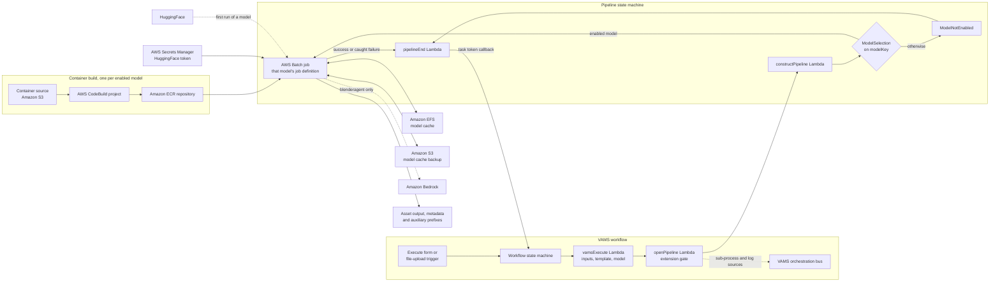

# Image to 3D Pipeline

The Image to 3D pipeline reconstructs a 3D mesh from a single photograph using open-weight image-to-3D models -- textured for most of them, geometry only for Stable3DGen, which can instead take its colour from the input photograph -- and optionally runs an automated print-readiness cleanup that repairs the mesh toward a watertight, manifold STL and then verifies it against a print-readiness gate. The pipeline runs on GPU-accelerated AWS Batch instances and writes the generated mesh, textures and a gate report back to the VAMS asset.

:::info[Seven selectable generation paths]
One deployment can carry up to seven generation paths -- **Stable-X Stable3DGen**, **Microsoft TRELLIS.2**, **Meta SAM 3D Objects**, **VAST-AI TripoSR**, **StepFun Step1X-3D**, **Tencent Hunyuan3D-2**, and a **Blender agent**: OpenAI's Codex CLI reasoning with a vision model on Amazon Bedrock and building the subject in headless Blender, from photographs or by refining another path's output. Each enabled model is built as its own container image and its own AWS Batch job definition, and a configuration template selects which one runs.
:::

:::tip[Choosing a model and its options]
[Image to 3D: Stages, Models and Options](./image-to-3d-options.md) maps every stage, every option each stage takes, which model-and-setting combinations produce colour, what each component is licensed under, and what has been measured so far.
:::

## Overview

| Property                    | Value                                                                                                                                                                                                                                                                                                                                                        |
| --------------------------- | ------------------------------------------------------------------------------------------------------------------------------------------------------------------------------------------------------------------------------------------------------------------------------------------------------------------------------------------------------------ |
| **Models**                  | `stable3dgen` (Stable-X Stable3DGen, default, geometry only), `trellis2` (Microsoft TRELLIS.2), `sam3d` (Meta SAM 3D Objects), `triposr` (VAST-AI TripoSR), `step1x3d` (Step1X-3D), `hunyuan3d` (Tencent Hunyuan3D-2), `blenderagent` (an agent driving Blender). Any combination can be enabled together, which is how one image is compared across models. |
| **Pipeline ID**             | `genai-image-to-3d` (database `GLOBAL`; the workflow uses the same identifier)                                                                                                                                                                                                                                                                               |
| **Configuration flag**      | `app.pipelines.useImageTo3d.enabled`, per-model flags under `app.pipelines.useImageTo3d.models.*`                                                                                                                                                                                                                                                            |
| **Execution type**          | Lambda (asynchronous with task token callback)                                                                                                                                                                                                                                                                                                               |
| **Supported input formats** | `.png`, `.jpg`, `.jpeg` -- one image file per execution; up to four named views of one subject on the Hunyuan3D-2 multi-view template; up to eight photographs plus optionally one existing mesh (`.glb`, `.gltf`, `.obj`, `.stl`, `.ply`) on the Blender agent template                                                                                     |
| **Outputs**                 | GLB, OBJ with MTL and texture images, STL, and a mesh/gate report written as asset metadata                                                                                                                                                                                                                                                                  |
| **Timeout**                 | 2 hours (AWS Batch attempt), 3 hours (pipeline state machine), 4 hours (VAMS workflow task token)                                                                                                                                                                                                                                                            |

## Approximate Run Times

| Phase                                        | Duration       | Notes                                                                                                                                             |
| -------------------------------------------- | -------------- | ------------------------------------------------------------------------------------------------------------------------------------------------- |
| Cold start (instance launch)                 | 4-8 min        | AWS Batch scales to zero between jobs, so every execution pays an instance launch                                                                 |
| Container image pull                         | 3-6 min        | Cached after the first pull on an instance                                                                                                        |
| Model weight restore (Amazon EFS)            | < 1 min        | First run per model: 10-40 min while weights download from HuggingFace                                                                            |
| Preprocess (validation + background removal) | 5-30 sec       | Depends on `BACKGROUND_REMOVAL`; `IMAGE_CLEANUP=skip` bypasses the step entirely                                                                  |
| Generation -- Stable3DGen                    | 30-90 sec      | Normal prediction then geometry generation; estimate for this pipeline                                                                            |
| Generation -- TRELLIS.2                      | 30-120 sec     | Published: roughly 3 sec at 512-cubed to 60 sec at 1536-cubed on an H100                                                                          |
| Generation -- TripoSR                        | 5-30 sec       | Published: sub-second inference on an A100; the range here includes model load                                                                    |
| Generation -- Step1X-3D                      | 2-6 min        | Two-stage geometry then texture synthesis; estimate for this pipeline                                                                             |
| Generation -- Hunyuan3D-2                    | 3-8 min        | Flow-matching shape stage then a multi-view paint stage; estimate for this pipeline                                                               |
| Generation -- Blender agent                  | 20-60 min      | An agentic build-render-compare loop bounded by `BLENDERAGENT_MAX_MINUTES`; cost is model tokens, not GPU time                                    |
| Generation -- Blender refit                  | 1-5 min        | Estimate for this pipeline: a fixed Blender chain on an existing mesh, with no model call; a metaball rebuild and QuadriFlow are the slow options |
| Generation -- SAM 3D Objects                 | 1-4 min        | Estimate for this pipeline                                                                                                                        |
| Mesh cleanup and print gate                  | 20 sec - 5 min | Scales with `TARGET_FACE_COUNT` and the number of `REPAIR_BACKENDS` rungs reached                                                                 |
| Export + Amazon S3 upload                    | < 1 min        | GLB, OBJ set and STL are typically a few MB to a few tens of MB                                                                                   |
| **Total (weights cached)**                   | **~8-20 min**  | Including cold start and container pull; estimate for this pipeline                                                                               |

:::note[Published benchmarks versus pipeline estimates]
The TRELLIS.2 and TripoSR generation figures are the models' published inference characteristics on data-center GPUs. Every other duration in the table is an estimate for this pipeline's own end-to-end run on the recommended instance types, and includes container startup, Amazon S3 transfer and mesh post-processing.
:::

## Architecture

The pipeline runs each model in a dedicated container on a GPU-enabled AWS Batch compute environment. Every enabled model has its own container image and its own AWS Batch job definition; the configuration template applied to an execution names the model, and the pipeline state machine routes the run to that model's job definition. Model weights are cached on a shared Amazon EFS file system and backed up to Amazon S3, so that only the first run of a model downloads from HuggingFace. The HuggingFace token is held in AWS Secrets Manager and reaches the container as a job secret. The Blender agent reasons with a foundation model on Amazon Bedrock, which the job invokes with its task role.



### Processing stages

The first four stages run in AWS Lambda and the AWS Batch job's start-up. The container stages after them are the ones a configuration template configures: its form labels every field with the stage that reads it -- `[1 Input]`, `[2 Generate]`, `[3 Cleanup]`, `[4 Colour]`, `[5 Print]` and `[6 Output]` -- in the order the run executes them, and shows only the stages its model uses.

1. **Input resolution and validation** -- The `vamsExecute` Lambda function resolves the input file, the four output paths, the asset identifier and the database identifier from the execution manifest, resolves the model from the configuration template, and confirms the input files against what that model accepts -- one photograph for most models, up to four named views for Hunyuan3D-2, and up to eight photographs plus one optional mesh to refine for the Blender agent. A mesh handed to any other model is refused here. An unknown model name fails immediately with a clear error.

2. **Extension gate and job submission** -- The `openPipeline` Lambda function checks every input file's extension against the pipeline's allowed extensions (`.png`, `.jpg`, `.jpeg`, plus the mesh formats for the Blender agent alone), registers the run's sub-process and log sources on the VAMS orchestration bus, generates a unique job name, and starts the pipeline state machine.

3. **Definition construction** -- The `constructPipeline` Lambda function builds the container definition -- input file location, output file, metadata and temporary prefixes, the asset and database identifiers, and the resolved model key. The model key is the discriminator the state machine routes on.

4. **Model weight resolution (AWS Batch on GPU instances)** -- The container resolves its weights from the Amazon EFS cache, restoring from the Amazon S3 backup when the cache is cold and downloading from HuggingFace only when neither is populated.

5. **`[1 Input]` Preprocessing and framing** -- The input image is validated and the subject is segmented from its background so that the reconstruction sees a clean silhouette. The cutout is then cropped to the subject, centred, scaled so the subject fills `FRAMING_RATIO` of a square frame, and composited onto the flat `FRAMING_BACKGROUND` colour. Each model was trained on a particular framing, so the framing defaults come from the selected model rather than from one pipeline-wide value; a model whose own pipeline frames the cutout, or which reads the alpha channel as an object mask, declares `none` and receives the cutout untouched. Framing is skipped when `BACKGROUND_REMOVAL` is `none`, because there is then no mask to locate the subject in. Set `IMAGE_CLEANUP` to `skip` when the input is already a cut-out, which bypasses segmentation and framing together and removes their time and cost from the run.

6. **`[2 Generate]` Generation** -- The selected model adapter reconstructs a mesh from the framed image. The Blender agent instead builds the subject in headless Blender against the photographs, or refines an existing mesh supplied beside them.

7. **`[3 Cleanup]` Print-readiness cleanup (optional)** -- When `MESH_CLEANUP` is enabled, the mesh is optionally decimated to `TARGET_FACE_COUNT` and run through the repair ladder, then measured against the print-readiness gate. A mesh being decimated has its uv and normal seams welded first, because the decimator would otherwise treat the per-corner vertices a texture requires as distinct points and an edge collapse across a seam would leave the surface open. The model's own colour is then carried onto the cleaned mesh.

8. **`[4 Colour]` Colour from the photograph (optional)** -- When `PROJECT_PHOTO_COLOUR` is `auto` and the mesh carries no colour of its own, the camera the photograph was taken from is recovered by matching the mesh's outline against the segmented subject, and the photograph is sampled onto the surface that camera could see. This runs after the cleanup, so the colours belong to the vertices that ship. See [Colour from the photograph](#colour-from-the-photograph).

9. **`[5 Print]` Rescale, print features and the gate verdict** -- The mesh is rescaled to `TARGET_SIZE_MM`, whether or not cleanup is enabled. When `PRINT_FEATURES` names one, a hanging loop or a stand base is attached; this runs after the rescale, so its millimetre dimensions describe the printed object, and the gate is re-measured against the result so its verdict covers the mesh that ships. `PRINT_GATE_POLICY` decides whether a failed gate stops the run.

10. **`[6 Output]` Export and upload** -- The mesh is exported in every format listed in `EXPORT_FORMATS` and uploaded to the asset output prefix, preserving the input image's relative location inside the asset. The gate and generation report is written to the metadata prefix, with per-stage timings when `BENCHMARK_REPORT` is on, and `PASS_THROUGH_INPUTS` copies the photographs beside the mesh for a later workflow step.

11. **Completion** -- The `pipelineEnd` Lambda function sends the workflow task token callback for both success and failure, so a failed AWS Batch job surfaces in the workflow execution rather than waiting for the task timeout.

## Model selection

The model is chosen by the configuration template applied to the execution, not by a separate pipeline registration. Each shipped template -- a base template per model, plus variations that pre-select a stage configuration -- pins `MODEL` in its configuration body to one model key:

```json
{
    "MODEL": "stable3dgen",
    "BACKGROUND_REMOVAL": "rembg",
    "MESH_CLEANUP": "true",
    "PRINT_GATE_POLICY": "failClosed",
    "REPAIR_BACKENDS": "trimesh,manifold3d,pymeshfix,pymeshlab",
    "TARGET_FACE_COUNT": 200000,
    "TARGET_SIZE_MM": 0,
    "EXPORT_FORMATS": "glb,obj,stl"
}
```

The configuration template's body is the only source of a run's options. When it leaves `MODEL` unset, the pipeline uses `stable3dgen`.

Asset and database metadata are deliberately not read as inputs. The model key selects the AWS Batch job definition, and therefore the container image, while the container separately selects its model adapter; a second input channel has to agree in both places, and a disagreement routes a run to one model's adapter inside another model's image without any error. Every option is therefore set on the execute form, where it is visible.

The resolved model key is carried into the pipeline state machine, where a Choice state routes the execution to that model's AWS Batch job definition. Only enabled models have a job definition, so selecting a model whose configuration is disabled fails fast with the error `ModelNotEnabled` rather than queuing a job that can never run. The `image-to-3d-stable3dgen` template is the default, matching the `stable3dgen` fallback above, so an execution that names no template runs that model. Operators who enable a different model apply that model's template per execution or mark it as the default for their databases. The pipeline is registered as `genai-image-to-3d` in the `GLOBAL` database; see [Templates](image-to-3d-options.md#templates) for every template identifier and [Options by stage](image-to-3d-options.md#options-by-stage) for every option a template accepts.

## Container Build Options

Each model brings its own upstream repository and its own pinned dependency stack, and those stacks are mutually incompatible in a single image. The pipeline therefore builds **one container image per enabled model** from a shared build specification, selecting the per-model Dockerfile at build time.

### AWS CodeBuild

When `useCodeBuild: true`, each enabled model gets an Amazon ECR repository and an AWS CodeBuild project:

-   The shared container source directory is uploaded to Amazon S3 during CDK deployment.
-   Each CodeBuild project builds its model's Dockerfile and pushes the image to its own Amazon ECR repository, using the previous image as a layer cache.
-   Builds re-trigger automatically when the container source changes.
-   Builds run in the same private VPC subnets as the pipeline AWS Batch compute, with NAT Gateway egress for pulling base images and upstream model repositories.

Builds continue asynchronously after `cdk deploy` returns. A failed build leaves the deployment successful but the AWS Batch job failing on an image pull, so check build status before the first execution:

```bash
aws codebuild list-builds-for-project --project-name <ImageTo3d CodeBuild project>
aws codebuild batch-get-builds --ids <build-id>
```

:::warning[Docker Hub rate limiting]
Builds pull the `nvidia/cuda` base image, which is subject to anonymous pull rate limits and can fail with "429 Too Many Requests". Configure registry credentials in AWS Secrets Manager and reference them from the build, or mirror the base image into a private Amazon ECR repository.
:::

### Local Docker asset

When `useCodeBuild: false`, the images are built locally during `cdk deploy` and pushed to CDK-managed Amazon ECR repositories. Each image contains a full CUDA toolchain plus an upstream model repository, so a deployment with several models enabled requires substantial local disk, memory and bandwidth.

## Model weights

Model weights are never baked into the container image. Each model has its own cache directory on a shared Amazon EFS file system mounted at `/mnt/efs/imageto3d-models`, with the HuggingFace cache for a model under `hf_cache/<modelKey>`. The same layout is mirrored into the model cache Amazon S3 bucket under the `imageTo3d/hf_cache/<modelKey>` prefix.

On startup the container resolves weights in this order:

1. **Amazon EFS cache** -- If the model's cache directory on Amazon EFS is complete, it is used directly and no network transfer occurs.
2. **Amazon S3 restore** -- If Amazon EFS is empty or incomplete, the cache is restored from the Amazon S3 backup prefix, which is faster and more reliable than a HuggingFace download and needs no HuggingFace availability.
3. **HuggingFace download** -- If neither cache is populated, the weights are downloaded from HuggingFace using the configured token, then written to Amazon EFS and backed up to Amazon S3 for later runs.

Setting the `INVALIDATE_MODEL_CACHE` parameter to `true` clears both the Amazon EFS cache and the Amazon S3 backup for the selected model and forces a fresh download. Because the file system is shared across AWS Batch instances, the container also clears stale partial-download and lock files on startup so that an interrupted earlier attempt cannot block later runs.

:::info[Amazon EFS costs]
The Amazon EFS file system stores model weights and incurs standard Amazon EFS storage costs for as long as the cache exists. The file system uses General Purpose performance mode with elastic throughput. Monitor storage growth as models are enabled, and consider Amazon EFS lifecycle policies for long-term cost optimization.
:::

## Prerequisites

:::warning[Model licenses and HuggingFace access]
Accept each model's license on HuggingFace before enabling it, using the same HuggingFace account that issues the access token. Three repositories are gated and need an approved access request on that account -- see **Model access** below. The Meta SAM License additionally carries trade-control terms and a redistribute-under-the-same-license obligation -- review it against your deployment Region and distribution plans before enabling `sam3d`.
:::

| Model                | Parameters                   | Minimum VRAM  | License                                                                                                                                                                                    | Source                                                                                                                                       |
| -------------------- | ---------------------------- | ------------- | ------------------------------------------------------------------------------------------------------------------------------------------------------------------------------------------ | -------------------------------------------------------------------------------------------------------------------------------------------- |
| Stable-X Stable3DGen | Not published                | 16 GB         | MIT (weights MIT / Apache-2.0, none gated)                                                                                                                                                 | [Stable-X/Stable3DGen](https://github.com/Stable-X/Stable3DGen)                                                                              |
| Microsoft TRELLIS.2  | 4B                           | 24 GB         | MIT code and weights, but renders through NVIDIA-licensed `nvdiffrast` and conditions on Meta's **gated** DINOv3 encoder                                                                   | [microsoft/TRELLIS.2](https://github.com/microsoft/TRELLIS.2)                                                                                |
| Meta SAM 3D Objects  | Not published                | 24 GB         | Meta SAM License (trade-control terms; redistribute-as-same); estimates depth through the ungated Apache-2.0 MoGe model                                                                    | Meta AI -- SAM 3D Objects (HuggingFace, license acceptance required)                                                                         |
| VAST-AI TripoSR      | Not published                | 8 GB          | MIT                                                                                                                                                                                        | [VAST-AI-Research/TripoSR](https://github.com/VAST-AI-Research/TripoSR)                                                                      |
| StepFun Step1X-3D    | Not published                | 24 GB         | Apache-2.0                                                                                                                                                                                 | [stepfun-ai/Step1X-3D](https://github.com/stepfun-ai/Step1X-3D)                                                                              |
| Tencent Hunyuan3D-2  | 1.1B shape + 1.3B paint      | 16 GB         | Tencent Hunyuan 3D 2.0 Community License -- **no licence in the European Union, the United Kingdom or South Korea**, and a separate Tencent licence above one million monthly active users | [Tencent-Hunyuan/Hunyuan3D-2](https://github.com/Tencent-Hunyuan/Hunyuan3D-2)                                                                |
| Blender agent        | The configured Bedrock model | None required | Blender GPL-2.0-or-later (tooling), Codex CLI Apache-2.0, LiteLLM MIT, MoGe-2 MIT (the refit's depth model); the model's terms are Amazon Bedrock's                                        | [openai/codex](https://github.com/openai/codex), [blender.org](https://www.blender.org), [microsoft/MoGe](https://github.com/microsoft/MoGe) |

The models differ in the form their colour arrives in, which the run reports as its texture status. Most return a UV atlas. Where the cleanup leaves the vertex set exactly as the atlas was measured over, that atlas and its UV array go back on unchanged and the status is `preserved`. Where the cleanup changed the topology, the atlas is **re-baked**: each cleaned vertex is located on the model's original surface, the UV field is read there, and the original atlas is rasterised into a fresh layout over the cleaned mesh, reported as `rebakedFromAtlas`. Locating the vertex on the original surface rather than at the nearest surviving vertex is what keeps the colour on the right body part where a decimation has moved a vertex further than the gap to a neighbouring surface. Stable3DGen returns geometry alone. SAM 3D Objects returns colour per vertex, which the pipeline samples onto the cleaned mesh from the nearest captured vertex and leaves as a colour array: glTF carries one natively and exactly, and a renderer interpolates it across a triangle correctly. Colour held per vertex is limited to the detail the vertex spacing can carry, so it is reported as `fromVertexColors` rather than as a preserved texture.

-   **HuggingFace account and token** -- Create an account at [huggingface.co](https://huggingface.co/) and generate a Read access token. Place the token value in the `huggingFaceToken` configuration field; CDK stores it in AWS Secrets Manager and the container receives it as a secret at job start, so it never appears in a CloudFormation template or an environment variable in the console.
-   **Model access** -- Accept the license on every model repository you plan to enable, using **the same HuggingFace account that issued the `huggingFaceToken`**. Access is granted to that account, not to the deployment, so a licence accepted under a different account leaves the token unable to download the weights.

    Three repositories are **gated**. The account has to request access before the first run, and a pending request behaves exactly like a denied one. The failure surfaces only in the weight-cache stage -- after an AWS Batch GPU instance has been provisioned and the container image pulled -- so request access before deploying.

    | Gated repository                           | Approval                          | Needed by                                                               |
    | ------------------------------------------ | --------------------------------- | ----------------------------------------------------------------------- |
    | `facebook/sam-3d-objects`                  | Manual, by Meta, and not instant  | `sam3d`                                                                 |
    | `facebook/dinov3-vitl16-pretrain-lvd1689m` | Manual, by Meta, and not instant  | `trellis2` -- its image encoder, required whenever the model is enabled |
    | `briaai/RMBG-2.0`                          | Granted on accepting BRIA's terms | Only `BACKGROUND_REMOVAL=rmbg2`, or `TRELLIS2_PREPROCESS_IMAGE=true`    |

    Every repository each model downloads, and whether the account needs approval for it:

    | Model or option            | HuggingFace repositories                                                             | Approval needed                              |
    | -------------------------- | ------------------------------------------------------------------------------------ | -------------------------------------------- |
    | `stable3dgen`              | `Stable-X/trellis-normal-v0-1`, `Stable-X/yoso-normal-v1-8-1`, `ZhengPeng7/BiRefNet` | None                                         |
    | `trellis2`                 | `microsoft/TRELLIS.2-4B`, `facebook/dinov3-vitl16-pretrain-lvd1689m`                 | DINOv3, from Meta                            |
    | `sam3d`                    | `facebook/sam-3d-objects`, `Ruicheng/moge-vitl`                                      | SAM 3D Objects, from Meta                    |
    | `triposr`                  | `stabilityai/TripoSR`                                                                | None                                         |
    | `step1x3d`                 | `stepfun-ai/Step1X-3D`                                                               | None                                         |
    | `hunyuan3d`                | `tencent/Hunyuan3D-2`, `tencent/Hunyuan3D-2mv`                                       | None; the licence is territorial (see below) |
    | `blenderagent`             | `Ruicheng/moge-2-vitl-normal`, the scripted refit's depth model                      | None; Amazon Bedrock model access instead    |
    | `BACKGROUND_REMOVAL=sam`   | `facebook/sam-vit-huge`                                                              | None                                         |
    | `BACKGROUND_REMOVAL=rmbg2` | `briaai/RMBG-2.0`                                                                    | RMBG-2.0, from BRIA                          |

    The `rembg` and `birefnet` background removers fetch their weights from a GitHub release rather than HuggingFace. A repository's owner sets its gating and can change it, and the repository's HuggingFace page shows its current state.

    A model's own license says nothing about what its dependencies require. TRELLIS.2 is the case that matters: its code and weights are MIT and ungated, but it conditions on Meta's gated DINOv3 encoder, so a token that downloads `microsoft/TRELLIS.2-4B` without complaint is still refused for the encoder. The pipeline lists the encoder among TRELLIS.2's weights, so that refusal is reported in the weight-cache stage and names the repository.

    :::caution[RMBG-2.0 is gated *and* restricted for commercial use]
    `briaai/RMBG-2.0` requires a separate commercial license agreement with BRIA in addition to accepting its terms on HuggingFace. Neither the default background removal (`rembg`) nor the default TRELLIS.2 configuration touches it, so no approval is needed unless you select `BACKGROUND_REMOVAL=rmbg2` or set `TRELLIS2_PREPROCESS_IMAGE=true`. Review BRIA's terms against your deployment before enabling either.
    :::

-   **GPU instance availability** -- The compute environment uses `BEST_FIT_PROGRESSIVE` across the configured instance types. Confirm that at least one configured type has capacity in the deployment Region, and request a quota increase if jobs stay in `RUNNABLE`.
-   **Amazon EFS** -- The pipeline creates a shared, encrypted Amazon EFS file system for the model cache and mounts it on every AWS Batch instance at `/mnt/efs/imageto3d-models`.
-   **VPC with internet egress** -- AWS Batch compute runs in private subnets that reach the internet through a NAT Gateway, which is required for HuggingFace downloads on the first run per model and for the container build. Enabling the pipeline requires the global VPC.

## Configuration

Add the following to your `config.json` under `app.pipelines`:

```json
{
    "app": {
        "pipelines": {
            "useImageTo3d": {
                "enabled": true,
                "huggingFaceToken": "hf_yourTokenHere",
                "useCodeBuild": true,
                "autoRegisterWithVAMS": true,
                "autoTriggerOnFileExtensionsUpload": "",
                "instanceTypes": [
                    "g6e.xlarge",
                    "g6e.2xlarge",
                    "g6e.4xlarge",
                    "g6.2xlarge",
                    "g6.4xlarge",
                    "g6.8xlarge",
                    "g5.2xlarge",
                    "g5.4xlarge",
                    "g5.8xlarge"
                ],
                "maxVCpus": 48,
                "models": {
                    "stable3dgen": { "enabled": true },
                    "trellis2": { "enabled": false },
                    "sam3d": { "enabled": false },
                    "triposr": { "enabled": false },
                    "step1x3d": { "enabled": false },
                    "hunyuan3d": { "enabled": false },
                    "blenderagent": {
                        "enabled": false,
                        "bedrockModelId": "global.openai.gpt-6-astra",
                        "useStabilityImageEditing": true
                    }
                }
            }
        }
    }
}
```

| Option                                         | Default                           | Description                                                                                                                                                                                                                                                                                                                                                                                                                                                                                                                                                                            |
| ---------------------------------------------- | --------------------------------- | -------------------------------------------------------------------------------------------------------------------------------------------------------------------------------------------------------------------------------------------------------------------------------------------------------------------------------------------------------------------------------------------------------------------------------------------------------------------------------------------------------------------------------------------------------------------------------------- |
| `enabled`                                      | `false`                           | Deploy the Image to 3D pipeline infrastructure. Requires the global VPC.                                                                                                                                                                                                                                                                                                                                                                                                                                                                                                               |
| `huggingFaceToken`                             | `""`                              | HuggingFace Read access token value. CDK stores it in AWS Secrets Manager during deployment. Required when the pipeline is enabled.                                                                                                                                                                                                                                                                                                                                                                                                                                                    |
| `useCodeBuild`                                 | `true`                            | When `true`, builds one container image per enabled model with AWS CodeBuild. When `false`, builds the images locally during `cdk deploy`.                                                                                                                                                                                                                                                                                                                                                                                                                                             |
| `autoRegisterWithVAMS`                         | `true`                            | Register the pipeline, workflow and configuration templates with VAMS at deploy time.                                                                                                                                                                                                                                                                                                                                                                                                                                                                                                  |
| `autoTriggerOnFileExtensionsUpload`            | `""`                              | Enables the workflow's file-upload trigger when set to any non-empty value. The extensions that actually match are the workflow's input file filters (`*.png`, `*.jpg`, `*.jpeg`), not this string.                                                                                                                                                                                                                                                                                                                                                                                    |
| `instanceTypes`                                | Nine `g6e`, `g6` and `g5` types   | EC2 GPU instance types for the AWS Batch compute environment (`BEST_FIT_PROGRESSIVE`). The templates list `g6e.xlarge` through `g5.8xlarge`, as in the example above.                                                                                                                                                                                                                                                                                                                                                                                                                  |
| `maxVCpus`                                     | `48`                              | Maximum vCPUs for the AWS Batch compute environment. Each job requests 4 vCPUs, about 26 GB of memory and 1 GPU.                                                                                                                                                                                                                                                                                                                                                                                                                                                                       |
| `models.stable3dgen.enabled`                   | `true`                            | Build and register the Stable-X Stable3DGen model. This is the model the default configuration template selects. It produces geometry without texture.                                                                                                                                                                                                                                                                                                                                                                                                                                 |
| `models.trellis2.enabled`                      | `false`                           | Build and register the Microsoft TRELLIS.2 model, kept available as a quality comparison. Its image needs a different Python and CUDA toolchain from the rest of the pipeline, and it pulls NVIDIA-licensed rendering components whose redistribution terms need review before distribution.                                                                                                                                                                                                                                                                                           |
| `models.sam3d.enabled`                         | `false`                           | Build and register the Meta SAM 3D Objects model. Review the Meta SAM License before enabling.                                                                                                                                                                                                                                                                                                                                                                                                                                                                                         |
| `models.triposr.enabled`                       | `false`                           | Build and register the VAST-AI TripoSR model.                                                                                                                                                                                                                                                                                                                                                                                                                                                                                                                                          |
| `models.step1x3d.enabled`                      | `false`                           | Build and register the StepFun Step1X-3D model.                                                                                                                                                                                                                                                                                                                                                                                                                                                                                                                                        |
| `models.hunyuan3d.enabled`                     | `false`                           | Build and register the Tencent Hunyuan3D-2 model. Its licence grants no rights in the European Union, the United Kingdom or South Korea, and enabling it in an AWS Region inside that territory is rejected. Review the Tencent Hunyuan 3D 2.0 Community License Agreement before enabling.                                                                                                                                                                                                                                                                                            |
| `models.blenderagent.enabled`                  | `false`                           | Build and register the Blender agent: OpenAI Codex CLI driving headless Blender, reasoning with a vision model on Amazon Bedrock. The job role is granted `bedrock:InvokeModel` when enabled. Blender is GPL-2.0-or-later.                                                                                                                                                                                                                                                                                                                                                             |
| `models.blenderagent.bedrockModelId`           | `""`                              | The Amazon Bedrock model id or inference-profile id the agent reasons with; it must accept image input. Required when the agent is enabled. The commercial template carries `global.openai.gpt-6-astra` (GPT-6 Astra). The GovCloud and EU Sovereign templates leave it empty, because the `global.` cross-Region inference profile exists only in the commercial partition, and an id with a `global.` or `us.` prefix is rejected outside it. Every run of the deployment uses this model: it is not a template option, because the job role's `bedrock:InvokeModel` grant names it. |
| `models.blenderagent.useStabilityImageEditing` | `true` in the commercial template | Lets the agent complete the sides of a model the photographs never covered with Stability AI image-editing models on Amazon Bedrock, reached through their `us.` inference profiles. Those profiles exist only in the commercial partition's US Regions, so the setting is rejected in any other Region, and it defaults to `true` there when the field is absent. With it `false` the agent textures from the photographs alone.                                                                                                                                                      |

At least one model must be enabled when the pipeline is enabled, and `instanceTypes` must be a non-empty array.

## GPU Instance Recommendations

Every enabled model shares one compute environment and one job queue, so the configured instance types must satisfy the most demanding model you enable.

| Model                | Minimum VRAM | Recommended instance        | Notes                                                                                                                                                                            |
| -------------------- | ------------ | --------------------------- | -------------------------------------------------------------------------------------------------------------------------------------------------------------------------------- |
| Stable-X Stable3DGen | 16 GB        | Any configured type         | The default model; geometry only                                                                                                                                                 |
| Microsoft TRELLIS.2  | 24 GB        | g6e.xlarge (1x L40S 48 GB)  | `TRELLIS2_PIPELINE_TYPE` drives both run time and peak memory; the cascade tiers need headroom                                                                                   |
| Meta SAM 3D Objects  | 24 GB        | g6e.xlarge (1x L40S 48 GB)  | Strongest measured on cluttered real-world photographs with occlusion and background context                                                                                     |
| VAST-AI TripoSR      | 8 GB         | g6e.xlarge (1x L40S 48 GB)  | Fits comfortably in roughly 6-8 GB; instance choice is driven by the other enabled models                                                                                        |
| StepFun Step1X-3D    | 24 GB        | g6e.2xlarge (1x L40S 48 GB) | Two-stage geometry and texture synthesis raises peak memory above the single-stage models                                                                                        |
| Tencent Hunyuan3D-2  | 16 GB        | g6.8xlarge (1x L4 22 GB)    | The lightest of the textured models: about 6 GB for the shape stage and about 16 GB with the paint stage, because the shape pipeline is released before the paint pipeline loads |

:::tip[Sizing for the whole model set]
A single 48 GB GPU instance covers all seven paths; the Blender agent needs no GPU memory of its own. Enable only the models you intend to use -- each additional model adds a container image build, an Amazon ECR repository and its own weight download on first run.
:::

## Print-readiness mesh cleanup

Generative reconstruction produces a mesh that renders correctly but is frequently not printable: it can contain holes, inverted or inconsistent normals, non-manifold edges where more than two faces meet, and zero-volume shells. When `MESH_CLEANUP` is enabled, the pipeline runs a repair ladder and then verifies the result against a print-readiness gate.

### Repair ladder

All four backends are installed in every container image, and the ones named in `REPAIR_BACKENDS` -- all four of them by default -- are applied in a fixed order, stopping as soon as the gate passes:

1. **`trimesh`** -- hole filling, normal fixing, winding correction and inversion correction. MIT licensed.
2. **`manifold3d`** -- a manifold pass that resolves self-intersections and non-manifold topology. Apache-2.0 licensed.
3. **`pymeshfix`** -- aggressive hole filling and shell repair. GPL-3.0 licensed.
4. **`pymeshlab`** -- filter-based remeshing and repair. GPL-3.0 licensed.

The ladder runs in this order whatever order `REPAIR_BACKENDS` names the backends in, so a run is reproducible. Naming a backend that is not one of these four rungs fails the run with a clear error rather than silently skipping it. A rung that is a valid name but cannot execute -- for example when the installed package raises on the call the ladder makes -- is skipped with a warning and recorded in the gate report, and the ladder continues with the remaining rungs, so an unusable rung does not cost the generation work already done.

Every configuration template offers the ladder as a **Mesh repair ladder** field with three selections, so an operator chooses the rungs per run without editing the configuration body:

-   `trimesh,manifold3d,pymeshfix,pymeshlab` -- the full ladder, and the default. It gives the best chance of a watertight, printable result.
-   `trimesh,manifold3d` -- the permissively licensed rungs only, for a run that must exclude the GPL-3.0 backends.
-   `trimesh` -- the single least invasive rung.

The field applies only when `MESH_CLEANUP` is enabled; with cleanup off there is no ladder to walk.

### Rejecting a destructive repair

The gate measures **printability, not likeness**, and the two are independent. A repair step that discards most of the model leaves something trivially watertight, manifold and defect-free, which passes every criterion while being useless: `pymeshfix` in particular reduces its input to a single closed body, so a reconstruction that arrived in several disconnected pieces can come out as one small fragment with a perfect gate report.

Each rung's result is therefore checked against the volume the mesh arrived with. A rung that leaves less than `MIN_VOLUME_RETENTION` of that volume is **discarded**, and the ladder continues from the mesh as it stood before that rung. Hole filling normally preserves or slightly increases volume, so a large loss indicates geometry was removed rather than repaired.

A rejection is recorded in the gate report under `repairsRejected`, and as a `repair rejected -- <backend>: kept <n>% of the original volume` entry in `failures`, alongside the `volumeRetained` figure for the mesh that shipped. A run whose gate fails only because its most aggressive rung was rejected is a run that kept its geometry, which is usually the outcome you want; lower the floor to allow more aggressive repair, or set it to `0` to accept any result.

### Print-readiness gate

After repair, the mesh must satisfy all of the following:

-   The mesh is watertight.
-   There are zero non-manifold edges.
-   There are zero non-manifold vertices.
-   The enclosed volume is greater than zero.
-   There are no broken faces.
-   The mesh is in one connected piece, plus one for each print feature attached by `concat`.

The connectivity criterion catches what the others structurally cannot. Every other criterion describes the surface of a shell, so a subject that came apart satisfies all of them: a reconstruction whose mug handle had separated from its body measured watertight, fully manifold, free of broken faces and positive in volume, and would have printed as a loose crescent beside a mug. The report records `bodies` against `expectedBodies` so the allowance a print feature is given is visible rather than implied.

These criteria are measured on a **position-welded copy** of the mesh, and the mesh that is exported keeps its original vertices. A texture needs two different UV coordinates wherever its atlas has a seam, so a textured mesh carries a separate vertex per face corner at every seam. That splits the shared edge into two edges each used by one face, and measured on the vertex indices alone each seam counts as a non-manifold edge: a sphere that is watertight with a single body reports thousands of non-manifold edges and one body per face purely by acquiring a texture, while enclosing exactly the same volume. Welding coincident positions for the measurement is what lets a textured mesh pass a criterion set written for a solid, and it masks nothing -- welding merges coincident positions, it does not fill holes, so a genuine hole is still reported.

`PRINT_GATE_POLICY` decides what happens when the gate does not pass:

-   **`failClosed`** (default) -- the execution fails and **no mesh output is written**, so a non-printable mesh cannot be mistaken for a printable one. The gate report is still written so that the failing criteria are visible.
-   **`bestEffort`** -- all outputs are written and the gate results are recorded in the report. Review the report before sending the mesh to a printer.

The gate report carries the measured value behind every criterion, the verdict in `passed`, and two fields that explain how the ladder reached it:

-   `backendsApplied` lists only the rungs that ran to completion, in ladder order, so a mesh that needed the GPL-3.0 rungs is distinguishable from one the permissive rungs repaired.
-   `failures` lists the criteria the mesh still fails. A rung that was reached but could not execute appears here as `repair backend skipped -- <backend>: <ExceptionType>`, alongside the criteria, which is how a report shows that the ladder walked past a rung rather than through it.

The report is written as the `IMAGE_TO_3D_PRINT_GATE_REPORT` asset metadata key. It reaches the asset through a document named `asset.metadata.json` under the execution's metadata prefix: the workflow's output processing treats any other `*.metadata.json` name as file-level metadata for the file its stem names, and fails the execution when that file is absent from the output. Since this pipeline's outputs are meshes rather than the source photograph, the report is asset-level.

### Cleanup disabled

With `MESH_CLEANUP` set to `false`, the mesh is exported exactly as the model generated it. Decimation, rescaling and the gate are all skipped, and the output is **not guaranteed to be printable**. Use this setting when the mesh is destined for visualization, review or a downstream tool that performs its own repair.

## Colour from the photograph

Stable3DGen reconstructs geometry only -- it carries no appearance decoder, so there is nothing in the
model to enable. `PROJECT_PHOTO_COLOUR` set to `auto` colours such a mesh from the other direction, by
sampling the input photograph onto it. It applies to any mesh that reached the stage with no colour,
and has no effect on a model that produced its own.

The photograph does not record the camera it was taken from, so the pipeline supplies it from two
sources, in order.

Each model declares the **view its own output frame puts the input photograph at**, the way it declares
its up axis, because a reconstruction is written into a frame keyed to that photograph -- the view is a
property of the model, not of the run. Stable3DGen declares 0 degrees. Given a declared view, only the
tilt is searched, along with a 15-degree window either side of the declared angle.

A model with no declared view falls back to **recovering the pose from the outline**: the mesh's
silhouette is rendered over a grid of three up axes, 24 azimuths and five elevations, and each one
scored against the segmented subject by intersection over union.

The declaration comes first because the outline is not always enough to find the view, and where it is
not enough it can prefer the wrong one. On a mug, whose handle makes its outline distinctive, the search
recovers the declared view and agrees with it. On a standing figure -- whose outline is nearly the same
from many directions -- the search preferred a view 225 degrees away from the right one, scoring it
higher (0.838) than the correct view (0.776), and the colour it projected landed the photograph's tones
on the wrong parts of the body while every number the run reported looked healthy. A vertex is measured from the photograph when it faces the camera and lands
on the subject; every other vertex takes the colour of the nearest vertex that was measured.

What that means for the result is worth being plain about:

-   **The side the camera saw is measured, and the rest is inferred.** On the reference mug, 34% of
    vertices were sampled from the photograph and the remaining 66% inherited a neighbour's colour. On a
    roughly symmetric subject this reads as the front colour wrapping around; it is not a measurement of
    the back.
-   **The pose is reported with its provenance and its confidence.** `poseFromDeclaredView` says the
    view came from the model's declaration; `poseMargin` is a recovered pose's lead over the best
    genuinely different one, and `poseDecisive` is false when that lead is small. A subject with no
    asymmetry -- a plain vase -- has no recoverable view at all, and a mirror-symmetric subject
    photographed at an angle has two that fit its outline equally and project mirrored colour.
-   **The tilt's direction is weaker than its size.** Tilting the camera up or down by the same angle
    gives nearly the same outline: measured on one subject, a planted +20 degrees scored 0.9858 while
    -20 scored 0.9859. `poseElevationSignMargin` reports that gap, and a projection from the wrong sign
    is shifted vertically on the subject.
-   **Only the surface the camera could see is sampled.** A vertex has to face the camera, have no
    nearer surface of the same mesh in front of it, and land inside the subject rather than on the
    mask's anti-aliased boundary. Without the depth test, vertices behind a forearm sampled the
    forearm's pixels and painted skin-coloured blotches across a figure's jeans.
-   **The view can be stated.** `PROJECT_PHOTO_POSE` overrides both sources when a photograph was not
    taken from the view the model expects, or when the run report says the pose was not decisive and
    the colour looks misplaced. An angle alone states the direction and leaves the tilt to the search.
-   **No colour is projected when the photograph and the mesh do not correspond.** A best pose below an
    intersection-over-union of 0.35 is refused, as is a subject mask derived from the background colour
    that covers more than 85% of the frame, which means the background was not separated and the sampled
    colour would be the background's. Run with `BACKGROUND_REMOVAL` enabled, or supply an image with an
    alpha channel, and the mask comes from the segmentation instead.

The run reports `IMAGE_TO_3D_TEXTURE_STATUS` as `projectedFromPhotograph`, and records the pose, its
confidence, the share of vertices measured and where the subject mask came from under
`IMAGE_TO_3D_PROJECTED_COLOUR`. The colour is attached per vertex and stays that way, which is what glTF
carries natively; the OBJ export bakes it into a UV atlas, and STL carries no colour at all.

## Print features

`PRINT_FEATURES` attaches parametric geometry the reconstruction cannot produce on its own: `loop` adds a hanging ring at the top of the model, and `base` adds a flat-bottomed cylinder underneath so the model stands and the slicer gets a stable first layer.

The feature dimensions are millimetres of the printed object, and they are applied **after** the rescale. Set `TARGET_SIZE_MM` alongside them: with it left at `0` the mesh keeps the model's own arbitrary scale, and a millimetre dimension has no fixed meaning against it. A dimension left at `0` is sized as a fraction of the model instead, which is scale-independent and works either way.

The gate is re-measured after a feature is attached, so its verdict describes the mesh that ships rather than the geometry the cleanup left behind. The repair rungs and volume retention recorded in the report still describe the cleanup, since re-measuring a finished mesh cannot recover them.

### Attachment and colour

How a feature is attached is a genuine trade-off. A boolean union produces a single solid but **discards the mesh's texture entirely** -- the resulting mesh carries no UV coordinates and no material at all. On a colour print that is the wrong outcome, and because the union still passes every print-readiness criterion, nothing about the gate result would reveal it.

`PRINT_FEATURE_JOIN` therefore selects between two behaviours:

| Value    | Result                                                                        | Use when                                                                   |
| -------- | ----------------------------------------------------------------------------- | -------------------------------------------------------------------------- |
| `concat` | Texture preserved; the feature is a second closed shell overlapping the model | The mesh carries colour that has to survive                                |
| `union`  | One fused solid; the texture is discarded                                     | The mesh is geometry-only, or the output is an STL for monochrome printing |
| `auto`   | `concat` for a textured mesh, `union` for a geometry-only one                 | Default; the right choice unless you are comparing runs                    |

Overlapping closed shells slice correctly, because a slicer fills by winding rule and so performs the union itself at slice time. The print gate cannot distinguish the two cases -- two disjoint closed shells are watertight, have no non-manifold edges and no broken faces -- so the join used and the resulting body count are both recorded in the report under `IMAGE_TO_3D_PRINT_FEATURES`. Read them alongside the gate verdict, since "passed" means something different for each.

Added geometry is given its own flat `PRINT_FEATURE_COLOR`. Without one it still receives UV coordinates into the model's texture atlas and prints as a smear of whichever part of the subject its unwrap happens to land on.

The colour is painted into a small block of texels the model's own UV coordinates do not reference, so the mesh keeps a single atlas at its original resolution. Supplying the feature as a second image instead would make the atlas packer combine the two, and it enlarges the result regardless of how small the added image is -- a 2048-pixel atlas becomes 8192, sixteen times the area with most of it unused, on the output the colour requirement cares most about.

Feature dimensions extend the object beyond `TARGET_SIZE_MM`. That setting scales the reconstructed model, and a base is then sized from the model's own footprint, so a 60 mm model with a default base measures about 69 mm across overall. Set `BASE_DIAMETER_MM` explicitly when the finished object has to fit a specific build volume.

:::warning[The container images carry GPL-3.0 components]
`pymeshfix` and `pymeshlab` are licensed under GPL-3.0 and are installed in every model image, so each image is subject to the obligations of GPL-3.0 -- including source availability obligations if you distribute those images. This holds regardless of which rungs `REPAIR_BACKENDS` selects, because the obligation follows the packages present in the image rather than the code a run executes. Review GPL-3.0 against your distribution model before deploying, and leave the pipeline disabled if your deployment cannot accept GPL-3.0 components in its container images.
:::

## Outputs

| Format            | Extension                       | Description                                                                                                                  |
| ----------------- | ------------------------------- | ---------------------------------------------------------------------------------------------------------------------------- |
| glTF binary       | `.glb`                          | Self-contained textured mesh, viewable directly in the VAMS web interface                                                    |
| Wavefront OBJ     | `.obj` with `.mtl` and textures | Mesh, material definition and texture images kept together so that the material's relative texture references resolve        |
| Stereolithography | `.stl`                          | Geometry-only mesh for 3D printing and slicing; the gate report records whether it is watertight and manifold                |
| Gate report       | `asset.metadata.json`           | Generation settings, repair rungs applied and every print-readiness criterion with its measured result, applied to the asset |
| Per-file metadata | `<mesh>.metadata.json`          | Applied to each mesh: the model that produced it, its licence, whether that file carries colour, and the run's measurements  |

Which of the three mesh formats are produced is controlled by `EXPORT_FORMATS`. Both metadata documents are written to the execution's metadata prefix and applied as metadata rather than returned as downloadable asset files.

### Metadata applied to each mesh

The gate report describes the run and is applied to the **asset**, which means an asset holding meshes from several models carries only the most recent run's report. Each exported mesh therefore also carries its own metadata, so the file identifies itself without opening the execution that produced it:

| Key                                                                         | Example                          | Notes                                                                                                                   |
| --------------------------------------------------------------------------- | -------------------------------- | ----------------------------------------------------------------------------------------------------------------------- |
| `IMAGE_TO_3D_MODEL`                                                         | `stable3dgen`                    | The model that produced this file                                                                                       |
| `IMAGE_TO_3D_MODEL_NAME`                                                    | `Stable-X Stable3DGen (Hi3DGen)` |                                                                                                                         |
| `IMAGE_TO_3D_MODEL_LICENSE`                                                 | `MIT`                            | The model's own licence, as the adapter declares it                                                                     |
| `IMAGE_TO_3D_TEXTURE_STATUS`                                                | `projectedFromPhotograph`        | The route the **mesh's** colour took                                                                                    |
| `IMAGE_TO_3D_COLOUR_IN_FILE`                                                | `false` for an `.stl`            | Whether **this file** holds colour, which differs from the status above: a textured mesh still writes a colourless STL  |
| `IMAGE_TO_3D_SOURCE_IMAGE_NAME`                                             | `mug.png`                        | The photograph it was reconstructed from                                                                                |
| `IMAGE_TO_3D_JOB_NAME`                                                      | `ImageTo3dJob_20260825_...`      | The run that produced it                                                                                                |
| `IMAGE_TO_3D_PRINT_READY`, `IMAGE_TO_3D_FACE_COUNT`, `IMAGE_TO_3D_BODIES`   | `true`, `188244`, `1/1`          | Present when the cleanup ran                                                                                            |
| `IMAGE_TO_3D_COLOUR_SOURCE`, `IMAGE_TO_3D_COLOUR_MEASURED_FRACTION`         | `photograph`, `0.21`             | Present when colour came from the photograph — the fraction is how much of the surface was sampled rather than inferred |
| `IMAGE_TO_3D_INSTANCE_TYPE`, `IMAGE_TO_3D_GPU`                              | `g5.8xlarge`, `NVIDIA A10G`      | Present when `BENCHMARK_REPORT` is on                                                                                   |
| `IMAGE_TO_3D_SECONDS_GENERATE`, `_PREPROCESS`, `_CLEANUP`, `_PROJECTCOLOUR` | `44.4`                           | Where the run's time went, per stage                                                                                    |
| `IMAGE_TO_3D_FILL_RATIO`                                                    | `0.2166`                         | Volume against the convex hull — low for a hollow subject, high for a solid one                                         |
| `IMAGE_TO_3D_BENCHMARK`                                                     | JSON                             | The whole benchmark document, for anything the flat fields leave out                                                    |

The values are flat rather than one JSON document so they read in the asset's metadata view and can be searched on. A document is written only for a mesh the run actually exported, because the workflow's metadata write-back rejects a document naming a file that is absent from the output.

Outputs land at the **input image's relative path inside the asset**. An image at `photos/front/subject.png` produces its mesh set under the same `photos/front/` subdirectory of the output location, so an asset with many source images keeps its structure instead of collapsing into one flat directory. The workflow's default output path extension appends the execution identifier, so repeated runs on the same image do not overwrite each other.

### Benchmark reporting

With `BENCHMARK_REPORT` enabled, the run records an `IMAGE_TO_3D_BENCHMARK` block in the generation report describing what it did and what it ran on. It adds no GPU work, and it is what makes a comparison across models, segmentation paths and quality settings meaningful:

-   **Per-stage durations** for weight cache resolution, input download, preprocessing, generation, mesh load, cleanup, print features, export and upload. Weight cache resolution is timed separately from generation on purpose: a cold cache downloads weights over the network, and folding that into the model's own duration makes the first run of any model look like a slow model.
-   **Host facts** -- the instance type, the GPU the run landed on and the AWS Batch job identity. A queue that can schedule several instance families will not give the same duration twice, so a duration is only comparable alongside the hardware that produced it.
-   **Outcome** -- texture status, print-gate result, and the byte size of every file produced.
-   **Shape descriptors** of the mesh as it ships: how much of its convex hull it fills, its ground-plane aspect, its proportion, and its **genus**. The first three mean little alone and a lot compared across models given the same photograph. Genus is read differently: it counts the TUNNELS through a closed surface, and any tunnel is a defect on its own terms. It is recorded here rather than as a print-gate criterion because a tunnel usually prints -- what it damages is the likeness, and one surfacing as a pinhole through a head passes every criterion the gate applies. Genus is measured on a position-welded copy, as the gate's criteria are, and is absent for a surface that is not closed, where it is undefined.

A comparison harness under `backendPipelines/genAi/imageTo3d/benchmark/` sweeps models and settings over a fixed image set and aggregates these per-run reports into a quality, speed and cost comparison with per-stage costing. See its `README.md`.

The report records the **inputs to a cost calculation rather than a cost**: instance pricing is regional and changes over time, so an aggregating harness derives cost from the recorded instance type and duration. A fact that cannot be collected is recorded with the reason it failed instead of being omitted, so a missing GPU name reads as a collection failure rather than as a hardware difference.

## Pipeline Input Parameters

These parameters are set in the configuration template's body and can be overridden per execution. Every parameter is optional and carries a default, so the pipeline also runs headless from a file-upload trigger with no form input. An empty value is treated as "use the default".

| Parameter                      | Default                                  | Description                                                                                                                                                                                                                                                                                                                                                                                                                                                                                                                                                                                                                                          |
| ------------------------------ | ---------------------------------------- | ---------------------------------------------------------------------------------------------------------------------------------------------------------------------------------------------------------------------------------------------------------------------------------------------------------------------------------------------------------------------------------------------------------------------------------------------------------------------------------------------------------------------------------------------------------------------------------------------------------------------------------------------------- |
| `MODEL`                        | `stable3dgen`                            | Model to run: `stable3dgen`, `trellis2`, `sam3d`, `triposr`, `step1x3d`, `hunyuan3d` or `blenderagent`. Selecting a disabled model fails with `ModelNotEnabled`.                                                                                                                                                                                                                                                                                                                                                                                                                                                                                     |
| `IMAGE_CLEANUP`                | `auto`                                   | `auto` segments the subject and frames it for the selected model. `skip` takes the image as already segmented and hands it to the model as supplied, removing both stages' time and cost -- the choice for an input that is known to be a clean cut-out.                                                                                                                                                                                                                                                                                                                                                                                             |
| `BACKGROUND_REMOVAL`           | `rembg`                                  | Segmentation backend used when `IMAGE_CLEANUP` is `auto`: `none`, `rembg`, `birefnet`, `rmbg2` or `sam`. The first three select the salient object themselves; `sam` segments what `SAM_PROMPT` points at, which is how to choose between several objects in one frame.                                                                                                                                                                                                                                                                                                                                                                              |
| `FRAMING_RATIO`                | `auto`                                   | Fraction of the frame the subject is scaled to fill before reconstruction, or `auto` to use the framing the selected model expects. The templates offer `0.70` through `0.95`. Ignored when `BACKGROUND_REMOVAL` is `none`.                                                                                                                                                                                                                                                                                                                                                                                                                          |
| `FRAMING_BACKGROUND`           | `auto`                                   | Flat colour composited behind the subject: `auto`, `none`, `gray`, `black` or `white`. `auto` uses the background the selected model was trained against. `none` composites nothing and keeps the alpha channel, which is what a model that reads alpha as an object mask requires. The subject is cropped and scaled to `FRAMING_RATIO` in every case -- this setting governs only what sits behind it.                                                                                                                                                                                                                                             |
| `PROJECT_PHOTO_COLOUR`         | `off`                                    | `auto` colours a mesh that has none of its own by sampling the input photograph onto the surface the camera saw, inferring the rest from it. Ignored when the model produced colour, and refused rather than guessed when no view matches the outline. See [Colour from the photograph](#colour-from-the-photograph).                                                                                                                                                                                                                                                                                                                                |
| `PROJECT_PHOTO_POSE`           | `auto`                                   | The view the photograph was taken from, in degrees around the subject, when `PROJECT_PHOTO_COLOUR` is on. `auto` uses the view the selected model reconstructs from. An angle states it instead and leaves the tilt to be worked out from the outline; `angle,tilt` states both. Needed only for a subject whose outline cannot determine its view.                                                                                                                                                                                                                                                                                                  |
| `MESH_CLEANUP`                 | `true`                                   | Run the repair ladder, decimation, rescaling and the print-readiness gate. Set to `false` to return the mesh as generated.                                                                                                                                                                                                                                                                                                                                                                                                                                                                                                                           |
| `PRINT_GATE_POLICY`            | `failClosed`                             | `failClosed` fails the execution and writes no mesh when the gate does not pass. `bestEffort` writes all outputs and records the gate results.                                                                                                                                                                                                                                                                                                                                                                                                                                                                                                       |
| `TARGET_FACE_COUNT`            | `200000`                                 | Decimate the mesh to approximately this many faces. Set to `0` to skip decimation. A textured mesh has its uv and normal seams welded before the reduction, so the reduction cannot open the surface at a seam. A deep reduction can still sever a thin connection -- a mug handle survived a reduction to 200,000 faces and came away from the body at 150,000 -- which the gate's connectivity criterion reports rather than passing silently.                                                                                                                                                                                                     |
| `TARGET_SIZE_MM`               | `0`                                      | Rescale the mesh so that its largest dimension is this many millimetres. Set to `0` to keep the model's native scale. Applied whether or not `MESH_CLEANUP` is enabled.                                                                                                                                                                                                                                                                                                                                                                                                                                                                              |
| `PRINT_FEATURES`               | `none`                                   | Printable geometry added to the finished mesh: `loop` for a hanging ring, `base` for a flat-bottomed stand, or `loop+base` for both. See [Print features](#print-features).                                                                                                                                                                                                                                                                                                                                                                                                                                                                          |
| `PRINT_FEATURE_JOIN`           | `auto`                                   | How a feature is attached: `concat` keeps the mesh's texture and leaves the feature as an overlapping shell, `union` fuses one solid and discards the texture, and `auto` picks per mesh. See [Print features](#print-features).                                                                                                                                                                                                                                                                                                                                                                                                                     |
| `PRINT_FEATURE_COLOR`          | `#3C3C3C`                                | Flat `#RRGGBB` colour given to added geometry so it prints as a deliberate solid-coloured fitting. No effect under a `union` join, which carries no texture.                                                                                                                                                                                                                                                                                                                                                                                                                                                                                         |
| `LOOP_DIAMETER_MM`             | `0`                                      | Clear opening of the hanging loop, in millimetres. `0` sizes it to the model's height.                                                                                                                                                                                                                                                                                                                                                                                                                                                                                                                                                               |
| `LOOP_THICKNESS_MM`            | `0`                                      | Thickness of the loop's tube, in millimetres. `0` uses a fraction of the hole diameter. Must stay below the hole diameter.                                                                                                                                                                                                                                                                                                                                                                                                                                                                                                                           |
| `BASE_DIAMETER_MM`             | `0`                                      | Diameter of the stand base, in millimetres. `0` sizes it slightly wider than the model's footprint.                                                                                                                                                                                                                                                                                                                                                                                                                                                                                                                                                  |
| `BASE_HEIGHT_MM`               | `0`                                      | Height of the stand base, in millimetres. `0` uses a fraction of the model's height.                                                                                                                                                                                                                                                                                                                                                                                                                                                                                                                                                                 |
| `EXPORT_FORMATS`               | `glb,obj,stl`                            | Output containers to write. The templates offer `glb,obj,stl`, `glb,stl`, `glb,obj` and each format alone. `glb` carries geometry and texture in one file, `obj` writes the texture as a separate file set, and `stl` is geometry only.                                                                                                                                                                                                                                                                                                                                                                                                              |
| `REPAIR_BACKENDS`              | `trimesh,manifold3d,pymeshfix,pymeshlab` | Comma-separated repair ladder drawn from `trimesh`, `manifold3d`, `pymeshfix` and `pymeshlab`, applied in that fixed order whatever order they are named in. The templates also offer `trimesh,manifold3d` and `trimesh`.                                                                                                                                                                                                                                                                                                                                                                                                                            |
| `MIN_VOLUME_RETENTION`         | `0.5`                                    | Fraction of the mesh's original volume a repair rung must leave behind for its result to be kept. A rung falling below this floor is discarded and the ladder continues from the mesh as it stood. See [Rejecting a destructive repair](#rejecting-a-destructive-repair).                                                                                                                                                                                                                                                                                                                                                                            |
| `CLOSE_HOLE_MAX_EDGES`         | `10000`                                  | Boundary size, in edges, of the largest hole the `pymeshlab` repair rung will close. The library's own default is `30` and it leaves anything wider open without reporting it, so a rung could complete and still leave the mesh failing the gate. Lower it when a hole is part of the subject -- the opening of a cup -- and keeping the shape matters more than closing it; `0` closes nothing.                                                                                                                                                                                                                                                    |
| `NEGLIGIBLE_FRAGMENT_FRACTION` | `0.1`                                    | How large a detached piece has to be, as a fraction of the mesh's bounding-box diagonal, before it counts as part of the subject. Anything smaller is debris and is dropped before the repair ladder runs, because it would print as a loose speck; one reconstruction arrived with 28 such specks around a mug. Anything larger is kept, and no repair rung is allowed to fuse it into the body -- a mug whose handle had come away spanned 29% and fusing it produced a featureless billet. The measure is span rather than volume because a thin feature is small by volume: that handle was 0.7% of the mesh. Set to `0` to keep every fragment. |
| `BENCHMARK_REPORT`             | `false`                                  | Record per-stage timings and the hardware the run landed on in the generation report, so models, segmentation paths and quality settings can be compared on speed and cost as well as on the mesh. See [Benchmark reporting](#benchmark-reporting).                                                                                                                                                                                                                                                                                                                                                                                                  |
| `STEP1X3D_TEXTURE_LOW_VRAM`    | `auto`                                   | Step1X-3D only. How hard its texture stage works to fit the GPU it lands on: `auto` chooses from the card's memory, `slicing` and `offload` force a choice, `off` runs the stage as the model ships it. `auto` selects `slicing`, which is VAE slicing alone and fits a 22 GiB card. Attention slicing is never applied and `offload` is not recommended: both interfere with the custom attention processor the texture adapter lives in, the first by replacing it and the second by raising inside it, and in either case the texture is lost while the geometry stands. Change this when a run fails with a CUDA out-of-memory error.            |
| `HUNYUAN3D_GENERATE_TEXTURE`   | `true`                                   | Hunyuan3D-2 only. Whether its multi-view paint stage runs. `false` returns geometry in roughly half the time and drops the run from about 16 GB of GPU memory to about 6 GB.                                                                                                                                                                                                                                                                                                                                                                                                                                                                         |
| `HUNYUAN3D_POSTPROCESS`        | `off`                                    | Hunyuan3D-2 only. Upstream's own tidy-up steps applied to the shape before it is painted: `floaters` discards disconnected fragments, `degenerate` drops zero-area faces, and both may be named together. Face reduction is deliberately not offered -- `TARGET_FACE_COUNT` decimates once, after the repair ladder.                                                                                                                                                                                                                                                                                                                                 |
| `HUNYUAN3D_REMOVE_BG`          | `auto`                                   | Hunyuan3D-2 only. Whether the model runs its own background removal. It reads the alpha channel as the object mask and recentres the subject from it, so an image without alpha is never cropped to the subject and the whole composition is reconstructed instead. `auto` runs it only when the image reaching the model carries no transparency.                                                                                                                                                                                                                                                                                                   |
| `INVALIDATE_MODEL_CACHE`       | `false`                                  | Clear the Amazon EFS cache and the Amazon S3 backup for the selected model and re-download the weights from HuggingFace.                                                                                                                                                                                                                                                                                                                                                                                                                                                                                                                             |

## Troubleshooting

### Out-of-memory errors

An out-of-memory failure in the AWS Batch job log means the selected instance type does not have enough GPU memory for the model, or the reconstruction resolution is too high for the available VRAM:

-   Use an instance with at least 24 GB of GPU memory for TRELLIS.2, SAM 3D Objects and Step1X-3D; Hunyuan3D-2 needs about 16 GB and TripoSR runs in roughly 6-8 GB.
-   Add a larger instance type to `instanceTypes` -- the compute environment will fall forward to it when the smaller type cannot satisfy the job.
-   Lower `TARGET_FACE_COUNT` if the failure occurs during cleanup rather than generation. Host memory, not GPU memory, bounds the repair and decimation stages.

### HuggingFace token and license acceptance

If the job fails while resolving model weights:

1. Verify that the `huggingFaceToken` value is a valid Read token and is not blank.
2. Confirm the license has been accepted on each enabled model's HuggingFace repository, using the same account that issued the token.
3. For gated repositories, confirm the access request has been approved -- a pending request behaves like a denied one.
4. Check the AWS Batch job logs in Amazon CloudWatch for the specific repository that failed.

### Invalidating the model cache

If a model has been updated upstream or the cached weights on Amazon EFS are incomplete, force a fresh download:

1. Run the pipeline with `INVALIDATE_MODEL_CACHE` set to `true` in the configuration body.
2. The cached weights for the selected model are deleted from Amazon EFS and from the Amazon S3 backup prefix, then re-downloaded from HuggingFace.
3. Return the parameter to `false` after a successful run so that later executions use the fast Amazon EFS path.

:::warning
Invalidating the cache adds the full weight download to the execution time and requires HuggingFace availability and a valid token.
:::

### Amazon EFS mount failures

If the AWS Batch job fails before the container starts, or the container reports that `/mnt/efs/imageto3d-models` is unavailable:

-   Confirm that the AWS Batch compute subnets can reach the Amazon EFS mount targets -- the mount targets must exist in the same Availability Zones as the compute environment subnets.
-   Verify that the security group on the Amazon EFS mount targets allows inbound NFS traffic on port 2049 from the AWS Batch compute security group.
-   Check the mount target state in the Amazon EFS console; a mount target still in `creating` will not accept a mount.
-   Review the instance system log for the mount step, which runs before the container and reports TLS and DNS resolution problems there rather than in the job log.

### ModelNotEnabled

The state machine ends in a `ModelNotEnabled` failure when the resolved model key has no AWS Batch job definition -- that is, when the configuration template selects a model whose `models.<modelKey>.enabled` flag is `false`, or when the model was disabled after the template was created. Either apply a template for an enabled model, or enable the requested model in the configuration and redeploy. Enabling a model creates a new container image, so allow time for its build to finish before the first run.

### Print gate failure

A failure reporting that the mesh is not print-ready means the repair ladder could not make the mesh watertight and manifold. Read the gate report to see which criteria failed, then:

-   Check `backendsApplied` and `failures` in the report. `backendsApplied` names the rungs that ran, so a ladder that reached the aggressive `pymeshfix` and `pymeshlab` rungs and still failed points at the input rather than at the repair settings. A `repair backend skipped -- <backend>: <ExceptionType>` entry in `failures` means that rung was reached but did not execute, so the mesh was never offered its repair -- inspect the AWS Batch job log in Amazon CloudWatch for the warning that names it.
-   Confirm the ladder is the full one. A run narrowed to `trimesh,manifold3d` or `trimesh` excludes the most aggressive hole filling; select `trimesh,manifold3d,pymeshfix,pymeshlab` in the **Mesh repair ladder** field where the deployment can accept the GPL-3.0 rungs.
-   Supply a cleaner input image. A single, fully visible, well-lit subject on a plain background reconstructs far more reliably than a partially occluded or heavily cropped one.
-   Try a different model. SAM 3D Objects handles cluttered real-world photographs best; TRELLIS.2 produces the most detailed geometry on clean product-style images.
-   Change `BACKGROUND_REMOVAL`. A segmentation that clips part of the subject leaves an open boundary the repair ladder cannot close plausibly.
-   Raise `TARGET_FACE_COUNT` or set it to `0`. Decimation to an aggressive face budget leaves the repair rungs a coarser mesh with wider holes to close.
-   For a failure reporting that the mesh is in more pieces than expected, raise `TARGET_FACE_COUNT` first. A deep reduction can pull a thin connection apart -- a mug handle survived a reduction to 200,000 faces and separated from the body at 150,000 -- and the piece that came away is usually a slender feature such as a handle, strap or stem. Compare `bodies` against `expectedBodies` in the report: `expectedBodies` is one for the model plus one for each print feature attached by `concat`, so anything above it is a genuine split. Raising the model's own resolution, such as `TRIPOSR_MC_RESOLUTION`, gives the connection more geometry to survive on.
-   Set `PRINT_GATE_POLICY` to `bestEffort` to retrieve the mesh for manual repair in an external tool, accepting that the output is not certified printable.

## Attribution

This pipeline runs third-party open-weight models, each under its own license. Review and comply with the license of every model you enable:

-   **Stable-X Stable3DGen** -- MIT License for the code and geometry weights; the StableNormal weights it loads are Apache-2.0. Retain the copyright and license notices.
-   **Microsoft TRELLIS.2** -- MIT License. Retain the copyright and license notice. Its rendering dependency NVlabs `nvdiffrast` is under the NVIDIA Source Code License, which limits licensees other than NVIDIA to research or evaluation use.
-   **Meta SAM 3D Objects** -- Meta SAM License. The license includes trade-control terms and requires that derivatives and redistributions be made available under the same license. Review it against your deployment Region and distribution plans.
-   **VAST-AI TripoSR** -- MIT License. Retain the copyright and license notice.
-   **StepFun Step1X-3D** -- Apache-2.0 License. Retain the notice file and record modifications. It also pulls NVlabs `nvdiffrast`, under the same NVIDIA Source Code License limitation as TRELLIS.2.
-   **Blender agent** -- Blender (GPL-2.0-or-later) is installed in that model's image as a tool the agent runs; the meshes it writes are the agent's output. OpenAI Codex CLI is Apache-2.0 and LiteLLM is MIT; retain their notices. MoGe-2, the scripted refit's depth model, is MIT in code and weights with a vendored DINOv2 under Apache-2.0, and runs on PyTorch (BSD-3-Clause) and utils3d (MIT); retain their notices. The foundation model's terms are Amazon Bedrock's for the configured model.
-   **Tencent Hunyuan3D-2** -- Tencent Hunyuan 3D 2.0 Community License Agreement. Commercial use is permitted only inside a Territory that excludes the European Union, the United Kingdom and South Korea; a deployment above one million monthly active users requires a separate licence from Tencent; outputs may not be used to improve any other AI model. Carry the agreement forward, mark modified files, and include Tencent's notice text.

The mesh processing dependencies `trimesh`, `manifold3d`, `rembg`, `xatlas`, `numpy`, `scipy` and `pillow` are permissively licensed. The repair backends `pymeshfix` and `pymeshlab` are licensed under **GPL-3.0** and are installed in every container image, which brings those images under GPL-3.0 obligations, including source availability if the images are distributed.

## Related pages

-   [Pipeline overview](overview.md)
-   [Custom pipelines](custom-pipelines.md)
-   [Deployment configuration](../deployment/configuration-reference.md)
