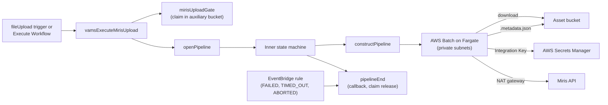

# Miris Upload

The Miris Upload pipeline uploads a VAMS asset's root USD file to [Miris](https://miris.com/) Spatial Streaming and records the resulting Miris asset as [stream metadata](../developer/miris-spatial-streaming.md#stream-metadata) on that file, so users can stream the asset by opening the file in the VAMS file viewer. It is part of the [Miris Spatial Streaming add-on](../developer/miris-spatial-streaming.md), which deploys it as a nested stack when `app.addons.useMirisStreaming.upload.enabled` is `true` and supplies the Miris Integration Key and API base URL it uses.

| Property           | Value                                                                                                 |
| ------------------ | ----------------------------------------------------------------------------------------------------- |
| **Pipeline ID**    | `miris-upload`                                                                                        |
| **Configuration**  | `app.addons.useMirisStreaming.upload`                                                                 |
| **Execution type** | Lambda (asynchronous, with callback)                                                                  |
| **Compute**        | AWS Batch on AWS Fargate (1 vCPU, 4 GiB memory, 21 GiB ephemeral storage, x86_64), in private subnets |
| **Input formats**  | `.usd`, `.usda`, `.usdc`, `.usdz`                                                                     |
| **Output**         | File metadata on the asset's root USD file; no new files                                              |
| **VPC required**   | Yes, with internet egress through a NAT gateway to `*.miris.com`                                      |
| **Partition**      | Commercial `aws` only                                                                                 |
| **Region**         | Same-Region only: input and output buckets must be in the deployment Region                           |

---

## How a run starts

The pipeline auto-registers as a GLOBAL pipeline and workflow, both with the ID `miris-upload`, with a `fileUpload` trigger and the **Stream with Miris** template. A run starts in one of three ways:

-   **Automatically**, when `autoRegisterAutoTriggerOnFileUpload` is `true` (it is `false` by default), for every uploaded `.usd`, `.usda`, `.usdc`, or `.usdz` file in any database. Turning it on sends every such file uploaded to any database to Miris. To limit uploads to specific databases, leave the global trigger off and register a database-scoped copy of the workflow for each database.
-   **On demand.** Select one of the asset's USD files in the file manager, choose **Automation**, then **Execute Workflow**, and pick the **Miris Spatial Streaming Upload** workflow with its **Stream with Miris** template.
-   **From the Miris viewer**, with its **Stream with Miris** button (see [Viewer plugin](../developer/miris-spatial-streaming.md#viewer-plugin)).

The workflow takes exactly one file; a whole-asset (`/`) or folder selection is rejected. A run on an asset that is not distributable, or is quarantined while `app.compliance.quarantineBlocksDownload` is `true`, fails before anything is claimed or sent to Miris (see [Which assets can be streamed and uploaded](../developer/miris-spatial-streaming.md#which-assets-can-be-streamed-and-uploaded)). A manual run uploads that file; an automatic run uploads the asset's [root USD file](#how-the-root-is-chosen). The pipeline records the stream metadata on the file it uploads.

### Duplicate uploads and re-runs

A `fileUpload` trigger fires once per matching file, so an asset made of several USD layers fans out to one execution per layer. The pipeline collapses that fan-out with a claim object in the auxiliary bucket, `locks/miris-upload/<databaseId>/<assetId>/<fingerprint>.claim`, written with a conditional Amazon S3 put. The fingerprint is a SHA-256 digest of the asset-relative key and ETag of every file under the asset root whose extension is one of `triggerExtensions`. The first execution to write the claim proceeds; the others report themselves as skipped without an AWS Batch job.

-   **Unchanged USD files.** A successful upload keeps its claim, so a later trigger on the same content is skipped.
-   **Changed, added, or reverted USD files** give a new fingerprint, so the next trigger uploads. A successful upload also deletes the asset's other claims.
-   **Failed runs** release their claim, so the next trigger on the same content uploads.
-   **Manual runs**, from **Execute Workflow** or the viewer, always upload and write no claim; when they succeed they delete the asset's claims. No claim needs to be deleted by hand.
-   **A change to non-USD files alone does not start an upload**, because only trigger-extension files enter the fingerprint. Run the workflow on one of the asset's USD files to upload a texture change.
-   **A queued run uploads the asset as it is when its job starts.** When newer files land while a run waits in the job queue, it can upload the newer content under the earlier claim. The next trigger, or a manual run, corrects the stream.
-   **A multi-file upload can upload twice**, when a run fingerprints the asset before all of its USD files have landed.

---

## How the root is chosen

The candidates are the asset's files with a trigger extension. The root is chosen in this order:

1. **A manual run** (from **Execute Workflow** or the viewer) roots at the selected file.
2. **The asset metadata `miris_root_file`**, an asset-relative path such as `/scenes/room.usda`, names the root of an automatic run. A value that is not one of the candidates fails the run with exit code 16 (`root_file_invalid`).
3. **Otherwise, the one candidate that no other USD layer in the asset references** (through a sublayer, reference, payload, value clip, or asset-valued attribute).

Several unreferenced candidates fail the run with exit code 10 (`ambiguous_root`), and the failure reason names up to 10 of them. The pipeline never chooses among them. Typical extra files are an exported `.usdz` beside its `.usda`, a proxy, a backup copy of the scene, and an unused material or light library. Set `miris_root_file` on the asset to the file to stream, or remove or move the extra files.

The chosen root is then checked in this order, before anything is packaged or uploaded. The first check that fails ends the run, and the container log names the files involved:

1. A reference that cannot be resolved inside the container, such as a layer not uploaded yet or an absolute path, fails with exit code 5 (`unresolved_references`). Upload the file, or re-export the asset with relative paths.
2. A dependency that resolves outside the asset, through an absolute or `..` path to a file that exists, is never uploaded; the run fails with exit code 12 (`reference_outside_asset`).
3. A sublayer, reference, or payload to an empty or malformed USD layer, or to a file in a format USD cannot read, such as Alembic or OBJ, fails with exit code 11 (`unreadable_layer`), even when the root defines other geometry. Every arc in the root's layers counts, including those in variants that are not selected and on inactive prims. Fix the file, convert it to USD, or remove it or its reference.
4. The root and the files it references must fit `maxAssetSizeBytes`, or the run fails with exit code 4 (see [Size and memory limits](#size-and-memory-limits)).
5. A WebP texture fails with exit code 18 (`unsupported_texture_webp`); other texture formats are warnings (see [Texture formats](#texture-formats)).
6. The root must define geometry: an active, defined (`def`) mesh, points, curves, primitive shape such as a `Cube` or `Sphere`, volume (any `UsdGeom.Gprim`), or `PointInstancer`, including geometry under instanceable prims. Payloads are loaded only when the root holds no such prim outside them. A root without one, such as a light rig, a material library, or a layer of `over` specs, fails with exit code 15 (`root_not_renderable`); when a file inside a `.usdz` root cannot be opened, the run fails with exit code 11 and names it instead.

A root `.usd`, `.usda`, or `.usdc` with external references, such as textures and sublayers, is packaged into a single `.usdz` with only the files it references; a root with no external references and a `.usdz` root are uploaded as is. A `.usdz` root skips checks 1 through 4, since it is self-contained and its size is checked before the download.

While the root is being chosen, an empty or malformed USD file among the candidates fails with exit code 11, and an asset whose USD files all reference one another has no root and fails with exit code 6.

---

## Texture formats

PNG and JPEG are the recommended texture formats, with EXR for dome lights and other high-dynamic-range images. Before packaging, the container checks each texture the upload holds, including those inside a `.usdz`, by its extension and its first bytes:

-   A WebP texture fails the run with exit code 18 (`unsupported_texture_webp`), and the container log names the files. Convert them to PNG or JPEG.
-   Any other format, such as TGA, PSD, TIFF, HDR, KTX2, BMP, or GIF, and a file whose contents do not match its extension, is a warning, and the run continues.
-   A root layer that does not set `upAxis` or `metersPerUnit` is a warning, since the asset can then stream at the wrong orientation or scale. Set both in the root layer.

Each warning is a `preflight_warning` entry in the container log. A run that succeeds with warnings also writes them to `preflight_warnings.txt` in the execution's results, at most 50 warnings in 4 KiB; a run without warnings writes no report.

---

## What the container does

The container lists the asset under its resolved root and downloads it: a lone `.usdz` root alone, otherwise every file under the asset root. The asset is listed once, and every download is pinned to that listing: the selected file is read at the Amazon S3 version the run recorded at launch, and every other file at the ETag the listing reported. A file that changes or is removed after the listing fails the run with exit code 19 (`asset_changed_during_run`), naming the file, before anything reaches Miris; run the upload again. Before USD reads any file, the container checks the text USD against the task's memory, and after the root's dependency check it checks the root's size (see [Size and memory limits](#size-and-memory-limits)) and its textures (see [Texture formats](#texture-formats)). The container then packages the root, writes the [dependency manifest](#what-the-pipeline-writes), creates the Miris asset, uploads the file, marks the upload complete, and writes the stream metadata file for the root. It polls the Miris asset every 10 seconds until its state is `preview` or `streamable`, for at most `taskTimeoutSeconds` or until the run's deadline, and then requests streamable processing (best effort; an asset left at `preview` can be promoted in the Miris Portal). A state of `error` or `failed` fails the run. When the wait runs out first, the run succeeds with the file linked to the still-processing asset. The container retries idempotent Miris calls after transient failures and never deletes a Miris asset. It runs as a non-root user.

### Miris asset name and tags

The **Stream with Miris** template has two optional fields: `MIRIS_ASSET_NAME` (blank uses the VAMS asset name) and `MIRIS_TAGS` (tags to add; blank adds none). Every Miris asset the pipeline creates carries the tags `vams`, `vams-asset-{assetId}`, and `vams-database-{databaseId}`, the last two being the [binding tags](../developer/miris-spatial-streaming.md#binding-tags). A template tag that begins with `vams-asset-` or `vams-database-`, in any case, is dropped with a warning in the container log.

---

## What the pipeline writes

The pipeline adds no files to the asset. It writes one `.metadata.json` file at `{outputS3AssetMetadataPath}<relativeFilePath>.metadata.json`, where `<relativeFilePath>` is the root USD file's path within the asset root, and the workflow applies it to that file with `updateType: update` when the run succeeds, keeping the file's other metadata keys. It sets the five [stream metadata](../developer/miris-spatial-streaming.md#stream-metadata) keys: `miris_asset_uuid`, `miris_source_version_id` (the Amazon S3 version the container downloaded; empty when there is none), `miris_uploaded_at`, `miris_display_name` (the Miris asset name), and `miris_dependency_manifest` (the ID of the dependency manifest).

-   **Dependency manifest.** Before it creates the Miris asset, the container writes a manifest of the files the upload holds to the auxiliary bucket at `pipelines/miris-upload/manifests/<databaseId>/<assetId>/<sha256>.json`. It is UTF-8 JSON with sorted keys and no insignificant whitespace, `{"files": {"<relativePath>": "<etag>", ...}, "root": "<relativePath>"}`, listing the root USD file and every layer and asset of its dependency tree by path within the asset root, each with the ETag (without quotes) of the bytes downloaded. Other files in the asset are not listed. `<sha256>` is the SHA-256 of the manifest's bytes and is the value of `miris_dependency_manifest`. A manifest that cannot be written fails the run with exit code 1 (`dependency_manifest_not_written`) before anything reaches Miris.

-   **Pre-flight warnings** go to `preflight_warnings.txt` in the execution's results, not to the asset (see [Texture formats](#texture-formats)).
-   **Re-running** the workflow, or a trigger on changed USD content, uploads a new Miris asset and overwrites the five keys. The previous Miris asset is not deleted; remove it in the Miris Portal if it is no longer needed.
-   **Output path extension.** The registered workflow uses the default output path. A custom workflow that runs this pipeline with a `defaultOutputFileBaseExecutionPathExtension` shifts where the metadata is applied, so the keys do not land on the source USD file.

After upload, Miris can take a few hours before the asset is streamable; until then the viewer shows its "preparing" overlay.

---

## Time limits

| Limit                 | Value                                        | What it bounds                                                                                                |
| --------------------- | -------------------------------------------- | ------------------------------------------------------------------------------------------------------------- |
| Miris processing wait | `taskTimeoutSeconds` (default 1,800 seconds) | The wait for `preview` or `streamable`. When it runs out, the run succeeds with the file linked to the asset. |
| AWS Batch job attempt | `taskTimeoutSeconds` plus 1,200 seconds      | The download, packaging, upload, and metadata write beyond the processing wait                                |
| Inner state machine   | The job attempt limit plus 1,800 seconds     | The job queue wait and the pipeline's Lambda functions                                                        |
| Workflow task         | 172,800 seconds (48 hours)                   | The workflow's wait for the callback (`executionConfig.taskTimeout` in `vamsSchema/pipeline.json`)            |

The run's deadline counts the job queue wait. Before it creates the Miris asset, the container checks that the time left covers the upload; when it does not, the run fails with exit code 14 and nothing reaches Miris. An inner execution that times out, is stopped, or fails without reaching its failure step still fails the workflow task promptly and releases the claim, through an Amazon EventBridge rule.

---

## Size and memory limits

| Limit               | Value                                               | What it bounds                                                                                                                      |
| ------------------- | --------------------------------------------------- | ----------------------------------------------------------------------------------------------------------------------------------- |
| `maxAssetSizeBytes` | 5,000,000,000 bytes by default                      | The root and the files it references, which the upload holds. Other files under the asset root do not count.                        |
| Task disk           | 21 GiB                                              | The download and the packaged `.usdz`, checked before the download.                                                                 |
| Text USD            | (task memory - 512 MiB) / 8, about 448 MiB at 4 GiB | The text layers (`#usda`) in the download, including those inside a `.usdz`. Binary layers (`PXR-USDC`) are not counted or bounded. |

A lone `.usdz` root is checked against `maxAssetSizeBytes` before the download; for any other root the dependency tree is checked after the dependency check. Either size limit fails the run with exit code 4 (`file_too_large`).

A text layer can take several times its file size in memory to parse, up to about 8 times for prim-heavy layers. The container reads the first bytes of each USD file to find the text layers, and fails the run with exit code 17 (`text_usd_too_large`) before USD reads anything when they exceed the limit. The container log names the largest text files. Converting them to binary `.usdc`, for example with `usdcat scene.usda -o scene.usdc` and keeping the references that name them in step, usually reduces memory, especially for large arrays such as points or splats.

The check does not bound the structure of binary layers. Their memory grows with the number of prims, so a scene with a very large number of prims can exceed the task's memory in either format, and the container then stops with exit code 137. Split the asset, or reduce the prim count, for example with instancing.

---

## Failure reasons

A failed run reports one of these reasons to the workflow execution, chosen from the container's exit code:

| Exit code | Reason                                                                                                                                                                                                        |
| --------- | ------------------------------------------------------------------------------------------------------------------------------------------------------------------------------------------------------------- |
| 1         | The container failed with an unexpected error, or could not write the dependency manifest (`dependency_manifest_not_written`). Any Miris asset the run created is kept.                                       |
| 2         | The container was started without a complete pipeline definition.                                                                                                                                             |
| 3         | The file is not a USD format the pipeline accepts.                                                                                                                                                            |
| 4         | The root and the files it references are larger than `maxAssetSizeBytes`, or the asset does not fit on the task's disk.                                                                                       |
| 5         | The root USD file references layers or assets that are not part of the VAMS asset (`unresolved_references`).                                                                                                  |
| 6         | The asset has no USD file to upload, every USD file in it is referenced by another, or a manual run's file is not one of them.                                                                                |
| 7         | The run has no metadata output location for the stream metadata.                                                                                                                                              |
| 8         | Miris rejected the upload or could not process it. Any Miris asset the run created is kept.                                                                                                                   |
| 10        | The asset has several root USD files (`ambiguous_root`); the reason names them. Set `miris_root_file`, or remove the extras.                                                                                  |
| 11        | A file the root's layers name anywhere, even in an unselected variant or on an inactive prim, is malformed or unreadable by USD (`unreadable_layer`). Fix or convert the file, or remove it or its reference. |
| 12        | The USD file references a layer or asset outside the VAMS asset (`reference_outside_asset`).                                                                                                                  |
| 13        | The file version the run was started on no longer exists (`input_version_missing`).                                                                                                                           |
| 14        | The job started too late to finish within the pipeline's time limit (`insufficient_time`). Nothing was uploaded; start again.                                                                                 |
| 15        | The root USD file defines no geometry (`root_not_renderable`).                                                                                                                                                |
| 16        | The asset metadata `miris_root_file` does not name a USD file in the asset (`root_file_invalid`).                                                                                                             |
| 17        | The asset's text USD layers are too large to parse in the task's memory (`text_usd_too_large`).                                                                                                               |
| 18        | A texture in the upload is WebP (`unsupported_texture_webp`). Convert it to PNG or JPEG.                                                                                                                      |
| 19        | A file of the asset changed or was removed while the run was reading it (`asset_changed_during_run`); the container log names it. Nothing was uploaded; run the upload again.                                 |

A job stopped at its time limit, an inner execution that timed out or was stopped, a Lambda function failure, and an input file or output bucket in another AWS Region each report their own reason. The container log is in the `/aws/vendedlogs/Pipelines/MirisUpload<hash>` log group, and the state machine log in `/aws/vendedlogs/VAMSStateMachine-MirisUpload<hash>`.

### Kept Miris assets

A run that fails after the Miris asset was created (exit codes 1 and 8) keeps the asset in Miris unlinked to the VAMS file, logs its ID in a `miris_asset_kept` entry, and names its `vams-asset-{assetId}` tag in the reason. Find it in the Miris Portal by that tag and, once it reaches `preview` or `streamable`, link it by [setting the file's stream metadata by hand](../developer/miris-spatial-streaming.md#editing-the-stream-metadata), or delete it there. Running the workflow again uploads a new Miris asset.

---

## Architecture

The Lambda functions run in the VPC only when `app.useGlobalVpc.useForAllLambdas` is `true`. The AWS Batch jobs always run in the VPC's private subnets and reach Miris through the NAT gateway. The container is built from a digest-pinned `python:3.12-slim` image with `usd-core`, `requests`, `boto3`, and `botocore` from a hash-locked requirements file. See [Notices](../additional/notices.md).

---

## Configuration

| Field                                                                     | Default                  | Description                                                                                                                          |
| ------------------------------------------------------------------------- | ------------------------ | ------------------------------------------------------------------------------------------------------------------------------------ |
| `app.addons.useMirisStreaming.upload.enabled`                             | `false`                  | Deploys the pipeline.                                                                                                                |
| `app.addons.useMirisStreaming.upload.autoRegisterWithVAMS`                | `true`                   | Registers the pipeline, the workflow, and the **Stream with Miris** template during deployment.                                      |
| `app.addons.useMirisStreaming.upload.autoRegisterAutoTriggerOnFileUpload` | `false`                  | Enables the workflow's `fileUpload` trigger. Requires `autoRegisterWithVAMS`.                                                        |
| `app.addons.useMirisStreaming.upload.triggerExtensions`                   | `.usd,.usda,.usdc,.usdz` | The extensions the pipeline accepts, fingerprints, and considers as a root. A run on a USD file whose extension is not listed fails. |
| `app.addons.useMirisStreaming.upload.taskTimeoutSeconds`                  | `1800`                   | Seconds the container waits for Miris to report `preview` or `streamable`.                                                           |
| `app.addons.useMirisStreaming.upload.maxAssetSizeBytes`                   | `5000000000`             | Largest upload, in bytes: the root and the files it references.                                                                      |

The pipeline also reads `apiKeySecretArn` and `mirisApiBaseUrl` from `app.addons.useMirisStreaming`. See the [Configuration Reference](../deployment/configuration-reference.md#miris-upload-appaddonsusemirisstreamingupload) for every validation rule.

The pipeline requires the add-on (`app.addons.useMirisStreaming.enabled`, with its `apiKeySecretArn`) and `app.useGlobalVpc.enabled`. Enabling it adds public and private subnets and a NAT gateway per Availability Zone to the VAMS VPC; an imported VPC needs `optionalExternalPrivateSubnetIds` with a route to the internet.
