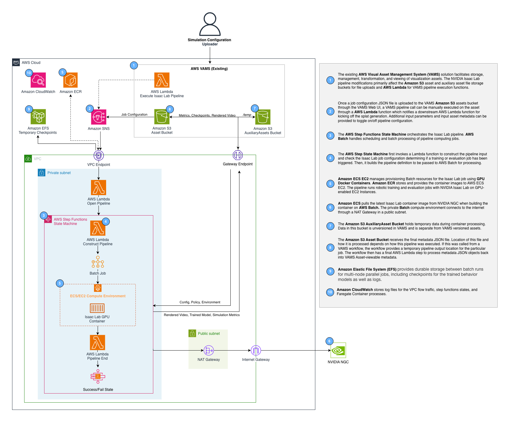
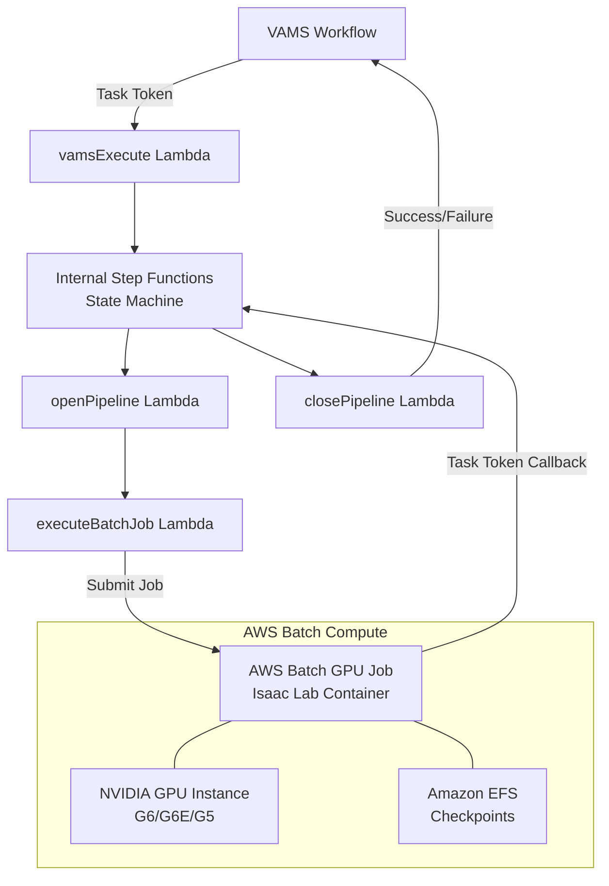

# NVIDIA Isaac Lab Training Pipeline

The NVIDIA Isaac Lab pipeline enables reinforcement learning (RL) policy training and evaluation using [NVIDIA Isaac Lab](https://developer.nvidia.com/isaac/lab) on GPU-accelerated Amazon EC2 instances managed by AWS Batch. It supports two operational modes -- training new RL policies from scratch and evaluating pre-trained policies -- both orchestrated by AWS Step Functions with asynchronous task token callbacks.

:::tip[Learn more]
Read the AWS blog post [GPU-Accelerated Robotic Simulation Training with NVIDIA Isaac Lab in VAMS](https://aws.amazon.com/blogs/physical-ai/gpu-accelerated-robotic-simulation-training-with-nvidia-isaac-lab-in-vams/) for a detailed walkthrough of the pipeline architecture, setup, and usage with example training scenarios.
:::

## Overview

| Property               | Value                                                                                                                             |
| ---------------------- | --------------------------------------------------------------------------------------------------------------------------------- |
| **Pipeline IDs**       | `isaaclab-training`, `isaaclab-evaluation`                                                                                        |
| **Configuration flag** | `app.pipelines.useIsaacLabTraining.enabled`                                                                                       |
| **Execution type**     | Lambda (asynchronous with callback)                                                                                               |
| **Launch**             | Manual only -- neither workflow registers a trigger                                                                               |
| **Compute**            | AWS Batch with single-GPU instances (G6, GR6, G6E, G5 families)                                                                   |
| **Storage**            | Amazon Elastic File System (Amazon EFS) for checkpoints                                                                           |
| **Training timeout**   | 8 hours for the workflow step, including the wait for a GPU instance and the image pull. The AWS Batch job limit is also 8 hours. |
| **Evaluation timeout** | 2 hours for the workflow step, including the wait for a GPU instance                                                              |

## Architecture



The pipeline uses a two-level AWS Step Functions pattern. The VAMS workflow invokes the `vamsExecute` Lambda function, which starts an internal Step Functions state machine. The internal state machine manages the AWS Batch GPU job lifecycle and reports completion back to the VAMS workflow via task tokens.



### AWS infrastructure components

| Component           | Service                                        | Purpose                                                 |
| ------------------- | ---------------------------------------------- | ------------------------------------------------------- |
| Container image     | Amazon Elastic Container Registry (Amazon ECR) | Isaac Lab Docker image built from NVIDIA NGC base       |
| Compute environment | AWS Batch (Amazon EC2)                         | GPU instance management with G6, G6E, G5 instance types |
| Job queue           | AWS Batch                                      | Job scheduling and priority management                  |
| Checkpoint storage  | Amazon EFS                                     | Persistent storage for training checkpoints across jobs |
| Orchestration       | AWS Step Functions                             | Workflow management with error handling                 |
| Monitoring          | Amazon CloudWatch Container Insights           | ECS cluster metrics and logging                         |

## Configuration

Add the following to your `config.json` under `app.pipelines`:

```json
{
    "app": {
        "pipelines": {
            "useIsaacLabTraining": {
                "enabled": true,
                "acceptNvidiaEula": true,
                "useCodeBuild": true,
                "autoRegisterWithVAMS": true,
                "keepWarmInstance": false,
                "instanceTypes": ["g6.4xlarge", "g6e.2xlarge", "g5.4xlarge"]
            }
        }
    }
}
```

| Option                 | Default                                                                                                                                                             | Description                                                                                                                                                                                                                                                                                         |
| ---------------------- | ------------------------------------------------------------------------------------------------------------------------------------------------------------------- | --------------------------------------------------------------------------------------------------------------------------------------------------------------------------------------------------------------------------------------------------------------------------------------------------- |
| `enabled`              | `false`                                                                                                                                                             | Enable or disable the pipeline deployment.                                                                                                                                                                                                                                                          |
| `acceptNvidiaEula`     | `false`                                                                                                                                                             | **Required when enabled.** You must accept the [NVIDIA Software License Agreement](https://docs.nvidia.com/ngc/gpu-cloud/ngc-catalog-user-guide/index.html#ngc-software-license) by setting this to `true`. Deployment fails if this is `false` when the pipeline is enabled.                       |
| `useCodeBuild`         | `false`                                                                                                                                                             | Build the container image via AWS CodeBuild + ECR instead of local Docker. Recommended for the large Isaac Lab GPU image.                                                                                                                                                                           |
| `autoRegisterWithVAMS` | `true`                                                                                                                                                              | Automatically register both the `isaaclab-training` and `isaaclab-evaluation` pipelines and workflows with VAMS at deploy time.                                                                                                                                                                     |
| `keepWarmInstance`     | `false`                                                                                                                                                             | When `true`, maintains one warm GPU instance in the AWS Batch compute environment. The floor is the 8 vCPUs one job needs, and every instance type in `instanceTypes` can run the job, so the warm instance can take it. Reduces cold-start latency at the cost of continuous GPU instance charges. |
| `instanceTypes`        | `["g6.4xlarge", "g6.8xlarge", "g6.16xlarge", "gr6.4xlarge", "gr6.8xlarge", "g6e.2xlarge", "g6e.4xlarge", "g6e.8xlarge", "g5.4xlarge", "g5.8xlarge", "g5.16xlarge"]` | The GPU instance types the compute environment may launch. See [Instance types](#instance-types).                                                                                                                                                                                                   |

:::warning[NVIDIA EULA acceptance required]
The Isaac Lab container is built from the NVIDIA NGC base image. You must review and accept the [NVIDIA Software License Agreement](https://docs.nvidia.com/ngc/gpu-cloud/ngc-catalog-user-guide/index.html#ngc-software-license) before enabling this pipeline. The CDK deployment will fail with a validation error if `acceptNvidiaEula` is not set to `true`.
:::

## Instance types

One Isaac Lab job asks AWS Batch for 8 vCPUs, 32,768 MiB of memory and 1 GPU. The compute environment holds only the types in `app.pipelines.useIsaacLabTraining.instanceTypes`, with no CPU-only instance classes added. AWS Batch accepts a compute environment whose instance types cannot hold the job and then leaves the job `RUNNABLE` with no error, so VAMS checks every type when the configuration loads and fails the deployment for one that cannot run the job. Each type needs:

-   **One NVIDIA GPU with RT cores and 16 GB or more of video memory.** Isaac Sim needs both. The G5 (A10G, 24 GB), G6 and GR6 (L4, 24 GB) and G6E (L40S, 48 GB) families qualify. The G4dn (T4) and P-series (V100, A100, H100) families do not.
-   **A single GPU.** A multi-GPU size such as `g6e.12xlarge` leaves the other GPUs idle and billed.
-   **At least 8 vCPUs.**
-   **More registered memory than 32,768 MiB.** The Amazon ECS agent registers less than the installed memory, so `g5.2xlarge` and `g6.2xlarge` (32 GiB installed) never hold the job.

The default list meets all four:

| Instance type | GPU     | vCPUs | Memory  |
| ------------- | ------- | ----- | ------- |
| g6.4xlarge    | 1x L4   | 16    | 64 GiB  |
| g6.8xlarge    | 1x L4   | 32    | 128 GiB |
| g6.16xlarge   | 1x L4   | 64    | 256 GiB |
| gr6.4xlarge   | 1x L4   | 16    | 128 GiB |
| gr6.8xlarge   | 1x L4   | 32    | 256 GiB |
| g6e.2xlarge   | 1x L40S | 8     | 64 GiB  |
| g6e.4xlarge   | 1x L40S | 16    | 128 GiB |
| g6e.8xlarge   | 1x L40S | 32    | 256 GiB |
| g5.4xlarge    | 1x A10G | 16    | 64 GiB  |
| g5.8xlarge    | 1x A10G | 32    | 128 GiB |
| g5.16xlarge   | 1x A10G | 64    | 256 GiB |

A type VAMS does not know, such as one from a newly released family, is accepted with a warning that asks you to confirm it offers the same. Narrowing the list reduces the places AWS Batch can find capacity: when EC2 has no On-Demand capacity for the listed types in the deployment's subnets, the job stays `RUNNABLE` until the workflow's heartbeat fails the run.

:::note[AWS GovCloud (US) and AWS European Sovereign Cloud]
Instance type availability varies by Region. Before you enable the pipeline in either partition, confirm that the types you list are offered in the Region and Availability Zones of your subnets, for example with `aws ec2 describe-instance-type-offerings --location-type availability-zone --filters Name=instance-type,Values=g6e.2xlarge --region <region>`, and remove the ones that are not.
:::

## Container Build Options

VAMS supports two methods for building the Isaac Lab container:

### CodeBuild (Recommended)

When `useCodeBuild: true`, the container is built in the cloud using AWS CodeBuild:

-   Container source code is uploaded to S3 during CDK deployment
-   CodeBuild builds the Docker image and pushes to ECR
-   The Batch job definition references the ECR image
-   Automatic rebuilds when container source code changes
-   Runs in the same private VPC subnets as the pipeline Batch compute, with NAT Gateway egress for internet access
-   The `acceptNvidiaEula` flag is forwarded to the build as the `ACCEPT_EULA` Docker build argument

**Advantages:**

-   No local Docker build required (avoids building the large Isaac Lab GPU image on developer machines)
-   Faster iteration with high-bandwidth cloud builds
-   Automatic rebuilds on source changes

**Troubleshooting CodeBuild failures:** CodeBuild runs asynchronously after CDK deployment completes. If a container build fails, the CDK deployment itself will succeed but the Batch pipeline will fail with a container image pull error. To check build status:

```bash
# Get the CodeBuild project name. The output is on the Isaac Lab nested stack,
# whose name starts with the core stack's name (vams-core-<baseStackName>-<region>).
aws cloudformation describe-stacks --query "Stacks[?starts_with(StackName, '<your-core-stack-name>')].Outputs[] | [?contains(OutputKey, 'IsaacLabTrainingCodeBuildProject')].OutputValue" --output text

# Check the status of the latest build
aws codebuild list-builds-for-project --project-name <project-name> --no-paginate --query 'ids[0]' --output text
aws codebuild batch-get-builds --ids <build-id> --query 'builds[0].buildStatus' --output text
```

Start a training or evaluation run once the latest build prints `SUCCEEDED`. A deployment that changes the container source starts a new build, and runs started before it finishes use the previous image.

:::warning[CodeBuild Internet Access]
CodeBuild runs in the same private VPC subnets used by the Isaac Lab pipeline Batch compute environments. These private subnets require a NAT Gateway for internet egress, which is automatically provisioned when the Isaac Lab pipeline is enabled.
:::

### DockerImageAsset (Legacy)

When `useCodeBuild: false`, the container is built locally during CDK deployment using Docker and pushed to a CDK-managed ECR repository. This requires significant local resources and bandwidth.

:::note[The Amazon EFS file system is removed with the stack]
This pipeline's Amazon EFS file system uses a `DESTROY` removal policy, so it is deleted on teardown and
needs no manual step — and its contents are not retained. Training does not write its checkpoints
there: Isaac Lab writes them under the container's `logs` folder and the pipeline uploads them to the
asset (see [Training output](#training-output)), which is where to find them. This pipeline
creates no Amazon S3 model cache bucket of its own. See
[AWS resources](../architecture/aws-resources.md#amazon-efs).
:::

## Prerequisites

-   **GPU instance availability** -- Request quota increases for the G6, G6E, or G5 instance families in your deployment region if needed. The compute environment uses `BEST_FIT_PROGRESSIVE` allocation across the instance types listed in `instanceTypes`. Confirm that each type is offered in your Region and Availability Zones, because AWS Batch can find capacity only among the types it is given. See [Instance types](#instance-types).
-   **VPC with NAT Gateway** -- The pipeline requires private subnets with internet access (via NAT Gateway) because the Isaac Lab container needs to download NVIDIA Omniverse assets at runtime. Its compute runs in `pipelineNetwork.privateSubnets.pipeline`, which the VPC builder creates as `PRIVATE_WITH_EGRESS`.

:::warning[Air-gapped deployments]
Any Isaac Lab feature that reaches the NVIDIA Omniverse content server needs outbound internet access, so those features do not operate in an air-gapped deployment. Amazon VPC endpoints cover the AWS services the pipeline calls but not the NVIDIA content server. A task that reads its files from VAMS instead (see [Asset files staged before the run](#asset-files-staged-before-the-run)) does not need that access. Evaluate the tasks you intend to run before enabling `app.pipelines.useIsaacLabTraining` on an isolated network; configuration validation does not check for egress.
:::

-   **Amazon EFS** -- An Amazon EFS file system is automatically created in isolated subnets for training checkpoint persistence.
-   **Large EBS volume** -- A 100 GB GP3 EBS volume is configured via launch template to accommodate the Isaac Lab container image (10+ GB).

## Physics engine

`trainingConfig.physics` selects the physics engine for both training and evaluation: `newton_mjwarp` (Newton with the MuJoCo-Warp solver, the default) or `isaacsim_physx` (PhysX on Isaac Sim). The built-in templates show it as the "Physics engine" drop-down.

:::warning[Behaviour change: the default engine is Newton]
Runs that do not name an engine now run on Newton: saved configurations, built-in templates, edited template bodies without the field, JSON input files and Isaac Sim connector launches. Results differ from earlier PhysX runs, and a checkpoint trained before the upgrade was trained on PhysX. Set `physics` to `isaacsim_physx` to reproduce an earlier run. A task that lists no physics presets, such as a custom environment ported from Isaac Lab 2.x, runs on the physics it registers and ignores the setting. The Isaac Lab environment runs Python 3.12, and a custom environment wheel built for another Python is refused.
:::

-   **Task support is per task.** `isaaclab list_envs --show_presets` lists what each task offers. A task that does not offer the chosen engine fails 11 to 17 seconds after Isaac Lab starts, before Isaac Sim starts, with the options for that task. The tables of tested tasks and the Isaac Lab 2.x to 3.0 task id mapping are in the [Isaac Lab CLI reference](https://github.com/awslabs/visual-asset-management-system/blob/main/backendPipelines/simulation/isaacLabTraining/ISAACLAB_CLI_REFERENCE.md). A listed preset is not proof that training works.
-   **Tasks with no physics presets.** The AutoMate tasks and most custom environments list no preset, so the run leaves the `physics=` selector out, the task runs on its registered physics, and `train-config.json` records `physics` as `task-default`. The AutoMate tasks also offer `rl_games` only; the pipeline refuses any other library before a GPU instance starts.
-   **Checkpoints from Isaac Lab 2.x.** `rl_games` and `skrl` checkpoints load. `rsl_rl` checkpoints do not load on 3.0 (the actor and critic format changed); the evaluation stops with a message naming the cause. Retrain on 3.0.
-   **Evaluate on the engine that trained the policy.** An evaluation whose checkpoint was trained on the other engine runs, prints a note, and records it as `physicsNote` in `evaluate-config.json`.
-   **Video.** Evaluation on Newton records through Newton's own viewer (`--viz newton_gl`) and on PhysX through the default Kit viewer. A play process that has not finished within a time limit derived from the playback length is stopped, and the run fails naming the engine and the limit.
-   **Saved task ids.** Isaac Lab 3.0 ids carry no `-v0` suffix. The pipeline maps `Isaac-Cartpole-v0`, `Isaac-Cartpole-Direct-v0`, `Isaac-Lift-Cube-Franka-v0` and `Isaac-Velocity-Rough-Anymal-D-v0` to their 3.0 ids and records the requested id as `taskIdRequested`. Other ids are passed through as written.
-   **First run on an instance.** The base image is about 34 GB, so the first pull on a new instance takes a while. Warp and Newton compile kernels on first use, which added about 60 to 90 seconds to a cold Newton training start in testing. Every job starts cold.
-   **GPU driver.** NVIDIA tests Isaac Sim 6.2 on NVIDIA driver 595.58.03 or newer on Linux. The pipeline runs on the driver of the ECS GPU AMI, which was 580.178.04 when it was validated, and prints the driver version at the start of each run. The image declares 570.169 as its minimum. A different AMI driver is the operator's risk. The driver on the GovCloud and EU Sovereign GPU AMIs has not been checked.

## Training mode

The training mode trains new RL policies from scratch using the RSL-RL, RL Games, or SKRL reinforcement learning libraries.

### Training input parameters

The training configuration is the configuration body of the pipeline template the run uses. Deployment registers the `isaaclab-training-cartpole` template with the body below, whose `{{TAG}}` placeholders are the fields the execute screen renders. A run sets each field there, and the template also permits a per-run body edit for anything the fields do not cover:

```json
{
    "trainingConfig": {
        "mode": "train",
        "task": "{{TASK}}",
        "numEnvs": {{NUM_ENVS}},
        "maxIterations": {{MAX_ITERATIONS}},
        "rlLibrary": "{{RL_LIBRARY}}",
        "physics": "{{PHYSICS}}",
        "seed": "{{SEED}}"
    }
}
```

The **Template tag** column names the execute-form field that supplies each parameter. A row with `--` is fixed by the template body: `mode` is what distinguishes this pipeline from the evaluation one, so it is not operator-settable.

| Parameter                        | Template tag     | Default                   | Description                                                                                                                                                                                                                                                       |
| -------------------------------- | ---------------- | ------------------------- | ----------------------------------------------------------------------------------------------------------------------------------------------------------------------------------------------------------------------------------------------------------------- |
| `trainingConfig.mode`            | --               | `"train"`                 | Must be `"train"` for training mode.                                                                                                                                                                                                                              |
| `trainingConfig.task`            | `TASK`           | `"Isaac-Cartpole-Direct"` | The Isaac Lab task environment name.                                                                                                                                                                                                                              |
| `trainingConfig.numEnvs`         | `NUM_ENVS`       | `4096`                    | Number of parallel simulation environments.                                                                                                                                                                                                                       |
| `trainingConfig.maxIterations`   | `MAX_ITERATIONS` | `1500`                    | Maximum training iterations.                                                                                                                                                                                                                                      |
| `trainingConfig.rlLibrary`       | `RL_LIBRARY`     | `"rsl_rl"`                | RL library to use. Options: `"rsl_rl"`, `"rl_games"`, `"skrl"`. Any other value fails the execution, naming the value and the supported set. The rejection happens in the pipeline's first state, so no GPU node is provisioned and no container image is pulled. |
| `trainingConfig.physics`         | `PHYSICS`        | `"newton_mjwarp"`         | Physics engine: `"newton_mjwarp"` (Newton) or `"isaacsim_physx"` (PhysX on Isaac Sim). Blank means Newton. Any other value fails the execution before a GPU node is provisioned.                                                                                  |
| `trainingConfig.seed`            | `SEED`           | `null`                    | Optional random seed for reproducibility. Leaving the field blank lets Isaac Lab choose one.                                                                                                                                                                      |
| `trainingConfig.stageAssetPaths` | --               | `[]`                      | Files and folders of the executing asset to download into the container before the run. See [Asset files staged before the run](#asset-files-staged-before-the-run).                                                                                              |

:::note[AutoMate assembly with rl_games]
The rl_games configuration of `IsaacContrib-AutoMate-Assembly-Direct` collects 32 steps per environment and trains on minibatches of 4096, and rl_games requires the batch to divide evenly into minibatches. Use a multiple of 128 for `NUM_ENVS`. With fewer, for example 64, the environment builds and rl_games then stops with an `AssertionError`, which the execution reports as `Training failed with exit code 1`.
:::

### Training output

Training results are added to the asset the run executed against. Both Isaac Lab workflows set `defaultOutputFileBaseExecutionPathExtension` to `/{{executionId}}/`, which places each output in a folder named for the workflow execution, immediately before the file name (see [Output path prefix](../api/workflows.md#output-path-prefix)):

| Output                            | Format  | Description                                                                   |
| --------------------------------- | ------- | ----------------------------------------------------------------------------- |
| `checkpoints/<executionId>/*`     | PyTorch | Model checkpoint files saved during training, named by the RL library (below) |
| `<executionId>/metrics.csv`       | CSV     | Training metrics exported from TensorBoard event files                        |
| `<executionId>/*_git_diff.txt`    | Text    | Configuration diff files (converted from `.diff` for VAMS compatibility)      |
| `<executionId>/train-config.json` | JSON    | Input configuration saved for reference                                       |

For example, a run whose execution id is `3f2a9c4e1b7d40a6a8c95e0f1d2b3c4a` writes its last rsl_rl checkpoint to `checkpoints/3f2a9c4e1b7d40a6a8c95e0f1d2b3c4a/model_99.pt`.

The files that reach `checkpoints/<executionId>/` depend on `rlLibrary` (layouts read from the Isaac Lab image):

| `rlLibrary` | Files uploaded                                                      |
| ----------- | ------------------------------------------------------------------- |
| `rsl_rl`    | `model_<iteration>.pt`                                              |
| `rl_games`  | `last_<name>_ep_<epoch>_rew__<reward>_.pth` (periodic and final)    |
| `skrl`      | `agent_<timestep>.pt` (and `best_agent.pt` when the run writes one) |

A run that writes none of these fails with `no <library> checkpoint was found to upload`, after its logs and configuration are uploaded. An evaluation with no `checkpointPath` takes the `.pt` or `.pth` file of the chosen library with the highest epoch, iteration or timestep in the run folder written most recently. `best_agent.pt` and the rl_games `<name>.pth` rank below numbered checkpoints, so name them in `checkpointPath` to evaluate the best one.

## Evaluation mode

The evaluation mode runs a pre-trained policy against the simulation environment and captures metrics and video recordings.

### Evaluation input parameters

The evaluation pipeline requires a template (`systemConfig.requireTemplate` is `true`), so a run cannot start without selecting one. Deployment registers `isaaclab-evaluation-cartpole`, whose configuration body follows this shape, with each `{{TAG}}` placeholder supplied by an execute-form field:

```json
{
    "trainingConfig": {
        "mode": "evaluate",
        "task": "{{TASK}}",
        "numEnvs": {{NUM_ENVS}},
        "numEpisodes": {{NUM_EPISODES}},
        "stepsPerEpisode": {{STEPS_PER_EPISODE}},
        "recordVideo": {{RECORD_VIDEO}},
        "rlLibrary": "{{RL_LIBRARY}}",
        "physics": "{{PHYSICS}}",
        "checkpointPath": "{{CHECKPOINT_PATH}}"
    }
}
```

The **Template tag** column names the execute-form field that supplies each parameter. `mode` is fixed by the template body, because it is what makes this the evaluation pipeline rather than the training one.

| Parameter                        | Template tag        | Default                   | Description                                                                                                                                                                                                                                      |
| -------------------------------- | ------------------- | ------------------------- | ------------------------------------------------------------------------------------------------------------------------------------------------------------------------------------------------------------------------------------------------ |
| `trainingConfig.mode`            | --                  | (required)                | Must be `"evaluate"` for evaluation mode.                                                                                                                                                                                                        |
| `trainingConfig.task`            | `TASK`              | `"Isaac-Cartpole-Direct"` | The Isaac Lab task environment name. It must match the task the policy was trained on.                                                                                                                                                           |
| `trainingConfig.numEnvs`         | `NUM_ENVS`          | `100`                     | Number of parallel environments for evaluation.                                                                                                                                                                                                  |
| `trainingConfig.numEpisodes`     | `NUM_EPISODES`      | `50`                      | Number of evaluation episodes to run.                                                                                                                                                                                                            |
| `trainingConfig.stepsPerEpisode` | `STEPS_PER_EPISODE` | `1000`                    | Steps per evaluation episode.                                                                                                                                                                                                                    |
| `trainingConfig.recordVideo`     | `RECORD_VIDEO`      | `false`                   | Whether the evaluation video is uploaded to the asset. Recording always happens, because the Isaac Lab play script requires `--video` to terminate; this controls publication only.                                                              |
| `trainingConfig.rlLibrary`       | `RL_LIBRARY`        | `"rsl_rl"`                | RL library the policy was trained with. Selects the Isaac Lab play script, so it must match the library used for training. Options: `"rsl_rl"`, `"rl_games"`, `"skrl"`; any other value fails the execution rather than falling back.            |
| `trainingConfig.physics`         | `PHYSICS`           | `"newton_mjwarp"`         | Physics engine. Use the engine that trained the policy; a different engine is a transfer test and is noted in the run log and in `evaluate-config.json`.                                                                                         |
| `trainingConfig.checkpointPath`  | `CHECKPOINT_PATH`   | `null`                    | Path to the policy file within the asset, for example `checkpoints/<executionId>/model_300.pt` for a checkpoint a training run wrote. Leaving the field blank evaluates the highest-numbered checkpoint in the run folder written most recently. |
| `trainingConfig.policyS3Uri`     | --                  | `null`                    | Amazon S3 URI to a `.pt` or `.pth` policy file. Operator-supplied, and must name the executing asset's own bucket. Omit it to use `checkpointPath` or auto-discovery.                                                                            |
| `trainingConfig.stageAssetPaths` | --                  | `[]`                      | Files and folders of the executing asset to download into the container before the run. See [Asset files staged before the run](#asset-files-staged-before-the-run).                                                                             |

### Evaluation output

Evaluation outputs use the same per-execution folders as training:

| Output                               | Format | Description                                                          |
| ------------------------------------ | ------ | -------------------------------------------------------------------- |
| `<executionId>/metrics.csv`          | CSV    | Evaluation metrics from TensorBoard                                  |
| `videos/<executionId>/*.mp4`         | MP4    | Evaluation episode recordings, uploaded when `recordVideo` is `true` |
| `<executionId>/evaluate-config.json` | JSON   | Input configuration saved for reference                              |

## Custom environments

The pipeline supports custom Isaac Lab environments packaged as Python packages. Upload your custom environment package (`.tar.gz`, `.tgz`, `.zip`, or `.whl`) into the asset the execution runs against and reference it in the `trainingConfig` section:

```json
{
    "trainingConfig": {
        "mode": "train",
        "task": "MyCustomTask",
        "customEnvironmentPath": "environments/my-custom-env.tar.gz"
    }
}
```

`customEnvironmentPath` is a path relative to the asset root, which the `openPipeline` Lambda resolves against the executing asset's bucket. `trainingConfig.customEnvironmentS3Uri` accepts a full Amazon S3 URI instead, and must name that same bucket -- a URI pointing anywhere else is rejected in the `openPipeline` state, before any AWS Batch job is submitted, with a message naming the offending bucket. Both keys are read from `trainingConfig`; a value placed at the top level of the configuration is ignored.

:::warning[The package's install code runs in the container]
`pip install` executes the package's build and setup code inside the GPU container, as the container's non-root user (uid 10000), which can write into the Isaac Lab Python environment (Python 3.12) the package installs into. That is why the URI is constrained to the executing asset's own bucket. The same constraint applies to `trainingConfig.policyS3Uri`, whose `.pt` file is deserialized by PyTorch.
:::

The container downloads the package at runtime and installs it with `pip install --no-build-isolation <archive>` before starting training or evaluation. `pip install -e` is not used: the editable flag accepts only a local project directory or a version-control URL, never an archive.

Training and evaluation run with Isaac Lab's directory, `/workspace/isaaclab`, as the working directory. An environment can create files there, as the built-in AutoMate assembly tasks do when they download their assets, but cannot change or remove the files Isaac Lab ships in it.

## Asset files staged before the run

A task often reads files from disk besides its environment package: robot and scene USD files with their materials and textures, meshes, terrains or datasets. Store them in the asset the execution runs against and list them in `trainingConfig.stageAssetPaths`. The container downloads them before Isaac Lab starts, keeping their paths within the asset, so relative references between the files resolve as they do in VAMS. The task reads them from the folder named by the `VAMS_ASSET_FILES_DIR` environment variable (`/tmp/assets`), which is set only when files were staged.

```json
{
    "trainingConfig": {
        "mode": "train",
        "task": "MyCustomTask",
        "customEnvironmentPath": "environments/my-custom-env.whl",
        "stageAssetPaths": ["Isaac/Robots/", "Isaac/Sensors/"]
    }
}
```

With this configuration, an asset file at `/Isaac/Robots/MyRobot/robot.usd` is at `$VAMS_ASSET_FILES_DIR/Isaac/Robots/MyRobot/robot.usd` during the run.

| Entry               | Stages                                                   |
| ------------------- | -------------------------------------------------------- |
| `Isaac/Robots/`     | Every file in the folder and its subfolders              |
| `configs/scene.usd` | That file, and the files of a folder of that name if any |
| `/`                 | Every file of the asset                                  |

The entries are paths within the executing asset. The `openPipeline` Lambda function resolves them against the asset's own root and rejects, before any AWS Batch job is submitted, an entry that is a URI, holds a backslash, a control character, or a `.`, `..` or empty path segment, is longer than 1,024 characters, or names no file. A run names at most 50 entries of 2,048 characters in total, counted as the AWS Batch job's command carries them, where a character outside ASCII takes 6 (12 for an emoji or another character outside the Basic Multilingual Plane) and a quote or backslash 2. It also counts the selected files: a run stages at most 10,000 files and 50 GiB, and a larger selection fails in the same state. So does a selection holding a file that cannot be written to disk: one whose path in the asset has a `.`, `..` or empty segment or a name longer than 246 bytes, a NUL character, or one at the same path as a folder of other selected files. The container lists the files again when the job starts, applies the same limits and checks, checks that the files fit on the instance's disk with 2 GiB to spare, and writes nothing outside the staging folder. File previews (`.previewFile.` files) are not staged. Files are read at their current version, as the custom environment package is.

The container downloads 16 files at a time from the asset's Amazon S3 bucket and logs the number of files, the bytes and the seconds the staging took. Staging happens before the custom environment package is installed. A task that would otherwise fetch the same files from an external content server, such as the NVIDIA Omniverse content server, can read them from the staged folder instead, which also lets it run without internet access.

## Heartbeat mechanism

Long-running training jobs send periodic heartbeats (every 5 minutes) to both the internal and external AWS Step Functions state machines to prevent timeout. The heartbeat thread runs in the background during the entire training or evaluation process. The internal state machine has a 30-minute heartbeat timeout, so any interruption lasting longer than 30 minutes will cause the job to be marked as failed.

:::tip[Monitoring training progress]
Training progress can be monitored through Amazon CloudWatch Logs for the AWS Batch job. Container Insights is enabled on the ECS cluster for detailed resource utilization metrics.
:::

## Related pages

-   [Pipeline overview](overview.md)
-   [Custom pipelines](custom-pipelines.md)
-   [Deployment configuration](../deployment/configuration-reference.md)
-   [GPU-Accelerated Robotic Simulation Training with NVIDIA Isaac Lab in VAMS](https://aws.amazon.com/blogs/physical-ai/gpu-accelerated-robotic-simulation-training-with-nvidia-isaac-lab-in-vams/) (AWS Blog)
