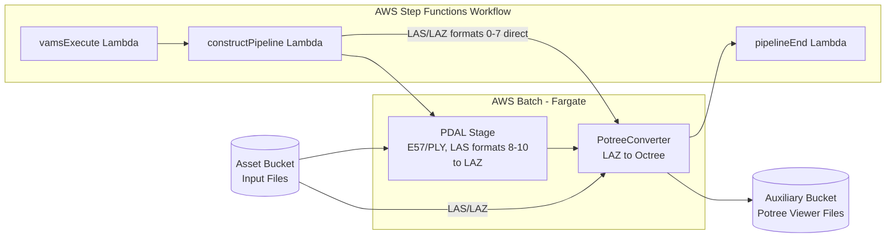
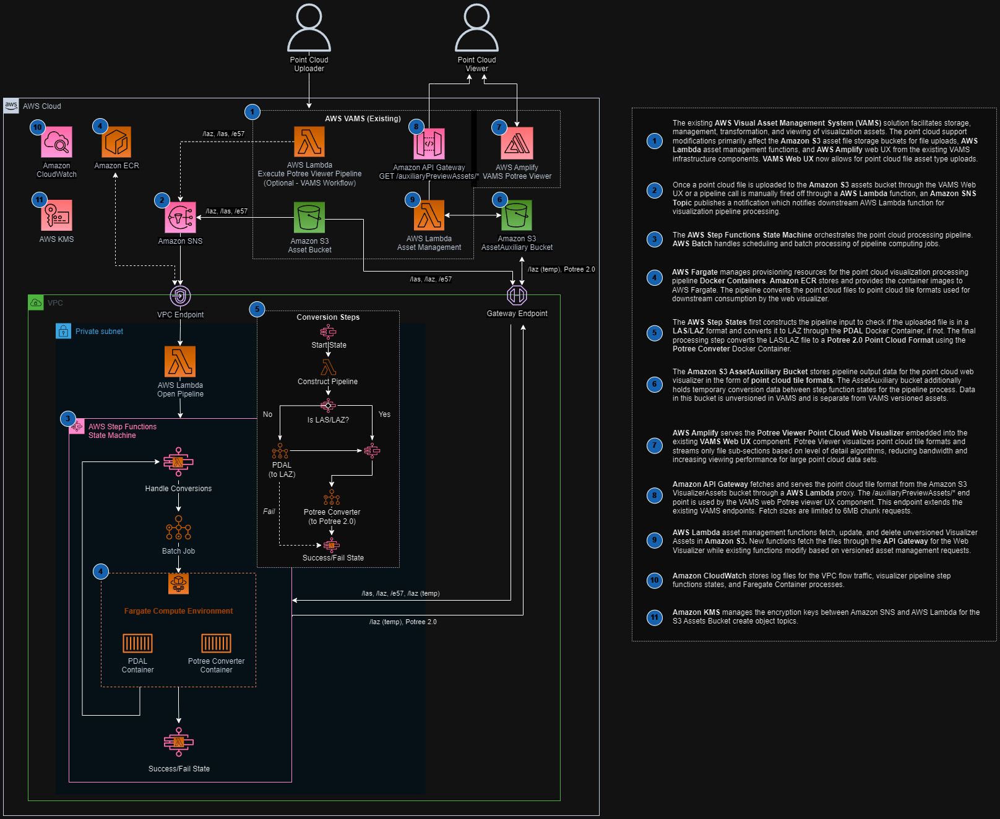

# Potree Point Cloud Viewer Pipeline

The Potree Point Cloud Viewer pipeline converts point cloud files into the Potree octree format, enabling interactive 3D visualization of large point cloud datasets directly in the VAMS web interface. This pipeline uses PDAL (Point Data Abstraction Library) for format translation and the PotreeConverter tool for octree generation, both running inside an AWS Batch Fargate container.

## Supported Formats

| Format | Extension | Notes                                                                                                                                           |
| :----- | :-------- | :---------------------------------------------------------------------------------------------------------------------------------------------- |
| E57    | `.e57`    | ASTM standard for 3D imaging data. Requires PDAL pre-processing to LAZ before octree conversion.                                                |
| PLY    | `.ply`    | Polygon File Format. Requires PDAL pre-processing to LAZ before octree conversion.                                                              |
| LAS    | `.las`    | ASPRS LiDAR data exchange format. Point data record formats 0 to 7 go directly to PotreeConverter; formats 8 to 10 are converted by PDAL first. |
| LAZ    | `.laz`    | Compressed LAS format. Same point format rule as LAS.                                                                                           |

:::info[Two-Stage Processing]
E57 and PLY files require a two-stage pipeline: first, PDAL converts the file to LAZ format, then PotreeConverter generates the octree. LAS and LAZ files in point data record formats 0 to 7 skip the PDAL stage and go directly to PotreeConverter. A LAS or LAZ file in format 8, 9 or 10 (LAS 1.4 with near-infrared or waveform data) takes the two-stage path, because PotreeConverter does not read those formats.
:::

## Architecture



### Processing Stages

The `constructPipeline` Lambda function inspects the input file extension, and for a LAS or LAZ file its point data record format, and builds a pipeline definition with either one or two stages:

-   **E57 and PLY files**: Two stages -- PDAL converts the file to LAZ, then PotreeConverter generates the octree from the intermediate LAZ file. If PDAL cannot read an E57 file, the run fails with `E57 file could not be read by the converter:` followed by PDAL's message; for other PDAL failures the message names PDAL's exit code instead.
-   **LAS and LAZ files**: Single stage -- PotreeConverter processes the file directly into the octree format. Before the run starts, the `openPipeline` Lambda function reads the file's point data record format from the first 105 bytes of its LAS header (a ranged Amazon S3 read; the extension is not used for this). A file in format 8, 9 or 10 gets the two stages an E57 file gets instead. If the header cannot be read, the file goes directly to PotreeConverter, as before.

:::note[What the PDAL conversion keeps]
A LAS or LAZ file converted by PDAL reaches PotreeConverter as LAS 1.2, point data record format 3. Positions, intensity, return number and number of returns, classification with its synthetic, key-point and withheld flags, scan angle (in whole degrees), user data, point source ID, GPS time and RGB colour are kept. Near-infrared (NIR), waveform data, Extra Bytes dimensions, the overlap flag and the scanner channel are dropped, and a classification above 31 becomes 1. Files in formats 0 to 7 are not converted and keep all of their attributes, including Extra Bytes.
:::

### Output Location

Unlike most pipelines, the Potree viewer writes output to the **auxiliary Amazon S3 bucket** rather than the asset bucket. This is because Potree octree files are non-versioned viewer data that the VAMS web frontend reads directly. The output is written to:

```
s3://<auxiliary-bucket>/<assetId>/preview/PotreeViewer/
```

The octree files at this location include `metadata.json`, `hierarchy.bin`, and the octree node files that the Potree web viewer loads on demand.

For an E57 or PLY file, or a LAS or LAZ file in format 8 to 10, the intermediate LAZ file is written to a working folder of that run's own, `<file>/preview/PotreeViewerRuns/<jobName>/` in the auxiliary bucket, and the Potree stage removes it when it ends, whether the run succeeded or failed. The previous octree is replaced only after every new octree file is uploaded, so a failed run leaves the previous preview in place. When several runs on one file overlap, each one completes and the last one to finish is the preview.

Both AWS Batch jobs are submitted by job definition name without a revision, so AWS Batch runs the latest active revision. An E57 or PLY run that is in progress while a deploy changes the pipeline's container images finishes on the new job definition.

## Configuration

Enable this pipeline in `infra/config/config.json`:

```json
{
    "app": {
        "pipelines": {
            "usePreviewPcPotreeViewer": {
                "enabled": true,
                "autoRegisterWithVAMS": true,
                "autoRegisterAutoTriggerOnFileUpload": true
            }
        }
    }
}
```

### Configuration Options

| Option                                | Default | Description                                                                                                                      |
| :------------------------------------ | :------ | :------------------------------------------------------------------------------------------------------------------------------- |
| `enabled`                             | `false` | Deploy the Potree viewer pipeline infrastructure. Enables the global VPC.                                                        |
| `autoRegisterWithVAMS`                | `false` | Automatically register the pipeline and workflow in the global VAMS database during CDK deployment.                              |
| `autoRegisterAutoTriggerOnFileUpload` | `true`  | Automatically trigger the pipeline when E57, PLY, LAS, or LAZ files are uploaded. Requires `autoRegisterWithVAMS` to be enabled. |

## Prerequisites

### VPC with Internet Access

This pipeline runs on AWS Batch with AWS Fargate compute. Enabling it automatically sets `app.useGlobalVpc.enabled` to `true`. The VPC builder creates the required VPC endpoints for AWS Batch, Amazon ECR, and Amazon ECR Docker so that the Fargate container can pull its image.

### Container Images

The pipeline uses two container images, each built during CDK deployment from its own Dockerfile in `backendPipelines/preview/pcPotreeViewer/container/` and stored in Amazon ECR:

-   `Dockerfile_PDAL` -- **PDAL** 2.10.2, the Point Data Abstraction Library, for format translation. Its E57 reader is libE57Format 3.3.0. The intermediate LAZ file is written as LAS 1.2 with point data record format 3 (XYZ, intensity, GPS time, RGB).
-   `Dockerfile_Potree` -- **PotreeConverter**, which generates the octree structure for web-based viewing

Each image runs under its own AWS Batch job definition, AWS Fargate compute environment, and job queue.

:::warning[License Notice]
This pipeline uses a third-party open-source library with a GPL license. Refer to your legal team before enabling this pipeline in production. See the NOTICE file in the pipeline directory for details.
:::

## How It Works

1. A workflow execution triggers the `vamsExecute` Lambda function, which receives the input file path and Amazon S3 output paths from the workflow state.
2. The `openPipeline` Lambda function reads a LAS or LAZ file's point data record format from its header, and the `constructPipeline` Lambda function builds a stage definition targeting either PDAL + Potree (for E57/PLY, and LAS/LAZ in formats 8 to 10) or Potree only (for LAS/LAZ in formats 0 to 7).
3. AWS Batch submits an AWS Fargate job with the pipeline definition. The container downloads the input file from Amazon S3, runs the appropriate processing stages, and uploads the resulting octree files to the auxiliary bucket.
4. Upon completion, AWS Step Functions receives a task token callback, and the `pipelineEnd` Lambda function finalizes the workflow execution.
5. The VAMS web frontend detects the Potree viewer data in the auxiliary bucket and renders the point cloud using the built-in Potree viewer plugin.

## Infrastructure Components

The following AWS resources are created when this pipeline is enabled:

| Resource                     | Service            | Purpose                                                                                       |
| :--------------------------- | :----------------- | :-------------------------------------------------------------------------------------------- |
| Fargate Compute Environment  | AWS Batch          | Serverless container execution                                                                |
| Job Queue                    | AWS Batch          | Job scheduling and prioritization                                                             |
| Job Definition               | AWS Batch          | Container configuration and resource limits                                                   |
| Container Image              | Amazon ECR         | PDAL + PotreeConverter container                                                              |
| Step Functions State Machine | AWS Step Functions | Workflow orchestration                                                                        |
| Lambda Functions (5)         | AWS Lambda         | Pipeline coordination (vamsExecute, constructPipeline, openPipeline, sqsExecute, pipelineEnd) |
| SQS Queue                    | Amazon SQS         | Event-driven pipeline triggering                                                              |

## Related Resources

-   [Pipeline System Overview](overview.md)
-   [3D Preview Thumbnail Pipeline](3d-thumbnail.md) -- generates static and animated previews for point clouds and other 3D formats
    
