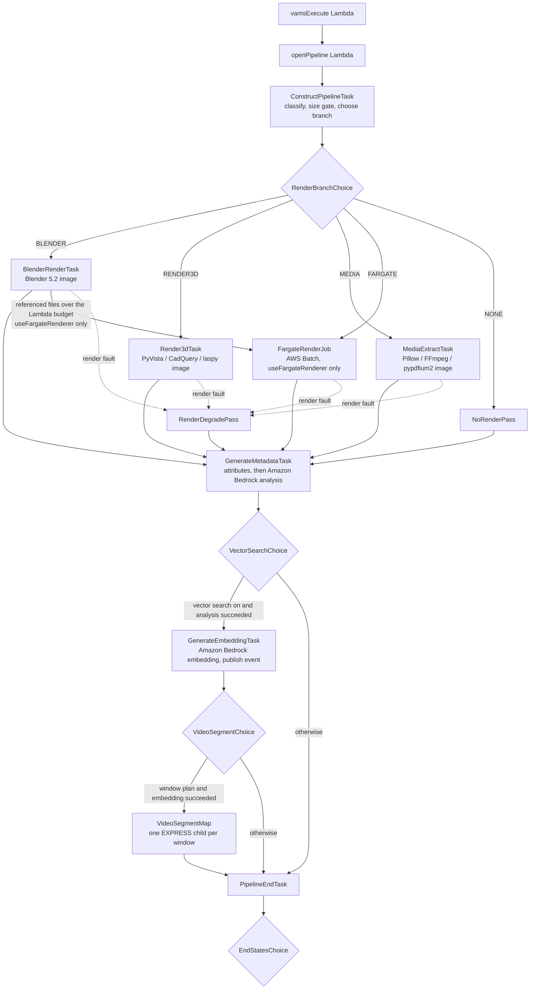

# SYSTEM - GenAI Metadata Generation Pipeline

Files often arrive in a deployment with little more than a file name. The SYSTEM GenAI metadata pipeline gives each of them a description. It reads what is stored in the file, looks at the file the way a person would (renders of a 3D model or CAD part, a video's keyframes, a document's pages and text), and writes back technical attributes, filterable metadata, a location when the file has one, and a generated title, description, keywords, and classification. That metadata makes the file easier to find, filter, and understand in keyword search, in the metadata panels, and on the map, and it is the source of the embeddings behind [natural-language search](../concepts/vector-search.md).

The SYSTEM GenAI metadata pipeline runs on every uploaded file, of any type, and writes what it learns back onto the file. The extraction layer records the attributes stored on the file itself — EXIF and XMP tags for images, container and stream tags for video and audio (a recording time, a camera location), document properties for PDF and Office files, archive contents for zip and tar containers, geometry and scene facts for 3D files, and the S3 object's own facts for everything else — as `sys_*` attributes, promotes a curated subset to typed `ext_*` metadata, and writes a GeoJSON `location` when the file carries a position. The GenAI layer, on by default (`useGenAiAnalysis`), then asks an Amazon Bedrock model to describe and classify the file from renders, keyframes, extracted text, and the existing metadata on the file, its asset, and its database; with that layer off the pipeline is attributes-only and makes no Amazon Bedrock Converse call. When [vector search](../concepts/vector-search.md) is enabled, it also produces one embedding per file version — plus one per video window or content chunk — and publishes them for the vector indexer. Every Amazon Bedrock model it calls is named in the `bedrockModels` block of its configuration. It is a [system pipeline](system-pipelines.md): it ships with the deployment, is read-only through the API except for its pause switches and template content, and runs automatically on file upload. With the GenAI layer on, the same deployment registers a second system workflow, the [asset summary](#asset-summary-workflow), which describes a whole asset or a folder of it from the descriptions this pipeline wrote on its files.

| Item                | Value                                                                                                                                                                                                                                                                                                                                                                    |
| ------------------- | ------------------------------------------------------------------------------------------------------------------------------------------------------------------------------------------------------------------------------------------------------------------------------------------------------------------------------------------------------------------------ |
| Pipeline id         | `system-genai-metadata` (workflow id identical, database `GLOBAL`)                                                                                                                                                                                                                                                                                                       |
| Pipeline name       | `SYSTEM - GenAI Metadata Generation`                                                                                                                                                                                                                                                                                                                                     |
| Category            | `SYSTEM - GenAI`                                                                                                                                                                                                                                                                                                                                                         |
| Configuration block | `app.pipelines.useSystemGenAiMetadata`                                                                                                                                                                                                                                                                                                                                   |
| Execution type      | Lambda with an AWS Step Functions task-token callback (`taskTimeout` 18,000 seconds)                                                                                                                                                                                                                                                                                     |
| Input               | One file per execution, of any type (`*`), except the `*.previewFile.*` thumbnails the preview pipelines write; an extension with dedicated handling takes its branch, every other file takes the generic probe                                                                                                                                                          |
| Compute             | AWS Lambda — zip functions and three container images (Blender renderer, 3D renderer, media extractor); an optional AWS Batch (Fargate) renderer behind `useFargateRenderer`                                                                                                                                                                                             |
| VPC required        | No. `useFargateRenderer: true` is the only setting that requires `app.useGlobalVpc.enabled`                                                                                                                                                                                                                                                                              |
| Models              | `bedrockModels.analysisModelId` (Claude Haiku 4.5 in the commercial template; Claude Sonnet 4.5 in GovCloud; used only with `useGenAiAnalysis`), the optional `bedrockModels.textModelId` for requests that carry no image, `bedrockModels.embeddingModelId` / `embeddingDimensions` (Amazon Titan Text Embeddings V2, 1024, by default; used while vector search is on) |
| Concurrency         | `perInputFileVersion` — a second execution over the same file version is rejected while one is running; a newer version runs concurrently                                                                                                                                                                                                                                |

## Top features

| Feature                               | What it does                                                                                                                                                                                                                                                                                                                                                   |
| ------------------------------------- | -------------------------------------------------------------------------------------------------------------------------------------------------------------------------------------------------------------------------------------------------------------------------------------------------------------------------------------------------------------- |
| Runs on every upload, of any type     | A system pipeline that ships with the deployment and starts on each new file version through its upload trigger, with no workflow to build or pipeline to register. Files that predate it are analyzed on request (see [Files already in the deployment](#files-already-in-the-deployment)).                                                                   |
| Facts from the file itself            | Without any model call, the extraction layer records image EXIF and XMP tags, video and audio stream tags, document properties, archive contents, and 3D geometry and scene facts as `sys_*` attributes. It promotes a curated subset to typed `ext_*` metadata that the search filters use, and writes a GeoJSON `location` when the file carries a position. |
| A generated description of every file | The GenAI layer sends renders, keyframes, page images, extracted text, and the metadata already on the file, its asset, and its database to an Amazon Bedrock model, and writes a `genai_*` block: title, description, keywords, category and subcategory, materials, colors, objects, and more.                                                               |
| Classification in your own terms      | Categories come from a classification vocabulary that administrators edit, so files are classified with the organization's terms (see [Editing the classification vocabulary](#editing-the-classification-vocabulary)).                                                                                                                                        |
| Sees 3D, CAD, and point clouds        | Meshes, USD scenes, CAD parts, and point clouds are rendered from several views by renderer container images on AWS Lambda, with referenced files loaded so a multi-file scene renders complete. An optional AWS Batch renderer on AWS Fargate (`useFargateRenderer`, which requires a VPC) handles models too large for Lambda.                               |
| Feeds natural-language search         | With vector search enabled, the pipeline embeds each file version, each content chunk of a document, and on request each time window of a video, and publishes the embeddings for the vector index.                                                                                                                                                            |
| Whole-asset summaries                 | The asset summary workflow describes an asset, or one folder of it, from the descriptions written on its files (see [Asset summary workflow](#asset-summary-workflow)).                                                                                                                                                                                        |
| Guarded by default                    | Amazon Bedrock Guardrails screens the untrusted content the pipeline sends to Amazon Bedrock for prompt attacks and masks personal data. The deployment creates the guardrail, and the pipeline runs with a guardrail whenever it calls Amazon Bedrock.                                                                                                        |
| Your metadata is kept                 | Every `sys_*`, `ext_*`, and `genai_*` key is owned by the pipeline. A key a user authored is never overwritten, and the pipeline writes outside its own keys only under the [key reuse](#key-reuse) rules.                                                                                                                                                     |
| Fails safe                            | Attributes are saved before any model call, so an Amazon Bedrock error, a throttle, or a guardrail intervention never discards them; the execution is recorded as failed with an explicit error code. A render fault continues the analysis without views.                                                                                                     |
| Predictable cost                      | The pipeline runs on AWS Lambda and AWS Step Functions and needs no VPC by default. Each execution makes one analysis call (plus one per video window when windows are on), a file version runs one execution at a time, and an attributes-only mode (`useGenAiAnalysis` off) makes no analysis call.                                                          |

## How it works




1. The workflow invokes `vamsExecute`, which resolves the input file, output prefixes, asset identity, and file version from the execution manifest and hands them to `openPipeline`.
2. `openPipeline` checks the extension against the allow list, starts the sub-state-machine, and registers the sub-execution and its log group with VAMS so the execution detail page can show and abort it.
3. `ConstructPipelineTask` classifies the file into a `fileClass`, applies the size gates, and chooses a render branch. For a file no library can read (`NONE`) it writes the analysis manifest itself.
4. The branch task downloads the file to the function's `/tmp`, with the files a 3D scene references (see [Referenced files](#referenced-files)), extracts attributes, and renders stills or keyframes. When the Fargate renderer is deployed and a scene's referenced files exceed what the Blender function can hold, `DependencyOverflowChoice` sends the run to `FargateRenderJob` before anything is rendered. A render fault routes through `RenderDegradePass` to `GenerateMetadataTask`, which records the render as skipped (`renderSkipped: "error"`) and continues attributes-only — a render failure never fails the execution.
5. `GenerateMetadataTask` writes the file's attributes first — the `sys_*` groups, the `ext_*` facts promoted from them, and the run's `genai_*` provenance — promotes the GeoJSON `location`, then calls the analysis model with the renders, text excerpt, attributes, asset context, the existing metadata when `SEED_WITH_EXISTING_METADATA` is `true`, and the classification vocabulary, and writes the result to the file, the asset, or both (see [Write targets](#write-targets)).
6. When vector search is enabled and the analysis succeeded, `GenerateEmbeddingTask` composes the embedding text, calls the embeddings model, writes the embedding document, and publishes `vector.embedding.ready` — and, for document, text, and data files with `CONTENT_CHUNKING` on, one more document and event per [content chunk](#content-chunks).
7. When the media branch produced a window plan (a video at least two windows long, with `VIDEO_SEGMENT_SECONDS` of `2` or more) and the embedding succeeded, `VideoSegmentMap` runs one child execution per [video window](#video-windows) — `SegmentAnalyzeTask`, the media image's second function — eight at a time, and writes its own result manifest under the execution's auxiliary prefix.
8. `PipelineEndTask` reports success or failure to the workflow through the task token. The workflow's process-output step then applies the metadata and attribute files to the asset.

The file-upload trigger fires on a **new** version of a file: an upload, a direct Amazon S3 write, a copy, move, or rename into the asset, a revert to an earlier version, and — when the workflow allows trigger chaining — another workflow's output. It does not fire when a file or an asset is **unarchived**: the restore copies the file's newest content version forward under a new version id, the pipeline has already analyzed that content, and its metadata, attributes, and vectors stay as they were (the vector indexer marks them live again without re-embedding; see [Vector search](../concepts/vector-search.md#only-the-latest-live-version-is-searchable)). With vector search on, a restored file that has no vector yet gets its embedding queued: one launch of this workflow through the reindexer's paced launch queue. To analyze a restored file again, re-execute the workflow on it or run the vector reindexer.

### Files already in the deployment

Turning the pipeline on does not analyze the files a deployment already holds. The file-upload trigger fires only for a version written after the trigger is armed, so a file uploaded before then has no `sys_*` attributes, `genai_*` metadata or vector until a run reaches it. Three ways start those runs, with vector search on or off:

-   **Run the workflow on a file.** The system workflow runs like any other workflow: in an asset's **File Manager**, select a file and choose **Execute Workflow** from the **Automation** menu, then pick **SYSTEM - GenAI Metadata Generation**; or launch it with `vamscli workflow execute --workflow-database-id GLOBAL -w system-genai-metadata --input-file <databaseId>:<assetId>:<fileKey>`. Each execution analyzes one file, so a whole asset or a folder is not accepted as the selection. This works with vector search on or off.
-   **Run the vector reindexer over every file.** The reindexer exists whenever the pipeline is on and registers its workflow, with vector search on or off. Its `enqueue` operation launches the full workflow for the latest live version of every file the workflow's input filters admit; at most `app.vectorSearch.indexingConcurrency` of those runs are running at once, and the others wait in the launch queue until one ends. A waiting file checks for a free slot again after a delay that grows from 30 seconds to 15 minutes, so the last files of a run can start up to 15 minutes after a slot frees. Uploads and manual runs are not counted. With vector search off the runs write the attributes and the `genai_*` metadata and skip the embedding step. A file with no attributes or metadata yet gets them, and a file that has them is analyzed again. Each file costs one analysis run (plus its embedding with vector search on). See [Reindexing](../concepts/vector-search.md#reindexing) for its options.
-   **Run it through the data migration.** The [v2.6 to v2.7 migration](../deployment/update-the-solution.md#v26-to-v27) wraps the same call: its `vectorBackfill` step with vector search on, and, with vector search off, its opt-in `metadataBackfill` step, which runs only when `generate_metadata_for_existing_files` is `true` in its config or `--generate-metadata-for-existing-files` is passed. The script runs on any 2.7 deployment, so turning the pipeline on later with vector search off is `--steps metadataBackfill --generate-metadata-for-existing-files` after the deploy.

## Supported files and how each is analyzed

The pipeline accepts every file: the pipeline, workflow, and trigger filters are the one `*` wildcard with the `*.previewFile.*` thumbnails excluded, and the openPipeline gate admits any extension or none. An extension with dedicated handling — every extension a viewer in the deployment's viewer catalog supports (see [File Viewers](../concepts/viewers.md)) plus the formats marked ‡ below — takes the class and branch the table gives it. The robotics logs the Robotics Data Viewer plays (`.mcap .bag .db3 .ulg .ulog`) have no extractor and are `other`, as is every file the table does not name; both take the generic probe at the bottom of the table. The `fileClass` decides the branch, the attributes written, and what the analysis model receives.

| `fileClass`  | Extensions                                                                                                                                                                                                               | Branch                                                    | Attributes written                                                                                                                                                                                                                                            | Analysis input                                                                                                                                        |
| ------------ | ------------------------------------------------------------------------------------------------------------------------------------------------------------------------------------------------------------------------ | --------------------------------------------------------- | ------------------------------------------------------------------------------------------------------------------------------------------------------------------------------------------------------------------------------------------------------------- | ----------------------------------------------------------------------------------------------------------------------------------------------------- |
| `image`      | `.png .jpg .jpeg .gif`; `.svg`                                                                                                                                                                                           | MEDIA                                                     | `sys_image` (dimensions, mode, every EXIF tag, XMP, text chunks), `sys_file`                                                                                                                                                                                  | The image (resized to at most 1568 px); SVG: the SVG text                                                                                             |
| `video`      | `.mp4 .webm .mov .mkv .m4v`; `.avi .flv .wmv` ‡                                                                                                                                                                          | MEDIA                                                     | `sys_media` (duration, resolution, codecs, frame rate, rotation, bitrate, every container and stream tag — `creation_time`, a location, encoder, …)                                                                                                           | Four evenly spaced keyframes; with `VIDEO_SEGMENT_SECONDS` of `2` or more, one analysis per time window as well (see [Video windows](#video-windows)) |
| `audio`      | `.mp3 .wav .ogg .aac .flac .m4a`                                                                                                                                                                                         | MEDIA                                                     | `sys_media` (duration, tags, codec)                                                                                                                                                                                                                           | Tag text                                                                                                                                              |
| `document`   | `.pdf`                                                                                                                                                                                                                   | MEDIA                                                     | `sys_document` (pages, title, author, has text)                                                                                                                                                                                                               | Text excerpt and the first two pages rasterized; the full text is captured for [content chunks](#content-chunks)                                      |
| `document` ‡ | `.docx .pptx`                                                                                                                                                                                                            | MEDIA                                                     | `sys_document` (pages or slides, words, title, author, created, has text)                                                                                                                                                                                     | Text excerpt; the full text is captured for content chunks — nothing is rasterized                                                                    |
| `text`       | `.txt .md .json .xml .yaml .yml .toml .ini .cfg .inf .log .py .js .ts .sql .sh .ps1 .ipynb .html .htm`                                                                                                                   | MEDIA                                                     | `sys_text` (encoding, lines, words, language guess)                                                                                                                                                                                                           | Text excerpt; the full text is captured for content chunks                                                                                            |
| `data`       | `.csv .fcs`                                                                                                                                                                                                              | MEDIA                                                     | `sys_data` (columns, row count, sample rows)                                                                                                                                                                                                                  | Header and sample rows; the full text is captured for content chunks                                                                                  |
| `data` ‡     | `.xlsx`                                                                                                                                                                                                                  | MEDIA                                                     | `sys_data` (sheets, rows, columns of the first sheet)                                                                                                                                                                                                         | Header and sample rows; the full text of every sheet is captured for content chunks                                                                   |
| `data`       | `.json` or `.geojson` ‡ whose root is a GeoJSON `Geometry`, `Feature`, or `FeatureCollection` (detected while reading it as text)                                                                                        | MEDIA                                                     | `sys_geo` (feature count, geometry types, footprint)                                                                                                                                                                                                          | Attribute text                                                                                                                                        |
| `data` ‡     | `.gpkg` (GeoPackage)                                                                                                                                                                                                     | MEDIA                                                     | `sys_geo` (layers with name, geometry type, feature count, fields and spatial reference; extent; footprint when the layers are in EPSG:4326)                                                                                                                  | Layer summary; the feature rows and geometry blobs are never read                                                                                     |
| `data` ‡     | `.lyrx` (ArcGIS Pro layer file)                                                                                                                                                                                          | MEDIA                                                     | `sys_geo` (layers with kind, data source, visible fields and renderer; extent and footprint when the file records them)                                                                                                                                       | Layer summary; the referenced dataset is not in the file                                                                                              |
| `tiles3d`    | `.json` or `.geojson` whose root carries `asset` and `geometricError`                                                                                                                                                    | MEDIA                                                     | `sys_tiles3d` (geometric error, bounding volume, tile count)                                                                                                                                                                                                  | Attribute text                                                                                                                                        |
| `mesh`       | `.glb .gltf .fbx .obj .stl .ply` (mesh)                                                                                                                                                                                  | BLENDER                                                   | `sys_geometry`, `sys_statistics`, `sys_format`, `sys_visual`, `sys_scene`                                                                                                                                                                                     | Six orthographic and two perspective renders                                                                                                          |
| `mesh`       | `.dae` (COLLADA)                                                                                                                                                                                                         | RENDER3D                                                  | `sys_geometry`, `sys_statistics`, `sys_format`, `sys_visual` (see [COLLADA files](#collada-files))                                                                                                                                                            | `RENDER_VIEWS` orbit stills                                                                                                                           |
| `mesh`       | `.3ds .3mf .wrl .off .amf .3dm .bim`                                                                                                                                                                                     | RENDER3D where a loader exists; otherwise attributes only | As above where loadable; otherwise `sys_file`                                                                                                                                                                                                                 | Renders where produced                                                                                                                                |
| `usd`        | `.usd .usda .usdc .usdz`                                                                                                                                                                                                 | BLENDER (RENDER3D fallback)                               | `sys_geometry`, `sys_scene`                                                                                                                                                                                                                                   | Renders                                                                                                                                               |
| `cad`        | `.stp .step .iges .igs .brep`                                                                                                                                                                                            | RENDER3D                                                  | `sys_geometry`, `sys_statistics`, `sys_cad`                                                                                                                                                                                                                   | `RENDER_VIEWS` orbit stills                                                                                                                           |
| `cad`        | `.asm .catpart .catproduct .iam .ipt .jt .par .prt .sldasm .sldprt .x_b .x_t`                                                                                                                                            | NONE                                                      | `sys_file`                                                                                                                                                                                                                                                    | File name and asset context                                                                                                                           |
| `pointcloud` | `.las .laz .e57 .pcd .ptx .xyz`                                                                                                                                                                                          | RENDER3D (streamed, capped by `maxPointCloudPoints`)      | `sys_pointcloud` (points, bounds, colour, header fields)                                                                                                                                                                                                      | `RENDER_VIEWS` orbit stills                                                                                                                           |
| `splat`      | `.spz .sog .splat .lcc .ksplat .ply` (splat)                                                                                                                                                                             | RENDER3D, attributes only                                 | `sys_file`, `sys_pointcloud` (header; `.lcc` and `.ksplat`: `sys_file` only)                                                                                                                                                                                  | Attribute text                                                                                                                                        |
| `ifc`        | `.ifc .ifczip`                                                                                                                                                                                                           | RENDER3D, attributes only                                 | `sys_ifc` (schema, project, entity counts)                                                                                                                                                                                                                    | Attribute text                                                                                                                                        |
| `other`      | Any extension the table does not name, a file without one, and a listed extension whose header fits no class (a `.ply` that is neither mesh, splat, nor point cloud; a `.json` or `.geojson` that is not decodable text) | MEDIA (generic probe)                                     | `sys_file`; then what the probe finds: a Pillow-readable image is reclassified `image`, an FFmpeg-readable container `video` or `audio`, decodable text `text`, a zip or tar container stays `other` with `sys_archive` (entries, sizes, OPC core properties) | What the reclassified class receives; for an unrecognised file, the file name, `sys_file` and the asset context                                       |

`.ply` is disambiguated by loading it: faces make it a mesh, `f_dc_0` properties make it a splat, anything else is a point cloud. `sys_file` is written for every file: `name`, `ext`, `sizeBytes`, `contentType`, `etag`, `versionId`, `lastModified`, the object's own user metadata as `s3Metadata` (`x-amz-meta-*` keys), the format its leading bytes identify as `detectedFormat` (`jpeg`, `mp4`, `zip`, `glb`, `utf8-text`, …), and `sha256` for files up to 512 MB. `contentType` is the type stored on the Amazon S3 object; VAMS stores every upload as `application/octet-stream`, so use `detectedFormat` and `ext` for the file's actual format. A file over `lambdaLimits.maxInputFileSizeMb` whose class is `other` keeps `sys_file` alone and never takes the Fargate branch.

‡ Formats no viewer renders, admitted through the classifier's `ADDITIONAL_EXTENSIONS` for their extracted content. The `.avi`, `.flv` and `.wmv` containers FFmpeg decodes but no browser plays take the video branch for their stream facts, tags and keyframes. A `.geojson` file is read by the same rule as a `.json`: a GeoJSON root is classified `data` and writes `sys_geo` and a [`location`](#location), a tileset root is `tiles3d`, any other JSON is `text`, and bytes that are not UTF-8 are `other`. The office formats are admitted for their text: `.docx` (paragraphs and table cells, in order) and `.pptx` (slide text and notes, one page per slide) are classified `document`, `.xlsx` (per sheet, the header row then tab-separated rows, one page per sheet) is classified `data`; spreadsheet row counts are taken up to 200,000 rows per sheet, so a larger sheet's `ext_row_count` is that floor. The GIS containers are admitted for their layer catalogue, read without GDAL or any Esri software: a `.gpkg` GeoPackage is an SQLite database, opened read-only, of which the extractor reads the `gpkg_contents` rows of the first 50 layers, the `gpkg_geometry_columns` and `gpkg_spatial_ref_sys` rows those layers name, and for each listed table a column listing and a row count bounded at 2,000,000 rows (`featureCountExact` is `false` above it); a layer that is a view is listed without a count, and an SQLite time budget (120 seconds per file, 15 seconds per layer count) ends any read that runs longer, so the cost is set by those bounds rather than by the file's size; a `.lyrx` layer file is a JSON document in Esri's CIM schema and records its layers, their data connections (reduced to the keys that locate the data: server, instance, database, version, branch, client and URL, with every URL stripped of user-info, query string and fragment), visible fields and renderers, and no data of its own, so it records no feature count or geometry types. Names taken from either file are cut to 200 characters, and `sys_geo` is kept under 300,000 characters by leaving out per-layer field lists, with a warning. Both are classified `data`. A footprint is written only when the layers are in EPSG:4326; another spatial reference keeps its extent as `nativeExtent` with its `crs` and writes no `location`. They receive attributes and generated metadata from the text alone and are never rendered. An input larger than 3,500 MiB is not downloaded by the MEDIA image at all, whatever its class: the `sys_file` attributes stand, the manifest carries a warning naming the size and the bound, and the GenAI layer describes the file from them.

:::note[Proprietary CAD formats]
Proprietary CAD formats that an add-on viewer opens are allow-listed so that every viewable file is covered, but no open library reads them. They receive `sys_file` attributes and metadata generated from the file name and the asset's own metadata.
:::

### Referenced files

A 3D scene is often several files: a USD stage that composes other layers, a glTF file with its buffers and textures, an OBJ file with its material library. When the template tag `RESOLVE_DEPENDENCIES` is `true` (the default), the render branch loads the files the input references before it renders, so the scene renders complete. It follows the references transitively, and each referenced file lands at its own path relative to the asset, so `../` references resolve as they do in the asset.

| Input               | References followed                                                                                                                                                                             |
| ------------------- | ----------------------------------------------------------------------------------------------------------------------------------------------------------------------------------------------- |
| `.usd .usda .usdc`  | Sublayers, references, payloads, and asset-valued attribute paths authored in the layer, for every variant. A UDIM texture set is not fetched.                                                  |
| `.usdz`             | The package's references to files outside the package, which are fetched but not loaded into the scene (see below); a path to a member of the package is read from the package itself           |
| `.gltf`, `.glb`     | The `buffers` and `images` URIs, except `data:` URIs (a GLB's own binary chunk needs none)                                                                                                      |
| `.dae`              | Images (`<image><init_from>`) and the documents its `instance_*` elements place from other files. The document is read with an XML parser that refuses document type declarations and entities. |
| `.obj`, `.mtl`      | The OBJ file's `mtllib` material libraries, and the texture maps they name                                                                                                                      |
| `.fbx`              | The texture file names stored in the file (the first 512 MiB is scanned), each also tried as a file beside the FBX file                                                                         |
| `.lcc` (XGRIDS LCC) | The scene's data files beside it                                                                                                                                                                |

A reference is followed only when it is a relative path that, resolved against the referring file's folder, stays inside the input file's own asset. Absolute paths, any URI scheme (`https:`, `s3:`, `file:`, a Windows drive letter), a `..` that leaves the asset, control characters, and values over 1,024 characters are refused before any Amazon S3 request is made. Files of a linked asset are not followed, and nothing is fetched over HTTP. For an asset created on an existing bucket folder, the asset's root is the folder it was created on.

The walk runs in two phases. Discovery downloads the files that can name further files (USD layers and packages, glTF, OBJ, MTL, FBX, COLLADA; a GLB's JSON chunk is read with a ranged request) and sizes every other file, recording the S3 version each lookup returned. The fetch then downloads those files at those versions, so a file replaced during the run does not mix two versions into one scene. A file referenced twice is fetched once, and a reference cycle is reported and not followed again.

A reference that is missing, refused, or past a limit never fails the run: the scene renders from what was found, and the run records what was left out. A missing USD layer, glTF buffer, or COLLADA external document makes the scene partial. When a required file is missing and the input was uploaded less than five minutes ago, discovery waits 30 seconds once and looks again, because a multi-file upload lands file by file. For a USD scene the Blender branch also takes the list of missing files from Blender's OpenUSD dependency check of the composed stage, which covers asset paths that only composition reveals. A file the walk fetched is never listed as missing. When the composed stage still does not load it, the report lists it under `notComposed`, the run's warnings name it, and a USD layer among them makes the scene partial. That is always the case for a `.usdz` package's reference to a file outside the package: OpenUSD resolves every relative reference in a package's layers inside the package, so `../parts/bolt.usda` in `usdz/station.usdz` is looked up as a package member and the scene renders without it, although `parts/bolt.usda` was fetched. Put such files inside the package to have them rendered. The 3D render branches do not run this check.

| Limit                               | Value                                                                                                                                    |
| ----------------------------------- | ---------------------------------------------------------------------------------------------------------------------------------------- |
| Files fetched                       | 2,000                                                                                                                                    |
| Objects looked up, found or not     | 4,000                                                                                                                                    |
| Reference depth below the input     | 32                                                                                                                                       |
| References read from one file       | 100,000                                                                                                                                  |
| Referenced bytes                    | About 6 GiB on the Lambda branches (`BLENDER`, `RENDER3D`); 50 GiB on the Fargate render job                                             |
| Free disk kept beyond each download | 1 GiB                                                                                                                                    |
| Time                                | The remaining invocation time less 390 seconds on the Blender branch and less 300 seconds on the 3D render branches, at least 30 seconds |

A template configuration body can lower the file, byte, and depth limits with the optional keys `maxDependencyFiles`, `maxDependencyBytes`, and `maxDependencyDepth`. The lookup limit follows at twice the file limit, a value above a built-in limit is ignored, and a byte budget lowered below the Lambda budget also keeps the scene on the Lambda branch. Set them by editing the body as described in [Editing the classification vocabulary](#editing-the-classification-vocabulary).

When the Fargate renderer is deployed (`useFargateRenderer`) and the files a scene references are larger than the Lambda byte budget, the Blender branch stops before rendering and the state machine runs the scene on the Fargate render job instead. That job renders with the [3D Preview Thumbnail](3d-thumbnail.md) pipeline's container image rather than Blender, so its views look different from a Blender render. Without the Fargate renderer, the Lambda branch renders what fits, and the run records that the walk stopped at its byte limit.

The walk reports to three places. The analysis manifest (the `analysis.json` object under the execution's auxiliary prefix) carries the full report as `dependencyReport`: the files fetched with their versions, sizes and depth, the missing and refused references, the cycles, the limit that stopped the walk (`files`, `lookups`, `bytes`, `disk`, `depth`, `references`, or `deadline`), the byte totals, the reference graph, and whether the scene is partial. The file's `sys_dependencies` attribute holds a bounded copy (see [Attribute groups](#attribute-groups)). The prompt and the embedding text carry one line of counts, for example `dependencies: 36 referenced files loaded; 2 missing; 1 refused` (a file fetched but not composed is counted as `fetched but not composed` rather than loaded), and never a path.

With `RESOLVE_DEPENDENCIES` set to `false`, the input file is fetched alone. The [3D preview thumbnail](3d-thumbnail.md) pipeline follows the same references for the formats it reads, at the files' current versions.

### COLLADA files

COLLADA (`.dae`) files are rendered by the 3D render image with the same COLLADA reader the 3D preview thumbnail uses: it refuses document type declarations and external entities, and a file that places the same part many times is expanded only up to the triangle budget. Its attributes differ from those of the Blender-rendered mesh formats in three ways:

-   `sys_format.loader` is `expat`. `sys_format.declaredMetersPerUnit`, `declaredUnits`, and `declaredUnitsSource` record the unit the file's `<asset><unit>` element declares.
-   The numbers are the authored coordinates, so `sys_geometry.units` (and `ext_units`) is the file's own unit, and the dimensions follow the 3D render image's Y-up convention: `height` is the vertical extent. A 2 m × 1 m × 0.5 m box authored in centimetres is `200 x 50 x 100 cm` (width × height × depth).
-   No `sys_scene` group (object counts, material names) is written.

### Size gates and the Fargate renderer

`lambdaLimits.maxInputFileSizeMb` (default 2048) and `lambdaLimits.maxPointCloudPoints` (default 20,000,000, checked from the file header) bound what a Lambda render attempts. A file above either limit is processed attributes-only, with the skip recorded in the analysis manifest, in `genai_source_modalities`, and in `analysis-summary.json`. With `useFargateRenderer: true`, those files instead take the `FARGATE` branch, an AWS Batch job that runs the 3D Preview Thumbnail pipeline's container image with a four-hour attempt limit, which requires `app.useGlobalVpc.enabled` and adds the AWS Batch, Amazon ECR API, and Amazon ECR Docker interface endpoints. The same job renders a scene whose [referenced files](#referenced-files) exceed the Lambda byte budget. Every shipped configuration template leaves the sub-flag off.

An attempt of the render job whose task fails to start is retried, up to three attempts in all: AWS Batch reports `Timeout waiting for EphemeralStorage` or `Timeout waiting for network interface provisioning` as the status reason, or `CannotPullContainerError` as the container reason. A render that ran and exited with an error, or an attempt that reached its four-hour limit, ends the job on that attempt. A retried render appears as a second or third attempt on the AWS Batch job. The other AWS Fargate pipeline jobs (Potree viewer, 3D preview thumbnail, coordinate transform, GenAI CAD STEP agent, Video SOP/BOM Extraction) run one attempt. The job's container output goes to the pipeline's own `/aws/vendedlogs/Pipelines/SystemGenAiMetadataRender<hash>` log group (KMS-encrypted, one-year retention), which `openPipeline` registers as the `FargateRenderJob` stage's log source so the execution log view can read it, and the state machine can describe and terminate the job when an execution is stopped. See [Pipeline log groups](../architecture/aws-resources.md#pipeline-log-groups-per-enabled-pipeline).

## Outputs

The pipeline writes two layers per file to the execution's metadata output prefix, and the workflow's process-output step applies the files to the asset as `SYSTEM_USER`.

**File attributes** — `<relativePath>.attribute.json`: the complete technical record. One `sys_*` key per attribute group, each value a JSON string; the deterministic `ext_*` facts promoted from those groups; and, when the GenAI layer is on, the run's provenance — `genai_model`, `genai_generated_at`, `genai_source_modalities`, the model's `genai_complexity` grade, and, after embedding, `genai_content_chunk_count`; with key reuse, `genai_written` records the keys outside the `genai_` namespace that the run wrote, and `genai_targets` the key each field went to when that is not its `genai_*` key (see [Key reuse](#key-reuse)). File attributes are string-typed, so a promoted number, flag, or triple is carried as its rendered text (`"1200"`, `"true"`, `{"x": 1.0, ...}`). The attributes are written before the analysis model is called, so they land even when the model call fails; the complexity grade is added once the model has answered. With `useGenAiAnalysis` off, this file and the deterministic rows of the metadata file are the whole output: no `genai_*` analysis row or provenance is written (the embedding step's `genai_content_chunk_count` still lands when vector search is on), and `analysis-summary.json` records `analysisMode: attributes-only`.

**File metadata** — `<relativePath>.metadata.json` (`updateType: update`): a GeoJSON `location` when the file has none, the video window counts, and, when the [write target](#write-targets) includes the file, the descriptive `genai_*` block the analysis model produces (title, description, keywords, category, and the rest). Every `ext_*` and `genai_*` key is pipeline-owned and rewritten on each run. A key you author yourself is never overwritten: `replace_all` is never used, and the pipeline writes a key outside its own namespace only under the rules in [Key reuse](#key-reuse). A promoted key whose source disappears in a later file version (a re-export without textures, for example) keeps its previous value until the next run writes it. List-valued keys are written as `string` rather than `inline_controlled_list` because the web interface's inline controlled list field holds a single value. Every key, its type, and its source are catalogued in [Fields written](#fields-written).

**Asset metadata** — `asset.metadata.json` (`updateType: update`, so the asset's other keys are untouched) with the descriptive `genai_asset_*` keys and the provenance keys that say which file or folder they describe. It is written when `METADATA_WRITE_TARGET` is `asset` or `both` (see [Write targets](#write-targets)) and by the [asset summary](#asset-summary-workflow); the default write target, `file`, writes no asset metadata.

**Results** — written to the execution's results prefix and recorded on the execution as results rows: `analysis-summary.json` always (model ids; token usage; modalities; skips; vocabulary corrections; the number of promoted fields; `guardrailMasked` and `guardrailMaskedTypes`, whether the guardrail's PII filter masked entities and which types; an `existingMetadata` block with how many existing-metadata lines were kept, how many the budget dropped, and whether the analysis prompt was seeded with them; the `writeTarget` and the `assetMetadataFile` it wrote; the `keyReuse` block and the `keyConflicts` list described in [Key reuse](#key-reuse); `replyFormat`, `tool` or `text`; and `imagesSent` and `imagesWithheld`), and `execution.status.json` when a Bedrock call failed (see [Failure behaviour](#failure-behaviour)). With video windows, one `segments/<segmentKey>.json` per window (its description, keywords, objects, actions, on-screen text, label, and time range) and, beside it, `segments/<segmentKey>.failed.json` for a window whose model call failed or from which no frame could be read; the map's own result manifest is written under the execution's auxiliary prefix (`segments/results/`), not here. `execution.status.json` is a reserved results file name for every pipeline; see [Building custom pipelines](custom-pipelines.md).

## Fields written

The three tables below are the complete list of keys the pipeline writes. One prefix identifies each layer — `sys_*` for the attribute groups, `ext_*` for the facts promoted from them, `genai_*` for what the model generates — so the fields are easy to recognise on the file's **Attributes** and **Metadata** tabs, in search columns, and in a metadata schema. Facts about the file and about the run are attributes; descriptions of the file's content are metadata. A file has one class, so a key such as `ext_width` is never ambiguous within a file.

### Attribute groups

Attributes are string-valued JSON documents. A group is written when its class applies and the extractor could read the file; `sys_file` is written for every file.

| Group              | What it holds                                                                                                                                                                                                                                                                                                                                                                                                                                                                                                                                                                                                                                                                                                                                              | Classes                                                                                                                      |
| ------------------ | ---------------------------------------------------------------------------------------------------------------------------------------------------------------------------------------------------------------------------------------------------------------------------------------------------------------------------------------------------------------------------------------------------------------------------------------------------------------------------------------------------------------------------------------------------------------------------------------------------------------------------------------------------------------------------------------------------------------------------------------------------------- | ---------------------------------------------------------------------------------------------------------------------------- |
| `sys_file`         | `name`, `ext`, `sizeBytes`, `contentType`, `etag`, `versionId`, `lastModified`, `s3Metadata` (the object's `x-amz-meta-*` user metadata), `detectedFormat` (what the leading bytes identify), `sha256` (files up to 512 MB)                                                                                                                                                                                                                                                                                                                                                                                                                                                                                                                                | every class                                                                                                                  |
| `sys_image`        | `width`, `height`, `mode`, `exif` (`make`, `model`, `dateTimeOriginal`, `gps` with `latitude`, `longitude`, `altitude` — `gps` only when `EXTRACT_GEO_LOCATION` is on — and `tags`: every EXIF tag of the IFD0 and Exif IFDs by its TIFF name), `xmp` (the XMP packet), `textChunks` (PNG text chunks and comments)                                                                                                                                                                                                                                                                                                                                                                                                                                        | `image`                                                                                                                      |
| `sys_media`        | `kind`, `durationSeconds`, `width`, `height`, `frameRate`, `videoCodec`, `audioCodec`, `bitrateKbps`, `channels`, `sampleRate`, `tags` (every format-level container tag — `title`, `artist`, `album`, `date`/`year`, `creation_time`, `encoder`, `com.apple.quicktime.*`, …), `streamTags` (each stream's own tags by stream id), `hasGps`, `gps` with `latitude`, `longitude`, `altitude` (decoded from the container's ISO 6709 `location` tag — `gps` only when `EXTRACT_GEO_LOCATION` is on). Video tags come from the FFmpeg header; audio tags from tinytag, with audio in an MP4-family container (`.m4a`) also reading the FFmpeg header, which names the `keys`-scheme atoms (`location`, `creation_time`, …) that tinytag reports only by index | `video`, `audio`                                                                                                             |
| `sys_archive`      | `containerFormat` (`zip` or `tar`), `entryCount`, `uncompressedBytes`, `entries` (the first 50), `topLevelEntries`, `entryExtensions`, and for an OPC package its `coreProperties` and `appProperties`                                                                                                                                                                                                                                                                                                                                                                                                                                                                                                                                                     | `other` — a zip or tar container                                                                                             |
| `sys_document`     | `pageCount`, `title`, `author`, `subject`, `keywords`, `category`, `comments`, `contentStatus`, `identifier`, `language`, `lastModifiedBy`, `revision`, `version`, `createdAt`, `modifiedAt`, `lastPrintedAt`, `hasText` (PDF: every entry of the document information dictionary)                                                                                                                                                                                                                                                                                                                                                                                                                                                                         | `document`                                                                                                                   |
| `sys_text`         | `encoding`, `lineCount`, `wordCount`, `language`                                                                                                                                                                                                                                                                                                                                                                                                                                                                                                                                                                                                                                                                                                           | `text`                                                                                                                       |
| `sys_data`         | `columnCount`, `rowCount`, `columns`, sample rows                                                                                                                                                                                                                                                                                                                                                                                                                                                                                                                                                                                                                                                                                                          | `data`                                                                                                                       |
| `sys_geo`          | `footprint` (a GeoJSON geometry), plus `featureCount` and `geometryTypes` for GeoJSON and a GeoPackage; for a GeoPackage or layer file also `format`, `layerCount`, `layers[]` (name, type, geometry type, feature count, fields, `crs`, `nativeExtent`), `crs`                                                                                                                                                                                                                                                                                                                                                                                                                                                                                            | `data` — a `.json` or `.geojson` whose root is a GeoJSON `Geometry`, `Feature`, or `FeatureCollection`; a `.gpkg`; a `.lyrx` |
| `sys_tiles3d`      | `geometricError`, `tileCount`, `region` (`[west, south, east, north, minHeight, maxHeight]`)                                                                                                                                                                                                                                                                                                                                                                                                                                                                                                                                                                                                                                                               | `tiles3d`                                                                                                                    |
| `sys_geometry`     | `boundsMin`, `boundsMax`, `dimensions` (`width`, `height`, `depth`), `extentMax`, `volume`, `surfaceArea`, `units` (`m`, `mm`, `cm`, `in`, or `ft`; absent when unknown)                                                                                                                                                                                                                                                                                                                                                                                                                                                                                                                                                                                   | `mesh`, `usd`, `cad`                                                                                                         |
| `sys_statistics`   | `meshCount`, `vertices`, `faces`, `triangles`, `watertight`                                                                                                                                                                                                                                                                                                                                                                                                                                                                                                                                                                                                                                                                                                | `mesh`, `cad`                                                                                                                |
| `sys_format`       | Format facts reported by the mesh loader; not promoted to metadata                                                                                                                                                                                                                                                                                                                                                                                                                                                                                                                                                                                                                                                                                         | `mesh`                                                                                                                       |
| `sys_visual`       | `materialCount`, `textureCount`, `hasUv`, `hasVertexColors`                                                                                                                                                                                                                                                                                                                                                                                                                                                                                                                                                                                                                                                                                                | `mesh`                                                                                                                       |
| `sys_scene`        | `nodeCount`, `hasAnimation`, `hasArmature`                                                                                                                                                                                                                                                                                                                                                                                                                                                                                                                                                                                                                                                                                                                 | `mesh`, `usd`                                                                                                                |
| `sys_cad`          | `solidCount`, `faceCount`, `edgeCount`, `assemblyCount`, `declaredUnits`, `estimatedUnits`                                                                                                                                                                                                                                                                                                                                                                                                                                                                                                                                                                                                                                                                 | `cad`                                                                                                                        |
| `sys_pointcloud`   | `pointCount`, `hasColor`, `boundsMin`, `boundsMax`, `crs` (`epsg`, `name`, `geographic`)                                                                                                                                                                                                                                                                                                                                                                                                                                                                                                                                                                                                                                                                   | `pointcloud`, `splat`                                                                                                        |
| `sys_ifc`          | `schema`, `projectName`, `storeyCount`, `elementCount`, `site` (`latitude`, `longitude`, `elevation`)                                                                                                                                                                                                                                                                                                                                                                                                                                                                                                                                                                                                                                                      | `ifc`                                                                                                                        |
| `sys_dependencies` | The [referenced files](#referenced-files) a scene loaded: `scope` (`asset`), `resolved` (files fetched), `totalBytes`, `maxDepth`, `missing`, `notComposed` (files fetched that the composed USD stage does not load; present only when there are any), `rejected` (`rel`, `reason`), `cycles`, `truncated` (`reason`, `at`; `null` when no limit was reached), `versions` (path to version id), `counts` (the full `missing`, `rejected` and `cycles` counts, and `notComposed` when present). Each list holds at most 50 entries and the attribute at most 32 KiB; `listsTrimmed` is `true` when the lists were shortened to fit. Written whenever a render branch reported, also when the analysis fails or the run is attributes-only                  | `mesh`, `usd`, `splat` (`.lcc`)                                                                                              |

### Promoted attributes

When the template tag `WRITE_EXTRACTED_METADATA` is `true` (the default), the pipeline derives the `ext_*` facts from the attribute groups through a fixed catalogue, with no model involved, and writes them as file attributes beside the groups. A field is written only when its source is present and non-null. The catalogue renders each value by the type in the table — a number as digits, a flag as `true`/`false`, a timestamp as ISO 8601, a triple as `{"x", "y", "z"}` JSON, a list joined with `", "` — and the attribute row carries that text (attributes are string-typed). Where a key has two sources, the first one present wins. The `location` row is the exception: it is a `geojson` **metadata** item, because the geospatial index and the map view read it from metadata.

| Key                       | Type      | Source                                                                                                                                                                                     | Classes                                                                    |
| ------------------------- | --------- | ------------------------------------------------------------------------------------------------------------------------------------------------------------------------------------------ | -------------------------------------------------------------------------- |
| `ext_dimensions`          | `xyz`     | `sys_geometry.dimensions`                                                                                                                                                                  | `mesh`, `usd`, `cad`, `splat`, `ifc`                                       |
| `ext_bounds_min`          | `xyz`     | `sys_geometry.boundsMin`; `sys_pointcloud.boundsMin`                                                                                                                                       | `mesh`, `usd`, `cad`, `splat`, `ifc`, `pointcloud`                         |
| `ext_bounds_max`          | `xyz`     | `sys_geometry.boundsMax`; `sys_pointcloud.boundsMax`                                                                                                                                       | `mesh`, `usd`, `cad`, `splat`, `ifc`, `pointcloud`                         |
| `ext_units`               | `string`  | `sys_geometry.units`; `sys_cad.declaredUnits`; `sys_cad.estimatedUnits` — omitted when none is known                                                                                       | `mesh`, `usd`, `cad`, `splat`, `ifc`                                       |
| `ext_extent_max`          | `number`  | `sys_geometry.extentMax`                                                                                                                                                                   | `mesh`, `usd`, `cad`, `splat`, `ifc`                                       |
| `ext_volume`              | `number`  | `sys_geometry.volume`                                                                                                                                                                      | `mesh`, `usd`, `cad`, `splat`, `ifc`                                       |
| `ext_surface_area`        | `number`  | `sys_geometry.surfaceArea`                                                                                                                                                                 | `mesh`, `usd`, `cad`, `splat`, `ifc`                                       |
| `ext_size_category`       | `string`  | `sys_geometry.extentMax` converted to metres with `ext_units`, only when the units are known: `tiny` (under 0.3 m), `small` (under 1 m), `medium` (under 2 m), `large` (under 5 m), `huge` | `mesh`, `usd`, `cad`, `splat`, `ifc`                                       |
| `ext_vertex_count`        | `number`  | `sys_statistics.vertices`                                                                                                                                                                  | `mesh`, `usd`, `cad`, `splat`, `ifc`                                       |
| `ext_face_count`          | `number`  | `sys_statistics.faces`; `sys_cad.faceCount`                                                                                                                                                | `mesh`, `usd`, `cad`, `splat`, `ifc`                                       |
| `ext_triangle_count`      | `number`  | `sys_statistics.triangles`                                                                                                                                                                 | `mesh`, `usd`, `cad`, `splat`, `ifc`                                       |
| `ext_mesh_count`          | `number`  | `sys_statistics.meshCount`                                                                                                                                                                 | `mesh`, `usd`, `cad`, `splat`, `ifc`                                       |
| `ext_watertight`          | `boolean` | `sys_statistics.watertight`                                                                                                                                                                | `mesh`, `usd`, `cad`, `splat`, `ifc`                                       |
| `ext_material_count`      | `number`  | `sys_visual.materialCount`                                                                                                                                                                 | `mesh`, `usd`, `cad`, `splat`, `ifc`                                       |
| `ext_texture_count`       | `number`  | `sys_visual.textureCount`                                                                                                                                                                  | `mesh`, `usd`, `cad`, `splat`, `ifc`                                       |
| `ext_has_textures`        | `boolean` | `sys_visual.textureCount` greater than 0                                                                                                                                                   | `mesh`, `usd`, `cad`, `splat`, `ifc`                                       |
| `ext_has_uv`              | `boolean` | `sys_visual.hasUv`                                                                                                                                                                         | `mesh`, `usd`, `cad`, `splat`, `ifc`                                       |
| `ext_has_vertex_colors`   | `boolean` | `sys_visual.hasVertexColors`                                                                                                                                                               | `mesh`, `usd`, `cad`, `splat`, `ifc`                                       |
| `ext_object_count`        | `number`  | `sys_scene.nodeCount`                                                                                                                                                                      | `mesh`, `usd`, `cad`, `splat`, `ifc`                                       |
| `ext_has_animation`       | `boolean` | `sys_scene.hasAnimation`                                                                                                                                                                   | `mesh`, `usd`, `cad`, `splat`, `ifc`                                       |
| `ext_has_armature`        | `boolean` | `sys_scene.hasArmature`                                                                                                                                                                    | `mesh`, `usd`, `cad`, `splat`, `ifc`                                       |
| `ext_solid_count`         | `number`  | `sys_cad.solidCount`                                                                                                                                                                       | `cad`                                                                      |
| `ext_edge_count`          | `number`  | `sys_cad.edgeCount`                                                                                                                                                                        | `cad`                                                                      |
| `ext_assembly_count`      | `number`  | `sys_cad.assemblyCount`                                                                                                                                                                    | `cad`                                                                      |
| `ext_point_count`         | `number`  | `sys_pointcloud.pointCount`                                                                                                                                                                | `pointcloud`, `splat`                                                      |
| `ext_has_color`           | `boolean` | `sys_pointcloud.hasColor`                                                                                                                                                                  | `pointcloud`, `splat`                                                      |
| `ext_crs`                 | `string`  | `sys_pointcloud.crs` — `EPSG:<code>` when the code is known, otherwise the CRS name                                                                                                        | `pointcloud`, `splat`                                                      |
| `ext_ifc_schema`          | `string`  | `sys_ifc.schema`                                                                                                                                                                           | `ifc`                                                                      |
| `ext_project_name`        | `string`  | `sys_ifc.projectName`                                                                                                                                                                      | `ifc`                                                                      |
| `ext_storey_count`        | `number`  | `sys_ifc.storeyCount`                                                                                                                                                                      | `ifc`                                                                      |
| `ext_element_count`       | `number`  | `sys_ifc.elementCount`                                                                                                                                                                     | `ifc`                                                                      |
| `ext_geometric_error`     | `number`  | `sys_tiles3d.geometricError`                                                                                                                                                               | `tiles3d`                                                                  |
| `ext_tile_count`          | `number`  | `sys_tiles3d.tileCount`                                                                                                                                                                    | `tiles3d`                                                                  |
| `ext_width`               | `number`  | `sys_image.width`; `sys_media.width`                                                                                                                                                       | `image`, `video`                                                           |
| `ext_height`              | `number`  | `sys_image.height`; `sys_media.height`                                                                                                                                                     | `image`, `video`                                                           |
| `ext_color_mode`          | `string`  | `sys_image.mode`                                                                                                                                                                           | `image`                                                                    |
| `ext_camera`              | `string`  | `sys_image.exif.make` and `sys_image.exif.model`, space-joined                                                                                                                             | `image`                                                                    |
| `ext_captured_at`         | `date`    | `sys_image.exif.dateTimeOriginal` (EXIF `YYYY:MM:DD HH:MM:SS` converted to ISO 8601); `sys_media.tags.creation_time`, then `sys_media.tags.date` (a bare year becomes January 1st)         | `image`, `video`, `audio`                                                  |
| `ext_duration_seconds`    | `number`  | `sys_media.durationSeconds`                                                                                                                                                                | `video`, `audio`                                                           |
| `ext_frame_rate`          | `number`  | `sys_media.frameRate`                                                                                                                                                                      | `video`                                                                    |
| `ext_bitrate_kbps`        | `number`  | `sys_media.bitrateKbps`                                                                                                                                                                    | `video`, `audio`                                                           |
| `ext_channels`            | `number`  | `sys_media.channels`                                                                                                                                                                       | `video`, `audio`                                                           |
| `ext_sample_rate`         | `number`  | `sys_media.sampleRate`                                                                                                                                                                     | `video`, `audio`                                                           |
| `ext_resolution`          | `string`  | `sys_media.width` and `sys_media.height` as `1920x1080`                                                                                                                                    | `video`                                                                    |
| `ext_video_codec`         | `string`  | `sys_media.videoCodec`                                                                                                                                                                     | `video`                                                                    |
| `ext_audio_codec`         | `string`  | `sys_media.audioCodec`                                                                                                                                                                     | `video`, `audio`                                                           |
| `ext_title`               | `string`  | `sys_media.tags.title`; `sys_document.title`                                                                                                                                               | `video`, `audio`, `document`                                               |
| `ext_artist`              | `string`  | `sys_media.tags.artist`                                                                                                                                                                    | `video`, `audio`                                                           |
| `ext_album`               | `string`  | `sys_media.tags.album`                                                                                                                                                                     | `video`, `audio`                                                           |
| `ext_year`                | `number`  | `sys_media.tags.year`                                                                                                                                                                      | `video`, `audio`                                                           |
| `ext_page_count`          | `number`  | `sys_document.pageCount`                                                                                                                                                                   | `document`                                                                 |
| `ext_author`              | `string`  | `sys_document.author`                                                                                                                                                                      | `document`                                                                 |
| `ext_created_at`          | `date`    | `sys_document.createdAt`                                                                                                                                                                   | `document`                                                                 |
| `ext_has_text`            | `boolean` | `sys_document.hasText`                                                                                                                                                                     | `document`                                                                 |
| `ext_language`            | `string`  | `sys_text.language`                                                                                                                                                                        | `text`                                                                     |
| `ext_encoding`            | `string`  | `sys_text.encoding`                                                                                                                                                                        | `text`                                                                     |
| `ext_line_count`          | `number`  | `sys_text.lineCount`                                                                                                                                                                       | `text`                                                                     |
| `ext_word_count`          | `number`  | `sys_text.wordCount`                                                                                                                                                                       | `text`                                                                     |
| `ext_row_count`           | `number`  | `sys_data.rowCount`                                                                                                                                                                        | `data`                                                                     |
| `ext_column_count`        | `number`  | `sys_data.columnCount`                                                                                                                                                                     | `data`                                                                     |
| `ext_columns`             | `string`  | `sys_data.columns`, joined with `", "`                                                                                                                                                     | `data`                                                                     |
| `ext_feature_count`       | `number`  | `sys_geo.featureCount`                                                                                                                                                                     | `data` (GeoJSON, GeoPackage)                                               |
| `ext_geometry_types`      | `string`  | `sys_geo.geometryTypes`, joined with `", "`                                                                                                                                                | `data` (GeoJSON, GeoPackage)                                               |
| `ext_detected_format`     | `string`  | `sys_file.detectedFormat`                                                                                                                                                                  | `other`                                                                    |
| `ext_container_format`    | `string`  | `sys_archive.containerFormat`                                                                                                                                                              | `other` (zip or tar)                                                       |
| `ext_archive_entry_count` | `number`  | `sys_archive.entryCount`                                                                                                                                                                   | `other` (zip or tar)                                                       |
| `location`                | `geojson` | See [Location](#location) — the one promoted key without the prefix                                                                                                                        | `image`, `video`, `audio`, `ifc`, `pointcloud`, `splat`, `tiles3d`, `data` |

### Generated metadata

The analysis model receives the renders or keyframes, the text excerpt, the attributes, the asset's name, description, and tags, and — when the template tag `SEED_WITH_EXISTING_METADATA` is `true` — the existing metadata of the file, of its asset, and of its database and the file's attributes that no pipeline wrote, each group under its own heading (`Existing file metadata:`, `Existing asset metadata:`, `Existing database metadata:`, `Existing file attributes:`) and under the same 12,000-character budget as the embedding, together with the classification vocabulary, and answers with one JSON document (through a tool call when a metadata schema applies; see [Key reuse](#key-reuse)). The tag governs the prompt only; the embedding carries the existing metadata in every run. Its fields are written to the keys below, or to keys the file or asset already carries under the [key reuse](#key-reuse) rules. An empty or null answer is not written, and neither is an answer, or a list item, that is only the word `null`, `none`, or `n/a` in any case.

| Key                              | Type               | Meaning                                                                                                                                                                                                                                  |
| -------------------------------- | ------------------ | ---------------------------------------------------------------------------------------------------------------------------------------------------------------------------------------------------------------------------------------- |
| `genai_title`                    | `string`           | A short title for the file (at most 80 characters)                                                                                                                                                                                       |
| `genai_description`              | `multiline_string` | Description of the file's content (at most 1,200 characters)                                                                                                                                                                             |
| `genai_keywords`                 | `string`           | 8 to 15 keywords, joined with `", "`                                                                                                                                                                                                     |
| `genai_category`                 | `string`           | One category from the classification vocabulary                                                                                                                                                                                          |
| `genai_subcategory`              | `string`           | The category's subcategory, when one fits                                                                                                                                                                                                |
| `genai_style`                    | `string`           | Visual style — one of the vocabulary's styles, or an unlisted value when the vocabulary allows it                                                                                                                                        |
| `genai_materials`                | `string`           | Materials the model identified, joined with `", "`                                                                                                                                                                                       |
| `genai_colors`                   | `string`           | Colors, primary first, joined with `", "`                                                                                                                                                                                                |
| `genai_primary_color`            | `string`           | The first entry of `genai_colors`                                                                                                                                                                                                        |
| `genai_objects`                  | `string`           | Objects detected in the renders, keyframes, or image, joined with `", "`                                                                                                                                                                 |
| `genai_orientation`              | `string`           | 3D files: the up axis and facing direction (for example `Z-up, front faces -Y`)                                                                                                                                                          |
| `genai_size_estimate`            | `string`           | Estimated real-world size in words, because most formats carry no units                                                                                                                                                                  |
| `genai_text_summary`             | `multiline_string` | Summary of extracted text, when the file carried text                                                                                                                                                                                    |
| `genai_segment_count`            | `number`           | Video files analyzed in windows: the number of time windows (see [Video windows](#video-windows))                                                                                                                                        |
| `genai_segment_interval_seconds` | `number`           | Video files analyzed in windows: the effective window length in seconds — the duration divided into equal windows, so at most the tag value and usually slightly shorter (see [Video windows](#video-windows))                           |
| `genai_asset_title`              | `string`           | Asset level (write target `asset` or `both`, or the asset summary): as `genai_title`                                                                                                                                                     |
| `genai_asset_description`        | `multiline_string` | Asset level (write target `asset` or `both`, or the asset summary): as `genai_description`                                                                                                                                               |
| `genai_asset_keywords`           | `string`           | Asset level (write target `asset` or `both`, or the asset summary): as `genai_keywords`                                                                                                                                                  |
| `genai_asset_category`           | `string`           | Asset level (write target `asset` or `both`, or the asset summary): as `genai_category`                                                                                                                                                  |
| `genai_asset_subcategory`        | `string`           | Asset level (write target `asset` or `both`, or the asset summary): as `genai_subcategory`                                                                                                                                               |
| `genai_asset_style`              | `string`           | Asset level (write target `asset` or `both`, or the asset summary): as `genai_style`                                                                                                                                                     |
| `genai_asset_materials`          | `string`           | Asset level (write target `asset` or `both`, or the asset summary): as `genai_materials`                                                                                                                                                 |
| `genai_asset_colors`             | `string`           | Asset level (write target `asset` or `both`, or the asset summary): as `genai_colors`                                                                                                                                                    |
| `genai_asset_source`             | `string`           | Asset level: what the asset rows describe, `file:<relativePath>` for a per-file run or `aggregate:<selection>` for an asset summary (`aggregate:/` for the whole asset, `aggregate:/<folder>/` for a folder)                             |
| `genai_asset_source_version`     | `string`           | Asset level: the source file's version id; empty when the bucket is unversioned and for an asset summary                                                                                                                                 |
| `genai_asset_generated_at`       | `date`             | Asset level: when the asset rows were written                                                                                                                                                                                            |
| `genai_asset_file_count`         | `number`           | Asset summary: the number of files whose descriptions the summary drew on                                                                                                                                                                |
| `genai_asset_written`            | `string`           | Asset level, with `REUSE_EXISTING_KEYS`: a JSON object of the SHA-256 digest of each asset key outside the `genai_` namespace that the pipeline wrote, so a later run leaves a value a person edited alone (see [Key reuse](#key-reuse)) |

The run's provenance rows are file **attributes**, written beside the `ext_*` facts. File attributes are string-typed, so every row's type is `string`; the timestamp is ISO 8601 text and the chunk count is digits.

| Key                         | Type     | Meaning                                                                                                                                                                                                                                                                                                  |
| --------------------------- | -------- | -------------------------------------------------------------------------------------------------------------------------------------------------------------------------------------------------------------------------------------------------------------------------------------------------------- |
| `genai_model`               | `string` | The model the analysis request went to: the analysis model, or `bedrockModels.textModelId` for a request that carried no image                                                                                                                                                                           |
| `genai_generated_at`        | `string` | Generation timestamp, ISO 8601 text                                                                                                                                                                                                                                                                      |
| `genai_source_modalities`   | `string` | What the model saw, joined with `", "`: `renders`, `keyframes`, `image`, `pages`, `file-text`, `file-attributes`, `asset-metadata`, `seed-metadata`, `previous-analysis`                                                                                                                                 |
| `genai_complexity`          | `string` | `low`, `medium`, or `high`, once the model has answered                                                                                                                                                                                                                                                  |
| `genai_content_chunk_count` | `string` | Document, text, and data files with `CONTENT_CHUNKING` on: the number of content chunks embedded (see [Content chunks](#content-chunks))                                                                                                                                                                 |
| `genai_written`             | `string` | With `REUSE_EXISTING_KEYS`: a JSON object of the SHA-256 digest of each file metadata key outside the `genai_` namespace that the pipeline wrote, so a later run leaves a value a person edited alone (see [Key reuse](#key-reuse))                                                                      |
| `genai_targets`             | `string` | With `REUSE_EXISTING_KEYS`: a JSON object of each analysed field the run wrote to a key outside the `genai_` namespace, and that key (`{"description": "Description"}`), so a reader of the analysis such as the [asset summary](#asset-summary-workflow) finds the field there; written when it changes |

### Location

When the template tag `EXTRACT_GEO_LOCATION` is `true` (the default) and the file carries no `location` metadata, the pipeline writes `location` as a `geojson` value — the key the geospatial index and the map view read. A `location` you entered yourself is never overwritten: the file's existing metadata arrives with the execution, so the check costs no extra call. The value is a GeoJSON geometry rather than a point only, so a survey area or a tileset footprint is stored as the area it covers. Sources, first match wins:

| Source                                                                                                                                                                                        | Geometry written                                                                                                           | Classes                                                                   |
| --------------------------------------------------------------------------------------------------------------------------------------------------------------------------------------------- | -------------------------------------------------------------------------------------------------------------------------- | ------------------------------------------------------------------------- |
| `sys_image.exif.gps`                                                                                                                                                                          | `Point` `[longitude, latitude]`, with the altitude as a third coordinate when present                                      | `image`                                                                   |
| `sys_media.gps` (the container's ISO 6709 `location` tag — the QuickTime `©xyz` atom, `com.apple.quicktime.location.ISO6709`, or the 3GPP `location-<lang>` tag — decoded to decimal degrees) | `Point` `[longitude, latitude]`, with the altitude as a third coordinate when the tag carries one                          | `video`, `audio`                                                          |
| `sys_ifc.site` (the IfcSite reference latitude and longitude, converted from degrees-minutes-seconds)                                                                                         | `Point`                                                                                                                    | `ifc`                                                                     |
| `sys_pointcloud` bounds, when `crs.geographic` is `true` (the EPSG:4326 family)                                                                                                               | `Polygon` — the bounding-box ring. A projected CRS contributes `ext_crs` only; coordinates are not reprojected             | `pointcloud`, `splat`                                                     |
| `sys_tiles3d.region` (`[west, south, east, north, minHeight, maxHeight]`, radians converted to degrees)                                                                                       | `Polygon` — the region's bounding box                                                                                      | `tiles3d`                                                                 |
| `sys_geo.footprint`                                                                                                                                                                           | The file's own geometry when it is a single `Point` or `Polygon`; otherwise the bounding-box `Polygon` of all its features | `data` (GeoJSON, GeoPackage in EPSG:4326, layer file with a WGS84 extent) |

Every value passes the structural and ring checks the metadata API applies to `geojson` values before it is written. Setting `EXTRACT_GEO_LOCATION` to `false` also stops the media extractor from recording a coordinate in the attributes: `sys_image.exif.gps` and `sys_media.gps` are not written, and a video or audio container's position tags are withheld from `sys_media.tags`; `hasGps` still records that the file carries one.

### Editing the classification vocabulary

The analysis prompt lists the categories, styles, materials, and colors the model may choose from. They come from the `classificationVocabulary` object in the template's configuration body — a plain JSON object beside the tag placeholders, not a tag — with this shape:

```json
{
    "classificationVocabulary": {
        "categories": {
            "<Category name>": {
                "description": "<one line the model uses to decide>",
                "subcategories": ["<Subcategory>", "..."]
            }
        },
        "styles": ["<style>", "..."],
        "materials": ["<material>", "..."],
        "colors": ["<color>", "..."],
        "allowUnlisted": true
    }
}
```

The shipped default is VAMS-wide rather than domain-specific: the categories `Vehicle`, `Industrial Equipment`, `Architecture`, `Interior & Furniture`, `Terrain & Environment`, `Character & Creature`, `Prop & Object`, `Infrastructure & Utility`, `Medical & Scientific`, `Electronics`, `Document`, `Media`, `Data`, and `Other`, each with a one-line description and three to eight subcategories; the styles `realistic`, `stylized`, `low-poly`, `technical/CAD`, `scanned`, `schematic`, and `other`; sixteen materials (metal, steel, aluminium, plastic, wood, glass, concrete, stone, brick, fabric, leather, rubber, ceramic, composite, paper, other); and sixteen basic color names. `allowUnlisted` is `true`, so the model may answer outside the lists when nothing fits: an off-list value is kept, and is normalised to the vocabulary's spelling when it matches an entry case-insensitively. With `allowUnlisted: false` an off-list category becomes `Other`, an off-list subcategory or style is dropped, off-list materials and colors are removed, and every correction is listed in `analysis-summary.json`.

To change the vocabulary, read the current body, edit the `classificationVocabulary` object while keeping every `{{TAG}}` placeholder in place (the body must still reference every tag), and write it back:

```bash
vamscli pipeline template get -d GLOBAL -p system-genai-metadata -t system-genai-metadata-default --json-output
vamscli pipeline template update -d GLOBAL -p system-genai-metadata -t system-genai-metadata-default --config-body-file config-body.json
```

Editing the configuration body is one of the two changes a [system template](system-pipelines.md) allows, so the new vocabulary applies to the next execution without a deployment. A deployment that registers the bundle again restores the shipped body (the deployment owns system records), so keep a copy of a customised body and re-apply it after such a deployment. Keep the object under 6 KB so the prompt section stays small.

:::warning[Databases that restrict metadata to schemas]
A database with **Restrict metadata outside schemas** (`restrictMetadataOutsideSchemas`) enabled limits an entity's metadata to the fields its schemas give that entity, and only when they give it at least one: a file whose extension no schema field reaches accepts any key. The pipeline's own write-back is not checked against schemas. The workflow's process-output step writes as `SYSTEM_USER`, which the metadata service exempts from schema validation, so the `genai_*` keys land on such a database even where no schema defines them.

The restriction applies to the writes a person or an API client makes, and only to keys that are new to the record: a key already stored on the file or asset passes later writes, including a change to its value, so the `genai_*` keys the pipeline wrote do not block editing the record ([#968](https://github.com/awslabs/visual-asset-management-system/issues/968)). A write that adds a key no schema gives the entity is refused with the metadata service's message, for example when a person adds back a pipeline key they deleted:

```text
Field 'genai_title' is not defined in the metadata schema. Only schema-defined fields are allowed when restrictMetadataOutsideSchemas is enabled.
```

To make the pipeline's metadata fields schema fields on such a database, typed and addable by hand, declare them in a schema once. The two arrays below list every **metadata** field with its `metadataFieldValueType` — the `ext_*` facts and the run's provenance rows are attributes, which schemas do not govern; the first is a `fileMetadata` schema, the second an `assetMetadata` schema. Save each as a file and create the schemas — no field is required, so files the pipeline has not analyzed still validate:

```bash
vamscli metadata-schema create -d <databaseId> -e fileMetadata -n "SYSTEM GenAI file metadata" -f genai-file-fields.json
vamscli metadata-schema create -d <databaseId> -e assetMetadata -n "SYSTEM GenAI asset metadata" -f genai-asset-fields.json
```

The same arrays go under `fields.fields` in a `POST /metadataschema` request body (see [Metadata API](../api/metadata.md)). If your files already carry a `location` under a different value type, keep your own definition and drop the `location` entry.

`genai-file-fields.json`:

```json
[
    { "metadataFieldKeyName": "location", "metadataFieldValueType": "geojson" },
    { "metadataFieldKeyName": "genai_title", "metadataFieldValueType": "string" },
    { "metadataFieldKeyName": "genai_description", "metadataFieldValueType": "multiline_string" },
    { "metadataFieldKeyName": "genai_keywords", "metadataFieldValueType": "string" },
    { "metadataFieldKeyName": "genai_category", "metadataFieldValueType": "string" },
    { "metadataFieldKeyName": "genai_subcategory", "metadataFieldValueType": "string" },
    { "metadataFieldKeyName": "genai_style", "metadataFieldValueType": "string" },
    { "metadataFieldKeyName": "genai_materials", "metadataFieldValueType": "string" },
    { "metadataFieldKeyName": "genai_colors", "metadataFieldValueType": "string" },
    { "metadataFieldKeyName": "genai_primary_color", "metadataFieldValueType": "string" },
    { "metadataFieldKeyName": "genai_objects", "metadataFieldValueType": "string" },
    { "metadataFieldKeyName": "genai_orientation", "metadataFieldValueType": "string" },
    { "metadataFieldKeyName": "genai_size_estimate", "metadataFieldValueType": "string" },
    { "metadataFieldKeyName": "genai_text_summary", "metadataFieldValueType": "multiline_string" },
    { "metadataFieldKeyName": "genai_segment_count", "metadataFieldValueType": "number" },
    {
        "metadataFieldKeyName": "genai_segment_interval_seconds",
        "metadataFieldValueType": "number"
    }
]
```

`genai-asset-fields.json`:

```json
[
    { "metadataFieldKeyName": "genai_asset_title", "metadataFieldValueType": "string" },
    {
        "metadataFieldKeyName": "genai_asset_description",
        "metadataFieldValueType": "multiline_string"
    },
    { "metadataFieldKeyName": "genai_asset_keywords", "metadataFieldValueType": "string" },
    { "metadataFieldKeyName": "genai_asset_category", "metadataFieldValueType": "string" },
    { "metadataFieldKeyName": "genai_asset_subcategory", "metadataFieldValueType": "string" },
    { "metadataFieldKeyName": "genai_asset_style", "metadataFieldValueType": "string" },
    { "metadataFieldKeyName": "genai_asset_materials", "metadataFieldValueType": "string" },
    { "metadataFieldKeyName": "genai_asset_colors", "metadataFieldValueType": "string" },
    { "metadataFieldKeyName": "genai_asset_source", "metadataFieldValueType": "string" },
    { "metadataFieldKeyName": "genai_asset_source_version", "metadataFieldValueType": "string" },
    { "metadataFieldKeyName": "genai_asset_generated_at", "metadataFieldValueType": "date" },
    { "metadataFieldKeyName": "genai_asset_file_count", "metadataFieldValueType": "number" },
    { "metadataFieldKeyName": "genai_asset_written", "metadataFieldValueType": "string" }
]
```

:::

## Write targets

The template tag `METADATA_WRITE_TARGET` decides where the descriptive fields land. The asset receives the eight fields an asset-level description needs (title, description, keywords, category, subcategory, style, materials, colors); the file receives all of them.

| Value   | Writes                                                                                                                                                                                                                                                        |
| ------- | ------------------------------------------------------------------------------------------------------------------------------------------------------------------------------------------------------------------------------------------------------------- |
| `file`  | The file's `genai_*` metadata. No asset metadata is written.                                                                                                                                                                                                  |
| `asset` | The asset's `genai_asset_*` metadata with `genai_asset_source` (`file:<relativePath>`), `genai_asset_source_version`, and `genai_asset_generated_at`. No descriptive row is written on the file, and the file's existing `genai_*` rows are left as they are. |
| `both`  | Both.                                                                                                                                                                                                                                                         |

The file's attributes, its GeoJSON `location`, and the video window rows go to the file whatever the target. A value other than the three is treated as `file`, with a warning in `analysis-summary.json`. Each run that writes the asset rows replaces their values; the asset's other keys are untouched.

Deployment registers two templates over the pipeline. `system-genai-metadata-default` (**Default GenAI metadata**) writes to the file and is the upload trigger's template. `system-genai-metadata-scene-to-asset` (**Scene to asset GenAI metadata**) is identical except that `METADATA_WRITE_TARGET` defaults to `both`; use it for a scene file that stands for the whole asset, such as a USD stage, a glTF scene, or an assembly. Choose it in the web interface's execute dialog, or name it in a CLI run:

```bash
vamscli workflow execute --workflow-database-id GLOBAL -w system-genai-metadata \
    --input-file <databaseId>:<assetId>:/scenes/main.usda \
    --pipeline-parameters '{"system-genai-metadata": {"templateId": "system-genai-metadata-scene-to-asset"}}'
```

When two files of one asset run with the `asset` or `both` target at the same time, the later write wins for each key; `genai_asset_source` names the file that wrote last. The [asset summary](#asset-summary-workflow) writes the same keys, with the same last-writer rule.

## Key reuse

With the template tag `REUSE_EXISTING_KEYS` on (the default), a run fills the keys a file or asset already carries instead of adding `genai_*` keys beside them, and never overwrites a value a person wrote. With it off, every run writes the plain `genai_*` layer (`genai_asset_*` for the asset targets), clears nothing, keeps no digest record, and reads no metadata schema.

**Which key a field lands in.** The template body's `fieldMapping` object lists, per analysed field, the existing key names that field may fill. The shipped mapping is:

```json
{
    "fieldMapping": {
        "title": ["title"],
        "description": ["description"],
        "keywords": ["keywords", "tags"],
        "category": ["category"],
        "materials": ["material"],
        "colors": ["color", "colour"]
    }
}
```

The fields a mapping can name are `title`, `description`, `keywords`, `category`, `subcategory`, `style`, `materials`, `colors`, `primaryColor`, `objects`, `orientation`, `sizeEstimate`, and `textSummary`. A field takes at most 20 names of at most 128 characters each; an unknown field or a malformed entry is ignored with a warning in `analysis-summary.json`. Names match ignoring case, spaces and punctuation, camelCase, character width (NFKC), a plural on the last word, and a leading `AB_`, so `material` matches `Material`, `MATERIALS`, and `AB_Material`. A field lands in the key that its first matching name finds, and two fields never share one key. Keys under `genai_`, `ext_`, and `sys_`, and `location`, are never filled this way. The model never names a key: a target is the field's own `genai_*` key or a key the entity already carries, and any member of the answer beyond the listed fields is dropped. Edit `fieldMapping` the way you edit the [classification vocabulary](#editing-the-classification-vocabulary); a deployment restores the shipped mapping.

**A person's value is never overwritten.** The pipeline records a SHA-256 digest of each key outside the `genai_` namespace that it writes: in the file's `genai_written` attribute and the asset's `genai_asset_written` metadata. A later run writes such a key again only while its stored value still has that digest. A value someone has edited is left alone: the field lands in its own `genai_*` key, and `analysis-summary.json` lists the key in `keyConflicts` as `{"entity", "field", "key", "reason": "edited"}`.

**Keys and the metadata schema.** The metadata service lists every field of a database's metadata schemas as a key, empty ones included, so an empty key the field mapping finds is usually a schema field, and so is a key the pipeline filled on an earlier run. Both shipped workflows ask for the metadata schema (`metadataInputs.metadataSchema`), and when the run's input carries the schema entry for the file's or asset's database, a key the run may fill, empty or holding the value the pipeline wrote on an earlier run, is filled by its schema type:

-   A text field (`string`, `multiline_string`) receives the value, written with the field's type.
-   An `inline_controlled_list` field receives the list entry that the value, or its first `", "`-separated item, names, in the list's spelling. A value outside the list stays in its `genai_*` key, listed with the reason `notInControlledList`.
-   A field of any other type (`number`, `date`, and the rest) is not filled; the value stays in its `genai_*` key with the reason `typeUnsupported`.
-   A key the schema does not define receives the value with the type of the field's `genai_*` key.

When the schema refuses the value for a key the pipeline filled on an earlier run, that key is emptied too, so its earlier value does not stand beside the new one, and `analysis-summary.json` lists it in `keyReuse.cleared`. A later run fills it again when its value fits.

A file takes, per field, the type from the schema whose file-type restriction lists the file's extension, else from a schema with no restriction; a file without an extension takes only unrestricted schemas. Without the schema entry (a custom workflow that does not ask for it, or a database whose schemas the launching identity may not read), the run cannot tell a text field from a controlled list, so it writes no key outside the `genai_` namespace that the field mapping finds, neither an empty one nor one it filled on an earlier run: the value stays in its `genai_*` key with the reason `typeUnknown`, the key keeps its value, and the next run that has the schema fills it again. `analysis-summary.json` carries the warning "No metadata schema of database `<db>` reached this run (the workflow does not ask for it, or the launching identity may not read it); metadata keys outside the `genai_` namespace that the field mapping matched were not written." Runs that the upload trigger and the vector reindexer start read the schema as `SYSTEM_USER`, which the deployment's default role assignment allows to read the schemas of every database.

**Structured output.** When the schema applies, the analysis request offers the model one tool, `record_analysis`, whose input schema is the field list. A field that lands in a controlled-list key has the list's values named in its description, and the prompt lists them under "Values the metadata schema lists, per field:"; the model is asked to give one of them when it fits and the value that does when none fits. The list is guidance rather than a constraint, so a subject that none of its values describes keeps its own value in the field's `genai_*` key with the reason `notInControlledList` (see above) instead of receiving a wrong list entry. The complexity grade is the one field limited to fixed values (`low`, `medium`, `high`). A request with the tool also asks the model to leave out a field that does not apply. A model that refuses tool use (a `ValidationException` that names tool use) is asked again in the prompt's JSON form without spending an attempt, and later requests from the same function instance skip the tool for that model. A model that fails while producing the tool call (a `ModelErrorException` that names tool use, which Amazon Nova Lite returns for some files) is asked the same request once again in the JSON form, without spending an attempt; its later requests still offer the tool, and a failure of the JSON request is recorded as `BedrockModelError`. A model that answers in text is read the same way. `analysis-summary.json` records the form in `replyFormat` (`tool` or `text`). With the `both` target only the file's schema constrains the answer, because one answer feeds both entities; an asset key whose list does not hold the answer keeps the value in its `genai_asset_*` key and is listed as a conflict.

A guardrail attached to a Converse call does not evaluate the tool input a model returns (see [Use a guardrail with the Converse API](https://docs.aws.amazon.com/bedrock/latest/userguide/guardrails-use-converse-api.html)), so the pipeline screens a tool answer with `ApplyGuardrail` as model output before reading it. A block fails the analysis as `BedrockGuardrailIntervened`; masked values are written with the mask tokens and set `guardrailMasked`. Only the listed fields survive, and their types, lengths, and controlled lists are checked as for a text answer.

**Clearing.** A `genai_*` field (`genai_asset_*` on the asset) that a re-run no longer produces is written as an empty value, and so is the `genai_*` key of a field that now lands in a key the entity already carried. A key outside the `genai_` namespace is emptied only when the pipeline filled it on an earlier run and the schema refuses this run's value (see above); a key a person owns is never cleared, and neither is one the pipeline filled when the run does not produce its field or has no schema. With the `asset` target the file's `genai_*` rows are left as they are.

**Previous analysis.** With `SEED_WITH_EXISTING_METADATA` also on, the prompt carries the pipeline's earlier values for the entity it writes (the asset's for the `asset` target) under "Previous analysis of this file:", so titles and keywords stay stable between runs, and `genai_source_modalities` includes `previous-analysis`. The section is guarded like the other existing metadata.

**The `autoGeneratedKeywords` key.** On an asset that carries `autoGeneratedKeywords`, the asset targets and the asset summary write the keywords there and treat the key as the pipeline's own, and `genai_asset_keywords` is cleared if present.

`analysis-summary.json` records the outcome in its `keyReuse` block (`enabled`, `schemaRead`, `targets` per entity as field to key, `cleared`, and `previousValues`, the number of earlier-result lines the prompt carried) and its `keyConflicts` list.

## Asset summary workflow

The SYSTEM GenAI asset summary describes a whole asset, or one folder of it, from the descriptions the per-file pipeline wrote on its files, and writes the result as the asset's `genai_asset_*` metadata. It is a second system workflow of the same deployment and configuration block.

| Item                     | Value                                                                                                                                                                                                                                        |
| ------------------------ | -------------------------------------------------------------------------------------------------------------------------------------------------------------------------------------------------------------------------------------------- |
| Pipeline and workflow id | `system-genai-asset-summary` (database `GLOBAL`)                                                                                                                                                                                             |
| Pipeline name            | `SYSTEM - GenAI Asset Summary`                                                                                                                                                                                                               |
| Category                 | `SYSTEM - GenAI`                                                                                                                                                                                                                             |
| Present when             | `useSystemGenAiMetadata.enabled` and `useGenAiAnalysis` are `true`; registered when `autoRegisterWithVAMS` is also `true`. The AWS European Sovereign Cloud template ships `useGenAiAnalysis` off, so it has no summary workflow.            |
| Execution type           | Lambda with an AWS Step Functions task-token callback (`taskTimeout` 3,600 seconds)                                                                                                                                                          |
| Input                    | A whole asset (`/`) or one folder of it (`/<folder>/`)                                                                                                                                                                                       |
| Trigger                  | None; it runs on request                                                                                                                                                                                                                     |
| Concurrency              | `perAsset` — a second summary of the same asset is refused with `400` while one is running                                                                                                                                                   |
| Model                    | `bedrockModels.textModelId`, or `analysisModelId` when that is empty, with the same inference settings and guardrail as the per-file analysis                                                                                                |
| Template                 | `system-genai-asset-summary-default`: `SEED_WITH_EXISTING_METADATA` (boolean, `true`) and `REUSE_EXISTING_KEYS` (boolean, `true`); the body also carries `fieldMapping` and `classificationVocabulary` with the per-file template's defaults |

**Running it.** Run it after the per-file pipeline has described the asset's files, from the web interface's execute dialog with the asset or a folder selected, or from the CLI:

```bash
vamscli workflow execute --workflow-database-id GLOBAL -w system-genai-asset-summary \
    --input-file <databaseId>:<assetId>:/
```

A single-file selection is accepted at launch and then fails the execution with `SystemGenAiAssetSummaryError` and the message "This workflow summarises a whole asset or a folder of it: select the asset or a folder, not a single file."

**What it reads.** The workflow asks for the per-file metadata of every current file under the selection (`metadataInputs.assetFileMetadata`, at most 500 files per selection; archived files and `*.previewFile.*` thumbnails are left out) and for the metadata schema. From each file it reads the title, description, keywords, and category the per-file analysis wrote, and the `sys_dependencies` attribute. Each field is read from its `genai_*` key (`genai_title`, `genai_description`, `genai_keywords`, `genai_category`), or, when that is empty, from the key the file's `genai_targets` attribute names: with [key reuse](#key-reuse) the per-file run may write the description into a `Description` key the file already carries. A value a person edited in that key since the run is read as it stands. A file whose analysis wrote its description to the asset only (write target `asset`) has no description to summarise. The asset's name, description, and tags are in the prompt, and with `SEED_WITH_EXISTING_METADATA` on its existing metadata as well; database metadata is not read.

**Order in the prompt.** Scene files that load other files and that no other file of the selection loads come first, the one that loads the most first, and a file a scene loads is marked as that scene's part; then the other scenes, then every other file. Each line carries the file's title, its description cut at 400 characters, its keywords, and its category. The file lines are capped at 40,000 characters, and the prompt says how many described files were left out. When the selection holds more files than the run's input carries, the prompt says so, `analysis-summary.json` carries a warning, and `files-without-description.json` records `selectionCapped: true`.

**What it writes.** One Converse call on the model, with the file lines and the asset's metadata guarded, produces `asset.metadata.json` (`updateType: update`): the eight descriptive `genai_asset_*` keys under the [key reuse](#key-reuse) rules, typed by the asset's metadata schema when the run carries it; `genai_asset_source` as `aggregate:<selection>`; an empty `genai_asset_source_version`; `genai_asset_file_count`, the number of files whose descriptions the prompt carried; `genai_asset_generated_at`; and `genai_asset_written` when key reuse changed it.

**Results.** `analysis-summary.json` with `analysisMode: asset-summary`, `selection`, `fileCount`, `describedCount`, `undescribedCount`, `filesListed`, `fileExpansion`, token usage, guardrail masking, warnings, vocabulary corrections, `writeTarget: asset`, `assetMetadataFile`, `keyReuse`, `keyConflicts`, and `replyFormat`; and, when any file had no description or the selection was capped, `files-without-description.json` with `count`, the first 200 `files`, `moreNotListed`, `selectionCapped`, `omittedFileCount`, and `omittedFileCountExact`. A selection none of whose files carries a description fails with `AssetSummaryNoFileDescriptions` ("No file under / carries a description yet; run the SYSTEM GenAI metadata pipeline on the asset's files first.") and makes no model call. A Bedrock failure is recorded through `execution.status.json` with the per-file pipeline's error codes.

**Permissions.** Running the summary needs the same workflow execute permission as any workflow. The per-file metadata and the schema are read with the launching user's identity, so a summary carries only what that user may read.

## Embeddings and the `vector.embedding.ready` event

When `app.vectorSearch.enabled` is `true` and the analysis succeeded, `GenerateEmbeddingTask` builds the embedding text from, in order and deduplicated, one line per part: the asset name, description, and tags; the database id, the file path, and the file class; the `genai_*` block — `genai_title`, `genai_description`, `genai_keywords`, `genai_category`, `genai_subcategory`, `genai_style`, `genai_materials`, `genai_colors`, `genai_objects`, `genai_size_estimate`, `genai_orientation`, `genai_text_summary`; human-readable attribute facts (dimensions with units, counts, duration, resolution, pages, camera, CRS — the same values the `ext_*` fields carry); the existing metadata of the file, then of its asset, then of its database, then the file's attributes that no pipeline wrote, as `key: value` lines sorted by key within each group; and, last, the text excerpt when `EMBEDDING_INCLUDE_TEXT_EXCERPT` is `true`. The `genai_*` part is read from the run's `analysis-result.json` under the execution's auxiliary prefix, which holds the analysis in the pipeline's own key names, so the text is the same whichever keys the values landed in, and a file analyzed with the `asset` [write target](#write-targets) is embedded like any other.

The existing metadata contributes in every run — `SEED_WITH_EXISTING_METADATA` governs only what the analysis model is shown — so the embedding represents what users already recorded about a file whether or not the model saw it. Keys under the `ext_`, `genai_`, and `sys_` prefixes are skipped because the current run contributes them fresh; legacy `autoGeneratedKeywords` and `AB_*` rows and other pipelines' keys are kept. A GeoJSON value is rendered as its geometry type (for example `Point geometry`), any other value longer than 400 characters is cut there, and the lines are kept whole up to 12,000 characters in total: the first line that would cross the budget and every later line are dropped, and the dropped count is logged as a warning and recorded in `analysis-summary.json`. The excerpt comes last because it is the one unbounded, low-density part — when the embedding model's window cuts anything, it cuts the excerpt, never the metadata. The text is truncated to VAMS's per-model budget (30,000 characters for Amazon Titan Text Embeddings V2 — below the model's own 8,192-token limit, leaving headroom for dense attribute JSON), embedded with `normalize: true`, and written as a document to the auxiliary bucket.

`sourceModalities`, on the event and on the vector item, lists in composition order each part that contributed at least one line: `asset-metadata`, `file-identity`, `genai-metadata`, `file-attributes`, `existing-file-metadata`, `existing-asset-metadata`, `existing-database-metadata`, `existing-file-attributes`, and `file-text`. A `videoTime` segment document also lists `segment-frames`; a `textChunk` document lists `asset-metadata`, `file-identity`, `genai-metadata`, and `file-text`. The four `existing-*` labels show — on the vector item, in the API's `_vector` block, and in the web interface's relevance popover — that a database's or an asset's metadata reached a file's vector without reading the stored text. A label records that at least one line of that scope reached the text, not that the scope was captured whole; a scope whose metadata could not be read carries no label, like one that has nothing. This vocabulary is distinct from the analysis model's `genai_source_modalities`, which records what the model saw.

The embedding reflects the metadata that existed when the run read its inputs, and those inputs are bounded when the execution is launched: each entity's metadata is kept in key order up to 1,000 entries and 300 KiB — an entry that does not fit is skipped, so a single value larger than that budget never reaches the run — and an entity whose metadata could not be read contributes an empty scope. A bounded entity and an unreadable database are reported in the execute request's response `warnings`, and every partial capture is logged by the execute-workflow Lambda; a run launched by the upload trigger or by the reindexer has no caller to receive the warnings. A first upload usually carries asset and database metadata but no file metadata yet, and a later metadata edit does not re-embed the file; re-executing the workflow on the same file version, or running the vector reindexer, picks up the current values.

The pipeline then publishes one event on the VAMS orchestration bus — the same contract any pipeline with `events:PutEvents` on the bus can use to contribute embeddings:

| Event field  | Value                                                                                                                                                                                                                                                                                                                                                                                                                   |
| ------------ | ----------------------------------------------------------------------------------------------------------------------------------------------------------------------------------------------------------------------------------------------------------------------------------------------------------------------------------------------------------------------------------------------------------------------- |
| `Source`     | The execution's `orchestrationEventPrefix` from the manifest                                                                                                                                                                                                                                                                                                                                                            |
| `DetailType` | `vector.embedding.ready`                                                                                                                                                                                                                                                                                                                                                                                                |
| `Detail`     | `schemaVersion` (1), `databaseId`, `assetId`, `filePath`, `versionId`, `contentEtag`, `bucketId`, `fileClass`, `fileExt`, `fileSize`, `contentType`, `embeddingModelId`, `embeddingDimensions`, `analysisModelId`, `sourceModalities`, `pipelineExecutionId`, `workflowExecutionId`, `generatedAt`, `documentS3Location`, `segmentKey`, `segmentKind`, `segmentLabel`, `segmentStartMs`, `segmentEndMs`, `segmentCount` |

The embedding vector and the source text travel only in the document at `documentS3Location`, never in the event. The vector indexer reads the document, writes the vector item, marks the file's other versions as not latest, and deletes the document. It drops a document whose `embeddingModelId` or `embeddingDimensions` differ from the deployed vector index. A manifest built from an earlier workflow step's outputs carries an empty `bucketId`; the indexer then resolves the file's bucket from the asset row. See [Vector search](../concepts/vector-search.md).

### Segment vectors

A file version may carry more than one vector. Beside the whole-file vector, the pipeline publishes one vector per [video window](#video-windows) and one per [content chunk](#content-chunks), each under the same file with its own `segmentKey` — a fixed-width key of at most 32 bytes that sorts in content order (`t` plus a 10-digit start millisecond for a window, `c` plus a 6-digit ordinal for a chunk, `c000001` first) — and a `segmentKind` of `videoTime` or `textChunk`. The whole-file vector carries `segmentKey` empty, `segmentKind` `none`, `segmentLabel` empty, and `segmentStartMs`/`segmentEndMs` null; every vector of the run carries the same `segmentCount`: the number of chunks the run embeds (its chunk count), or the number of windows planned (`0` for a run without segments; for windows, a count a skipped window does not reduce — see [Video windows](#video-windows)). `segmentKind` is one of the seven filter attributes of the vector index, so a search can ask for whole-file vectors only.

Segment vectors share the file's key prefix in the vector table, so every lifecycle rule — a new version, archive, unarchive, permanent delete, reindex — covers them together with the whole-file vector, and the vector indexer removes the segments an earlier run published for the same version when the new run's whole-file document arrives. Search returns one hit per file however many of its windows or chunks matched; see [Vector search](../concepts/vector-search.md).

Any pipeline that publishes `vector.embedding.ready` may emit several vectors for one file version the same way, by giving each document and event a distinct `segmentKey`, a `segmentKind` of `videoTime` or `textChunk`, a `segmentLabel`, and — for `videoTime` only — `segmentStartMs` and `segmentEndMs`. A `Detail` without the six segment fields is indexed as the file's whole-file vector.

### Video windows

Off by default. When the template tag `VIDEO_SEGMENT_SECONDS` is `2` or more, the media branch divides the video into equal time windows: the window count is the duration divided by the tag value and rounded up, capped at 360 per file, and the effective window length is the duration divided by that count — so a window is at most as long as the tag and usually slightly shorter (a 45-second video at `10` gives five windows of 9.0 seconds, not four of 10 and one of 5), and a longer video is sampled coarser rather than cut off. The effective length is recorded in `genai_segment_interval_seconds`; a video shorter than two windows produces none. Each window is analyzed by one child execution of the pipeline's state machine, eight at a time: it reads three frames at 10 %, 50 %, and 90 % of the window through a presigned URL (downloading the file once when the URL read fails), asks the analysis model for a short description, keywords, objects, actions, and any on-screen text, embeds those together with the asset name, the file path, and the file's own `genai_title` and `genai_category` (the guardrail screens that composed text before it is embedded — see [Amazon Bedrock guardrail](#amazon-bedrock-guardrail)), and publishes the vector with `segmentKind` `videoTime`, a key of `t` plus the window's start millisecond zero-padded to 10 digits, and a label of the form `HH:MM:SS.mmm–HH:MM:SS.mmm`. The window document's `sourceModalities` are `asset-metadata`, `file-identity`, `segment-frames`, and `genai-metadata` — `segment-frames` marks the three frames as the content the model described. The file's metadata records `genai_segment_count` and `genai_segment_interval_seconds`; window descriptions are **not written as file metadata** (file metadata has no time axis) but land as results — `segments/<segmentKey>.json` per window — so a consumer can read matching timestamps without re-analyzing the video.

A window whose model call fails, or whose `vector.embedding.ready` event cannot be published, is recorded, not raised: the child writes `execution.status.json` with `BedrockSegmentError` or `SegmentPublishError` and `segments/<segmentKey>.failed.json` beside the window records, then completes normally; the map completes, the execution is recorded **FAILED**, and every vector already published stays indexed (a window document written but not published is overwritten by key on the re-run). A window from which `ffmpeg` can read no frame — a black or corrupt stretch — is **skipped**, not failed: the child returns `SKIPPED` with `SegmentFramesUnavailable`, writes the `.failed.json` record and no `execution.status.json`, and publishes no vector. The whole-file vector's `segmentCount` is therefore the **planned** window count, and a video with skipped windows carries fewer window vectors than it states. A child that crashes — a timeout, an out-of-memory condition, a throttled invocation — is retried twice, after 10 and 20 seconds; a Lambda service fault on the invocation itself is instead retried up to six times by the invoke retrier — whichever retrier matches the error class applies; a window is idempotent, so a retry publishes the same vector under the same key. A child that still fails after its retries fails the map and the execution like any other crash. The map's own result manifest — each window's `segmentKey`, `status` and `documentS3Location`, with an `error` code (`BedrockSegmentError`, `SegmentPublishError` or `SegmentFramesUnavailable`) on a failed or skipped window — is written under the execution's auxiliary prefix, `segments/results/`.

Three images per window are about 5,000 input tokens: about $0.005 per window with Claude Haiku 4.5, about $2 per hour of video at a 10-second interval, plus a negligible embedding cost — which is why the tag is off by default and its interval is bounded below at 2 seconds. One video in flight is about eight children every ten seconds, or about 240,000 input tokens per minute against the account's Claude Haiku 4.5 quota — commonly 1–2 million tokens per minute — so roughly four to eight videos analyze concurrently before Amazon Bedrock throttles; a throttled window retries adaptively and then records `BedrockThrottled`. The pipeline reserves no Lambda concurrency: raise the model quota or stagger bulk video uploads.

Each window request uses the deployment's `bedrockModels.inference` settings, the same as the whole-file analysis. `maxTokens` is a ceiling and billing follows the tokens the model produces; a window description is short (at most 400 characters plus short lists), so the setting does not change a normal window's cost. Window analysis needs an image-capable analysis model. With `bedrockModels.analysisModelSupportsImages` set to `false`, no window is analyzed and no window vector is published, the video gets no `genai_segment_count` or `genai_segment_interval_seconds` rows, `sys_media.videoSegments` records `"analysed": false` with the reason `analysisModelTakesNoImageInput`, and `analysis-summary.json` carries a warning.

### Content chunks

On by default. For document, text, and data files (including the ‡ office formats), the media branch captures the full extracted text — up to 2,000,000 characters — together with the page, slide, or sheet boundaries, and `GenerateEmbeddingTask` embeds it in windows of 1,600 characters with 200 characters of overlap, each end snapped to the last paragraph or sentence break inside the final fifth of the window, at most 1,000 chunks per file version (text beyond that is not chunked, and the dropped count is logged). Each chunk is published as its own vector with `segmentKind` `textChunk`, a key of `c` plus the chunk's 1-based ordinal zero-padded to 6 digits (`c000001` is the first chunk), and a label of the form `chunk 12/200 · page 7` (the page, slide, or sheet where the chunk starts; omitted when the file has none), embedding the asset name, the file path, the file's `genai_title`, the label, and the chunk text; its `sourceModalities` are `asset-metadata`, `file-identity`, `genai-metadata`, and `file-text`. The file's attributes record `genai_content_chunk_count`. Content chunks are produced for files up to 50 MiB. A larger document, text, or data file keeps its whole-file vector, built from the first 12,000 characters of its text and the generated summary, and produces no chunks; the run records the skip in its results and writes no `genai_content_chunk_count`. A thousand chunks cost about a thousand embedding calls — well under a cent with Amazon Titan Text Embeddings V2 — so the feature is on by default; set `CONTENT_CHUNKING` to `false` for whole-file vectors only. A failure while chunking is recorded like any other embedding failure (`BedrockAccessDenied`, `BedrockThrottled`, or `BedrockEmbeddingError`), and a chunk event that cannot be published is recorded as `SegmentPublishError`; in every case the chunks already published stay indexed.

## Prerequisites

### Amazon Bedrock model access

The pipeline calls Amazon Bedrock with the deployment's Lambda roles, which hold `bedrock:InvokeModel` on the configured models and no AWS Marketplace permissions; no function streams a response. Each function is granted the models it calls: the analysis function the analysis model and, when one is set, the text model; the embedding function the embedding model; the video window function the analysis model and the embedding model; the asset summary the text model, or the analysis model when no text model is set. Model access itself is account state, and every configured model needs it:

-   **Commercial AWS** — Bedrock enables third-party models on first invocation when a principal in the account holds `aws-marketplace:Subscribe`, `aws-marketplace:ViewSubscriptions`, and `aws-marketplace:Unsubscribe`. Invoke the analysis model once from such a principal, or enable it on the Bedrock console's **Model access** page, before the first upload. Amazon-provider models — including the default Amazon Titan Text Embeddings V2 — need no Marketplace step.
-   **Anthropic models** (the commercial and GovCloud defaults) additionally require a one-time use-case form, submitted once per account or once at the organization's management account. Until it is submitted, Bedrock returns `FTUFormNotFilled` and the pipeline records the execution as failed with `BedrockAccessDenied`.
-   **AWS GovCloud (US)** — model access is a manual step. Enable a third-party model, such as the default Anthropic analysis model, in **both** the linked commercial account and the GovCloud account (console **Model access** page in `us-gov-west-1`); enable an Amazon model, such as Amazon Titan Text Embeddings V2, in the GovCloud account only (see [Access Amazon Bedrock foundation models in AWS GovCloud (US)](https://docs.aws.amazon.com/bedrock/latest/userguide/model-access.html#model-access-govcloud)). Use a `us-gov.` inference profile id for `bedrockModels.analysisModelId`.
-   **AWS European Sovereign Cloud** — configuration validation rejects `app.vectorSearch.enabled: true`, and the template ships `useGenAiAnalysis: false` with no analysis model, so the pipeline runs attributes-only there; set a model and turn the layer on once one is available in the partition.

Configuration validation warns at synthesis when `bedrockModels.analysisModelId` or `textModelId` names an Anthropic model, as a reminder of the form. Deployment prerequisites are collected in [Prerequisites](../deployment/prerequisites.md).

### Amazon Bedrock guardrail

The analysis prompt carries untrusted content — the text extracted from an uploaded file, user-entered metadata, and asset descriptions. Amazon Bedrock Guardrails screens that content before the model reads it, and the deployment creates the guardrail by default (`app.pipelines.useSystemGenAiMetadata.bedrockGuardrail.create.enabled`, `true` in the commercial template). The pipeline wraps the untrusted blocks of every Converse call — the analysis call, each video-window call, and the asset summary's call — in guardrail content tags so the filters evaluate them. The same content reaches the embeddings model, which accepts no guardrail on its own invocation, so with vector search enabled the embedding step (`GenerateEmbeddingTask`, and the window child for its window text) first sends the composed text — and every content chunk, several per call — through the guardrail's `ApplyGuardrail` operation and embeds the text the guardrail returns: an entity the PII filter masks is a type token (`{NAME}`, `{EMAIL}`, …) in the vector's input and in the `sourceText` the vector table stores, never the value. The analysis, embedding, and video window functions and the asset summary step receive `bedrock:ApplyGuardrail` on that guardrail only; the analysis function and the summary step also use it to screen a structured-output answer (see [Key reuse](#key-reuse)).

The created guardrail is configured as follows:

-   **Prompt-attack filter** on the prompt at `create.promptAttackInputStrength` (`LOW`, `MEDIUM`, or `HIGH`; default `LOW`), and none on the model response. Start at `LOW` and raise the strength only when malicious prompts pass; a higher strength blocks more legitimate file content. Configuration validation rejects any other value, so the input side is never `NONE`.
-   **PII filter** per `create.piiFilter`, applied to the prompt and to the model response alike: `anonymize` (default) masks, and `block` rejects, an email address, phone number, person name, postal address, US Social Security number, payment card number, AWS access key, AWS secret key, or password; `off` adds no PII filter. Metadata generation does not need personal data, so the default masks an entity in the prompt before the model reads it and masks one the model writes before the response reaches the pipeline, each replaced by its type token (`{NAME}`, `{ADDRESS}`, `{EMAIL}`, …). The address detector also matches some place names, so survey and GIS data can show `{ADDRESS}` where a site or landmark was named; set `piiFilter` to `off` for data that holds no personal information. A masked prompt or response is analyzed normally and the run **succeeds**: the `genai_*` values carry the tokens where the entities were, and `analysis-summary.json` records `guardrailMasked: true` with the masked entity types in `guardrailMaskedTypes` (types only, never the values). Only `block` makes a detected entity an intervention. An operator-owned guardrail whose PII filter sets the legacy per-entity `action` alone masks the response only; set its input action too, or use `block`, to keep PII from reaching the model.
-   **Encryption** with the deployment's KMS key when `app.useKmsCmkEncryption.enabled` is `true`, otherwise with the AWS-managed Amazon Bedrock key. The role that deploys the stack needs `kms:Decrypt`, `kms:GenerateDataKey`, `kms:DescribeKey`, and `kms:CreateGrant` on that key (the default AWS CDK bootstrap role has them), and the analysis functions hold `kms:Decrypt` through the standard VAMS key grant.
-   **A published version** follows the draft, and the analysis functions reference that version, never `DRAFT`. Changing the strength or the PII filter publishes a new version on the next deployment.
-   **A fixed name**, `VAMS-SystemGenAiMetadata-<deployment hash>`, unique per deployment in an account and Region. The name is required by Amazon Bedrock, so the guardrail is an explicitly named resource: an orphaned copy left by a failed teardown collides with a redeploy of the same configuration (see [Uninstall](../deployment/uninstall.md#step-1-destroy-the-cdk-stack)).

To use a guardrail you own instead — one with denied topics, word filters, or a different PII treatment — set `create.enabled` to `false` and reference it in `guardrailIdentifier` and `guardrailVersion` (both or neither): create it in the deployment Region with the **Prompt attacks** content filter enabled at input strength `LOW` or higher and publish a version. Configuration validation rejects `create.enabled` together with a `guardrailIdentifier`, because the analysis functions carry one guardrail. A configuration written before the `create` block existed that already names a guardrail keeps it: an absent `create.enabled` defaults to `true` only when no `guardrailIdentifier` is set.

**How an intervention surfaces.** Amazon Bedrock returns `stopReason: guardrail_intervened` whenever the guardrail acted — when a filter **blocked** the prompt or the response, and also when the PII filter only **masked** text — so the pipeline reads the guardrail trace to tell the two apart. A `BLOCKED` action in any filter of the trace — a prompt-attack detection, or PII under `piiFilter: block` — is a caught failure: the pipeline writes `execution.status.json` with `BedrockGuardrailIntervened` and a cause that lists the filters that fired (policy, type, action, and confidence — never the matched text), and the execution is recorded **FAILED** while the file's attributes and promoted metadata still land (see [Failure behaviour](#failure-behaviour)). A video window the guardrail blocks fails that window only. A trace whose actions are all `ANONYMIZED` is not an intervention: the response is the complete answer with mask tokens, the analysis completes, and `guardrailMasked` is recorded (on `analysis-summary.json` for the file, on `segments/<segmentKey>.json` for a window). A `guardrail_intervened` response that carries no trace at all is treated as an intervention. The embedding step's `ApplyGuardrail` pass follows the same reading: a masked text is embedded and stored masked, and the embedding summary (`embedding/summary.json` under the execution's auxiliary prefix) records `guardrailMasked` with the masked types; a blocked whole-file text is the same `BedrockGuardrailIntervened` failure with no vector published, and a blocked content chunk is skipped while the other chunks are still embedded and the run is recorded **FAILED** naming that chunk. Every successful analysis, window, asset summary, and embedding logs one `Guardrail assessment` line — the filters that acted, by side (prompt or response), policy, type, and action — so input-side masking is auditable from Amazon CloudWatch. For an answer that came as a [structured-output](#key-reuse) tool call, the response side lists the filters of the `ApplyGuardrail` screen of that answer.

:::tip[Guardrail coverage]
Every Amazon Bedrock call fed with user-supplied content runs behind a prompt-attack filter, with PII masked in both the input and the output under the default `piiFilter`: the analysis, window, and asset summary Converse calls through their guardrail configuration and, for a tool answer, an `ApplyGuardrail` pass on the output, the embeddings calls through the `ApplyGuardrail` pass on the text they receive. Configuration validation rejects `create.enabled` `false` without a `guardrailIdentifier` whenever the pipeline calls Amazon Bedrock, that is with the GenAI analysis on or with vector search on, in every partition and with no opt-out. The commercial and AWS GovCloud (US) templates create the guardrail. The AWS European Sovereign Cloud template ships `create.enabled` `false` with the attributes-only pipeline, which makes no Amazon Bedrock call, because Amazon Bedrock Guardrails availability there is unverified; turning on the GenAI layer there requires a guardrail, created or named.
:::

### Network

The pipeline's Lambda functions run outside the VPC unless `app.useGlobalVpc.useForAllLambdas` is `true`, in which case VAMS creates the Amazon Bedrock Runtime interface endpoint for them. With `useFargateRenderer` the AWS Batch job runs in the isolated pipeline subnets and needs the shared Batch and ECR endpoints. See [Pipeline System Overview — VPC and Network Requirements](overview.md#vpc-and-network-requirements).

An input file whose asset bucket is in another Region is read through that Region: the workflow manifest names the bucket's Region, `vamsExecute` forwards it, and every reader of the file — the classifier's header and digest reads, the media and Blender extractors, the 3D renderer — signs its requests for that Region through the state's `bucketRegions` map. Whether such an input is admitted depends on where the code that reads it runs:

-   **Outside the VPC** (the default, `app.useGlobalVpc.useForAllLambdas` off), the Lambda functions read a bucket in any Region through the public Amazon S3 endpoints, and the input is admitted.
-   **With `useForAllLambdas`**, every function runs in the isolated pipeline subnets, so the input is admitted only when the VPC carries a cross-Region Amazon S3 interface endpoint for its Region (`app.useGlobalVpc.addCrossRegionS3Endpoints`); an input in any other Region is rejected at launch with `SendTaskFailure` naming both remedies.
-   **The Fargate renderer** (`useFargateRenderer`) always runs in the isolated subnets, so it is used only for an input in the deployment Region or in a Region with such an endpoint. Elsewhere a file over the Lambda limits is described from its attributes, as it would be without the renderer, and a scene whose referenced files exceed the Blender function's budget is rendered by that function with the files that fit; a warning in `analysis-summary.json` names the Region.

See [External Amazon S3 Setup — Pipelines and cross-Region inputs](../deployment/external-s3-setup.md#pipelines-and-cross-region-inputs).

## Configuration

Enable and tune the pipeline in `infra/config/config.json`:

```json
{
    "app": {
        "pipelines": {
            "useSystemGenAiMetadata": {
                "enabled": true,
                "autoRegisterWithVAMS": true,
                "autoRegisterAutoTriggerOnFileUpload": true,
                "useFargateRenderer": false,
                "useGenAiAnalysis": true,
                "bedrockModels": {
                    "analysisModelId": "global.anthropic.claude-haiku-4-5-20251001-v1:0",
                    "textModelId": "",
                    "analysisModelSupportsImages": true,
                    "embeddingModelId": "amazon.titan-embed-text-v2:0",
                    "embeddingDimensions": 1024,
                    "inference": {
                        "maxTokens": 2048,
                        "temperature": 0.2
                    }
                },
                "lambdaLimits": {
                    "maxInputFileSizeMb": 2048,
                    "maxPointCloudPoints": 20000000
                },
                "bedrockGuardrail": {
                    "guardrailIdentifier": "",
                    "guardrailVersion": "",
                    "create": {
                        "enabled": true,
                        "promptAttackInputStrength": "LOW",
                        "piiFilter": "anonymize"
                    }
                }
            }
        }
    }
}
```

| Option                                      | Purpose                                                                                                                                                                                                                                                                                                                                                                                                                                                                                                                                                                                                                                                                                                                                                                                                           |
| ------------------------------------------- | ----------------------------------------------------------------------------------------------------------------------------------------------------------------------------------------------------------------------------------------------------------------------------------------------------------------------------------------------------------------------------------------------------------------------------------------------------------------------------------------------------------------------------------------------------------------------------------------------------------------------------------------------------------------------------------------------------------------------------------------------------------------------------------------------------------------- |
| `enabled`                                   | Deploys the pipeline. Required when `app.vectorSearch.enabled` is `true`.                                                                                                                                                                                                                                                                                                                                                                                                                                                                                                                                                                                                                                                                                                                                         |
| `useGenAiAnalysis`                          | The GenAI layer. `true` (default): the analysis model describes and classifies each file into `genai_*` metadata and analyses video windows. `false`: attributes-only — extracted `sys_*` attributes, typed `ext_*` metadata and the `location` still land, no `genai_*` analysis row is written, no Converse call is made, no render is produced, and no analysis model is needed; embeddings (vector search on) are built from the extracted text and attributes, and the embedding step still records `genai_content_chunk_count`. `false` in the AWS European Sovereign Cloud template.                                                                                                                                                                                                                       |
| `bedrockModels.analysisModelId`             | The Converse-capable vision model the GenAI layer generates metadata with; required only with `useGenAiAnalysis`. Every model id of the block is a foundation-model id or a system-defined cross-Region inference-profile id; an ARN is refused, because each function is granted the model it names. The `global.`, `eu.`, `apac.`, `au.`, `jp.`, and `in.` prefixes are accepted only in the commercial partition and `us-gov.` only in AWS GovCloud (US); `us.` is accepted in both, and in a GovCloud Region emits a configuration warning to verify the profile exists there.                                                                                                                                                                                                                                |
| `bedrockModels.textModelId`                 | The model for requests that carry no image: text, data, and office files, a skipped or failed render, an analysis model that takes no images, and the [asset summary](#asset-summary-workflow). Empty (the default): the analysis model answers them. `genai_model` names the model a request went to.                                                                                                                                                                                                                                                                                                                                                                                                                                                                                                            |
| `bedrockModels.analysisModelSupportsImages` | `true` (default) sends the rendered views, keyframes, and page images with the prompt. `false`, for an analysis model without image input: no views are rendered, the analysis runs on the file's attributes, its text excerpt, and the asset's metadata, and the prompt says that no rendered views are sent. [Video windows](#video-windows) are not analyzed with `false`.                                                                                                                                                                                                                                                                                                                                                                                                                                     |
| `bedrockModels.inference.maxTokens`         | The output token limit of every analysis request (whole file, video window, asset summary): an integer from `256` to `8192`, default `2048`. Billing follows the tokens the model produces.                                                                                                                                                                                                                                                                                                                                                                                                                                                                                                                                                                                                                       |
| `bedrockModels.inference.temperature`       | The sampling temperature of those requests: a number from `0` to `1`, default `0.2`. `null` sends no temperature, for a model that rejects the parameter.                                                                                                                                                                                                                                                                                                                                                                                                                                                                                                                                                                                                                                                         |
| `bedrockModels.embeddingModelId`            | The in-Region embedding model the vector index is built from and queries are embedded with; required while `app.vectorSearch.enabled` is `true`. A different model is a differently named index (see [Changing the embedding model](../concepts/vector-search.md#changing-the-embedding-model)).                                                                                                                                                                                                                                                                                                                                                                                                                                                                                                                  |
| `bedrockModels.embeddingDimensions`         | The vector width the embedding model emits; immutable per index. With vector search on, configuration validation accepts only a width the model's family produces (see the [Configuration Reference](../deployment/configuration-reference.md#system-genai-metadata-apppipelinesusesystemgenaimetadata)).                                                                                                                                                                                                                                                                                                                                                                                                                                                                                                         |
| `autoRegisterWithVAMS`                      | Registers the pipeline, workflow, template, and trigger from the `vamsSchema` bundle at deployment.                                                                                                                                                                                                                                                                                                                                                                                                                                                                                                                                                                                                                                                                                                               |
| `autoRegisterAutoTriggerOnFileUpload`       | Arms the file-upload trigger. Required when `app.vectorSearch.enabled` is `true`.                                                                                                                                                                                                                                                                                                                                                                                                                                                                                                                                                                                                                                                                                                                                 |
| `useFargateRenderer`                        | Adds the AWS Batch renderer branch for files above the Lambda limits and for scenes whose [referenced files](#referenced-files) exceed the Lambda byte budget. The only setting on this block that requires a VPC.                                                                                                                                                                                                                                                                                                                                                                                                                                                                                                                                                                                                |
| `lambdaLimits.maxInputFileSizeMb`           | Files above this size are analyzed attributes-only (or on Fargate).                                                                                                                                                                                                                                                                                                                                                                                                                                                                                                                                                                                                                                                                                                                                               |
| `lambdaLimits.maxPointCloudPoints`          | Point clouds above this count are analyzed attributes-only (or on Fargate).                                                                                                                                                                                                                                                                                                                                                                                                                                                                                                                                                                                                                                                                                                                                       |
| `bedrockGuardrail`                          | The Amazon Bedrock guardrail every analysis prompt is sent with; see [Amazon Bedrock guardrail](#amazon-bedrock-guardrail). `create.enabled` (default `true` in the commercial and AWS GovCloud (US) templates; `false` in the AWS European Sovereign Cloud template, whose pipeline is off and set to the attributes-only layer, which calls no Amazon Bedrock model) creates it with a prompt-attack filter at `create.promptAttackInputStrength` (`LOW`, `MEDIUM`, `HIGH`) and a PII filter per `create.piiFilter` (`off`, `anonymize`, `block`); `guardrailIdentifier` and `guardrailVersion` name an operator-owned one instead (both set or both empty, with `create.enabled` `false`). One of the two is required whenever the pipeline calls Amazon Bedrock, with the GenAI analysis or vector search on. |

Every field is described in the [Configuration Reference](../deployment/configuration-reference.md).

## Template

Deployment registers two templates over the pipeline, `system-genai-metadata-default` and `system-genai-metadata-scene-to-asset`, which differ only in the default of `METADATA_WRITE_TARGET` (see [Write targets](#write-targets)). Each configuration body references every tag below and carries two plain JSON objects that are not tags: `fieldMapping` (see [Key reuse](#key-reuse)) and `classificationVocabulary` (see [Editing the classification vocabulary](#editing-the-classification-vocabulary)). The default template is the trigger's default for the pipeline. A template's body and tag schema are the only parts of it that can be edited on a system pipeline. The asset summary has a template of its own; see [Asset summary workflow](#asset-summary-workflow).

| Tag                              | Type    | Default                                                   | Effect                                                                                                                                                                                                                                                                                                                                                                                                                                                                                                                     |
| -------------------------------- | ------- | --------------------------------------------------------- | -------------------------------------------------------------------------------------------------------------------------------------------------------------------------------------------------------------------------------------------------------------------------------------------------------------------------------------------------------------------------------------------------------------------------------------------------------------------------------------------------------------------------- |
| `SEED_WITH_EXISTING_METADATA`    | boolean | `true`                                                    | Shows the existing file, asset, and database metadata and non-pipeline file attributes to the analysis model (prompt only)                                                                                                                                                                                                                                                                                                                                                                                                 |
| `RESOLVE_DEPENDENCIES`           | boolean | `true`                                                    | Loads the files a 3D scene references (USD layers and packages, glTF buffers and textures, COLLADA images and documents, OBJ materials and their textures, FBX textures) from inside the input's own asset before rendering (see [Referenced files](#referenced-files))                                                                                                                                                                                                                                                    |
| `RENDER_VIEWS`                   | integer | `8`                                                       | Number of views rendered for a 3D file, at most eight: the Blender branch's orthographic and perspective views, or the 3D render image's orbit stills                                                                                                                                                                                                                                                                                                                                                                      |
| `MAX_TEXT_CHARS`                 | integer | `12000`                                                   | Characters of extracted text given to the analysis model                                                                                                                                                                                                                                                                                                                                                                                                                                                                   |
| `METADATA_WRITE_TARGET`          | enum    | `file` (`both` in `system-genai-metadata-scene-to-asset`) | `file` writes the descriptive rows as the file's `genai_*` metadata, `asset` as the asset's `genai_asset_*` metadata with the source file and version, `both` writes both (see [Write targets](#write-targets))                                                                                                                                                                                                                                                                                                            |
| `REUSE_EXISTING_KEYS`            | boolean | `true`                                                    | On a re-run, fills a key the file or asset already carries when `fieldMapping` names it, fills an empty metadata-schema key by its type, never overwrites a value a person edited, and clears a `genai_*` field the run no longer produces; `false` writes the plain `genai_*` layer every run (see [Key reuse](#key-reuse))                                                                                                                                                                                               |
| `EMBEDDING_INCLUDE_TEXT_EXCERPT` | boolean | `true`                                                    | Includes the text excerpt in the embedding text                                                                                                                                                                                                                                                                                                                                                                                                                                                                            |
| `WRITE_EXTRACTED_METADATA`       | boolean | `true`                                                    | Writes the typed `ext_*` attributes derived from the attribute groups (see [Promoted attributes](#promoted-attributes))                                                                                                                                                                                                                                                                                                                                                                                                    |
| `EXTRACT_GEO_LOCATION`           | boolean | `true`                                                    | Writes `location` as GeoJSON when the file has none, and records EXIF GPS coordinates in `sys_image` and a container's ISO 6709 position in `sys_media` (see [Location](#location))                                                                                                                                                                                                                                                                                                                                        |
| `VIDEO_SEGMENT_SECONDS`          | integer | `0`                                                       | `0` turns per-window video analysis off; `2` or more divides the video into equal windows of at most that many seconds (the duration split into the smallest whole number of windows that fit) and publishes one embedding per window (see [Video windows](#video-windows)). About $0.005 per window with Claude Haiku 4.5, about $2 per hour of video at 10 seconds, at most 360 windows per file; roughly four to eight videos analyze concurrently within a typical Bedrock quota (see [Video windows](#video-windows)) |
| `CONTENT_CHUNKING`               | boolean | `true`                                                    | Embeds the content of document, text, and data files up to 50 MiB in overlapping chunks as additional vectors under the same file (see [Content chunks](#content-chunks))                                                                                                                                                                                                                                                                                                                                                  |

`SEED_WITH_EXISTING_METADATA` governs the analysis prompt only; the embedding text carries the existing metadata whether the tag is `true` or `false`.

A body that carries the key `includeSiblingFiles` instead of `resolveDependencies` is read the same way, so `includeSiblingFiles: false` also fetches the input file alone.

A template never names a model: the models are deployment settings, and each function's Amazon Bedrock grant is scoped to the models the configuration names. A rendered configuration body or a custom template override that carries `modelId`, or any key ending in `ModelId` in any spelling and at any depth, is refused before the run starts. The keys inside `classificationVocabulary` and `fieldMapping` are data, so a category named `Product Model ID` is accepted:

```text
The template configuration sets <keys>: this pipeline's Amazon Bedrock models are deployment settings (app.pipelines.useSystemGenAiMetadata.bedrockModels), so a template or an override may not name one.
```

To change a model, edit `bedrockModels` in `config.json` and deploy.

## Failure behaviour

-   **Attributes first.** `<relativePath>.attribute.json` is written before any Bedrock call, so a model failure never discards extracted attributes.
-   **Bedrock failures are recorded, not raised.** When the analysis or embedding call fails with an access, model, throttling, guardrail, or input-length error, the pipeline writes `execution.status.json` to the results prefix as `{"status": "FAILED", "error": "<code>", "cause": "<detail>"}` with one of `BedrockAccessDenied`, `BedrockModelError`, `BedrockThrottled`, `BedrockGuardrailIntervened`, or `BedrockEmbeddingError`, completes normally, and the workflow's process-output step applies the attributes and then records the execution — and its pipeline step — as **FAILED** with `executionError` set to `<code>: <cause>`. No embedding is published for an execution recorded as failed; the vector for that file version is produced by a later run (a re-upload or a reindex).
-   **Window failures are recorded per window.** A child of `VideoSegmentMap` whose model call fails (`BedrockSegmentError`) or whose event cannot be published (`SegmentPublishError`) writes `execution.status.json` with that code and `segments/<segmentKey>.failed.json`, then completes normally; the map finishes, the execution is recorded **FAILED**, and every vector already published stays indexed. A chunk event that cannot be published is `SegmentPublishError` the same way. A content chunk the guardrail blocks is skipped and recorded as `BedrockGuardrailIntervened` naming the chunk, while the whole-file vector and the other chunks are still published. A window with no readable frame is skipped (`SegmentFramesUnavailable`) and fails nothing (see [Video windows](#video-windows)).
-   **Configuration faults stop the run before it starts.** A configuration body or custom template override that is not a JSON object, or that names a model, fails the execution in `vamsExecute`, before the state machine starts.
-   **Render faults degrade.** A timeout, out-of-memory condition, or loader exception in a render task marks the render as skipped and continues attributes-only; the execution succeeds. `analysis-summary.json` then records `renderSkipped: "error"`, the branch whose render failed in `renderBranch` (`FARGATE` for the Fargate render job), and the reason in `warnings` (for example `Render failed: <reason>`), and the 3D render image logs a line saying that the render failed on that branch and the file was analysed without views. A missing or refused [referenced file](#referenced-files) is recorded and never fails the run. An AWS Batch render attempt whose task fails to start is retried, up to three attempts (see [Size gates and the Fargate renderer](#size-gates-and-the-fargate-renderer)).
-   **Asset summary failures.** A summary of a selection none of whose files carries a description is recorded as `AssetSummaryNoFileDescriptions` without a model call, and a single-file selection fails the execution with `SystemGenAiAssetSummaryError`; Bedrock failures use the codes above.
-   **Crashes fail.** An uncaught fault in `ConstructPipelineTask`, `GenerateMetadataTask`, `GenerateEmbeddingTask`, or — after its two retries — a child of `VideoSegmentMap` reports failure through the task token and the workflow records the execution as failed through its error handler.

The execution detail page shows the recorded error, and `analysis-summary.json` lists every skip.

The execution's log view reads each of the pipeline's Lambda functions as a separate log source: `openPipeline` registers the `/aws/lambda/<function>` log group of every Lambda the state machine runs, under the state that runs it (`ConstructPipelineTask`, `BlenderRenderTask`, `Render3dTask`, `MediaExtractTask`, `GenerateMetadataTask`, `GenerateEmbeddingTask`, `VideoSegmentMap` for the window function, and `PipelineEndTask`), and its own log group, alongside the state machine log and, with the Fargate renderer, the render job's container log. Every run shares these log groups, so every line the functions log carries the run's `workflowExecutionId` and `pipelineExecutionId`, and the view reads only the lines of the run it shows. A branch the file did not take shows no lines.

## Costs

Each execution incurs one Amazon Bedrock Converse call (text plus up to eight images) on the analysis model and, with vector search enabled, one embeddings call. Lambda time is dominated by rendering (up to 10 GB memory for the 3D images). With `VIDEO_SEGMENT_SECONDS` of `2` or more, add one Converse call with three images per window (about $0.005 with Claude Haiku 4.5, at most 360 windows per file); content chunks add one embeddings call per chunk, which is negligible. Every analysis call carries the guardrail, so it is also billed on the text units of its screened prompt text and of its response, and the embedding step adds `ApplyGuardrail` calls on the text it embeds: one for the whole-file text and one per ten content chunks (a call carries at most ten texts and 20,000 characters). Each is billed per policy on the guardrail's text units of 1,000 characters — about $0.25 per 1,000 text units for the created guardrail's prompt-attack (content filter) and PII policies, so a 10-page document of some 30 chunks costs about 2 cents to screen and a 1,000-chunk document about 50 cents; a video window adds one call of a single text unit. With `useFargateRenderer`, the VPC endpoints the renderer needs are a standing monthly charge and each render job bills AWS Fargate time at 16 vCPU and 64 GiB. With the commercial template's models, a typical file costs about $0.01–$0.05 to analyze and embed. A request without images goes to `bedrockModels.textModelId` when one is set, at that model's price. With a guardrail configured, a schema-aware analysis (key reuse on, with the metadata schema in the run's input) that receives a tool answer adds one `ApplyGuardrail` call on that answer, a few text units. Each [asset summary](#asset-summary-workflow) is one text Converse call whose input grows with the number of described files, up to 40,000 characters of file lines, plus the guardrail's text units on the guarded part and, for a tool answer, one `ApplyGuardrail` call on it. See [Natural-language (vector) search costs](../overview/costs.md#natural-language-vector-search) for the per-file, per-query, and standing figures.

## Third-party components

The three container images are built in the deploying account from pinned open-source components. The copyleft ones are invoked as subprocesses and are not linked into VAMS code:

| Component            | Version                                      | License                                           | Image                         | Use                                                                                   |
| -------------------- | -------------------------------------------- | ------------------------------------------------- | ----------------------------- | ------------------------------------------------------------------------------------- |
| Blender              | 5.2.3                                        | GPL-3.0-or-later                                  | Blender renderer              | Imports mesh and USD files and renders the views the analysis model sees              |
| FFmpeg               | 7.0.2                                        | LGPL-2.1-or-later (GPL per build)                 | Media extractor               | Static binary bundled by `imageio-ffmpeg` 0.6.0; video metadata and frames            |
| VTK                  | 9.6.2                                        | BSD-3-Clause                                      | 3D renderer                   | Mesh, CAD, and point-cloud rendering through PyVista                                  |
| pypdfium2            | 5.13.0                                       | Apache-2.0 or BSD-3-Clause (PDFium: BSD-3-Clause) | Media extractor               | PDF text extraction and page rasterization                                            |
| tinytag              | 2.3.2                                        | MIT                                               | Media extractor               | Audio tags and durations                                                              |
| OpenUSD (`usd-core`) | 26.8 (Blender renderer); 25.11 (3D renderer) | Modified Apache-2.0 (TOST-1.0)                    | Blender renderer, 3D renderer | Reads USD layers to find the files a scene references; USD loading in the 3D renderer |

The optional Fargate render job runs the [3D Preview Thumbnail](3d-thumbnail.md) pipeline's container image. The complete pinned list with licenses is recorded in the repository's `NOTICE.md` and summarised in [Notices](../additional/notices.md).

## Related pages

-   [System pipelines](system-pipelines.md)
-   [Vector search](../concepts/vector-search.md)
-   [Pipeline System Overview](overview.md)
-   [3D Preview Thumbnail Pipeline](3d-thumbnail.md) — the other shipped system pipeline; its renderers are shared with this pipeline's 3D render image
-   [Metadata and Schemas](../concepts/metadata-and-schemas.md)
