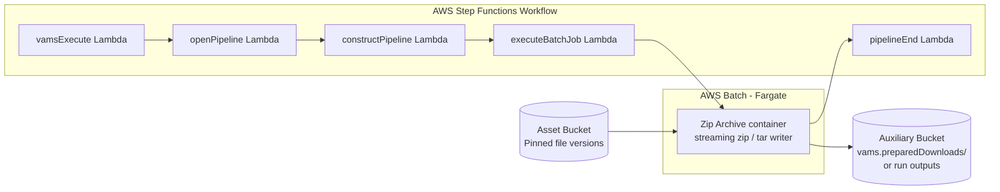

# Zip Archive Pipeline

The Zip Archive pipeline (`utility-zip-archive`) streams selected files, folders, or a whole asset into one zip, tar, or tar.gz archive. It serves the [Download as Zip](../user-guide/zip-downloads.md) feature, and it can also be run as an ordinary workflow that writes the archive back into the asset as a new file. The pipeline runs as an AWS Batch Fargate container that reads the selected file versions from Amazon S3 and writes the archive to Amazon S3 as a multipart upload, without staging data on disk, so an archive can reach the 5 TiB Amazon S3 object limit.

The pipeline and its workflow are **system** records: VAMS registers them in the `GLOBAL` database with the fixed IDs `utility-zip-archive` when `app.zipDownloads.enabled` is `true`, and they are read-only through the API except for their `enabled` toggles and template content. Runs of the workflow are hidden from the execution lists unless system runs are included.

## Archive Formats

| Format | Extension | Notes                                                                                                                                                                                                                        |
| ------ | --------- | ---------------------------------------------------------------------------------------------------------------------------------------------------------------------------------------------------------------------------- |
| zip    | `.zip`    | ZIP64 records wherever a member size, an offset, or the entry count needs them (members over 4 GiB, archives over 4 GiB, more than 65,535 entries). UTF-8 file names. `store` (default) or `deflate` compression per member. |
| tar    | `.tar`    | POSIX pax format, so long names and members over 8 GiB are preserved.                                                                                                                                                        |
| tar.gz | `.tar.gz` | The tar format through a streaming gzip writer.                                                                                                                                                                              |

Empty folders in the selection are written as directory entries.

The zip archive is written in one pass, so each member's sizes and CRC follow its data in a data descriptor and are recorded in the central directory at the end. Readers that use the central directory, such as Info-ZIP `unzip`, 7-Zip, libarchive (`bsdtar`) and Python's `zipfile`, read it normally. A reader that only streams from the start without the central directory, such as Java's `ZipInputStream`, cannot read members stored without compression (`store`); use `deflate`, or a tar format, for such a consumer.

The finished archive must fit in one Amazon S3 object (5 TiB). The headers, padding and directory records add to the size of the selected files, so a selection whose archive could exceed 5 TiB is refused before the archive is written, even when the selected files total less than `maxTotalBytesPerRequest`.

## Architecture



### Two Modes

The container decides its mode from the run manifest:

-   **Zip download** -- A run that VAMS launched for a Download as Zip job (system trigger `System-ZipDownload`) carries a server-only context naming the job and its request manifest under `vams.preparedDownloads/` in the auxiliary bucket. The request manifest, written by the API when the job was created, is the authority for what is archived. The archive is written to the job's key under `vams.preparedDownloads/`, the container records the job's progress and outcome in `ZipDownloadRequestsStorageTable`, and nothing is written to the asset.
-   **Zip Archive run** -- Any other run archives the run's input files and writes the archive to the run's outputs, so the output step ingests it into the asset as a new file version. Outputs over 1 GiB are copied into the asset by the large object copy engine, so the archive size is not capped below 5 TiB. This mode never reads or writes the zip download table.

### Processing Flow

1. The `vamsExecute` Lambda receives the workflow event, decides the mode, and invokes `openPipeline`.
2. `openPipeline` starts the pipeline's AWS Step Functions state machine.
3. `constructPipeline` validates the template configuration and builds the job definition. The AWS Batch command carries the location of the request manifest or the run manifest, not the file list, because AWS Batch bounds the size of a command override.
4. `executeBatchJob` submits the AWS Fargate job with the task token.
5. The container resolves the selection, checks every member, and writes the archive (see below). It heartbeats both task tokens (the VAMS workflow's and the Zip Archive state machine's own) every two minutes and reports success or failure on the state machine's token. If the container is stopped outside VAMS (an AWS Batch terminate), it reports the stop on that token; if it is killed without warning (out of memory, host loss), the missing heartbeats end the run within 30 minutes.
6. `pipelineEnd` finalizes the workflow execution.

### Checks Before Writing

Before it writes the first byte, the container resolves every folder and whole-asset entry to the current file versions (or to the versions recorded in an asset version) and head-checks every member on its pinned version. The whole archive is refused when a member is a delete marker, a missing version, in the GLACIER or DEEP_ARCHIVE storage class, marked archived or deleted (`vams-status`), or has an extension or media type on the executable blocklist, and when the member count or total size exceeds the limits. A refusal fails the run with a user-safe reason that names the asset-relative path. A zip download carries the deployment's blocklists and limits in its request manifest; a Zip Archive run applies the core blocklists.

### Streaming and Multipart Upload

The container reads members with ranged GET requests of their pinned versions, retried and length-checked, and feeds them into the archive writer in order. The writer's output goes to an Amazon S3 multipart upload through a bounded in-memory buffer with at most four parts in flight. The part size is the larger of 16 MiB and the estimated archive size divided by 9,500, rounded up to 1 MiB and capped at 5 GiB, so even a 5 TiB archive stays below the 10,000-part limit. The upload is aborted on any error and when the job is terminated, so a failed or cancelled run leaves no partial archive.

### Container Image Build

The container image is built during CDK deployment, from `backendPipelines/utility/zipArchive/container/` (Python 3.11 slim base image, the Python standard library, and the AWS SDK for Python). It runs as a non-root user. By default the image is a local Docker build on the deployment machine (a CDK image asset pushed to Amazon ECR), so the machine running `cdk deploy` needs Docker. With `app.zipDownloads.useCodeBuild` set to `true`, CDK uploads the container source to Amazon S3 instead, and an AWS CodeBuild project builds the image with `container/buildspec.yml` into an Amazon ECR repository VAMS owns (`<name>-<baseStackName>-ziparchive`, with `-kms` when `app.useKmsCmkEncryption.enabled`). The build runs outside the VPC to pull the public base image, and the deployment does not wait for it: the stack output `ZipArchiveCodeBuildProject` names the project, so check that its latest build SUCCEEDED before the first zip download. The CodeBuild option is supported in the commercial and AWS GovCloud (US) partitions; configuration validation warns when it is set elsewhere.

## Configuration

The pipeline has no configuration block of its own. It is deployed, and its pipeline and workflow are registered, when Download as Zip is enabled:

```json
{
    "app": {
        "zipDownloads": {
            "enabled": true,
            "computeVcpu": 16,
            "computeMemoryGiB": 32,
            "useCodeBuild": false
        }
    }
}
```

`computeVcpu` and `computeMemoryGiB` size the AWS Fargate job, and `useCodeBuild` builds the image with AWS CodeBuild instead of local Docker (see [Container Image Build](#container-image-build)). The other `app.zipDownloads` keys set the limits of Download as Zip jobs, which are kept for 7 days; see [Zip downloads (`app.zipDownloads`)](../deployment/configuration-reference.md#zip-downloads-appzipdownloads).

## Running the Zip Archive Workflow

Run the `utility-zip-archive` workflow on an asset's files, folders, or the whole asset like any workflow, from the asset's **File Manager** (**Automation** > **Execute Workflow**) or with `vamscli workflow execute`. The run archives one asset's files and adds the archive to that asset as a new file. The pipeline accepts multiple input files, folders, and the whole asset, and needs no template; the shipped template `zip-archive-store` writes a zip archive without compression.

The workflow's settings are fixed by the deployment (a system workflow is read-only):

| Setting                 | Value                              | Why                                                                                                                                                                                                                  |
| ----------------------- | ---------------------------------- | -------------------------------------------------------------------------------------------------------------------------------------------------------------------------------------------------------------------- |
| Input files             | One or more                        | An archive usually holds several files.                                                                                                                                                                              |
| Asset scope             | One asset; folders and whole asset | An archive holds one asset's files.                                                                                                                                                                                  |
| Input file filters      | None                               | Any file type can be archived; blocked file types are refused by the archive checks.                                                                                                                                 |
| Concurrency restriction | None                               | The pipeline only reads its inputs, and each Download as Zip job writes its own archive key. A per-asset lock would make a user's zip downloads of one asset, and other users' downloads of it, wait for each other. |
| Output                  | The input asset, no override       | A Zip Archive run adds the archive to the asset it read. Two runs that write the same archive name add two versions of that file.                                                                                    |
| Metadata inputs         | None                               | The archive does not use metadata.                                                                                                                                                                                   |
| Trigger chaining        | Off                                | Another workflow's output never starts an archive run.                                                                                                                                                               |

### Template Configuration Body

| Key               | Type     | Default             | Description                                                                                                                                |
| ----------------- | -------- | ------------------- | ------------------------------------------------------------------------------------------------------------------------------------------ |
| `format`          | string   | `zip`               | `zip`, `tar`, or `tar.gz`.                                                                                                                 |
| `compression`     | string   | `store`             | `store` or `deflate`. `deflate` applies to `zip` only.                                                                                     |
| `outputFileName`  | string   | `<assetId>-archive` | Name of the archive file. The extension for the format is added, and characters other than letters, digits, space, and `._()-` become `_`. |
| `includePatterns` | string[] | all files           | Glob patterns; a file is included when its asset-relative path (without the leading `/`) or its file name matches one.                     |
| `excludePatterns` | string[] | none                | Glob patterns, matched the same way, that leave a file out.                                                                                |
| `assetVersionId`  | string   | current files       | Archive the file versions recorded in this asset version instead of the current files.                                                     |

Any other key fails the run. The same checks as for a zip download apply: the run fails, naming the file, when a selected file is archived, a deleted version, in an archive storage class, or has a blocked file type.

### Example Template Configuration Body

```json
{
    "format": "tar.gz",
    "outputFileName": "scan-package",
    "includePatterns": ["*.e57", "scans/*.laz"],
    "excludePatterns": ["*.tmp"]
}
```

## Prerequisites

### VPC with Isolated Subnets

The container runs on AWS Batch with AWS Fargate compute in the VPC's isolated subnets, so `app.useGlobalVpc.enabled` must be `true` when `app.zipDownloads.enabled` is `true`. Configuration validation refuses `app.zipDownloads.enabled` without the VPC. When the feature is on and `app.useGlobalVpc.addVpcEndpoints` is `true`, the VPC builder creates the shared AWS Batch, Amazon ECR, and Amazon ECR Docker interface endpoints; the container also uses the VPC's base interface endpoints (AWS Step Functions, Amazon CloudWatch Logs, AWS STS, and AWS KMS when a customer managed key is configured) and the Amazon S3 and Amazon DynamoDB gateway endpoints. A VPC you bring without `addVpcEndpoints` must reach the same services.

## Infrastructure Components

The following AWS resources are created when Download as Zip is enabled:

| Resource                     | Service            | Purpose                                                                                                    |
| :--------------------------- | :----------------- | :--------------------------------------------------------------------------------------------------------- |
| Fargate Compute Environment  | AWS Batch          | Serverless container execution                                                                             |
| Job Queue                    | AWS Batch          | Job scheduling                                                                                             |
| Job Definition               | AWS Batch          | Container configuration (`computeVcpu`, `computeMemoryGiB`)                                                |
| Container Repository         | Amazon ECR         | Stores the Zip Archive container image (the CDK asset repository, or a VAMS-owned one with `useCodeBuild`) |
| CodeBuild Project            | AWS CodeBuild      | Builds the container image, only with `useCodeBuild`                                                       |
| Step Functions State Machine | AWS Step Functions | Pipeline orchestration with an 11-hour job timeout and a 30-minute task-token heartbeat timeout            |
| Lambda Functions (5)         | AWS Lambda         | Pipeline coordination (vamsExecute, openPipeline, constructPipeline, executeBatchJob, pipelineEnd)         |

The `ZipDownloadRequestsStorageTable` table, the `vams.preparedDownloads/` lifecycle rules on the auxiliary bucket, and the zip download API functions are deployed whether or not the feature is enabled. See [AWS Resources](../architecture/aws-resources.md).

### Container Permissions

The job role reads and lists object versions in the asset buckets, writes and aborts multipart uploads under `vams.preparedDownloads/` in the auxiliary bucket and reads the request manifest there, writes the run's outputs for a Zip Archive run, updates job rows in `ZipDownloadRequestsStorageTable`, queries the asset file versions table for asset-version pins, and reports on the Step Functions task token. With an AWS KMS customer managed key, it also decrypts and generates data keys with that key.

## Troubleshooting

### A Job or Run Fails Naming a File

The archive was refused because the named file is archived, a deleted version, in the GLACIER or DEEP_ARCHIVE storage class, or has a blocked file type, or the selection exceeds a limit. Unarchive or restore the file, or remove it from the selection, and create the job again.

### A Job Fails With "The archive job timed out"

The run reached the 12-hour task timeout. Very large archives finish faster with more compute: raise `computeVcpu` and `computeMemoryGiB`, or split the selection into several jobs.

### A Job Fails With "The archive job was stopped" or "The archive job stopped responding"

The Zip Archive container ended before the archive was written. "The archive job was stopped" means its AWS Batch job was terminated outside VAMS. "The archive job stopped responding" means the container stopped without warning, for example because it ran out of memory or its host was lost, or the job waited in the AWS Batch queue for more than 30 minutes before it started. Create the job again. If it recurs for the same selection, raise `computeMemoryGiB`, or check the account's AWS Fargate vCPU quota and the other Batch jobs in the queue.

### A Job Fails With "Cancelled from workflow executions"

The Zip Archive run was aborted from the workflow executions views rather than cancelled from the **Download Queue**. Create the job again.

## Third-Party Library Licenses

The container uses only the Python standard library and the AWS SDK for Python (Boto3, Apache-2.0) on the Python base image. No other third-party archive library is included. See [Notices](../additional/notices.md).

## Related Resources

-   [Download as Zip and the Download Queue user guide](../user-guide/zip-downloads.md)
-   [Zip Downloads API](../api/zip-downloads.md)
-   [Pipeline System Overview](overview.md)
-   [Configuration Reference](../deployment/configuration-reference.md#zip-downloads-appzipdownloads)
