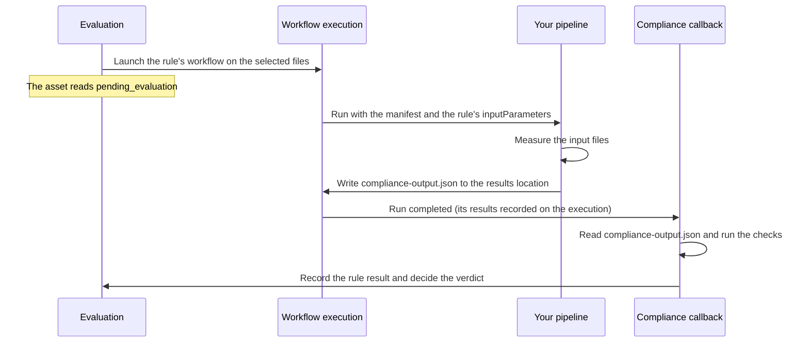

# Compliance

Compliance lets your organization write down the standards its assets must meet and has VAMS check every asset against them, automatically and every time the asset changes. An asset that breaks a strict rule is held back in quarantine until it is fixed or a reviewer decides otherwise, and every verdict and every human decision is recorded for audit. For a worked example and a diagram of how the parts fit together, see the [Compliance overview](../concepts/compliance.md#overview).

## What compliance is for

Teams that produce engineering, survey and 3D content have standards a deliverable must meet before anyone relies on it: a part number in its metadata, the expected folders and file types, a model that converts cleanly, a link to the assembly it belongs to. Checking that by hand does not scale to thousands of assets, and a check done once is out of date as soon as the asset changes.

Compliance turns those standards into rules that VAMS applies continuously. You define the rules once and attach them to a database, or to a single asset. From then on every asset carries a clear status, content that fails a strict rule is stopped before it is used, and an auditor can see who decided what, and when.

## Key capabilities

| Capability                                      | What it gives you                                                                                                                                                                                                                                                                                                                                                                                                                                                                                                                                                                                                                                                                                                                                                                                                 |
| ----------------------------------------------- | ----------------------------------------------------------------------------------------------------------------------------------------------------------------------------------------------------------------------------------------------------------------------------------------------------------------------------------------------------------------------------------------------------------------------------------------------------------------------------------------------------------------------------------------------------------------------------------------------------------------------------------------------------------------------------------------------------------------------------------------------------------------------------------------------------------------- |
| **Standards written once, as reusable rules**   | A compliance schema is a named, versioned set of rules. Six rule types cover an asset's metadata (required fields and types on the asset, its files or its links), its relationships (required links, such as a parent assembly), its file structure (required or forbidden paths and file counts), version coverage (every current file is recorded in an asset version), its attributes (naming conventions, descriptions, required tags) and pipeline checks. Each rule has an enforcement level: `quarantine`, `warn` or `inform`. A schema is shared with every database (`GLOBAL`) or kept to one database, can extend another schema, and is built in the **Visual Builder** or written as JSON. A default schema and four ready-made templates help you start. See [Managing schemas](#managing-schemas). |
| **Automated checks through your own pipelines** | A pipeline rule runs a VAMS workflow, such as the built-in 3D conversion, on the asset's files and compares the measurements the run reports with tolerances you set: the conversion succeeds, finishes within a time limit, or keeps a value in range. Any pipeline registered in VAMS can serve as a check. See [Pipeline rules](../concepts/compliance.md#pipeline-rules), and [Building a pipeline for compliance checks](#building-a-pipeline-for-compliance-checks) for a pipeline that reports measurements of its own.                                                                                                                                                                                                                                                                                    |
| **Continuous, automatic evaluation**            | Binding a schema to a database covers every asset in it, at any database size; the change is applied in the background, with its progress on the database's compliance page. After that, an asset is evaluated whenever it is created or its files, metadata or links change. You can also evaluate one asset (**Evaluate Now**), a whole database (**Evaluate All Assets**) or every asset under a schema (**Sweep**). See [Binding schemas to databases](#binding-schemas-to-databases) and [Evaluating assets](#evaluating-assets).                                                                                                                                                                                                                                                                            |
| **A clear status for every asset**              | Each governed asset is `compliant`, `non_compliant`, `quarantined`, `exception`, `pending_evaluation` or `unknown`. The status shows as a badge on the asset, on its **Compliance** tab with the failing rules and the full evaluation history, and on each database's compliance overview with counts per state and a compliance rate. See [Viewing compliance status](#viewing-compliance-status).                                                                                                                                                                                                                                                                                                                                                                                                              |
| **Quarantine that holds back failing content**  | An asset that fails a `quarantine`-level rule is quarantined and listed on the **Quarantine** page, and its subscribers are notified when it enters quarantine. A deployment can also refuse downloads, previews, streaming and exports with file links for quarantined assets. A quarantine is not lifted by a binding change or by a re-evaluation still in progress; only a passing verdict or a reviewer ends it. See [Quarantine](#quarantine).                                                                                                                                                                                                                                                                                                                                                              |
| **Human decisions, recorded**                   | A reviewer can release a quarantined asset or grant it an exception, each with a recorded reason. An exception holds for the schema version it was granted against and can be revoked. A decision made while an evaluation is running stands, and that evaluation is recorded as not applied. See [Releasing from quarantine](#releasing-from-quarantine) and [Granting an exception](#granting-an-exception).                                                                                                                                                                                                                                                                                                                                                                                                    |
| **Linked assets kept in step**                  | When an evaluated asset has child assets, a cascade re-evaluates them, parents before children, once a reviewer approves it. See [Cascade approvals](#cascade-approvals).                                                                                                                                                                                                                                                                                                                                                                                                                                                                                                                                                                                                                                         |
| **A complete audit trail**                      | Every evaluation, binding change, release, exception and cascade decision is recorded with who or what made it, when, and the asset's state before and after. You can filter the trail by database, asset, event type and time. The history of a deleted database is kept. See [Audit log](#audit-log).                                                                                                                                                                                                                                                                                                                                                                                                                                                                                                           |
| **Access control built on VAMS permissions**    | Compliance uses the standard two-tier permission model, with three ready-made role templates: Compliance Admin for one database, Compliance Global Admin for a central team that owns shared rules, and Compliance Readonly for auditors and viewers. Every allow-or-deny decision is made by the API, and compliance data follows asset access: a user sees an asset's compliance data only if they may open the asset. See [Permissions](#permissions).                                                                                                                                                                                                                                                                                                                                                         |
| **Available in every interface**                | The web interface (**Compliance Schemas**, **Quarantine**, **Cascade Approvals**, **Audit Log**, each database's compliance overview and each asset's **Compliance** tab), the `vamscli compliance` commands, the compliance tools of the VAMS MCP server for AI agents, and the REST API. See [Compliance Commands](../cli/commands/compliance.md) and the [Compliance API reference](../api/compliance.md).                                                                                                                                                                                                                                                                                                                                                                                                     |

## The parts you work with on this page

Each part has its own section below:

-   **Compliance schemas** -- named sets of rules, each with an enforcement level: `quarantine` (the asset is quarantined when the rule fails), `warn` (it is marked non-compliant) or `inform` (the failure is only recorded). See [Managing schemas](#managing-schemas).
-   **Bindings** -- a schema bound to a database governs every asset in it; a schema bound to one asset overrides the database's. See [Binding schemas to databases](#binding-schemas-to-databases).
-   **Evaluations** -- an asset is checked automatically when it changes, or when you choose **Evaluate Now**, **Evaluate All Assets** or **Sweep**. The result is the asset's compliance state. See [Viewing compliance status](#viewing-compliance-status) and [Evaluating assets](#evaluating-assets).
-   **Quarantine, releases and exceptions** -- a reviewer releases a quarantined asset or grants it an exception with a recorded reason. See [Quarantine](#quarantine).
-   **Cascades** -- after an asset is evaluated, its child assets can be re-evaluated once a reviewer approves. See [Cascade approvals](#cascade-approvals).
-   **The audit log** -- every compliance action, with who made it and when. See [Audit log](#audit-log).

To get a first verdict on a new deployment, follow [First steps](../concepts/compliance.md#first-steps): bind the seeded `default-compliance-schema` (or your own) to a database, let the binding evaluate its assets, and read the result on the database's compliance overview. This page walks through each page of the web interface and the API calls behind it; the rule format, states and behavior in full are described in [Compliance (Concepts)](../concepts/compliance.md), and the [Behaviors to know about](../concepts/compliance.md#behaviors-to-know-about) list the ones that most often surprise new users.

:::info[Navigation]
The **Admin - Compliance** section of the left sidebar — **Compliance Schemas**, **Quarantine**, **Cascade Approvals** and **Audit Log** — and the database compliance overview appear to users whose role grants the `/compliance` and `/databases` web routes. If you do not see them, ask your administrator to apply one of the compliance [permission templates](#permissions).
:::

Each compliance list has the search box on the left with the refresh button next to it, and its filters on the right, also when they wrap onto a line of their own. Choosing a column header sorts the list, and choosing it again reverses the order. The quarantine, cascade and audit lists, the database compliance overview and an asset's evaluation history are paged by the server: a column header sorts the page shown, and the table header says so when there is more than one page. The **Compliance Schemas** list is sorted, filtered and paged as a whole.

---

## Viewing compliance status

### Asset compliance tab

Each asset detail view includes a **Compliance** tab showing:

-   **Current state** -- the compliance state as a colored indicator: green (compliant), yellow (non-compliant), red (quarantined), grey (pending evaluation or unknown), or the blue **Exception** indicator for an asset released from quarantine by a granted exception. The same state shows as a badge beside the asset name at the top of the asset view. A red **Evaluation error** indicator beside it means the last evaluation produced no verdict — every rule of it errored, or its schema could not be loaded — so the state shown is the one the asset held before that evaluation; the evaluation history shows the cause. An archived asset shows **Archived (not evaluated)** with a notice and its **Recorded State** beneath: it is not evaluated while it is archived, is left out of the database overview and the quarantine list, and offers no evaluation, release or exception action. Its recorded state applies again once the asset is unarchived.
-   **Schema binding** -- which schema governs the asset and whether it is inherited from the database or set on the asset.
-   **Active exception** -- when an exception holds, its reason, grantor, time and the schema and version it was granted against, with a **Revoke exception** action (a confirmation dialog, no reason) that returns the asset to the state of its last evaluation.
-   **Evaluate Now** -- evaluates the asset and, when it has child assets, opens a cascade awaiting approval (unless one for this asset is already pending).
-   **Evaluation history** -- past evaluations with their timestamps, verdicts and violations.

When the compliance state or the evaluation history cannot be loaded, the tab says so with the reason and a **Retry** button, and shows no state or history read before.

:::info[Evaluation history]
Each row lists the rules that failed as violations. A row flagged **Exception applied** was evaluated while an exception held, so its violations did not change the asset's state. A row flagged **Rule errors** had at least one rule whose tooling failed — an input selection the workflow could not use, or an execution that could not start; such a rule is listed under **Not evaluated** apart from the violations, because it produced no verdict and its enforcement did not apply. A row still running that is flagged **Waiting** has a pipeline rule waiting for a running execution of its workflow; the rule is named under **Waiting for a running execution of its workflow** and starts when that execution ends. The running execution is not named, because it may be another user's. An evaluation in which every rule errored, or whose schema cannot be loaded, shows an `error` result rather than a verdict and leaves the asset's state as it was.

A pipeline rule whose workflow execution failed is listed as **Pipeline execution FAILED** (**Pipeline execution ABORTED** or **Pipeline execution TIMED_OUT** when the execution was aborted or timed out). When you may open that execution, the reason it failed follows as **Pipeline failure (rule name):** with the error the execution recorded, for example `ValueError: latin1.obj could not be read as OBJ text`; a quarantined asset shows the same line under its current state. The reason is shown exactly to the users who may open the execution itself (its workflow and every asset it read and wrote); anyone else sees the generic message and the link to the execution in the **Execution** column.
:::

### Database compliance overview

1. Navigate to **Databases** in the left sidebar.
2. In the databases table, choose the **Compliance** link for the database you want to inspect.
3. The overview page shows:
    - A **Schema Binding** panel, for users who may list schemas and bind or unbind one, with the **Bound schema** selector and the **Bind**, **Change** and **Remove** actions. See [Binding schemas to databases](#binding-schemas-to-databases).
    - A summary row with counts for each state: Compliant, Non-Compliant, Quarantined, Exception, Pending Evaluation, and Unknown, plus an **Evaluation errors** tile counting the assets whose last evaluation produced no verdict. That tile is an overlay on the state counts, not a state of its own: each of those assets is also counted under the state it kept.
    - A compliance rate (compliant assets divided by tracked assets you can view, shown as `-` when there are none). Archived assets are left out of every count, the rate and the table.
    - A table of tracked assets with each asset's name (its ID beneath), compliance state (with the **Evaluation error** indicator beside it where the last evaluation errored), the **Bound schema** — the schema the asset is currently bound to, which is not necessarily the schema whose evaluation produced the state shown, with whether it is inherited from the database or set on the asset beneath — and last evaluation time.
    - On each asset row, for users who may read evaluations, **History**: the asset's evaluations newest first, each with its verdict, the schema and version it read, and every rule's result, including rules whose tooling failed (shown as errors, not evaluated). For an asset in the `exception` state, users who may revoke exceptions also get **Revoke exception**, with the same confirmation as the asset's Compliance tab. Both work without access to the asset page, which is how the Compliance Admin and Compliance Readonly roles reach them: neither template grants asset pages.

Only assets with a compliance record are counted; an asset that has never been bound does not appear.

The table filters and sorts on the server, across every tracked asset of the database rather than only the page shown: search by asset name or ID, and filter by state, bound schema, binding source (the database binding or an asset override) and whether the last evaluation errored; sort by asset ID or name with **Sort by**. A column header sorts the page shown; choosing a **Sort by** order clears it, so the rows follow that order. Choosing a state tile in the summary row shows only the assets in that state (choose it again to clear it), **Evaluation errors** shows only the assets whose last evaluation errored, and **Tracked Assets** clears both. The summary always counts the whole database. The filters are kept in the page URL, so a filtered view can be reloaded or shared, and a link or pasted URL to another filtered view of the same overview reloads the table for it. A filtered page can hold fewer assets than a full page while more follow; use the pagination control to continue.

---

## Binding schemas to databases

### Assigning a compliance schema

On the database's compliance overview:

1. Navigate to **Databases** and choose the **Compliance** link of the database.
2. In the **Schema Binding** panel, select the schema in **Bound schema**. `GLOBAL` schemas and schemas scoped to this database are offered.
3. Choose **Bind**, or **Change** when the database already has a schema.
4. Confirm with **Bind schema** or **Change schema**. The confirmation names the database, the schema bound now and the one you chose, and says what the change does. Until you confirm, nothing is sent; **Cancel** keeps the binding as it is.

The binding is saved at once and then applied to the database's assets in the background: the overview shows **Applying the binding** with a progress bar ("Applying the binding to 2,500 assets", "1,000 of 2,500 done") until every asset record is updated, then the counts (assets pending evaluation, quarantined assets kept, evaluations queued). **Bind**, **Change**, **Remove** and **Evaluate All** are unavailable meanwhile. With automatic evaluation on, the overview then shows **Queueing evaluations** ("300 of 2,500 evaluations queued") while the evaluations are queued, a share at a time; the controls are available meanwhile. A change that really stopped (its last step failed on every delivery, could not be queued, or ran more steps than a change of its size needs) shows **Stopped** (or **Evaluations stopped**) with the reason and a **Resume** button, which repeats the change and continues it from where it stopped; a change that only waits its turn on a busy queue keeps showing its progress. In the database editor:

1. Navigate to **Databases** and choose the database you want to configure.
2. Choose **Edit** to open the database editor.
3. In the **Compliance Schema** field, select the schema to bind. `GLOBAL` schemas and schemas scoped to this database are offered.
4. Choose **Update Database**.

The editor closes once the binding is saved; the database's compliance page shows the change being applied. Every asset in the database without an asset-level override is marked `pending_evaluation`, except a quarantined one: it stays quarantined (and, when quarantine blocks downloads, cannot be downloaded) until it is re-evaluated, and the **Quarantine** list and its **Compliance** tab say it awaits re-evaluation under the new schema. Each asset gets its own entry in the audit log. With automatic evaluation on, the binding queues the evaluation of every affected asset; with it off, run **Evaluate All** or a sweep. Choosing the schema already bound, with the same automatic evaluation setting, changes nothing and says so. Use **Evaluate Now** on individual assets or **Sweep** on the schema to produce verdicts. With automatic evaluation on (the default for a binding), an asset is also evaluated whenever it is created or updated — once per upload, however many files it contains, about a minute after the upload completes (an upload of more than 50 files, which the CLI and the web uploader send as several requests, is evaluated once when its requests complete within a minute of each other); a file that arrives after that evaluation started is evaluated separately.

The same binding is made with the API:

```bash
PUT /compliance/bind/{databaseId}
```

```json
{ "schemaName": "survey-compliance", "complianceAutoEval": true }
```

The database editor sends the database save only when a database field changed and the binding only when the schema selection changed, so a schema-only change needs no permission to update the database. A refused save sends no binding; a refused binding is reported in the editor, which stays open. A role that holds only compliance permissions, such as one built from the Compliance Admin template, binds on the compliance overview, with the API or with `vamscli compliance bind`. See [Permissions](#permissions).

### Removing a compliance schema

On the database's compliance overview, choose **Remove** in the **Schema Binding** panel and confirm. In the database editor:

1. Navigate to **Databases** and choose the database.
2. Choose **Edit** to open the database editor.
3. In the **Compliance Schema** field, select **None (no compliance schema)**.
4. Choose **Update Database**.
5. Confirm with **Remove binding**. This is the same confirmation as **Remove** on the overview. Until you confirm, nothing is sent, not even other changes to the database fields; **Cancel** returns to the editor.

The compliance records of every asset that inherited the database schema are removed, except a quarantined asset's: it stays quarantined, marked as awaiting re-evaluation because the binding was removed, until you release it or bind a schema that evaluates it. The overview shows **No compliance schema bound** until a schema is assigned again.

:::warning[Irreversible action]
Removing a database's compliance schema deletes the compliance state of every asset that inherited it, except a quarantined asset, which stays quarantined until it is released or a newly bound schema evaluates it. Assets with an asset-level schema override keep their state.
:::

### Overriding the schema of one asset

An asset can be bound to a schema of its own, which takes precedence over the database binding. In the asset view, choose **Edit**, select the schema in the **Compliance Schema** field of the **Update Asset** modal (or **Inherit from database** to remove the override), and choose **Update Asset**. As in the database editor, the asset save is sent only when an asset field changed and the binding only when the schema selection changed; a refused save sends no binding, and a refused binding is reported in the modal, which stays open. With the API:

```bash
PUT /compliance/bind/{databaseId}/{assetId}
```

```json
{ "schemaName": "strict-survey-compliance" }
```

Removing the override (`DELETE /compliance/bind/{databaseId}/{assetId}`) returns the asset to the database schema as `pending_evaluation`. Setting or removing an override on a quarantined asset keeps it quarantined until it is re-evaluated, and setting the override it already has changes nothing. `GET /compliance/bind/{databaseId}` lists the database binding and the asset overrides in the database, one page per call (`maxItems`, `startingToken`, `NextToken`).

---

## Managing schemas

Compliance schemas define the rules assets are evaluated against. Write schemas in the `vams-rules-v1` format: named rules of the `pipeline`, `metadata`, `relationship`, `fileStructure`, `versionCoverage` and `assetAttributes` types, each with a `quarantine`, `warn` or `inform` enforcement level. Only `vams-rules-v1` bodies are accepted; any other body (including a legacy JSON Schema document) is rejected at registration. A pipeline rule's **Input files** selection decides which of the asset's files its workflow execution receives: **Matching files** (the default) applies the workflow's and pipeline's own file filters plus the rule's glob filters and must leave exactly one file for a single-input workflow; **Whole asset** sends the asset root where the workflow allows it; **Explicit files** names asset-relative paths. The pipeline's `compliance-output.json` is optional — without it the rule's checks can read only `execution_success` and `processing_duration_seconds`. The four templates in `documentation/complianceSchemaTemplates/` are ready-to-register `vams-rules-v1` schemas; see [Compliance concepts](../concepts/compliance.md#schema-templates).

The **Compliance Schemas** page lists every schema you may read with its name, where it is **Available to**, description, format and version, 15 to a page, and filters by name, description and availability. The filters and the column sorting apply to the whole list before it is paged. A schema is available to **All databases (GLOBAL)** — offered and bindable in every database — or to **One database** only, which **Create Schema** asks for (GLOBAL by default); a schema for one database is offered, and can be bound, only in that database, and the API refuses binding it elsewhere. The binding control on the database compliance overview, the database editor and the asset editor offer the GLOBAL schemas and those of the database they bind in. **Create Schema** opens the schema editor, which builds a `vams-rules-v1` body rule by rule; **Edit** opens an existing schema in the same editor and writes its next version; **Sweep** evaluates every asset bound to the schema.

### Where a metadata rule's schema is looked up

A metadata rule names a VAMS metadata schema. In the Visual Builder, **Metadata schema location** decides where it is looked up:

-   **The asset's database (then GLOBAL)** (the default) — the database of the asset being evaluated, then GLOBAL. A GLOBAL compliance schema bound to several databases uses each database's own metadata schema of that name, and the GLOBAL one where a database has none.
-   **GLOBAL** — always the GLOBAL metadata schema.
-   **This database** — offered for a compliance schema available to one database only: that database's metadata schema, then the GLOBAL one.

A schema cannot name another database's metadata schema, workflow or pipeline: the database it names must be GLOBAL or, for a database-scoped compliance schema, its own. Saving one that does is refused.

### Adding rules in the Visual Builder

In the schema editor, open the **Visual Builder** tab and choose a rule type from **Add rule**. Each new rule starts from a working example that you then adjust; **Add check** adds a check to a rule and **Remove check** removes one. The builder shows the validation message the API would return next to the field it concerns. Every rule needs a name of its own: while a rule name is empty or repeated, **Create** and **Save** are refused with that message, since the schema body keys rules by name and would drop or merge the rule. Path, name and description patterns are regular expressions — see [Path and attribute patterns](../concepts/compliance.md#path-and-attribute-patterns) — and are checked as such when you save the schema; a pattern the API refuses is reported at the top of the dialog, which scrolls the message into view.

| Rule type                 | What you edit in the builder                                                                                                                                                                                                                                                                                     |
| ------------------------- | ---------------------------------------------------------------------------------------------------------------------------------------------------------------------------------------------------------------------------------------------------------------------------------------------------------------- |
| **Pipeline rule**         | The workflow, pipeline and optional template, and the **Input files** selection. Its checks and input parameters are edited in the **JSON Editor** tab.                                                                                                                                                          |
| **Metadata rule**         | Name, enforcement and **Scope** (**Asset metadata**, **File metadata**, **File attributes** or **Asset link metadata**) with the scope's filters — see [Choosing a metadata rule's scope](#choosing-a-metadata-rules-scope). The metadata schema reference and the checks are edited in the **JSON Editor** tab. |
| **Relationship rule**     | Name and enforcement; the checks are edited in the **JSON Editor** tab.                                                                                                                                                                                                                                          |
| **File structure rule**   | Per check: **Required paths** and **Forbidden paths**, one pattern per line (paths are matched without their leading `/`, so `^models/` is a top-level `models` folder), and **Minimum files** / **Maximum files**. A check needs at least one.                                                                  |
| **Version coverage rule** | Per check: **Excluded paths (optional)**, one pattern per line, for files that need not be versioned — the example excludes preview images (`\.previewFile\.`).                                                                                                                                                  |
| **Asset attributes rule** | Per check: the **Attribute** (asset name, description or tags). For a name or description, a **Condition** (**Must match** or **Must not match**) and a **Pattern**. For tags, **Required tags**, **Forbidden tags** and **Minimum tags**.                                                                       |

:::warning[A version coverage rule fails after every upload]
A version coverage rule fails from every upload until you create an asset version that records the new files; creating the version re-evaluates the asset and clears the failure. Reverting to an earlier version also re-evaluates the asset. Files added after that version stay in the asset; any of them that no asset version records stays uncovered until a new version includes it, while one a later version already records stays covered. With **Quarantine** enforcement and quarantine blocking downloads (`app.compliance.quarantineBlocksDownload`), a freshly uploaded asset cannot be downloaded until it is versioned. Use **Warn** for this rule unless that is what you want.
:::

With automatic evaluation on, editing an asset's name, description or tags re-evaluates the asset, so an asset attributes rule follows the edit; an edit that leaves all three as they were starts no evaluation. Adding, changing or deleting metadata of the asset, of one of its files (metadata or attributes) or of one of its asset links re-evaluates the asset the same way — both linked assets for a link's metadata — and so does creating or deleting an asset link, so a metadata or relationship rule that failed clears once you fix what it reported. Metadata a pipeline rule's own workflow writes back does not re-evaluate the asset.

#### Choosing a metadata rule's scope

A metadata rule's **Scope** decides what it validates. Choose the metadata schema to match: an asset metadata schema for **Asset metadata**, a file metadata schema for **File metadata**, a file attribute schema for **File attributes**, and an asset link metadata schema for **Asset link metadata**. A rule whose schema is missing or of another type is listed under **Not evaluated** on the asset's Compliance tab instead of passing.

| Scope                   | What is checked                                   | Filters in the builder                                     |
| ----------------------- | ------------------------------------------------- | ---------------------------------------------------------- |
| **Asset metadata**      | The asset's own metadata (the default)            | —                                                          |
| **File metadata**       | The metadata of every current file of the asset   | **Include paths (optional)**, **Exclude paths (optional)** |
| **File attributes**     | The attributes of every current file of the asset | **Include paths (optional)**, **Exclude paths (optional)** |
| **Asset link metadata** | The metadata of every asset link of the asset     | **Link direction**, **Relationship type**                  |

**Link direction** offers **Both directions** (the default), **Parents** and **Children**. A body that sets `linkDirection` to `related` also reads both directions, and the builder shows it as **Both directions**.
For the two file scopes, every current, non-archived file the schema's file type restriction admits is checked, including files that carry no metadata yet — such a file fails a required field. **Include paths** and **Exclude paths** take one regular expression per line, matched against the file path without its leading `/`: when include paths are given, only matching files are checked; files matching an exclude path are skipped (for example `\.previewFile\.` for preview images). For **Asset link metadata**, **Link direction** chooses the links to this asset (**Parents**), from it (**Children**) or both, and **Relationship type** chooses **Parent-child**, **Related** or either; an asset with more than 500 such links is reported as not evaluated. Every file or link checked must pass for the rule to pass, and the violation names up to ten that failed. Switching the scope removes the filters the new scope does not take.

:::warning[Legacy schemas]
A schema whose body is not a `vams-rules-v1` document is marked **Legacy — cannot be bound or evaluated** in the Format column (the API and CLI report it as `schemaFormat: legacy`). Such a schema cannot be bound, updated or evaluated — a bind request is refused with `Schema body must be a vams-rules-v1 document` — and is listed only so that it can be found and deleted (`DELETE /compliance/schemas/{schemaName}` or `vamscli compliance schema delete`). Register its rules again as a `vams-rules-v1` schema under a new name if they are still needed.
:::

### Registering a schema

Saving a schema with a pipeline rule needs the right to run the rule's workflow: the workflow's execute route and reading the workflow and its pipelines. The Compliance Admin template grants it for the workflows of its database and of `GLOBAL`, the Compliance Global Admin template for `GLOBAL` workflows. Without it the save is refused with **Not authorized to run the workflow of pipeline rule '<name>'**, and the editor stays open with that message. Only pipeline rules the save adds or changes are checked.

```bash
POST /compliance/schemas
```

```json
{
    "schemaName": "survey-compliance",
    "description": "Compliance rules for survey data assets",
    "schemaBody": {
        "schemaFormat": "vams-rules-v1",
        "rules": {
            "coord-accuracy": {
                "ruleType": "pipeline",
                "enforcement": "quarantine",
                "pipelineRef": {
                    "databaseId": "GLOBAL",
                    "workflowId": "coord-validate-workflow",
                    "pipelineDatabaseId": "GLOBAL",
                    "pipelineId": "coord-validate"
                },
                "checks": [
                    {
                        "name": "residual_check",
                        "outputField": "residual_error_mm",
                        "tolerance": { "operator": "lte", "value": 1.0 }
                    }
                ]
            },
            "required-metadata": {
                "ruleType": "metadata",
                "enforcement": "quarantine",
                "metadataSchemaRef": {
                    "databaseId": "survey-project",
                    "schemaName": "scan-capture-metadata"
                },
                "checks": [
                    {
                        "name": "required_fields",
                        "validateRequired": true,
                        "validateTypes": true
                    }
                ]
            },
            "has-control-parent": {
                "ruleType": "relationship",
                "enforcement": "warn",
                "checks": [
                    {
                        "name": "control_point_link",
                        "direction": "parents",
                        "relationshipType": "parentChild",
                        "minCount": 1
                    }
                ]
            }
        }
    }
}
```

A schema is `GLOBAL` unless the request names a `databaseId`, in which case it can only be bound within that database.

:::note[Pipeline rules that share a workflow]
When two or more pipeline rules of a schema name the same workflow, the schema still saves, and the answer carries a `warnings` entry naming those rules; the Schemas page shows it beside the success message, and the CLI prints it. If that workflow restricts concurrency (`perAsset`, `perInputFile` or `perInputFileVersion`), the rules cannot run at the same time on an asset: the second waits for the first rule's run and starts when it ends, so the evaluation takes as long as their runs together. The warning is computed from the schema alone and is shown whatever the workflow's setting, which can change after the save. See [Rules that wait for a running execution](../concepts/compliance.md#rules-that-wait-for-a-running-execution).
:::

:::note[A parent schema that was not found]
When a schema's `extends` names a parent that was not found as a `vams-rules-v1` schema you may read, the schema still saves, and the answer carries an `extendsSchemaNotFound` warning: **The parent schema '_name_' was not found as a vams-rules-v1 schema you may read. If it does not exist or is not vams-rules-v1, this schema is evaluated with its own rules only.** The Schemas page shows it beside the success message, and the CLI prints it. The same message is shown for a parent you may not read, so check the name with an administrator if you expect it to exist. See [Schema inheritance](../concepts/compliance.md#schema-inheritance).
:::

### Updating a schema

An update writes a new version of the schema; assets keep the verdict of their last evaluation until they are evaluated again. Fields omitted from the request carry over from the current version.

```bash
PUT /compliance/schemas/{schemaName}
```

:::warning[System schemas]
A schema registered by the system (`isSystem: true`) is updated or deleted only by the system user.
:::

### Deleting a schema

A schema that no database or asset is bound to can be deleted through the API or the CLI (`vamscli compliance schema delete`); every version is removed and a `schema_deleted` entry is written to the audit log. Remove the schema's bindings first — the request is refused while a binding remains.

```bash
DELETE /compliance/schemas/{schemaName}
```

### Sample schemas

#### Coordinate transform validation

Quarantines point cloud assets whose positional accuracy after coordinate transformation is outside tolerance. The pipeline's template tag `expected_crs` is set from `inputParameters`:

```json
{
    "schemaFormat": "vams-rules-v1",
    "rules": {
        "coord-transform-accuracy": {
            "ruleType": "pipeline",
            "enforcement": "quarantine",
            "pipelineRef": {
                "databaseId": "GLOBAL",
                "workflowId": "coord-validate-workflow",
                "pipelineDatabaseId": "GLOBAL",
                "pipelineId": "coord-validate"
            },
            "inputParameters": { "expected_crs": "EPSG:27700" },
            "checks": [
                {
                    "name": "residual_error",
                    "description": "Positional residual under 1 mm",
                    "outputField": "residual_error_mm",
                    "tolerance": { "operator": "lte", "value": 1.0 }
                },
                {
                    "name": "scale_deviation",
                    "description": "Scale factor deviation within 1 ppm",
                    "outputField": "scale_deviation_ppm",
                    "tolerance": { "operator": "lte", "value": 1.0 }
                }
            ]
        }
    }
}
```

#### Metadata completeness with relationship requirements

Quarantines scan assets that lack required metadata, warns when a scan has no control point parent, and records whether related imagery is linked:

```json
{
    "schemaFormat": "vams-rules-v1",
    "rules": {
        "scan-metadata": {
            "ruleType": "metadata",
            "enforcement": "quarantine",
            "metadataSchemaRef": {
                "databaseId": "survey-project",
                "schemaName": "scan-capture-metadata"
            },
            "checks": [
                {
                    "name": "required_fields",
                    "validateRequired": true,
                    "validateTypes": true,
                    "additionalRequiredFields": ["capture_date", "scanner_model", "operator"]
                }
            ]
        },
        "has-control-point": {
            "ruleType": "relationship",
            "enforcement": "warn",
            "checks": [
                {
                    "name": "parent_control_point",
                    "direction": "parents",
                    "relationshipType": "parentChild",
                    "minCount": 1
                }
            ]
        },
        "has-related-imagery": {
            "ruleType": "relationship",
            "enforcement": "inform",
            "checks": [
                {
                    "name": "linked_imagery",
                    "direction": "related",
                    "relationshipType": "related",
                    "minCount": 1
                }
            ]
        }
    }
}
```

#### Combined pipeline and range validation

Checks reconstruction quality with three tolerance operators:

```json
{
    "schemaFormat": "vams-rules-v1",
    "rules": {
        "reconstruction-quality": {
            "ruleType": "pipeline",
            "enforcement": "quarantine",
            "pipelineRef": {
                "databaseId": "GLOBAL",
                "workflowId": "reconstruction-validate",
                "pipelineDatabaseId": "GLOBAL",
                "pipelineId": "reconstruction-metrics"
            },
            "checks": [
                {
                    "name": "point_density",
                    "outputField": "points_per_sqm",
                    "tolerance": { "operator": "gte", "value": 100.0 }
                },
                {
                    "name": "coverage_ratio",
                    "outputField": "coverage_percent",
                    "tolerance": { "operator": "between", "min": 95.0, "max": 100.0 }
                },
                {
                    "name": "noise_level",
                    "outputField": "noise_sigma_mm",
                    "tolerance": { "operator": "lte", "value": 2.5 }
                }
            ]
        }
    }
}
```

#### Using an existing workflow with the derived measurements

Any workflow can back a pipeline rule without changes to its pipelines. When the pipeline writes no `compliance-output.json`, two measurements are derived from the execution itself: `execution_success` (`1.0` on success, `0.0` otherwise) and `processing_duration_seconds`. This schema requires the Coordinate Transform workflow to succeed within 60 seconds:

```json
{
    "schemaFormat": "vams-rules-v1",
    "rules": {
        "coord-transform-execution": {
            "ruleType": "pipeline",
            "enforcement": "quarantine",
            "pipelineRef": {
                "databaseId": "GLOBAL",
                "workflowId": "coordinate-transform",
                "pipelineDatabaseId": "GLOBAL",
                "pipelineId": "coordinate-transform",
                "templateId": "coordinate-transform-wgs84-to-osgb36-laz"
            },
            "checks": [
                {
                    "name": "must_succeed",
                    "description": "Coordinate transform completes successfully",
                    "outputField": "execution_success",
                    "tolerance": { "operator": "gte", "value": 1.0 }
                },
                {
                    "name": "time_budget",
                    "description": "Completes within 60 seconds",
                    "outputField": "processing_duration_seconds",
                    "tolerance": { "operator": "lte", "value": 60.0 }
                }
            ]
        }
    }
}
```

:::tip[Domain-specific measurements]
For measurements of your own — geometric accuracy, noise levels, coverage ratios — the pipeline writes a `compliance-output.json` file under its results output prefix. [Building a pipeline for compliance checks](#building-a-pipeline-for-compliance-checks) walks through it; the file format is in [Compliance (Concepts) — Pipeline output contract](../concepts/compliance.md#pipeline-output-contract).
:::

---

## Building a pipeline for compliance checks

A pipeline rule splits the work in two. The pipeline measures the asset and reports numbers, such as a residual error in millimetres or a triangle count. The rule's checks compare each number with a tolerance, and the rule's enforcement level decides what a failure does. The pipeline makes no pass or fail decision of its own, needs no compliance permissions, and knows nothing about the schema or the evaluation that started it, so one pipeline can serve a strict schema and a lenient one.

### How a pipeline check runs



1. When an evaluation reaches a pipeline rule, it launches the rule's workflow on the asset files the rule selects (`inputFiles`) and passes the rule's `inputParameters` as template tag values. The run is an ordinary workflow execution, started by the system user and listed with the workflow's other executions. The asset reads `pending_evaluation` until the run ends.
2. The pipeline reads its inputs from the workflow manifest, measures them, and writes one file, `compliance-output.json`, to the run's results location (`outputS3AssetResultsPath`).
3. When the run ends, the workflow records each file in the results location on the execution and announces the completion. The compliance callback receives the announcement, reads `compliance-output.json` from the execution's results, and runs each of the rule's checks against the `measurements` in it.
4. The rule passes when every check passes. The verdict comes from all the schema's rules together, and the asset's compliance state follows from it.
5. A run can report its end twice, first as failed and then as succeeded, when two attempts of its last step overlap. The later success replaces the rule's failed result and the evaluation is decided again: the verdict, the compliance state and quarantine follow the new result, and a release or exception granted after the evaluation began still stands. Only a success replaces a failure of the same run; a later failure never replaces a success, and a run of another evaluation is never counted.

### What decides the rule's result

| What the run did                                                                                   | The rule's result                                                                                                                                                  |
| -------------------------------------------------------------------------------------------------- | ------------------------------------------------------------------------------------------------------------------------------------------------------------------ |
| Succeeded and wrote `compliance-output.json` with `"status": "success"`                            | Each check compares the measurement its `outputField` names with its tolerance. A missing measurement, or one that is not a number, fails its check                |
| Succeeded and wrote `compliance-output.json` with `"status": "error"`                              | Every check fails with `Pipeline reported an error`                                                                                                                |
| Succeeded and wrote no `compliance-output.json`                                                    | The checks read the two derived measurements, `execution_success` and `processing_duration_seconds`. A check on any other field fails because the field is missing |
| Failed, was aborted or timed out, or wrote `execution.status.json` with `"status": "FAILED"`       | Every check fails with `Pipeline execution <status>`, and the result carries the failure reason the execution recorded                                             |
| Never started: the selected files do not fit the workflow, or the workflow is disabled or archived | An `error` result. This is a [tooling failure](../concepts/compliance.md#tooling-failures): it applies no enforcement, and the verdict comes from the other rules  |

A failed check applies the rule's enforcement: `quarantine` quarantines the asset, `warn` marks it non-compliant, and `inform` only records the failure. When the pipeline writes `compliance-output.json`, only the measurements in it count, and `processing_duration_seconds` is not added. A rule that should also hold the pipeline to a time budget needs the pipeline to report its own duration.

### Step 1: Decide what to measure

Choose the values a reviewer would otherwise check by hand, and give each one a name such as `residual_error_mm`, `triangle_count` or `coverage_percent`. Each name is the `outputField` of a check and must match it exactly, including case; a unit in the name keeps the rule readable. Every value is a number: report a yes-or-no result as `1` or `0` and check it with `gte 1`. Leave the limits to the rule rather than building them into the pipeline.

### Step 2: Write the measurements to the results location

Build the pipeline as described in [Building custom pipelines](../pipelines/custom-pipelines.md), with any execution type. The pipeline reads its input files from the workflow manifest at the version the manifest records, measures them, and writes this document to `compliance-output.json` under `outputS3AssetResultsPath`:

```json
{
    "complianceOutput": true,
    "status": "success",
    "measurements": { "triangle_count": 184220, "open_edge_count": 0 },
    "errors": [],
    "pipelineMetadata": { "tool": "mesh-inspector" }
}
```

A Python pipeline uses the helper `backendPipelines/common/compliance_output.py`. Copy it into the pipeline's own `lambda/` or `container/` directory, beside its vendored `manifestHelper.py`: a deployed pipeline contains only its own directory, so it cannot import the file from `backendPipelines/common/`. The helper needs only the Python standard library and the Amazon S3 client you pass to it. A synchronous AWS Lambda pipeline that measures one file looks like this:

```python
import json

import compliance_output
import manifestHelper


def lambda_handler(event, context):
    data = json.loads(event["body"]) if isinstance(event.get("body"), str) else event["body"]
    s3_client = manifestHelper.s3_client_for_region()
    resolved = manifestHelper.resolve_pipeline_inputs(data, s3_client)
    manifestHelper.enforce_single_input_file(resolved)
    # The rule's inputParameters, rendered into the template's configBody
    configuration = manifestHelper.fetch_input_configuration(
        s3_client, resolved["inputConfigurationS3Location"])

    # Your code: read the input file at resolved["inputVersionId"] and measure it
    measurements = measure_mesh(resolved, units=configuration.get("units", "mm"))

    compliance_output.write_compliance_output(
        s3_client=manifestHelper.s3_client_for_region(resolved["outputBucketRegion"]),
        measurements=measurements,  # {"triangle_count": 184220, "open_edge_count": 0}
        results_s3_path=resolved["outputS3AssetResultsPath"],
    )
    return {"statusCode": 200, "body": "Success"}
```

A pipeline in another language writes the same JSON document itself. A pipeline that hands its work to a container forwards `outputS3AssetResultsPath` together with the other output paths. Keep the file under about 380 KB. A larger file is cut short in the execution's record and is treated as if the pipeline wrote none: only `execution_success` and `processing_duration_seconds` are available, and a check on any other field fails because the field is missing.

Decide how the pipeline reports a measurement it could not take. Writing `"status": "error"` with the reasons in `errors` fails the rule with `Pipeline reported an error`, and the reasons are kept in the execution's results. Raising an exception, or writing `execution.status.json` with `"status": "FAILED"` (see [Writing outputs](../pipelines/custom-pipelines.md#writing-outputs)), fails the run, and the rule's result shows the reason the execution recorded to readers allowed to read that execution. Either way the rule fails and its enforcement applies.

:::note[A function you deploy outside VAMS]
The pipelines VAMS builds get their invoke rights and permissions from the VAMS CDK. A function you deploy yourself needs both:

-   **Its name.** The VAMS workflow role invokes only functions in the deployment's account and Region whose name contains the deployment's top-level `name` value (default `vams`), or that match `vams-*`. See [Pipeline execution types](../pipelines/custom-pipelines.md#pipeline-execution-types).
-   **Its role.** `s3:GetObject` on the bucket the body names as `workflowExecutionS3InputOutputBucket`, for the manifest and the rendered configuration; `s3:GetObject` and `s3:GetObjectVersion` on the input files' bucket, to read each file at its recorded version; `s3:PutObject` under the run's output locations, the `pipelines/` area of the deployment's default asset bucket; and `kms:Decrypt` and `kms:GenerateDataKey` on the deployment's key when its buckets use a customer managed key. Grant these actions on these buckets only.

:::

### Step 3: Register the pipeline and its workflow

1. Register the pipeline through the **Pipelines** page, `vamscli pipeline create` or a `vamsSchema` bundle, with an `inputFileArity` and `inputFileFilters` that match the files it measures. Name your function in `lambda.resourceId`; without it, VAMS creates a sample function instead. If the rule passes `inputParameters`, give the pipeline a template whose `tagSchema` declares each parameter and whose `configBody` places it as a `{{tag}}` placeholder; the pipeline reads the rendered configuration from `inputConfigurationS3Location`, as the example above does (see [Configuration templates and per-run options](../pipelines/custom-pipelines.md#configuration-templates-and-per-run-options)).
2. Create a workflow that runs the pipeline. A pipeline that only measures fits a results-only workflow, set by `outputTarget` `{"locationType": "none"}` in the workflow's `systemConfig`, which writes nothing into the asset. A pipeline that does write files or metadata into the asset starts no new evaluation by doing so, and in `matching` mode a file a workflow wrote is never selected as a rule's input.
3. Run the workflow once by hand on a sample asset and read the execution's results with `vamscli execution details results <executionId>`. They show `compliance-output.json` with the measurements, before any rule depends on them. In the web interface, choose **Execute workflow** on the asset's **Executions** tab; the asset is filled in, and you choose the file before **Launch** is available.

With the CLI, the three steps for the example pipeline are:

```bash
vamscli pipeline create -d GLOBAL -p mesh-inspector -n "Mesh inspector" \
    --execution-config '{"executionType": "Lambda", "waitForCallback": "Disabled", "lambda": {"resourceId": "vams-mesh-inspector"}}' \
    --system-config '{"inputFileArity": "one", "inputFileFilters": {"allow": ["*.glb"], "exclude": []}}'
vamscli pipeline template create -d GLOBAL -p mesh-inspector -t mesh-inspector-default -n "Mesh inspector" \
    --config-body '{"units": "{{units}}"}' \
    --tag-schema '[{"tagKey": "units", "type": "enum", "enumValues": ["mm", "m"], "default": "mm"}]' --default
vamscli workflow create -d GLOBAL -w mesh-quality-check -n "Mesh quality check" \
    --pipeline GLOBAL:mesh-inspector:mesh-inspector-default \
    --system-config '{"outputTarget": {"locationType": "none"}}'
vamscli workflow execute --workflow-database-id GLOBAL -w mesh-quality-check \
    --input-file <databaseId>:<assetId>:/model.glb
```

All the steps of a workflow share one results location. When more than one step writes `compliance-output.json`, each write replaces the one before, and the checks read the last one written, whichever step `pipelineRef.pipelineId` names. In a workflow that backs a pipeline rule, let one step write the file. `pipelineRef.pipelineId` decides which step receives the rule's template and `inputParameters`.

### Step 4: Write the rule

Name the workflow and the pipeline in `pipelineRef`, select the files in `inputFiles`, and add one check per measurement. This rule quarantines a GLB model that has open edges or a triangle count outside the budget:

```json
{
    "schemaFormat": "vams-rules-v1",
    "rules": {
        "mesh-quality": {
            "ruleType": "pipeline",
            "enforcement": "quarantine",
            "pipelineRef": {
                "databaseId": "GLOBAL",
                "workflowId": "mesh-quality-check",
                "pipelineDatabaseId": "GLOBAL",
                "pipelineId": "mesh-inspector",
                "templateId": "mesh-inspector-default"
            },
            "inputFiles": { "mode": "matching", "filter": ["*.glb"] },
            "inputParameters": { "units": "mm" },
            "checks": [
                {
                    "name": "watertight",
                    "description": "The mesh has no open edges",
                    "outputField": "open_edge_count",
                    "tolerance": { "operator": "eq", "value": 0 }
                },
                {
                    "name": "triangle_budget",
                    "description": "Between 1,000 and 500,000 triangles",
                    "outputField": "triangle_count",
                    "tolerance": { "operator": "between", "min": 1000, "max": 500000 }
                }
            ]
        }
    }
}
```

The fields are described in [Pipeline rules](../concepts/compliance.md#pipeline-rules), the file selection in [Input files](../concepts/compliance.md#input-files), and the operators (`lte`, `gte`, `eq`, `between`) in [Tolerance operators](../concepts/compliance.md#tolerance-operators). A workflow that restricts its own concurrency can make a rule wait for a run already going on the asset; see [Rules that wait for a running execution](../concepts/compliance.md#rules-that-wait-for-a-running-execution).

### Step 5: Test the rule

1. [Register the schema](#registering-a-schema) and bind it to a test database, or set it as the [override of one asset](#overriding-the-schema-of-one-asset).
2. Choose **Evaluate Now** on an asset, or run `vamscli compliance evaluate -d <databaseId> -a <assetId>`. The asset reads `pending_evaluation`, and the run appears among the workflow's executions.
3. When the run ends, the asset's **Compliance** tab shows the verdict, and its evaluation history lists each failed check with its message, for example `triangle_budget: 612000.0 not in [1000.0, 500000.0]`. A failed run shows **Pipeline failure:** with the reason it recorded. `vamscli compliance evaluations -d <databaseId> -a <assetId> --json-output` returns each evaluation's `ruleResults`, a JSON-encoded list in which each pipeline rule carries its `measured` and `expected` values (see [List the evaluations of an asset](../api/compliance.md#list-the-evaluations-of-an-asset)).

---

## Evaluating assets

### Single asset evaluation

1. Navigate to the asset detail view.
2. Open the **Compliance** tab.
3. Choose **Evaluate Now**.

Metadata, relationship, file structure, version coverage and asset attributes rules complete at once. A pipeline rule launches a workflow execution — visible among the workflow's executions — and the asset stays `pending_evaluation` until the execution completes and its measurements are checked. When the workflow restricts concurrency and another execution of it is already running on the asset (yours, another user's, or the run of the asset's previous evaluation), the rule waits and starts when that execution ends: **Evaluate Now** says how many rules wait, and the evaluation's history row shows **Waiting** with **Waiting for a running execution of its workflow:** and the rule name. Evaluating again while a rule waits replaces the waiting evaluation, so only the newest one runs. A rule that waits longer than its workflow can run records **Waited too long for a running execution of the workflow** as an error. That limit is checked only when the workflow runs again or the asset is evaluated: if the run holding the workflow ends without reporting its end and the workflow does not run again, the rule keeps waiting past its limit and the asset reads `pending_evaluation`, never compliant, until **Evaluate Now**, a sweep, a change to the asset or a later run of that workflow ends the wait; see [Rules that wait for a running execution](../concepts/compliance.md#rules-that-wait-for-a-running-execution). A rule whose tooling fails — its input selection does not resolve to the files the workflow takes, the execution cannot start, or the asset's files cannot be listed — records an `error` result instead of a verdict: its enforcement does not apply, the verdict comes from the remaining rules, and the asset is not quarantined for it. If the asset has child assets linked by `parentChild` relationships, a cascade is opened in `pending_approval` so the children can be re-evaluated, unless a cascade for this asset is already pending.

The same evaluation is started with the API:

```bash
POST /compliance/evaluate/{databaseId}/{assetId}
```

### Database evaluation

**Evaluate All Assets** on the [database compliance overview](#database-compliance-overview) evaluates every tracked asset of that database, each against its own bound schema (the database binding, or the asset's override), and no asset of any other database. In a bound database, assets without a compliance record are registered under the binding first. Like a sweep, one request evaluates up to 200 assets and reports how many remain; choose **Evaluate All Assets** again to continue with the assets not evaluated yet, until none remain.

```bash
POST /compliance/evaluate/{databaseId}
```

### Schema sweep

A sweep evaluates every asset bound to a schema — for example after registering or updating the schema.

1. Navigate to **Admin - Compliance > Compliance Schemas** in the left sidebar.
2. Locate the schema and choose **Sweep** in the Actions column.

A sweep evaluates up to 200 assets per request and reports how many remain; choose **Sweep** again to continue with the assets not evaluated yet, until none remain (`vamscli compliance sweep` continues on its own).

```bash
POST /compliance/sweep/{schemaName}
```

---

## Quarantine

An asset that fails a rule with `quarantine` enforcement enters the `quarantined` state and appears in the quarantine list. Whether a quarantined asset can still be downloaded depends on the deployment's `app.compliance.quarantineBlocksDownload` setting. With the block on, the file viewers, previews, thumbnails and download buttons show the reason the API gives ("Asset is quarantined and cannot be downloaded") in place of their usual failure text. The asset's subscribers are notified either way, once when it enters quarantine. Later edits or evaluations that keep it quarantined send no further message (the Audit Log records them); after a release or an exception, a new quarantine notifies again.

A quarantined asset stays quarantined while it is re-evaluated. When an edit, **Evaluate Now**, **Evaluate All**, a sweep or a cascade evaluates it and the schema has a pipeline rule, the asset stays in the quarantine list, and cannot be downloaded where quarantine blocks downloads, while that rule runs or waits. Its **Compliance** tab and the quarantine list show **Awaiting re-evaluation: an evaluation under _schema_ is waiting for its pipeline rules, and the quarantine holds until its verdict**, and its evaluation history shows the evaluation in progress. When the rule's run ends, the verdict decides: a pass releases the asset, a `quarantine`-level failure keeps it quarantined (its **Quarantined At** time does not change and no second notification is sent), and a `warn`-level failure makes it non-compliant. An evaluation that ends with no verdict leaves it quarantined. See [Quarantine](../concepts/compliance.md#quarantine).

### Viewing quarantined assets

1. Navigate to **Admin - Compliance > Quarantine** in the left sidebar.
2. The page lists every quarantined asset you may read with its name (its ID beneath), Database ID, **Bound schema** (the schema the asset is currently bound to; the quarantine may have been produced by an evaluation against a different version or schema) the quarantine reason and when it was quarantined. A pipeline rule's failure shows its execution's reason beneath the quarantine reason to users who may open that execution. The list is paged: use the pagination control to move through the pages.
3. Narrow the list with the **database** filter and the search box, which matches the asset name or ID. The filters are applied by the server across every quarantined asset, not only the page shown, and are kept in the page URL, so a filtered view can be reloaded or shared.

### Releasing from quarantine

1. In the quarantine list, locate the asset you want to release.
2. Choose **Release**.
3. Enter the reason for the release in the confirmation dialog. It is required and recorded in the audit log.
4. Choose **Release asset**. The asset state changes from `quarantined` to `compliant`.

A release made while an evaluation of the asset is still running (for example while a pipeline rule runs or waits) stands: when that evaluation ends, its verdict is recorded in the asset's evaluation history with **Not applied** and the reason ("the asset was released after this evaluation began"), and the asset stays released with no new quarantine or notification. An exception granted while an evaluation runs stands the same way. The next evaluation (an edit, **Evaluate Now**, a sweep) decides the asset as usual. If the asset left quarantine by another way while you were releasing it, the release answers that the asset is not quarantined.

:::tip[Release by re-evaluation]
Fixing the underlying issue — adding the missing metadata, creating the required parent link — and evaluating the asset again clears the quarantine when every `quarantine`-level rule passes. No manual release is needed in that case.
:::

### Granting an exception

If an asset must remain available despite the failure:

1. In the quarantine list, locate the asset.
2. Choose **Exception**.
3. Enter the reason for the exception in the confirmation dialog. It is required and recorded in the audit log.
4. Choose **Grant exception**.

The asset's **Compliance** tab offers the same two actions, **Release** and **Grant Exception**, on a quarantined asset.

The asset's compliance state changes to `exception`, and the reason, the grantor, the time and the schema name and version the exception was granted against are recorded on the asset's compliance record and in the audit log.

The exception holds until it is revoked or superseded. While it holds, a re-evaluation against the same schema version records its violations on the evaluation (flagged **Exception applied**) but never quarantines the asset: the state is `compliant` when the evaluation passes and `exception` when it fails, and the download block never applies. An evaluation against a different schema, or a newer version of the same schema, supersedes the exception (`exception_superseded`) and applies its verdict normally.

### Revoking an exception

1. Open the asset's **Compliance** tab.
2. In **Active exception**, choose **Revoke exception** and confirm.

The asset returns to the state of its last evaluation: back into quarantine, with its quarantine reason restored and its subscribers notified, when that evaluation failed a `quarantine`-level rule; `pending_evaluation` when it has no recorded evaluation. The revocation is recorded as `exception_revoked`. The same action is `DELETE /compliance/quarantine/{databaseId}/{assetId}/exception` and `vamscli compliance quarantine revoke-exception`.

---

## Cascade approvals

A cascade re-evaluates the downstream assets of a parent — every descendant linked through `parentChild` relationships, parents before children. Cascades opened after an evaluation wait for approval, and at most one waits per parent: while a cascade for a parent is pending approval, further evaluations of that parent open no new one.

### Reviewing pending cascades

1. Navigate to **Admin - Compliance > Cascade Approvals** in the left sidebar.
2. The page lists cascades in `pending_approval` with their status (the cascade's short ID beneath), the asset that triggered them (its name, with its database and ID beneath), the reason, when and by whom each was created, and the **Approval timeout**: 24 hours after creation.
3. Use the state filter to list executing, completed or aborted cascades instead, and the database filter and search box (trigger asset name or ID) to narrow the list. The list is paged, and the filters are kept in the page URL.

A cascade nobody approves or rejects before its approval timeout is aborted with the reason `approval timed out` and recorded as `cascade_timed_out`. It leaves the list, and the next evaluation of its parent may open a new one.

### Approving a cascade

1. Locate the cascade in the list.
2. Choose **Approve**.
3. Enter an optional reason.
4. The cascade moves to `executing` and its downstream assets are evaluated in dependency order in the background; the API answers `202` with the cascade `state`. The Cascade Approvals page follows the execution and shows its progress until the cascade is `completed` or `aborted`: how many nodes were evaluated of the total, and apart from them how many were skipped and why, how many failed and how many remain, for example "1 of 2 nodes evaluated; 1 skipped: not authorized". A node is skipped when it is in a database the approver may not evaluate (not authorized), was archived when the cascade reached it (archived), has no bound schema or no longer exists, or a newer evaluation of it was already running (superseded). **View nodes** lists each node with its outcome: its verdict when it was evaluated, or why it was skipped or failed. An executing, completed or aborted cascade in the list shows the same progress and **View nodes** link. A node skipped as not authorized is listed by its database and ID; the cascade records no name for it. A node in a database whose compliance you may not read, or an asset you may not read, is not listed: the progress and **View nodes** count it, for example "1 of 1 nodes evaluated; 1 node you cannot access", without its ID, name or verdict. An archived node you may not see is neither listed nor counted.

### Rejecting a cascade

1. Locate the cascade in the list.
2. Choose **Reject**.
3. Enter an optional reason.
4. The cascade is aborted.

A cascade can also be created directly — `POST /compliance/cascades` with the parent's `databaseId` and `assetId`. Created with `requireApproval: false` it starts executing in the background at once: the API answers `202` with the cascade `state`, and `GET /compliance/cascades/{cascadeId}` reports its progress until it is `completed` or `aborted`.

---

### Deleted databases

When a database is deleted, its compliance history moves under `<databaseId>#deleted`: a database created later with the same id starts with no compliance records, cascades, audit entries or schemas, and the deleted database's cascades awaiting approval are closed. A role allowed on every database (admin, Compliance Global Admin) reads the history through the API by passing `<databaseId>#deleted` (URL-encoded as `%23deleted`) wherever a compliance read takes a database id, for example `GET /compliance/audit?databaseId=my-db%23deleted`. Right after the delete, while the history moves (seconds to minutes for a large one), compliance actions on the re-created id answer that the move is still running.

## Audit log

The compliance audit log records every compliance action across the deployment.

### Viewing the audit log

1. Navigate to **Admin - Compliance > Audit Log** in the left sidebar.
2. Use the **Event Type** filter to narrow the list (for example, only `quarantine_released` events), and the database, asset ID (within the chosen database), search box (the asset name recorded with the entry, the asset ID or the actor) and the from / to days to narrow it further. The filters are applied by the server and kept in the page URL.
3. Entries are ordered newest first and the list is paged: use the pagination control to move through the pages. A filtered page can hold fewer entries than a full page while more follow.

### Event types

| Event type                         | Description                                                                                                              |
| ---------------------------------- | ------------------------------------------------------------------------------------------------------------------------ |
| `compliance_check`                 | An asset was evaluated against a schema                                                                                  |
| `evaluation_error`                 | A rule's tooling failed in an evaluation, or its schema could not be loaded; the entry names the rules                   |
| `quarantine_released`              | An asset left quarantine, by release or by a re-evaluation that moved it to compliant                                    |
| `exception_granted`                | An exception was granted to a quarantined asset                                                                          |
| `exception_revoked`                | An exception was revoked; the asset returned to its last verdict                                                         |
| `exception_superseded`             | An evaluation against another schema or version cleared an exception                                                     |
| `schema_bound_to_database`         | A schema was bound to a database                                                                                         |
| `schema_unbound_from_database`     | A database's schema binding was removed                                                                                  |
| `schema_bound_to_asset`            | A schema was bound directly to an asset                                                                                  |
| `schema_unbound_from_asset`        | An asset-level schema override was removed                                                                               |
| `schema_deleted`                   | A schema was deleted                                                                                                     |
| `cascade_triggered`                | A cascade was created through the API                                                                                    |
| `cascade_auto_triggered`           | A cascade was opened after the evaluation of an asset with children                                                      |
| `cascade_approved`                 | A pending cascade was approved and executed                                                                              |
| `cascade_rejected`                 | A pending cascade was rejected                                                                                           |
| `cascade_timed_out`                | A pending cascade reached its approval timeout unapproved and was aborted                                                |
| `schema_binding_applied_to_asset`  | A binding change reached an asset (its previous and new state; a quarantined asset stays quarantined until re-evaluated) |
| `schema_binding_auto_eval_changed` | Re-binding the same schema changed only automatic evaluation                                                             |
| `schema_binding_apply_finished`    | A database binding change finished applying to the assets (or failed), with its totals                                   |
| `cascade_database_deleted`         | A pending cascade was aborted because its database was deleted                                                           |
| `database_deleted`                 | A database was deleted; its compliance history moves under `<databaseId>#deleted`                                        |
| `database_compliance_moved`        | The deleted database's compliance history finished moving under `<databaseId>#deleted`                                   |
| `cascade_completed`                | A cascade finished evaluating its downstream assets                                                                      |
| `asset_deleted`                    | An asset was permanently deleted and its compliance record removed                                                       |

---

## Permissions

Compliance operations are governed by the same two-tier access control as the rest of VAMS. Both tiers must allow a request.

### Tier 1: route access

Controls which users can call the compliance API and open the compliance pages. Grant the API routes with an `api` constraint matching `/compliance` and the methods the role needs: `GET` to view; `POST` to create schemas, evaluate, sweep, release, grant exceptions, and create, approve or reject cascades; `PUT` to update schemas and bind them; `DELETE` to delete schemas, unbind them and revoke exceptions. Grant the pages with a `web` constraint matching `/compliance` and `/databases` (the database compliance overview is `/databases/{databaseId}/compliance`). A page offers each action — Create Schema, Edit, Sweep, Release, Exception, Approve, Reject, Evaluate All — only to a user whose role may call its route, so a read-only role sees the lists without them:

```json
{
    "objectType": "api",
    "criteriaOr": [{ "field": "route__path", "operator": "starts_with", "value": "/compliance" }],
    "groupPermissions": [
        { "permission": "GET", "permissionType": "allow" },
        { "permission": "POST", "permissionType": "allow" },
        { "permission": "PUT", "permissionType": "allow" },
        { "permission": "DELETE", "permissionType": "allow" }
    ]
}
```

### Tier 2: object-level access

Controls which compliance resources a user can act on. Four object types govern compliance operations:

| Object type            | Controls                                                       | Constraint fields                    | Use case                                                            |
| ---------------------- | -------------------------------------------------------------- | ------------------------------------ | ------------------------------------------------------------------- |
| `complianceSchema`     | Schema registration, update, deletion, the schema bound, sweep | `databaseId`, `complianceSchemaName` | Scope schema management to a database's schemas or to `GLOBAL` ones |
| `complianceBinding`    | Bind (`PUT`) and unbind (`DELETE`) a schema in a database      | `databaseId`                         | Scope who can bind schemas to a database and its assets             |
| `complianceEvaluation` | Evaluate, state, quarantine, audit                             | `databaseId`, `complianceState`      | Scope evaluations and quarantine actions to specific databases      |
| `complianceCascade`    | Cascade create, approve, reject                                | `databaseId`, `cascadeId`            | Scope cascade approval to the parent asset's database               |

A schema's `databaseId` is its scope: a database ID, or `GLOBAL` for a schema any database may bind. Binding a schema to a database or an asset, and removing the binding, needs `GET` on the schema in its scope, `PUT` or `DELETE` on the database's `complianceBinding`, and `GET` on that `database` or `asset` object. It needs no write permission on the schema, the database or the asset, because a binding changes compliance records only, so a database's compliance administrator may bind a `GLOBAL` schema it cannot edit.

The compliance pages show each action only on the items the caller may act on: the service returns the caller's allowed actions with every listed schema, cascade and quarantined asset. A sweep of a `GLOBAL` schema, **Evaluate All** and a cascade evaluate only the databases the caller (for a cascade, its approver) may evaluate and the assets the caller may read, and report the other assets as skipped (not authorized).

A user whose permissions include constraints on assets sees an asset's compliance data only if they may open the asset: a deny that hides an asset, such as a `GET` deny on a tag, also hides its compliance state, evaluation history, quarantine, audit entries and cascade node. A user with compliance permissions only (the Compliance Global Admin template) is not asked for asset access, and sees archived assets' compliance history too.

### Default admin access

The built-in admin role holds full access (GET, PUT, POST, DELETE) to all four compliance object types. No additional configuration is needed for administrators.

### Permission templates

VAMS includes three permission templates for compliance roles, and the Database Admin and Database User templates include compliance for their database:

| Template                | File                           | Description                                                                                                                                                                                                                                                                                                                                                                                                                                                        |
| ----------------------- | ------------------------------ | ------------------------------------------------------------------------------------------------------------------------------------------------------------------------------------------------------------------------------------------------------------------------------------------------------------------------------------------------------------------------------------------------------------------------------------------------------------------ |
| Compliance Admin        | `compliance-admin.json`        | Full schema management, schema binding on one database and its assets, evaluation and quarantine actions within that database, cascade approval, the compliance web and API routes, the database list route (`GET /database`), and read access to the database and its assets. It may also run the database's and `GLOBAL` workflows (the execute route and `GET` on their workflows and pipelines; no workflow or pipeline write), so it can save pipeline rules. |
| Compliance Readonly     | `compliance-readonly.json`     | View-only access: schemas, evaluation results and compliance state within one database, the quarantine list, pending cascades and the audit log. Cannot trigger evaluations or change state.                                                                                                                                                                                                                                                                       |
| Compliance Global Admin | `compliance-global-admin.json` | Manages `GLOBAL` schemas and reads every database's compliance, for a central compliance team. Cannot bind, evaluate, release, approve, or write any asset or database. It may run `GLOBAL` workflows (the execute route and `GET` on `GLOBAL` workflows and pipelines), so it can save pipeline rules in `GLOBAL` schemas.                                                                                                                                        |

The database-scoped templates take `DATABASE_ID` and `ROLE_NAME` variables; Compliance Global Admin takes `ROLE_NAME` only. Each database-scoped template manages (or reads) the database's own schemas and reads `GLOBAL` ones.

#### Who can do what

| Action                                           | Compliance Global Admin | Compliance Admin / Database Admin (own database) | Compliance Readonly / Database User (own database) |
| ------------------------------------------------ | ----------------------- | ------------------------------------------------ | -------------------------------------------------- |
| View `GLOBAL` schemas                            | Yes                     | Yes                                              | Yes                                                |
| Create, edit, delete `GLOBAL` schemas            | Yes                     | No                                               | No                                                 |
| View the database's schemas                      | Yes (every database)    | Yes                                              | Yes                                                |
| Create, edit, delete the database's schemas      | No                      | Yes                                              | No                                                 |
| Bind and unbind schemas (`GLOBAL` or own)        | No                      | Yes                                              | No                                                 |
| Evaluate, sweep                                  | No                      | Yes                                              | No                                                 |
| Release quarantine, grant or revoke exceptions   | No                      | Yes                                              | No                                                 |
| Approve or reject cascades                       | No                      | Yes                                              | No                                                 |
| Save a pipeline rule (run its workflow)          | `GLOBAL` workflows      | The database's and `GLOBAL` workflows            | No                                                 |
| View state, history, quarantine, cascades, audit | Yes (every database)    | Yes                                              | Yes                                                |

A role built from Compliance Admin 2.0 or Compliance Global Admin 1.0 cannot save pipeline rules until it holds the constraints that 2.1 and 1.1 add (the execute route and `GET` on the scope's workflows and pipelines; no workflow or pipeline write); see [Adding the pipeline-rule run rights to an existing role](#adding-the-pipeline-rule-run-rights-to-an-existing-role). A compliance role imported before schemas and cascades carried a database (`databaseId`) keeps its earlier reach (every schema and cascade) until it is re-imported from the current template. Apply them with `vamscli role constraint template import`, the `tools/permissionsSetup/apply_template.py` script, or `POST /auth/constraintsTemplateImport`; see [Developer Guide: Permissions](../developer/permissions.md#applying-templates).

### Adding the pipeline-rule run rights to an existing role

:::warning[Do not import the template again]
Importing a template always creates new constraints: it neither updates nor skips the ones a role already holds. Importing `compliance-admin.json` 2.1 into a role built from 2.0 gives the role a second copy of its 10 existing constraints. Add only the new constraints, with the commands below.
:::

Replace `<ROLE>` with the role name (the template's `ROLE_NAME`) in every command, and `<DATABASE_ID>` with the database the role administers (the `DATABASE_ID` the role was built with; its existing `<ROLE>-schemas-scoped` constraint names it). Each command writes one constraint under the identifier given by `-c`; running a command again rewrites that constraint instead of adding a second one.

#### Compliance Admin 2.0 to 2.1

Five constraints: the execute route of the database's and `GLOBAL` workflows, and `GET` on the workflows and pipelines of the database and of `GLOBAL`.

```bash
vamscli role constraint create -c <ROLE>-workflow-execute-route --json-input '{"name": "<ROLE>-workflow-execute-route", "description": "Run a workflow through its execute route only (POST /workflows/{workflowDatabaseId}/{workflowId}/execute), so a pipeline rule naming it can be saved. Matches no workflow create, update, archive or re-run route.", "objectType": "api", "criteriaAnd": [{"field": "route__path", "operator": "ends_with", "value": "/execute"}], "criteriaOr": [{"field": "route__path", "operator": "starts_with", "value": "/workflows/<DATABASE_ID>/"}, {"field": "route__path", "operator": "starts_with", "value": "/workflows/GLOBAL/"}], "groupPermissions": [{"groupId": "<ROLE>", "permission": "POST", "permissionType": "allow"}]}'
vamscli role constraint create -c <ROLE>-workflows-run-scoped --json-input '{"name": "<ROLE>-workflows-run-scoped", "description": "Read the workflows of the database (no create, edit or delete), as running a workflow requires", "objectType": "workflow", "criteriaAnd": [{"field": "databaseId", "operator": "equals", "value": "<DATABASE_ID>"}], "criteriaOr": [], "groupPermissions": [{"groupId": "<ROLE>", "permission": "GET", "permissionType": "allow"}]}'
vamscli role constraint create -c <ROLE>-workflows-run-global --json-input '{"name": "<ROLE>-workflows-run-global", "description": "Read the workflows of GLOBAL (no create, edit or delete), as running a workflow requires", "objectType": "workflow", "criteriaAnd": [{"field": "databaseId", "operator": "equals", "value": "GLOBAL"}], "criteriaOr": [], "groupPermissions": [{"groupId": "<ROLE>", "permission": "GET", "permissionType": "allow"}]}'
vamscli role constraint create -c <ROLE>-pipelines-run-scoped --json-input '{"name": "<ROLE>-pipelines-run-scoped", "description": "Read the pipelines of the database (no create, edit or delete), as running a workflow requires", "objectType": "pipeline", "criteriaAnd": [{"field": "databaseId", "operator": "equals", "value": "<DATABASE_ID>"}], "criteriaOr": [], "groupPermissions": [{"groupId": "<ROLE>", "permission": "GET", "permissionType": "allow"}]}'
vamscli role constraint create -c <ROLE>-pipelines-run-global --json-input '{"name": "<ROLE>-pipelines-run-global", "description": "Read the pipelines of GLOBAL (no create, edit or delete), as running a workflow requires", "objectType": "pipeline", "criteriaAnd": [{"field": "databaseId", "operator": "equals", "value": "GLOBAL"}], "criteriaOr": [], "groupPermissions": [{"groupId": "<ROLE>", "permission": "GET", "permissionType": "allow"}]}'
```

#### Compliance Global Admin 1.0 to 1.1

Three constraints: the execute route of `GLOBAL` workflows, and `GET` on the `GLOBAL` workflows and pipelines.

```bash
vamscli role constraint create -c <ROLE>-workflow-execute-route --json-input '{"name": "<ROLE>-workflow-execute-route", "description": "Run a workflow through its execute route only (POST /workflows/{workflowDatabaseId}/{workflowId}/execute), so a pipeline rule naming it can be saved. Matches no workflow create, update, archive or re-run route.", "objectType": "api", "criteriaAnd": [{"field": "route__path", "operator": "ends_with", "value": "/execute"}, {"field": "route__path", "operator": "starts_with", "value": "/workflows/GLOBAL/"}], "criteriaOr": [], "groupPermissions": [{"groupId": "<ROLE>", "permission": "POST", "permissionType": "allow"}]}'
vamscli role constraint create -c <ROLE>-workflows-run-global --json-input '{"name": "<ROLE>-workflows-run-global", "description": "Read the workflows of GLOBAL (no create, edit or delete), as running a workflow requires", "objectType": "workflow", "criteriaAnd": [{"field": "databaseId", "operator": "equals", "value": "GLOBAL"}], "criteriaOr": [], "groupPermissions": [{"groupId": "<ROLE>", "permission": "GET", "permissionType": "allow"}]}'
vamscli role constraint create -c <ROLE>-pipelines-run-global --json-input '{"name": "<ROLE>-pipelines-run-global", "description": "Read the pipelines of GLOBAL (no create, edit or delete), as running a workflow requires", "objectType": "pipeline", "criteriaAnd": [{"field": "databaseId", "operator": "equals", "value": "GLOBAL"}], "criteriaOr": [], "groupPermissions": [{"groupId": "<ROLE>", "permission": "GET", "permissionType": "allow"}]}'
```

`vamscli role constraint list` shows the role's constraints before and after. `POST /auth/constraints/{constraintId}` with the same body, `constraintId` and `identifier` set to the `-c` value, does the same through the API.

### Example: database-scoped compliance admin

1. Apply the `compliance-admin` template with `DATABASE_ID` set to the target database.
2. Assign the resulting role to the user.

The user manages the scoped database's schemas, binds them or `GLOBAL` ones, and evaluates assets, acts on quarantine and approves cascades only within the scoped database. The template grants no asset pages: the user reads evaluation history and revokes exceptions on the database compliance overview.

### Example: read-only compliance viewer

1. Apply the `compliance-readonly` template with `DATABASE_ID` set to the target database.
2. Assign the resulting role to the user.

The user views the database's and `GLOBAL` schemas, evaluation history (from **History** on the database compliance overview), quarantine status and the audit log but cannot evaluate, release, grant exceptions or approve cascades.

:::tip[Troubleshooting 403 errors]
If a user receives **Not Authorized** on compliance pages or calls, verify they hold both:

1. `api` and `web` constraints allowing the `/compliance` routes (Tier 1)
2. A `complianceSchema`, `complianceBinding`, `complianceEvaluation`, or `complianceCascade` constraint matching the resource, and for a binding a `GET` on the target database or asset (Tier 2)

Missing either tier results in a 403 response.
:::

---

## Related topics

-   [Compliance (Concepts)](../concepts/compliance.md) -- rule format, pipeline output contract, states, cascades and the authorization model
-   [Compliance API](../api/compliance.md) -- endpoint reference
-   [CLI: Compliance commands](../cli/commands/compliance.md) -- `vamscli compliance` command group
-   [Metadata and Schemas](../concepts/metadata-and-schemas.md) -- metadata schemas referenced by `metadata` rules
-   [Permissions Model](../concepts/permissions-model.md) -- access control for compliance operations
-   [Databases](../concepts/databases.md) -- database configuration and schema binding
