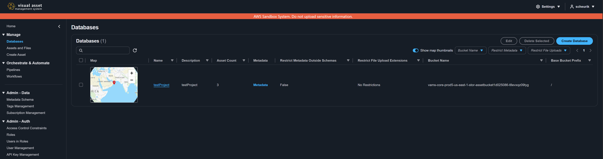
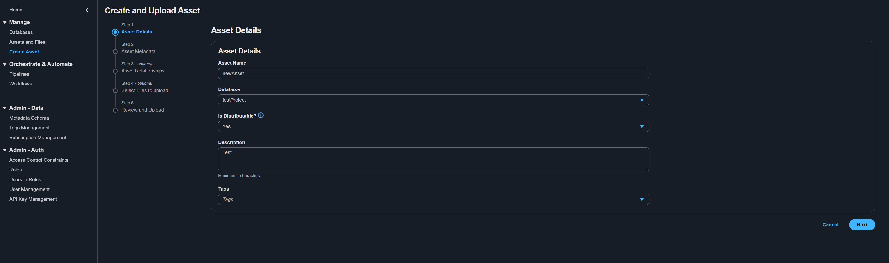
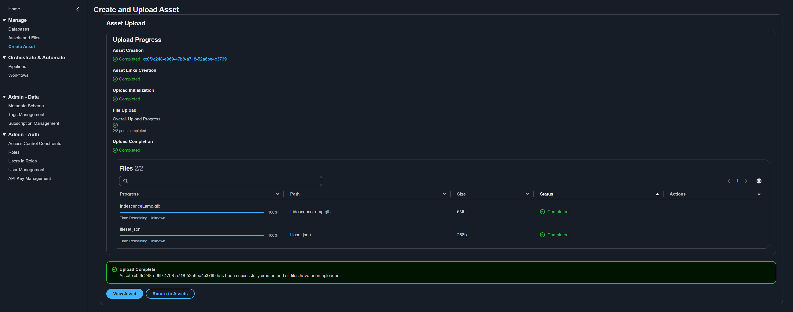
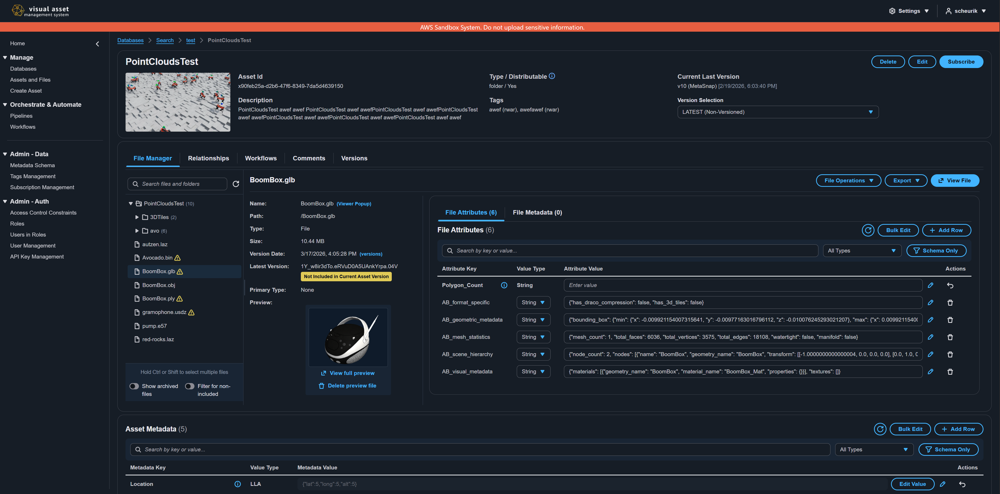

# Upload Your First Asset

This tutorial walks you through creating a database, uploading your first asset, and viewing it in the VAMS web interface. By the end, you will have a working database with an asset containing files, metadata, and optional relationships.

:::note[Prerequisites]
You must be signed in to VAMS with a role that grants access to the **Databases**, **Create Asset**, and **Assets and Files** navigation pages. If you do not see these items in the side navigation, contact your administrator.
:::

---

## Step 1: Create a Database

Assets in VAMS are organized into databases. If your administrator has already created a database for you, skip to [Step 2](#step-2-navigate-to-the-upload-page).

1. In the side navigation, select **Databases**.
2. Select the **Create Database** button in the top-right corner of the page.
3. In the **Create Database** modal, fill in the following fields:

| Field                                 | Requirements                                                             | Description                                                                                                                       |
| ------------------------------------- | ------------------------------------------------------------------------ | --------------------------------------------------------------------------------------------------------------------------------- |
| **Database Name**                     | 4-63 characters, alphanumeric plus `-` and `_` only. Cannot be "GLOBAL". | A unique identifier for your database. This cannot be changed after creation.                                                     |
| **Database Description**              | 4-256 characters.                                                        | A human-readable description of the database's purpose.                                                                           |
| **Default Bucket and Prefix**         | Required. Select from available buckets.                                 | The Amazon S3 bucket where assets in this database will be stored. If only one bucket is available, it is selected automatically. |
| **Restrict Metadata Outside Schemas** | Optional checkbox.                                                       | When enabled, only metadata fields defined in applied metadata schemas are allowed.                                               |
| **Restrict File Upload Extensions**   | Optional. Comma-separated list (e.g., `.jpg,.png,.pdf`).                 | Limits file uploads to specified extensions. Leave blank or enter `.all` to allow all file types.                                 |

4. Select **Create Database**.

:::tip
Choose a descriptive database name that reflects the type of assets it will contain, such as `building-models` or `site-scans-2024`. The name becomes part of asset URLs and cannot be changed later.
:::

---

## Step 2: Navigate to the Upload Page

1. In the side navigation, select **Create Asset**.
2. The upload wizard opens with the first step: **Asset Details**.

---

## Step 3: Enter Asset Details

Fill in the required fields on the **Asset Details** step:

1. **Asset Name** -- Enter a descriptive name for your asset. This is the primary display name used throughout VAMS.

2. **Database** -- Select the database you created in Step 1 (or any database you have access to) from the dropdown.

3. **Is Distributable?** -- Select **Yes** or **No**.

    :::info
    The **Is Distributable** setting controls whether file downloads are enabled for this asset. Select **Yes** if users should be able to download files from this asset. Select **No** to restrict the asset to viewing only.
    :::

4. **Description** -- Enter a description of at least 4 characters. This helps other users understand what the asset contains.

5. **Tags** (optional) -- Select one or more tags from the dropdown to categorize your asset. Tags are defined by your administrator in the **Tags Management** page.

    :::warning
    If your administrator has configured required tag types, you must select at least one tag from each required type before proceeding. Required tag types are listed in the constraint text below the Tags field.
    :::

6. Select **Next** to proceed to the metadata step.

<!-- The create asset screenshot above shows the Asset Details form -->

---

## Step 4: Add Metadata

The **Asset Metadata** step allows you to attach key-value metadata pairs to your asset.

1. If a metadata schema is applied to the selected database, required fields are displayed automatically. Fill in all required fields.
2. To add custom metadata, use the metadata editor to add key-value pairs. Each entry requires a key name, a value, and a value type (string, number, or boolean).
3. Select **Commit changes** to save your metadata entries before proceeding.

:::tip
Metadata makes your assets searchable and organizable. Common metadata keys include `project`, `location`, `captureDate`, `equipment`, and `author`.
:::

4. Select **Next** to proceed to the relationships step.

---

## Step 5: Configure Asset Relationships (Optional)

The **Asset Relationships** step lets you link your new asset to existing assets. This step is optional -- select **Next** to skip it.

VAMS supports three relationship types:

| Relationship | Description                                                                                                                                            |
| ------------ | ------------------------------------------------------------------------------------------------------------------------------------------------------ |
| **Parent**   | The current asset is a child of the selected parent asset. Use this for hierarchical structures (for example, a building scan that belongs to a site). |
| **Child**    | The selected asset becomes a child of the current asset.                                                                                               |
| **Related**  | A general bidirectional association between assets with no hierarchy implied.                                                                          |

To add a relationship:

1. Select the relationship type tab (**Parent**, **Child**, or **Related**).
2. Use the asset selector to search for and select an existing asset.
3. Optionally add metadata to the relationship link.
4. Repeat for additional relationships.

:::info
Relationships can cross database boundaries. You can link an asset in one database to an asset in a different database.
:::

5. Select **Next** to proceed to the file selection step.

---

## Step 6: Select Files to Upload

The **Select Files to Upload** step lets you attach files to your asset. This step is optional -- you can create an asset without files and upload them later.

### Selecting Files

1. Add what you want to upload, in any combination:

    - **Add files** -- Pick one or more individual files.
    - **Add folder** -- Pick a folder. Its subfolders and their files come along, with the folder structure kept. This works in every current browser.
    - **Drop** files and folders together onto the upload zone.

    You can add more items at any time; each addition joins the current selection.

2. Check where the files will land. A picked folder and a dropped folder always land at the same path:

    - **A single folder added on its own** becomes the asset's contents, so its own name is dropped. For a folder `pack/` holding `scene.usda` and `props/pallet.usda`, the asset gets `/scene.usda` and `/props/pallet.usda`.
    - **Every other selection** keeps each folder's name as its top-level folder: several folders, or folders mixed with loose files. If you add a loose file after a single folder, the folder switches to keeping its name (`/pack/scene.usda`), and an info line says why.
    - **Loose files** keep their file name only, at the asset root.

3. For a single folder, choose **Upload folder contents** (the default here, name dropped) or **Upload folder** (name kept). The preview updates as you switch.

    

4. Review the preview table below the upload zone. It lists the final asset path of every file, sorted by path, with its status and size underneath, and the total file count and size. You can filter by path, remove single files, selected files, or all files, and switch the view:

    - **All** -- every file in the selection.
    - **Errors (n)** -- the files that block the upload: **Duplicate path**, **Invalid path**, and an extension the database does not allow (for example **Extension .gltf not allowed**, or a preview file that is not one of `.png`, `.jpg`, `.jpeg`, `.svg`, or `.gif`).

    Also note:

    - **Duplicate paths are errors.** When two files would land at the same path (for example, two different folders with the same name), both rows are marked **Duplicate path** and **Next** stays blocked until you remove one. Nothing is skipped silently. An alert above the table gives the number of files with path errors, and its **Show errors only** action switches the table to the **Errors** view.
    - **Multi-file formats.** When a loose file can reference other files by relative path (`.usd*`, `.gltf`, `.obj`, `.fbx`, `.dae`, STEP, IFC, IGES and CAD assemblies, or `tileset.json`), an info alert suggests adding the whole folder with **Add folder** instead, so those references keep working. The alert does not block the upload.

    

### File Extension Restrictions

If the selected database has file upload extension restrictions, an alert banner displays the allowed extensions. Files with disallowed extensions are marked with an error on their row in the preview table (for example **Extension .gltf not allowed**), count toward its errors, and block the upload until you remove them.

:::note
Preview files (filenames containing `.previewFile.`) are exempt from the database's extension restrictions, but must still be one of `.png`, `.jpg`, `.jpeg`, `.svg`, or `.gif`. A preview file with any other extension is flagged before the upload starts, and rejects the whole upload request if it reaches the API.
:::

### Preview Files

VAMS supports two types of preview files:

-   **Overall asset preview** -- Use the **Asset Overall Preview File** uploader on the right side to select a single image (`.png`, `.jpg`, `.jpeg`, `.svg`, or `.gif`, maximum 5 MB) that represents the entire asset.
-   **File-level previews** -- Include files named with the `.previewFile.{ext}` convention in your upload. For example, `model.gltf.previewFile.png` is automatically used as the preview thumbnail for `model.gltf`.

5. Select **Next** to proceed to the review step, which lists the same final paths.

---

## Step 7: Review and Submit

The **Review and Upload** step displays a summary of everything you have configured:

-   **Asset Detail** -- Name, database, description, distributable status, and tags.
-   **Linked Assets** -- Parent, child, and related asset relationships.
-   **Asset Metadata** -- All key-value metadata pairs.
-   **File list** -- All files to be uploaded, including their paths, sizes, and types (asset file or preview file).

1. Review all information carefully. To make changes, select the **Edit** button next to any section or use the **Previous** button to go back to a specific step.
2. When satisfied, select **Upload Object** to begin the upload.

---

## Step 8: Monitor Upload Progress

After submitting, the upload workflow begins:

1. The wizard transitions to a progress view showing the status of each operation:

    - Asset creation in the VAMS backend
    - File uploads to Amazon S3 (with individual progress bars per file)
    - Workflow execution (if auto-triggered workflows are configured)

2. For large files, VAMS uses multipart upload to Amazon S3 for reliability. The progress bar updates in real time as each part completes.

3. Do not close or navigate away from the page until all uploads complete.

:::warning
If you close the browser tab during upload, in-progress file uploads will be interrupted. Completed file uploads are retained, and you can resume uploading the remaining files from the asset detail page.
:::

---

## Step 9: View Your Asset

After the upload completes:

1. Navigate to the asset by selecting the link in the upload completion summary, or:

    - Go to **Assets and Files** in the side navigation and search for your asset.
    - Go to **Databases**, select your database, then find your asset in the list.

2. On the asset detail page, verify:
    - The **details pane** shows the correct name, description, tags, and distributable status.
    - The **File Manager** tab displays your uploaded files in a directory tree.
    - The **Metadata** section at the bottom shows your key-value pairs.

---

## Step 10: Try the File Viewer

If you uploaded a file in a supported format (such as `.gltf`, `.obj`, `.e57`, `.png`, `.pdf`, or `.mp4`), you can view it directly in the browser:

1. In the **File Manager** tab, select a file in the directory tree.
2. In the file details panel on the right, select **View File**.
3. VAMS opens the file in the appropriate viewer plugin. For 3D models, you can rotate, zoom, and pan the model interactively.

### Commonly Used File Formats

| Format                                  | Viewer               | Description                           |
| --------------------------------------- | -------------------- | ------------------------------------- |
| `.gltf`, `.glb`, `.obj`, `.fbx`, `.stl` | Three.js Viewer      | 3D models with full rotation and zoom |
| `.e57`, `.las`, `.laz`                  | Potree Viewer        | Point cloud data with 3D navigation   |
| `.usd`, `.usda`, `.usdc`, `.usdz`       | Three.js Viewer      | Universal Scene Description files     |
| `.png`, `.jpg`, `.svg`, `.gif`          | Image Viewer         | Raster and vector images              |
| `.mp4`, `.webm`, `.mov`                 | Video Player         | Video playback with controls          |
| `.pdf`                                  | PDF Viewer           | Multi-page document viewing           |
| `.csv`                                  | Columnar Data Viewer | Tabular data browsing                 |

:::tip
If a file has a preview image, the file page offers a **Preview** option that shows the image, including for a file that has no dedicated viewer.
:::

---

## Next Steps

Congratulations -- you have created your first database and asset in VAMS. To continue learning:

-   [Asset Management](asset-management.md) -- Learn about versioning, file operations, relationships, and advanced asset management
-   [Web Interface Overview](web-interface.md) -- Explore all pages and features of the VAMS interface
-   [Metadata Management](metadata-management.md) -- Deep dive into metadata schemas and metadata operations
-   [Tags](tags.md) -- Organize assets with tags
-   [Subscriptions](subscriptions.md) -- Receive change notifications
